# SafeAI Desk

Корпоративная платформа управляемого доступа к искусственному интеллекту
с изоляцией организаций, контролем моделей и расходов, базами знаний (RAG),
доказуемой историей исполнения и независимой проверкой целостности аудита.

**Состояние документа:** 22.11.2026.

**Граница схемы:** Flyway V1–V101. **Этап:** 7.5E.8 Fix1 — Security-приёмка Models & AI.

**Состояние поставки:** V94–V99 исторически подтверждены локальным Flyway history.
Комплект V1–V101 и реализация этапов 7.5E.1–7.5E.8 подготовлены;
последний пакет 7.5E.8 Fix1 согласован с переданными README и ACL contract.
Исходный пакет 7.5E.8 был остановлен проверкой SHA-256 README.
Применение Fix1, актуальная Flyway history V101 и полный release gate
на конечном SHA требуют подтверждения. Документ не является разрешением на deploy.

**Статус выпуска:** подготовка к production. Разрешение на промышленный запуск (GO) не выдано.

> Наличие реализации, зелёная сборка и работающий интерфейс не равнозначны
> подтверждённой эксплуатации. Документ разделяет код, результаты проверок
> и обязательные действия перед развёртыванием.

## Содержание краткого обзора

- [Назначение и возможности](#1-назначение-и-возможности)
- [Текущее состояние и дорожная карта](#2-текущее-состояние-и-дорожная-карта)
- [Архитектура](#3-архитектура)
- [Технологии и структура репозитория](#4-технологии-и-структура-репозитория)
- [Роли, организации и безопасность](#5-роли-организации-и-безопасность)
- [Серверные модули](#6-серверные-модули)
- [Модели, политики и бюджеты](#7-модели-политики-и-бюджеты)
- [Чаты и исполнение AI-запросов](#8-чаты-и-исполнение-ai-запросов)
- [Базы знаний, RAG и удаление](#9-базы-знаний-rag-и-удаление)
- [Учёт использования](#10-учёт-использования)
- [Аудит и криптографическая целостность](#11-аудит-и-криптографическая-целостность)
- [Frontend и API](#12-frontend-и-api)
- [PostgreSQL, Flyway и Runtime ACL](#13-postgresql-flyway-и-runtime-acl)
- [Конфигурация и запуск](#14-конфигурация-и-запуск)
- [Инфраструктура и наблюдаемость](#15-инфраструктура-и-наблюдаемость)
- [Тестирование и CI/CD](#16-тестирование-и-cicd)
- [Production Readiness](#17-production-readiness)
- [Ограничения и развитие](#18-ограничения-и-развитие)
- [Правила сопровождения и документация](#19-правила-сопровождения-и-документация)
- [Подробная техническая документация](#safeai-desk--подробная-техническая-документация)

---

## 1. Назначение и возможности

SafeAI Desk решает задачу безопасного корпоративного использования AI.
Пользователь получает рабочий интерфейс чата и доступ к утверждённым источникам,
администратор — управляемые политики, квоты, отчёты и историю действий,
оператор безопасности — инструменты проверки исполнения и целостности.

Важно установить не только содержание ответа модели, но и условия его получения:

- кто, когда и от имени какой организации инициировал операцию;
- действовали ли полномочия и текущие версии безопасности пользователя и организации;
- какая политика и версия каталога использовались, почему запрос разрешён или отклонён;
- какие средства и лимиты зарезервированы до внешнего вызова;
- кто фактически исполнил запрос, есть ли доказательство начала и результата вызова;
- какие документы, версии, фрагменты и индексы участвовали в поиске;
- известны ли физические расходы или их необходимо выяснить;
- какие изменения безопасности произошли и доставлены ли события аудита;
- изменялась ли закреплённая история после независимой проверки.

| Контур | Реализованные возможности |
| --- | --- |
| Identity / Auth | Пользователи, роли, защищённые сессии, отзыв доступа |
| Organization | Изоляция, каталог, управление состоянием организаций |
| Chat | Диалоги, идемпотентность, архив, восстановление, удаление |
| AI | OpenAI, Anthropic, локальная mock-реализация, учёт попыток |
| Model | Каталог, политики, маршрутизация, симуляция, бюджеты |
| Knowledge | Документы, версии, ACL, ingestion, поиск, RAG |
| Usage | Квоты, отчёты, физические попытки, провайдеры, сверка, durable CSV |
| Audit | Журнал, фильтры, снимки субъектов, outbox, восстановление |
| Audit Integrity | Correlation ID, SHA-256, Ed25519, WORM, оповещения |
| Operations | Разделение DB-ролей, CI, мониторинг, backup/restore |

## 2. Текущее состояние и дорожная карта

### 2.1. Этапы административного контура

| Этап | Направление | Состояние |
| --- | --- | --- |
| 1–3.2 | Организации, пользователи, единый интерфейс | Реализовано |
| 4 | Model Control Plane и диагностика | Реализовано |
| 5–5.2 | Audit, Usage, отчёты, CSV | Реализовано |
| 6 | Dashboard, бюджеты USD/RUB | Реализовано |
| 7–7.3 | Каталог, поиск, полировка администрирования | Реализовано |
| 7.5B.1 | Интерфейс аудита и серверные сводки | Реализовано |
| 7.5B.2 | Защищённое сохранение политик, V93 | Реализовано |
| 7.5B.3 | Сквозной Correlation ID, V94 | Реализовано |
| 7.5B.4.1 | Целостность доставки Audit Outbox | Реализовано |
| 7.5B.4.2.1 | Криптографические контрольные снимки | Реализовано |
| 7.5B.4.2.2 | Внешний архив, ротация и retention-разрешения | Реализовано* |
| 7.5B.4.3 | Статус целостности, метрики и правила алертов | Реализовано* |
| 7.5D.1–2.1 | Точность исторического учёта и quota evidence | Реализовано |
| 7.5D.2.2 | V95: независимый барьер single physical attempt | Реализовано |
| 7.5D.2.3 | V96: конкурентный финансовый допуск и календарь | Реализовано |
| 7.5D.3.1 | Физический отчёт, сверка, интерфейс | Визуально принято |
| 7.5D.3.2 | Провайдеры, серверный CSV, интерфейс | Реализовано |
| 7.5D.4.1–4.4 | V97–V99, очередь, метрики, performance | Реализовано; локальные проверки |
| 7.5D.4.5 | Security-приёмка Usage | Исторический BLOCKED; нужна приёмка |
| 7.5E.1 | Архитектура, scope, security audit | Усиление подготовлено |
| 7.5E.2 | Финансы, exact pricing, конкурентный допуск | Реализация подготовлена |
| 7.5E.3 | V100, физический допуск, receipt, settlement | Fix3 подготовлен |
| 7.5E.4 | HTTP, deadline, безопасный retry | Реализация подготовлена |
| 7.5E.5 | Provider secrets, TLS, egress | Реализация подготовлена |
| 7.5E.6 | V101, ledger performance, ACL | Fix5 подготовлен |
| 7.5E.7 | Models/AI metrics, alerts и CI | Fix2 подготовлен |
| 7.5E.8 | Security acceptance, README AI/Model | Fix1; ожидается приёмка |
| 7.5C (frontend) | Responsive Playwright всей платформы | Пакеты Fix1–Fix4; regression |
| 7.5F | RateLimit Production Hardening | Запланировано |
| 7.5C | Deployment Readiness и мониторинг платформы | Запланировано |
| 7.6 | Полный production-аудит и приёмка | Запланировано |
| 8 | Промышленное развёртывание | Только после GO |

\* Инструменты реализованы. Внешний доверенный реестр, AWS S3 Object Lock,
планировщик независимого проверяющего, доставка отчётов и маршрутизация
оповещений ещё требуют развёртывания и приёмки в целевой среде.
Криптографические разрешения retention пока не интегрированы с SQL-удалением.

### 2.2. Зафиксированные результаты

По предоставленным результатам локальных проверок от 21.11.2026:

- Backend: исторический успешный прогон — 2812 тестов, 0 ошибок,
  0 провалов, 5 пропущено; BUILD SUCCESS.
  Необходимость каждого пропуска оценивается отдельно перед выпуском.
- PostgreSQL: проверены фактическая проекция checkpoint, ACL и обнаружение удаления;
  в тестовом сценарии обновления получен PASS. Исправлен CONNECT для тестовой
  роли независимого проверяющего, без выдачи приложению новых прав.
- Frontend: архитектура и зависимости прошли проверку в предоставленном логе;
  четыре новых файла потребовали исправления заголовков путей.
  Окончательный полный CI на последнем коммите следует подтвердить повторно.
- Интерфейс аудита отображает карточку криптографической целостности.
  Без настроенного независимого проверяющего ожидается NOT_CONFIGURED.
- Зелёные GitHub Actions прошлых изменений не заменяют проверку release-коммита.
- Локальная Flyway history: V94–V99 показаны с success=true, таблица
  `usage_export_jobs` существует. Это не доказывает полномочия safeai_app.
- Usage: два opt-in performance-теста прошли; сохранены 13 EXPLAIN ANALYZE
  планов. Диапазон измеренного SQL Execution Time — 0,309–424,938 мс.
  Это локальный synthetic run, не нагрузочный HTTP SLO.
- Actuator отдаёт метрики очереди экспорта. Prometheus запущен локально;
  после первого scrape исчезли начальные сигналы отсутствующих метрик.
  AuditIntegrityNotConfigured требует настроенного независимого verifier.
- Последний Fix1 check: PASS 99 SQL и 106 утверждённых SQL/CONF ресурсов,
  включая ранее утверждённый байтовый вариант V96 с комментарием-путём.
  Затем BLOCKED на `UsagePhysicalExplainPerformanceIntegrationTest.java`.
  Не изменять утверждённые хеши ради обхода; сравнить тест с Fix5.

Результаты 22.11.2026 относятся к новым пакетам 7.5E. Промежуточный Maven
прогон на 2950 тестах завершился с 3 failures, 14 errors и 6 skipped:
обнаружено расхождение границы reviewed ACL V100/V101. Fix5 синхронизирует
политику, inventory, конфигурации и негативные тесты; это не отчёт о повторном
успешном Maven-прогоне. Прежний Playwright-прогон 720×450 обнаружил перекрытие
кнопки организаций; подготовленные responsive fixes необходимо принять.

Не подтверждены реальное промышленное хранилище WORM, доставка оповещений,
актуальный полный release gate и промышленный запуск.

## 3. Архитектура

### 3.1. Модульный монолит

Backend — одно Spring Boot приложение с предметными модулями и общей
транзакционной базой. Это позволяет обеспечивать атомарность, согласованность
tenant/security-состояния и строгие ограничения исполнения в PostgreSQL
без преждевременного разделения на независимые микросервисы.

Независимый криптографический контроль вынесен за пределы монолита:
ключи подписания и доверенная история не должны зависеть от приложения и его БД.

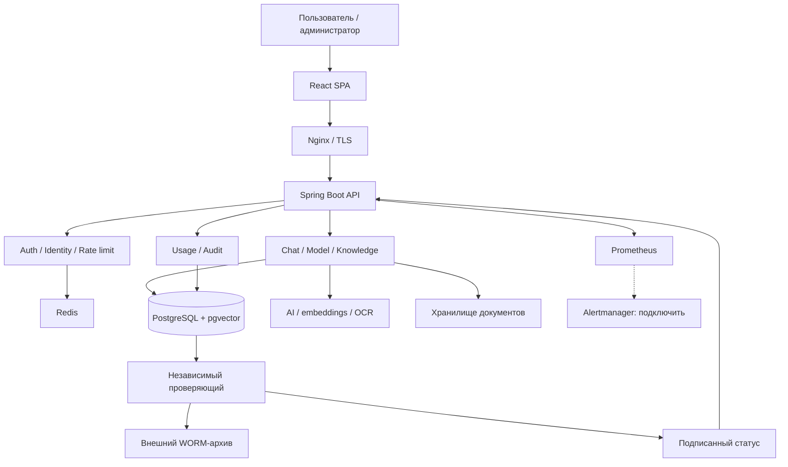

Сплошные связи показывают программные контракты и зависимости. Внешний
проверяющий, архив и pin-реестр требуют отдельной эксплуатационной настройки;
схема не означает, что эти компоненты уже запущены.

### 3.2. Ответственность подсистем

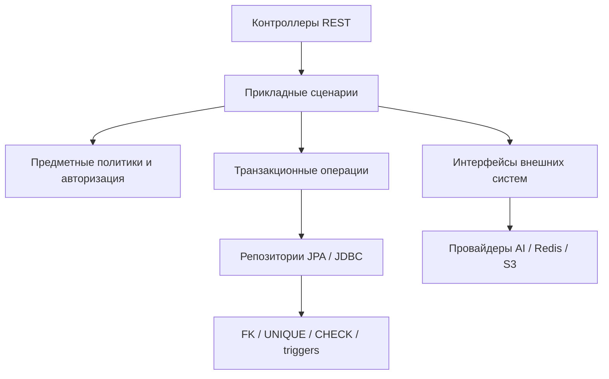

Проверки в БД дополняют проверки приложения: связь строки с tenant, уникальность
логических операций и неизменяемость критических доказательств должны
сохраняться даже при ошибке прикладного кода.

### 3.3. Хранилища

| Хранилище | Что хранится | Граница доверия |
| --- | --- | --- |
| PostgreSQL | Состояние, политики, операции, аудит, учёт | Основная БД |
| pgvector | Векторы фрагментов документов | Tenant и ACL базы знаний |
| Redis | Лимитеры, кеш security state, координация | Не источник истории |
| S3/MinIO Knowledge | Версии документов, служебные объекты | Защищённый доступ |
| S3 Audit WORM | Подписанные контрольные снимки | Независимый аккаунт |
| Внешний pin-реестр | Последняя доверенная версия архива | Вне БД и архива |
| Файл статуса | Подписанный результат проверки | Backend только читает |

Redis не подменяет долговечную идемпотентность PostgreSQL, а хешированный
архив аудита не является резервной копией оригинального содержания событий.

## 4. Технологии и структура репозитория

### 4.1. Технологический стек

| Компонент | Стек |
| --- | --- |
| Backend | Java 21, Spring Boot 4.1.1, Maven Wrapper |
| HTTP и безопасность | Spring MVC, Spring Security, Bean Validation |
| Persistence | JPA/Hibernate, JDBC, PostgreSQL 16, Flyway, pgvector |
| Распределённые операции | Redis 7 |
| Документы | MinIO SDK / S3, PDFBox, POI, jsoup |
| Frontend | React 19.2.7, TypeScript 6.0.3, Vite 8.3.6 |
| Маршрутизация и графики | React Router 7.18.3, Recharts 3.9.2 |
| Node.js / npm | Node 24.x, npm 11.x (закреплён 11.17.0) |
| Тесты backend | JUnit, Mockito, Spring Test, Testcontainers, ArchUnit |
| Тесты frontend | Vitest 4.1.12, Testing Library, Playwright 1.56.1 |
| Наблюдаемость | Micrometer, Prometheus, структурированные логи |
| Инфраструктура | Docker, Compose, Nginx, GitHub Actions |
| Независимый аудит | Python 3.10+, OpenSSL 3.x, AWS CLI v2, psql |

Источники версий — [pom.xml][pom], [package.json][package] и закреплённые
образы релиза. PostgreSQL Noble/pgvector candidate проверяется отдельным
workflow; его успешная проверка не означает автоматическую смену production-образа.

### 4.2. Структура каталогов

```text
SafeAI-Desk/
├── .github/
│   ├── workflows/              # CI, проверки, выпуск и развёртывание
│   └── scripts/                # Политики CI и тесты инфраструктуры
├── backend/
│   ├── pom.xml / mvnw          # Сборка Java
│   ├── Dockerfile
│   ├── .env.example            # Шаблон локального окружения
│   ├── .env.prod.example       # Шаблон промышленной конфигурации
│   └── src/
│       ├── main/
│       │   ├── java/ru/safeai/gateway/
│       │   │   ├── ai/         # Провайдеры и физическое исполнение
│       │   │   ├── audit/      # Аудит и статус целостности
│       │   │   ├── auth/       # Аутентификация
│       │   │   ├── chat/       # Чаты, turn, архив, удаление
│       │   │   ├── common/     # Общие механизмы, DB, security, ошибки
│       │   │   ├── identity/   # Идентичность субъекта
│       │   │   ├── knowledge/  # Документы, RAG, erasure
│       │   │   ├── model/      # Каталог и политики моделей
│       │   │   ├── organization/
│       │   │   ├── ratelimit/
│       │   │   ├── usage/
│       │   │   └── user/
│       │   └── resources/
│       │       ├── db/migration/       # Flyway V1–V101
│       │       ├── db/local-migration/ # Только локальные данные
│       │       ├── db/acl/             # Проверенные права и SHA-256
│       │       ├── application*.yml
│       │       └── logback-spring.xml
│       └── test/               # Модульные и интеграционные тесты
├── frontend/
│   ├── package.json / package-lock.json
│   ├── scripts/                # Архитектурные проверки
│   └── src/
│       ├── app/
│       ├── pages/
│       ├── features/
│       ├── entities/
│       └── shared/
├── infra/
│   ├── docker-compose.yml
│   ├── docker-compose.local.yml
│   ├── postgres/
│   ├── nginx/ / host-nginx/
│   ├── prometheus/
│   ├── scripts/                # Эксплуатация, проверка, аудит
│   └── tests/acceptance/      # Приёмочные проверки инфраструктуры
├── docs/                       # Архитектурные решения и runbook
├── scripts/                    # Вспомогательные инструменты
└── README.md                   # Общая документация
```

Локальные `.env`, приватные ключи, рабочие секреты, дампы БД,
архивы диагностики и пользовательские документы не коммитятся.

## 5. Роли, организации и безопасность

### 5.1. Системные роли

Ровно одна системная роль на пользователя: `SUPER_ADMIN`, `ADMIN`, `USER`.
Авторизация осуществляется на сервере; сокрытие кнопки на frontend — не защита.

| Операция | USER | ADMIN | SUPER_ADMIN |
| --- | --- | --- | --- |
| Собственные чаты | Да | Да | Нет в рабочем UI |
| Доступные базы знаний | Да | Да | Нет в рабочем UI |
| Управление участниками KB | По правам KB | По правам KB | Нет в рабочем UI |
| Пользователи своего tenant | Нет | Да | Да |
| Пользователи других tenant | Нет | Нет | Да |
| Управление организациями | Нет | Нет | Да |
| Аудит и Usage своего tenant | Нет | Да | Да |
| Межорганизационные отчёты | Нет | Нет | Да |
| Общий каталог моделей | Нет | Чтение | Управление |
| Политика своего tenant | Нет | Управление | Управление |
| Политика другого tenant | Нет | Нет | Управление |
| Диагностика подключения AI | Нет | Чтение | Чтение / probe |
| Статус целостности всего журнала | Нет | Нет | Чтение |

Доступ SUPER_ADMIN к административным данным не означает автоматического
права читать чужие приватные чаты или контент Knowledge.
Обычный пользовательский CRUD не создаёт нового SUPER_ADMIN.
Управление системной учётной записью — отдельный доверенный процесс.

### 5.2. Изоляция tenant

- Организация определяется аутентифицированным субъектом, а не произвольным JSON.
- ADMIN может работать только в своей организации. Чужой tenant отвергается
  до чтения защищённых данных.
- SUPER_ADMIN имеет явные административные операции над целевой организацией.
- Идентификаторы организации участвуют в запросах и составных FK/ограничениях.
- Контекст поиска, export, агрегаты и справочники проходят те же проверки,
  что и основной список.
- Платформенная организация защищена от обычных tenant-мутаций.
- Названия организаций нормализуются; пустые и конфликтующие имена отклоняются.
- История аудита и расходов не становится недоступной при удалении пользователя.

### 5.3. Сессия браузера

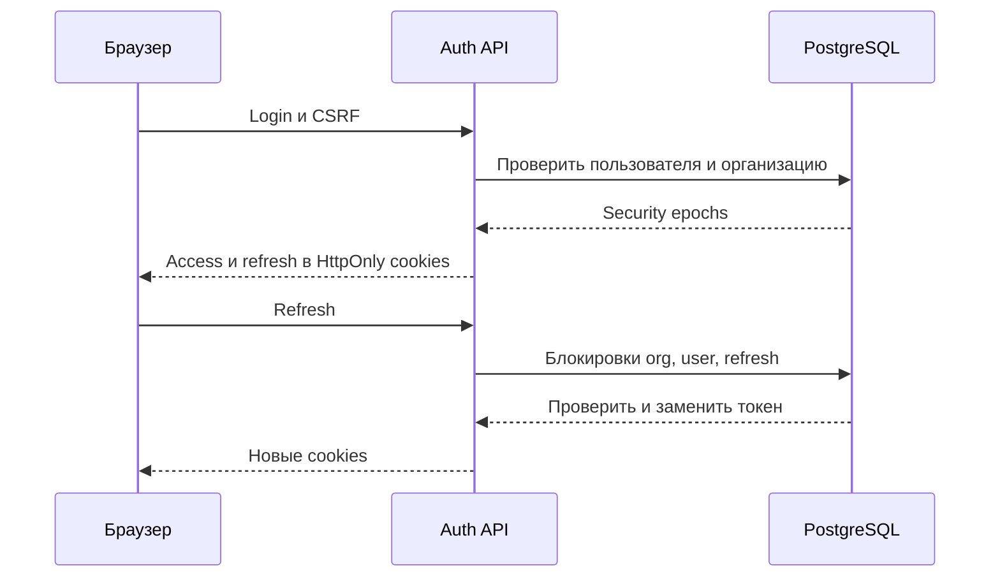

- Access JWT подписан RSA; проверяются issuer, audience, срок, тип, key ID,
  идентичность, системная роль и актуальное security state.
- Access и refresh cookies — HttpOnly. В production обязательны HTTPS и Secure;
  JWT не хранится в localStorage.
- Читаемый CSRF cookie используется для заголовка `X-XSRF-TOKEN`.
  CSRF-состояние обновляется при входе.
- Refresh token хранится в виде хеша. Ротация и блокировки защищают от гонок.
- Повторное использование старого refresh аннулирует семейство, пишет
  событие безопасности, очищает cookies и возвращает отказ.
- `users.token_version` и `organizations.auth_version` инвалидируют старые сессии.
- Login, refresh, disable и physical STARTED согласованы с порядком блокировок V72.
- Кеш состояния пользователя не является разрешением на чувствительную
  операцию при устаревшем или неизвестном состоянии.
- Пароли хешируются; временные/выданные пароли и токены не попадают в аудит.

### 5.4. Защита HTTP, внешних вызовов и данных

- В production: TLS, строго заданные CORS origins, доверенные proxy CIDR,
  заголовки безопасности, HSTS на внешнем TLS-крае.
- Сообщения об ошибках не раскрывают SQL, секреты, внутренние stack traces.
- Серверный Request ID отделён от клиентского идентификатора операции.
- Тела prompt, документы, credentials, cookie, токены и provider raw payload
  не должны попадать в диагностические логи.
- Внешние endpoints и provider identity контролируются; нельзя передавать
  credentials по произвольным redirects.
- Rate limiting входа, refresh и AI защищает от перебора и расходования средств.
- При критическом отказе инфраструктуры запрещено молча разрешать paid AI.

## 6. Серверные модули

Модули находятся под `backend/src/main/java/ru/safeai/gateway/`.
Точная структура классов и тестов — в соответствующих модульных README.

| Модуль | Ответственность |
| --- | --- |
| [common][common] | Security, конфигурация, DB lifecycle, общие контракты |
| identity | Представление текущего субъекта и граница идентичности |
| [auth][auth] | Login, refresh, logout, CSRF, JWT, отзыв и очистка токенов |
| user | CRUD, роли, включение, reset пароля, контролируемое удаление |
| [organization][organization] | Tenant, каталог, нормализация имени, версии, disable |
| [ratelimit][ratelimit] | Redis limiter, ключи с HMAC, отказоустойчивые политики |
| [ai][ai] | Провайдеры, adapters, retry, physical evidence |
| [model][model] | Governance, маршрутизация, каталог, бюджет, политики |
| [chat][chat] | ChatTurn, lifecycle, quota, recovery, title, erasure |
| [knowledge][knowledge] | Membership, документы, индексы, RAG, retention |
| [usage][usage] | Агрегация, детализация, качество, сверка расходов |
| [audit][audit] | События, доставка, поиск, retention, целостность |

### 6.1. Пользователи и организации

Серверные каталоги поддерживают поиск, фильтрацию и пагинацию.
Число найденных записей вычисляет сервер; клиент не фильтрует только видимую страницу.

- Управление профилем, ролями и состоянием пользователя.
- Сброс пароля и отзыв прежнего security state.
- Защита роли SUPER_ADMIN и административных инвариантов.
- Отключение пользователя отделено от постоянного удаления с проверкой retention.
- Создание, переименование, отключение и включение организаций;
  просмотр влияния отключения до выполнения.
- Конкурентные изменения защищены версией и транзакционными блокировками.
- Отключение организации прекращает доступ с устаревшим authVersion.
- Аудит сохраняет историческое имя, идентификатор и связь с целевой организацией.

### 6.2. Rate limiting и квоты

Redis обслуживает быстрые ограничители запросов, PostgreSQL — устойчивые
бизнес-резервы и учёт затрат. Это две разные границы.

Необходимо учитывать вход, refresh, IP/субъект и tenant для paid AI.
HMAC ключей Redis не раскрывает исходные чувствительные идентификаторы.
Дедупликация ChatTurn и бюджетный резерв сохраняются при отказе Redis или JVM.
Отключение лимитера в production не является способом устранения отказа.

## 7. Модели, политики и бюджеты

### 7.1. Model Control Plane

- Версионированный глобальный Model Catalog с эффективными версиями.
- Runtime status и явный административный probe без подмены его симуляцией.
- Импорт runtime-модели в каталог, публикация новой версии и просмотр истории.
- Свойства модели, provider/deployment target, модальности, контекст,
  ограничения вывода, тарифы, свойства конфиденциальности.
- Организационная политика: доступные модели, режимы, требования к провайдерам,
  ограничения маршрутизации, бюджеты и отключение доступа.
- Immutable route decision с зафиксированными версиями и причиной решения.
- Применение реальной runtime-конфигурации и строгих совместимых ограничений.

Реализованные адаптеры: OpenAI, Anthropic и Mock.
Наличие нескольких адаптеров не означает динамический dispatch произвольных
провайдеров на каждый запрос; действующий runtime выбирается конфигурацией.

### 7.2. Provider Data Assurance

Утверждение no-training или Zero Data Retention (ZDR) не берётся на веру
из названия модели. Проверенное доказательство привязывается к фактическому
подключению, провайдеру/целевой конфигурации и сроку действия.

Отдельно проверяются чат-провайдер, embeddings и OCR. Несовпадение или истечение
обязательного доказательства не должно превращаться в разрешение запроса.
Сведения о договорённостях с провайдером подтверждает уполномоченный оператор.

### 7.3. V93 — серверное подтверждение изменений политики

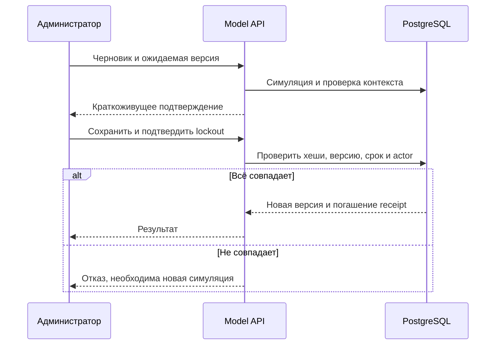

- Таблица `model_policy_preview_confirmations` хранит хеш случайного токена,
  хеш черновика и контекста, признак lockout, срок и ссылку на результат.
- Подтверждение ограничено администратором и целевой организацией, одним
  актуальным receipt и пятиминутным сроком.
- Сохранение проверяет привязку, версию, актуальные ограничения и срок.
  Произвольное изменение JSON между preview и POST не допускается.
- Когда блокируются все модели, требуется осознанное подтверждение lockout.
- Погашение и создание политики согласованы транзакционно; идентичный
  допустимый retry возвращает уже созданную версию без повторного аудита.
  Устаревший или чужой receipt не даёт разрешения.
- Симуляция не отправляет prompt провайдеру, не резервирует деньги и не
  гарантирует, что будущий AI-вызов будет разрешён.

### 7.4. Стоимость и бюджет

Единственный источник чат-тарифов — версии PostgreSQL Model Catalog.
Статические YAML-тарифы не конкурируют с каталогом и не заменяют его.

- Денежные значения передаются десятичными строками, без округления через float.
- Backend использует BigDecimal и NUMERIC; frontend — точную десятичную обработку.
- Лимиты могут вводиться в USD или RUB. V91 фиксирует курс ЦБ РФ,
  дату, источник и консервативно рассчитанный USD-потолок в версии политики.
- V92 отклоняет NaN и бесконечные временные значения валютного доказательства.
- Исторические расходы не пересчитываются по новому курсу.
- Отсутствие тарифа или неизвестная схема не равнозначны нулевой стоимости.
- Бюджет учитывает известные расходы, активные резервы и неопределённые
  обязательства (unknown liability); неизвестность нельзя скрывать от оператора.
- Резерв до вызова и его завершение обеспечиваются транзакционно
  с защитой от параллельных превышений бюджета.

7.5E.2–E.6 добавляют общий transaction-scoped advisory lock по организации
для допуска, публикации политики и settlement; READ COMMITTED обязателен.
Снимок политики и расчёт UTC-периода выполняются после получения lock.
Отрицательные token counts, переполнение numeric(30,12) и неизвестная
стоимость не превращаются в FREE или нулевой расход. Резерв округляется
CEILING, подтверждённая стоимость — HALF_UP; факт не урезается до резерва.
V100 повторно проверяет финансовое разрешение непосредственно на STARTED
и перед отправкой. V101 сохраняет V62 ledger и оптимизирует поиск последней
попытки по существующему индексу V50.

Механизм пока не является бухгалтерской системой сверки счетов провайдера.

## 8. Чаты и исполнение AI-запросов

### 8.1. Пользовательский функционал

- Создание и просмотр собственных диалогов, список и история сообщений.
- Пользовательские и автоматические названия с сохранением происхождения title.
- Отправка сообщения с `clientRequestId`, безопасный повтор при сетевом сбое.
- Подключение разрешённых баз знаний, RAG-режимы и паспорт ответа.
- Архивирование, просмотр архива, восстановление.
- Отдельное контролируемое стирание содержимого с проверкой доступности операции.
- Отображение ограничений, ошибок и неизвестного результата без ложного успеха.

### 8.2. Устойчивое исполнение

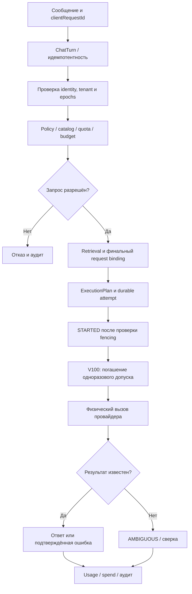

Диаграмма отражает обязательные границы допуска, а не точный порядок
каждого внутреннего вызова: подготовка RAG, расчёт envelope и финальная
привязка повторно проверяют критические ограничения.

- Один логический ChatTurn на идемпотентную операцию.
- Не более одного итогового assistant reply в соответствующей операции.
- Final-request binding связывает реально отправленный запрос с решением
  маршрутизации, параметрами и фактическим RAG.
- Physical STARTED допустим только при действующем fenced PROCESSING,
  актуальных security epochs и успешном допуске провайдера.
- Квоты и расходы не полагаются на факт наличия сообщения в чате.
- Provider response, ошибка протокола и неопределённый outcome различаются.
- Retry разрешается только по доказуемым правилам безопасности;
  нельзя автоматически повторять неоднозначный платный вызов.
- Сбой JVM после STARTED не превращает результат в доказанный отказ или успех.
- Recovery использует существующую идентичность операции и сохранённые доказательства.
- Отключённая организация не получает новый physical STARTED через гонку.

V95/V96 добавляют независимый барьер Chat-квот на INSERT physical attempt:
точный маршрут, неизменяемый резерв, действующая редакция квоты и её месяц.
При строгой токенной или денежной квоте разрешена только первая попытка.
V96 согласует создание/изменение политики и допуск транзакционными
advisory locks; перед network dispatch выполняется повторная проверка.
Нет распределённой атомарности PostgreSQL и внешнего AI API;
уже допущенный вызов нельзя считать отменённым задним числом.

### 8.3. Архив и стирание содержимого

Архивирование изменяет видимость чата, но не уничтожает его.
V86–V88 вводят отдельную операцию удаления содержимого со своими guard,
retention и состоянием. История AI-исполнения, расходов и аудита сохраняется.

Удалённое содержимое не следует путать с физическим удалением всех копий,
внешней историей провайдера, резервными копиями или RAG-доказательствами.
Нельзя уничтожать доказательства только ради упрощения UI.

## 9. Базы знаний, RAG и удаление

### 9.1. Возможности Knowledge

- Создание баз, изменение параметров, поиск, управление участниками и правами.
- Загрузка, скачивание, версии документов, переименование и переиндексация.
- Ограничения размера, формата, состояния и полномочий при загрузке.
- S3-compatible storage с проверкой идентичности объекта и upload intent.
- Durable ingestion jobs, повторное воспроизведение и контроль ошибок.
- Извлечение текста из поддерживаемых PDF, Office и текстовых форматов;
  OCR для соответствующих сценариев.
- Разбиение на фрагменты, embeddings и версионированные поколения индекса.
- Гибридный лексический и векторный поиск, русский лексический профиль.
- Оценка retrieval, диагностика готовности документов.
- RAG с доступными источниками, provenance и Answer Passport.
- Контролируемое удаление документа, версии содержимого и целой базы.

### 9.2. Публикация индексов и поиск

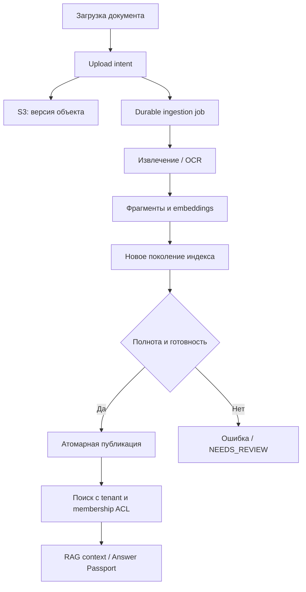

Старое поколение не подменяется частично построенным новым.
Проверяется идентичность версии, готовность данных и активная публикация.
Retrieval фильтрует доступные документы до выдачи результата.

### 9.3. RAG

Паспорт ответа связывает retrieval run, версии источников, generation,
фрагменты и сведения об использовании контекста с конкретным ChatTurn.
Он позволяет объяснить, какие источники участвовали в ответе.

- Режим с обязательными источниками (KNOWLEDGE_ONLY) должен отклонять
  недостаточный разрешённый контекст, а не выдавать его за успешный grounding.
- V76 ограничивает хранение текстов поисковых запросов.
- V85 вводит durable RAG execution permits и leases физической попытки.
  Принятое удаление и уже выполняющийся запрос согласованы с fencing.
- История retrieval защищает необходимые поколения и фрагменты от GC.

### 9.4. Controlled erasure

Удаление — долговечная операция, а не прямой вызов удаления объекта из S3.
HTTP 202 означает принятие задачи, но не подтверждённое стирание.

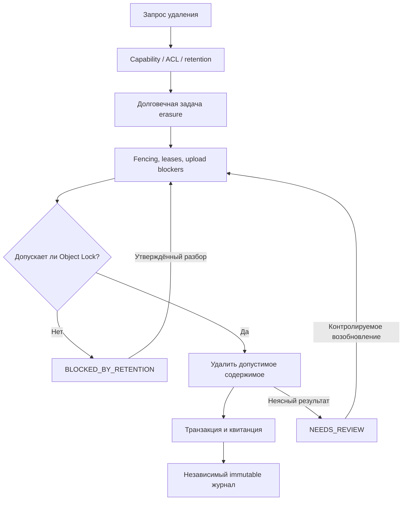

- V78–V84: модели удаления документа/базы, provenance, guards и аудит.
- V85: leases препятствуют удалению при несовместимой активной RAG-операции.
- V89: выделенная DB-роль erasure worker; публикация квитанции после commit
  повторяема в immutable S3-журнал; возврат из retention требует dual control.
- V90: приложение не имеет прямого DELETE chunks; GC вызывает ограниченную
  SECURITY DEFINER-функцию после перехода generation в COLLECTING.
- Operator resume из NEEDS_REVIEW проверяет актуального администратора,
  expectedUpdatedAt, блокирующие условия и обязательное аудирование.
- Повтор после сбоя проверяет точную идентичность объектов и доказательства;
  нельзя обходить Object Lock, менять состояние через произвольный SQL
  или удалять audit/spend/RAG provenance.

WORM-хранилище квитанций Knowledge и архив криптографического Audit —
отдельные назначения, отдельные bucket и границы доступа.

## 10. Учёт использования

Usage отвечает за наблюдаемые операции, расходы и качество данных,
но не выдаёт неподтверждённые значения за точные финансовые расчёты.

- Сводка платформы и tenant, отчёты по организациям, пользователям и моделям.
- Дневные ряды, сравнение организаций, детализация расходов и фильтры периода.
- Различение логических запросов, физических попыток и known/unknown usage.
- Квоты, токены, денежные commitment и физический spend ledger.
- Отдельное состояние качества данных и сверка неоднозначных результатов.
- Агрегирование через дневные rollup, dirty dates и очередь пересчёта.
- Перекрывающиеся события и запаздывающие данные не должны удваивать расход.
- Отчётность UTC; календарь Chat-квот фиксируется в V96 (UTC по умолчанию),
  согласован между инстансами. Месяц бюджета модели — UTC.
- Исторические сведения сохраняются при удалении пользователя.
- CSV ограничен явными фильтрами, полномочиями и текущим контрактом объёма.
- Шестая вкладка «По провайдерам» использует исторический provider_type.
  Физический отчёт и сохранённые ответы — отдельные контуры.
- Серверная выгрузка создаётся в PostgreSQL-очереди V98/V99:
  202 → QUEUED/RUNNING → READY/FAILED; не более 10 000 строк и 8 МиБ.
  Получение статуса/файла проверяет актуальные права владельца и TTL.
- В V97 добавлен online-индекс для планов и времени physical attempt.
  Метрики очереди и rollup собираются по расписанию, не во время scrape.

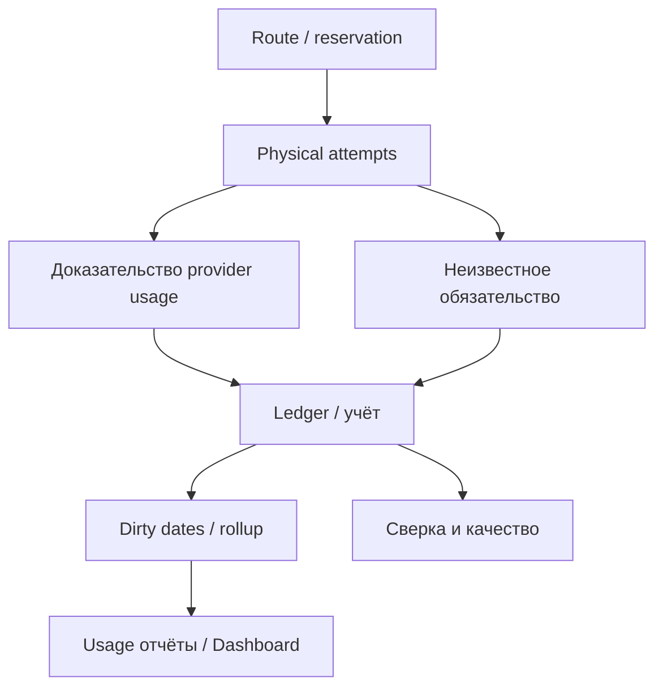

Frontend показывает явно известное, неизвестное и неприменимое.
Бюджетный статус строится по серверному ledger, а не по сумме видимых
строк или по приблизительному пересчёту на браузере.

## 11. Аудит и криптографическая целостность

Подробное описание классов, API, метрик и сценариев —
[README модуля Audit][audit]. Этот раздел описывает системные контракты.

### 11.1. Журнал событий

Аудит — неизменяемая история значимых действий, отказов и результатов.
Он не является логом всех строк SQL, HTTP-тел или содержания диалогов.

Категории UI:

- Все события.
- Безопасность: успешный/неуспешный вход, logout, reuse и другие сигналы.
- Пользователи: изменение ролей, профиля, доступности и иные операции.
- Организации: управление tenant и security state.
- AI и чаты: решения, сообщения, результаты и изменения политик.
- Базы знаний: операции с базой, документами, поиском, ingestion и удалением.
- Системные: предусмотренные классификатором системные события, например
  восстановление записи из очереди ошибок аудита.

Категории пусты, если нет подходящих событий за период.
Нулевая категория не является сама по себе доказательством сбоя или полноты
аудита: наличие emitters проверяется контрактными тестами.

Сводка серверная, независимая от текущей страницы. Показатели «Успешные»,
«Отказы» и «Критические» не являются исчерпывающим разбиением: критичность
может пересекаться с другим результатом, а ошибки исполнения не равны отказам.

Интерфейс поддерживает фильтры, быстрые периоды, сортировку по времени,
страничную навигацию, данные субъекта/организации, подробности события,
CSV текущей страницы и CSV по фильтрам (до 100 событий).
Исторические неизвестные имена не восстанавливаются выдуманными значениями.

В карточке события доступен переход к связанным событиям по Correlation ID,
копирование корреляции и нормализованных данных для поддержки.
Расширенный фильтр принимает точный UUID; область tenant не расширяется.
CSV включает ID события и Correlation ID. Ссылки на решение маршрутизации
позволяют открыть диагностику исторического решения.

### 11.2. Audit Outbox — надёжность доставки

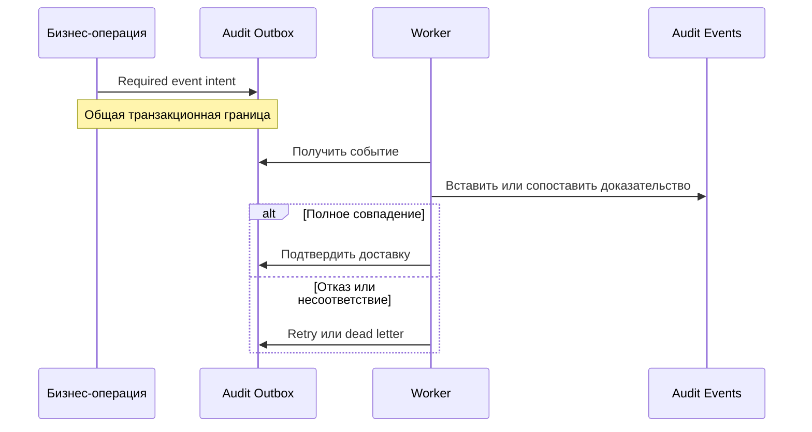

Outbox обеспечивает долговечный intent для соответствующих обязательных
событий. Доставка в основной журнал асинхронна.
Разные пути записи аудита имеют свои транзакционные правила.

Stage 7.5B.4.1 усиливает проверку идемпотентности: одинаковый ID записи
недостаточен. Доставленное доказательство должно совпадать по всем 11 полям,
включая nullable значения и Correlation ID.
Нельзя подтверждать чужую или подменённую запись, переписывать её либо
удалять доказательство, необходимое незавершённой доставке.

Dead-letter recovery — контролируемая операция с обязательным аудитом.
Метрики очереди, отказов и возраста отслеживаются отдельно от целостности архива.

### 11.3. V94 — Correlation ID

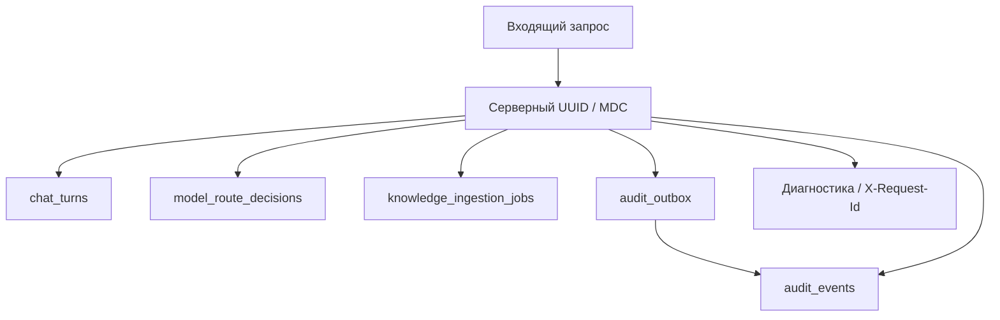

- Сервер генерирует диагностический UUID; входящий клиентский идентификатор
  не становится доверенным correlation или разрешением.
- Связь сохраняется в пяти таблицах и переносится в соответствующие worker-задачи.
- Nullable исторические записи остаются NULL, история не фабрикуется.
- Частичные индексы обеспечивают поиск по ненулевому идентификатору.
- Неизменяемость защищена V45/V68 и дополнительными guard V94.
- Correlation ID не заменяет идемпотентность, авторизацию, PK/FK или canonical hash.

### 11.4. Криптографический контроль

SHA-256 позволяет обнаружить отличие сохранённых полей события.
Ed25519 доказывает, что контрольный снимок или статус подписан владельцем
закреплённого приватного ключа. Сам по себе хеш без независимого доверенного
закрепления не защищает от его пересчёта атакующим.

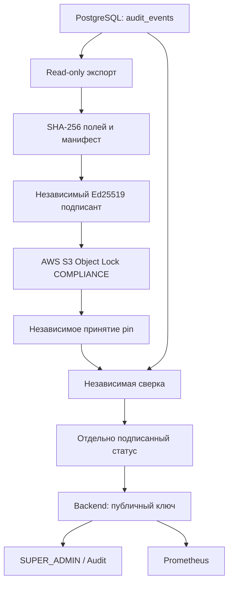

**7.5B.4.2.1 — контрольные снимки.** Полный экспорт проекции аудита,
детерминированное хеширование, цепочка манифестов, подпись, выявление
изменённых и пропавших ранее закреплённых записей.

**7.5B.4.2.2 — независимое хранение.** Архивирование точных версий подписанных
конвертов в AWS S3 COMPLIANCE, проверка версии, байтов и срока Object Lock,
двусторонняя авторизация ротации старым и новым ключом.
Последний доверенный pin должен приниматься внешним CAS-реестром.
Реестр не реализуется самой утилитой публикации.

**Retention.** Независимый ключ разрешает точный набор ID и хешей событий
с ограниченным сроком действия и хешем утверждённой политики.
Проверяется отсутствие неразрешённых удалений и повторного появления ID.
Протокол не выполняет SQL DELETE и пока не является разрешением запускать
production-очистку. Нужна транзакционная интеграция и отдельная приёмка.

**Границы.** Контроль обнаруживает нарушения после независимого закрепления.
Он не доказывает, что событие было действительно записано до первого снимка,
не защищает при одновременной компрометации всех точек доверия, не заменяет
backup и не доказывает правомерность самого решения об удалении.

### 11.5. Статус независимой проверки

Stage 7.5B.4.3 добавляет read-only проверяющего, подписанный отчёт,
API и карточку состояния исключительно для SUPER_ADMIN.

Контракт: `GET /api/admin/audit-events/integrity`, `Cache-Control: no-store`.
Backend не получает приватные ключи архива или подписанта статуса.
Он читает ограниченный файл, проверяет Ed25519, dataset UUID, канонические
поля, время и допустимость счётчиков. Отчёт действует 15 минут.

| Состояние | Код | Смысл |
| --- | ---: | --- |
| NOT_CONFIGURED | 0 | Независимая проверка не настроена |
| VERIFIED | 1 | Подтверждённая целостность закреплённой истории |
| VIOLATION | 2 | Обнаружено нарушение |
| UNAVAILABLE | 3 | Не удалось получить достоверное доказательство |
| STALE | 4 | Срок действия статуса истёк |
| INVALID | 5 | Неверная подпись, контекст или структура отчёта |
| PENDING | 6 | Есть новые ещё не закреплённые события |

Карточка показывает количество закреплённых и незакреплённых событий,
нарушения, алгоритм Ed25519, архив, последнюю проверку и неопределённость.
Она относится ко всему журналу, а не к выбранному периоду или категории.
Обновление состояния читает отчёт, не инициирует новую подпись или удаление.
При отсутствии подтверждения отображаются прочерки, а не вымышленные нули.

Для локальной разработки статус NOT_CONFIGURED без внешней настройки нормален.
В production это запрещающее условие, а не зелёный статус.

### 11.6. Оповещения и реагирование

Prometheus считывает `safeai_audit_integrity_state` с каждой реплики.

| Условие | Уровень | Задержка |
| --- | --- | --- |
| VIOLATION | critical | Без задержки правила |
| UNAVAILABLE / STALE / INVALID | critical | 2 минуты |
| NOT_CONFIGURED | warning / NO-GO | 5 минут |
| PENDING | warning | 15 минут |
| Нет метрики / backend недоступен | critical | 3 минуты |

При нарушении остановить публикацию новых снимков и retention,
зафиксировать pin, точные версии объектов, состояние отчётов и логи,
создать инцидент, проверить независимую копию и расследовать причину.
Запрещено переподписывать изменённую историю для получения зелёного статуса.

При недоступности проверять IAM, TLS, часы, доступ reader, подпись и доставку.
Правила Prometheus не равнозначны фактическому уведомлению оператора.
Alertmanager, канал дежурного, подтверждение получения и эскалация — этап 7.5C.

## 12. Frontend и API

### 12.1. Интерфейс

SPA организован по слоям app / pages / features / entities / shared.
Feature-модули: auth, chat, knowledge, admin-users, admin-organizations,
admin, model management (models), audit, usage.

| Раздел | Маршрут | Назначение |
| --- | --- | --- |
| Вход | `/login` | Аутентификация |
| Чаты | `/chat` | Диалоги и ответы |
| Базы знаний | `/knowledge` | Каталог доступных баз |
| Карточка базы | `/knowledge/:knowledgeBaseId` | Документы и участники |
| Обзор | `/admin/dashboard` | Состояние платформы, SUPER_ADMIN |
| Пользователи | `/admin/users` | Управление пользователями |
| Организации | `/admin/organizations` | Tenant-управление |
| Аудит | `/admin/audit` | История, фильтры, целостность |
| Использование | `/admin/usage` | Отчёты, расходы, графики |
| Модели | `/admin/models` | Каталог, доступ, бюджеты, диагностика |

Общий UX: серверная пагинация, регулируемые панели и таблицы,
единообразные состояния загрузки/ошибки/пустого результата, сохранение
соответствующих фильтров в URL, переходы из отчётов и карточек.
В датах аудита отображается локальный часовой пояс.
Отсутствующее значение отличают от нуля; неизвестный факт не превращают в успех.

### 12.2. Основные REST-контракты

Пути ниже — обзор групп API, не замена DTO, контроллеров и интеграционных тестов.
Для tenant-параметров действует серверная проверка полномочий.

| Группа | Операции |
| --- | --- |
| `/api/auth` | csrf, login, refresh, logout, me |
| `/api/users` | CRUD, search, statistics, roles, enabled, reset-password |
| `/api/organizations` | Каталог, search, directory, me, impact, disable/enable |
| `/api/chats` | Список, сообщения, title, archive/restore, erasure |
| `/api/knowledge-bases` | Каталог, members, документы, поиск, retrieval, erasure |
| `/api/admin/audit-events` | Список, cursor, summary, история пользователя |
| `/api/admin/usage` | Summary, organizations, users, models, daily, quality |
| `/api/admin/models` | Catalog, runtime, policies, route decisions |

Ключевые новые/чувствительные операции:

```text
GET  /api/admin/audit-events/summary
GET  /api/admin/audit-events/cursor
GET  /api/admin/audit-events/integrity
GET  /api/admin/audit-event-types
GET  /api/admin/audit-organizations
GET  /api/admin/audit-actors

GET  /api/admin/models/catalog/effective
GET  /api/admin/models/catalog/versions
POST /api/admin/models/catalog/import-runtime
POST /api/admin/models/runtime/probe
GET  /api/admin/models/policies/{organizationId}
POST /api/admin/models/policies/{organizationId}/preview
POST /api/admin/models/policies/{organizationId}
GET  /api/admin/models/policies/{organizationId}/budget-status
GET  /api/admin/models/policies/budget-summary
GET  /api/admin/models/policies/rub-quote
GET  /api/admin/models/route-decisions/{decisionId}

GET  /api/admin/usage/physical-attempts
GET  /api/admin/usage/physical-attempts/reconciliation
GET  /api/admin/usage/physical-attempts/report
GET  /api/admin/usage/physical-attempts/providers
GET  /api/admin/usage/data-quality
POST /api/admin/usage/exports
GET  /api/admin/usage/exports/{id}
GET  /api/admin/usage/exports/{id}/download
POST /api/admin/usage/rebuild

GET  /api/chats/{chatId}/turns/{turnId}/answer-passport
GET  /api/chats/{chatId}/erasure/capability
DELETE /api/chats/{chatId}/erasure
```

HTTP 400 — некорректный вход, 401 — нет аутентификации,
403 — нет полномочий, 409 — конфликт состояния/версии, 429 — ограничение частоты.
Конкретный ответ зависит от API; ошибки не содержат излишних сведений
о чужих ресурсах. Для асинхронного удаления результат 202 не равен DELETED.

## 13. PostgreSQL, Flyway и Runtime ACL

### 13.1. Основные сущности

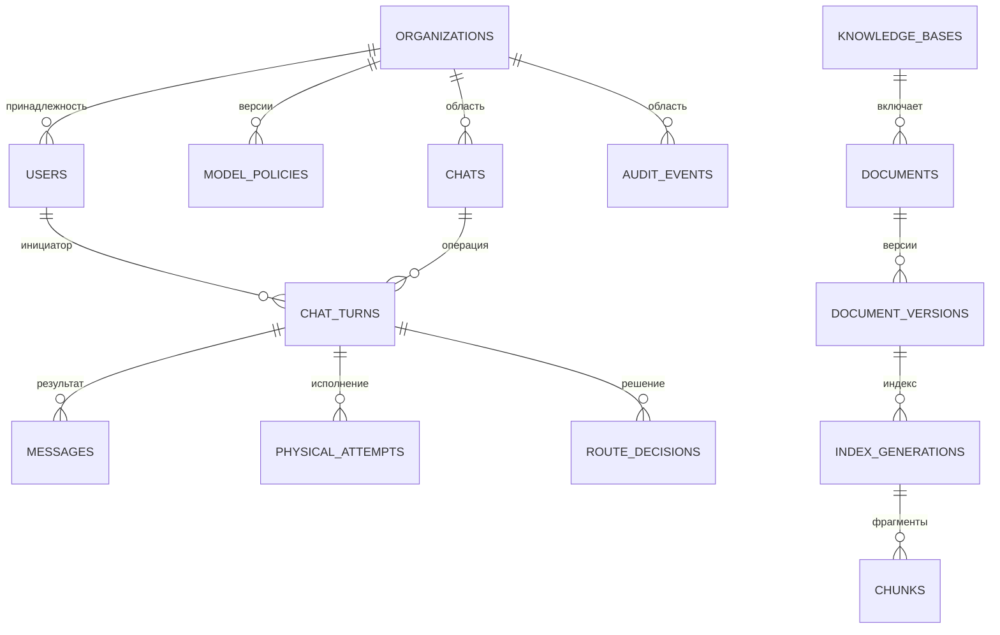

Это концептуальная схема предметных связей, не точная DDL-диаграмма:
физические имена таблиц, nullable FK, уникальность и detach исторических
связей определяются SQL и моделями JPA. В частности, исторический actor
аудита не требует существования живой записи пользователя.

### 13.2. История миграций

В [db/migration][migration] находятся 101 последовательная SQL-миграция
и 9 конфигураций `.sql.conf` (V87 и V94–V101): всего 110 проверяемых ресурсов.
V87/V97 — вне транзакции; V94–V96 и V98–V101 — транзакционные.
Hibernate использует ddl-auto=validate; создание схемы через ORM запрещено.
Локальные seed-миграции не применяются к промышленной базе.

| Диапазон | Основное назначение |
| --- | --- |
| V1–V12 | Базовая модель, справочники, индексы, tenant integrity |
| V13–V24 | Identity, chat, токены, pricing, аудит, outbox |
| V25–V37 | Security epochs, snapshots, Usage, ChatTurn state |
| V38–V44 | Knowledge, документы, ingestion, retrieval, RAG |
| V45–V54 | Model Control Plane, execution и provider evidence |
| V55–V59 | Русский поиск, upload intent, generations, title |
| V60–V68 | Ledger, budgets, binding, immutable AI/Audit evidence |
| V69–V72 | История акторов, rollup queue, auth epoch / STARTED |
| V73–V77 | Нормализация, Usage, recovery аудита, privacy, title |
| V78–V84 | Контролируемое удаление документов и баз, terminal audit |
| V85–V90 | RAG leases, chat archive/erasure, fencing, GC |
| V91–V92 | RUB budget и конечные денежные/временные значения |
| V93 | Серверное подтверждение preview политики |
| V94 | Сквозной диагностический Correlation ID |
| V95 | Неизменяемый резерв и guard строгих физических повторов |
| V96 | Согласованный допуск, UUID редакций квот и календарь |
| V97 | Online-индекс попыток по plan/time |
| V98 | Durable bounded очередь CSV-экспорта |
| V99 | Fencing аренды, identity и проверка полномочий |
| V100 | DB admission, одноразовый dispatch receipt и settlement |
| V101 | Оптимизация V62 ledger, fail-closed проверка схемы и индекса |

Особенности последних миграций:

| Версия | Усиление |
|--------| --- |
| V85    | Durable RAG execution permits и physical lease |
| V86    | Архив и восстановление, отдельное стирание чата |
| V87    | Индекс архива с CREATE INDEX CONCURRENTLY вне транзакции |
| V88    | Валидация CHECK и готовности индекса |
| V89    | Erasure worker, WORM-квитанция, dual-control recovery |
| V90    | Закрытие прямого DELETE chunks, узкая GC-функция |
| V91    | Неизменяемый валютный снимок правила |
| V92    | Запрет NaN и бесконечных дат/времени |
| V93    | Хеши receipt и привязка администратора/организации |
| V94    | UUID, частичные индексы и guard изменения корреляции |
| V95    | Snapshot строгой квоты, route evidence и границы периода |
| V96    | Shared/exclusive admission fence; точный период |
| V97    | Индекс (execution_plan_id, started_at) CONCURRENTLY |
| V98    | Ограниченная очередь, TTL, lease и состояния CSV |
| V99    | READ COMMITTED, immutable identity, актуальный owner |
| V100   | Повторный финансовый и Knowledge gate до физического I/O |
| V101   | LATERAL lookup, сохранение контракта ledger и ACL |
| V102   |  |

V94 транзакционна: `SET LOCAL lock_timeout = '5s'`,
`SET LOCAL statement_timeout = '120s'`. Индексы создаются обычным CREATE INDEX.
Миграцию следует проводить в согласованное окно обслуживания; большие таблицы
требуют оценки локов и времени. Таймаут должен прервать проблемную миграцию,
а не служить причиной произвольного отключения ограничений.

Этапы 7.5B.4.1–7.5B.4.3 не меняли схему V94; V95–V99 появились
в последующем Usage hardening 7.5D.2.2–7.5D.4.
V95/V96/V98/V99 используют локальные транзакционные таймауты 5s/120s.
V97 работает вне транзакции, lock_timeout 5s и statement_timeout 30min;
проверять VALID/READY и отсутствие незавершённого индекса.

### 13.3. Разделение DB-ролей

| Роль | Назначение и ограничения |
| --- | --- |
| Bootstrap DBA | Подготовка БД/ролей; не runtime |
| safeai_migrator | Flyway и проверенное ACL; не runtime |
| safeai_app | Минимально необходимые права DML/EXECUTE; не owner |
| Chat / Knowledge erasure worker | Только утверждённый выделенный контур |
| Chat / Knowledge erasure operator | Выделенные полномочия оператора |
| safeai_audit_verifier | CONNECT, USAGE и read-only проекция; не запись |

Runtime ACL закреплён в `db/acl/runtime-v90.sql`. Название файла историческое;
реальная рассмотренная граница — V101 в RuntimeAclPolicy (7.5E.6 Fix5).
SHA-256 каждой SQL и конфигурации находится в `reviewed-migrations.sha256`.

Для V96 runtime имеет только SELECT календаря и EXECUTE утверждённых функций
допуска. UUID редакций и evidence создаются БД. Для V98 разрешены scoped
операции приложения: SELECT/DELETE, INSERT идентичности и UPDATE только состояния,
попыток, аренды, результата и ошибки. V99 не расширяет права. Имя владельца,
фильтры и версии авторизации не обновляются runtime-ролью;
досрочный DELETE и изменение READY/FAILED запрещены триггером.
ACL не является самостоятельной RLS: tenant scope обеспечивается
прикладной авторизацией и параметризованными запросами.

V100: runtime допускается читать receipt и вставлять только attempt_id.
Время авторизации формирует DB trigger; UPDATE, DELETE, TRUNCATE и DDL запрещены.
Разрешены только утверждённые admission/settlement функции. V101: ledger V62
остаётся SELECT-only, его владелец, ACL, identity и девять колонок сохраняются.
Новая версия схемы не предоставляет runtime права изменять ledger или его источники
за пределами ранее утверждённых узких grants.

Перед миграцией/применением ACL проверяются ресурсы, полнота,
непрерывность версий и разрешённое содержимое. Непроверенная версия,
отсутствующий ресурс, изменённый файл или конфигурация дают fail-closed.
После миграции сверяется успешная последовательность в Flyway history.

Production runtime не получает миграционные credentials, не владеет таблицами
и не должен выполнять Flyway. Независимый verifier получает только необходимую
проекцию; CONNECT на конкретную БД не расширяет его табличные привилегии.

### 13.4. Правила изменения схемы

- Применённые V1–V101 не переписывать, включая комментарии и байты файлов.
- Новое изменение — следующая согласованная версия и анализ ACL.
- Закрепить SHA-256 новой миграции и конфигурации после review.
- Не повышать REVIEWED_THROUGH автоматически до последней версии.
- Проверять чистую БД и populated upgrade, SQL guards, runtime DML и deny paths.
- Для online index проверять pg_index.indisvalid и indisready.
- Flyway repair не использовать для скрытия расхождения checksum.
- Не отключать триггеры для устранения ошибок бизнес-сценариев.

## 14. Конфигурация и запуск

### 14.1. Источники конфигурации

| Файл | Назначение |
| --- | --- |
| application.yml | Общие настройки и свойства |
| application-local.yml | Только локальные значения и режим разработки |
| application-local-nginx.yml | Локальный proxy-профиль |
| application-prod.yml | Промышленные ограничения |
| application-prod-knowledge.example.yml | Пример Knowledge-конфигурации |
| application-security-example.yml | Пример настроек безопасности |
| backend/.env.example | Шаблон локального окружения |
| backend/.env.prod.example | Шаблон переменных production |
| infra/docker-compose*.yml | Топология, сервисы, mount и сети |
| /run/secrets/ | File-backed секреты production, configtree |

Примеры не активны только потому, что находятся в resources.
Фактические свойства определяются профилем, env, configtree и Compose.
Не хранить ключи в frontend VITE_*: такие значения доступны браузеру.

### 14.2. Локальная разработка на macOS/Linux

Требуется Java 21, Node.js 24, npm 11, Docker с Compose V2.
Подготовить доверенный `backend/.env` по шаблону, отдельные app/migrator
credentials, JWT RSA PEM и локальную инфраструктуру.
Не копировать production secrets в локальный профиль.

Из корня проекта:

```bash
cd ~/Workspace/Projects/Products/SafeAI-Desk
java -version
node -v
npm -v
docker compose version

docker compose --env-file backend/.env \
  -f infra/docker-compose.local.yml up -d postgres redis minio
```

На существующей БД сначала проверить Flyway history и соответствие ролей.
Bootstrap выполняется отдельно; не использовать postgres/DBA как login приложения.
Для Knowledge указать режим и credentials локального S3/MinIO, создать
нужный bucket с параметрами, соответствующими выбранному сценарию.

Backend — отдельный терминал:

```bash
cd ~/Workspace/Projects/Products/SafeAI-Desk/backend
set -a
source ./.env
set +a
unset SAFEAI_JWT_SECRET
export SPRING_PROFILES_ACTIVE=local
export SAFEAI_JWT_PUBLIC_KEY="$(cat .local-secrets/jwt-public.pem)"
export SAFEAI_JWT_PRIVATE_KEY="$(cat .local-secrets/jwt-private.pem)"
./mvnw spring-boot:run
```

Имена локальных PEM соответствуют используемой конфигурации пользователя;
при другом расположении указать реальные пути. В env требуется active key ID,
issuer, DB usernames/passwords и настройки Redis. Mock позволяет разрабатывать
без платных AI-операций. Реальный провайдер требует его штатных настроек.

Frontend — второй терминал:

```bash
cd ~/Workspace/Projects/Products/SafeAI-Desk/frontend
npm ci
npm run dev
```

| Сервис | Типичный локальный адрес |
| --- | --- |
| Frontend | http://localhost:5173 |
| Backend | http://127.0.0.1:8080 |
| Management | http://127.0.0.1:9091 |
| PostgreSQL | localhost:5432 |
| Redis | localhost:6379 |
| MinIO | localhost:9000 |

На Windows применяются `mvnw.cmd` и соответствующий shell для env.
Секреты не выводить в терминал, логи или скриншоты.

### 14.3. Независимый аудит

Настройка выполняется отдельным оператором, не при старте Spring Boot.
Backend получает только параметры чтения и публичной проверки:

```dotenv
SAFEAI_AUDIT_INTEGRITY_REPORT_PATH=/run/audit-integrity/status.txt
SAFEAI_AUDIT_INTEGRITY_DATASET=UUID_ИЗ_ДОВЕРЕННОЙ_КОНФИГУРАЦИИ
SAFEAI_AUDIT_INTEGRITY_PUBLIC_KEY=BASE64_DER_ЗАКРЕПЛЁННОГО_КЛЮЧА
```

Это шаблон, указанные значения не являются реальными ключами.
Локальный путь может быть абсолютным путём к отчёту на Mac.
В production требуется read-only mount **каталога**, а не отдельного файла,
чтобы атомарная замена отчёта была видна контейнеру.
Приватный ключ отчёта и ключи архивирования в backend не передаются.

Нужно независимо запланировать проверку, рекомендуемый интервал — 5 минут,
и обеспечить защищённую атомарную доставку статуса.
Кнопка «Обновить состояние» не заменяет планировщик.

Операционные команды и процедуры:

- [Создание и сверка снимка][checkpoint-doc].
- [Архив, pin, ротация и retention][archive-doc].
- [Подписанный отчёт и доставка][integrity-doc].

## 15. Инфраструктура и наблюдаемость

### 15.1. Топология production

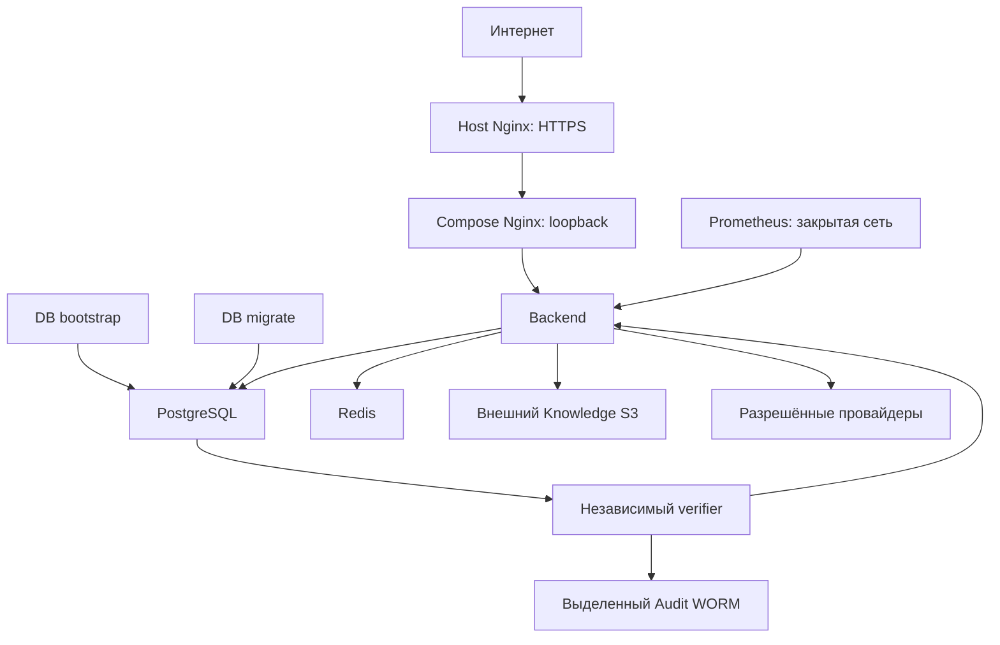

Production Compose содержит backend, PostgreSQL, db-bootstrap, db-migrate,
Redis, Nginx и Prometheus. PostgreSQL bootstrap/migrate — отдельные роли
и процессы; приложение запускается с ограниченным runtime login.
Внешние storage, pin-registry, подписанты, verifier и alert routing
разворачиваются независимо. Не публиковать PostgreSQL, Redis или management
на общедоступном интерфейсе.

### 15.2. Инструменты эксплуатации

Скрипты под `infra/scripts/` — часть production engineering.
Они не становятся фоновыми процессами Spring Boot автоматически.

| Файл | Назначение |
| --- | --- |
| audit-checkpoint-export.sql | Узкая read-only проекция событий |
| audit-checkpoint.py | Создание, подпись и проверка снимков |
| audit-checkpoint-archive.py | WORM, версии, ротация и разрешения |
| audit-integrity-report.py | Независимая сверка и подпись статуса |
| apply-local-runtime-acl.sh | Проверенные ACL только локальной БД |
| test-runtime-acl.sh | Контракт чистой БД и upgrade |
| test-postgres-bootstrap.sh | Проверка подготовки ролей и схемы |
| provider-data-fingerprint.py | Привязка data assurance к подключению |
| test-provider-data-evidence.sh | Проверки provider assurance |
| check-config-topology.sh | Согласованность конфигурации |
| check-prometheus-config.sh | Правила и конфигурация Prometheus |
| init-prod-secrets.sh | Подготовка file-backed секретов |
| test-prod-secrets.sh | Проверка требований к секретам |
| build-prod.sh | Сборка релизных образов |
| update-prod-images.py | Обновление закреплённых ссылок на образы |
| validate-prod.sh | Предварительная проверка production |
| deploy-prod.sh | Контролируемое развёртывание |
| backup-postgres.sh | Резервная копия |
| restore-postgres.sh | Восстановление по runbook |
| run-production-audit.sh | Сбор проверок, не deployment |

В production verifier запускается в независимом контексте по расписанию.
Приватные ключи и IAM-права не распространяются в приложение.
Большинство test-скриптов используются только в CI или на изолированном стенде.

### 15.3. Мониторинг

- Actuator health/liveness/readiness, JVM и Hikari, ресурсы процессора/памяти.
- Redis, ошибки внешних зависимостей, Chat recovery, очереди обработки.
- Audit Outbox: backlog, failures, dead letter, возраст событий.
- Независимая целостность audit и просроченные/недоступные статусы.
- Knowledge ingestion, NEEDS_REVIEW, erasure и fencing.
- Usage, квоты, provider failures и неизвестные обязательства.

Каноническая конфигурация — `infra/prometheus/prometheus.yml` и каталог rules:

```text
safeai-audit-outbox.yml
safeai-audit-integrity.yml
safeai-knowledge-review.yml
safeai-knowledge-erasure.yml
safeai-usage.yml
safeai-model-ai.yml
```

Правила проверяются тестами promtool. Метрики не должны содержать секреты,
тексты prompt, raw UUID пользователей и иной неограниченный cardinality.
Actuator Prometheus доступен только в сети мониторинга.
Не считать старый пример deploy/prometheus активным без проверки mount/rule_files.

Usage: 11 правил для очереди, lease, ошибок, report admission/timeout,
dirty dates, lag и свежести наблюдений. Canonical tests: `tests/usage.test.yml`.
На нескольких репликах общие DB gauges агрегируются через max, а не sum.
Счётчики событий допуска/ошибок агрегируются по инстансам.
Prometheus в Compose считывает backend; это не полное покрытие модулей.
Models/AI: 15 правил, ограниченные labels и отдельные тесты
`infra/prometheus/tests/model-ai.test.yml`. Мониторинг физического исполнения
не является источником финансового допуска. Отдельные alert-группы Chat,
RateLimit/Auth и инфраструктурные exporters требуют дальнейшего hardening.
Прямые exporters PostgreSQL, Redis, MinIO и host, Grafana provisioning
и Alertmanager delivery относятся к 7.5C, не заявлены как принятые.

### 15.4. Backup, recovery и операционная безопасность

- Резервные копии PostgreSQL хранятся под отдельными правами и вне основной БД.
- Проверяются восстановимость, целостность, время восстановления и потери данных.
- Backup не считается рабочим только по факту выполнения cron.
- Версии S3, pin и ключевые доказательства сохраняются отдельно.
- После восстановления БД проверить Flyway history, tenant/ACL, очереди,
  неизвестные AI-результаты и независимый архив.
- Восстановление старого snapshot БД не должно молча подтверждать более старый pin.
- При нарушении целостности сохраняются доказательства и открывается инцидент;
  не перезаписывать историю и не скрывать нарушение.

## 16. Тестирование и CI/CD

### 16.1. Локальные команды

Backend — изолированное окружение с доступным Docker для Testcontainers:

```bash
cd ~/Workspace/Projects/Products/SafeAI-Desk/backend
./mvnw clean verify
```

Frontend:

```bash
cd ~/Workspace/Projects/Products/SafeAI-Desk/frontend
npm ci
npm run ci
npm run audit:prod
```

Инфраструктура и статические проверки — из корня:

```bash
python3 .github/scripts/check-flyway-migrations.py
python3 -m unittest discover -s .github/scripts -p 'test_*.py'
git diff --check
bash infra/scripts/check-config-topology.sh
bash infra/scripts/check-prometheus-config.sh
bash infra/scripts/run-production-audit.sh --static
```

Полный локальный аудит — только в отдельной копии проекта, без доступа
к production БД, S3 и секретам:

```bash
bash infra/scripts/run-production-audit.sh --local --confirm-isolated
```

Не выдавать static PASS за эксплуатационную приёмку.
Проверка Runtime ACL требует два актуальных закреплённых образа:

```bash
bash infra/scripts/test-runtime-acl.sh "$POSTGRES_IMAGE" "$SAFEAI_BACKEND_IMAGE"
```

Переменные должны указывать на проверенные образы тестового выпуска.
Скрипт создаёт изолированные PostgreSQL-сценарии, а не исправляет рабочую БД.

### 16.2. Обязательные классы проверок

| Контур | Что доказать |
| --- | --- |
| Auth | Ротация, reuse, CSRF, revoke, race login/refresh/disable |
| RBAC | Чужой tenant, прямой API, системные роли, отсутствие обхода UI |
| DB | Fresh install, populated upgrade, constraints, triggers, ACL |
| Model | Каталог, policy, lockout, expiry/replay, budget race |
| Chat / AI | Idempotency, single reply, binding, STARTED, crash, ambiguity |
| Usage | Rollup, dirty-date, unknown liability, цены и валюты |
| Knowledge | ACL, upload, index publication, RAG leases, provenance |
| Erasure | Retention, fencing, S3, сбои и безопасное возобновление |
| Audit | Полнота контракта событий, snapshots, cursor, outbox matching |
| Correlation | Генерация, сохранение, worker propagation, неизменяемость |
| Integrity | Подмена, удаление, wrong key/dataset, replay, expiry |
| Archive | Версии, Object Lock, ротация, точный retention, pin |
| Frontend | Архитектура, lint, coverage, типы, сборка, Playwright |
| Operations | Docker, topology, secrets, promtool, backup/restore |

Отдельно тестируется реальная PostgreSQL проекция checkpoint под
независимой ролью; попытки запрещённой записи должны отклоняться.
WORM probe выполняется только в выделенном тестовом bucket с явным
подтверждением создания неизменяемых тестовых объектов.
Нельзя запускать probe против production-архива.

### 16.3. GitHub Actions

В [каталоге workflows][workflows] поддерживаются проверки backend,
frontend, Docker/Compose, browser и staging E2E, CI policy, security,
Qodana, PostgreSQL Noble candidate, Redis topology, provider data assurance,
performance, staging acceptance и workflows выпуска/развёртывания.

- Coverage baseline не снижается для прохождения проверки.
- Frontend architecture:check проверяет направления зависимостей,
  циклы, импорты и актуальные заголовки пути.
- Backend проверяет Maven Enforcer, зависимости, качество и архитектуру.
- GitHub Actions оформляют evidence для конкретного SHA, а не для «проекта вообще».
- Пропуски, исключения, сканеры и ложные срабатывания разбираются явно.
  Нельзя выключать тест или ослаблять policy вместо исправления.

## 17. Production Readiness

### 17.1. Последовательность релиза

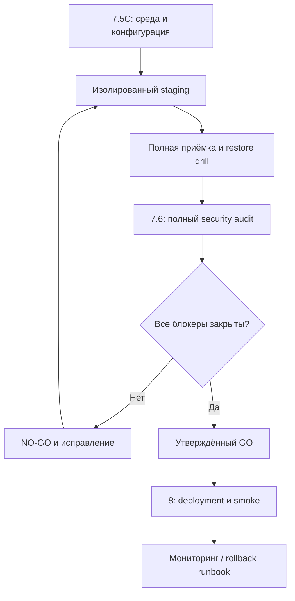

### 17.2. Обязательные условия GO

- [ ] Зафиксирован release SHA, полный backend/frontend/security CI зелёный.
- [ ] Подтверждены причины пропущенных тестов и acceptance всех модулей.
- [ ] Чистая БД V1–V101 и populated V85 → V101 проверены с реальными ролями.
- [ ] Usage 7.5D.4.5: HTTP/runtime ACL для CSV, lease recovery, отзыв прав,
  opt-in performance, promtool и актуальный полный CI.
- [ ] Models & AI 7.5E.8: 50 обязательных test suites и 97 сценариев,
  V100 deny/replay/settlement, V101 ledger equivalence и benchmark,
  bounded HTTP, provider secrets, metrics, runtime ACL и HTTP budget isolation.
- [ ] Responsive matrix: все роли и маршруты, 13 viewport, реальные действия
  без перекрытия; Firefox, WebKit, visual snapshots и axe-core на 7.5C.
- [ ] Runtime ACL, migration SHA-256 и образ PostgreSQL подтверждены.
- [ ] Проверены гонки auth, budgets, ChatTurn, provider STARTED и erasure.
- [ ] Проведены тесты S3/MinIO, Object Lock и live crash recovery.
- [ ] Зафиксированы provider no-training/ZDR и тарифы актуального подключения.
- [ ] Все production-образы закреплены digest; provenance и security scan проверены.
- [ ] TLS, proxy, секреты, IAM, CORS и сетевые границы приняты.
- [ ] Внешний Audit WORM в отдельной зоне доверия и IAM проверены на staging.
- [ ] Независимый pin-реестр с CAS и восстановлением введён в эксплуатацию.
- [ ] Подписанты, ротация и восстановление ключей проверены.
- [ ] Запущен независимый verifier; отчёты доставляются и проходят Ed25519-проверку.
- [ ] Разрешения retention интегрированы с SQL-очисткой либо она отключена.
- [ ] Проверены Prometheus, Alertmanager и доставка реального synthetic alert.
- [ ] Пройдены backup/restore, инцидент, rollback и контроль целостности.
- [ ] Выполнены нагрузочные тесты и согласованы эксплуатационные пределы.
- [ ] Пройден полный Production Audit 7.6 и документирован GO.

Это чек-лист будущей приёмки, не перечень уже закрытых задач.

### 17.3. Deployment

Prerequisite: подготовленная инфраструктура, отдельные секреты,
закреплённые образы и утверждённый release. Перед deployment выполняется
`infra/scripts/validate-prod.sh` (по умолчанию читает backend/.env.prod).
Использовать Linux-окружение и Compose V2 согласно требованиям скрипта.

Релизный порядок: backup и проверка восстановления; bootstrap; Flyway
однократным мигратором; проверка схемы и ACL; runtime; smoke; независимая
проверка аудита; наблюдение. Рабочий rollout — через проверенный deploy workflow.
Не запускать `deploy-prod.sh` до получения GO и вне утверждённого окна.

Rollback приложения возможен только при совместимости версии со схемой.
Откат контейнера не отменяет применённые Flyway migrations и внешние
платные действия. Нельзя вручную переписывать историю, квоты и pin.

## 18. Ограничения и развитие

### 18.1. Блокеры и эксплуатационные задачи 7.5C

- Реальные внешние WORM и IAM, автоматизация независимого verifier,
  защищённая доставка статуса, CAS pin-registry и tested alert routing.
- Интеграция crypto retention с транзакционной политикой SQL или отключение
  очистки до её реализации. Общая конфигурация по умолчанию разрешает
  плановую очистку; до интеграции явно задать SAFEAI_AUDIT_RETENTION_ENABLED=false
  и проверить эффективное значение на каждой runtime-реплике.
- Фактические release gate на выбранном SHA, нагрузочная приёмка,
  full production audit и проверка восстановления.
- Grafana provisioning, dashboards для всех доменов, PostgreSQL/Redis/MinIO
  и host exporters, Alertmanager routing, контроль свежести и retention
  метрик. Management endpoints и dashboard — только защищённая сеть.
- Контроль границ роста archive: размер manifests, количество transitions,
  лимиты разрешений, срок хранения WORM; план нового утверждённого периода.

### 18.2. Технический backlog

Пункты требуют подтверждения текущим кодом и отдельного проектирования.
Это не утверждение, что каждый из них является воспроизводимым дефектом.

- Единая непреодолимая граница всех credential-bearing provider call sites.
- Безопасный recovery уже закреплённого ExecutionPlan до первого attempt.
- Provider-aware tokenizer и строгая оценка context fit.
- Расширение pricing для tiered, cache, batch, service class, иных модальностей.
- Invoice reconciliation, settlement periods и полноценная финансовая сверка.
- Retention/legal hold RAG provenance, bounded evidence compaction.
- Строгая обработка mixed/scanned PDF и изоляция парсеров вне main JVM.
- Durable physical evidence для embeddings/OCR с неизвестными расходами.
- Улучшение операторской очереди NEEDS_REVIEW.
- Отдельные индексы/механизмы для высоких объёмов audit, Usage и dirty dates.
- Отдельная кнопка копирования ID события, метрика ошибок исполнения
  и асинхронный большой CSV-экспорт с авторизацией и аудитом.

Не считать реализованными полноценный billing, универсальный динамический
multi-provider dispatch, автоматическую правовую проверку retention
или внешние оповещения по email/Telegram/Slack.

## 19. Правила сопровождения и документация

### 19.1. Инварианты разработки

1. Tenant isolation, RBAC и security epochs не ослабляются.
2. Новое поведение подкрепляется негативными тестами и DB guards там,
   где это необходимо для долгосрочной целостности.
3. Нельзя подменять UNKNOWN, AMBIGUOUS, NOT_CONFIGURED, STALE или INVALID
   оптимистичным SUCCESS.
4. Не изменять применённые миграции и доказательства аудита задним числом.
5. Сохранять точные десятичные расчёты, разделять оценку и факт расходов.
6. Не обходить retention, Object Lock, leases, fencing и согласование ролей.
7. Не хранить секреты и пользовательское содержимое в тестовых артефактах,
   diagnostic metadata, Git или открытых отчётах.
8. Исправлять причину ошибки, а не удалять тест, отключать guard или CI gate.
9. Frontend-файлы должны содержать актуальный комментарий с путём файла.
   Для новых миграций соблюдать этот же стандарт до фиксации checksum.
10. Документация отражает реальные конфигурации, уровень доказательства
    и последнюю подтверждённую сборку.

Строки документации не длиннее 100 символов. Если код/URL длиннее,
разбивать команды и применять ссылки Markdown с отдельным определением.
Не копировать устаревшие числа тестов и списки классов без проверяемого источника.

### 19.2. Навигация по документации

- [Common][common] — общие контракты, DB и безопасность.
- [Auth][auth] — сессии, JWT, refresh, revoke.
- [Organization][organization] — tenant и управление состоянием.
- [RateLimit][ratelimit] — лимиты и Redis.
- [AI][ai] — провайдеры и исполнение.
- [Model][model] — governance и бюджеты.
- [Chat][chat] — операции, recovery, archive и erasure.
- [Knowledge][knowledge] — документы, RAG, controlled deletion.
- [Usage][usage] — учёт, отчёты и качество данных.
- [Audit][audit] — журнал, delivery integrity, correlation и криптография.
- [Checkpoint][checkpoint-doc] — независимые снимки.
- [Archive][archive-doc] — WORM, ротация, retention.
- [Integrity report][integrity-doc] — отчёт, ключи и реакция на инцидент.
- [Миграции Flyway][migration], [документация БД][db-doc], [ACL][acl].
- [Workflows][workflows].
- [Production Compose][compose], [конфигурация Prometheus][prometheus].

При любом изменении обновлять соответствующий модульный README, при
изменении архитектуры/релизной границы — этот корневой документ.
Перед новым этапом сохранять точный SHA, состояние БД, результаты тестов
и перечень незакрытых условий GO.

---

**SafeAI Desk: управляемое использование AI с проверяемыми решениями,
расходами, происхождением данных и независимым контролем истории.**

[pom]: backend/pom.xml
[package]: frontend/package.json
[common]: backend/src/main/java/ru/safeai/gateway/common/README.md
[auth]: backend/src/main/java/ru/safeai/gateway/auth/README.md
[organization]: backend/src/main/java/ru/safeai/gateway/organization/README.md
[ratelimit]: backend/src/main/java/ru/safeai/gateway/ratelimit/README.md
[ai]: backend/src/main/java/ru/safeai/gateway/ai/README.md
[model]: backend/src/main/java/ru/safeai/gateway/model/README.md
[chat]: backend/src/main/java/ru/safeai/gateway/chat/README.md
[knowledge]: backend/src/main/java/ru/safeai/gateway/knowledge/README.md
[usage]: backend/src/main/java/ru/safeai/gateway/usage/README.md
[audit]: backend/src/main/java/ru/safeai/gateway/audit/README.md
[checkpoint-doc]: infra/scripts/audit-checkpoint.README.md
[archive-doc]: infra/scripts/audit-checkpoint-archive.README.md
[integrity-doc]: infra/scripts/audit-integrity-report.README.md
[migration]: backend/src/main/resources/db/migration/
[db-doc]: backend/src/main/resources/db/README_DB.md
[acl]: backend/src/main/resources/db/acl/
[workflows]: .github/workflows/
[compose]: infra/docker-compose.yml
[prometheus]: infra/prometheus/prometheus.yml

<!-- SafeAI-Desk/README.md -->

[postgres-badge]: https://img.shields.io/badge/PostgreSQL-16%20%2B%20pgvector-4169E1

## SafeAI Desk — подробная техническая документация

**Корпоративная AI-платформа и управляемый AI Gateway** для работы с языковыми моделями,
корпоративными
документами и
проверяемой историей выполнения запросов.

[](backend/pom.xml)
[](backend/pom.xml)
[![PostgreSQL][postgres-badge]](backend/src/main/resources/db/migration)
[](backend/src/main/resources/db/migration)
[](frontend/package.json)

> **Редакция документа:** 22 ноября 2026 года. **Схема:** Flyway V1–V101.
>
> **Источник:** переданный README, доступный комплект SQL V1–V101, актуальный
> срез исходников и пакеты изменений 17–22.11.2026: Model Control Plane,
> Provider Data Assurance, RUB budgets, Catalog Pricing, V92, Super Admin UX
> до Stage 7.3, Infra Security Fix 2, Audit 7.5B, Usage 7.5D.4.5,
> Frontend Responsive Hardening и Models & AI 7.5E.1–7.5E.8 Fix1.
> Репозиторий:
> [`Amid-1/Safeai-desk`](https://github.com/Amid-1/Safeai-desk).
>
> **Статус:** production-oriented, pre-1.0. Документ описывает реализованные
> механизмы и требуемые проверки. Локальный Flyway V99 подтверждён выводом
> history 21.11.2026. На 22.11.2026 подготовлены V100/V101 и E.8 Fix1;
> применение и полная приёмка на актуальном checkout остаются неподтверждёнными.
> Состояние production БД не подтверждено.
>
> **Особо опасные операции:** стирание Chat/Knowledge по умолчанию выключено.
> `202 Accepted`, завершение SQL-операции, публикация S3-квитанции и удаление
> данных из резервных копий представляют разные факты.

## Содержание

<!-- TOC:START -->
0. [Границы документа](#границы-документа)
1. [Что решает проект](#что-решает-проект)
2. [Текущее состояние](#текущее-состояние)
3. [Архитектура](#архитектура)
4. [Границы модулей и архитектурный контроль](#границы-модулей-и-архитектурный-контроль)
5. [Технологический стек](#технологический-стек)
6. [Структура frontend](#структура-frontend)
7. [Структура backend](#структура-backend)
8. [Роли и границы доступа](#роли-и-границы-доступа)
9. [Multi-tenancy и database integrity](#multi-tenancy-и-database-integrity)
10. [Security architecture](#security-architecture)
11. [Конфигурация](#конфигурация)
12. [Модуль `common`](#модуль-common)
13. [Модуль `identity`](#модуль-identity)
14. [Модуль `auth`](#модуль-auth)
15. [Модуль `user`](#модуль-user)
16. [Модуль `organization`](#модуль-organization)
17. [Модуль `ratelimit`](#модуль-ratelimit)
18. [Модуль `audit`](#модуль-audit)
19. [Модуль `usage`](#модуль-usage)
20. [Модуль `chat`](#модуль-chat)
21. [Модуль `model`](#модуль-model)
22. [Модуль `ai`](#модуль-ai)
23. [Модуль `knowledge`](#модуль-knowledge)
24. [Безопасное удаление Knowledge — V78–V90](#безопасное-удаление-knowledge--v78v90)
25. [Ключевые backend contracts](#ключевые-backend-contracts)
26. [Database / Flyway V1–V101](#database--flyway-v1v101)
27. [Observability и operational jobs](#observability-и-operational-jobs)
28. [Тестирование](#тестирование)
29. [Local development](#local-development)
30. [Production deployment notes](#production-deployment-notes)
31. [Текущие ограничения и production-readiness gaps](#текущие-ограничения-и-production-readiness-gaps)
32. [Позиционирование проекта](#позиционирование-проекта)
33. [Frontend](#frontend)
34. [Поддержание документации в актуальном состоянии](#поддержание-документации-в-актуальном-состоянии)
35. [Главное правило дальнейшей эволюции](#главное-правило-дальнейшей-эволюции)
36. [Передача контекста в новый AI-чат](#передача-контекста-в-новый-ai-чат)
37. [План следующего этапа](#план-следующего-этапа)
38. [Релизный контроль V73–V101](#релизный-контроль-v73v101)
39. [Super Admin Production UX](#super-admin-production-ux)
<!-- TOC:END -->

---

## Границы документа

- README описывает реализованные контракты и состояние проверок. Super Admin UX Stage 2–7.3
  развивает Spring/React API, интерфейс и тесты без новых миграций Flyway.
  Инфраструктурные исправления ведутся отдельно (Infra Security Fix 1/2).
  Подготовленный пакет не равнозначен установленному коду, успешному GitHub Actions или
  production-релизу.
- Комплект SQL V1–V101 представлен в доступном срезе; V91–V101 сверены с SQL,
  ресурсами ACL и связанными backend-тестами. Frontend-изменения, отсутствующие в частичном
  срезе дерева, описаны по подготовленным патчам, а не по live deployment.
- Разделы с упоминанием 31.10.2026 и PR #8 описывают **исторические** прогоны;
  они не подтверждают состояние текущего checkout или production.
- Реальные `@ConditionalOnProperty`, API и frontend wiring должны проверяться
  на локальном дереве перед GO, если файлы изменились после присланных снимков.

---

## Что решает проект

Корпоративная работа с AI требует отвечать не только на вопрос «что ответила модель».

SafeAI Desk проектируется так, чтобы после выполнения запроса можно было установить:

- кто инициировал запрос;
- из какой организации пришёл запрос;
- какая системная роль и security state были у пользователя;
- был ли user и tenant активен;
- не устарела ли access-сессия после security mutation;
- какой `clientRequestId` использовался для idempotency;
- какой `ChatTurn` представлял логическую операцию;
- какая версия Model Catalog была effective;
- какая organization model policy была применена;
- почему route был `ALLOWED` или `DENIED`;
- какой input-accounting contract использовался;
- какой объём input/output был зарезервирован до внешнего I/O;
- какие Knowledge Bases и document versions участвовали в retrieval;
- какие chunks попали в RAG context;
- какой immutable Answer Passport остался после ответа;
- был ли физический provider attempt фактически начат;
- какой provider/config/deployment/model target был разрешён;
- можно ли безопасно повторить физический вызов;
- известен ли provider outcome или он `AMBIGUOUS`;
- какие usage/pricing данные известны и какого они качества;
- кто изменил governance/security state;
- что произошло при crash между commit, provider I/O и finalization.

Высокоуровнево проект объединяет:

```text
Identity
+ Tenant isolation
+ Session security
+ Durable chat operations
+ Model governance
+ Physical AI execution evidence
+ Knowledge / Retrieval provenance
+ Rate limits / quotas
+ Usage / pricing quality
+ Audit trail
+ PostgreSQL-enforced integrity
```

---

## Текущее состояние

Схемы **V1–V101 представлены целиком**: 101 последовательная SQL-миграция,
9 конфигураций SQL (V87, V94–V101) и 110 утверждённых SHA-256.
Само наличие файлов не доказывает успешного `migrate`, `validate`
или прохождения интеграционных тестов.

**Реализованные направления:** аутентификация с security epochs, изоляция tenants, ChatTurn и
provider attempt
evidence,
модельное управление, квоты/учёт затрат, Knowledge/RAG, аудит и контролируемое стирание содержимого.

**Новые границы V85–V101:**

- **V85:** durable RAG execution permits и lease каждого физического provider attempt;
  контекст и источники нельзя молча использовать после принятия удаления.
- **V86:** архивирование/восстановление чатов и отдельная операция стирания
  содержимого с сохранением неизменяемой истории AI, аудита и расходов.
- **V87:** индекс истории архивов создаётся через `CREATE INDEX CONCURRENTLY`.
- **V88:** отдельная валидация chat CHECK и проверка `indisvalid`/`indisready`.
- **V89:** отдельная PostgreSQL-роль Knowledge erasure worker, атомарная квитанция
  после commit, повторяемая публикация в immutable S3-журнал, dual-control recovery.
- **V90:** прямой `DELETE` Knowledge chunks для приложения закрыт, GC вызывает
  ограниченную `SECURITY DEFINER`-функцию после перехода generation в `COLLECTING`.
- **V91:** альтернативный ввод лимитов в RUB; неизменяемый снимок курса ЦБ
  и точный консервативный пересчёт в USD в каждой версии политики.
- **V92:** запрет `NaN` для всех USD-бюджетов и бесконечных дат/времени
  в RUB evidence; проверка существующих строк без переписывания истории.
- **V93:** серверное краткоживущее подтверждение preview с hash receipt,
  actor/tenant binding и явным подтверждением lockout.
- **V94:** nullable Correlation ID в пяти таблицах, частичные индексы,
  независимый guard изменения; исторические NULL сохраняются.
- **V95:** неизменяемый quota reservation и барьер single physical attempt
  для строгих токенных/денежных Chat-квот.
- **V96:** shared/exclusive admission lock, UUID редакций политик и
  доверенный календарь; повторный допуск перед network dispatch.
- **V97:** online-индекс physical attempts по plan/time, дополняющий V74.
- **V98:** durable очередь асинхронного CSV с TTL и ограниченным объёмом.
- **V99:** неизменяемая identity задания, ограниченная аренда,
  READ COMMITTED и проверка текущих полномочий владельца.
- **V100:** независимый model admission на STARTED и dispatch, одноразовый
  durable receipt без backfill, совместный lock финансов и публикации.
- **V101:** эквивалентная оптимизация V62 ledger через LATERAL lookup;
  fail-closed проверки view, её колонок, параметров и индекса V50.
- **V102:** 

**Models & AI (7.5E.1–7.5E.8, 21–22.11.2026):**

- Scope авторизует каждую физическую попытку: последовательность, фиксированный
  предел, уникальная identity, обязательный pre-dispatch и terminal callback.
- Общий финансовый lock, exact decimal arithmetic, V100 durable admission,
  повторная проверка текущей политики, квоты, RAG и lease до provider I/O.
- Bounded HTTP/1.1, no hidden retry, абсолютный deadline для dispatch/HTTP,
  строгая классификация подтверждённых ошибок и отказов.
- File-backed secrets в production, строгий URI/egress/TLS, проверка IP после
  DNS resolution, исключение credentials из ошибок и ответов.
- V101 оптимизирует V62 без изменений истории, финансовых формул и grants;
  сравниваются выборочные, перекошенные и глобальные нагрузки до миллиона attempts.
- Observability: ограниченные labels, route metrics after commit, bounded
  physical-attempt monitor, 15 правил Prometheus с отдельными promtool tests.
- Security acceptance Fix1: обновление AI/Model README, 50 suites / 97 сценариев,
  объединённые Usage/Models/AI runtime ACL, HTTP budget status checks.

Статус каждого пакета — подготовлен к приёмке; не подменяет full Maven,
проверку фактической базы или эксплуатационный Security GO.

**Audit и Usage, 20–21.11.2026 (7.5B–7.5D):**

- Audit: Correlation ID, доказуемая доставка outbox, checkpoint,
  независимый Ed25519/WORM-контур, статус целостности и правила алертов.
- Usage: исправлены точность истории, квоты и конкурентный допуск;
  физическая сверка и отчёт по историческим провайдерам.
- CSV: ограниченный durable export с восстановлением lease, без
  обхода tenant scope, отзыва прав или временного окна хранения.
- Usage: EXPLAIN ANALYZE, метрики rollup/export, обязательные promtool
  scenarios и отдельный Runtime ACL acceptance с реальным HTTP.
- Финальный Fix1 не установлен из-за строгой precondition;
  локальные успешные прогоны не подменяют acceptance нового SHA.

**Функциональные изменения 17.11.2026 (не все требуют SQL):**

- Model Control Plane: раздельные рабочие области обзора, каталога, доступа и диагностики,
  история версий, редактирование правил и non-binding preview; ADMIN работает
  в своей организации, SUPER_ADMIN управляет глобальным каталогом.
- Provider Data Assurance: независимые подтверждения no-training и ZDR,
  привязанные к фактическому подключению и сроку действия; отдельные
  проверки external embeddings/OCR.
- Catalog-only pricing: единственный источник тарифов чат-моделей —
  версионированный PostgreSQL Model Catalog; статический YAML pricing удалён.
- Бюджеты USD/RUB: строковый десятичный API, BigDecimal/BigInt/NUMERIC,
  фиксированная котировка на версию правил; действующие лимиты не зависят
  от последующих сетевых запросов к ЦБ.
- PostgreSQL supply chain и least privilege: раздельные bootstrap/migrator/app
  identities, отдельный migration service и release-controlled image digest;
  никакого автоматического изменения существующего volume.

**Административный контур 18–20.11.2026 (Super Admin UX Stage 2–7.3):**

- Единая навигация и карточки пользователя, организации и модели; серверные
  справочники, фильтры, стабильная пагинация, сквозные ссылки с tenant scope.
- Общие модальные окна, видимый фокус, клавиатура, разворот и восстановление;
  регулируемые панели аудита, каталога и всех пяти отчётов использования AI.
- Model Control Plane: бюджет USD/RUB, справочный эквивалент обеих валют,
  объяснение SOFT/HARD, явная симуляция политики и отдельная диагностика.
- Каталог моделей: заявленные возможности и конфиденциальность отделены
  от подтверждений конкретного runtime-подключения; история версий неизменяема.
- Аудит и Usage: таблицы, графики, фильтры, CSV, серверные агрегаты, рейтинги,
  сравнение всех организаций, включая организации без использования.
- Обзор платформы (`/admin/dashboard`): только SUPER_ADMIN; глобальные
  счётчики, динамика, выбор организации, поиск по всему каталогу, топ-5
  с подтверждёнными токенами, бюджетная сводка и переходы по семи статусам.
- Бюджетная сводка и фильтр сравнения используют единую классификацию
  PostgreSQL на основе V62 ledger, текущего месяца UTC и последней политики.
  Неизвестные расходы не становятся нулевыми; переносимые резервы учитываются.
- Infra Security Fix 2 устраняет ложную проверку версии Nginx и рассинхронизацию
  PG builder parity; Trivy, проверки версии пакетов и pinning остаются строгими.

Подробные контракты — в разделах `organization`, `usage`, `model`, Frontend,
Super Admin Production UX и Production deployment notes. Все эти изменения
не отменяют инварианты V1–V101, ACL, RBAC, provider assurance и destructive gates.

**Исторический baseline:** для PR #8 (`fdcff62`) отдельно фиксировался зелёный набор из 2259 тестов
и 27
PostgreSQL/Redis IT. На 31 октября 2026 года был успешно проверен clean Flyway V1–V84 на
Testcontainers
PostgreSQL
16.15, но полный suite того среза содержал один ошибочный тестовый сценарий. **Эти результаты не
относятся
автоматически
к V85–V92.**

**Исторические логи backend 17.11.2026:** общий backend-прогон — 2722 теста, 0 failures, 1 error
(runtime wire
contract fixture), 5 skipped; целевой прогон после V92 — 28 тестов, 0 failures, 1 error (создание
тестового
пользователя
без роли). Подготовлены исправления обоих fixtures, включая атомарное создание пользователя и роли с
повторной
проверкой
V20. Повторный зелёный Maven-прогон после последнего исправления не предоставлен. Ни один из этих
результатов
не
подтверждает production deploy.

**Актуальные доказательства по подготовленному Stage 7.3:** frontend CI — 1501 тест,
дополнительный целевой API-набор — 26 тестов, typecheck/lint/build и Java hygiene
прошли. Полный backend Maven/Testcontainers не выполнен в доступном окружении;
Playwright ограничен запуском Chromium в среде проверки. Ранее предоставленный
пользователем результат 56/56 браузерных сценариев относится к более раннему
срезу. Новый merge/release требует собственных успешных прогонов.

### Identity / Security

- organization-based multi-tenancy;
- `SUPER_ADMIN / ADMIN / USER`;
- exactly-one-role policy;
- HttpOnly access/refresh cookies;
- CSRF для browser flow;
- строгая JWT validation;
- RSA key ring / active key id;
- `users.token_version`;
- `organizations.auth_version`;
- согласованный порядок блокировок `organization → user → refresh token` для Login/Refresh/Logout;
- синхронизация выдачи сессий с отключением организации;
- refresh-token rotation;
- refresh reuse detection;
- refresh family termination;
- tenant-safe user/organization management;
- trusted-proxy-aware client IP resolution;
- server-generated request correlation ID;
- fail-closed security-state lookup;
- BCrypt UTF-8 boundary hardening;
- production startup invariant validators.

### Durable chat / AI execution

- durable `ChatTurn`;
- idempotency + semantic replay identity;
- short reservation transaction;
- lease + fencing;
- `processingToken`;
- `providerOperationId`;
- DB-enforced `NEW → PROCESSING → terminal` state machine;
- terminal `ChatTurn` immutability;
- route-bound quota reservation provenance;
- cost-verifiable reservation flag;
- route-decision binding;
- `provider_call_started_at` выставляется PostgreSQL только при допущенном durable physical
  `STARTED` (V67/V72);
- immutable `chat_turns.authorized_organization_auth_version` для каждого нового ChatTurn (V72);
- `organizations.enabled` + `auth_version` с row-lock при каждом новом физическом AI attempt (V72);
- crash recovery;
- `AMBIGUOUS` protection;
- no blind retry после неопределённого external I/O;
- V50+ durable `ModelExecutionPlan`;
- durable physical `ModelExecutionAttempt`;
- V100: one-shot durable dispatch receipt, повторная проверка текущего
  финансового допуска, quota/Knowledge lease и epochs до сетевого вызова;
- final prepared-request receipt before physical I/O;
- v2-only DB execution binding fence;
- outcome certainty;
- `PROTOCOL_REJECTED` as physically executed but application-rejected response evidence;
- retry/fallback safety;
- immutable physical target identity;
- provider usage/pricing evidence;
- completed Chat message evidence immutability;
- physical spend read model per `ChatTurn`.

### Model governance

- append-only versioned Model Catalog;
- latest/effective distinction;
- scheduled `effectiveFrom`;
- organization model policies;
- allow/deny/default model rules;
- canonical/unique model-key arrays;
- unique required-capability arrays;
- max input/output envelope;
- max request cost preflight;
- monthly budget preflight;
- RUB input и immutable CBR quote evidence V91, USD-only enforcement;
- V92 finite numeric/date constraints;
- общий критерий verified catalog pricing для preview, reservation, display и settlement;
- независимые provider-data confirmations, проверяемые перед provider dispatch;
- route-time `actual / reserved / unknown` commitment evidence;
- explicit monthly cost state;
- pricing/data requirements;
- explicit `pricing_scheme` provenance;
- retention/training requirements;
- immutable route decisions;
- integrity digest;
- exact route decision ↔ `ChatTurn` binding;
- sealed pre-RAG request hash;
- sealed final prepared-request hash;
- exact RAG retrieval/context provenance for Knowledge requests;
- input-accounting provenance;
- fail-closed unconfigured-policy semantics;
- fail-closed capability gate для ещё не реализованного specialized data plane.

### Knowledge / RAG

- tenant/ACL-aware Knowledge Bases;
- organization/member visibility;
- immutable document versions;
- separate latest-uploaded and searchable/published version pointers;
- atomic searchable-pointer advancement only after fenced `READY` publication;
- durable ingestion jobs;
- S3-compatible object storage;
- upload intent journal;
- separate `needs_review_at` and actual `reviewed_at` evidence;
- fenced orphan cleanup/reconciliation;
- bounded extraction;
- PDF/DOCX/PPTX/XLSX/HTML/Markdown/JSON/XML/CSV/plain text extractors;
- optional OCR boundary;
- embeddings;
- pgvector + lexical retrieval;
- Russian lexical profile;
- Reciprocal Rank Fusion;
- deterministic chunking;
- RAG context assembly;
- `GENERAL / KNOWLEDGE_ASSISTED / KNOWLEDGE_ONLY`;
- immutable RAG context receipt bound to exact retrieval run and prepared AI request;
- inline citations;
- citation validation;
- retrieval provenance;
- Answer Passport;
- retrieval evaluation;
- explicit index-generation lifecycle;
- hardened generation chronology;
- fenced generation publication/GC.

### Knowledge и Chat: защищённые операции стирания V78–V90

- **V78–V84:** запрос удаления документа/базы, независимые immutable identities,
  проверяемая очистка всех версий S3, lifecycle/lease fences, обязательный аудит.
- **V85:** отдельный слой авторизации RAG, учитывающий permit, source versions,
  активные физические попытки и право на финализацию ответа.
- **V86–V88:** независимый жизненный цикл Chat `AVAILABLE → ERASING → ERASED`;
  legacy plaintext редактируется, но provider evidence и audit сохраняются.
- **V89:** окончание PostgreSQL-транзакции фиксирует обязательный receipt в outbox.
  Внешнее `*_COMMITTED` публикуется отдельным worker после commit, с retry.
- **V89:** `BLOCKED_BY_RETENTION` можно повторно проверить только после двух
  независимых ревью от отдельных DB login, с совпадающим ticket/evidence SHA.
- **V90:** приложение собирает старые поколения индекса через ограждённую
  PostgreSQL-функцию без самостоятельного доступа к `DELETE` chunks.
- **V91:**

- **V92:**

- **V93:**


`enabled=false`, принятие операции, S3 purge, `DELETED`, доставка квитанции и backup/third-party retention не являются
взаимозаменяемыми состояниями.

### Audit / Usage / Rate limits

- transactional audit outbox;
- canonical immutable actor snapshots;
- immutable target organization snapshots;
- DB-validated audit event types;
- object-only JSON audit details;
- `audit_events` immutable after INSERT while retention DELETE remains explicit;
- immutable audit-outbox intent with mutable delivery bookkeeping only;
- monotonic retry attempt count;
- terminal dead-letter semantics;
- retry/dead-letter;
- cursor pagination;
- retention jobs;
- Redis fixed-window rate limits;
- HMAC-derived Redis keys;
- fail-closed infrastructure semantics;
- live + rollup usage analytics;
- pricing/usage quality states;
- UTC aggregation;
- provider-evidenced monthly commitment ledger;
- per-ChatTurn known physical spend view;
- rollup reconciliation.

---


### Хронология последних миграций V73–V101

Ниже указано назначение версий, а не факт установки в production.

| Версия | Назначение |
|--------| --- |
| V73    | Unicode-нормализация названий организаций. |
| V74    | UTC dirty dates, физический usage, индексы. |
| V75    | Тип аудита recovery из dead-letter. |
| V76    | Privacy новых retrieval runs, SHA-256 вместо raw query. |
| V77    | Backfill заголовков старых чатов. |
| V78    | Документная operation и lifecycle защиты. |
| V79    | Аудит принятия удаления документа. |
| V80    | Независимые version/chunk provenance identities. |
| V81    | Leases, S3 inventory и DB fences удаления документа. |
| V82    | Base identity, parent operation и дочерние guards. |
| V83    | Аудируемый операторский `NEEDS_REVIEW` resume. |
| V84    | Транзакционный терминальный аудит и наблюдаемость. |
| V85    | RAG permits и per-attempt leases, erasure guards. |
| V86    | Chat archive/restore/content erasure и SQL-роли. |
| V87    | Онлайн-индекс архивных чатов без транзакции. |
| V88    | Валидация chat CHECK и индекса V87. |
| V89    | Knowledge worker, commit outbox, dual-control recovery. |
| V90    | Least-privilege Generation GC через SQL-функцию. |
| V91    | RUB budget input, immutable CBR quote evidence и точный USD ceiling. |
| V92    | Запрет NaN USD-лимитов и бесконечных дат/времени RUB evidence. |
| V93    | Одно серверное preview-подтверждение на actor/tenant. |
| V94    | UUID корреляции, partial indexes, immutable guard. |
| V95    | Route-bound quota reservation, single physical attempt. |
| V96    | Сериализация допуска и изменений квот, точный календарь. |
| V97    | Online-индекс physical attempt plan/time. |
| V98    | Durable bounded очередь CSV, lease, TTL. |
| V99    | Immutable export identity, lease bounds, актуальный owner. |
| V100   | Independent financial gate, one-shot dispatch receipt, settlement. |
| V101   | V62 ledger lookup, schema guards, прежние owner и ACL. |
| V102   | |

**Frontend:** функции удаления Knowledge и чатов зависят от соответствующих backend
capability/status API. UI
не
является границей безопасности.

---

## Архитектура

Проект построен как **модульный монолит**.

Это сознательный выбор: security, tenant, durability, model-governance и provenance invariants
выгодно держать
в одной
PostgreSQL transactional boundary, не добавляя преждевременную распределённую согласованность.

```text
┌──────────────────────────────┐
│ React + TypeScript frontend  │
└──────────────┬───────────────┘
               │ HTTPS / JSON
               │ HttpOnly cookies + CSRF
               ▼
┌──────────────────────────────┐
│ Edge / Nginx                 │
└──────────────┬───────────────┘
               ▼
┌───────────────────────────────────────────────────────────────┐
│ Spring Boot backend                                           │
│                                                               │
│ common / auth / user / organization / ratelimit / audit       │
│ usage / chat / model / ai / knowledge                         │
└───────────┬──────────────────┬──────────────────┬──────────────┘
            │                  │                  │
            ▼                  ▼                  ▼
     ┌─────────────┐     ┌─────────────┐   ┌──────────────┐
     │ PostgreSQL  │     │ Redis       │   │ S3-compatible│
     │ + Flyway    │     │ rate limit  │   │ object store │
     │ source of   │     │ coordination│   │ Knowledge    │
     │ truth       │     │ cache       │   │ documents    │
     └──────┬──────┘     └─────────────┘   └──────────────┘
            │
            │ provider I/O outside long DB transaction
            ▼
     ┌──────────────────────────────┐
     │ Mock / OpenAI / Anthropic    │
     └──────────────────────────────┘
```

### Стирание и доказательства завершения: V78–V90

```text
Browser / React
    |
    |  Capability / status / history / подтверждение
    v
Spring Boot: acceptance + tenant/RBAC + optimistic version
    |
    v
PostgreSQL: durable request, audit intent, lifecycle fence
    |
    v
Dedicated worker: lease / ownership / inventory
    |
    +--> Knowledge: версия S3 + delete markers + HEAD/verify
    |       |
    |       +--> DB-fenced document/base cleanup, V85 guards
    |
    +--> Chat: bounded, atomic content redaction, V86 guards
    |
    v
PostgreSQL: terminal operation state + required audit
    |
    +--> Knowledge V89: commit receipt in SAME transaction
              |
              v
       Separate receipt publisher -> immutable S3 journal
              |
              +--> retries, delivery bookkeeping, diagnostics
```

V89 не позволяет опубликовать **финальную** внешнюю квитанцию до подтверждения DB commit. Если S3
недоступен,
долговечная запись остаётся в outbox и может быть доставлена повторно; это не означает повторную
очистку
исходных
объектов. Триггеры, права SQL-ролей и Object Lock не отключаются.

### Control plane vs execution plane

SafeAI Desk разделяет два принципиально разных слоя.

```text
Model Control Plane
    │
    ├─ Model Catalog
    ├─ Organization Policy
    ├─ budget / pricing / retention checks
    └─ immutable ModelRouteDecision
            │
            ▼
AI Physical Execution Plane
    │
    ├─ ModelExecutionPlan
    ├─ ModelExecutionAttempt #1..N
    ├─ exact provider/config/deployment/model target
    ├─ outcome certainty
    ├─ retry/fallback safety
    └─ usage/pricing evidence
```

`ModelRouteDecision` отвечает на вопрос **что governance разрешил**.

`ModelExecutionAttempt` отвечает на вопрос **что физически пытались выполнить и что удалось доказать
о результате**.

---

## Границы модулей и архитектурный контроль

### Действующие правила (подтверждены срезом `main`)

- **`common` независим от остальных прикладных пакетов.** Проверяется
  `CommonDependencyArchitectureTest`.
- **`identity.session` — контракт**, не реализация инфраструктуры аутентификации.
- **`auth` владеет JWT, cookie/filter chain, BCrypt configuration и refresh-session persistence.**
- **`user` и `organization` вызывают отзыв сессий через `SessionRevocationPort`.**
- **Семантика публичных ошибок стабильна:** общий envelope в `common.exception`, модульные mappings
  в своих пакетах.
- **PostgreSQL-инварианты сильнее соглашений о пакетах:** безопасность tenant/epoch/fencing нельзя
  ослабить ради переноса классов.

### ArchUnit — PR #8

```text
backend/pom.xml
  └── com.tngtech.archunit:archunit-junit5:1.5.1 (test)

backend/src/test/java/ru/safeai/gateway/architecture/
  └── CommonDependencyArchitectureTest.java
```

Правило анализирует **производственные классы** `ru.safeai.gateway.common..` и запрещает
bytecode-зависимости
на любые
классы `ru.safeai.gateway..` **вне `common..`**. Это шире текстового поиска `import`: срабатывает, например, на тип поля
и сигнатуру. Оно не является доказательством отсутствия runtime reflection, конфигурационных и
транзакционных
нарушений.

Проверка:

```bash
cd backend
./mvnw -Dtest=CommonDependencyArchitectureTest test
./mvnw test
```

**Negative control:** временный класс `common.archprobe.ArchUnitBoundaryProbe` с полем типа
`auth.security.PasswordEncodingConfiguration` привел к ожидаемой `Architecture Violation`. Временный файл и
скомпилированный `.class` удалены, повторный positive test прошел.

### История разделения границ — восемь merged PR

- **[#1](https://github.com/Amid-1/Safeai-desk/pull/1)**
  - **Изменение:** Common/error boundary
  - **Архитектурный результат:** Общая error infrastructure отделена от module-specific concerns
- **[#2](https://github.com/Amid-1/Safeai-desk/pull/2)**
  - **Изменение:** Identity session boundary
  - **Архитектурный результат:** Контракт `SessionRevocationPort` / `SessionRevocationReason`
    вынесен из auth implementation
- **[#3](https://github.com/Amid-1/Safeai-desk/pull/3)**
  - **Изменение:** Common/JWT boundary
  - **Архитектурный результат:** `JwtService` принадлежит `auth.service`, сохранены
    security/concurrency semantics
- **[#4](https://github.com/Amid-1/Safeai-desk/pull/4)**
  - **Изменение:** Authentication converter
  - **Архитектурный результат:** `SafeAiJwtAuthenticationConverter` принадлежит `auth.security`
- **[#5](https://github.com/Amid-1/Safeai-desk/pull/5)**
  - **Изменение:** Auth HTTP error boundary
  - **Архитектурный результат:** Auth/Spring Security entry points and access-denied handler
    перенесены в `auth.security`
- **[#6](https://github.com/Amid-1/Safeai-desk/pull/6)**
  - **Изменение:** JWT codec/key ring
  - **Архитектурный результат:** `JwtCodecConfiguration`, `JwtRsaKeyRing` и профильный тест
    перенесены в `auth`
- **[#7](https://github.com/Amid-1/Safeai-desk/pull/7)**
  - **Изменение:** Password encoding ownership
  - **Архитектурный результат:** `PasswordEncodingConfiguration` и профильный тест перенесены в
    `auth.security`
- **[#8](https://github.com/Amid-1/Safeai-desk/pull/8)**
  - **Изменение:** ArchUnit common boundary
  - **Архитектурный результат:** Добавлена автоматическая архитектурная проверка `common`


PR #8: исходный коммит `103c587`, merge-коммит `fdcff62`. Это **историческое** состояние `main`; на 31.10.2026 показана
другая рабочая ветка `fix/knowledge-upload-confirmation-20261025` с изменёнными и новыми файлами.
Статус
чистого дерева
к ней не относится.

**Эти PR не означают, что остальные пакеты уже имеют автоматические правила независимости.** Не
создавать
новые правила
по догадкам: сначала инвентаризировать исходящие зависимости и Spring bean graph, затем выбрать
допустимую
границу и
проверить тестами.

### Правило безопасного рефакторинга

Малые изолированные PR, сохранение public API/JSON/errors/configuration, тесты до и после
перемещения,
отсутствие
циклов, package visibility без необоснованного `public`, сохранение `@Transactional`/event/cache semantics и DB
constraints. Не перемещать класс только из-за его имени; учитываются фактические consumers,
ownership, shared
contracts
и startup wiring.

---

## Технологический стек

### Backend

- Java 21 baseline;
- Spring Boot 4.1.1 (parent в актуальном `backend/pom.xml`);
- Spring Web MVC;
- Spring Security;
- Spring Data JPA / Hibernate;
- Spring JDBC;
- Bean Validation;
- PostgreSQL 16 family; release-controlled candidate PostgreSQL 16.15 + pgvector 0.8.7;
- Flyway;
- Redis;
- Maven Wrapper;
- Lombok;
- JUnit Jupiter / Spring Boot Test (версии берутся из актуального BOM);
- ArchUnit 1.5.1 (`archunit-junit5`, test scope);
- Mockito / Spring Test;
- Testcontainers;
- MinIO Java SDK / S3-compatible storage (`io.minio.MinioClient` в текущем коде);
- pgvector;
- Apache PDFBox;
- Apache POI;
- jsoup;
- document-format-specific extractors;
- Micrometer / Prometheus;
- structured logging;
- Docker / Docker Compose.

Точные dependency versions определяет `backend/pom.xml`; README не дублирует их как источник истины. Для исторического
среза `fdcff62` проверены также `postgresql.version=42.7.14`, `snappy-java.version=1.1.10.11` и
`testcontainers.version=2.0.5`.

Frontend по `frontend/package.json` Stage 7.3: React 19.2.7, React Router 7.18.3,
TypeScript 6.0.3, Vite 8.3.6, Vitest 4.1.12, Recharts 3.9.2, Playwright 1.56.1.
**Node.js 24.x и npm 11.x** (закреплён npm 11.17.0). Эти версии из проверенного
manifest не заменяют отдельную проверку безопасности цепочки поставок.

### Persistence philosophy

- `spring.jpa.hibernate.ddl-auto=validate`;
- application не создаёт production schema через Hibernate;
- schema evolution — только Flyway;
- критические tenant/security/durability invariants, где практично, подкреплены PostgreSQL
  FK/UNIQUE/CHECK/trigger;
- applied migrations не редактируются задним числом;
- local seed отделён от production migrations.

---

Карта структуры каталогов приведена далее. Для точного перечня Java-файлов используйте текущий
checkout, а не
историческое дерево из документации.


### Карта репозитория и источники конфигурации

Это **структурная схема**, а не прямой `find` из локального checkout. Пути проверены по
предоставленным снимкам IDE,
конфигурационным файлам и архивам V82–V84. Стандартный `target/`, IDE metadata, `.env`, секреты и локальные
object-storage данные не являются частью релиза.

```text
SafeAI-Desk/
├── .github/                         # CI и релизные проверки
├── backend/
│   ├── .mvn/ / mvnw / pom.xml         # Java 21 / Maven Wrapper
│   ├── Dockerfile
│   ├── .env.example                   # локальный шаблон; можно коммитить
│   ├── .env.prod.example              # шаблон production; можно коммитить
│   ├── .env / .env.prod               # рабочие секреты; НЕ коммитить
│   ├── .local-secrets/                # локальное хранилище секретов
│   ├── docs/config/                   # примеры, не загружаются автоматически
│   └── src/
│       ├── main/java/ru/safeai/gateway/  # модульный монолит
│       ├── main/resources/db/migration/ # неизменяемые Flyway V1..V92
│       ├── main/resources/db/local-migration/
│       ├── main/resources/application*.yml
│       ├── main/resources/logback-spring.xml
│       ├── test/java/ru/safeai/gateway/
│       └── test/resources/             # тестовые профили JUnit и Spring
├── frontend/
│   ├── package.json / package-lock.json
│   ├── scripts/                        # проверки архитектуры и зависимостей
│   └── src/                            # app / entities / features / pages / shared
├── infra/
│   ├── docker-compose.yml              # топология production
│   ├── docker-compose.local.yml        # локальная топология
│   ├── prometheus/
│   │   ├── prometheus.yml              # действующее подключение rule_files
│   │   ├── rules/
│   │   │   ├── safeai-audit-outbox.yml
│   │   │   ├── safeai-knowledge-review.yml
│   │   │   └── safeai-knowledge-erasure.yml
│   │   └── tests/knowledge-erasure.test.yml
│   ├── scripts/
│   │   ├── check-config-topology.sh
│   │   ├── check-prometheus-config.sh
│   │   ├── validate-prod.sh
│   │   ├── deploy-prod.sh
│   │   └── ...                          # сборка, бэкапы, restore, секреты
│   ├── postgres/ / nginx/ / host-nginx/
│   ├── config/                         # runtime config, без статического pricing.yml
│   ├── secrets/jwt-keys.yml.example
│   └── systemd/                        # таймер и сервис резервного копирования
├── docs/
│   ├── config/
│   │   ├── CONFIGURATION_LAYOUT.md
│   │   └── PRODUCTION_CONFIG_AUDIT_2026-10-31.md
│   └── knowledge-erasure/              # инструкции оператора V84, если установлены
├── scripts/                             # локальные инструменты
├── .gitignore / .dockerignore
└── README.md                            # общая документация
```

**Важно:** `backend/deploy/prometheus/` — отдельный legacy/example-каталог в некоторых снимках. Он
не
становится
активным из-за названия: актуальные `infra/docker-compose*.yml` монтируют только `infra/prometheus`.
`ops/prometheus/knowledge-erasure-alerts.yml`, поставленный в V84 ZIP как пример, не следует одновременно подключать с
каноническими rules: это создаёт дубликат аудиторского alert. Источником истины служит Compose mount + `rule_files`.

## Структура frontend

Начиная с refactoring frontend использует feature-oriented каталоги. Ниже приведена известная
структурная
схема, а не
полный `git ls-files` локального checkout. Для верификации состава нужно сравнить её с `frontend/src`.

```text
frontend/
├── package.json / package-lock.json
├── scripts/
│   ├── audit-dependencies.cjs
│   ├── check-architecture.cjs
│   ├── verify-source-layout.cjs
│   └── ...                            # тесты зависимостей модулей
├── src/
│   ├── app/                           # запуск приложения, маршруты
│   ├── entities/
│   │   ├── organization/api/organizationApi.ts
│   │   ├── model/api/
│   │   └── knowledge/api/
│   │       ├── knowledgeDocumentDeletionApi.ts
│   │       ├── knowledgeBaseDeletionApi.ts
│   │       └── knowledge/             # парсеры, типы DTO
│   ├── features/
│   │   ├── admin-organizations/
│   │   ├── admin-users/
│   │   ├── audit/
│   │   ├── models/
│   │   ├── usage/
│   │   │   ├── api/
│   │   │   ├── controller/
│   │   │   ├── lib/
│   │   │   └── ui/
│   │   └── knowledge/
│   │       ├── controller/
│   │       │   ├── useKnowledgeDeletionController.ts
│   │       │   └── useKnowledgeDeletionController.test.tsx
│   │       ├── ui/
│   │       │   ├── BaseDeletionHistory.tsx
│   │       │   ├── KnowledgeBaseDeleteAction.tsx
│   │       │   ├── KnowledgeDetailsWorkspace.tsx
│   │       │   └── details/
│   │       │       ├── KnowledgeDeleteDialog.tsx
│   │       │       └── KnowledgeDetailsContent.tsx
│   │       └── ...                     # компоненты просмотра и редактирования
│   ├── pages/
│   │   ├── AdminDashboardPage.tsx
│   │   ├── AdminUsagePage.tsx
│   │   ├── KnowledgeDetailsPage.tsx
│   │   ├── KnowledgeDetailsPage.test.tsx
│   │   ├── KnowledgePage.test.tsx
│   │   └── ...
│   ├── shared/                        # HTTP-клиент, UI, вспомогательный код
│   ├── test/                          # тестовые данные и настройка
│   └── main.tsx
├── tsconfig*.json
└── vite.config.ts
```


Список конкретных файлов и ограничений направленности imports проверяется `frontend/scripts/check-architecture.cjs`,
`verify-source-layout.cjs` и `audit-dependencies.cjs`. При `FEATURE_DISABLED` история операций **не должна исчезать**:
V84 отделяет `GET` истории и статуса от destructive DELETE. Ошибка запроса истории должна
отображаться как
ошибка, а не
как «операций нет». Тесты в V84 архиве охватывают этот контракт; полное прохождение текущего
`npm run ci`
необходимо
проверить в локальной ветке. Команда «Удалить…» является UI capability, а не разрешением backend на
физическую
очистку.

---

## Структура backend

#### Краткая карта backend

```text
backend/
├── src/main/java/ru/safeai/gateway/
│   ├── ai/
│   ├── audit/
│   ├── auth/
│   ├── chat/
│   ├── common/
│   ├── identity/
│   ├── knowledge/
│   ├── model/
│   ├── organization/
│   ├── ratelimit/
│   ├── usage/
│   ├── user/
│   └── SafeaiBackendApplication.java
│
├── src/main/resources/
│   ├── db/
│   │   ├── migration/         # V1 ... V92 (92 SQL, подробнее ниже)
│   │   └── local-migration/   # начальные данные только для локальной среды
│   │
│   ├── application.yml
│   ├── application-local.yml
│   ├── application-local-nginx.yml
│   ├── application-prod.yml
│   ├── application-prod-knowledge-reconciliation.example.yml
│   └── logback-spring.xml
│
└── src/test/
    ├── java/
    │   └── ru/safeai/gateway/architecture/
    │       └── CommonDependencyArchitectureTest.java
    └── resources/
```

#### Подробная структура backend и Flyway

Дерево объединяет исторический baseline и файлы, обнаруженные в предоставленных архивах и
подготовленных
материалах
V73–V101. Это не результат `ls` полной рабочей ветки и не подтверждает коммит, успешную миграцию
либо запуск
worker.

```text
backend/
├── src/
│   ├── main/
│   │   ├── java/
│   │   │   └── ru/
│   │   │       └── safeai/
│   │   │           └── gateway/
│   │   │               ├── ai/
│   │   │               ├── audit/
│   │   │               ├── auth/
│   │   │               ├── chat/
│   │   │               ├── common/
│   │   │               ├── identity/
│   │   │               ├── knowledge/
│   │   │               │   ├── controller/   # удаление, история, оператор
│   │   │               │   ├── dto/          # ответы и доступность удаления
│   │   │               │   ├── repository/   # запросы устойчивых операций
│   │   │               │   ├── service/      # полный список ниже, V78–V90
│   │   │               │   ├── storage/      # проверяемое удаление версий S3
│   │   │               │   ├── ingestion/ / generation/ / retrieval/ / rag/
│   │   │               │   └── ...          # извлечение, embeddings, настройки
│   │   │               ├── model/
│   │   │               ├── organization/
│   │   │               ├── ratelimit/
│   │   │               ├── retention/
│   │   │               ├── usage/
│   │   │               ├── user/
│   │   │               └── SafeaiBackendApplication
│   │   │
│   │   └── resources/
│   │       ├── db/
│   │       │   ├── local-migration/
│   │       │   │   └── R__seed_local_demo_data.sql
│   │       │   │
│   │       │   ├── migration/
│   │       │       ├── V1__init_schema.sql
│   │       │       ├── V2__seed_reference_data.sql
│   │       │       ├── V3__denormalize_chat_organization.sql
│   │       │       ├── V4__schema_hardening.sql
│   │       │       ├── V5__audit_event_types.sql
│   │       │       ├── V6__updated_at_triggers.sql
│   │       │       ├── V7__usage_quotas_and_rollups.sql
│   │       │       ├── V8__usage_chat_messages_indexes.sql
│   │       │       ├── V9__audit_events_indexes.sql
│   │       │       ├── V10__schema_hardening_timestamps_audit_rollups.sql
│   │       │       ├── V11__add_user_updated_audit_event_type.sql
│   │       │       ├── V12__enforce_tenant_and_refresh_token_integrity.sql
│   │       │       ├── V13__identity_refresh_and_message_integrity.sql
│   │       │       ├── V14__chat_turn_idempotency_and_integrity.sql
│   │       │       ├── V15__audit_query_and_retention_indexes.sql
│   │       │       ├── V16__preserve_usage_history_on_user_delete.sql
│   │       │       ├── V17__ai_usage_and_pricing_metadata.sql
│   │       │       ├── V18__audit_actor_snapshots.sql
│   │       │       ├── V19__user_management_details_and_audit.sql
│   │       │       ├── V20__production_integrity_hardening.sql
│   │       │       ├── V21__refresh_token_cleanup_batch_index.sql
│   │       │       ├── V22__chat_single_reply_index.sql
│   │       │       ├── V23__organization_normalized_name_index.sql
│   │       │       ├── V24__user_security_and_audit_outbox_hardening.sql
│   │       │       ├── V25__organization_auth_version.sql
│   │       │       ├── V26__audit_snapshot_retry_and_retention_hardening.sql
│   │       │       ├── V27__audit_query_and_outbox_indexes.sql
│   │       │       ├── V28__usage_analytics_hardening.sql
│   │       │       ├── V29__usage_analytics_indexes.sql
│   │       │       ├── V30__validate_usage_constraints.sql
│   │       │       ├── V31__usage_user_report_index.sql
│   │       │       ├── V32__chat_turn_state_machine.sql
│   │       │       ├── V33__chat_turn_indexes.sql
│   │       │       ├── V34__chat_ambiguous_usage_quality.sql
│   │       │       ├── V35__chat_turn_composite_integrity.sql
│   │       │       ├── V36__validate_chat_composite_integrity.sql
│   │       │       ├── V37__audit_target_organization_snapshots.sql
│   │       │       ├── V38__knowledge_base_core.sql
│   │       │       ├── V39__knowledge_documents_and_versions.sql
│   │       │       ├── V40__knowledge_ingestion_job_version_identity.sql
│   │       │       ├── V41__durable_knowledge_ingestion_and_hybrid_retrieval.sql
│   │       │       ├── V42__rag_answers_and_answer_passports.sql
│   │       │       ├── V43__archive_chat_sessions.sql
│   │       │       ├── V44__knowledge_production_integrity.sql
│   │       │       ├── V45__model_control_plane.sql
│   │       │       ├── V46__model_control_plane_hardening.sql
│   │       │       ├── V47__knowledge_chunk_generation_uniqueness.sql
│   │       │       ├── V48__model_input_accounting_provenance.sql
│   │       │       ├── V49__model_control_plane_strict_routing_and_generic_pricing.sql
│   │       │       ├── V50__ai_execution_attempt_usage_evidence.sql
│   │       │       ├── V51__ai_execution_attempt_integrity_hardening.sql
│   │       │       ├── V52__model_strict_execution_and_modality_integrity.sql
│   │       │       ├── V53__physical_attempt_transition_and_pricing_integrity.sql
│   │       │       ├── V54__provider_identity_and_reconciliation_safety.sql
│   │       │       ├── V55__knowledge_russian_lexical_profile.sql
│   │       │       ├── V56__knowledge_storage_upload_intents.sql
│   │       │       ├── V57__knowledge_index_generations.sql
│   │       │       ├── V58__chat_title_lifecycle.sql
│   │       │       ├── V59__governance_integrity_hardening.sql
│   │       │       ├── V60__monthly_cost_commitment_ledger.sql
│   │       │       ├── V61__model_policy_array_uniqueness.sql
│   │       │       ├── V62__model_control_plane_hardening.sql
│   │       │       ├── V63__knowledge_publication_and_retention_hardening.sql
│   │       │       ├── V64__model_control_plane_completion.sql
│   │       │       ├── V65__model_execution_binding_enforcement.sql
│   │       │       ├── V66__physical_response_and_pricing_scheme.sql
│   │       │       ├── V67__chat_execution_quota_and_evidence_hardening.sql
│   │       │       ├── V68__audit_integrity_hardening.sql
│   │       │       ├── V69__audit_actor_link_fk_detachment.sql
│   │       │       ├── V70__audit_live_user_link_separation.sql
│   │       │       ├── V71__usage_dirty_dates_and_recalculation_queue.sql
│   │       │       ├── V72__organization_auth_epoch_physical_attempt_gate.sql
│   │       │       ├── V73__organization_unicode_whitespace_canonicalization.sql
│   │       │       ├── V74__usage_midnight_dirty_date_and_physical_indexes.sql
│   │       │       ├── V75__audit_dead_letter_recovery_event_type.sql
│   │       │       ├── V76__knowledge_retrieval_query_privacy.sql
│   │       │       ├── V77__backfill_legacy_default_chat_titles.sql
│   │       │       ├── V78__knowledge_document_deletion_foundation.sql
│   │       │       ├── V79__knowledge_deletion_request_audit_type.sql
│   │       │       ├── V80__knowledge_erasure_provenance_identities.sql
│   │       │       ├── V81__knowledge_erasure_executor_guards.sql
│   │       │       ├── V82__knowledge_base_erasure_foundation.sql
│   │       │       ├── V83__knowledge_erasure_operator_audit_types.sql
│   │       │       ├── V84__knowledge_erasure_terminal_audit.sql
│   │       │       ├── V85__knowledge_rag_execution_leases_and_erasure_guards.sql
│   │       │       ├── V86__chat_archive_restore_erasure.sql
│   │       │       ├── V87__chat_archive_owner_online_index.sql
│   │       │       ├── V87__chat_archive_owner_online_index.sql.conf
│   │       │       ├── V88__chat_erasure_validate_constraints.sql
│   │       │       ├── V89__knowledge_erasure_reconciliation_and_fencing.sql
│   │       │       ├── V90__knowledge_generation_gc_least_privilege.sql
│   │       │       ├── V91__organization_model_policy_rub_budget.sql
│   │       │       ├── V92__organization_model_policy_budget_finite_values.sql
│   │       │       ├── V93__model_policy_preview_confirmations.sql
│   │       │       ├── V94__operation_correlation.sql
│   │       │       ├── V94__operation_correlation.sql.conf
│   │       │       ├── V95__chat_quota_physical_attempt_gate.sql
│   │       │       ├── V95__chat_quota_physical_attempt_gate.sql.conf
│   │       │       ├── V96__chat_quota_admission_fence.sql
│   │       │       ├── V96__chat_quota_admission_fence.sql.conf
│   │       │       ├── V97__usage_physical_tenant_index.sql
│   │       │       ├── V97__usage_physical_tenant_index.sql.conf
│   │       │       ├── V98__usage_export_jobs.sql
│   │       │       ├── V98__usage_export_jobs.sql.conf
│   │       │       ├── V99__usage_export_job_guard.sql
│   │       │       ├── V99__usage_export_job_guard.sql.conf
│   │       │       ├── V100__model_physical_dispatch_admission.sql
│   │       │       ├── V100__model_physical_dispatch_admission.sql.conf
│   │       │       ├── V101__model_commitment_ledger_lookup.sql
│   │       │       ├── V101__model_commitment_ledger_lookup.sql.conf
│   │       │       ├── V102__platform_erasure_admission_policy.sql
│   │       │       ├── V103__erasure_case_intake.sql
│   │       │       ├── V104__erasure_actor_detachment_guards.sql
│   │       │       ├── V105__erasure_review_intake.sql
│   │       │       ├── 
│   │       │       ├── 
│   │       │       ├── 
│   │       │       ├── 
│   │       │       └── 
│   │       │
│   │       │   └── README_DB.md              # документация DB; структура db/
│   │       │
│   │       ├── META-INF/
│   │       ├── application.yml
│   │       ├── application-local.yml
│   │       ├── application-local-nginx.yml
│   │       ├── application-prod.yml
│   │       ├── application-prod-knowledge.example.yml
│   │       ├── application-prod-knowledge-reconciliation.example.yml
│   │       ├── application-security-example.yml
│   │       └── logback-spring.xml
│   │
│   └── test/
│       └── java/
```

#### V78–V90: классы и интеграционные тесты по путям

Имена классов сверены с приложенными исходными файлами/архивами; наличие каждого файла в актуальной
локальной
ветке
следует проверить отдельно. Обозначение версии говорит о **появлении в пакете**, а не о
подтверждённом production
rollout; доступность в конкретном checkout нужно сравнить с `git ls-files`.

```text
backend/src/main/java/ru/safeai/gateway/knowledge/
├── controller/
│   ├── KnowledgeDocumentDeletionCapabilityController.java  # независимый GET
│   ├── KnowledgeDocumentDeletionController.java            # необратимый DELETE
│   ├── KnowledgeDocumentDeletionReadController.java        # V83 история/статус
│   ├── KnowledgeBaseDeletionController.java                # V82 API/статус базы
│   └── KnowledgeDeletionOperatorController.java            # V83 ADMIN: диагностика, запуск
├── dto/
│   ├── KnowledgeDocumentDeletionResponse.java
│   └── KnowledgeBaseDeletionResponse.java
├── repository/
│   └── KnowledgeDocumentDeletionRepository.java
├── service/
│   ├── KnowledgeDocumentDeletionAcceptanceService.java     # V78/V79
│   ├── KnowledgeDocumentDeletionExecutor.java              # V81
│   ├── KnowledgeBaseDeletionService.java                   # V82
│   ├── KnowledgeBaseDeletionExecutor.java                  # V82
│   ├── KnowledgeDeletionOperatorService.java               # V83
│   └── KnowledgeErasureObservability.java                  # V84 только чтение
└── storage/
    ├── ObjectStorage.java                                 # интерфейс очистки
    └── S3ObjectStorage.java                               # проверяемая очистка версий

backend/src/main/java/ru/safeai/gateway/audit/
└── AuditEventType.java                                    # типы V79/V82/V83/V84

backend/src/test/java/ru/safeai/gateway/knowledge/
├── integration/
│   ├── KnowledgeBaseDeletionFoundationIntegrationTest.java
│   ├── KnowledgeBaseDeletionRecoveryConcurrencyIntegrationTest.java
│   ├── KnowledgeBaseDeletionRealJvmCrashIntegrationTest.java
│   ├── KnowledgeBaseObjectLockIntegrationTest.java
│   ├── KnowledgeDeletionOperatorSafetyIntegrationTest.java
│   └── KnowledgeErasureTerminalAuditIntegrationTest.java
├── service/
│   ├── KnowledgeBaseDeletionServiceSafetyTest.java
│   └── KnowledgeErasureObservabilityTest.java
└── storage/
    └── KnowledgeDocumentErasureRealMinioIntegrationTest.java
```

Дополнительные тесты документного executor, version purge и отдельных S3 провайдеров перечислены в
разделе
«Тестирование». Тестовый worker для kill/restart запускается в отдельной JVM, а не в production
process.

Основные потоки взаимодействия (логические, **не исчерпывающий граф Java imports**):

```text
Потребители / оркестраторы                        Общие контракты
    auth, user, organization, audit, ... ─────────────► common
    user, organization ───────────────────────────────► identity.session (порт)
    auth.service.UserSessionRevocationService ───────► identity.session (реализация порта)

    auth ───► user / organization persisted security state
    chat ───► model governance ───► ai physical execution ───► provider
         └──► knowledge retrieval / RAG
         └──► quota / audit / usage evidence
```

Стрелка означает **использование контракта/ответственности**, а не утверждение о полном наборе
Java-импортов.
Фактический межпакетный граф для каждого следующего рефакторинга следует снимать с текущих
исходников и
проверять
отдельно. Зафиксированное автоматическое ограничение сегодня только одно: **`common` не зависит от
других
пакетов
`ru.safeai.gateway`**.

---

## Роли и границы доступа

У пользователя должна быть ровно одна системная роль:

```text
SUPER_ADMIN
ADMIN
USER
```

### SUPER_ADMIN

Platform/control-plane administrator:

- управляет tenant organizations;
- создаёт/управляет обычными `ADMIN` и `USER`;
- читает global audit;
- читает global usage;
- управляет глобальным Model Catalog;
- импортирует runtime model в catalog;
- создаёт immutable catalog versions;
- читает и изменяет organization model policies;
- читает route evidence разных tenants;
- выполняет administrative runtime probe.

Ordinary user-management flow не должен использоваться для создания нового `SUPER_ADMIN`.

### ADMIN

Tenant administrator:

- работает с Chat;
- управляет `USER` своей организации;
- работает с Knowledge Bases;
- управляет KB memberships;
- читает tenant audit;
- читает tenant usage;
- читает runtime model status;
- читает global/effective Model Catalog;
- создаёт новые версии model policy своей организации;
- читает route evidence своей организации.

ADMIN не должен:

- управлять чужим tenant;
- мутировать глобальный catalog;
- управлять чужой policy;
- читать чужой route evidence;
- превращать пользователя в `SUPER_ADMIN`.

### USER

- работает со своими chats;
- использует доступные Knowledge Bases;
- получает AI responses в пределах policy организации;
- не имеет administrative routes.

### Model Control Plane RBAC

| Возможность | USER | ADMIN | SUPER_ADMIN |
|---|---:|---:|---:|
| Runtime status | — | read | read |
| Runtime metadata probe | — | — | execute |
| Global catalog | — | read | read/write |
| Catalog version history | — | read | read |
| Import runtime → catalog | — | — | write |
| Own organization policy | — | read/write | read/write |
| Other organization policy | — | — | read/write |
| Own organization policy preview | — | read-only simulation | read-only simulation |
| Other organization policy preview | — | — | read-only simulation |
| Official RUB quote | — | read | read |
| Own route evidence | — | read | read |
| Other tenant route evidence | — | — | read |
| Бюджет собственной организации | — | чтение | чтение |
| Бюджет другой организации | — | — | чтение |
| Сводка бюджетов платформы | — | — | чтение |
| Сравнение организаций и бюджетный фильтр | — | — | чтение |
| Обзор платформы | — | — | чтение |

Frontend guards являются UX-слоем. Security boundary находится на backend.

---

## Multi-tenancy и database integrity

Tenant key:

```text
organization_id
```

Scope model:

```text
SUPER_ADMIN -> platform/global scope
ADMIN       -> organization scope
USER        -> own-resource / ACL scope
```

Tenant isolation применяется к:

- users;
- organizations;
- chat sessions;
- chat messages;
- chat turns;
- quota reservations;
- model policies;
- model-route decisions;
- execution plans/attempts через route provenance;
- Knowledge Bases;
- Knowledge memberships;
- documents/versions/chunks;
- retrieval runs/hits;
- Answer Passports;
- audit;
- usage;
- rate-limit keys;
- security-state lookup.

Типовые composite integrity relations:

```text
chat_session(user_id, organization_id)
    -> user(id, organization_id)

chat_message(session_id, organization_id)
    -> chat_session(id, organization_id)

chat_turn(session_id, organization_id, user_id)
    -> chat_session(id, organization_id, user_id)

model_route_decision
    -> exact catalog snapshot
    -> exact organization policy snapshot
    -> exact chat/user/organization context

chat_turn.model_route_decision_id
    -> exact ALLOWED route decision

answer_passport.model_route_decision_id
    -> exact route evidence
```

Цель — не полагаться только на service-layer checks и не допустить cross-tenant/provenance mismatch
даже при
application
bug или race.

---

## Security architecture

### Browser authentication

```text
access token  -> HttpOnly cookie
refresh token -> HttpOnly cookie
XSRF-TOKEN    -> readable cookie
```

JWT не должен храниться в `localStorage`. Access principal не должен включать email/PII только ради удобства аудита:
actor snapshot разрешается отдельно из доверенных данных.

Unsafe browser methods передают CSRF header:

```text
X-XSRF-TOKEN
```

После login CSRF state ротируется.

### JWT contract

Access token содержит/валидирует identity и security epoch data:

- subject;
- user ID;
- organization ID;
- role;
- user `tokenVersion`;
- organization `authVersion`;
- token type;
- `jti`;
- `iat`;
- `exp`;
- issuer;
- audience;
- signing key identity.

JWT validity не ограничивается проверкой криптографической подписи: runtime также проверяет текущий
user/org
security
state.

### Security epochs

```text
users.token_version
```

изменяется при user-specific security mutation.

```text
organizations.auth_version
```

— organization-level epoch.

Это позволяет инвалидировать tenant access state без обязательного массового переписывания всех JWT.

### Refresh token rotation / reuse detection

Refresh token хранится как hash.

```text
cookie
  ↓
hash + non-locking identity lookup (only routing IDs)
  ↓
organization FOR SHARE
  ↓
user PESSIMISTIC_WRITE
  ↓
refresh token PESSIMISTIC_WRITE
  ↓
RECHECK token hash/owner/expiry/revocation/family + current epochs
  ↓
revoke predecessor
  ↓
create successor
```

Reuse path:

```text
reused predecessor
  ↓
terminate refresh family
  ↓
security audit
  ↓
clear cookies
  ↓
401
```

DB-инварианты защищают replacement chain/family consistency.

### V72 — единый PostgreSQL lock ordering для сессий

Одновременное создание сессии, refresh и отключение tenant — **конкурентные транзакции**. Текущий
патч задаёт общий
порядок захвата строк и повторную проверку security state **после** блокировок.

- **Login**
  - **Порядок и защита:** `organizations FOR SHARE` → `users PESSIMISTIC_WRITE` → запись
    login/refresh session
- **Refresh**
  - **Порядок и защита:** неблокирующее чтение только ID владельца токена → `organizations FOR
    SHARE` → `users PESSIMISTIC_WRITE` → `refresh_tokens PESSIMISTIC_WRITE` → повторная валидация
- **Logout**
  - **Порядок и защита:** согласованный `organization → user → token` перед изменением refresh state
- **Organization Disable**
  - **Порядок и защита:** `organizations PESSIMISTIC_WRITE` → `enabled=false`, `auth_version++` →
    отзыв refresh sessions
- **User security mutation**
  - **Порядок и защита:** `organizations PESSIMISTIC_WRITE` → `users PESSIMISTIC_WRITE` → связанный
    отзыв сессий


Правило **organization → user → token** препятствует обратному захвату блокировок по этим путям.
Предварительный lookup
ID токена **не является авторизацией**: token hash, владелец, семейство, состояние, `enabled`, `token_version` и
`auth_version` проверяются на актуальных данных под блокировками. Блокировка `FOR SHARE`
удерживается до
commit
соответствующей транзакции и конфликтует с disable `FOR UPDATE` той же organization.

После `Disable` любой ранее выпущенный access token должен проходить runtime-проверку `enabled`/epoch; наличие уже
подписанного JWT само по себе не сохраняет доступ. Старый refresh token не может получить новую
сессию через
старую
версию безопасности. Повторный Enable не делает старый epoch актуальным.

Это **контракт кода и базы**, а не доказательство отсутствия всех deadlock во всей системе:
необходимы реальные
PostgreSQL concurrency-тесты, анализ дополнительных lock paths, timeout/serialization diagnostics и
проверка
поведения
при параллельных `Refresh` одной семьи.


### Passwords

BCrypt ограничение учитывается как **72 UTF-8 bytes**, а не «72 символа».

Baseline включает:

- `DelegatingPasswordEncoder`;
- `{bcrypt}`;
- BCrypt strength 12;
- migration compatibility для legacy BCrypt;
- current create/reset password policy;
- UTF-8 byte-length validation;
- запрет control characters.

### Production environment detection

`common.security.ProductionEnvironmentCondition` включает production-only invariant checks не только
при
`prod`/`production`, но и при профилях вида `prod-k8s`, `production-eu`; предпочтительный явный сигнал —
`safeai.environment=production`. Проверено по текущему классу. Новые профили и механизм включения этих validators не
должны случайно обходить production hardening. Старый пункт README о распознавании **только точных**
имен
профилей
устранен и не считается известным дефектом среза.

### Request ID

Backend генерирует собственный canonical UUID request ID.

Incoming `X-Request-Id` не считается автоматически доверенным server correlation ID.

Server request ID используется в:

- request attributes;
- MDC;
- response header;
- API error envelope.

### Trusted proxy / client IP

Forwarded headers учитываются только если direct peer принадлежит configured trusted proxy CIDR.

Security model:

```text
empty trustedProxyCidrs = trust nobody
```

Production не должен использовать trust-all CIDR.

### CORS

Production policy — explicit HTTPS allowlist.

Не допускаются wildcard origins и неоднозначные URL forms с userinfo/query/fragment/path.

### Public error contract

MVC:

```text
Exception
  ↓
GlobalExceptionHandler
  ↓
ApiErrorResponseFactory
  ↓
ApiErrorResponse
```

Spring Security:

```text
authentication / authorization failure
  ↓
RestAuthenticationEntryPoint / RestAccessDeniedHandler
  ↓
ApiErrorResponseWriter
  ↓
ApiErrorResponse
```

Public response не должен содержать:

- stack traces;
- raw provider body;
- credentials;
- cookies;
- raw JWT;
- secret configuration.

---
## Конфигурация

### Канонические источники конфигурации

**Нельзя «привести всё к одному `application.yml`».** Runtime Spring, Compose, настоящие файлы секретов,
example-шаблоны
и тестовые профили выполняют разные роли. Правка примера в `backend/docs/config` сама по себе ничего
не
активирует;
production остаётся управляемым через `/etc/safeai/config`, `/etc/safeai/secrets`, `backend/.env.prod` и проверенные
изображения контейнеров.

Разделять **Spring runtime**, **Compose deployment**, **Prometheus monitoring** и **reference
templates**. Одинаковое
имя в другом каталоге не делает файл активным.

| Роль | Канонический источник |
|---|---|
| Общие свойства Spring | `backend/src/main/resources/application.yml` |
| Local / prod | `backend/src/main/resources/application-local.yml`, `application-prod.yml` |
| JUnit integration | `backend/src/test/resources/application-test.yml`, `application-auth-postgres-it.yml` |
| Production/local Compose | `infra/docker-compose.yml`, `infra/docker-compose.local.yml` |
| Prometheus + alerts | `infra/prometheus/prometheus.yml`, `infra/prometheus/rules/*.yml` |
| Erasure monitoring regression | `infra/prometheus/tests/knowledge-erasure.test.yml` |
| Production env template | `backend/.env.prod.example` (commit разрешён) |
| Production host env | `backend/.env.prod` (**не** коммитить) |
| Chat pricing | `public.model_catalog_entries` (версионированный PostgreSQL-каталог) |
| Secrets на host | `/etc/safeai/secrets/`; JWT structured config и deployment env |
| Документационные примеры | `backend/docs/config/`, `infra/config/*.example`, `infra/secrets/*.example` |

Файлы `backend/deploy/prometheus/*` — **legacy** с точки зрения актуального `infra/docker-compose*.yml`: они не
монтируются и не активируют алерты. То же относится к `ops/prometheus/*`, если его явно не включает иной deployment. Не
удалять legacy файлы, пока не выполнены `git grep` по ссылкам и review скриптов.

31.10.2026 конфигурационным merge добавлены `check-config-topology.sh`, `check-prometheus-config.sh`, erasure
rules/tests, уточнены env template, production Compose/validator/deploy. Применение merge выполнено
пользователем без
изменения runtime secrets и базы. Сообщённые `promtool` проверки успешны; для release всё равно
нужны Compose
render
with actual **non-secret** production settings, pinned image digest, проверка секретов на host и
Alertmanager
routing.
Подробности: `docs/config/CONFIGURATION_LAYOUT.md`, `docs/config/PRODUCTION_CONFIG_AUDIT_2026-10-31.md`.

Ниже перечислены ключевые configuration groups, подтверждённые в просмотренном backend. Конкретный
production
secret/value задаётся deployment environment, а не README.

### Core

```yaml
spring:
  jpa:
    hibernate:
      ddl-auto: validate
    open-in-view: false

  flyway:
    enabled: true
    locations:
      - classpath:db/migration
    validate-migration-naming: true
    clean-disabled: true
    postgresql:
      transactional-lock: false

server:
  port: 8080
  forward-headers-strategy: none
```

`transactional-lock=false` важен для migrations с PostgreSQL concurrent index operations.

### JWT / platform

```text
app.security.jwt.*
safeai.platform.organization-id
```

Canonical platform organization baseline:

```text
00000000-0000-0000-0000-000000000001
```

### Auth cookies

Prefix:

```text
safeai.auth.cookies.*
```

Ключевые параметры:

- `secure`;
- `same-site`;
- `access-token-max-age`;
- `refresh-token-max-age`;
- `refresh-token-absolute-max-age`;
- `reuse-detection-retention`;
- `domain`;
- access cookie name;
- refresh cookie name.

Refresh cleanup:

```text
safeai.auth.refresh-cleanup.*
```

- cron;
- batch size;
- max batches per run.

### User status cache

```text
safeai.security.user-status-cache.*
```

- enabled;
- TTL;
- key prefix.

Security correctness не должна зависеть только от cached value; invalidation/fallback semantics
должны
оставаться
fail-safe.

### Rate limiting

```text
safeai.rate-limit.redis.*
safeai.rate-limit.login.*
safeai.rate-limit.refresh.*
safeai.rate-limit.ai-messages.*
```

Ключевые настройки:

- HMAC secret;
- key version;
- login email/IP limits;
- refresh IP limit;
- user/admin/org AI-message limits;
- fixed windows.

### Audit

```text
safeai.audit.outbox.*
safeai.audit.retention.*
```

Baseline включает:

- outbox batch size;
- poll delay;
- retention enable;
- retention period;
- batch size;
- max batches/run;
- cron;
- timezone.

### Usage

```text
safeai.usage.*
safeai.usage.rollup.*
```

Baseline properties:

- default range;
- max range;
- max live range;
- max page size;
- query timeout;
- slow-query threshold;
- JDBC fetch size;
- max concurrent reports;
- rollup cron;
- lookback;
- backfill per run;
- advisory lock key;
- statement timeout.

При работе с `UsageJdbcClients` учитываются изоляция ресурсов аналитических запросов и инварианты
пула
подключений;
конкретные настройки/бюджеты пула следует сверять с `UsageConfiguration`, properties и текущими runtime profiles. Не
считать схему пулов доказанной только по одному названию класса.

### Chat

```text
safeai.chat.*
safeai.chat.lock.*
safeai.chat.quota.*
safeai.chat.recovery.*
```

Ключевые настройки:

- list/details limits;
- message length;
- processing lease;
- lease-renewal pool;
- distributed chat-lock TTL;
- max active locks/watchdogs;
- quota reservation input/output/cost;
- quota period zone;
- recovery scheduler batch limits/cron.

#### Chat content erasure (V86–V88)

Все переключатели выключены по умолчанию. Для production необходимо подтверждённое решение о
retention,
выделенное
SQL-подключение и тесты.

```yaml
safeai:
  chat:
    erasure:
      accept-enabled: false
      executor-enabled: false
      retention-approved: false
      # poll-delay: задаётся конфигурацией worker
      # worker-jdbc-url, worker-username, worker-password: secrets/runtime
```

- `accept-enabled` разрешает только проверенное принятие durable intent.
- `executor-enabled` разрешает работу отдельного физического worker.
- `retention-approved` означает одобренную политику, а не автоматическое её наличие.
- `worker-jdbc-url`, `worker-username`, `worker-password` должны задаваться
  через окружение и секреты, а не храниться в Git или копироваться из app-login.
- `MAX_ROWS_PER_KIND = 10_000`: admission ограничивает отдельно сообщения
  и исторические raw retrieval queries. Ровно 10 000 разрешено;
  10 001 отклоняется до durable intent и частичной редакции.

Для `@PreAuthorize` необходима активная аутентификация **и** повторная проверка сохранённой роли
ADMIN в
PostgreSQL.
Отключение SecurityContext в тесте не является допустимым исправлением авторизации.

### AI

```text
safeai.ai.provider
safeai.ai.context.*
safeai.ai.retry.*
safeai.ai.openai.*
safeai.ai.anthropic.*
```

Context configuration контролирует:

- max user message chars;
- instruction/history limits;
- total input chars;
- model context safety margin.

Retry configuration контролирует:

- enabled;
- max attempts;
- initial/max backoff;
- max `Retry-After`;
- total timeout.

OpenAI/Anthropic configuration включает:

- API key;
- exact base URL;
- model;
- input/output limits;
- response chars/body bytes;
- connect/read timeout;
- provider-specific flags/version.

Production provider URLs проходят strict HTTPS/host validation.

Статический `safeai.ai.pricing.*` и монтирование legacy `pricing.yml` удалены из актуального
pricing-патча.
`validate-prod.sh` не требует этот файл. Ротация тарифа выполняется созданием audited catalog
version, не
изменением
конфигурации контейнера. Исторический host-файл не удаляется автоматически.

Для доказательств no-training/ZDR используется `ProviderDataAssuranceProperties`. Точные канонические переменные и
порядок их заполнения — в `docs/security/provider-data-assurance.md` и актуальных конфигурационных
шаблонах.
Не
записывать ключи, отпечатки подключения и договорные evidence в публичный README.

### Knowledge

Main prefixes:

```text
safeai.knowledge.ingestion.*
safeai.knowledge.retrieval.*
safeai.knowledge.rag.*
safeai.knowledge.embedding.*
safeai.knowledge.ocr.*
```

#### Ingestion baseline

- bounded concurrent `worker-threads` (по умолчанию 1, диапазон 1–8);

- enabled;
- poll delay;
- batch size;
- processing lease;
- extraction timeout;
- extraction worker count;
- max attempts;
- retry backoff;
- max extracted chars;
- max OOXML uncompressed size;
- chunk size;
- chunk overlap.

#### Retrieval baseline

- max query chars;
- max `topK`;
- candidate limit;
- RRF `k`.

#### RAG baseline

- `topK`;
- max context chars;
- max chunk chars.

#### Embeddings

Providers:

```text
hashing
openai
```

Baseline embedding dimension фиксирован текущей реализацией; OpenAI production configuration pins
allowed
endpoint
вместо произвольного outbound host.

#### OCR

OCR provider configuration включает:

- provider;
- endpoint;
- API key;
- explicit allowed hosts;
- minimum native chars/page threshold;
- connect/read timeout;
- maximum response size.

Credential-bearing property records редактируют `toString()` так, чтобы API keys не утекали в
logs/diagnostics.
#### Безвозвратное удаление документов (опционально, по умолчанию выключено)

```yaml
safeai:
  knowledge:
    deletion:
      accept-enabled: false
      executor-enabled: false
      poll-delay: PT20S
```

- `accept-enabled`: регистрация destructive HTTP DELETE/controller.
- `executor-enabled`: регистрация фонового `KnowledgeDocumentDeletionExecutor`.
- **Оба** document-флага должны быть `true`, чтобы backend разрешил приём
  destructive DELETE; status/list GET с V83 вынесены в независимый read-only controller.
- Сам read-only capability endpoint регистрируется **независимо** от двух флагов;
  проверяет tenant и `OWNER` на backend и при выключенной функции возвращает
  `200 {"allowed":false,"reason":"FEATURE_DISABLED"}` для уполномоченного пользователя.
- Переменные среды для Spring Boot:
  `SAFEAI_KNOWLEDGE_DELETION_ACCEPT_ENABLED`,
  `SAFEAI_KNOWLEDGE_DELETION_EXECUTOR_ENABLED`.
- **Нельзя включать** оба флага только ради активации UI. Сначала выполнить
  migration rehearsal и полную destructive integration matrix на изолированном стенде.
- V82 добавляет отдельные `safeai.knowledge.base-deletion.accept-enabled` и
  `safeai.knowledge.base-deletion.executor-enabled` (default `false`). V83 добавляет
  `safeai.knowledge.deletion.recovery-enabled` (default `false`). Подробная матрица ниже.


---

#### Knowledge erasure и reconciliation (V89)

Основные переключатели имеют default `false`:

```text
safeai.knowledge.deletion.accept-enabled
safeai.knowledge.deletion.executor-enabled
safeai.knowledge.base-deletion.accept-enabled
safeai.knowledge.base-deletion.executor-enabled
safeai.knowledge.deletion.recovery-enabled
```

В предоставленной реализации финальное внешнее подтверждение зависит от `KnowledgeErasureCommitPublisher`, который
читает `knowledge_erasure_commit_outbox_v89` через отдельное JDBC-подключение
`safeai_knowledge_erasure_worker` и
передаёт событие в immutable journal.

Сопутствующие настройки S3 Object Lock, journal, approved drills, разрешений персонала и изоляции
worker
обязательны для
release gate. Нельзя ставить `true` только ради появления кнопки в интерфейсе.

---

## Модуль `common`

Package:

```text
ru.safeai.gateway.common
```

`common` — cross-cutting infrastructure layer. В нем не должна жить business-логика конкретного
tenant domain.
Это
**проверяемая граница**, а не папка для всего, что повторно используется: внутренний код `common..`
не должен зависеть
от других пакетов `ru.safeai.gateway..`. ArchUnit контролирует это автоматически.

После PR #1–#8 из `common` вынесены auth-specific исключения и handlers, JWT runtime/key ring, auth
filter
converter и
BCrypt configuration. В `common.security` оставлены действительно совместно используемые `SafeAiUserPrincipal`,
`SystemRole`, `AccessTokenSubject`, `JwtProperties`, CORS/IP/request-id, management chain и production startup
invariants. `JwtProperties` намеренно остается здесь как shared configuration contract; это **не**
повод
возвращать сюда
`JwtService` или crypto implementation.

### Структура

```text
common/
├── budget/
│   └── PlatformBudgetClassification
├── config/
│   ├── SchedulingConfiguration
│   └── TimeConfiguration
├── exception/
│   ├── ApiErrorCode
│   ├── ApiErrorResponse
│   ├── ApiErrorResponseFactory
│   ├── ApiErrorResponseWriter
│   ├── ApiException
│   ├── ApiExceptionResponseSupport
│   ├── BadRequestException
│   ├── ConflictException
│   ├── ForbiddenOperationException
│   ├── GlobalExceptionHandler
│   ├── README.md
│   ├── ResourceNotFoundException
│   └── ValidationErrorExtractor
├── pagination/
│   └── StablePageableNormalizer
├── persistence/
│   ├── DatabaseConstraintClassifier
│   └── PostgresAdvisoryLockExecutor
├── platform/
│   ├── PlatformProperties
│   └── PlatformPropertiesConfiguration
├── security/
│   ├── AccessTokenSubject
│   ├── ClientIpProperties
│   ├── ClientIpResolver
│   ├── CorsProperties
│   ├── JwtProperties
│   ├── ManagementSecurityConfig
│   ├── package-info.java
│   ├── ProductionEnvironmentCondition
│   ├── ProductionSecurityInvariantValidator
│   ├── RequestIdFilter
│   ├── RoleAuthorityMapper
│   ├── SafeAiUserPrincipal
│   ├── SecurityIdentityValidator
│   ├── SecurityPropertiesConfiguration
│   └── SystemRole
└── validation/
    └── UnicodeValidationSupport
```

### Основные контракты

#### `TimeConfiguration`

Предоставляет injectable UTC `Clock`, чтобы business timestamps и lease/retry/retention tests были воспроизводимыми.

#### `StablePageableNormalizer`

Централизует bounded pagination/sort normalization и снижает риск расхождения paging semantics между
controllers.

#### `DatabaseConstraintClassifier`

Преобразует ожидаемые PostgreSQL constraint failures в domain-level conflict semantics вместо
случайного
generic 500.

#### `PostgresAdvisoryLockExecutor`

Централизует session-level PostgreSQL advisory lock:

- acquire;
- action;
- unlock;
- best-effort abort/close небезопасного pooled connection при unlock failure.

Используется jobs, которым нужна кластерная singleton-coordination без отдельного lock service.

#### `SafeAiUserPrincipal`

JWT principal хранит минимальную identity/security-информацию без email и credentials. Password-auth
principal
временно
содержит hash для проверки; после аутентификации его `eraseCredentials()` очищает. UUID пользователя
и
организации
ненулевые по контракту конструктора.

#### `ProductionSecurityInvariantValidator`

Fail-fast startup boundary для явно небезопасных production settings.

---

## Модуль `identity`

Package: `ru.safeai.gateway.identity`.

```text
identity/
└── session/
    ├── SessionRevocationPort.java
    └── SessionRevocationReason.java
```

Этот пакет — **узкая контрактная граница identity/tenancy**, а не новая реализация JWT или хранилище
refresh-token rows.

`SessionRevocationPort` задает две операции: `revokeAllForUser(UUID, SessionRevocationReason)` и
`revokeAllForOrganization(UUID, SessionRevocationReason)`. Модули `user` и `organization` зависят от порта, а реализация
`auth.service.UserSessionRevocationService` владеет фактическим отзывом refresh-сессий и маппингом
причин в
auth-specific `RefreshTokenRevocationReason`. Реализация использует `@Transactional(propagation = MANDATORY)`:
бизнес-операция должна открыть транзакцию до вызова порта.

`SessionRevocationReason` — общие security-mutation reasons (`PASSWORD_RESET`, `ROLE_CHANGED`, `EMAIL_CHANGED`,
`USER_DISABLED`, `ORGANIZATION_DISABLED`, `SECURITY_STATE_CHANGED`, `ADMIN_REVOKED`). Не добавлять сюда details
JWT/cookie/refresh-token persistence: они принадлежат `auth`.

В `identity` на данном срезе **два Java-класса**; расширять пакет только при наличии нового
реального межмодульного
identity-контракта. Рекомендуемый следующий защитный тест — `identity..` не зависит от `auth`, `user`, `organization` и
прочих прикладных модулей; правило сначала нужно проверить на реальном bytecode/импортах.

---

## Модуль `auth`

Package:

```text
ru.safeai.gateway.auth
```

### Структура

```text
auth/
├── config/
│   ├── ProductionAuthCookieInvariantValidator
│   └── RefreshTokenCleanupConfiguration
├── controller/
│   ├── AuthController
│   └── CsrfController
├── dto/
│   ├── CsrfTokenResponse
│   ├── CurrentUserResponse
│   └── LoginRequest
├── entity/
│   ├── RefreshTokenEntity
│   └── RefreshTokenRevocationReason
├── exception/
│   ├── AuthExceptionHandler
│   ├── AuthServiceUnavailableException
│   ├── ExpiredRefreshTokenException
│   ├── InvalidRefreshTokenException
│   └── RefreshTokenReuseDetectedException
├── repository/
│   └── RefreshTokenRepository
├── security/
│   ├── AccessCookieAuthenticationFilter
│   ├── BearerAuthenticationEntryPoint
│   ├── CsrfCookieFilter
│   ├── CustomUserDetailsService
│   ├── HstsProperties
│   ├── JwtCodecConfiguration
│   ├── JwtRsaKeyRing
│   ├── package-info.java
│   ├── PasswordEncodingConfiguration
│   ├── RestAccessDeniedHandler
│   ├── RestAuthenticationEntryPoint
│   ├── SafeAiJwtAuthenticationConverter
│   ├── SecurityConfig
│   ├── SpaCsrfTokenRequestHandler
│   └── UserStatusFilter
├── service/
│   ├── AuthAuditRequestSupport
│   ├── AuthCookieConfigurationValidator
│   ├── AuthCookieProperties
│   ├── AuthCookieService
│   ├── AuthEventService
│   ├── AuthService
│   ├── JwtService
│   ├── LoginSessionResult
│   ├── LoginSessionTransactionService
│   ├── LogoutAuditSubject
│   ├── RefreshReuseAuditService
│   ├── RefreshSessionResult
│   ├── RefreshSessionTransactionService
│   ├── RefreshTokenCleanupBatchService
│   ├── RefreshTokenCleanupJob
│   ├── RefreshTokenCleanupProperties
│   ├── RefreshTokenService
│   └── UserSessionRevocationService
└── validation/
    ├── Utf8ByteLength
    └── Utf8ByteLengthValidator
```

### Собственность классов после PR #1–#8

`auth.exception` содержит `AuthExceptionHandler` и исключения недействительного, истекшего и
повторно
использованного
refresh token, а также недоступности auth infrastructure. Они используют общий
`common.exception.ApiErrorResponse`
contract, но не должны находиться в `common`.

`auth.security` владеет `JwtCodecConfiguration`, `JwtRsaKeyRing`, `SafeAiJwtAuthenticationConverter`,
`BearerAuthenticationEntryPoint`, `RestAuthenticationEntryPoint`, `RestAccessDeniedHandler`,
`PasswordEncodingConfiguration`. `auth.service.JwtService` владеет JWT runtime. BCrypt остается **strength 12**, новые
password hashes используют `{bcrypt}`; поддержка legacy unprefixed BCrypt контролируется
`safeai.security.password.allow-legacy-unprefixed-bcrypt` и не должна выключаться без проверки
существующих
учетных
записей.

Public JSON envelope остается совместным контрактом в `common.exception`, а все auth-specific status/error code mappings
принадлежат `auth.exception.AuthExceptionHandler` и security handlers.

### Login flow

```text
POST /api/auth/login
  ↓
login rate limit
  ↓
credentials validation
  ↓
initial user + organization security checks
  ↓
organization FOR SHARE → user PESSIMISTIC_WRITE
  ↓
repeat enabled/tokenVersion/authVersion checks under locks
  ↓
transactional refresh-session creation
  ↓
access JWT
  ↓
HttpOnly access + refresh cookies
  ↓
CSRF state
  ↓
audit
```

### Access-token validation

`AccessCookieAuthenticationFilter` извлекает token из cookie.

JWT converter/identity validator формирует principal только после проверки contract claims.

`UserStatusFilter` дополнительно проверяет текущие persisted/cache-backed:

- user enabled;
- organization enabled;
- token organization ID;
- user token version;
- organization auth version.

Security-state infrastructure failure должен fail closed.

### Refresh flow

```text
refresh cookie → hash
  ↓
non-locking lookup of token routing identity
  ↓
organization FOR SHARE → user PESSIMISTIC_WRITE
  ↓
refresh token PESSIMISTIC_WRITE
  ↓
repeat hash/owner/state/family/expiry + enabled/version checks
  ↓
rotate predecessor; persist successor (same transaction)
  ↓
sign access JWT + set new cookies
```

Reuse detection прекращает token family.

### Logout

Logout отзывает server-side refresh state и очищает browser cookies; audit subject snapshot должен
быть
получен до
потери необходимого identity context.

### Cleanup

Expired/revoked refresh records удаляются bounded batch job-ом, а не одним неограниченным delete.

---

## Модуль `user`

Package:

```text
ru.safeai.gateway.user
```

### Структура

```text
user/
├── controller/
│   └── UserController
├── dto/
│   ├── CreateUserRequest
│   ├── PermanentDeleteUserRequest
│   ├── ResetUserPasswordRequest
│   ├── UpdateUserEnabledRequest
│   ├── UpdateUserRequest
│   ├── UpdateUserRolesRequest
│   ├── UserDetailsResponse
│   ├── UserResponse
│   └── UserStatisticsResponse
├── entity/
│   ├── RoleEntity
│   └── UserEntity
├── event/
│   └── UserSecurityStateChangedEvent
├── exception/
│   ├── UserExceptionHandler
│   └── UserVersionConflictException
├── mapper/
│   └── UserRoleMapper
├── repository/
│   ├── RoleRepository
│   └── UserRepository
├── service/
│   ├── UserAccessPolicy
│   ├── UserCommandOperations
│   ├── UserEntityAccess
│   ├── UserManagementProperties
│   ├── UserQueryOperations
│   ├── UserResponseMapper
│   ├── UserRoleAssignmentResolver
│   ├── UserSecurityStatus
│   ├── UserService
│   ├── UserStatusCacheInvalidationListener
│   ├── UserStatusCacheProductionInvariantVerifier
│   ├── UserStatusCacheProperties
│   └── UserStatusCacheService
└── validation/
    ├── BcryptUtf8Length
    ├── BcryptUtf8LengthValidator
    ├── PasswordPolicy
    ├── PasswordValidator
    ├── UserEmailNormalizer
    └── ValidPassword
```

### Внутренние границы и ответственность

`UserService` координирует публичные операции; выделены package-private `UserCommandOperations` и `UserQueryOperations`,
`UserAccessPolicy`, `UserEntityAccess`, `UserRoleAssignmentResolver`, `UserResponseMapper`. `UserExceptionHandler` и
`UserVersionConflictException` локальны для `user`. Security-sensitive commands зависят от
`identity.session.SessionRevocationPort`, не от `auth.service.UserSessionRevocationService` напрямую. Это важная граница
PR #2.

### Основные invariants

- user принадлежит одной organization;
- ровно одна системная role;
- role mutation контролируется application policy и БД;
- canonical email сохраняется как storage invariant;
- security-significant mutation увеличивает `token_version`;
- optimistic concurrency использует entity `version`;
- stale update не должен молча перетирать новое состояние.

### User status cache

Cache является optimization layer, а не единственным security source of truth.

Security mutation публикует `UserSecurityStateChangedEvent`, после чего cache инвалидируется listener-ом.

### Permanent deletion

Permanent deletion — restricted flow:

- eligibility;
- retention period;
- confirmation;
- expected version;
- dependency checks;
- audit;
- защита historical records от случайного cascade disappearance.

---

## Модуль `organization`

Package:

```text
ru.safeai.gateway.organization
```

### Структура

```text
organization/
├── audit/
│   └── OrganizationAuditSnapshotProvider
├── controller/
│   └── OrganizationController
├── dto/
│   ├── CreateOrganizationRequest
│   ├── DisableOrganizationRequest
│   ├── EnableOrganizationRequest
│   ├── OrganizationDirectoryResponse
│   ├── OrganizationDisableImpactResponse
│   ├── OrganizationPageResponse
│   ├── OrganizationResponse
│   ├── OrganizationType
│   ├── UpdateOrganizationEnabledRequest
│   └── UpdateOrganizationRequest
├── entity/
│   └── OrganizationEntity
├── event/
│   └── OrganizationSecurityStateChangedEvent
├── exception/
│   ├── OrganizationExceptionHandler
│   └── OrganizationVersionConflictException
├── repository/
│   ├── OrganizationImpactQueryRepository
│   └── OrganizationRepository
└── service/
    ├── OrganizationAccessPolicy
    ├── OrganizationCommandOperations
    ├── OrganizationNameNormalizer
    ├── OrganizationQueryOperations
    ├── OrganizationResponseMapper
    ├── OrganizationService
    ├── OrganizationStatusCacheInvalidationListener
    └── PlatformOrganizationInvariantVerifier
```

`OrganizationExceptionHandler` и `OrganizationVersionConflictException` принадлежат модулю `organization`, а не
глобальной `common.exception`. Внутренние command/query operations отделены от публичного `OrganizationService`; отзыв
сессий проходит через `identity.session.SessionRevocationPort`.

### Platform organization

Canonical platform organization имеет отдельную semantic role и не должна обрабатываться как обычный
tenant.

`PlatformOrganizationInvariantVerifier` проверяет startup/runtime assumptions о protected platform
organization.

### Серверный справочник и поиск организаций — Stage 2 / 7.2

`OrganizationController` → `OrganizationService` → `OrganizationQueryOperations` →
`OrganizationRepository`. Фильтры имени, типа и статуса применяются в PostgreSQL
до пагинации; `totalElements` относится к совпадениям, не к размеру страницы.
Поиск доступен SUPER_ADMIN. Фильтр названия: с первого символа, без учёта
регистра, по любой части имени, с удалением крайних пробелов; `%` и `_`
экранируются как буквальные символы. Точное совпадение, затем совпадение
с начала имени, затем прочие совпадения; стабильное разрешение равенства.
`PLATFORM` и `TENANT` остаются серверными типами, не зависят от текста UI.

В справочнике и обзоре действует живой поиск с задержкой 300 мс, отменой
устаревших запросов и сбросом страницы при изменении фильтра. Dashboard
ищет по всему справочнику, включая организации без расходов; не по топ-5.
Отдельный серверный счётчик совпадений не подменяется длиной Usage Slice.
Защита системной организации и optimistic locking не изменены.

### Organization naming — V73

`OrganizationNameNormalizer` задаёт правила имени и проверяет запрещённые управляющие символы. В
целевом патче
Java и БД
одинаково схлопывают 24 ASCII/Unicode пробельных символа, включая NBSP, NNBSP, разделители строк и
абзацев.

- PostgreSQL `lower()` остаётся источником истины для
  уникального `normalized_name` (с учётом коллации БД).
- Проверяются потенциальные коллизии существующих tenant names.
  Миграция останавливается, но не объединяет организации.
- `SHARE ROW EXCLUSIVE` блокирует конкурентную запись на
  время preflight/rewrite, а последующий DDL берёт свой lock.
- Проверяются действующие ограничения V20 и уникальный,
  `VALID`/`READY` индекс V23.
- Нормализованные имена проверяются на C0/C1 controls,
  пустоту, SQL-длину и Java UTF-16 длину не более 255.
- При реальном изменении записи увеличивается `version`,
  но не `auth_version`: переименование не выдаётся за
  security-significant disable/re-enable.
- `normalizeForConfirmation()` не подменяет уникальность
  `lower(canonical_organization_name(...))`.

Миграция: `V73__organization_unicode_whitespace_canonicalization.sql`. Применять только после теста на копии populated
БД, предварительной проверки имён и окна блокировок.

### Enable / disable

Disable/enable используют optimistic versioning.

Security-significant organization mutation увеличивает:

```text
organization.auth_version
```

и публикует `OrganizationSecurityStateChangedEvent`.

Это инвалидирует старые auth epochs. Re-enable не должен «оживлять» старые refresh sessions.

#### V72: Disable как security boundary, а не только административный флаг

При отключении организация блокируется на запись до изменения `enabled` и увеличения `auth_version`. Login/Refresh
запрашивают совместимую с другими читателями, но конфликтующую с Disable блокировку `FOR SHARE`; физический AI STARTED
использует такой же organization fence в SQL-триггере.

- Commit Disable запрещает **новый** `ModelExecutionAttempt STARTED`, пока organization отключена.
- После Enable устаревший `ChatTurn` с прежним authorized epoch всё равно не проходит V72 gate.
- Физические вызовы, **допущенные до Disable**, не удаляются и не переписываются: нужно
  завершить/сохранить evidence, включая неопределённый outcome.
- Внешний HTTP-запрос, разрешённый до Disable, не гарантированно остановится: DB fence определяет
  момент **авторизации STARTED**, не момент отправки сетевых байтов.

Проверять только `enabled` в Java перед отправкой запрещено считать строгой защитой: между Java
check и DB
INSERT
возникает TOCTOU. База повторно проверяет identity/epoch под row lock.

---
## Модуль `ratelimit`

Package:

```text
ru.safeai.gateway.ratelimit
```

### Структура

```text
ratelimit/
├── exception/
│   ├── RateLimitExceededException
│   ├── RateLimitExceptionHandler
│   ├── RateLimitUnavailableException
│   └── RateLimitUnavailableLogger
├── AiMessageRateLimitProperties
├── AnonymousCapacityExceededException
├── DualRateLimitResult
├── LoginRateLimitProperties
├── LoginRateLimitExceededEvent
├── LoginRateLimitService
├── RateLimitDecision
├── RateLimitEpochFence
├── RateLimitExceededEvent
├── RateLimitKeyFactory
├── RateLimitMetrics
├── RateLimitProductionConfigurationValidator
├── RateLimitProductionProperties
├── RateLimitRedisKeyProperties
├── RateLimitRedisMonitor
├── RateLimitResult
├── README.md
├── RedisFixedWindowRateLimiter
├── RedisRateLimitService
├── RefreshRateLimitProperties
└── RefreshRateLimitService
```

### Модель

Redis используется как distributed rate-limit state.

Atomic fixed-window operation выполняется Lua script-ом. Для dual-counter операций критична
**предварительная
проверка
обоих Redis-значений до первой записи**: Redis Lua сериализует вызовы, но при ошибке **не
откатывает** уже
выполненные
команды.

```text
validate counter #1 + counter #2
        ↓
validate update preconditions / limits
        ↓
INCR and initialize TTL where applicable
        ↓
limit decision / optional marker
```

`tryIncrementBoth()` резервирует оба bucket только при допустимости запроса;
`incrementBothAndCheck()`
сохраняет
семантику учёта попытки. Интеграционные тесты отдельно проверяют конкуренцию, TTL и отсутствие
частичных
записей на
повреждённых значениях. В Redis Cluster ключи одной Lua-операции должны находиться в одном hash
slot.

### Keys

Raw email/IP/user identity не обязана попадать в Redis key.

`RateLimitKeyFactory` использует versioned/HMAC-based key derivation.

### Policies

#### Login

Комбинирует identity/email и IP boundary.

#### Refresh

Имеет отдельный IP-oriented policy.

#### AI messages

Контролирует:

- user bucket;
- organization bucket;
- role-dependent limits.

Auth- и rate-limit-specific failure classes живут в `ratelimit.exception`, включая `RateLimitExceededException`,
`RateLimitUnavailableException`, `RateLimitUnavailableLogger` и `RateLimitExceptionHandler`. Совместимый публичный API
error envelope обеспечивает `common.exception`.

### Production fail-fast rate-limit invariants

Login и Refresh limiter обязательны в production. Для AI отключение требует явного исключения
политики
`allow-unlimited-ai-traffic=true`. Это аварийный escape hatch, а не рекомендуемый штатный режим.

Двойные Redis Lua-операции используют hash tags, чтобы все ключи одного вызова находились в одном
Redis
Cluster slot.
HMAC защищает сырой email/IP от попадания в названия ключей. Счётчики и TTL валидируются, а
`Retry-After`
округляется
вверх.

### Failure semantics

Redis outage не должен превращаться в silent allow-all.

Infrastructure unavailable имеет отдельный controlled error path и observability.

`RateLimitExceededEvent` используется для audit/metrics integration.

---

## Модуль `audit`

Package:

```text
ru.safeai.gateway.audit
```

### Структура

```text
audit/
├── config/
│   ├── AuditDetailsProperties
│   ├── AuditOutboxConfiguration
│   ├── AuditOutboxProperties
│   ├── AuditRetentionConfiguration
│   └── AuditRetentionProperties
├── controller/
│   ├── AuditController
│   ├── AuditDirectoryController
│   ├── AuditIntegrityController
│   └── AuditOutboxRecoveryController
├── details/
│   ├── AiResponseAuditDetails
│   ├── AuditDeadLetterRecoveryDetails
│   ├── AuditDetails
│   ├── ChatTurnAuditDetails
│   ├── RateLimitAuditDetails
│   └── SecurityRefreshReuseAuditDetails
├── dto/
│   ├── AuditActorDirectoryResponse
│   ├── AuditEventCursorResponse
│   ├── AuditEventFilter
│   ├── AuditEventPageResponse
│   ├── AuditEventResponse
│   ├── AuditEventSummary
│   ├── AuditIntegrityStatus
│   └── AuditTargetOrganizationDirectoryResponse
├── entity/
│   ├── AuditEventEntity
│   └── AuditOutboxEntity
├── listener/
│   └── RateLimitAuditListener
├── model/
│   └── AuditActor
├── repository/
│   ├── AuditDirectoryQueryRepository
│   ├── AuditEventCriteria
│   ├── AuditEventCursorRepository
│   ├── AuditEventCursorRepositoryImpl
│   ├── AuditEventRepository
│   └── AuditOutboxRepository
├── service/
│   ├── AuditCommand
│   ├── AuditCommandFactory
│   ├── AuditCursorCodec
│   ├── AuditDatabaseClock
│   ├── AuditDeliveryEvidence
│   ├── AuditDetailsSanitizer
│   ├── AuditDirectoryService
│   ├── AuditEventCursorService
│   ├── AuditEventQueryPolicy
│   ├── AuditEventQueryService
│   ├── AuditEventService
│   ├── AuditEvidenceConflictException
│   ├── AuditIntegrityReport
│   ├── AuditIntegrityService
│   ├── AuditOutboxFailureService
│   ├── AuditOutboxMetrics
│   ├── AuditOutboxProcessor
│   ├── AuditOutboxRecoveryService
│   ├── AuditOutboxScheduler
│   ├── AuditOutboxWriter
│   ├── AuditRetentionBatchService
│   ├── AuditRetentionLockService
│   ├── AuditRetentionService
│   └── BestEffortStandaloneAuditService
├── spi/
│   ├── AuditActorSnapshotProvider
│   └── AuditTargetOrganizationSnapshotProvider
└── AuditEventClassification
└── AuditEventType
```

### Transactional outbox

Основной flow:

```text
business transaction
  ├─ domain mutation
  └─ audit_outbox
         ↓ commit
background processor
         ↓
audit_events
```

Преимущества:

- audit intent фиксируется рядом с business mutation;
- provider/network side effects не нужны для записи event;
- delivery retry безопасно повторяется;
- `audit_events.id = audit_outbox.id` поддерживает idempotent delivery;
- uncertain DB commit не приводит автоматически к duplicate audit event.

#### V68–V70 database integrity

V68 делает разделение intent/evidence явным на уровне PostgreSQL:

- `audit_outbox.event_type` обязан существовать в `audit_event_types`;
- `details` и в outbox, и в final events должен быть JSON object;
- actor email canonicalized как lowercase + trim;
- actor display name canonicalized через trim;
- control characters запрещены в actor/organization snapshot text;
- `audit_events` нельзя `UPDATE` после вставки;
- retention `DELETE` намеренно не блокируется;
- immutable поля `audit_outbox` нельзя менять после enqueue;
- `attempt_count` не может уменьшаться;
- после `dead_lettered_at` delivery row становится terminal;
- dead-letter row не может одновременно оставаться scheduled через `next_attempt_at`.

#### V69–V70: actor snapshot и live user link

Последовательные миграции `V69__audit_actor_link_fk_detachment.sql` и
`V70__audit_live_user_link_separation.sql`
уточняют границы между **исторической идентичностью инициатора audit event** и **актуальной ссылкой
на пользователя**.
Ключевой принцип: удаление или изменение существования user row не должно уничтожать уже сохранённую
историю
аудита. При
этом live linkage и правила tenant isolation должны оставаться проверяемыми. Точные правила
удаления,
`ON DELETE` и
состав колонок определяются SQL этих миграций, а не данным README.

### Immutable snapshots

Actor snapshot:

```text
actor_user_id
actor_organization_id
actor_email
actor_display_name
```

Target snapshot:

```text
target_organization_id
target_organization_name
```

Snapshot нужен потому, что пользователь/организация могут быть переименованы или удалены позже.

### Typed details и обязательный Audit

Для `AuditDetails` должен использоваться `AuditCommandFactory.createTyped(...)` и `sanitizeTyped()`; legacy
`Map<String, Object>` сохраняет отдельный строгий unstructured sanitizer. Иначе разрешённые поля
типизированного
security evidence могут быть ошибочно вырезаны.

`AuditEventService.recordPrincipalSnapshot(...)` использует ту же typed boundary.
`AuditEventServiceTest`
должен
мокировать `createTyped(...)`, не `create(Map)`; `MANDATORY`-аудит по-прежнему не проглатывает ошибки сохранения.

Best-effort standalone остаётся отдельным `REQUIRES_NEW` контрактом: ошибка аудита не должна ломать
business
flow, но
такой вызов недопустим для обязательного evidence.

### Delivery

Outbox processor использует:

```text
FOR UPDATE SKIP LOCKED
```

что позволяет нескольким backend instances безопасно обрабатывать очередь.

Failure state включает:

- attempt count;
- next attempt time;
- bounded/sanitized last error;
- dead-letter timestamp.

### Контролируемое восстановление dead-letter — V75

Подготовленный endpoint:

```http
POST /api/admin/audit-events/outbox/dead-letters/{eventId}/recover
```

- Доступ только `SUPER_ADMIN` с дополнительной сервисной проверкой.
- Исходная terminal outbox row берётся под `FOR UPDATE`.
- Original event переносится идемпотентно с тем же UUID.
- Отдельный required typed audit фиксирует действие оператора.
- Terminal row удаляется только вместе с успешной фиксацией
  события и evidence восстановления в одной транзакции.
- Не выполняется `UPDATE dead_lettered_at` и не снимаются
  защитные триггеры неизменяемости V68.
- V75 регистрирует **только тип** события в справочнике;
  без Java recovery service/controller это не рабочая функция.

Не выполнять recovery до устранения root cause. Сохранять старое `occurred_at`: обычные правила retention продолжают
действовать и для восстановленной записи.

### V84: транзакционный аудит завершения удаления Knowledge

В `V84__knowledge_erasure_terminal_audit.sql` зарегистрированы **шесть** типов: `KNOWLEDGE_DOCUMENT_DELETION_COMPLETED`,
`KNOWLEDGE_DOCUMENT_DELETION_REVIEW_REQUIRED`, `KNOWLEDGE_DOCUMENT_DELETION_RETENTION_BLOCKED` и аналогичные
`KNOWLEDGE_BASE_DELETION_*`.

`trg_document_erasure_terminal_audit_v84` / `trg_base_erasure_terminal_audit_v84` срабатывают
**после
реального UPDATE
state**, когда операция перешла из `DELETING` в `DELETED`, `NEEDS_REVIEW` либо `BLOCKED_BY_RETENTION`.
`enqueue_knowledge_erasure_terminal_audit_v84()` вставляет outbox intent в **той же PostgreSQL
транзакции**; rollback
отменяет и state, и audit. Для одного перехода создаётся один event; повторный вход в `NEEDS_REVIEW`
после
санкционированного V83 resume может породить новое событие, что корректно отражает новую попытку.

Детали содержат только UUID операции/базы/документа, state, предыдущий state, число попыток и
безопасный код
ошибки;
`actor_user_id = NULL` обозначает системный worker. Запрещено помещать в этот payload storage keys,
file
names, query
text, access tokens и provider exception strings. Асинхронный `AuditOutboxProcessor` проводит
доставку
отдельно; V84
**не** backfill-ит старые завершённые операции.

### Query

ADMIN scope повторно ограничивается tenant policy на service/query layer.

SUPER_ADMIN получает global/platform scope.

Cursor pagination использует стабильную пару:

```text
(createdAt, id)
```

Подготовленный `AuditEventQueryService` ограничивает глубину старой OFFSET-пагинации: максимум 10
000
пропущенных строк,
HTTP 400 до тяжёлого запроса. Cursor endpoint остаётся.

Исторические справочники используют выборку ID и latest-row; `AuditDirectoryService` ограничивает
выполнение
до 5
секунд. Это защита ресурса, но не доказательство дешёвого `DISTINCT`/substring-поиска: нужен
`EXPLAIN (ANALYZE, BUFFERS)` и нагрузочный профиль реальной БД.

### Retention

Retention выполняется bounded batches.

Для межинстансовой координации используется PostgreSQL advisory lock. Session lock удерживает
отдельное
соединение, а
`REQUIRES_NEW` batch может потребовать второе. Требуются настройка Hikari capacity, lock/timeout
monitoring и
нагрузочная проверка `AuditRetentionPoolLoadIT` на стенде. Наличие теста в пакете не означает, что
он был
выполнен.

### Обязательный и самостоятельный аудит: проверенный контракт

`AuditOutboxWriter.writeRequiredInCurrentTransaction(AuditCommand)` использует
`@Transactional(propagation = Propagation.MANDATORY)`: без активной business transaction вызов должен завершиться
отказом, а не незаметно создать независимую транзакцию. `AuditEventService.record(...)` вызывает
именно этот
метод и
сохраняет durable audit intent в рамках транзакции caller. `saveAndFlush()` не равнозначен `COMMIT`
caller
transaction.

`AuditOutboxWriter.writeStandaloneRequired(AuditCommand)` использует `REQUIRES_NEW`: это отдельный явно выбранный путь
для independent audit intent, когда вызов идет через Spring transactional proxy. Оба пути нельзя
смешивать
ради
«удобства» или ослаблять failure/rollback семантику. Этот контракт уже реализован в проверенном
`main` и **не
является
открытой задачей на изменение `REQUIRED → MANDATORY`**.

---

## Модуль `usage`

Package:

```text
ru.safeai.gateway.usage
```

### Структура

```text
usage/
├── config/
│   ├── UsageConfiguration
│   ├── UsageHikariPoolInvariantVerifier
│   ├── UsageJdbcClients
│   └── UsageProperties
├── controller/
│   ├── UsageController
│   ├── UsageExportController
│   ├── UsagePhysicalSpendController
│   └── UsageRebuildController
├── dto/
│   ├── PagedResponse
│   ├── UsageCostSummary
│   ├── UsageDailySummaryResponse
│   ├── UsageDataQualityResponse
│   ├── UsageDateFilter
│   ├── UsageDateModelFilter
│   ├── UsageExportRequest
│   ├── UsageModelSummaryResponse
│   ├── UsageOrganizationSummaryResponse
│   ├── UsagePageRequest
│   ├── UsagePhysicalReconciliationResponse
│   ├── UsagePhysicalReportResponse
│   ├── UsagePhysicalSpendResponse
│   ├── UsageProblemModelResponse
│   ├── UsageProviderReportResponse
│   ├── UsageProviderRow
│   ├── UsageResponseSummary
│   ├── UsageSummaryInvariants
│   ├── UsageSummaryResponse
│   ├── UsageTokenSummary
│   └── UsageUserSummaryResponse
├── repository/
│   ├── JdbcUsageQueryRepository
│   ├── UsageDirtyDateRepository
│   ├── UsageExportJobRepository
│   ├── UsageFactQueryBuilder
│   ├── UsageFactSql
│   ├── UsageInstantRange
│   ├── UsagePhysicalSpendRepository
│   ├── UsageQueryCriteria
│   ├── UsageQueryPlan
│   ├── UsageQueryRepository
│   ├── UsageRollupStateRepository
│   ├── UsageRowMapperSupport
│   └── UsageSqlFragments
└── service/
    ├── UsageAccessPolicy
    ├── UsageDirtyDateProcessor
    ├── UsageExportCsv
    ├── UsageExportService
    ├── UsageForcedRebuildService
    ├── UsagePhysicalSpendService
    ├── UsageQueryService
    ├── UsageReportExecutor
    ├── UsageRollupDayProcessor
    ├── UsageRollupMonitor
    └── UsageRollupScheduler
```

`UsageRebuildController` входит в текущую структуру `usage.controller`: `POST /api/admin/usage/rebuild?date=YYYY-MM-DD`
возвращает `202 Accepted`, а сам controller защищен `@PreAuthorize("hasRole('SUPER_ADMIN')")`. Внутренний
`UsageForcedRebuildService` обрабатывает запрос; состояние очереди, ограничения выполнения и audit
должны
проверяться по
его реализации и тестам при доработках. `UsageHikariPoolInvariantVerifier` и `UsageJdbcClients` —
конфигурационные
границы аналитических JDBC-пулов.

### Usage quality model

Usage:

```text
NOT_APPLICABLE
AVAILABLE
MISSING
PARTIAL
```

Pricing:

```text
NOT_APPLICABLE
PRICED
FREE
UNPRICED
CALCULATION_FAILED
```

Ключевой принцип:

> Unknown pricing не превращается в `$0`.

`FREE` означает подтверждённый нулевой cost.

`UNPRICED` означает, что корректная price identity отсутствует.

`CALCULATION_FAILED` означает, что pricing должен был быть рассчитан, но расчёт завершился ошибкой.

### Административная аналитика — Stage 5–7.5D.3

Пять отчётов по сохранённым ответам: детализация (пользователь × модель), по пользователям, по
моделям,
по дням UTC, по организациям (только SUPER_ADMIN). Таблица и график — два
представления одних серверных данных. Точные суммы и счётчики сохраняются
в таблице и CSV; масштаб осей не заменяет исходные значения.
Шестой отчёт по провайдерам использует физический ledger, не rollup ответов.

```text
UsageController
  └─ UsageQueryService / UsageReportExecutor
       └─ UsageQueryRepository → JdbcUsageQueryRepository
            ├─ UsageFactQueryBuilder / UsageFactSql
            ├─ UsageSqlFragments / UsageRowMapperSupport
            ├─ UsageQueryCriteria / UsageQueryPlan
            └─ PlatformBudgetClassification (фильтр бюджета)
```

- Фильтры: область организации, пользователь, модель, календарный период;
  диапазон API полуоткрытый `[dateFrom, dateTo)` в UTC. Последняя дата UI
  включительна и преобразуется в начало следующего дня.
- KPI рассчитываются из серверных дневных агрегатов всего периода/области,
  а не из страницы. Полнота — дни с записями и полным учётом / дни с записями;
  это не доля всех календарных дней и не доля успешных AI-запросов.
- Сравнение организаций включает отключённые и организации без использования.
  Для них отсутствие записей не обозначает подтверждённый нулевой расход.
  `usedOnly=true` ограничивает выборку положительным подтверждённым объёмом.
- Сортировка выполняется на сервере до пагинации; `organizationQuery` ищет
  по имени до ограничения размера. `budgetStatus` фильтрует текущие месячные
  категории независимо от периода отчёта. Общие KPI скрыты при таком фильтре,
  чтобы не выдавать глобальные итоги за итоги бюджетной категории.
- Для постраничных рейтингов применяется Slice. Поддерживаются `content`,
  `page`, `size`, `first`, `last`, `hasNext`, `hasPrevious`. Не следует
  интерпретировать синтетический totalPages UI как COUNT всей БД.
  `UsageOrganizationSummaryResponse`: `organizationId`, `organizationName`,
  `responses`, `usage`, `cost`. `cost.knownCostUsd` — десятичная строка
  либо NULL, если стоимость не установлена ни для одной записи.
- CSV страницы выгружает показанные строки. Массовый CSV по фильтрам —
  отдельное durable задание (V98/V99), не старое ограничение 100 строк.
  Максимум 10 000 строк и 8 МиБ, без усечения; CSV formula escaping.
  При смене области UI прекращает polling, не удаляя серверное задание.
  DTO экспорта не включает organizationQuery/usedOnly; перенос этих двух
  фильтров нельзя обещать без явного расширения контракта.
- Бюджет организации запрашивается отдельно по явному действию пользователя;
  это не N+1 для каждого элемента рейтинга и не счёт провайдера.

Клиентские переходы используют URL и ID, а не отображаемые имена.
Серверный RBAC применяется независимо от видимости вкладки и UI-ссылок.

### Физические расходы и сверка — V74 / Stage 7.5D.3

Подготовлены отдельные API:

```http
GET /api/admin/usage/physical-attempts
GET /api/admin/usage/physical-attempts/reconciliation
GET /api/admin/usage/physical-attempts/report
GET /api/admin/usage/physical-attempts/providers
```

Используют `dateFrom`/`dateTo` как диапазон `Instant`. `ADMIN` ограничивается своим tenant, `SUPER_ADMIN` может
читать глобальный scope. Сервис повторно проверяет доступ.

- `UsagePhysicalSpendRepository` агрегирует физические
  `model_execution_attempts` по времени `started_at`,
  а не по времени записи chat message.
- В учёт входит **каждый** физический attempt, включая retry;
  известные затраты считаются только для `PRICED`/`FREE`.
- `STARTED`/`AMBIGUOUS` и недостаточная usage/pricing evidence
  отражаются в unverifiable counters; **unknown != 0**.
- `costComplete` и `usageComplete` согласованы со счётчиками,
  неконсистентные флаги отвергаются DTO.
- Reconciliation выбирает планы по попыткам в интервале,
  но сравнивает **все попытки каждого выбранного плана**
  с сохранённой ценой assistant message.
- `matched`, `mismatched` и `unverifiable` нельзя подменять
  успешностью chat/провайдера или данными для инвойса.
- `report` возвращает coverage и reconciliation из одного согласованного
  snapshot. `providers` группирует по историческому provider_type,
  фильтрует logical requested_model и userId, требует обе даты.
  Exact monetary/count strings; no-store для агрегированного отчёта.
- Зелёная сверка только для ненулевой доказанной выборки без mismatch
  и unverifiable. Красные расхождения; не складывать физическую стоимость
  с итогами сохранённых сообщений.

Новые запросы остаются evidence-backed финансовой аналитикой, а не invoice-grade reconciliation с
поставщиком.

### Durable CSV, мониторинг и финальная приёмка — 7.5D.4

```text
UsageExportController
  └─ UsageExportService / UsageReportExecutor
       ├─ UsageAccessPolicy: scope, owner, role
       ├─ UsageExportJobRepository: durable queue V98/V99
       ├─ UsageQueryRepository / UsagePhysicalSpendRepository
       └─ UsageExportCsv: bounded exact CSV

UsageRollupMonitor
  ├─ UsageJdbcClients.rollup()
  └─ Micrometer: dirty days, lag, observation freshness
```

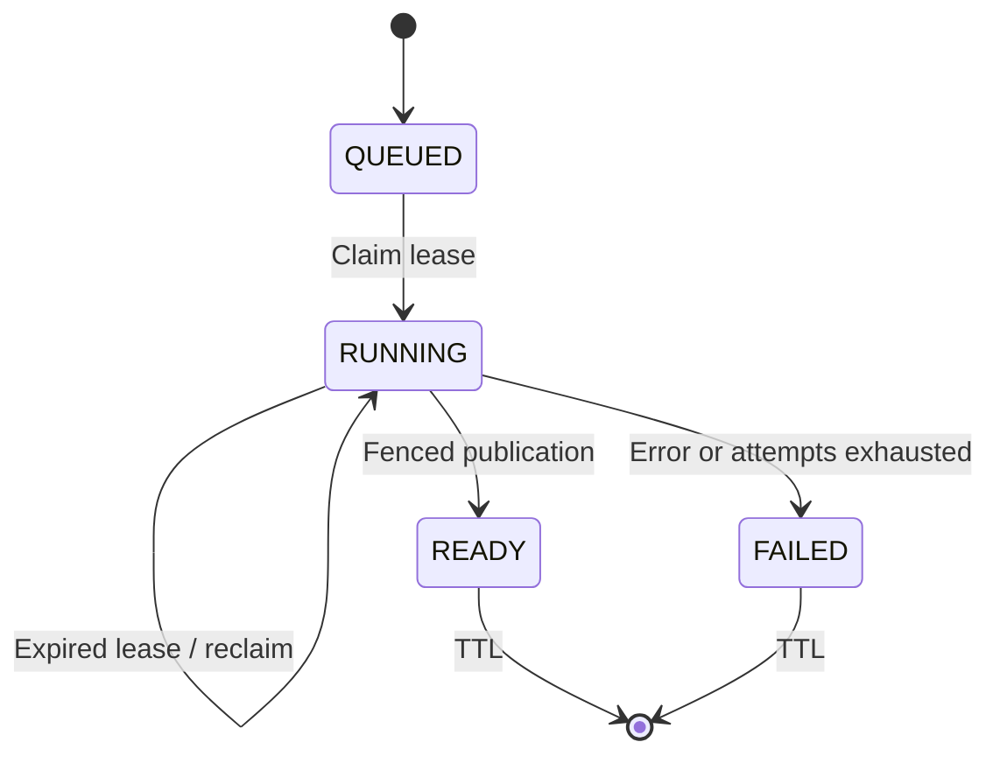

V98 ограничивает общий инвентарь (8), per-owner (2), QUEUED (4),
активное задание owner (1), RUNNING (1), TTL (15 минут) и CSV (8 МиБ).
V99 фиксирует immutable identity, READ COMMITTED, действующую lease
не более двух минут, актуального владельца и его версии безопасности.
Старый worker не может перезаписать готовый результат. Повтор SQL при
истечении lease возможен; это не exactly-once вычисление.

POST /exports возвращает 202, GET /exports/{id} — статус,
GET /exports/{id}/download — файл после READY. Scoped Authorization
повторно выполняется в PostgreSQL; чужое/просроченное задание или
изменение прав — 404, не раскрытие метаданных. CSRF для POST.
No-store, attachment, nosniff. TTL не удаляет данные из WAL/backup.

V97 дополняет V74 индексом plan/time. UsageRollupMonitor читает closed
UTC dates и watermark по расписанию; при ошибке observation unknown
(NaN), сохраняется последняя успешная отметка, растёт error counter.
11 правил Prometheus отслеживают очереди, аренды, свежесть, lag,
dirty dates, report admission, timeout и ошибки. SQL не выполняется
при scrape.

Всего в Usage: 53 production-файла и 42 тестовых класса + 1 fixture.
Полный каталог, test tree, назначения классов и runbook —
[README Usage][usage]. Общий README не дублирует целиком его каталог.

### Live + rollup

- source-of-truth факты читаются из persisted chat/AI completion metadata;
- daily aggregation работает в UTC;
- rollup ускоряет длинные отчёты;
- rollup имеет watermark/reconciliation;
- recent/incomplete range может дочитываться live;
- max live range защищает DB от неограниченного тяжёлого запроса.

### V71 — Dirty-date recalculation и восстановление актуальности сводок

Историческая дневная сводка не обязательно остаётся актуальной навсегда: сообщение или физический AI
attempt
может
получить окончательный статус позже даты первоначального rollup. Поэтому механизм V71 отделяет
**последовательный
backfill** от **повторного расчёта уже закрытых UTC-дней**.

```text
persisted usage / late-arriving or corrected evidence
       │
       ▼
usage dirty-date tracking (V71)
       │
       ▼
UsageDirtyDateRepository ── pending UTC dates / queue state
       │
       ▼
UsageRollupScheduler ───── PostgreSQL advisory lock
       │
       ├── contiguous backfill → UsageRollupDayProcessor(rebuildDay, true)
       ├── recent reconciliation → rebuildDay(date, false)
       └── dirty-date processing → UsageDirtyDateProcessor
                                   │
                                   ▼
                               daily rollups
```

#### Компоненты и ответственность

- **`UsageRollupStateRepository`**
  - **Назначение:** Чтение `last_completed_date`, поиск первого UTC-дня источников, монотонное
    продвижение watermark, запуск под PostgreSQL advisory lock
- **`UsageDirtyDateRepository`**
  - **Назначение:** Доступ к очереди дат, требующих повторной обработки; репозиторий должен
    допускать Spring CGLIB-проксирование, если используется exception translation
- **`UsageDirtyDateProcessor`**
  - **Назначение:** Обработка помеченных дат с учётом состояния очереди; служит отдельной границей
    от обычного backfill
- **`UsageForcedRebuildService`**
  - **Назначение:** Обработка принудительного пересчета; доступен защищенный
    `UsageRebuildController`, `POST /api/admin/usage/rebuild?date=YYYY-MM-DD` (SUPER_ADMIN, HTTP
    202)
- **`UsageRollupDayProcessor`**
  - **Назначение:** Фактическая перестройка дневных агрегатов; `advanceWatermark` определяет,
    продвигать ли последовательный watermark
- **`UsageRollupScheduler`**
  - **Назначение:** Планирование ограниченных порций backfill, lookback reconciliation и dirty-date
    обработки в рамках межинстансовой координации
- **`UsageJdbcClients`**
  - **Назначение:** Конфигурация JDBC-клиентов для usage paths; параметры исполнения запросов и
    подключения следует проверять по коду/configuration


#### Watermark: точный контракт

- `findLastCompletedDate()` возвращает последнюю *последовательно* обработанную дату или `null` до
  инициализации.
- `findEarliestUsageDate()` берёт минимум по UTC-дням сообщений `ASSISTANT` и `AMBIGUOUS` chat turns
  с `completed_at`; это шире прежнего assistant-only поиска.
- `markCompleted(date)` реализован как условный PostgreSQL `INSERT ... ON CONFLICT DO UPDATE`:
  повторная запись и запись более ранней даты допустимы, переход вперёд — только на следующий
  UTC-день; попытка пропустить день приводит к `IllegalStateException`, переведённому репозиторием
  через Spring exception translation в соответствующий `DataAccessException`.
- `rebuildDay(date, false)` применяется для reconciliation: **не должен продвигать watermark назад
  или вперёд**, даже если данные за дату изменились.
- Pending dirty dates и watermark — разные понятия: корректировка старой даты не должна изображаться
  как новый contiguous backfill.
- Планировщик ограничивает backfill и lookback настройками `safeai.usage.rollup.*`; не следует
  считать, что один запуск пересчитывает всю историю.

#### Безопасность исполнения и эксплуатация

Используется `PostgresAdvisoryLockExecutor`, чтобы два экземпляра приложения не запускали конкурирующую работу одного
scheduled rollup. Session-level advisory lock привязан к JDBC connection и должен освобождаться при
завершении
action;
корректность изменений всё равно зависит от транзакционных границ отдельных операций. Принудительная
переагрегация —
потенциально дорогая операция, поэтому перед массовым использованием нужно проверять лимиты, аудит
вызывающего
и
наблюдаемость выполнения по реальному коду.

Для V71 не следует создавать новую SQL-миграцию или редактировать уже применённый
`V71__usage_dirty_dates_and_recalculation_queue.sql` только ради документации.

### V74 — UTC-полночь, dirty dates и индексы

`V74__usage_midnight_dirty_date_and_physical_indexes.sql` переопределяет функцию `safeai_mark_usage_date_dirty_v71`:
**текущий UTC-день также помечается dirty** внутри исходной транзакции. Это защищает от гонки
start-before-midnight /
commit-after-midnight. Обработчик пересчитывает только соответствующие закрытые даты в пределах
watermark.

V74 добавляет неуникальные индексы:

```sql
idx_model_execution_attempts_started_plan_v74
idx_model_execution_plans_organization_id_v74
```

Увеличение активности dirty queue может создать hot row на текущем UTC-дне; нагрузка и contention
требуют
проверки.

### Concurrency / performance

`UsageReportExecutor` ограничивает количество конкурентных тяжёлых reports **локальным семафором**
и, в
подготовленном
патче, PostgreSQL `pg_try_advisory_xact_lock`-слотами.

Транзакция — `REQUIRES_NEW`, read-only, `REPEATABLE_READ`; для нескольких агрегаций отчёта она обеспечивает один DB
snapshot. При исчерпании слотов возвращается HTTP 429. В production размер Hikari-пула проверяется с
запасом
от
`maxConcurrentReports + 2`.

Пагинация Usage ограничена 50 000 строками OFFSET; `models` не должен молча обрезать финансовый
отчёт:
`LIMIT 1001` и
HTTP 422 при более чем 1000 моделях. `daily` ограничен 366 днями. Эти ограничения относятся к
подготовленному
Usage
hardening и требуют регрессионного прогона.

SQL paths имеют:

- query timeout;
- fetch size;
- performance/integration tests;
- EXPLAIN/EXPLAIN ANALYZE coverage в тестовой базе.

### Product usage vs physical spend

Usage subsystem остаётся product/chat analytics, но после `V60/V62/V67` физические расходы больше не
обязаны
исчезать из
accounting только потому, что `ChatTurn` не завершился пользовательским success.

Отдельные DB read models дают разные представления:

```text
model_cost_commitment_ledger_v62
    → provider-evidenced actual cost
    → active upper-bound reservations
    → unknown liability count
    → retry-safe carry-forward semantics

chat_physical_spend_v67
    → known executed input/output
    → known provider-evidenced cost
    → usage_unverifiable / cost_unverifiable flags
```

Это существенно ближе к FinOps, но всё ещё **не invoice/settlement ledger**: `actual` здесь означает
provider-evidenced
cost по сохранённой pricing/usage evidence, а не подтверждение расчёта с поставщиком.

---

## Модуль `chat`

Package:

```text
ru.safeai.gateway.chat
```

### Структура

```text
chat/
├── config/
│   ├── ChatConfiguration
│   ├── ChatErasureWorkerDatabaseConfig
│   ├── ChatLockProperties
│   ├── ChatProperties
│   ├── ChatQuotaProperties
│   └── ChatRecoveryProperties
├── controller/
│   ├── ChatController
│   ├── ChatLifecycleController
│   └── ChatTitleController
├── dto/
│   ├── AutomaticChatTitleRequest
│   ├── ChatCapabilitiesResponse
│   ├── ChatDetailsResponse
│   ├── ChatErasureCapabilityResponse
│   ├── ChatErasureOperationResponse
│   ├── ChatErasureRequest
│   ├── ChatPageRequest
│   ├── ChatPageResponse
│   ├── ChatResponse
│   ├── ChatTurnStatusResponse
│   ├── CreateChatRequest
│   ├── MessagePageRequest
│   ├── MessageResponse
│   ├── SendMessageRequest
│   ├── SendMessageResponse
│   └── UpdateChatTitleRequest
├── entity/
│   ├── ChatErasureState
│   ├── ChatMessageEntity
│   ├── ChatMessageRole
│   ├── ChatMessageStatus
│   ├── ChatQuotaReservationState
│   ├── ChatSessionEntity
│   ├── ChatTurnEntity
│   └── ChatTurnState
├── exception/
│   ├── AiOutcomeAmbiguousException
│   ├── ChatAccessRevokedException
│   ├── ChatApiException
│   ├── ChatApiExceptionHandler
│   ├── ChatBusyException
│   ├── ChatInfrastructureExceptionHandler
│   ├── ChatLeaseUnavailableException
│   ├── ChatLockUnavailableException
│   ├── ChatQuotaExceededException
│   ├── ChatStaleProcessorException
│   ├── ChatTurnFailedException
│   ├── ChatTurnInProgressException
│   └── IdempotencyKeyReusedException
├── observability/
│   └── ChatMetrics
├── quota/
│   ├── ChatQuotaConsumption
│   ├── ChatQuotaPolicy
│   └── ChatQuotaReservation
├── repository/
│   ├── ChatHistoryRepository
│   ├── ChatHistoryTurn
│   ├── ChatMessageRepository
│   ├── ChatQuotaRepository
│   ├── ChatSecurityStateRepository
│   ├── ChatSessionRepository
│   ├── ChatTurnMutexRepository
│   ├── ChatTurnRecoveryRepository
│   ├── ChatTurnRepository
│   └── RecoveredChatTurn
├── service/
│   ├── AiHistoryBuilder
│   ├── ChatContentNormalizer
│   ├── ChatDatabaseClockRepository
│   ├── ChatErasureLimits
│   ├── ChatErasureWorker
│   ├── ChatLifecycleService
│   ├── ChatLockService
│   ├── ChatMapper
│   ├── ChatProcessingContext
│   ├── ChatQuotaService
│   ├── ChatSecurityStateService
│   ├── ChatService
│   ├── ChatTurnAuditDetailsFactory
│   ├── ChatTurnExecutionCoordinator
│   ├── ChatTurnFinalizationService
│   ├── ChatTurnLeaseService
│   ├── ChatTurnReadSupport
│   ├── ChatTurnRecoveryCoordinator
│   ├── ChatTurnRecoveryScheduler
│   ├── ChatTurnRecoveryService
│   └── ChatTurnReservationService
└── title/
    ├── ChatTitlePolicy
    ├── ChatTitleService
    └── ChatTitleSource
```

Exception ownership: `ChatBusyException` и `ChatLockUnavailableException` находятся в
`chat.exception` вместе
с
`ChatInfrastructureExceptionHandler`; не возвращать их в `common`.

### `ChatTurn` state machine

```text
NEW
  ↓
PROCESSING
  ├─→ SUCCEEDED
  ├─→ FAILED
  └─→ AMBIGUOUS
```

`AMBIGUOUS` — отдельное operationally-sensitive состояние, а не alias для `FAILED`.

V67 закрепляет переходы в PostgreSQL trigger-ом:

```text
NEW -> PROCESSING
PROCESSING -> SUCCEEDED | FAILED | AMBIGUOUS
terminal -> no further UPDATE
```

Identity/provenance поля `ChatTurn` также защищены от изменения после создания. Дополнительно
message row со
`status=COMPLETED` становится immutable evidence и не может быть переписан ORM/direct SQL.

### Idempotency

Ключ:

```text
clientRequestId
```

Semantics:

```text
same clientRequestId + same semantic request
    → replay

same clientRequestId + different semantic request
    → IDEMPOTENCY_CONFLICT
```

Replay identity не должен зависеть от mutable policy/catalog state, изменившегося уже после принятия
оригинальной
операции.

### Reservation flow

До external provider I/O сохраняются:

```text
ChatTurn
processingToken
providerOperationId
leaseUntil
authorized_organization_auth_version (immutable V72)
quota reservation
ModelRouteDecision
reserved execution envelope
```

Provider call не выполняется внутри долгой business transaction.

### Lease / fencing

Watchdog `ChatTurnLeaseService` использует
`ChatTurnRepository.renewLeaseUsingDatabaseClock(turnId, processingToken, leaseMillis)` — PostgreSQL
`clock_timestamp()`
определяет и проверку действующего срока, и новую границу lease в одном SQL-запросе. Сохраняются условия `PROCESSING`,
точного `processing_token` и непросроченной аренды; результат, отличный от одной обновлённой строки,
означает
потерю
ownership. Ошибка БД также инвалидирует watchdog; нельзя переключаться на разрешающий fallback по
локальным
часам JVM.
Сигнатура конструктора service сохранена для совместимости существующих consumers.


`processingToken` является fencing token.

Finalization должна доказать, что worker всё ещё владеет текущим processing generation.

Stale worker не может завершить turn после lease takeover.

### Provider-call ambiguity

После V67 `provider_call_started_at` больше не должен быть application-level догадкой о том, начался
ли
provider call.

DB boundary для вставки физического attempt:

```text
ExecutionPlan + sealed prepared-request binding v2
  ↓
V72: organization row FOR SHARE, enabled=true,
     authorized_organization_auth_version == auth_version
  ↓
V67: ChatTurn must be PROCESSING
  ↓
processing_token + live lease checked under row lock
  ↓
provider_call_started_at = COALESCE(existing, DB clock_timestamp())
  ↓
ModelExecutionAttempt STARTED committed
  ↓
V100 quota/finance/RAG recheck, one-shot receipt committed
  ↓
external provider I/O (outside long DB transaction)
```

Поэтому:

```text
provider_call_started_at = null
    → durable STARTED boundary ещё не пройдена

provider_call_started_at != null
    → физический provider execution был разрешён к старту
    → blind replay после неопределённого исхода запрещён
```

Точная истина об outcome хранится в `ModelExecutionAttempt`; `provider_call_started_at` остаётся coarse-grained ChatTurn
marker для recovery/fencing.

#### V72 — immutable authorization epoch у ChatTurn

`chat_turns.authorized_organization_auth_version` — зафиксированная версия безопасности организации,
предъявленная
авторизованным principal при создании logical turn. V72 при `INSERT chat_turns` блокирует tenant `FOR SHARE`, проверяет
`enabled=true` и совпадение epoch; последующее изменение epoch-колонки запрещает DB-trigger.

Исторические ChatTurn, созданные до V72, сохраняют `NULL` (миграция **не приписывает** прошлым
запросам
произвольную
авторизацию). Такие строки не получают право на **новые** физические попытки. `DEFAULT 0` в SQL
существует для
совместимости новых низкоуровневых тестовых INSERT; production Java должна явно передавать epoch
principal, а
не
полагаться на default.

При pre-`STARTED` запрете (например, Disable, потерянный lease, несоответствие epoch) корректное
состояние —
контролируемый `FAILED` без подмены его `AMBIGUOUS`. Если attempt уже был разрешён, дальнейший outcome трактуется по
durable evidence, а не исходя из последующей смены tenant state.

**Инвариант временной последовательности:** `created_at ≤ provider_call_started_at ≤ completed_at`
там, где
terminal
timestamp установлен. V67/V72 используют физическое время PostgreSQL на STARTED; тестовые injectable
часы
нужно
согласовывать с DB clock, не отключая `chk_chat_turns_timestamps` и не переписывая immutable `created_at`.


### Quota reservation

Новая reservation-путь вызывает перегрузку `ChatQuotaService.reserve(..., ChatQuotaReservation)`
вместо
устаревшего
пятиаргументного `reserve(...)`. `ChatQuotaReservation` привязывается к immutable `ModelRouteResult.decisionId`,
использует `estimatedInputTokens`, `estimatedOutputTokens`, верхнюю оценку `estimatedMaxCostUsd` и `pricingComplete`.
Сервис отдельно подтверждает поддерживаемую схему через `hasVerifiedRoutePricingScheme`; неизвестная стоимость не
подменяется доказанным нулём и не обходит денежный hard quota. Старую перегрузку не следует
возвращать в
production-flow
лишь ради предупреждений IDE.


Quota резервируется до provider call и затем finalization корректирует состояние согласно persisted
usage/cost
quality.

V67 добавляет provenance:

- `reservation_version=1` — legacy static reservation;
- `reservation_version=2` — reservation, привязанная к immutable `ModelRouteDecision`;
- `model_route_decision_id` обязателен для v2;
- `cost_verifiable=true` допустим только когда `reserved_cost_usd` является доказанным upper bound
  по поддерживаемой immutable pricing scheme.

V95 добавляет DB snapshot строгих token/cost quotas и границы месяца.
При строгом ограничении допускается только первая физическая попытка.
V96 сериализует reserve/STARTED с изменениями quota, включая INSERT
отсутствующей политики, сохраняет UUID revisions и DB calendar.
Любая смена quota evidence требует нового допуска ещё не отправленного
запроса. Перед provider network dispatch проверка повторяется.
Неизвестный outcome сохраняет финансовое обязательство; ранее начатый
вызов не отменяется только из-за смены политики или месяца.

### Recovery

Recovery scheduler:

- выбирает expired PROCESSING turns;
- различает safe recoverability;
- использует fencing/lease state;
- не повторяет blindly unknown provider side effect.

### Chat title lifecycle — V58/V77

Title provenance:

```text
DEFAULT
AUTO
USER
```

Semantics:

- `DEFAULT` — новый пустой chat с canonical title `Новый чат`;
- `AUTO` — deterministic title из первого accepted USER message;
- `USER` — explicit title при create/rename.

Automatic naming:

- не вызывает LLM;
- выполняется детерминированно;
- не должен перезаписывать user-owned title;
- manual rename фиксируется audit event `CHAT_RENAMED`;
- audit не должен копировать сам текст title без необходимости.

#### Автоматическое и ручное переименование — интеграция 17.10.2026

- `ChatTitlePolicy.automaticTitle()` формирует заголовок детерминированно из первого принятого
  сообщения
  пользователя,
  не вызывая LLM; длина ограничена 72 Unicode code points.
- Frontend при создании пустого чата должен отправлять `title: null` или неявное значение по
  контракту
  `CreateChatRequest`, **не** строку `«Новый чат»` как пользовательский заголовок: иначе `ChatSessionEntity.create()`
  установит `title_source=USER` и автоматическое назначение не сработает. Совместимость JSON
  уточняется по
  актуальному
  DTO.
- `ChatTurnReservationService.reserveOrReplay()` выполняет проверку идемпотентности до любых новых
  изменений
  заголовка;
  при первом новом принятом USER-сообщении под `ChatTurnMutexRepository.lockChat()` вызывает
  `assignAutomaticTitle(...)`
  только если `title_source=DEFAULT`. Все изменения заголовка принадлежат той же транзакции reservation и откатываются
  при её отказе.
- Если заголовок имеет источник `AUTO` или `USER`, последующие сообщения не меняют его. Явное изменение пользователем
  имеет приоритет и переводит источник в `USER`.
- `ChatTitleService.rename()` проверяет владельца/организацию, использует ту же mutex boundary и
  регистрирует
  `CHAT_RENAMED` без помещения текста заголовка в audit details; повторное одинаковое
  пользовательское
  переименование
  идемпотентно.
- Заголовок в истории должен перечитываться из API после отправки сообщения, чтобы новое название
  появилось
  без
  обновления страницы. Успешный ответ провайдера **не является** необходимым условием для названия
  уже
  принятого
  сообщения: наименование привязано к успешной reservation transaction.

#### V77 — однократный backfill исторических заголовков

`V77__backfill_legacy_default_chat_titles.sql` обрабатывает только строки `chat_sessions`, где `title = 'Новый чат'`.
Для них по первому непустому `USER`-сообщению (сортировка `created_at, id`) вычисляется заголовок с ограничением до 72
символов, устанавливается `title_source='AUTO'` и увеличивается optimistic `version`. Остальные пользовательские
названия сохраняются.

Пустые старые чаты с заглушкой, без USER-сообщений, получают `title_source='DEFAULT'`, чтобы первое новое сообщение
могло назвать их автоматически. Миграция не передаёт сообщения провайдеру и не изменяет tenant
ownership. При
повторном
исполнении обновлённые строки не подходят под условие заглушки; однако **Flyway не следует запускать
повторно
с
изменённой checksum**.

**Неустранимая неоднозначность legacy:** старый frontend мог записать буквальную строку `Новый чат` как `USER`; по
данным БД нельзя надёжно отличить это от сознательного ручного выбора такого же названия. V77
реализует явную
политику
восстановления всех заглушек, заказанную владельцем проекта. Перед применением к populated БД
необходимо
сделать backup
и оценить этот компромисс. V58 задним числом не менять.

---
### Архивирование, восстановление и стирание Chat (V86–V88)

Архивирование является **обратимым скрытием**, не удалением. `archive()` и `restore()` сериализованы
с резервированием
новых ChatTurn через mutex. Архивный чат больше не принимает новые сообщения, а live-owner endpoints
не должны
возвращать архивы как активные.

**Стирание содержимого** представляет самостоятельную durable operation:

```text
AVAILABLE --(архив + ADMIN + retention + If-Match + idempotency)--> ERASING
    |                                                               |
    +-- восстановление архива, пока нет erasure intent                  +--> ERASED
                                                                    +--> NEEDS_REVIEW
                                                                    +--> BLOCKED_BY_RETENTION
                                                                    +--> CANCELLED
```

Первое состояние относится к `chat_sessions.erasure_state`, а `NEEDS_REVIEW`, `BLOCKED_BY_RETENTION` и `CANCELLED`
относятся к `chat_erasure_operations_v86.state`. Не смешивать их в API и отчётах.

- Для принятия нужны действующий ADMIN в БД, архив, текущая версия через
  сильный ETag `If-Match`, проверенные название/фраза и `Idempotency-Key`.
- Одинаковые idempotency key и payload возвращают ту же operation; ключ с
  другим payload отклоняется. `202` подтверждает только запись операции.
- До физического стирания проверяются retention holds, активные turns,
  RAG permits/attempts и отдельные лимиты атомарного удаления.
- Выделенный `safeai_chat_erasure_worker` выполняет транзакционную редакцию
  содержимого `chat_messages.content`, legacy retrieval `query_text` и title.
- Физическое удаление `chat_sessions`, quota, audit, provider attempts,
  Model decisions, RAG provenance или billing evidence **не заявляется**.
- Состояния operation audit/hold защищены триггерами; произвольный
  `UPDATE` или GUC не равнозначен операторскому разрешению.
- Выход из `BLOCKED_BY_RETENTION` и отмена карантинной операции требуют
  отдельного SQL-операторского процесса с двумя независимыми approvals.
- Неизвестный исход внешнего провайдера остаётся `AMBIGUOUS`, не `FAILED`.

**V87:** `CREATE INDEX CONCURRENTLY` выполняется вне транзакции Flyway
(`executeInTransaction=false`).
`IF NOT EXISTS`
намеренно отсутствует: неудачное построение индекса способно оставить `INVALID` объект. Перед
продолжением DBA
должен
проверить `pg_index.indisvalid/indisready`.

**V88:** валидирует `chk_chat_erasure_state_v86` после `NOT VALID` в V86 и останавливает миграцию
при
отсутствующем/невалидном индексе V87.

**PostgreSQL SQL roles:**

- `safeai_app` может подать подтверждённый intent, но не делать redaction;
- `safeai_chat_erasure_worker` имеет только необходимые операции редактирования;
- `safeai_chat_erasure_operator` является `NOLOGIN` группой, к которой
  отдельно привязаны индивидуальные человеческие DB login;
- две независимые записи approval обязательны для санкционированного действия;
- Flyway migrator отдельный от app и worker; роли создаёт DBA заранее.

Тесты должны проверять `session_user` и фактические privileges, а не только успешный вызов service из `@WithMockUser`.

---

## Модуль `model`

Package:

```text
ru.safeai.gateway.model
```

### Логическая структура

```text
model/
├── config/
│   └── ModelRoutingEnvelopeProperties
├── controller/
│   ├── ModelCatalogController
│   ├── ModelPolicyPreviewController
│   ├── ModelRouteDecisionController
│   ├── ModelRuntimeController
│   ├── OrganizationBudgetStatusController
│   ├── OrganizationModelPolicyController
│   └── RubBudgetRateController
├── domain/
│   ├── BudgetEnforcement
│   ├── ModelBudgetCommitmentSnapshot
│   ├── ModelCapability
│   ├── ModelCatalogEntry
│   ├── ModelCatalogSource
│   ├── ModelLifecycle
│   ├── ModelModality
│   ├── ModelPricingStatus
│   ├── ModelRetentionStatus
│   ├── ModelRouteDecision
│   ├── ModelRouteOutcome
│   ├── ModelRouteReason
│   ├── ModelRouteRequest
│   ├── ModelRouteResult
│   ├── ModelTrainingUseStatus
│   ├── MonthlyCommitmentState
│   ├── MonthlyCostState
│   ├── OrganizationModelPolicy
│   ├── RubBudgetSnapshot
│   ├── RuntimeModelProbeResult
│   └── RuntimeModelProbeStatus
├── dto/
│   ├── CreateModelCatalogVersionRequest
│   ├── CreateOrganizationModelPolicyVersionRequest
│   ├── ModelCatalogEntryResponse
│   ├── ModelPolicyPreviewItemResponse
│   ├── ModelPolicyPreviewResponse
│   ├── ModelRouteDecisionResponse
│   ├── OrganizationBudgetStatusResponse
│   ├── OrganizationModelPolicyResponse
│   ├── PlatformBudgetSummaryResponse
│   ├── RubBudgetInput
│   ├── RubBudgetResponse
│   ├── RuntimeModelProbeResponse
│   ├── RuntimeModelStatusResponse
│   ├── RuntimeModelStatusWireResponse
│   ├── StrictPolicyLockoutAcknowledgmentDeserializer
│   └── StrictPolicyTokenLimitDeserializer
├── exception/
│   ├── ModelRouteDeniedException
│   └── ModelRouteEnvelopeExceededException
├── pricing/
│   ├── CatalogPricingEligibility
│   └── VersionedCatalogPricingResolver
├── repository/
│   ├── JdbcTextArrayReader
│   ├── ModelCatalogRepository
│   ├── ModelPolicyPreviewConfirmationRepository
│   ├── ModelRouteDecisionRepository
│   ├── ModelRouteMetrics
│   ├── ModelRouteRequestBindingRepository
│   ├── ModelRouteRequestMutexRepository
│   └── OrganizationModelPolicyRepository
└── service/
    ├── AnthropicRuntimeModelHealthProbe
    ├── CbrUsdRateSource
    ├── DatabaseTimestampNormalizer
    ├── MockRuntimeModelHealthProbe
    ├── ModelCatalogAuditDetails
    ├── ModelCatalogAuditDetailsFactory
    ├── ModelCatalogRules
    ├── ModelCatalogService
    ├── ModelControlPlaneAccess
    ├── ModelControlPlaneNumericValidation
    ├── ModelControlPlaneSchemaVerifier
    ├── ModelInputTokenEstimator
    ├── ModelPolicyPreviewConfirmationService
    ├── ModelPolicyPreviewFingerprint
    ├── ModelPolicyPreviewService
    ├── ModelRouteDecisionAuditDetails
    ├── ModelRouteDecisionFactory
    ├── ModelRouteDecisionIntegrity
    ├── ModelRouteExecutionBindingService
    ├── ModelRouteExecutionGuard
    ├── ModelRouteExecutionIdentity
    ├── ModelRouteReservedRequestService
    ├── ModelRoutingCostPolicy
    ├── ModelRoutingEnvelopeService
    ├── ModelRoutingExecutionCapabilityGate
    ├── ModelRoutingSelectionPolicy
    ├── ModelRoutingService
    ├── OpenAiRuntimeModelHealthProbe
    ├── OrganizationBudgetStatusService
    ├── OrganizationModelPolicyAuditDetailsFactory
    ├── OrganizationModelPolicyRules
    ├── OrganizationModelPolicyService
    ├── ProviderDataDispatchGuard
    ├── RubBudgetRateService
    ├── RuntimeModelHealthProbe
    ├── RuntimeModelProbeHttpSupport
    ├── RuntimeModelProbeService
    └── RuntimeModelStatusService
└── spi
    └── ModelRequestContentHashPort.java
```

### Runtime model

Runtime — это то, что физически настроено в deployment.

Control Plane не равен dynamic provider router.

На текущем этапе backend runtime всё ещё представляет один активный configured provider/model target
на
deployment, а
catalog/policy определяют, разрешён ли logical model и совместим ли он с этим target.

### Versioned Model Catalog

#### Явные pricing-схемы и совместимость конструкторов

`ModelCatalogEntry`, `ModelCatalogEntryResponse` и `CreateModelCatalogVersionRequest` содержат `ModelPricingScheme`.
Существующие positional constructors сохранены ради совместимости вызовов, но не для автоматического
повышения
доверия к
старым тарифам.

- Для старой записи `CONFIGURED` без явной схемы используется
  `LEGACY_FLAT_UNVERIFIED_V1`, а не подтверждённая `FLAT_TOKEN_V1`.
- `FREE` получает `FLAT_TOKEN_V1`; неподдерживаемые/неполные тарифы не становятся
  автоматически пригодными для settlement.
- В ручном создании версии `CONFIGURED` требует явный `pricingScheme=FLAT_TOKEN_V1`.
- API возвращает денежные значения строками из `BigDecimal.toPlainString()`:
  десятичные суммы нельзя неявно конвертировать в JavaScript `Number`.
- `capabilities` и modality sets копируются в неизменяемые коллекции в доменной записи.
- `ModelCatalogRepository` читает точный `pricing_scheme` и сохраняет его вместе с
  immutable catalog entry; нельзя подменять exact version текущей latest-версией.

**Актуальный контракт import-runtime (17.11.2026):** внешний runtime первоначально импортируется как `UNPRICED`,
поскольку runtime projection не является источником цен. Только локальный `mock:mock-safeai`
получает явную
`FREE`
запись; mock запрещён в production. Повторный импорт не переписывает историческую `RUNTIME_IMPORT`
версию и не
заменяет
ручную или мигрированную запись. Настройка проверенного тарифа — отдельное создание новой audited
catalog
version.
Предыдущий риск implicit CONFIGURED import закрыт в текущей реализации; полная регрессия на
PostgreSQL
остаётся
обязательной.

#### Единый источник тарифов

- `public.model_catalog_entries` — единственный источник цен чат-моделей.
- `CatalogPricingEligibility.verified()` — единый fail-closed критерий для
  reservation, policy preview, runtime display и settlement.
- `FREE` требует полного нулевого тарифа; `CONFIGURED` — полных неотрицательных
  базовых ставок, хотя бы одной ненулевой ставки, непустой pricing version,
  поддерживаемой `FLAT_TOKEN_V1` и пустого `extraPricingJson` (`{}`).
- Optional cache rates не могут быть отрицательными; отсутствие обязательной
  ставки для фактического provider usage делает расчёт недоказуемым.
- Legacy/unsupported/incomplete pricing остаётся `UNPRICED`. Нулевую цену
  нельзя использовать как замену неизвестной.
- Удалены `ModelPricingProperties`, `ModelPricingService`,
  `StaticConfigurationPricingResolver`, их статические YAML-настройки и
  production pricing example. Архитектурный тест защищает единственный
  production `PricingResolver`: `VersionedCatalogPricingResolver`.


Catalog entry — immutable/append-only snapshot.

Основные поля/семантика:

- `modelKey`;
- version;
- provider;
- provider model ID;
- display name;
- lifecycle;
- limits;
- capabilities;
- modalities;
- retention status;
- training-use status;
- pricing status;
- pricing dimensions/version;
- explicit `pricingScheme`;
- `effectiveFrom`;
- source;
- creator/time.

V59/V62 дополнительно защищают canonical text/numeric boundaries, а V66 вводит explicit settlement
algorithm
identity.
Исторические legacy prices сохраняются, но не должны автоматически считаться проверенной современной
pricing
scheme.

#### Latest vs effective

```text
latest
    = последняя созданная version
    = может быть scheduled

effective
    = версия, вступившая в силу к decision time
    = участвует в routing
```

Старая version не редактируется.

### Organization model policy

Policy append-only/versioned.

Поддерживает:

- enabled;
- allow model keys;
- deny model keys;
- default model key;
- max input envelope;
- max output envelope;
- max request cost;
- monthly budget;
- ввод USD или RUB (V91), без смешивания валют в одном запросе policy;
- `SOFT / HARD`;
- require complete pricing;
- require no training;
- require zero data retention.

DB canonicality hardening:

- каждый allow/deny key соответствует normalized lowercase key syntax;
- duplicate key внутри allow/deny array запрещён;
- required capability array route decision также должен быть unique.

Первое отсутствие policy представляется fail-closed/unconfigured state, а не неявным «разрешить
всё». После
V65 новый
strict integrity-v3 decision без policy может существовать только как явное
`DENIED / MODEL_NOT_ALLOWED`
unconfigured
evidence; physical execution такой row не авторизует.

#### Рублёвые бюджеты и фиксированная котировка — V91/V92

USD остаётся единственной валютой route enforcement, reservation, settlement, monthly commitment и
usage
analytics. RUB
— альтернативный способ задать два потолка, не отдельный счёт, не банковский баланс и не валюта
расчётов
провайдера.

| Поле policy | PostgreSQL type / смысл |
| --- | --- |
| `max_request_cost_rub` | `numeric(30,12)`, необязательный лимит запроса |
| `monthly_budget_rub` | `numeric(30,12)`, необязательный месячный лимит |
| `rub_per_usd` | `numeric(18,8)`, официальный RUB за 1 USD |
| `rub_quote_date` | `date`, московская дата получения |
| `rub_effective_date` | `date`, дата действия официального курса |
| `rub_fetched_at` | `timestamptz`, точный момент получения |

`RubBudgetSnapshot` хранит immutable evidence; `RubBudgetInput` / `RubBudgetResponse` — DTO.
`OrganizationModelPolicyRepository` сохраняет все шесть колонок вместе с версией, а audit details
включают
источник CBR.
Старые USD-only политики сохраняют все шесть значений NULL.

Конвертация: `USD = RUB / RUB_PER_USD`, scale 12, округление вниз для неотрицательных чисел. Java —
`BigDecimal.divide(rate, 12, RoundingMode.DOWN)`; PostgreSQL — точный `div(rub * 1000000000000, rate) * 0.000000000001`;
frontend — fixed-scale BigInt. При условном курсе 90: 5 RUB → 0.055555555555 USD; 10 000 RUB →
111.111111111111 USD. Это
пример, не текущий курс. NULL и 0 имеют разные смыслы. SQL V91 сверяет каждую пару RUB/USD через `IS NOT DISTINCT FROM`;
limit не может увеличиться из-за округления.

`CbrUsdRateSource` получает официальную котировку исключительно с фиксированного HTTPS endpoint
`https://www.cbr.ru/scripts/XML_daily.asp?date_req=ДД/ММ/ГГГГ`. Connect timeout 4 s, read timeout 5 s, предел 128 KiB;
redirects, DTD, external entities/schema и XInclude запрещены. Tenant data, prompts и credentials не
отправляются в этот
запрос. JAXP XML parsing в JVM не требует SQL XML-привилегий.

`RubBudgetRateService` использует per-process single-flight daily cache по `Europe/Moscow`; effective date может
отставать до 14 дней. При ошибке — 30-second cooldown, без fallback на выдуманный/вчерашний курс.
Quote API:
`GET /api/admin/models/policies/rub-quote`, ADMIN/SUPER_ADMIN, `Cache-Control: no-store`. Ошибка получения: HTTP 503
`BUDGET_RATE_UNAVAILABLE`; устаревший или несовпадающий курс: HTTP 409. Клиентская котировка служит только сверкой с
серверной, не источником цены.

При изменении RUB-потолка новая версия требует котировку текущего московского дня; под блокировкой
при
сохранении
повторно проверяются optimistic version и дата. При изменении только доступа, токенов и требований к
данным
неизменённый
RUB snapshot переносится без пересчёта, даже если курс теперь другой. Уже применённый USD ceiling
действует и
при
недоступности ЦБ; ввод USD не зависит от сетевого запроса к ЦБ. Monthly accounting period остаётся
UTC.

V92 дополнительно запрещает NaN даже в USD-only политиках и `infinity`/ `-infinity` для quote/effective/fetched/created
timestamps рублёвых политик. V91 продолжает контролировать полноту и согласованность evidence;
numeric typmod
запрещает
бесконечные денежные значения и переполнение. Обе новые CHECK V92 валидируются сразу на всех
строках,
ошибочную историю
нельзя исправлять молча. Append-only guard V45 защищает сохранённую котировку от UPDATE/DELETE.

### Route decision

До provider I/O сохраняется immutable evidence:

- requested model;
- selected model;
- exact catalog version;
- exact policy version;
- provider/model identity;
- capabilities/modalities;
- input accounting version;
- additional input upper bound;
- output cap;
- pricing/budget state;
- route outcome;
- reason;
- integrity version;
- SHA-256 digest.

DB deferred trigger связывает `ALLOWED` decision с exact `ChatTurn`.

#### Budget commitments — V60/V62/V64

Budget accounting разделяет:

```text
actual_cost_usd
reserved_cost_usd
unknown_cost_count
cost_state
```

V62 исправляет важный representability case: full monthly liability может оставаться unknown, но
известный
lower bound
уже способен доказать budget overrun. V64 сохраняет route-time commitment evidence отдельно и
immutable, не
изменяя
исторические V1/V2/V3 decision hashes.

V100 использует этот же ledger для независимого admission на STARTED
и receipt. Нельзя повторно прибавлять собственный PENDING_RESERVATION
или STARTED reservation. V101 сохраняет содержание и типы ledger.
Финансовая блокировка действует также при публикации политики и settlement.
При неизвестных обязательствах HARD budget закрыт, при известном нижнем
пределе возможен доказанный overrun даже при неполном учёте.

7.5E.2 проверяет границы NUMERIC(30,12), отрицательные usage dimensions,
overflow и точную консервативную арифметику. Tenant ADMIN получает только
снимок своей организации; платформенная сводка предназначена для SUPER_ADMIN.
Чужой scope отвергается до SQL, UNKNOWN не превращается в WITHIN.

#### Чтение текущего бюджета и сводка платформы — Stage 5.2 / 7.3

```text
OrganizationBudgetStatusController
  └─ OrganizationBudgetStatusService
       ├─ проверка роли / области организации
       └─ ModelRouteDecisionRepository
            ├─ model_cost_commitment_ledger_v62
            └─ PlatformBudgetClassification
                    ↑
             JdbcUsageQueryRepository
             (серверный фильтр сравнения)
```

Время берётся из серверного `Clock`, период — текущий календарный месяц UTC,
границы `[periodStart, periodEnd)`, независимо от фильтров аналитики.
Снимок бюджета: `organizationId`, `policyVersion`, `policyEnabled`,
`enforcement`, `periodStart`, `periodEnd`, `asOf`, `monthlyBudgetUsd`,
`knownActualUsd`, `reservedUsd`, `knownCommittedUsd`,
`unknownCommittedCostCount`, `remainingUsd`, `status`.

USD-значения — точные десятичные строки, `monthlyBudgetUsd` и `remainingUsd`
обязательны в JSON даже при `null`. Нулевой лимит — заданный лимит, NULL —
отсутствующий. `remainingUsd` доступен при известном состоянии (`KNOWN`,
`EXCEEDED`); при `UNKNOWN`, `EXCEEDED_LOWER_BOUND`, `NO_LIMIT`, `DISABLED`,
`UNCONFIGURED` вычисленный остаток не выдаётся за достоверный.
При известном превышении остаток ограничен снизу нулём; отрицательный
остаток не возвращается.

Сводка платформы доступна только SUPER_ADMIN. В ней каждая организация
(в том числе отключённая) относится ровно к одной категории. Классификация
общая для счётчиков и фильтра Usage, порядок проверок строго следующий:

| Категория | Условие (приоритет сверху вниз) |
|---|---|
| `UNCONFIGURED` | Нет версии политики |
| `DISABLED` | Последняя политика отключена |
| `NO_LIMIT` | Месячный лимит NULL |
| `EXCEEDED` | Известные обязательства строго больше лимита |
| `UNKNOWN` | Есть обязательства с неизвестной стоимостью |
| `NEAR` | Известные обязательства ≥ 80% лимита |
| `WITHIN` | Менее 80%, состояние известно |

Известные обязательства = известные фактические расходы текущего месяца +
резервы, включая переносимые. В `PlatformBudgetClassification.CTE` фактические
расходы из carry-forward исключены, резервы и unknown count учитываются.
Доказанное превышение имеет приоритет над неполнотой. Ровно 100%, а также
нулевой лимит при нулевых обязательствах относятся к `NEAR` согласно контракту.
Категория — аналитическая, не новая политика разрешения запросов: SOFT/HARD,
транзакционные блокировки, route-time evidence и V62/V64 остаются источником
исполнения. Сводка и последующий drill-down — независимые актуальные снимки,
поэтому при конкурентных изменениях их числа могут закономерно различаться.

#### Final request binding — V62/V64/V65

Governance evidence проходит две durable seal-точки:

```text
base/pre-RAG request
  ↓ SHA-256
model_route_reserved_requests
  ↓
retrieval + RAG + context fitting
  ↓ SHA-256
model_route_prepared_requests_v62
  ↓
binding_version=2
  ↓
ExecutionPlan / physical attempt
```

Для Knowledge mode prepared receipt дополнительно обязан совпасть с immutable `knowledge_rag_context_receipts_v64`:
exact `RetrievalRun`, KB, user/org, context hash и final prepared-request hash.

После V65 новые prepared receipts должны иметь `binding_version=2`, а DB trigger на `model_execution_attempts` не
разрешает physical I/O без exact v2 binding.

### Input accounting

Governance accounting использует deterministic input units.

Текущий accounting contract:

```text
UTF8_STRUCTURAL_UNITS_V2
```

Это **не** заявляется как exact provider tokenizer.

Исторические DB column names могут содержать `*_tokens`, но новые semantics в коде трактуются как versioned
deterministic accounting units.

### Capability gate

Catalog metadata может описывать:

```text
TEXT
TOOLS
VISION
STRUCTURED_OUTPUT
```

Но metadata не означает автоматически реализованный data plane.

Нереализованные specialized capabilities должны fail closed.

### Runtime probe

Runtime probe:

- отделён от user Chat;
- не отправляет user prompt/history/RAG content;
- использует strict HTTPS/host policy;
- redirects disabled;
- bounded connect/read/body limits;
- возвращает controlled status.

Типовые states:

```text
NOT_PROBED
AVAILABLE
AUTH_ERROR
MODEL_NOT_FOUND
RATE_LIMITED
UNAVAILABLE
ERROR
```

Probe — point-in-time check, а не SLA monitoring.

`GET /api/admin/models/runtime` возвращает sanitized `RuntimeModelStatusWireResponse` через
`currentWithCatalogPricing()`. Money fields — точные decimal strings; API не раскрывает ключи, provider URL, connection
fingerprint или evidence secrets. Runtime price — только projection единственной подходящей
effective
ACTIVE/DEPRECATED
catalog entry; при неоднозначности или непроверенном тарифе — UNPRICED. Metadata-only
`POST /api/admin/models/runtime/probe` доступен SUPER_ADMIN, не выполняет генерацию и не доказывает
доступность billing
или inference.

### Provider Data Assurance — независимые факты no-training и ZDR

Catalog metadata сама по себе не подтверждает договорные условия реального подключения.
`ProviderDataAssuranceProperties`, `ProviderDataEvidence`, `ProviderDataDispatchGuard` и `AiDataAssurancePort` связывают
governance с фактической конфигурацией provider/connection и сроком подтверждения (не более 90
суток).
No-training и ZDR
— разные требования и отдельные evidence.

- Требуемые подтверждения проверяются при routing и перед каждой physical
  отправкой, в том числе повторной попыткой.
- Ротация API key, смена подключения/конфигурации, просрочка или отсутствие
  доказательства приводят к fail-closed при соответствующем требовании.
- OpenAI `store=true` несовместим с требованием ZDR.
- Для внешних embeddings и OCR предусмотрены отдельные обязательные
  подтверждения, независимые от tenant policy чат-модели.
- Операторский evidence — подтверждение проверенного договора и конфигурации,
  не гарантия фактического поведения удалённого сервера; API и audit не
  раскрывают credentials и fingerprints.

Контракт и operational setup: `docs/security/provider-data-assurance.md`, `infra/scripts/provider-data-fingerprint.py`,
`infra/scripts/test-provider-data-evidence.sh` и обязательный release workflow `provider-data-assurance.yml`. Нельзя
придумывать evidence ради прохождения gate.

---

## Модуль `ai`

Package:

```text
ru.safeai.gateway.ai
```

### Структура

```text
ai/
├── config/
│   ├── AiConfiguration
│   ├── AiProductionConfigurationValidator
│   ├── AiRetryTimeoutBudgetValidator
│   ├── AnthropicProviderConfiguration
│   ├── OpenAiProviderConfiguration
│   ├── ProviderSecretConfigurationValidator 
│   └── ProviderSecretFile
├── dto/
│   ├── AiChatRequest
│   ├── AiChatResponse
│   ├── AiMessage
│   └── AiMessageRole
├── exception/
│   ├── AiContextLimitException
│   ├── AiProviderBillingException
│   ├── AiProviderErrorType
│   ├── AiProviderException
│   ├── AiProviderOverloadedException
│   ├── AiProviderQuotaExceededException
│   ├── AiProviderRateLimitedException
│   ├── AiProviderResponseTooLargeException
│   ├── AiProviderTimeoutException
│   └── AiProviderUnavailableException
├── execution/
│   ├── AiDataAssurancePort
│   ├── AiDispatchAbortedException
│   ├── AiExecutionAttemptAuthorization
│   ├── AiExecutionAttemptObserver
│   ├── AiExecutionAttemptRecorder
│   ├── AiExecutionAttemptScope
│   ├── AiExecutionIdentity
│   ├── AiExecutionPlanService
│   ├── AiExecutionRequest
│   ├── AiExecutionResult
│   ├── AiExecutionService
│   ├── AiKnowledgeExecutionMode
│   ├── AiModelExecutionPort
│   ├── AiOrganizationExecutionDeniedException
│   ├── ExecutionAttemptOutcome
│   ├── FallbackSafety
│   ├── ModelAttemptMonitor
│   ├── ModelExecutionAttemptEntity
│   ├── ModelExecutionAttemptRepository
│   ├── ModelExecutionPlanEntity
│   ├── ModelExecutionPlanRepository
│   ├── OutcomeCertainty
│   ├── PhysicalAttemptReconciliationRequiredException
│   ├── ProviderExecutionTarget
│   ├── ProviderFailureCertainty
│   ├── ProviderPricingEvidence
│   ├── ProviderUsageEvidence
│   ├── ResolvedModelMismatchException
│   ├── ResponseValidationStatus
│   └── RetrySafety
├── input/
│   ├── AiInputUnitEstimator
│   └── AiRequestFingerprint
├── metadata/
│   ├── AiResponseStatus
│   ├── AiTokenUsage
│   ├── PricingStatus
│   └── UsageStatus
├── pricing/
│   ├── ModelPricingScheme
│   ├── PricingResolver
│   └── PricingResult
│
├── provider/
│   ├── anthropic/
│   │   ├── AnthropicProperties
│   │   └── AnthropicProvider
│   ├── mock/
│   │   └── MockAiProvider
│   ├── openai/
│   │   ├── OpenAiProperties
│   │   └── OpenAiProvider
   ├── AiBoundedHttpRequestFactory
│   ├── AiContextWindowProperties
│   ├── AiContextWindowService
│   ├── AiJsonNodeSupport
│   ├── AiProvider
│   ├── AiProviderAttemptContext
│   ├── AiProviderDispatchDeadline
│   ├── AiProviderEndpoint
│   ├── AiProviderExceptionFactory
│   ├── AiProviderMetrics
│   ├── AiProviderProperties
│   ├── AiProviderRetryExecutor
│   ├── AiProviderSupport
│   ├── AiResponseMetadataService
│   ├── AiResponseTooLargeIOException
│   ├── AiRestClientFactory
│   ├── AiRetryProperties
│   ├── ProviderCredentialEvidence
│   ├── ProviderDataAssuranceProperties
│   ├── ProviderDataEvidence
│   ├── ProviderEvidenceText
│   ├── ProviderPropertyValidator
│   └── ProviderRegistry
└── web/
    └── AiExceptionHandler
```

### Provider abstraction

```java
public interface AiProvider {
    AiChatResponse sendMessage(AiChatRequest request);
}
```

Реализации:

```text
MockAiProvider
OpenAiProvider
AnthropicProvider
```

`AiOrganizationExecutionDeniedException` фиксирует application-level отказ на организационной
execution
boundary;
authoritative physical STARTED gate при этом остается в PostgreSQL V72.

### Durable physical execution

Начиная с V50 AI execution имеет отдельную durable evidence layer; V62–V67 доводят binding/start
boundary до
жёсткого
database-enforced контракта.

```text
ModelRouteDecision
      ↓
sealed base request
      ↓
final prepared request + optional exact RAG receipt
      ↓
binding_version=2
      ↓
ModelExecutionPlan
      ↓
V72 organization enabled + exact auth_version (FOR SHARE)
      ↓
V67 live PROCESSING ChatTurn + lease/processingToken fence
      ↓
ModelExecutionAttempt STARTED + provider_call_started_at
      ↓
V100 committed one-shot dispatch receipt
      ↓
provider I/O
      ↓
terminal physical evidence
      ↓
Chat finalization
```

Ключевой порядок:

```text
validate governed route/envelope
  ↓
commit final prepared-request binding
  ↓
commit ExecutionPlan
  ↓
commit Attempt STARTED with V72 organization epoch gate,
V67 live lease/fencing and PostgreSQL wall clock
  ↓
consume V100 receipt (REQUIRES_NEW, committed)
  ↓
external provider I/O
  ↓
persist terminal physical evidence
  ↓
application/chat finalization
```

Это позволяет переживать crash boundaries без ложного предположения «если Chat не ответил, provider
точно
ничего не
сделал» и не позволяет historical binding v1 авторизовать новый physical call.

### V72 — физический AI kill-switch

**V72 ограничивает допуск новых физических вызовов, а не корректность уже состоявшегося внешнего
вызова.**
Организационный `enabled` и сохранённый `authVersion` проверяются дважды с разными целями:

1. `ModelExecutionAttemptRepository.organizationEpochCurrent(planId)` — неблокирующий advisory
   preflight для ранней понятной ошибки. Он **не** устраняет TOCTOU.
2. PostgreSQL `BEFORE INSERT` trigger `trg_a_physical_attempt_organization_epoch_v72` — авторитетная
   проверка `organization.enabled`, `auth_version`, immutable ChatTurn epoch и совпадения
   `organization_id`; берёт organization row `FOR SHARE` и удерживает lock до commit INSERT.
3. Остальные триггеры V53/V54/V65/V67 сохраняют свои дополнительные запреты: attempt ordering/retry,
   exact governed binding v2, live `PROCESSING` turn, lease и `processingToken`.
4. Успешно закоммиченный `STARTED` — необходимое, но с V100 недостаточное
   условие для provider I/O: нужен отдельный committed one-shot receipt.
   При STARTED фиксируется `provider_call_started_at`; отдельного публичного
   `ChatTurnFinalizationService.markProviderCallStarted()` в актуальном патче нет.

**Линеаризация по БД:** конкурентный Disable (`FOR UPDATE` на той же организации) не может
закоммититься между
V72
проверкой организации и commit разрешённого STARTED. После commit Disable новые STARTED не проходят;
после
Enable старый
ChatTurn также не проходит из-за старого epoch.

**Граница внешнего эффекта:** attempt с разрешением, полученным **до** Disable, может уже выполнять
HTTP либо
дойти до
сетевой отправки **после** Disable. Такой вызов нельзя считать автоматически отменённым. Для более
строгой
гарантии
«никаких сетевых send после commit Disable» недостаточно даже V100 receipt:
нужны внешний draining/in-flight coordination и согласованный cutover.
V100 повторно проверяет epoch перед receipt, но commit receipt и физическая
отправка не атомарны относительно сети. Не обещать отмену provider I/O.

**Execution evidence не теряется:** `STARTED`, `SUCCEEDED`/`FAILED`/`AMBIGUOUS`, outcome certainty, usage/pricing и
retry-safety сохраняются по существующим договорам. Отказы до STARTED и неопределённость после
STARTED не
объединяются в
одно состояние.


### Physical target identity

Attempt фиксирует target:

- provider;
- provider configuration reference/version;
- deployment reference/version;
- requested physical model;
- allowed resolved models.

Текущий runtime использует transitional static target identity; полноценный versioned provider
registry ещё не
реализован.

### Scope и реальные физические попытки (7.5E.1–E.3)

`AiExecutionAttemptScope` удерживает точную identity операции, допустимую
последовательность, неизменяемый declared attempt limit и уникальность
attempt IDs. Повторное/несогласованное использование scope отвергается.
`AiExecutionAttemptObserver` требует started, beforeNetworkDispatch
и один terminal callback; нет optional no-op для pre-dispatch.
`AiExecutionAttemptRecorder` фиксирует STARTED, receipt и terminal
в отдельных REQUIRES_NEW транзакциях, до продолжения соответствующего шага.
Предшественник и same-target являются advisory проверками Java; DB guards
независимо сериализуют concurrent writers. При lost acknowledgement
допуска сеть не вызывается повторно. Terminal recording failure означает
необходимость сверки, а не безопасный retry.

### Outcome certainty

Система различает:

```text
KNOWN_NOT_EXECUTED
KNOWN_REJECTED
KNOWN_EXECUTED
AMBIGUOUS
```

Outcome certainty не эквивалентен HTTP status и не эквивалентен business success.

### Retry / fallback safety

Следующий physical attempt допускается только если предыдущий terminal state доказан как retry-safe.

DB boundary сериализует attempt insert и требует:

```text
previous outcome = FAILED
AND certainty ∈ {KNOWN_NOT_EXECUTED, KNOWN_REJECTED}
AND retrySafety = SAME_TARGET_RETRY_ALLOWED
AND exact same physical target
```

V59 дополнительно запрещает второй physical attempt для bounded-cost routes, если действует:

```text
HARD monthly budget
OR policy.max_request_cost_usd
```

Таким образом cost upper-bound reservation не может быть нарушен скрытым retry. Blind retry/fallback после `AMBIGUOUS`,
`SUCCEEDED` или physically executed protocol rejection не допускается.

### Resolved model validation

Provider response model сверяется с approved target.

Если provider фактически выполнил запрос, но вернул неразрешённый resolved model, физическое
evidence
сохраняется до
governance rejection.

### HTTP hardening

`AiRestClientFactory` + `AiBoundedHttpRequestFactory` (7.5E.4–E.5):

- connect timeout;
- read timeout;
- redirects disabled;
- response-body byte limits;
- bounded error-body read;
- controlled exception conversion.
- Reactor Netty HTTP/1.1 без скрытого transport retry, redirect,
  автоматической декомпрессии и replay HTTP/2 stream.
- Общий монотонный дедлайн `AiProviderDispatchDeadline` включает ожидание
  соединения, DNS, TLS, отправку, заголовки и полный read; idle read timeout
  не заменяет абсолютный предел. Отмена закладывает AMBIGUOUS при
  неопределённой передаче, не гарантирует прекращение работы провайдера.
- И error, и success response имеют один byte bound (потолок 16 MiB).
  Неверные Content-Length/Transfer-Encoding, encoding, 3xx и незавершённое
  тело не сертифицируются как успешный ответ или известный отказ.
- Автоматический retry только для доказанного rate-limit rejection 429
  с известным кодом, при повторном прохождении всех guards. Отсутствующий
  Retry-After допускает configured backoff; invalid/duplicate/excessive —
  не допускает. 408/5xx/529, timeout, disconnect и сомнительный payload
  не дают слепого retry; дедлайн не отменяет durable terminal settlement.

Provider base URL:

- HTTPS;
- allowlisted exact host/base URL;
- без userinfo/query/fragment;
- без произвольного custom endpoint в production baseline.
- Контроль конечной цели непосредственно до отправки, запрет Host override,
  encoded traversal; TLS certificate chain и hostname verification.
- Проверка resolved remote IP до connect, запрет private, loopback,
  link-local, CGNAT, multicast, metadata и special-use addresses.
  HTTP loopback допускается только в изолированных тестовых fixtures.

### Provider secrets и эксплуатационная ротация (7.5E.5)

- `ProviderSecretFile` и `ProviderSecretConfigurationValidator` проверяют
  наличие scalar secret в `/run/secrets`, owner/mode 0640, отсутствие symlink,
  placeholder, управляющих символов и совпадение с effective Spring value.
- Production запрещает известные прямые environment/JVM/CLI overrides ключей;
  local/test остаются отдельным контуром.
- Chat: OPENAI_API_KEY, ANTHROPIC_API_KEY; Knowledge отдельно проверяет
  OPENAI_EMBEDDING_API_KEY и KNOWLEDGE_OCR_API_KEY при активном провайдере.
  `KnowledgeProviderSecretConfigurationValidator` использует общий файловый
  контракт, но AI не импортирует Knowledge.
- Атомарная замена файла и проверка доступа не означают live reload всех
  клиентов. Ротацию завершать согласованным перезапуском экземпляров,
  проверкой effective credentials и отзывом старого ключа у провайдера.
- Actuator env/configprops отключены в production; не публиковать
  credential-bearing error body, headers, request/response metadata.
  Отражённый ключ очищается либо результат отклоняется.
- Egress firewall и provider assurance остаются независимыми условиями GO.
  Защита E.4/E.5 для chat не является доказательством полного runtime hardening
  всех Embeddings/OCR, model probes и сторонних HTTP call sites.

### Pricing

#### Физический settlement и проверка целостности

`VersionedCatalogPricingResolver` принимает `operationId` и проверяет непрерывную цепочку
`operation → execution plan → ALLOWED route decision → exact catalog version`. Без identity либо при несовпадении
provider, physical model, tenant, chat turn, `decisionIntegrityVersion=3` и версии каталога результат `UNPRICED`.

- Только `FLAT_TOKEN_V1`, полный тариф и обязательные rate dimensions допускают расчёт.
- Статусы `FREE` и `PRICED` различаются: неизвестную стоимость нельзя заменить нулём.
- Для OpenAI cached input является частью `input_tokens` и вычитается из ordinary input.
- Для Anthropic cache-read и cache-write учитываются как отдельные input dimensions.
- Отсутствие нужного cache rate, неполная usage или неизвестный provider → `UNPRICED`.
- Арифметическая ошибка и невозможный положительный/нулевой итог → `CALCULATION_FAILED`.
- Денежные суммы округляются до 12 знаков; идентификатор price book строится из
  immutable catalog snapshot с SHA-256, не из изменяемого YAML.

`ModelRoutingCostPolicy` использует worst-case reservation cost и отдельные `actual`, `reserved`, `unknown` commitment
states. Для `HARD` budget неизвестная стоимость не должна обходить ограничение. Read-only preview
использует
snapshot
без data-plane budget lock и всегда `nonBinding=true`: он не обещает результата следующей транзакционной маршрутизации.


`VersionedCatalogPricingResolver` привязывает calculation evidence к:

```text
provider operation
  ↓
execution plan
  ↓
route decision
  ↓
exact catalog entry/version
  ↓
pricing version
  ↓
pricing scheme
```

Unknown pricing не становится zero.

V66 делает pricing algorithm identity явной:

```text
FLAT_TOKEN_V1
LEGACY_FLAT_UNVERIFIED_V1
UNSUPPORTED_COMPLEX_V1
```

Legacy `CONFIGURED` pricing после migration не должен автоматически считаться доказуемым современным
расчетом:
governed path обязан fail closed, пока новая audited catalog version не выберет поддерживаемую
scheme.

`VersionedCatalogPricingResolver` — единственный pricing resolver и для governed provider adapters,
и для mock
path.
Static YAML resolver удалён. Без operation identity нет доказанной стоимости; mock не является
обходом
проверки exact
catalog evidence.

### Usage / response evidence

Provider usage поддерживает quality states и specialized billing dimensions.

V66 отдельно фиксирует факт физически наблюдавшегося provider response:

- `response_observed`;
- `response_validation_status`;
- `provider_http_status`;
- `protocol_failure_code`;
- `PROTOCOL_REJECTED` outcome.

Это позволяет сохранить billable `KNOWN_EXECUTED` evidence даже когда ответ нельзя принять на
application/protocol
layer. Pricing/usage evidence остаётся на physical attempt для reconciliation.

---

## Модуль `knowledge`

Package:

```text
ru.safeai.gateway.knowledge
```

### Структура

```text
knowledge/
├── chunking/
│   ├── KnowledgeChunkCandidate
│   └── KnowledgeChunker
├── config/
│   ├── KnowledgeEmbeddingConfigurationInvariantVerifier
│   ├── KnowledgeEmbeddingProperties
│   ├── KnowledgeErasureReleaseInvariantVerifier
│   ├── KnowledgeErasureWorkerDatabaseConfig
│   ├── KnowledgeIngestionProperties
│   ├── KnowledgeOcrConfigurationInvariantVerifier
│   ├── KnowledgeOcrProperties
│   ├── KnowledgeProcessingConfiguration
│   ├── KnowledgeProviderDataGuard
│   ├── KnowledgeProviderSecretConfigurationValidator
│   ├── KnowledgeRagProperties
│   └── KnowledgeRetrievalProperties
├── controller/
│   ├── AnswerPassportController
│   ├── KnowledgeBaseController
│   ├── KnowledgeBaseSearchController
│   ├── KnowledgeDocumentController
│   ├── KnowledgeDocumentDeletionCapabilityController
│   ├── KnowledgeDocumentDeletionController
│   ├── KnowledgeDocumentDeletionReadController
│   ├── KnowledgeBaseDeletionController
│   ├── KnowledgeDeletionOperatorController
│   ├── KnowledgeEvaluationController
│   └── KnowledgeRetrievalController
├── dto/
│   ├── AnswerCitationResponse
│   ├── AnswerPassportResponse
│   ├── CreateKnowledgeBaseMemberRequest
│   ├── CreateKnowledgeBaseRequest
│   ├── KnowledgeBaseAccessResponse
│   ├── KnowledgeBaseMemberPageResponse
│   ├── KnowledgeBaseMemberResponse
│   ├── KnowledgeBasePageResponse
│   ├── KnowledgeBaseResponse
│   ├── KnowledgeBaseDeletionResponse
│   ├── KnowledgeDocumentDeletionResponse
│   ├── KnowledgeDocumentPageResponse
│   ├── KnowledgeDocumentResponse
│   ├── KnowledgeDocumentVersionPageResponse
│   ├── KnowledgeDocumentVersionResponse
│   ├── KnowledgeEvaluationCaseRequest
│   ├── KnowledgeEvaluationCaseResponse
│   ├── KnowledgeEvaluationRequest
│   ├── KnowledgeEvaluationResponse
│   ├── KnowledgeHealthResponse
│   ├── KnowledgeMemberCandidateResponse
│   ├── KnowledgeReindexResponse
│   ├── KnowledgeRetrievalHitResponse
│   ├── KnowledgeRetrievalRequest
│   ├── KnowledgeRetrievalResponse
│   ├── UpdateKnowledgeBaseMemberRequest
│   ├── UpdateKnowledgeBaseRequest
│   └── UpdateKnowledgeDocumentRequest
├── embedding/
│   ├── HashingKnowledgeEmbeddingProvider
│   ├── KnowledgeEmbeddingException
│   ├── KnowledgeEmbeddingProductionInvariantVerifier
│   ├── KnowledgeEmbeddingProvider
│   ├── OpenAiKnowledgeEmbeddingProvider
│   └── PgVectorSupport
├── entity/
│   ├── KnowledgeBaseEntity
│   ├── KnowledgeBaseMembershipEntity
│   ├── KnowledgeDocumentEntity
│   ├── KnowledgeDocumentVersionEntity
│   └── KnowledgeIngestionJobEntity
├── evaluation/
│   └── KnowledgeRetrievalMetrics
├── exception/
│   └── KnowledgeStorageUnavailableException
├── extraction/
│   ├── CsvKnowledgeExtractor
│   ├── DocxKnowledgeExtractor
│   ├── ExtractedDocument
│   ├── ExtractedSection
│   ├── ExtractionTextSupport
│   ├── HtmlKnowledgeExtractor
│   ├── JsonKnowledgeExtractor
│   ├── KnowledgeDocumentExtractor
│   ├── KnowledgeExtractionService
│   ├── MarkdownKnowledgeExtractor
│   ├── OoxmlPackageSupport
│   ├── PdfKnowledgeExtractor
│   ├── PlainTextKnowledgeExtractor
│   ├── PptxKnowledgeExtractor
│   ├── XlsxKnowledgeExtractor
│   └── XmlKnowledgeExtractor
├── generation/
│   ├── KnowledgeGenerationGc
│   └── KnowledgeGenerationGcScheduler
├── ingestion/
│   ├── EmbeddedKnowledgeChunk
│   ├── ExpiredKnowledgeIngestionJob
│   ├── KnowledgeChunkPersistenceService
│   ├── KnowledgeIngestionClaim
│   ├── KnowledgeIngestionException
│   ├── KnowledgeIngestionFailureService
│   ├── KnowledgeIngestionMaintenanceService
│   ├── KnowledgeIngestionProcessor
│   ├── KnowledgeIngestionQueueRepository
│   ├── KnowledgeIngestionScheduler
│   └── StaleIngestionOwnershipException
├── model/
│   ├── KnowledgeBaseAccessLevel
│   ├── KnowledgeBaseVisibility
│   ├── KnowledgeDocumentLifecycleState
│   ├── KnowledgeHealthState
│   └── KnowledgeIngestionStatus
├── ocr/
│   ├── DisabledKnowledgeOcrProvider
│   ├── HttpKnowledgeOcrProvider
│   ├── KnowledgeOcrProvider
│   ├── OcrDocument
│   └── OcrPage
├── rag/
│   ├── AnswerPassportService
│   ├── KnowledgeChatContext
│   ├── KnowledgeCitationValidator
│   ├── KnowledgeContextAssembler
│   ├── KnowledgeContextSource
│   ├── KnowledgeHashing
│   ├── KnowledgeMode
│   ├── KnowledgeRagContextReceiptRepository
│   ├── KnowledgeRagContextReceiptService
│   ├── KnowledgeRagContextRevokedException
│   ├── KnowledgeRagErasureGuard
│   ├── KnowledgeRagExecutionPermitService
│   ├── KnowledgeRagService
│   ├── RagCitation
│   ├── RagCompletion
│   └── RagPreparation
├── repository/
│   ├── KnowledgeBaseMembershipRepository
│   ├── KnowledgeBaseRepository
│   ├── KnowledgeDocumentDeletionRepository
│   ├── KnowledgeDocumentQueryRepository
│   ├── KnowledgeDocumentRepository
│   ├── KnowledgeDocumentVersionRepository
│   ├── KnowledgeIngestionJobRepository
│   └── KnowledgeMemberDirectoryRepository
├── retrieval/
│   ├── KnowledgeRetrievalExecution
│   ├── KnowledgeRetrievalHit
│   └── KnowledgeRetrievalRepository
├── service/
│   ├── KnowledgeAccessService
│   ├── KnowledgeBaseDeletionExecutor
│   ├── KnowledgeBaseDeletionService
│   ├── KnowledgeBaseNameNormalizer
│   ├── KnowledgeBaseSearchPattern
│   ├── KnowledgeBaseSearchService
│   ├── KnowledgeBaseService
│   ├── KnowledgeDeletionDiagnostics
│   ├── KnowledgeDeletionOperatorService
│   ├── KnowledgeDocumentDeletionAcceptanceService
│   ├── KnowledgeDocumentDeletionExecutor
│   ├── KnowledgeDocumentFileValidator
│   ├── KnowledgeDocumentMediaTypeDetector
│   ├── KnowledgeDocumentMediaTypes
│   ├── KnowledgeDocumentNameNormalizer
│   ├── KnowledgeDocumentService
│   ├── KnowledgeDocumentWriteService
│   ├── KnowledgeErasureCommitPublisher
│   ├── KnowledgeErasureObservability
│   ├── KnowledgeEvaluationService
│   ├── KnowledgeNameNormalizerSupport
│   ├── KnowledgeOoxmlDetector
│   ├── KnowledgeOperationsService
│   ├── KnowledgeRetrievalService
│   ├── KnowledgeStructuredTextValidator
│   ├── KnowledgeUploadFileSupport
│   └── KnowledgeValidationErrors
└── storage/
    ├── reconciliation/
    │   ├── KnowledgeStorageReconciliationConfiguration
    │   ├── KnowledgeStorageReconciliationProperties
    │   ├── KnowledgeStorageReconciliationScheduler
    │   ├── KnowledgeStorageReviewMetrics
    │   └── KnowledgeStorageUploadJournal
    ├── ErasureTombstoneJournal
│   ├── KnowledgeErasureTombstoneJournal
    ├── KnowledgeStorageConfiguration
    ├── KnowledgeStorageProductionInvariantVerifier
    ├── KnowledgeStorageProperties
    ├── KnowledgeStorageType
    ├── LocalObjectStorage
    ├── ObjectStorage
    ├── S3ObjectStorage
    └── StoredObject
```

**Примечание к inventory.** Эта карта основана на предоставленных исходниках и снимках проекта. При
добавлении
классов
сверяйте актуальный checkout через `git ls-files` и обновляйте раздел без переноса секретов в
документацию.

### Конкурентный ingestion, lease fencing и bounded processing

`KnowledgeIngestionProperties` добавляет `workerThreads` с default 1, допустимыми значениями 1–8 и
legacy
constructor
без нового аргумента. `KnowledgeIngestionScheduler` создаёт фиксированный pool и claim-ит задачи
только на
свободные
слоты в пределах `batchSize`. После каждой волны он ожидает `Future.get()`; shutdown вызывает `shutdownNow()`.

`KnowledgeIngestionProcessor` отдельно поддерживает heartbeat leases с `processingToken`, регулярное продление во время
extraction/embedding и fenced publication. При потере ownership публикация запрещена. Проверяются
точные
document/version/tenant IDs, длина S3-объекта, SHA-256 содержимого, валидность embedding dimensions
(384),
finite/non-zero values и batch size.

**Открытые проверки:** failure/cancellation, shutdown, multi-worker race, lease renewal во время
долгих
операций, pool
starvation и monotonic state transitions. У heartbeat pool фиксировано два потока: проверить
capacity под
фактическую
ingest-конкурентность. Наличие кода не доказывает корректность поведения при многопроцессном сбое
или
остановке JVM.

### Knowledge Base access

Visibility model включает organization/member semantics.

`KnowledgeAccessService` является backend security boundary.

ACL/filtering применяется **до ranking**, а не после retrieval.

### Document/version model

Document metadata отделено от immutable uploaded versions.

Версия хранит provenance:

- storage key;
- content SHA;
- size;
- media type;
- version number;
- uploader/time;
- ingestion identity.

После V63 у документа два разных указателя:

```text
current_version_id
    = latest uploaded version
    = может быть PENDING / processing / FAILED

searchable_version_id
    = latest successfully published searchable version
    = меняется только после fenced READY publication
```

Поэтому новый upload больше не должен временно скрывать предыдущую рабочую searchable version.

### Upload journal — V56

Новый upload создаёт durable intent.

Lifecycle:

```text
INTENT
  ├─→ STORED
  │     ├─→ LINKED
  │     └─→ CLEANING → CLEANED
  └─→ NEEDS_REVIEW

CLEANING
  └─→ NEEDS_REVIEW   # ambiguous cleanup
```

Принцип:

> Нельзя автоматически считать historical/uncertain S3 object orphan-ом только потому, что SQL row
  не найден.

Cleanup разрешён только для positively known `STORED` unlinked object с fencing.

V63 также разделяет timestamps:

- `needs_review_at` — когда операция попала в очередь `NEEDS_REVIEW`;
- `reviewed_at` — резервируется для фактически завершённого human review.

Попадание в review queue больше не маскируется как уже состоявшийся review.

### Ingestion

Job state хранится durable.

Queue path использует:

- bounded claims;
- `FOR UPDATE SKIP LOCKED`;
- processing lease;
- processing token/generation fencing;
- retry/backoff;
- stale ownership detection;
- failure service.

### Extraction

Поддержанные baseline formats:

```text
PDF
DOCX
PPTX
XLSX
HTML
Markdown
JSON
XML
CSV
plain text
```

Extractors имеют format-specific safety/validation.

OOXML path защищается от unbounded decompression.

Extraction выполняется с timeout и bounded worker pool.

### OCR

OCR — optional provider boundary.

HTTP OCR configuration:

- HTTPS only;
- explicit allowed hosts;
- credential redaction;
- connect/read timeout;
- response byte limit.

PDF extraction определяет страницы, которым требуется OCR.

### Embeddings

Provider abstraction:

```text
KnowledgeEmbeddingProvider
  ├─ HashingKnowledgeEmbeddingProvider
  └─ OpenAiKnowledgeEmbeddingProvider
```

Hashing provider — deterministic/local baseline.

Production OpenAI embedding path использует explicit endpoint restrictions.

### Chunking

`KnowledgeChunker` выполняет deterministic structure-aware chunking.

Это не semantic chunking и README не заявляет обратное.

Chunk provenance включает:

- document/version;
- generation;
- ordinal;
- heading/page metadata;
- extractor/chunker/embedding identity;
- content hash;
- vector;
- lexical content.

### Retrieval

Pipeline:

```text
query
  ↓
tenant + KB + membership + enabled filters
  ↓
vector candidates
  +
lexical candidates
  ↓
RRF
  ↓
topK
  ↓
persist retrieval run/hits
```

V55 добавляет Russian lexical profile:

```text
simple+russian-v2
```

Historical retrieval runs сохраняют legacy provenance.

### RAG modes

```text
GENERAL
KNOWLEDGE_ASSISTED
KNOWLEDGE_ONLY
```

`KNOWLEDGE_ONLY` должен abstain/fail closed при недостаточном evidence.

### Prompt-injection boundary

Retrieved document content считается **untrusted source data**.

RAG context формируется так, чтобы документ не получал authority system instruction.

### Citations

`KnowledgeCitationValidator` проверяет structural/source validity citation markers.

Citation evidence содержит exact chunk/document/version identity.

### Answer Passport

Answer Passport связывает:

```text
ChatTurn
RetrievalRun
KnowledgeBase
ModelRouteDecision
knowledge mode
provider
requested/resolved model
embedding model
context hash
answer hash
citations
evidence flags
```

Это provenance document, а не обещание семантической истинности ответа.

V64 добавляет более раннюю execution-time proof-точку — immutable `knowledge_rag_context_receipts_v64`. Она доказывает,
что exact retrieval/context assembly был связан с exact final prepared AI request **до** физического
provider
execution.

### Index generations — V57/V59/V63

Generation-level lifecycle:

```text
ACTIVE
  ↓
RETIRED
  ↓
COLLECTING
  ↓
COLLECTED
```

Инварианты:

- новая generation может быть вставлена только как `ACTIVE`;
- retirement/collection chronology проверяется БД;
- максимум одна `ACTIVE` generation для document version;
- publication проверяет exact chunk count/provenance;
- stale publication блокируется;
- searchable pointer меняется атомарно только после успешной publication;
- защищается именно generation, реально доступная retrieval через `searchable_version_id`;
- chunk deletion разрешён только fenced GC;
- retrieval evidence защищает referenced chunks;
- retired/collected generation нельзя «воскресить»;
- incomplete GC transaction блокируется deferred guard.

---
### Безвозвратное удаление документа — V78–V81 (подготовлено, opt-in)

#### Разные операции: отключение и удаление

| Операция | Поиск AI | Файлы и версии | Можно восстановить |
|---|---|---|---|
| `enabled=false`, `lifecycle_state=AVAILABLE` | выключен | сохранены | да, повторным включением |
| `lifecycle_state=DELETING` | запрещён | очистка ожидает/выполняется | нет через обычный API |
| `knowledge_document_deletions_v78.state=DELETED` | запрещён | онлайн-очистка должна быть доказана | нет |

`DELETED` — **состояние независимой операции**, не строка в `knowledge_documents`: после завершения документ и его
версии физически удаляются из online DB. Статусы операции: `DELETING`, `NEEDS_REVIEW`, `BLOCKED_BY_RETENTION`,
`DELETED`. Состояние `BLOCKED_BY_RETENTION` означает, что Object Lock/legal hold/retention препятствует обещанию
очистки. Обозначение не подменяется успехом.

#### Принятие запроса и закрытие доступа

`KnowledgeDocumentDeletionController` зарегистрирован только при обоих feature flags.
`KnowledgeDocumentDeletionAcceptanceService` выполняет принятие в короткой транзакции:

1. Проверяет `OWNER` своей базы/организацию на сервере, а не по кнопке UI.
2. Проверяет `Idempotency-Key` (12–128 символов) и `If-Match` — кавычки вокруг
   целой версии документа, например `"7"`.
3. Берёт документ под `FOR UPDATE`, исключая гонку с новой версией/редактированием.
4. В том же коммите сохраняет deletion intent, `enabled=false`, `DELETING`
   и обязательное событие аудита `KNOWLEDGE_DOCUMENT_DELETION_REQUESTED`.
5. Отвечает `202 Accepted`; **это принятие**, а не факт физического удаления.

Повтор с тем же ключом и той же семантикой возвращает исходную операцию; повтор с другим
документом/версией —
конфликт.
Права и организация повторно проверяются при чтении операции. V78 дополнительно ограничивает запись
новых
версий и
публикацию после перехода в `DELETING`.

#### Фоновая очистка: lease, fencing, S3 и PostgreSQL

`KnowledgeDocumentDeletionExecutor` создан как opt-in scheduled job:

```text
claim durable DELETING job (SKIP LOCKED) + lease_token
    ↓
transactional inventory of storage keys (V81)
    ↓ COMMIT
purgeAllVersionsVerified(key) для каждого ключа — OUTSIDE DB TRANSACTION
    ↓
transactional fenced erase of chunks/versions/jobs/document
    ↓
DB completion guard + DELETED acknowledgement
```

- `knowledge_document_erasure_objects_v81` содержит **временный** перечень
  storage keys документных версий и связанных upload-intents, но не текст
  или bytes документа. Прочие derived artifacts требуют отдельной инвентаризации.
- Inventory учитывает версии и связанные `LINKED`/`CLEANED` upload intents.
  Неоднозначные `INTENT/STORED/CLEANING/NEEDS_REVIEW` требуют разбора:
  нельзя объявлять отсутствие физического объекта без проверки.
- Lease продлевается до S3-операций; stale worker не имеет права подтверждать завершение.
  Ошибки приводят к bounded retry либо `NEEDS_REVIEW`.
- `ObjectStorage.purgeAllVersionsVerified` обязан проверить все S3 `versionId` и
  delete markers: обычный `delete(key)` этого **не гарантирует**.
- `S3ObjectStorage` использует MinIO Java SDK; `LocalObjectStorage` — отдельный
  provider-specific контракт. Версионирование, Object Lock и provider errors требуют
  интеграционных тестов по реальной конфигурации.
- PostgreSQL-транзакция очищает chunks/embeddings, документы, версии и ingestion jobs,
  а V81 запрещает зафиксировать `DELETED`, если остались online-content rows
  или временный inventory. Проверка БД не доказывает физическую очистку S3.
- Очистка учитывает V57/V63 generation state machine, не должна обходить
  защищённые поколения без отдельного fenced разрешения.

#### Сохранение независимых аудиторских свидетельств

V80 создаёт `knowledge_document_version_identities_v80` и `knowledge_chunk_identities_v80` и
переносит к ним
внешние
ключи после backfill и `VALIDATE CONSTRAINT`. В этих таблицах нет самого извлечённого текста, векторов или storage keys.
Исторические retrieval hits и generation records сохраняют корректную ссылочную целостность. V81
допускает
ограниченную
санитизацию `document_name_snapshot` до `Удалённый документ` под fenced lease.

**Граница обещания удаления:** исторические чаты, ранее отправленные ответы, RAG context receipts,
prompts,
аудит,
backup snapshots, внешние OCR/embedding/AI провайдеры и реплики имеют самостоятельный
retention/erasure
контракт. Без
инвентаризации этих мест нельзя обещать тотальное удаление каждого следа содержимого. Нельзя
каскадно
уничтожать
immutable RAG receipts или историю аудита.

#### UI: capability и подтверждение

`KnowledgeDocumentDeletionCapabilityController` зарегистрирован независимо от feature flags. Его
ответ защищён
ACL/tenant/OWNER и не является разрешением на обход backend checks. В интерфейсе владельцу
показывается
«Удалить…»; при
`allowed:false` команда неактивна с понятной причиной. При `allowed:true` требуется точное название
документа;
после
`202` показывается ход операции. Повтор при timeout использует тот же `Idempotency-Key`; успешное сообщение «Файл
удалён» допустимо только после терминального `DELETED` от сервера.

#### Удаление Knowledge Base — V82 (подготовлено, opt-in)

V78–V81 относятся к документам; V82 отдельно вводит durable `knowledge_base_deletions_v82`,
`knowledge_bases.lifecycle_state`, неизменяемую base identity и транзакционные ограничения на новые
загрузки/retrieval/ссылки. `KnowledgeBaseDeletionService` принимает и координирует удаление дочерних
документов, а
`KnowledgeBaseDeletionExecutor` удаляет live base row только при подтверждённой очистке.
`DELETE knowledge_bases`
вручную запрещён DB fencing. Frontend подтверждения базы подготовлен, но V82–V84 UI/CI release
приёмка текущей
ветки
отдельно не подтверждена.


### RAG permits и защита удаления (V85)

`KnowledgeRagExecutionPermitService` выдаёт durable permit для **конкретного ChatTurn**, версии
Knowledge Base и
конкретного retrieval run. Источники привязаны к идентификаторам документов и их версий; сохранённый
SHA-256
контекста
не заменяется историческим plaintext.

```text
RetrievalRun + exact document versions
    -> context receipt + prepared-request binding
    -> permit (one ChatTurn)
    -> ACTIVE attempt lease per physical provider attempt
    -> terminal outcome evidence
    -> finalization under DB guard
```

В V85 созданы:

- `knowledge_rag_execution_permits_v85`;
- `knowledge_rag_execution_permit_sources_v85`;
- `knowledge_rag_execution_attempt_leases_v85`.

Каждая новая физическая попытка проверяет доступность Knowledge-источников и базу. Приём удаления
запрещает
новые
permits и retry. Ранее созданный `ACTIVE` attempt lease остаётся препятствием для завершения
удаления даже при
истечении
wall-clock срока: неоднозначный outcome нужно выяснять, а не стирать его след SQL-операцией. При
финализации
ответ
повторно проверяется против актуального lifecycle источника/базы.

**V86 дополнительно** запрещает создавать новый RAG permit/attempt для заархивированного или
стираемого чата.
Для
тестового permit нужен реальный tenant-matched ChatTurn, а не отключённый триггер.

### Изолированный worker, commit receipts и recovery (V89)

V89 исправляет опасную последовательность `external COMMITTED → DB cleanup`: квитанция
`knowledge_erasure_commit_outbox_v89` создаётся AFTER UPDATE в **той же транзакции**, в которой
operation переходит в
`DELETED`. Публикация `DOCUMENT_ERASURE_COMMITTED` или `KNOWLEDGE_BASE_ERASURE_COMMITTED` выполняется только после DB
commit.

```text
S3 versions purged and verified
    -> fenced PostgreSQL cleanup
    -> operation DELETED + V84 audit + V89 receipt (single DB commit)
    -> commit publisher claims receipt
    -> immutable external S3 journal
    -> receipt DELIVERED, or durable retry on failure
```

Для уже завершённых до V89 operations предусмотрен backfill receipts. Новые receipts содержат
безопасные
UUID/provenance, состояние `PENDING`, число попыток и время retry; `DELIVERED` требует живого worker lease. Внешний
journal может иметь at-least-once доставку, поэтому событие должно быть идемпотентным по
идентификатору
операции.

**Разделение SQL-прав:**

- `safeai_app` не имеет `DELETE` на live Knowledge documents, versions,
  bases, ingestion и inventory, а также `UPDATE` доставки commit receipts.
- `safeai_knowledge_erasure_worker` использует собственный DB login,
  PostgreSQL проверяет `session_user` и действующий lease; GUC недостаточно.
- Worker имеет ограниченное `UPDATE(lifecycle_state)` на Knowledge Base,
  необходимое в том числе для `SELECT ... FOR UPDATE` существующих fences.
- Функции/триггеры V81/V82/V85 сохраняются, не отключаются ради worker.
- `safeai_knowledge_erasure_operator` является отдельной `NOLOGIN` группой;
  два разных человеческих DB login подтверждают повторное рассмотрение.

Ранее `BLOCKED_BY_RETENTION` оставался терминально неподвижным. В V89 предусмотрено **исключение
только для
повторной
верификации** через `review_blocked_knowledge_erasure_v89(...)`: два независимых ревью, совпадающие ticket/evidence SHA,
актуальный `blocked_updated_at`, проверка lifecycle/дочерних операций и обязательный audit. Эта процедура **не снимает
Object Lock**. Если объект всё ещё защищён, обычный executor снова фиксирует retention block.

Не выполнять прямой `UPDATE state='DELETING'` и не выдавать обычному веб-ADMIN полномочия отдельного
DB-оператора.

### Least-privilege GC поколений индекса (V90)

`KnowledgeGenerationGc` сохраняет bounded batch, retention, `FOR UPDATE SKIP LOCKED` и запрет сбора
searchable/retrieval-pinned поколений. V90 **закрывает app direct `DELETE knowledge_document_chunks`**. Вместо него
после перехода generation в `COLLECTING` приложение вызывает:

```sql
SELECT public.gc_knowledge_generation_chunks_v90(
    ?::uuid,
    ?::uuid
);
```

Функция `SECURITY DEFINER` захватывает строку generation `FOR UPDATE`, проверяет точное состояние `COLLECTING`, удаляет
только соответствующие chunks в вызывающей транзакции. V57 chunk deletion trigger по-прежнему
защищает
операцию.
`PUBLIC EXECUTE` отозван; `safeai_app` получает только ограниченный `EXECUTE`.

**GC старой индексной версии не является стиранием документа из S3.** Ограничения хранения, цитаты и
независимые
audit/provenance identities по-прежнему должны соблюдаться.

## Безопасное удаление Knowledge — V78–V90

Раздел охватывает SQL V78–V90 и связанную Java-логику, классы и эксплуатационный контракт. Миграции
**добавляют
ограничения и аудит**; сами по себе они не удаляют документов, объектов S3 или базы.
Runtime-операции
разрушительны,
поэтому отделены feature flags и проверками прав, lease, fencing и состояния провайдера.

### Состояния и граница подтверждения

```text
Живой документ / Knowledge Base: AVAILABLE → DELETING

Долговечная операция удаления:
DELETING ──► DELETED                  # verified, terminal, immutable
         ├─► NEEDS_REVIEW            # операторский разбор
         └─► BLOCKED_BY_RETENTION    # доказанный Object Lock / legal hold

NEEDS_REVIEW ──► DELETING             # только V83 controlled resume при строгих условиях
BLOCKED_BY_RETENTION ──► [V89: 2 DB-оператора, только повторная проверка]
DELETED ──► [нет переходов]
```

`DELETING` — защитное состояние, не факт окончания физической очистки. `NEEDS_REVIEW` не
подразумевает, что S3
уже
очищен. `BLOCKED_BY_RETENTION` фиксирует подтверждённое ограничение хранения; нельзя заменять его
generic
ошибкой,
автоматически снимать hold или переписывать terminal evidence. `DELETED` устанавливается только
после проверок
executor
и внутренних БД-ограничений; оно **не** обещает удаления из backup, исторического аудита и внешних
копий.

### Миграции V78–V90: точные обязанности

- **V78**. SQL: `V78__knowledge_document_deletion_foundation.sql`; Назначение:
  `knowledge_documents.lifecycle_state`, durable `knowledge_document_deletions_v78`, unique tenant/document +
  tenant/idempotency, lease/completion CHECK, immutable operation identity, запреты поздних
  version/ingestion/chunk
  writes
- **V79**. SQL: `V79__knowledge_deletion_request_audit_type.sql`; Назначение: Регистрация
  `KNOWLEDGE_DOCUMENT_DELETION_REQUESTED` в `audit_event_types`
- **V80**. SQL: `V80__knowledge_erasure_provenance_identities.sql`; Назначение: Immutable version/chunk identity,
  backfill истории, validated FK для retrieval hits/index generations без необходимости удерживать
  оригинальный
  текст/embeddings
- **V81**. SQL: `V81__knowledge_erasure_executor_guards.sql`; Назначение: Object inventory, transaction-local
  erasure lease/token validation, ограниченное право на chunk GC/hit redaction, запрет `DELETED`, пока живы
  online-rows/inventory; V89 добавляет строго проверенное dual-control recovery
- **V82**. SQL: `V82__knowledge_base_erasure_foundation.sql`; Назначение: Immutable base identity и backfill,
  validated FK исторических chat/retrieval/evaluation, `knowledge_base_deletions_v82`, lifecycle/child-write fences,
  verified owner fence перед физическим удалением базы, audit request type
- **V83**. SQL: `V83__knowledge_erasure_operator_audit_types.sql`; Назначение: Регистрация
  `KNOWLEDGE_DOCUMENT_DELETION_RESUMED` и `KNOWLEDGE_BASE_DELETION_RESUMED` для авторизованного
  операторского
  requeue
- **V84**. SQL: `V84__knowledge_erasure_terminal_audit.sql`; Назначение: Шесть terminal/attention audit types и два
  `AFTER UPDATE OF state` trigger, запись в `audit_outbox` в исходной транзакции
- **V85**. SQL: `V85__knowledge_rag_execution_leases_and_erasure_guards.sql`; Назначение: RAG permits, sources and
  physical attempt leases.
- **V86**. SQL: `V86__chat_archive_restore_erasure.sql`; Назначение: Chat lifecycle, content erasure, DB roles and
  two-person operator approval.
- **V87**. SQL: `V87__chat_archive_owner_online_index.sql`; Назначение: CONCURRENTLY index for archived chats;
  nontransactional.
- **V87 conf**. SQL: `V87__chat_archive_owner_online_index.sql.conf`; Назначение: `executeInTransaction=false`.
- **V88**. SQL: `V88__chat_erasure_validate_constraints.sql`; Назначение: Validates chat CHECK and requires
  VALID/READY V87 index.
- **V89**. SQL: `V89__knowledge_erasure_reconciliation_and_fencing.sql`; Назначение: Isolated worker, DB commit
  receipt outbox, dual-control retention recheck.
- **V90**. SQL: `V90__knowledge_generation_gc_least_privilege.sql`; Назначение: отозвать прямой
  app DELETE на chunks; единственный штатный GC выполняет fenced `SECURITY DEFINER`-функция.
- **V91**. SQL: `V91__organization_model_policy_rub_budget.sql`; Назначение:
  альтернативный RUB input и неизменяемый снимок котировки в organization model policy;
  относится к финансовому governance, не расширяет право на Knowledge erasure.
- **V92**. SQL: `V92__organization_model_policy_budget_finite_values.sql`; Назначение:
  дополнительная проверка конечности USD-бюджетов и RUB dates/timestamps;
  не изменяет V78–V90 и destructive permissions.
- **V93**. SQL: `V93__model_policy_preview_confirmations.sql`; Назначение:
  серверный receipt preview. PK (organization_id, actor_id), только хеши
  токена, черновика и контекста, lockout, finite expiry и result_policy_id.
- **V94**. SQL: `V94__operation_correlation.sql`; Назначение:
  сквозной диагностический UUID в Audit, Model, Chat и Knowledge ingestion;
  частичные индексы, immutable guard для изменяемых строк, NULL для истории.
- **V95**. SQL: `V95__chat_quota_physical_attempt_gate.sql`; Назначение:
  неизменяемые признаки/границы резервирования, строгая квота допускает
  только attempt_number=1 при подтверждённом route-bound резерве.
- **V96**. SQL: `V96__chat_quota_admission_fence.sql`; Назначение:
  statement locks для quota writes и допуска, UUID ревизий, DB calendar,
  immutable snapshot, повторная проверка актуального допуска.
- **V97**. SQL: `V97__usage_physical_tenant_index.sql`; Назначение:
  CONCURRENTLY индекс (execution_plan_id, started_at), дополняющий V74.
- **V98**. SQL: `V98__usage_export_jobs.sql`; Назначение:
  ограниченная долговечная очередь CSV; owner, scope, версии безопасности,
  TTL, статусы, аренда, лимит размера и admission guard.
- **V99**. SQL: `V99__usage_export_job_guard.sql`; Назначение:
  усилить V98: READ COMMITTED, immutable identity, bounded lease,
  актуальная авторизация владельца при INSERT и READY.
- **V100**. SQL: `V100__model_physical_dispatch_admission.sql`; Назначение:
  независимый финансовый admission, совместная сериализация политики и routing,
  неизменяемая одноразовая квитанция перед I/O и проверка Knowledge lease.
- **V101**. SQL: `V101__model_commitment_ledger_lookup.sql`; Назначение:
  эквивалентная оптимизация ledger V62 без переписывания истории, с проверкой
  view identity, reloptions, колонок и валидного уникального B-tree V50.
- **V102**. SQL: `V102__platform_erasure_admission_policy.sql`; Назначение:
- **V103**. SQL: `V103__erasure_case_intake.sql`; Назначение:
- **V104**. SQL: `V104__erasure_actor_detachment_guards.sql`; Назначение:
- **V105**. SQL: `V105__erasure_review_intake.sql`; Назначение:
- **V106**. SQL: `V106__`; Назначение:
- **V107**. SQL: `V107__`; Назначение:
- **V108**. SQL: `V108__`; Назначение:

  V94–V101 — общие системные миграции; не расширяют destructive Knowledge
  permissions. V94/V95/V96/V98/V99/V100/V101 имеют transactional .sql.conf,
  V97 — executeInTransaction=false.
  


V78: после принятия durable document operation состояние документа монотонно; новые версии,
ingestion и chunk
publication после `DELETING` отвергаются. Серверная проверка наличия operation при переходе в
`DELETING` не
заменяет
tenant/RBAC checks.

V80: сначала копируются immutable identities из уже существующих версий/chunks, затем новая
составная FK
добавляется как
`NOT VALID`, **проверяется** через `VALIDATE CONSTRAINT` и лишь после этого удаляется старый RESTRICT FK. Это смена
provenance reference, а не каскадное удаление исторических цитирований.

V81: разрешение на удаление chunks устанавливается по **действующему DB lease** (`operation_id`, `lease_token`,
`lease_until`), lifecycle и состоянию operation. Простое `SET safeai.knowledge.erasure_*` не даёт достаточного права без
живой строки с совпадающим токеном. Нарушение inventory/completion guard должно останавливать
финализацию, а
не
игнорироваться в Java.

V82: базовый identity сохраняется после удаления live-row. Три исторические ссылки (`chat_turns`,
`knowledge_retrieval_runs`, `knowledge_evaluation_runs`) переходят на `knowledge_base_identities_v82` после валидации.
Дополнительные запреты сериализуют новые документы/версии/upload
intents/retrieval/evaluation/generation/hits,
изменение
memberships и повторную публикацию относительно перехода базы в `DELETING`. Физический `DELETE knowledge_bases` разрешён
только актуальному base-erasure owner после завершения дочерних операций и очистки активных
зависимостей.

V83: только регистрация audited operator-resume types; реальное разрешение, requeue и валидация
находятся в
`KnowledgeDeletionOperatorController` и `KnowledgeDeletionOperatorService`. **Не** объявлять ручным recovery
SQL-обновление статуса или удаление `knowledge_document_erasure_objects_v81`.

V84: триггеры фиксируют только **реальное изменение** состояния из `DELETING` в `DELETED`, `NEEDS_REVIEW` или
`BLOCKED_BY_RETENTION`. Для документа и базы записываются соответствующие шесть event types. Поля деталей:
`operationId`, `knowledgeBaseId`, `documentId` (для базы `null`), текущий/предыдущий state, `attempts`, безопасный
`last_error_code`. Отсутствуют имя файла, S3 keys, текст документа и provider exception text. `actor_user_id=NULL`
означает системный worker; инициатор запроса остаётся в immutable V78/V82 operation. Уже завершённые
**до**
установки
V84 операции не получают синтетического audit-backfill. V85: новые RAG execution permits/attempt
leases
защищают
источник до физического AI outcome.

V86–V90: см. отдельные разделы Chat, Knowledge и полную карту Flyway ниже.

### Backend-классы и ответственность

- **`KnowledgeDocumentDeletionAcceptanceService`**. Роль в workflow: Tenant/OWNER authorization,
  optimistic
  version/idempotency, принятие документа и атомарный durable audit/request
- **`KnowledgeDocumentDeletionRepository`**. Роль в workflow: Хранение/чтение документных операций
  удаления
- **`KnowledgeDocumentDeletionExecutor`**. Роль в workflow: Lease claim/renewal, inventory, S3
  version-aware
  verified purge, DB-fenced физическая очистка и финализация
- **`KnowledgeBaseDeletionService`**. Роль в workflow: Административное принятие базы, создание
  parent operation,
  связь с дочерними документами и защитное отключение базы
- **`KnowledgeBaseDeletionExecutor`**. Роль в workflow: Координация завершения дочерних операций,
  физическое
  удаление live base row только после DB fences
- **`KnowledgeDocumentDeletionCapabilityController`**. Роль в workflow: Read-only capability для
  интерфейса;
  доступен и при выключенном DELETE
- **`KnowledgeDocumentDeletionController`**. Роль в workflow: Destructive document DELETE;
  включается только с
  требуемыми флагами
- **`KnowledgeDocumentDeletionReadController`**. Роль в workflow: Отдельные GET status/list,
  сохраняющие чтение при
  выключенных destructive flags и tenant/RBAC checks
- **`KnowledgeBaseDeletionController`**. Роль в workflow: Base DELETE/capability/status, проверка
  авторизации и
  подтверждения запроса
- **`KnowledgeDeletionOperatorController`**. Роль в workflow: ADMIN diagnostics + узкий POST resume,
  без физического
  удаления внутри HTTP handler
- **`KnowledgeDeletionOperatorService`**. Роль в workflow: Проверка актуальных ADMIN/organization DB
  state,
  `expectedUpdatedAt`, unresolved uploads/children, mandatory audit для `NEEDS_REVIEW → DELETING`
- **`KnowledgeErasureObservability`**. Роль в workflow: Read-only scheduled collector Micrometer, не
  захватывает
  leases и не выполняет DELETE
- **`S3ObjectStorage` / `ObjectStorage`**. Роль в workflow: Provider-specific version-aware deletion и проверка
  результатов; обычный S3 `DELETE` не доказывает отсутствия предыдущих версий


Точные Java package names и HTTP signatures сверяются с исходниками в текущей ветке, особенно если
локальные
файлы после
ZIP/patch были вручную изменены.

### Feature flags: default-deny

| Свойство | По умолчанию | За что отвечает |
|---|---|---|
| `safeai.knowledge.deletion.accept-enabled` | `false` | Приём document DELETE |
| `safeai.knowledge.deletion.executor-enabled` | `false` | Document physical executor |
| `safeai.knowledge.base-deletion.accept-enabled` | `false` | Приём base DELETE |
| `safeai.knowledge.base-deletion.executor-enabled` | `false` | Base physical executor |
| `safeai.knowledge.deletion.recovery-enabled` | `false` | V83 operator resume; одного этого флага недостаточно |

Для base DELETE V82 требует четыре document/base флага одновременно. V83 operator resume требует
**все пять**. Чтение
диагностики и статусов не должно зависеть от включения физического удаления, но авторизация для него
обязательна. **Ни
один из флагов нельзя включать ради проверки UI на существующей БД.**

### HTTP, idempotency и операторское продолжение

Подтверждённые по контроллерам V82/V83 маршруты (authorization проверяется на backend):

```http
DELETE /api/knowledge-bases/{baseId}/documents/{documentId}
GET    /api/knowledge-bases/{baseId}/document-deletions
GET    /api/knowledge-bases/{baseId}/document-deletions/{operationId}
GET    /api/knowledge-bases/{baseId}/document-deletions/capability

DELETE /api/knowledge-bases/{baseId}
GET    /api/knowledge-bases/{baseId}/base-deletions/capability
GET    /api/knowledge-bases/{baseId}/base-deletions/current
GET    /api/knowledge-bases/{baseId}/base-deletions/{operationId}
GET    /api/knowledge-bases/base-deletions
```

Фактические HTTP mapping annotations и сигнатуры ответа проверять в исходниках. Особенно важно, что
document
read-only
GET в V83 находится в отдельном `KnowledgeDocumentDeletionReadController`, а не за флагом destructive DELETE. `If-Match`
и `Idempotency-Key` обязательны для запросов, принимающих удаление; ответ `202 Accepted` означает
принятие
durable
request, **не** завершение purge.

Подтверждённые по V83 пути защищённой диагностики:

```http
GET /api/knowledge-bases/{baseId}/document-deletions/{operationId}/diagnostics
GET /api/knowledge-bases/{baseId}/base-deletions/{operationId}/diagnostics
```

Продолжение только с текущей ролью ADMIN, tenant isolation и всеми пятью flags:

```http
POST /api/knowledge-bases/{baseId}/document-deletions/{operationId}/resume
POST /api/knowledge-bases/{baseId}/base-deletions/{operationId}/resume
```

```json
{
  "expectedUpdatedAt": "2026-10-29T18:00:00Z",
  "reasonCode": "OPERATOR_REVIEWED"
}
```

`expectedUpdatedAt` берётся из свежего GET diagnostics; `reasonCode` — короткий нормализованный код
(не
свободное
описание инцидента). Service проверяет актуальную включённость пользователя/организации и
**сохранённую** роль
ADMIN,
точную временную версию, истёкший/отсутствующий lease и неразрешённые upload intents. Для базы
дополнительно
запрещён
resume при `NEEDS_REVIEW`/ `BLOCKED_BY_RETENTION` у дочерних документов. V83 requeue не выполняет S3 I/O: следующий
штатный executor заново проверяет inventory/ownership.

Отмена ранее принятого destructive request и восстановление `DELETING → AVAILABLE` по умолчанию
**не**
поддерживаются.
Конкурентный duplicate request не должен приводить к двум несогласованным операциям или повторной
физической
очистке.

### Физическое удаление, retention и crash safety

- Versioned S3/MinIO bucket: удалять и проверять **каждую** версию и delete marker;
  не считать обычный `DELETE object` достаточным доказательством удаления.
- `COMPLIANCE` Object Lock / legal hold: при **подтверждённом** ограничении
  переходить в `BLOCKED_BY_RETENTION`, сохранять immutable evidence; не пытаться
  обойти lock или снять hold через административный retry.
- Неоднозначный provider failure / непроверенный `InvalidRequest` — не то же самое,
  что достоверный retention block; требуется безопасный retry/review согласно
  ограниченному retry policy и фактическому доказательству.
- После crash между S3 purge и PostgreSQL commit возобновление должно опираться
  на durable inventory, текущий lease/fencing и повторную верификацию; нельзя
  подставлять «успех» из факта, что прежний worker запустился.
- Исторические citation/Answer Passport/audit identifiers сохраняются отдельно
  от исходных bytes; metadata/provenance persistence надо учитывать в privacy policy.
- Если источники данных уже были отправлены внешнему AI provider, локальный purge
  не удаляет их копии у провайдера; действует отдельный provider retention contract.

### Monitoring V84 и поведение при сбоях

`KnowledgeErasureObservability` по расписанию (default `PT1M`) читает агрегаты PostgreSQL для `scope=document|base` и
четырёх states: `DELETING`, `NEEDS_REVIEW`, `BLOCKED_BY_RETENTION`, `DELETED`. В каждом bucket публикуются count,
возраст самой старой операции **от `created_at`** и сумма `max(attempts-1,0)`.

Prometheus names после экспорта Micrometer:

```text
safeai_knowledge_erasure_operations{scope="document|base",state="..."}
safeai_knowledge_erasure_oldest_age_seconds{scope="document|base",state="..."}
safeai_knowledge_erasure_retries{scope="document|base",state="..."}
safeai_knowledge_erasure_metrics_last_success_epoch_seconds
safeai_knowledge_erasure_metrics_refresh_failures_total
```

24 gauges по scope/state + 1 freshness gauge + 1 failure counter. Метки `operationId`, `documentId`, `tenant`,
`storageKey`, exception text **не** используются. Если SQL refresh завершается ошибкой, сохраняется последний корректный
снимок, увеличивается failure counter; `last_success=0` до первого успешного сбора, после чего
устаревание
определяется
по его возрасту. Повторяющиеся PostgreSQL-backed counts от разных replicas следует агрегировать `max`, **не** `sum`.

Канонические файлы мониторинга:

```text
infra/prometheus/prometheus.yml
infra/prometheus/rules/safeai-audit-outbox.yml
infra/prometheus/rules/safeai-knowledge-review.yml
infra/prometheus/rules/safeai-knowledge-erasure.yml
infra/prometheus/tests/knowledge-erasure.test.yml
infra/scripts/check-prometheus-config.sh
```

`infra/prometheus/prometheus.yml` подключает `/etc/prometheus/rules/*.yml`. `infra/docker-compose.yml` монтирует
канонический каталог rules read-only. **Не** копировать второй dead-letter alert из `ops/prometheus`
или
`backend/deploy/prometheus`: dead-letter уже отслеживает canonical audit rule. Prometheus firing без Alertmanager
routing не означает уведомления дежурного.

31.10.2026 пользователь подтвердил успешную проверку `promtool`: валидна общая конфигурация и **3 файла** правил (audit:
7, erasure: 6, storage review: 3); проверка erasure unit rules также прошла. Это не проверка реально
активного
Alertmanager и не доказательство подключённого production Prometheus.

### Операторский runbook и release safety

1. Считать защищённую диагностику и текущую роль; проверить state, `lastErrorCode`,
   `attempts`, age, upload intents, дочерние операции. Зафиксировать incident вне свободного audit payload.
2. `DELETING`: диагностировать работу PostgreSQL/S3/lease; не запускать второй worker в обход fencing.
3. `NEEDS_REVIEW`: устранить первопричину; продолжить только с одобренным `reasonCode`,
   актуальным `expectedUpdatedAt` и включёнными всеми пятью flags на отдельном разрешённом стенде.
4. `BLOCKED_BY_RETENTION`: не использовать V83 resume; V89 требует
   два независимых human DB login, совпадающее evidence и новую S3-проверку.
5. После любого перехода проверить V78/V82 operation, audit outbox/delivery, метрики и
   пользовательский
   status;
   `202 Accepted` и запись `*_RESUMED` не означают `DELETED`.
6. При проблеме — управляемое выключение flags и redeploy с сохранением диагностики;
   не удалять immutable rows и не редактировать применённые миграции.

До любого production enablement нужны: пустая и populated PostgreSQL Flyway rehearsal; V78–V90
negative/concurrency/lease/retention/real versioned-S3 tests; Frontend CI и staging UX;
восстановление из
backup;
проверка RBAC после revoke; реальный Prometheus scrape + Alertmanager notification test;
согласованная policy
для
архивов, audit, Answer Passport и provider retention. До прохождения этой матрицы feature flags остаются `false`.

---

## Ключевые backend contracts

Ниже — основные публичные API groups. Controllers остаются source of truth для exact query/body
shape.

### Auth

```http
GET  /api/auth/csrf
POST /api/auth/login
POST /api/auth/refresh
POST /api/auth/logout
GET  /api/auth/me
```

### Chat

```http
POST /api/chats
GET  /api/chats
GET  /api/chats/{id}
POST /api/chats/{id}/messages
GET  /api/chats/{chatId}/turns/by-client-request/{clientRequestId}
```

Ручное переименование обслуживает отдельный `ChatTitleController` / `ChatTitleService`; точный HTTP verb и путь сверять
с текущим кодом контроллера. Доступ только к собственным неархивированным чатам своей организации;
повторное
одинаковое
пользовательское название — no-op. Заголовки при создании без пользовательского ввода не должны
передаваться
как явное
`"Новый чат"`.

### Users

```http
GET   /api/users
GET   /api/users/statistics
GET   /api/users/search
GET   /api/users/search/statistics
GET   /api/users/{id}
POST  /api/users
PATCH /api/users/{id}
PATCH /api/users/{id}/enabled
PATCH /api/users/{id}/roles
POST  /api/users/{id}/reset-password
POST  /api/users/{id}/permanent-deletion
```

Mutation contracts используют optimistic `expectedVersion`.

### Organizations

```http
POST  /api/organizations
GET   /api/organizations
GET   /api/organizations/search
GET   /api/organizations/directory
GET   /api/organizations/me
GET   /api/organizations/{id}
GET   /api/organizations/{id}/disable-impact
PATCH /api/organizations/{id}
POST  /api/organizations/{id}/disable
POST  /api/organizations/{id}/enable
```

### Audit

```http
GET  /api/admin/audit-events
GET  /api/admin/audit-event-types
GET  /api/admin/audit-organizations
GET  /api/admin/audit-actors
POST /api/admin/audit-events/outbox/dead-letters/{eventId}/recover
```

Справочники типов событий, организаций и акторов обслуживают фильтры UI.
Последний endpoint (восстановление dead letter) относится к Audit hardening;
он требует Java-сервис и V75, а не только миграцию.

### Usage

```http
GET /api/admin/usage/summary
GET /api/admin/usage/users
GET /api/admin/usage/models
GET /api/admin/usage/daily
GET /api/admin/usage/organizations
GET /api/admin/usage/by-user/{userId}
GET /api/admin/usage/by-organization/{organizationId}
GET /api/admin/usage/by-organization/{organizationId}/users
GET /api/admin/usage/by-organization/{organizationId}/models
GET /api/admin/usage/by-organization/{organizationId}/daily
GET /api/admin/usage/data-quality
```

`GET /api/admin/usage/organizations` — SUPER_ADMIN, Slice, фильтры периода,
модели, пользователя и `organizationQuery`, `usedOnly`, `budgetStatus`;
`page`, `size` и `order` управляют серверной выборкой. Например:

```http
GET /api/admin/usage/organizations?budgetStatus=NEAR&page=0&size=20
```

При использовании диапазона дат передаются ISO-8601 UTC instants. Глобальная
выборка не доступна ADMIN даже при прямом вызове API. Категория бюджета
вычисляется по текущему месяцу, а не по `dateFrom/dateTo`.

Отчёты физического учёта (V74, V97, 7.5D.3) и серверные задания:

```http
GET /api/admin/usage/physical-attempts
GET /api/admin/usage/physical-attempts/reconciliation
GET /api/admin/usage/physical-attempts/report
GET /api/admin/usage/physical-attempts/providers
POST /api/admin/usage/exports
GET /api/admin/usage/exports/{id}
GET /api/admin/usage/exports/{id}/download
POST /api/admin/usage/rebuild
```

REPORT/PROVIDERS: физические попытки, не сумма ответов.
EXPORT: ADMIN scoped, SUPER_ADMIN global/scoped, async 202, no-store;
истёкшее/чужое задание недоступно. REBUILD: SUPER_ADMIN, 202, UTC date.

### Model Control Plane

```http
GET  /api/admin/models/runtime
POST /api/admin/models/runtime/probe

GET  /api/admin/models/catalog
GET  /api/admin/models/catalog/effective
GET  /api/admin/models/catalog/versions
POST /api/admin/models/catalog
POST /api/admin/models/catalog/import-runtime

GET  /api/admin/models/policies/{organizationId}
POST /api/admin/models/policies/{organizationId}
POST /api/admin/models/policies/{organizationId}/preview
GET  /api/admin/models/policies/rub-quote
GET  /api/admin/models/policies/{organizationId}/budget-status
GET  /api/admin/models/policies/budget-summary

GET  /api/admin/models/route-decisions/{decisionId}
```

Runtime availability probe — отдельная SUPER_ADMIN operation в `ModelRuntimeController`. Quote read — ADMIN/SUPER_ADMIN,
preview — non-binding; создание policy по-прежнему подчиняется server-side tenant scope и expected
version.

`budget-status` — текущий снимок только разрешённой организации (ADMIN своей,
SUPER_ADMIN любой). `budget-summary` — исключительно SUPER_ADMIN; поля
`periodStart`, `periodEnd`, `asOf`, `total`, `enabled`, `within`, `nearLimit`,
`exceeded`, `noLimit`, `unknown`, `disabled`, `unconfigured`.
Результат не является доказательством будущего разрешения AI-запроса.

### Knowledge Bases

```http
GET   /api/knowledge-bases
GET   /api/knowledge-bases/{knowledgeBaseId}
GET   /api/knowledge-bases/{knowledgeBaseId}/access
POST  /api/knowledge-bases
PATCH /api/knowledge-bases/{knowledgeBaseId}
```

Membership administration существует под `/api/knowledge-bases/{knowledgeBaseId}/members`.

### Knowledge documents

Base path:

```http
/api/knowledge-bases/{knowledgeBaseId}/documents
```

Поддерживаются:

- list;
- upload/version creation;
- metadata update;
- list versions;
- current version download;
- historical version download;
- health;
- reindex.

Подтверждённые routes:

```http
GET  /api/knowledge-bases/{knowledgeBaseId}/documents/health
POST /api/knowledge-bases/{knowledgeBaseId}/documents/{documentId}/reindex
GET  /api/knowledge-bases/{knowledgeBaseId}/documents
GET  /api/knowledge-bases/{knowledgeBaseId}/documents/{documentId}/versions
GET  /api/knowledge-bases/{knowledgeBaseId}/documents/{documentId}/download
GET  /api/knowledge-bases/{knowledgeBaseId}/documents/{documentId}/versions/{versionId}/download
```

#### Knowledge: API безвозвратного удаления документа (opt-in)

```http
GET    /api/knowledge-bases/{knowledgeBaseId}/document-deletions/capability
DELETE /api/knowledge-bases/{knowledgeBaseId}/documents/{documentId}
GET    /api/knowledge-bases/{knowledgeBaseId}/document-deletions
GET    /api/knowledge-bases/{knowledgeBaseId}/document-deletions/{operationId}
```

- Read-only `capability` зарегистрирован и при выключенных двух флагах;
  требует backend tenant/OWNER, возвращает `allowed:false, reason:FEATURE_DISABLED`.
- Только destructive DELETE зависит от двух document flags. Начиная с V83
  GET status/list должны работать независимо от этих флагов и сохранять ACL.
  Для DELETE обязательны `If-Match: "<version>"` и `Idempotency-Key`.
- `202 Accepted` = операция принята, документ находится в `DELETING`;
  сведения об окончании берутся из status/list, а не из статуса HTTP 202.
- `GET` защищён той же серверной авторизацией, что и DELETE.
- V82 добавляет отдельный base deletion controller, durable parent operation и
  read-only историю; интерфейс и безопасность выключены по умолчанию до release gate.

ADMIN V83 diagnostics / opt-in continuation:

```http
GET  /api/knowledge-bases/{baseId}/document-deletions/{operationId}/diagnostics
GET  /api/knowledge-bases/{baseId}/base-deletions/{operationId}/diagnostics
POST /api/knowledge-bases/{baseId}/document-deletions/{operationId}/resume
POST /api/knowledge-bases/{baseId}/base-deletions/{operationId}/resume
```

GET сохраняет tenant/RBAC проверки при выключенных destructive flags; POST допускается только для
`NEEDS_REVIEW` после
верификации текущей роли/причины.

### Knowledge retrieval / evaluation

#### V76 — privacy для новых retrieval runs

`V76__knowledge_retrieval_query_privacy.sql` вводит `NOT VALID` CHECK:

```sql
CHECK (query_text = '[REDACTED:SHA256_ONLY]') NOT VALID
```

PostgreSQL применяет такой CHECK к новым `INSERT` и `UPDATE`, но не проводит ретроспективную валидацию всех старых
строк. `query_sha256` сохраняет ограниченный provenance поиска; SHA-256 не гарантирует анонимность
низкоэнтропийного
запроса и требует соответствующей privacy policy.

Миграция предварительно требует успешную Flyway V75, таблицы `knowledge_retrieval_runs` /
`knowledge_retrieval_hits` и
действующий `trg_knowledge_retrieval_runs_immutable_v44`. V41/V44/V55/V63 **не редактировать**. Исторические plaintext
queries **не удаляются и не редактируются этой миграцией**: для них необходим отдельный
согласованный retention/evidence
процесс.

Добавляется частичный индекс очереди storage review:

```sql
CREATE INDEX idx_knowledge_upload_needs_review_v76
    ON public.knowledge_storage_upload_intents (needs_review_at, id)
    WHERE state = 'NEEDS_REVIEW';
```

**Проверка совместимости:** все writer paths должны до `INSERT` передавать строго `[REDACTED:SHA256_ONLY]`, отдельно
сохранять корректный `query_sha256` и не писать raw query в trace, audit или metrics. Представленный
`KnowledgeRetrievalRepository.hybridSearch()` передаёт query в SQL для полнотекстового поиска; это
само по
себе не
доказывает сохранение raw text в БД. Нужен отдельный тест persist/retrieval-run writer и
отрицательный DB
test.


```http
POST /api/knowledge-bases/{knowledgeBaseId}/retrieval
POST /api/knowledge-bases/{knowledgeBaseId}/evaluations
```

Answer Passport читается по chat/turn identity через `AnswerPassportController`.

---

## Database / Flyway V1–V101

Production migrations:

```text
backend/src/main/resources/db/migration
```

Local-only:

```text
backend/src/main/resources/db/local-migration
```

### Правила

```text
never edit an applied migration
new schema change => new migration
ddl-auto=validate
critical invariants in PostgreSQL where practical
local seed != production reference data
```

### V76: безопасное применение

Исторический privacy-gate V76 остаётся обязательной составной частью последовательного V73–V84
upgrade. На
реальной БД
нельзя перескакивать через обязательные версии. V76 нельзя применять без успешного прохождения V75;
нельзя
переигрывать
immutable V41/V44/V55/V63. Порядок V73 → V74 → V75
→ V76 — префикс общей последовательности V73–V84.

`NOT VALID` не означает disabled: PostgreSQL проверяет новые строки, но разрешает оставаться
существующим
строкам,
которые могли нарушать новый CHECK. Исторические данные подлежат отдельному privacy review. Проверить `conname`,
`convalidated=false`, `CHECK` enforcement, индекс review queue и absence of plaintext in newly created retrieval runs на
отдельном PostgreSQL стенде.

В preflight V76 проверяется наличие таблиц и одного immutable trigger; это не заменяет проверки всех
write
paths и
совместимости приложения со схемой.

### Evolution map

- **`V1–V10`**
  - **Назначение:** base schema, tenant denormalization, timestamps, quotas/rollups, indexes
- **`V11–V19`**
  - **Назначение:** audit/user/chat identity and integrity evolution
- **`V20–V23`**
  - **Назначение:** production integrity, canonical identity/name hardening, concurrent indexes
- **`V24`**
  - **Назначение:** exactly-one-role, user security hardening, audit outbox
- **`V25`**
  - **Назначение:** organization `auth_version` + refresh organization epoch
- **`V26–V27`**
  - **Назначение:** audit retry/dead-letter/details bounds/query indexes
- **`V28–V31`**
  - **Назначение:** usage/pricing quality model and query indexes
- **`V32`**
  - **Назначение:** durable `ChatTurn` state machine
- **`V33–V36`**
  - **Назначение:** ChatTurn indexes, ambiguity quality, composite tenant integrity
- **`V37`**
  - **Назначение:** immutable target organization audit snapshots
- **`V38–V42`**
  - **Назначение:** Knowledge Base, versions, ingestion, retrieval, RAG, Answer Passport
- **`V43`**
  - **Назначение:** chat archive lifecycle
- **`V44`**
  - **Назначение:** Knowledge production integrity hardening
- **`V45`**
  - **Назначение:** Model Control Plane baseline
- **`V46`**
  - **Назначение:** Model Control Plane hardening
- **`V47`**
  - **Назначение:** Knowledge chunk-generation uniqueness
- **`V48`**
  - **Назначение:** input-accounting provenance / route integrity v3
- **`V49`**
  - **Назначение:** strict routing + generic pricing semantics
- **`V50`**
  - **Назначение:** AI execution plans/attempts + usage evidence
- **`V51`**
  - **Назначение:** execution attempt integrity hardening
- **`V52`**
  - **Назначение:** strict execution + modality integrity
- **`V53`**
  - **Назначение:** physical attempt transition + pricing integrity
- **`V54`**
  - **Назначение:** provider identity + reconciliation safety
- **`V55`**
  - **Назначение:** Knowledge Russian lexical profile
- **`V56`**
  - **Назначение:** durable Knowledge storage upload intents
- **`V57`**
  - **Назначение:** Knowledge index generations + fenced publication/GC
- **`V58`**
  - **Назначение:** deterministic chat title lifecycle
- **`V59`**
  - **Назначение:** governance integrity: canonical model keys, bounded-cost single-attempt rule,
    reconciliation/title/generation hardening
- **`V60`**
  - **Назначение:** UTC monthly physical cost commitment ledger: actual, reserved, unknown
    liability, carry-forward
- **`V61`**
  - **Назначение:** model-policy allow/deny array uniqueness
- **`V62`**
  - **Назначение:** budget representability fix, final prepared-request receipt, capability
    canonicality, commitment ledger v2
- **`V63`**
  - **Назначение:** Knowledge searchable-version publication, generation lifecycle hardening,
    review-time semantics
- **`V64`**
  - **Назначение:** immutable route-time budget commitments, RAG context receipt, prepared-request
    binding v2
- **`V65`**
  - **Назначение:** post-rollout binding v2 enforcement and DB physical-execution fence
- **`V66`**
  - **Назначение:** physical response/protocol rejection evidence + explicit fail-closed pricing
    scheme provenance
- **`V67`**
  - **Назначение:** ChatTurn state/evidence hardening, live STARTED fencing, quota provenance,
    physical-spend view, DB clock
- **`V68`**
  - **Назначение:** audit event/outbox integrity: canonical snapshots, typed payload, immutable
    evidence/intent, terminal dead-letter state
- **`V69`**
  - **Назначение:** audit actor-link FK detachment: отделение исторического actor snapshot от
    ссылочной зависимости на удаляемую учётную запись
- **`V70`**
  - **Назначение:** audit live-user link separation: разделение живой ссылки на пользователя и
    исторических данных audit actor; сохранение audit evidence при изменении жизненного цикла
    пользователя
- **`V71`**
  - **Назначение:** Usage dirty-date queue и повторный расчёт UTC-дней: учёт поздних изменений
    источников, выборка ожидающих дат и управляемая переагрегация без отката последовательного
    watermark
- **`V72`**
  - **Назначение:** immutable authorization epoch у ChatTurn; organization `FOR SHARE` при
    reservation и каждом физическом `STARTED`; DB-serialized AI kill-switch и запрет оживления
    старых turns
- **`V73`**
  - **Назначение:** Организации: Unicode whitespace + коллизии имён
- **`V74`**
  - **Назначение:** Usage: dirty date на UTC-полуночи + physical indexes
- **`V75`**
  - **Назначение:** Audit: тип события recovery terminal dead-letter
- **`V76`**
  - **Назначение:** Privacy hardening retrieval evidence: новые записи
    `knowledge_retrieval_runs` содержат только маркер `[REDACTED:SHA256_ONLY]`
    вместо raw `query_text`, при сохранении `query_sha256`. Ограничение
    `CHECK ... NOT VALID` защищает новые INSERT/UPDATE без изменения истории.
    Частичный индекс ускоряет обработку `NEEDS_REVIEW` upload intents.
    Исторический plaintext требует отдельного privacy/retention решения.
- **`V77`**
  - **Назначение:** восстановление исторических названий чатов `Новый чат` из первого
    пользовательского
    сообщения;
    `AUTO`-provenance для заполненных чатов, `DEFAULT` для пустых legacy-чата, увеличение optimistic `version` без
    изменения сообщений/tenant. Дополнительных AI-вызовов нет.
- **`V78`**
  - **Назначение:** создан фундамент удаления отдельных документов без автоматического физического
    purge.
    В `knowledge_documents` добавлено монотонное состояние `AVAILABLE / DELETING`, а в
    `knowledge_document_deletions_v78` — durable operation с tenant/document identity,
    `Idempotency-Key`, `expected_version`, числом попыток, lease-токеном, сроком аренды и
    проверяемым terminal state. `UNIQUE` предотвращает два конкурирующих запроса на один
    документ и повторное использование ключа идемпотентности в организации. Триггеры
    запрещают восстановление удаляемого документа, повторное добавление версий и позднюю
    запись ingestion/chunks после принятия удаления. Доказательство запроса нельзя
    обновлять в части identity или удалять обычным SQL.
- **`V79`**
  - **Назначение:** зарегистрирован `KNOWLEDGE_DOCUMENT_DELETION_REQUESTED` в
    `audit_event_types` — тип обязательного события принятия запроса на удаление;
    миграция не открывала HTTP DELETE, не вызывала S3 и не меняла статус операции.
- **`V80`**
  - **Назначение:** вынесено независимое immutable provenance версий и фрагментов в
    `knowledge_document_version_identities_v80` и `knowledge_chunk_identities_v80`.
    Существующие UUID и tenant lineage перенесены backfill-запросами; исторические
    `knowledge_retrieval_hits` и `knowledge_index_generations` переключены на новые
    составные FK только после `NOT VALID` и `VALIDATE CONSTRAINT`. Так сохранена
    ссылочная история цитирований без удержания исходных байтов, текстовых chunks,
    embeddings и storage keys. Обновление или удаление identity запрещено триггерами.
- **`V81`**
  - **Назначение:** усилены PostgreSQL fences фактического document-erasure executor.
    Добавлен временный durable inventory `knowledge_document_erasure_objects_v81`,
    предотвращён новый upload-intent для уже удаляемого документа. Разрешение на
    контентный DELETE требует совпадающих `operation_id`, `lease_token`, действующего
    `lease_until`, состояния `DELETING` и отключённого поиска. Узко разрешены
    fenced GC chunks и санитизация исторического `document_name_snapshot`; обычные
    guards V57/V44 остаются. Переход в `DELETED` запрещён при наличии online records
    или незачищенного inventory; `BLOCKED_BY_RETENTION` сохраняет immutable evidence.
    Сам SQL не проверяет отсутствие S3-версий и не заменяет проверку провайдера.
- **`V82`**
  - **Назначение:** добавлен отдельный жизненный цикл удаления всей Knowledge Base.
    Созданы `knowledge_base_identities_v82` и `knowledge_base_deletions_v82`, сохранены
    независимые immutable UUID/tenant lineage и перенесены исторические FK для
    chat/retrieval/evaluation с проверкой целостности. Base lifecycle, parent operation,
    child-document operations и DB fencing предотвращают новую загрузку, публикацию,
    retrieval/evaluation и необоснованное удаление live base row после принятия удаления.
    Завершение parent требует завершения зависимостей; retention/hold не обходятся.
- **`V83`**
  - **Назначение:** зарегистрированы `KNOWLEDGE_DOCUMENT_DELETION_RESUMED` и
    `KNOWLEDGE_BASE_DELETION_RESUMED` для обязательного аудита контролируемого
    operator recovery. Java-контроллер и сервис могут возвращать только
    `NEEDS_REVIEW → DELETING` при действующей DB-роли ADMIN, совпадающем
    `expectedUpdatedAt`, tenant scope, отсутствии неразрешённых upload intents,
    включённых защитных флагах и обязательном аудите. `DELETED` и
    `BLOCKED_BY_RETENTION` не восстанавливаются; GET status/diagnostics отделены от
    destructive DELETE. В SQL V83 нет самостоятельного физического удаления.
- **`V84`**
  - **Назначение:** добавлены шесть типов аудита фактических переходов
    `DELETING → DELETED / NEEDS_REVIEW / BLOCKED_BY_RETENTION` отдельно для документов
    и баз знаний, а также два `AFTER UPDATE OF state` PostgreSQL-триггера.
    В `audit_outbox` в **той же транзакции**, что и изменение состояния, записываются
    только безопасные идентификаторы операции/base/document, старое/новое состояние,
    attempts и код ошибки, без исходных файлов, storage keys, текста и provider errors.
    Откат записи outbox откатывает терминальный переход. Прямой
    `NEEDS_REVIEW → BLOCKED_BY_RETENTION` запрещён. Micrometer/Prometheus и проверки
    frontend/Java относятся к программному выпуску V84, а не к содержимому SQL-миграции.
- **`V85`**
  - **Назначение:** Durable per-ChatTurn RAG permits, source identity and physical-attempt lease. DB
    deletion
    cannot
    complete while ACTIVE attempts remain.
- **`V86`**
  - **Назначение:** Chat content erasure, independent worker/operator SQL roles, holds, durable
    operations and
    audit. Historical evidence stays.
- **`V87`**
  - **Назначение:** Nontransactional CREATE INDEX CONCURRENTLY for archived chat owner lookup.
    Migration
    .sql.conf
    forces executeInTransaction=false.
  - **Сопутствующий файл:** `V87__chat_archive_owner_online_index.sql.conf`
    задаёт nontransactional execution; не является отдельной миграцией.
- **`V88`**
  - **Назначение:** Validate NOT VALID chat erasure CHECK and verify V87 index is VALID/READY.
- **`V89`**
  - **Назначение:** Worker-only Knowledge destructive permission, receipt outbox created with
    DELETED commit,
    retry
    publisher and two-human retention reviews.
- **`V90`**
  - **Назначение:** Generation GC via SECURITY DEFINER fenced SQL function. App direct DELETE from
    knowledge_document_chunks revoked.
- **`V91`**
  - **Назначение:** Organization model policy RUB budget input. Шесть nullable
    колонок для двух RUB ceilings и CBR quote evidence в append-only
    `organization_model_policies`. Старые USD-only policies неизменны.
    `chk_model_policy_rub_budget_v91` проверяет completeness, положительный
    конечный курс, nonnegative budgets, 14-day effective-date window,
    московскую дату получения, timeline до `created_at`, точный консервативный
    USD conversion с scale 12 и NULL-safe matching.
- **`V92`**
  - **Назначение:** Additive financial evidence hardening. Validated
    `chk_model_policy_usd_finite_v92` запрещает NaN обеих USD-сумм, включая
    legacy USD-only; `chk_model_policy_rub_dates_finite_v92` запрещает
    infinity/-infinity для четырёх дат/времени RUB-backed policy.
    Existing V45/V91 guards, checksums и исторические snapshots сохранены.
- **`V93`**
  - **Назначение:** Server-side policy preview receipt. PK actor/tenant,
    hashes токена, черновика и контекста, lockout и конечный TTL;
    результат связан с сохранённой версией policy.
- **`V94`**
  - **Назначение:** Correlation ID в audit_events, audit_outbox,
    model_route_decisions, chat_turns, knowledge_ingestion_jobs.
    Четыре partial indexes; три независимых immutable update triggers.
    NULL для истории, никаких новых ключей авторизации или idempotency.
- **`V95`**
  - **Назначение:** Snapshot single_physical_attempt, physical_period_start/end
    в chat_quota_reservations. Guard immutable evidence и terminal rows;
    bounded tokens/USD требуют attempt 1, RESERVED v2, совпадение маршрута,
    оценки токенов, verifiable cost при денежной квоте, текущий период.
    Исторические NULL-снимки не разрешают новый physical execution.
- **`V96`**
  - **Назначение:** Shared/exclusive transaction advisory lock (754962, 1)
    на quota admission/policy writes, включая отсутствие строки.
    UUID ревизий, immutable snapshot календаря и exact month boundaries.
    READ COMMITTED; повторная проверка при INSERT и перед отправкой.
    V95 и ранее введённые model/budget guards продолжают действовать.
- **`V97`**
  - **Назначение:** idx_model_execution_attempts_plan_started_v97,
    план → started_at. CONCURRENTLY вне транзакции, 5s/30min session
    timeouts с RESET; V74 индекс с обратным порядком сохраняется.
- **`V98`**
  - **Назначение:** usage_export_jobs, ограничение 8 строк всего,
    2 на владельца, 4 QUEUED, 1 active на owner, 1 RUNNING на кластер.
    15 минут TTL, 3 попытки захвата, 8 МиБ CSV; state/lease CHECK,
    advisory admission и запрет досрочного DELETE/terminal mutation.
- **`V99`**
  - **Назначение:** проверяет inventory V98 и заменяет guard без
    переписывания истории. READ COMMITTED, свежий snapshot после lock,
    immutable identity/filters, lease token rotation и не более 2 минут,
    актуальные enabled/roles/token/org versions при INSERT и READY.
- **`V100`**
  - **Назначение:** DB-enforced model admission для STARTED, dispatch и terminal
    settlement с общим advisory lock по организации, READ COMMITTED.
    Таблица model_physical_dispatch_receipts_v100: PK/FK attempt_id,
    серверный finite authorized_at; immutable receipt, без backfill.
    Проверка текущего маршрута, политики, лиза, квот V95/V96 и RAG V85.
- **`V101`**
  - **Назначение:** CREATE OR REPLACE VIEW V62 только при ожидаемой схеме;
    выбор последней попытки через LEFT JOIN LATERAL, ORDER BY attempt_number
    DESC LIMIT 1 по уникальному индексу V50. Сохраняет девять колонок,
    финансовые формулы, grants, owner и историю; новых индексов нет.
- **`V102`**
  - **Назначение:**
- **`V103`**
  - **Назначение:**
- **`V104`**
  - **Назначение:**
- **`V105`**
  - **Назначение:**
- **`V106`**
  - **Назначение:**
- **`V107`**
  - **Назначение:**
- **`V108`**
  - **Назначение:**

### V85–V101: порядок применения и эксплуатационные зависимости

Для чистого окружения последовательно применять **V1 → V101**. Для заполненной БД выполнять upgrade
с первой
отсутствующей версии после backup/restore и проверки `flyway_schema_history`; нельзя удалять старые версии или менять
SQL ради совпадения checksums.

1. До **V86** DBA создаёт `safeai_chat_erasure_worker` (LOGIN) и
   `safeai_chat_erasure_operator` (NOLOGIN group), отдельные human logins,
   `safeai_app` не должен наследовать worker/operator privileges.
2. **V87** выполняется вне транзакции по `.sql.conf`; при сбое проверить
   недействительный индекс перед повторной попыткой, не считать его готовым.
3. **V88** проверяет CHECK и valid/ready index. Старый backend/worker
   нельзя оставлять активным без совместимости со схемой.
4. До **V89** аналогично заранее создать `safeai_knowledge_erasure_worker`
   и `safeai_knowledge_erasure_operator`, обеспечить отдельные DB credentials;
   Flyway migrator не должен совпадать с app/worker.
5. **V89** создаёт commit receipt outbox и делает backfill старых `DELETED`
   операций. Publisher следует запускать после проверки S3 journal и прав.
6. **V90** требует установленный и включённый V57 chunk GC trigger;
   Java `KnowledgeGenerationGc` должен перейти на constrained function,
   иначе старый direct `DELETE` закономерно перестанет работать.
7. **V91** добавляет nullable money/quote evidence без backfill USD-only строк.
   Обновлённый backend требует V91; новый frontend и backend выпускать
   согласованно. Для RUB input нужен TLS egress до `www.cbr.ru:443`.
8. **V92** валидирует существующие финансовые rows; предварительно проверить
   NaN и non-finite RUB dates. Нельзя удалять или переписывать повреждённые
   версии, отключать immutable triggers или исправлять checksum ради upgrade.
   Успешный upgrade обязан сохранить исторические USD/RUB snapshots.
9. **V93** — развернуть совместимые backend/frontend: preview receipt,
   expiry, optimistic version и явное подтверждение полной блокировки.
10. **V94** — maintenance window; оценить блокировки пяти ALTER TABLE
    и четырёх partial indexes. Исторические correlation_id не заполнять.
11. **V95** — прекратить приём новых вызовов, завершить in-flight операции;
    не переносить старый незавершённый резерв в новый допуск путём UPDATE.
12. **V96** — согласовать календарь DB и всех backend-инстансов,
    совместимый Java admission/pre-dispatch путь и READ COMMITTED.
    Не менять календарь при существующих новых snapshots.
13. **V97** — executeInTransaction=false; проверить valid/ready,
    время и ресурсы CREATE INDEX CONCURRENTLY, не удалять старый V74.
14. **V98** — применить утверждённые column-level grants Runtime ACL,
    проверить scoped API и лимиты очереди. Не выдавать TRUNCATE/DDL.
15. **V99** — проверить inventory, lock contention, immutable identity,
    lease fencing, отзыв полномочий и реальный runtime login;
    после V99 — полный Usage acceptance clean/upgrade.
16. **V100** — согласованный cutover backend и migrator; завершить in-flight,
    проверить READ COMMITTED, наличие V96/V85 guards, общий lock, receipt ACL,
    отсутствие повторного допуска при replay/lost ack и прямых SQL-обходах.
    Старый STARTED не превращать в receipt.
17. **V101** — maintenance window, проверить исходный V62 view, owner/ACL,
    отсутствие reloptions и индекс V50. Проверить rollback при lock_timeout,
    повтор после освобождения lock, EXCEPT ALL в обе стороны и performance.
    Не использовать DROP VIEW CASCADE или Flyway repair для обхода drift.
18. **V102** —
19. **V103** —
20. **V104** —
21. **V105** —
22. **V106** —
23. **V107** —
24. **V108** —


Для V86–V90 проверять не только `GRANT/REVOKE` в SQL, но и фактические `has_table_privilege`, `has_function_privilege`,
`session_user`, роль владельца таблиц, наследование, публичные grants и pre-existing defaults.

### V78–V101 — эволюция жизненного цикла удаления и финансового governance

- **V78**. Durable schema / DB enforcement: `knowledge_document_deletions_v78`, документ `AVAILABLE/DELETING`,
  immutable intent, запрет поздней публикации; Java и внешний эффект: Приём операции, без
  физического удаления
  при
  самой миграции
- **V79**. Durable schema / DB enforcement: `audit_event_types` содержит `KNOWLEDGE_DOCUMENT_DELETION_REQUESTED`;
  Java и внешний эффект: Required audit при принятии
- **V80**. Durable schema / DB enforcement: `knowledge_document_version_identities_v80`,
  `knowledge_chunk_identities_v80`, перенесённые validated FK; Java и внешний эффект: История цитирования не
  блокирует удаление исходных bytes
- **V81**. Durable schema / DB enforcement: `knowledge_document_erasure_objects_v81`, fenced checks
  `is_knowledge_erasure_lease_owner_v81`, terminal guards; Java и внешний эффект: Executor вызывает verified S3
  purge, затем защищённый DB cleanup
- **V82**. Durable schema / DB enforcement: `knowledge_base_identities_v82`, `knowledge_base_deletions_v82`, parent
  lifecycle/fences; Java и внешний эффект: Base executor ждёт состояния всех детей; не стирает
  audit/provenance
- **V83**. Durable schema / DB enforcement: Два новых `*_RESUMED` audit event types; Java и внешний
  эффект:
  Контролируемый operator resume только из `NEEDS_REVIEW`; независимая GET диагностика
- **V84**. Durable schema / DB enforcement: Два AFTER UPDATE trigger и шесть terminal/attention
  event types; Java и
  внешний эффект: Outbox сохраняется атомарно, low-cardinality мониторинг собирается отдельно
- **V85**. Durable schema / DB enforcement: Protected schema and release fences; Java и внешний
  эффект: RAG
  permits/leases защищают источники во время AI-выполнения.
- **V86**. Durable schema / DB enforcement: Protected schema and release fences; Java и внешний
  эффект: Архив и
  стирание содержимого Chat, audit/retention/roles.
- **V87**. Durable schema / DB enforcement: Protected schema and release fences; Java и внешний
  эффект: Индекс
  истории архивов через CREATE INDEX CONCURRENTLY.
- **V88**. Durable schema / DB enforcement: Protected schema and release fences; Java и внешний
  эффект: Validate
  chat CHECK; verify VALID index V87.
- **V89**. Durable schema / DB enforcement: Protected schema and release fences; Java и внешний
  эффект: Отдельный
  Knowledge worker, DB receipts, dual review.
- **V90**. Durable schema / DB enforcement: Protected schema and release fences; Java и внешний
  эффект: SQL-fenced
  Generation GC; no app direct DELETE chunks.
- **V91**. Durable schema / DB enforcement: immutable RUB quote and exact USD
  equivalence; Java и внешний эффект: CBR quote service, server-side currency
  validation, BigDecimal conversion, policy audit, USD/RUB editor.
- **V92**. Durable schema / DB enforcement: validated monetary NaN and temporal
  infinity rejection; Java и внешний эффект: finite-value, overflow,
  immutability и sequential-upgrade regression tests, без смены erasure flow.
- **V93**. DB: hash receipt, один на actor/tenant; Java/UI:
  обязательная серверная симуляция при сохранении, expiry/lockout/version.
- **V94**. DB: nullable UUID, четыре partial indexes и три guard triggers;
  Java/UI: единый серверный diagnostic ID, фильтр и переходы в Audit.
- **V95**. DB: неизменяемый снимок строгой квоты и границы периода;
  Java: route-bound reserve, запрет дополнительного physical attempt.
- **V96**. DB: advisory fence, revision UUID, trusted calendar;
  Java: согласованный reserve, STARTED и beforeNetworkDispatch.
- **V97**. DB: online plan/time index; Java: те же запросы physical spend,
  EXPLAIN ANALYZE и проверка фактической готовности индекса.
- **V98**. DB: durable очередь с TTL, state CHECK и admission limits;
  Java/UI: bounded async export, polling, recoverable lease, download.
- **V99**. DB: immutable job identity, lease fencing и owner authorization;
  Java: запрет stale publication и выдачи файла после отзыва прав.
- **V100**. DB: one-shot dispatch receipt, admission и settlement triggers;
  Java: recorder REQUIRES_NEW до I/O, fail-closed при потере commit ack.
  V85 и V96 продолжают независимо запрещать недопустимый вызов.
- **V101**. DB: совместимый V62 financial ledger и lookup последней попытки;
  Java: тот же repository contract, точный monthly commitment. Приёмка:
  двусторонняя эквивалентность, schema drift, блокировки и EXPLAIN ANALYZE.
- **V102**.
- **V103**.
- **V104**.
- **V105**.
- **V106**.
- **V107**.
- **V108**.
- **V109**.
- **V110**.


V78–V81 образуют document-erasure фундамент, V82 добавляет удаление всей базы, V83 — контролируемое
операторское
продолжение и отдельный read API, V84 — обязательный атомарный аудит переходов. Полные таблицы,
бизнес-инварианты,
feature flags и операторский runbook приведены в главе
[«Безопасное удаление Knowledge — V78–V90»](#безопасное-удаление-knowledge--v78v90).

**Порядок миграций строго последовательный:** V78 → V79 → … → V101; V91/V92 относятся к policy
budgets, не к
destructive
erasure. V80/V82 выполняют identity backfill и validated FK переходы; V84 регистрирует триггеры и
audit types
без
физического удаления. На populated PostgreSQL нужны backup, preflight существующих данных, проверка
ограничений и
остановка старых workers, несовместимых с новым SQL contract. **Не исправлять checksum применённых
Flyway SQL**, включая
V1–V101; schema fix — следующей миграцией.


### V73 — Canonical names организаций

Полное имя файла:

```text
V73__organization_unicode_whitespace_canonicalization.sql
```

Транзакционно заменяет тела существующих функций V20, не удаляя их CHECK/trigger и уникальный индекс
V23.

1. `SHARE ROW EXCLUSIVE` блокирует конкурирующие изменения
   организаций до завершения preflight и UPDATE.
2. Проверяются V20 functions/constraints/trigger и V23
   `UNIQUE`, `VALID`, `READY` индекс `normalized_name`.
3. Канонизация переводит 24 символа пробелов в ASCII SPACE,
   схлопывает подряд идущие пробелы и удаляет крайние.
4. `organization_name_has_iso_controls_v73` исключает
   управляющие C0/C1; контролируется UTF-16 длина имени.
5. Collision preflight проверяет фактический PostgreSQL key:
   `lower(canonical_organization_name_v73(name))`.
6. При наличии коллизий миграция аварийно останавливается.
   Tenant merge/delete не допускается.
7. При реальной корректировке имени сохраняется `auth_version`,
   увеличивается optimistic `version`.

**Риск внедрения:** полный preflight / UPDATE может удерживать блокировки. Применять сначала на
populated
backup clone.
Сверить Java `OrganizationNameNormalizer` с финальной V73; проверить Unicode, ISO controls, emoji и
SQL
collation.

### V74 — Usage: midnight dirty-date и physical indexes

```text
V74__usage_midnight_dirty_date_and_physical_indexes.sql
```

Миграция переопределяет функцию V71 `safeai_mark_usage_date_dirty_v71(date)`; исходные триггеры dirty-date tracking
сохраняются.

- Теперь в очередь попадает и сегодняшний UTC-день:
  транзакция, завершившаяся после полуночи, не должна
  оставить предыдущий день без перерасчёта.
- Перерасчёт выполняется только при достижении
  соответствующего закрытого дня/watermark.
- Индекс `(started_at, execution_plan_id)` оптимизирует
  диапазонную выборку физических попыток.
- Индекс `(organization_id, id)` на `model_execution_plans`
  помогает tenant-scoped joins.
- Индексы не уникальны и не меняют semantics retry.

**Риск:** ежедневная dirty row может стать точкой конкурентной записи. Нужны нагрузочные замеры и
мониторинг
lock waits
на production-like PostgreSQL.

### V76 — Privacy retrieval runs и индекс review queue

```text
V76__knowledge_retrieval_query_privacy.sql
```

- Preflight требует успешно применённую V75, необходимые таблицы
  и действующий immutable trigger V44.
- Новые `knowledge_retrieval_runs.query_text` обязаны содержать
  `[REDACTED:SHA256_ONLY]`; поисковый provenance хранится
  отдельно в `query_sha256`.
- `CHECK ... NOT VALID` проверяет новые INSERT/UPDATE, но не
  подтверждает отсутствие старых открытых запросов в таблице.
- Частичный индекс `(needs_review_at, id)` с фильтром
  `state = 'NEEDS_REVIEW'` оптимизирует очередь на проверку
  в `knowledge_storage_upload_intents`.
- Не менять применённые V41/V44/V55/V63 и не удалять
  immutable retrieval evidence ради успешного запуска.
- Совместимость Java-writer с новым DB CHECK и privacy
  исторических данных должны подтверждаться отдельно.

### V75 — Регистрация типа Audit recovery

```text
V75__audit_dead_letter_recovery_event_type.sql
```

Миграция добавляет `AUDIT_OUTBOX_DEAD_LETTER_RECOVERED` в справочник `public.audit_event_types`
идемпотентно,
не
редактируя применённую V68 и не заменяя terminal `dead_lettered_at` на повторно запланированное
событие.

**V75 не создаёт endpoint, восстановление или алерты.** Для восстановления нужны согласованные
Java-классы
`AuditOutboxRecoveryService`, `AuditOutboxRecoveryController`, `AuditDeadLetterRecoveryDetails`, `AuditEventType` и
тесты.

### Порядок внедрения

```text
V1–V72 → V73 Organization → V74 Usage → V75 Audit → V76 Retrieval privacy
       → V77 Chat titles → V78 Document lifecycle → V79 Request audit
       → V80 Provenance identities → V81 Document erasure guards
       → V82
       → V83
       → V84
       → V85
       → V86
       → V87
       → V88
       → V89
       → V90
       → V91
       → V92
       → V93 Policy confirmation
       → V94 Operation correlation
       → V95 Physical quota gate
       → V96 Quota admission fence
       → V97 Physical plan/time index
       → V98 Durable export queue
       → V99 Export job guard
       → V100 One-shot model dispatch admission
       → V101 V62 commitment ledger lookup
       → V102 
       → V103 
       → V104 
       → V105 
       → V106 
       → V107 
       → V108 
       → V109 
       → V110 
```

Это последовательность **номеров Flyway**, а не инструкция вручную запускать каждый SQL на
действующей базе. Миграции
выполняет Flyway на разрешённом стенде после проверки checksum и предварительного резервного
копирования.

Не копировать ранний конфликтный
`V73__audit_dead_letter_recovery_event_type.sql`:
этот номер уже занят миграцией организаций.

В исторически проверенном `main` (PR #8) было подтверждено наличие V1–V72. В исторических архивах от
28–31.10.2026 были
V73–V84, а в доступном текущем SQL-срезе представлены V1–V101.
Локальный вывод пользователя от 21.11.2026 подтвердил V94–V99 success=true.
Это не доказательство состояния staging/production. Истину об установке
конкретной БД даёт `flyway_schema_history`.

### V91 — Organization model policy RUB budget

Файл: `V91__organization_model_policy_rub_budget.sql`.

- **Схема:** шесть nullable колонок на существующей versioned policy, без
  UPDATE, DELETE, новых таблиц или изменения ролей.
- **Инвариант:** либо все RUB-поля NULL, либо положительный курс с полной
  датированной котировкой и хотя бы одним RUB ceiling. Negative/NaN RUB и
  rate запрещены; USD pairs совпадают с exact floor to 12 decimals.
- **Временные границы:** effective date от quote date - 14 до quote date;
  fetched-at по Москве соответствует quote date, fetched-at <= created_at.
- **Приложение:** `RubBudgetRateService`, `CbrUsdRateSource`,
  `RubBudgetSnapshot`, policy DTO/repository и audit; canonical USD enforcement
  сохраняется. Quote cache в памяти, applied quote — в immutable policy.
- **Совместимость:** старые USD-only rows остаются без RUB evidence; новые
  лимиты хранятся точными числами, а не floating point.

### V92 — Finite budget values

Файл: `V92__organization_model_policy_budget_finite_values.sql`.

- **Схема:** два новых validated CHECK и комментарии к ним; V91 не меняется.
- **USD:** NaN запрещён для `max_request_cost_usd` и `monthly_budget_usd`,
  поскольку PostgreSQL numeric NaN проходит простую проверку >= 0.
- **RUB:** `isfinite()` проверяет `rub_quote_date`, `rub_effective_date`,
  `rub_fetched_at` и `created_at`, если присутствует `rub_per_usd`.
- **Совместимость:** сохранены NULL, валидный ноль, single-ceiling policies и
  исторические котировки; constrained numeric уже отклоняет ±Infinity
  и целочисленное переполнение. Существующие CHECK V45/V91 не заменены.
- **Upgrade safety:** при нарушении существующих данных миграция должна
  завершиться ошибкой, а не переписать immutable record.

Перед V92 на V91-стенде выполнить read-only preflight (сводка количества аномальных строк, без
вывода tenant
evidence):

```sql
SELECT
    count(*) FILTER (WHERE max_request_cost_usd = 'NaN'::numeric
                          OR monthly_budget_usd = 'NaN'::numeric) AS usd_nan,
    count(*) FILTER (WHERE rub_per_usd IS NOT NULL AND NOT (
        isfinite(rub_quote_date) AND isfinite(rub_effective_date)
        AND isfinite(rub_fetched_at) AND isfinite(created_at)
    )) AS rub_nonfinite_dates
FROM public.organization_model_policies;
```

Оба счётчика должны быть нулевыми. Ненулевой результат — NO-GO до отдельно согласованного
remediation с
сохранением
аудиторских доказательств.

### V93 — подтверждение model policy

Файл: `V93__model_policy_preview_confirmations.sql`.
Таблица содержит один актуальный receipt на организацию и администратора:
token/draft/context hashes, lockout, конечный expires_at и result_policy_id.
Сервер проверяет receipt при сохранении политики, сохраняет результат
и не полагается на обязательность модального окна UI.
Preview не является financial reservation и не разрешает provider I/O.

### V94 — Operation correlation

Файл: `V94__operation_correlation.sql` (transactional).

- Nullable UUID добавлен в audit_events, audit_outbox, model_route_decisions,
  chat_turns и knowledge_ingestion_jobs; старые строки остаются NULL.
- Частичные индексы по correlation_id для Audit (global/tenant),
  по organization_id/correlation_id для Model/Chat.
- `guard_correlation_update_v94()` запрещает изменение UUID в outbox,
  chat turn и ingestion job; прежние V45/V68 guards не заменяются.
- Диагностическая связь не является credential, FK, ключом идемпотентности
  или частью старого canonical decision hash.
- SQL: lock_timeout 5s, statement_timeout 120s; обычные CREATE INDEX
  требуют maintenance window. Никакого backfill выдуманными UUID.

### V95 — Chat quota physical attempt gate

Файл: `V95__chat_quota_physical_attempt_gate.sql` (transactional).

- В chat_quota_reservations: single_physical_attempt и границы
  physical_period_start/end. CHECK проверяет finite timestamps,
  принадлежность created_at месяцу и допустимые границы длительности.
- `quota_requires_single_attempt_v95` смотрит enabled token/USD policies
  организации и пользователя; БД сама устанавливает snapshot при INSERT.
- `guard_quota_reservation_v95` сохраняет immutable route, суммы, токены,
  actor/tenant, период и terminal state; старые резервы не переписываются.
- `guard_physical_quota_attempt_v95` при строгой квоте требует attempt 1,
  RESERVED v2, тот же route/actor/tenant, совпавшие estimates и верхнюю
  стоимость при денежной квоте, STARTED и DB now внутри периода.
- Исторический NULL snapshot не даёт разрешения нового запуска;
  V95 не отменяет ранее начатый вызов или существующий ledger.
  Request-only quotas отдельно охватывает V96; single attempt действует
  именно при строгих token/cost quotas.

### V96 — Chat quota admission fence

Файл: `V96__chat_quota_admission_fence.sql` (transactional).

| Механизм | Назначение |
| --- | --- |
| lock_quota_admission_v96 | Shared xact lock (754962, 1), READ COMMITTED |
| lock_quota_policy_write_v96 | Exclusive xact lock до row locks |
| quota_revision_v96 | UUID новой политики или изменённых лимитов |
| chat_quota_calendar_v96 | Единственная доверенная зона, default UTC |
| guard_quota_snapshot_v96 | Exact month и immutable revision snapshot |
| assert_quota_admission_v96 | Актуальность reserve, route и периода |
| guard_physical_quota_v96 | Повторная проверка при INSERT attempt |

Statement triggers защищают создание отсутствующих строк политики;
UUID меняется при реальном изменении enabled/лимитов или пересоздании.
DB snapshots nullable для истории; v2 reserve получает точные границы
календарного месяца и ревизии org/user. При изменении политики нужен
новый допуск, не изменение старых резервов.

Все инстансы согласуют `SAFEAI_CHAT_QUOTA_PERIOD_ZONE` с календарём БД.
После создания новых snapshots менять calendar обычным UPDATE нельзя.
Java повторно проверяет перед network dispatch в отдельной транзакции;
DB и provider API не образуют распределённую атомарную транзакцию.
V95 остаётся независимой защитой. Не считать retry безопасным по одному
факту отсутствия ответа и не списывать неизвестное обязательство как ноль.

### V97 — Usage physical tenant index

Файл: `V97__usage_physical_tenant_index.sql`.
Конфигурация: executeInTransaction=false.

Индекс `idx_model_execution_attempts_plan_started_v97` на
(execution_plan_id, started_at) дополняет V74 (started_at, execution_plan_id).
CONCURRENTLY не блокирует обычную запись на всё время построения,
но потребляет ресурсы и ожидает транзакции. Session timeouts 5s/30min,
затем RESET. Проверить indisvalid/indisready, план и длительность на
production-like data; при interrupted migration — отдельный runbook,
не произвольный Flyway repair или drop.

### V98 — Durable Usage export

Файл: `V98__usage_export_jobs.sql` (transactional).

Таблица хранит job UUID, owner/tenant/role, token/org versions,
вид отчёта, immutable фильтры и период, state, attempts, lease, CSV/failure.
Новый экспорт доступен ADMIN/SUPER_ADMIN в разрешённой области.
ORGANIZATIONS — только SUPER_ADMIN и глобальный scope.

| Ограничение | Значение |
| --- | --- |
| Живой инвентарь | 8 строк всего, 2 на owner |
| QUEUED / RUNNING | 4 ожидающих / 1 RUNNING на кластер |
| Активные у owner | 1 (partial unique) |
| TTL | Ровно 15 минут от created_at |
| Attempts | 0–3 захвата |
| Период | Не более 8784 часов |
| CSV | 1–8 388 608 байт, только READY |

Индексы expiry/owner и два уникальных partial indexes.
CHECK связывает state с lease, CSV и failure; trigger сериализует
admission, запрещает недопустимые переходы, terminal modification
и DELETE до expiry. PostgreSQL, а не память JVM, хранит очередь.

### V99 — Export job guard

Файл: `V99__usage_export_job_guard.sql` (transactional).

Миграция берёт SHARE ROW EXCLUSIVE и проверяет существующие пределы,
не исправляя инвентарь автоматически. Заменяет функцию V98, сохраняя
триггер, таблицу, данные и grants. VOLATILE SECURITY INVOKER,
search_path=pg_catalog, pg_temp. READ COMMITTED обязателен;
lock и count выполняются раздельными statements.

- Immutable owner, role, token/org versions, kind, scope, фильтры и TTL.
- Новая RUNNING lease требует отличающийся token и срок в будущем,
  не позднее expires_at и 2 минут от проверки.
- При INSERT/READY БД перепроверяет живых enabled user/org,
  единственную роль и версии авторизации.
- Expired lease допускает повторный claim (до 3); старый lease
  не может опубликовать результат через repository fencing.
- READY/FAILED terminal, раннее удаление запрещено; runtime не owner.
  Изоляция чтения — приложение (не независимая RLS).

### V100 — Model physical dispatch admission

Файл: `V100__model_physical_dispatch_admission.sql` (transactional).
Независимый DB boundary дополняет V53/V59/V62/V64/V67/V72/V85/V95/V96.

- `model_physical_dispatch_receipts_v100`: attempt_id — PK и FK к physical
  attempt с ON DELETE RESTRICT; authorized_at — конечный серверный timestamp.
  Намеренно невалидный DEFAULT '-infinity' не позволяет обойти INSERT guard.
- `model_execution_attempts.dispatch_protocol_version`: версия 1 для новых
  попыток; NULL исторических строк сохраняется без backfill.
- `lock_model_admission_v100`: READ COMMITTED, общий advisory transaction
  lock по organization. Try-lock при admission исключает ожидание в
  обратном порядке блокировок; contention даёт SQLSTATE 55P03, не разрешение.
- `assert_model_physical_admission_v100`: текущие organization epoch,
  PROCESSING/processing token/lease, ALLOWED decision integrity v3,
  актуальная policy version, допустимый pricing и exact price envelope.
  HARD month проверяется по UTC, V64 evidence и текущему V62 ledger:
  известные обязательства плюс резерв, ровно один собственный резерв,
  отсутствие неизвестных liabilities и превышения бюджета.
- `guard_model_physical_start_v100`: независимая проверка при INSERT STARTED.
  `guard_model_admission_publication_v100` защищает публикацию policy/route.
- `lock_model_settlement_v100` и `guard_model_settlement_v100` сериализуют
  переход в terminal state; ранее действующие immutable guards сохраняются.
- `guard_model_dispatch_receipt_v100`: quota lock V96, STARTED protocol 1,
  актуальные Knowledge permit/physical lease V85, повторные проверки после
  потенциальных ожиданий и финансового SQL. Receipt нельзя изменить/удалить.
- `consume_model_dispatch_v100(plan_id, provider_attempt)` делает INSERT
  ровно одной квитанции; duplicate — 23505, без ON CONFLICT success.

Сетевое действие разрешается лишь после подтверждённого commit receipt.
Ни receipt, ни STARTED не доказывают, что запрос дошёл до провайдера.
Потеря commit acknowledgement — fail-closed, не второй HTTP-вызов.
Подтверждённое отсутствие receipt допускает строго ограниченный abort
FAILED / KNOWN_NOT_EXECUTED / SAME_TARGET_RETRY_FORBIDDEN.
При неопределённости требуется evidence reconciliation, не blind replay.

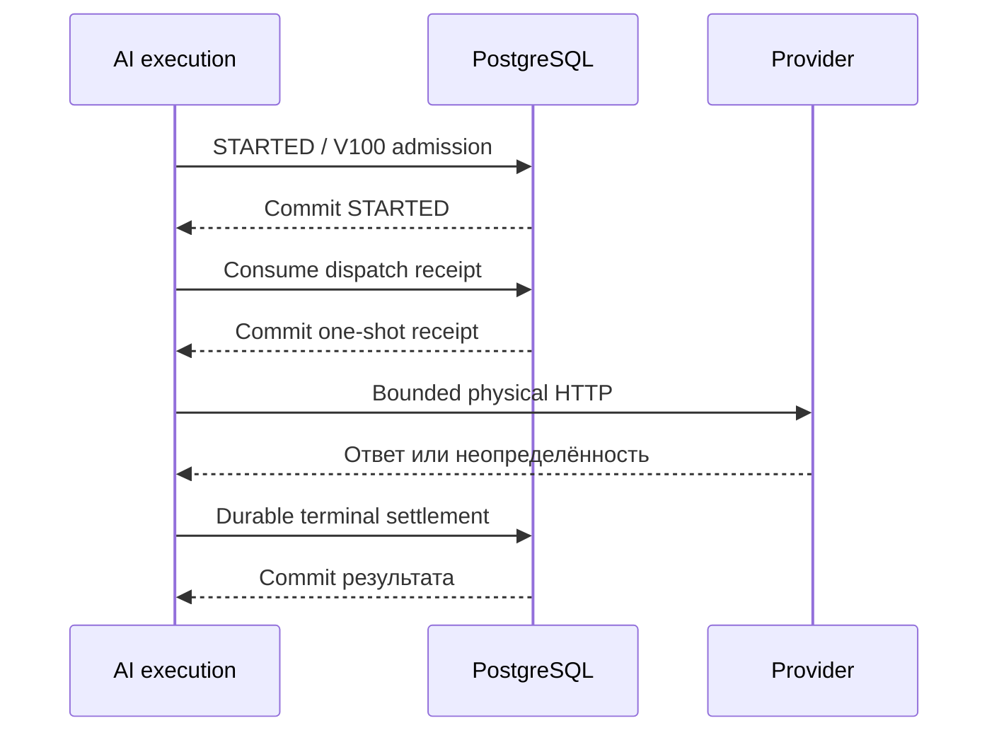

Runtime ACL: SELECT и INSERT(attempt_id) на receipt, без UPDATE, DELETE,
TRUNCATE, owner или произвольного timestamp. Функции SECURITY INVOKER,
фиксированный search_path; PUBLIC EXECUTE отозван. Не считать
receipt независимой сетевой авторизацией внешнего произвольного клиента:
все сетевые call sites обязаны следовать этому application contract.

### V101 — Model commitment ledger lookup

Файл: `V101__model_commitment_ledger_lookup.sql` (transactional).
Сохраняет определение финансовых фактов V62. Меняется только доступ
к последнему physical attempt для PENDING_RESERVATION.

- До DDL проверяются существующий view OID/relkind, отсутствие reloptions
  (security_barrier/security_invoker и иных) и девять имён/типов колонок.
- READ COMMITTED, NO data scan для read lock; SHARE UPDATE EXCLUSIVE
  на attempts стабилизирует индексный каталог при обычном DML.
- Проверяется V50 constraint `uq_model_execution_attempt_number_v50`:
  валидный immediate unique B-tree, две NOT NULL колонки
  (execution_plan_id uuid, attempt_number integer), точный порядок,
  indisvalid/indisready/indislive, отсутствие predicate/expression.
- LEFT JOIN LATERAL с ORDER BY attempt_number DESC LIMIT 1 вместо
  глобального DISTINCT ON; новый индекс не нужен.
- CREATE OR REPLACE VIEW сохраняет имя, OID, owner и ACL; девять колонок
  по прежнему контракту. Факты PHYSICAL_ATTEMPT, PENDING_RESERVATION,
  MISSING_PHYSICAL_EVIDENCE и LEGACY_ROUTE_TIMESTAMP не переклассифицируются.
- 5s lock_timeout / 120s statement_timeout, rollback при drift/lock conflict;
  повтор только после диагностики на неизменённом baseline.
  Проверки схемы не являются универсальным детектором любых DBA-изменений.

V60 и V97 содержат индексы с одинаковым порядком plan/time.
Оба сохраняются: удаление дублирования требует самостоятельной приёмки.
До применения V101 — проверить, что её исходный вариант ещё не был применён
на сохраняемой БД. Если уже применён, исправление только новой миграцией
следующей свободной версии после review; не изменять V101 или Flyway checksum.

Приёмка: EXCEPT ALL в обе стороны на V62/V101, независимые ожидаемые суммы,
13 schema/lock/concurrency сценариев, sequential Flyway и ACL, выборочные
и глобальные EXPLAIN (ANALYZE, BUFFERS). Extended fixture — до 1 000 009
physical attempts, с tenant skew и PROCESSING plans. Сравнить медиану,
shared/temp blocks и обработку строк. Это тестовые пороги, не production SLA.

### V77 — безопасный backfill исторических чатов

Перед применением `V77__backfill_legacy_default_chat_titles.sql` проверить, что V58 и все V73–V76
уже успешно
применены
в правильном порядке, сделать snapshot populated БД и провести dry-run подсчёта строк. Данные
первого
сообщения
используются **только внутри того же чата**; миграция не меняет `organization_id`, `user_id`, `created_at`,
`chat_messages` и audit trail. Legacy-заголовок `Новый чат` по своей природе неоднозначен, поэтому
возможное
намеренное
название, совпадающее с заглушкой, также будет заменено: это явно принятая политика backfill, а не
универсальное
восстановление provenance.

После применения проверить число оставшихся заглушек с/без сообщений, распределение `title_source`, `version` и
неизменность названий, отличных от заглушки. Новые транзакционные проверки должны охватывать
идемпотентный
replay,
ошибку Redis/quota, ручное rename одновременно с первым сообщением и frontend refresh списка. Если
V77 уже
есть в
`flyway_schema_history`, изменять её нельзя; correction требует следующей свободной версии.

### V72 — границы транзакционного допуска и обратная совместимость

Новая migration **`V72__organization_auth_epoch_physical_attempt_gate.sql`** добавляет:

- **`chat_turns.authorized_organization_auth_version` (`bigint`, исторически nullable)**
  - **Назначение:** Неподменяемый epoch авторизации из момента reservation
- **`chk_chat_turn_authorized_org_auth_epoch_v72`**
  - **Назначение:** Запрет отрицательной версии
- **`guard_chat_turn_reservation_epoch_v72()` + `trg_a_chat_turn_reservation_epoch_v72`**
  - **Назначение:** На `INSERT chat_turns`: tenant `FOR SHARE`, `enabled`, exact epoch
- **`guard_chat_turn_epoch_immutable_v72()` + `trg_a_chat_turn_epoch_immutable_v72`**
  - **Назначение:** Запрет изменения authorization epoch после INSERT
- **`guard_physical_attempt_organization_epoch_v72()` +
  `trg_a_physical_attempt_organization_epoch_v72`**
  - **Назначение:** На каждый `INSERT model_execution_attempts`: tenant `FOR SHARE` + live security
    epoch


```text
Organization Disable                       Physical STARTED
--------------------                       ----------------
organization FOR UPDATE <──── conflict ── organization FOR SHARE
set enabled=false, auth_version++           check enabled + exact epoch
commit                                     attempt commit (before provider I/O)
```

Операции сериализуются по строке организации: победившая транзакция определяет допустимость нового
STARTED.
**Нет
гарантий отмены** уже допущенного сетевого вызова; нельзя менять/удалять его исторический attempt
evidence.

Миграция V72 сохраняет `NULL` в исторических строках ChatTurn и даёт `DEFAULT 0` лишь новым
SQL-вставкам,
которые не
передали значение. Такие исторические turns не могут открыть новую physical attempt. Загрузка старых
версий
backend в
смешанном rollout может приводить к fail-closed отказам из-за отсутствующего principal epoch:
требуется
согласованный
cutover. Изменять ранее применённые V1–V71 вместо нового SQL-файла запрещено.

**Статус проверки:** исторический PostgreSQL Testcontainers log подтверждает применение V1–V72 с
нуля. Позднее
получен
успешный локальный прогон `./mvnw test` (2259 tests) и трех выбранных PostgreSQL/Redis
concurrency/integration
suites
(27 tests). Это не равно проверке всех возможных блокировок и не подтверждает upgrade населенной
базы V71→V72
или
production rollout.


### Важные DB boundaries

Финальная схема включает:

- canonical user email uniqueness;
- normalized organization-name uniqueness;
- exactly-one-role;
- composite tenant FK;
- refresh family integrity;
- audit event type/payload/snapshot validation;
- immutable `audit_events` UPDATE boundary;
- immutable `audit_outbox` intent + monotonic delivery metadata;
- usage quality checks;
- V71 dirty-date recalculation state и инварианты монотонного rollup watermark;
- one reply per user message;
- DB-enforced ChatTurn transition graph;
- terminal ChatTurn immutability;
- completed Chat message immutability;
- route-decision immutability;
- deferred exact route-decision ↔ ChatTurn validation;
- canonical unique model-policy key arrays;
- route-time budget commitment evidence;
- sealed base request;
- sealed final prepared request;
- exact Knowledge RAG context receipt;
- binding-version=2 physical execution fence;
- execution-plan immutability;
- live lease/fencing requirement at physical `STARTED`;
- V72 immutable ChatTurn organization authorization epoch;
- V72 `FOR SHARE` fence при reservation и physical `STARTED`;
- V72 tenant-disable gate, исключающий новый committed STARTED после Disable;
- physical attempt sequence;
- bounded-cost single-attempt rule;
- physical retry safety;
- provider target identity;
- physical response/protocol-rejection evidence;
- explicit pricing-scheme identity;
- reconciliation safety;
- monthly physical cost commitment read model;
- per-ChatTurn known physical spend read model;
- Knowledge latest-uploaded vs searchable-version separation;
- Knowledge chunk/generation provenance;
- one active Knowledge generation;
- fenced generation publication/GC;
- generation chronology;
- deterministic chat title provenance and no-backwards provenance transition.
- V93 server preview receipt and policy-version binding;
- V94 immutable diagnostic correlations, NULL for legacy;
- V95 immutable reservation and single-attempt token/USD fence;
- V96 quota revision/calendar, transaction locks and re-admission;
- V97 online index validity and availability;
- V98 bounded export state machine, TTL and owner scope;
- V99 immutable export identity, lease fencing and owner revalidation.
- V100 durable immutable dispatch receipt, current policy, bounded cost,
  quota/calendar, organization epoch и RAG permit до physical I/O.
- V101 schema-checked SELECT-only financial ledger, без изменения фактов.
- V102
- V103
- V104
- V105
- V106
- V107
- V108
- V109
- V110

### Concurrent indexes

Часть migrations использует `CREATE INDEX CONCURRENTLY`.

Production Flyway должен сохранять совместимую PostgreSQL transactional-lock configuration.

Release runbook также должен проверять `pg_index.indisvalid/indisready` для critical unique/business
indexes
после
аварийного interrupted migration.

---

## Observability и operational jobs

### Logging

Structured log context включает server request ID и, где применимо, client request ID.

Не логировать по умолчанию:

- passwords;
- raw JWT;
- raw refresh token;
- cookies;
- Authorization;
- provider API keys;
- full user prompts;
- full provider responses;
- raw document chunks;
- OCR/embedding credentials.

### Models & AI: Prometheus и операционные сигналы (7.5E.7 Fix2)

Rules: `infra/prometheus/rules/safeai-model-ai.yml`.
Tests: `infra/prometheus/tests/model-ai.test.yml`.

| Метрика Prometheus | Что измеряет |
| --- | --- |
| safeai_model_route_decisions_total | Вставки после commit; outcome, reason |
| safeai_model_route_budget_exceeded_total | Вставки с budgetExceeded |
| safeai_ai_provider_attempts_total | Входы в адаптер; provider, result |
| safeai_ai_provider_retries_total | Входы после попытки №1 |
| safeai_ai_provider_gate_failures_total | Отказ scope/STARTED/dispatch/deadline |
| safeai_ai_provider_recording_failures_total | Ошибка terminal callback |
| safeai_ai_provider_duration_seconds_bucket | Histogram adapter duration |
| safeai_ai_attempt_stalled | STARTED старше 15 минут в окне 24h |
| safeai_ai_attempt_ambiguous | AMBIGUOUS в окне 24h |
| safeai_ai_attempt_unknown_cost | Terminal unknown cost по V62 |
| safeai_ai_attempt_observation_healthy | 1 при успешном снимке, иначе 0 |
| safeai_ai_attempt_observation_errors_total | Ошибки чтения снимка |
| safeai_ai_attempt_last_observation_timestamp | Последний успешный Unix timestamp |

`ModelRouteMetrics` не считает повторное чтение новой маршрутизацией.
`AiProviderMetrics` считает вход в адаптер, а не подтверждённый provider
receipt или факт сетевой отправки. Provider labels — openai, anthropic,
mock, other; result, outcome, reason — фиксированные значения.
Tenant/user IDs, model key, URL, prompt, error body, токены и секреты
не используются как labels.

`ModelAttemptMonitor`: раз в 60 секунд read-only SQL, queryTimeout 3s,
started_at V74 index, последние 24 часа, максимум 100 000 attempts.
Превышение лимита или ошибка: NaN, healthy=0, last-success timestamp
сохраняется. AtomicReference и serialized observe исключают race
публикации; scrape не запускает SQL. Это bounded diagnostic snapshot,
не полный ledger и не гарантия обнаружения зависших попыток старше окна.

15 правил (включая пропуск/неактуальность instrumentation):

- SafeAiModelAiInstrumentationMissing;
- SafeAiAiAttemptObservationMissing;
- SafeAiAiAttemptObservationUnhealthy;
- SafeAiAiPhysicalStalled;
- SafeAiAiPhysicalAmbiguous;
- SafeAiAiPhysicalUnknownCost;
- SafeAiModelMonthlyBudgetUnverifiable;
- SafeAiModelBudgetDenialsElevated;
- SafeAiAiProviderCredentialsOrBilling;
- SafeAiAiProviderRateLimited;
- SafeAiAiProviderErrorRatio;
- SafeAiAiProviderSlow;
- SafeAiAiDispatchGateFailures;
- SafeAiAiProviderRetryElevated;
- SafeAiAiTerminalRecordingFailed.

Promtool проверяет pending/firing и отрицательные случаи, missing series,
свежесть, несколько backend instances. DB gauges агрегируются max,
instance counters — sum/rate. Не выдавать alert inactive за здоровье,
если target отсутствует или последнее наблюдение просрочено.

### Audit Outbox: метрики и оповещения

Файл правил размещается **не в Spring `application.yml`**:

```text
infra/prometheus/rules/safeai-audit-outbox.yml
```

`infra/prometheus/prometheus.yml` загружает `/etc/prometheus/rules/*.yml`; каталог rules должен быть смонтирован в
контейнер Prometheus. Scrape target использует внутренний `backend:9091/actuator/prometheus`.

Главные сигналы:

- `safeai_audit_outbox_dead_letter_rows` — dead-letter count;
- `safeai_audit_outbox_oldest_age_seconds` — возраст backlog;
- `safeai_audit_outbox_metrics_refresh_failures_total` —
  сбой обновления метрик;
- `safeai_audit_outbox_processor_failures_total` —
  сбои фоновой обработки;
- `up{job="safeai-backend"}` — доступность scrape.

Конфигурация подготовлена с семью оповещениями, включая отсутствующую целевую метрику и отсутствие
scrape
target.
Несколько инстансов публикуют общую DB backlog метрику: использовать `max`, не `sum` для gauge общих строк БД.

**Важный gap:** одни лишь alert rules не доставляют уведомления. Необходим реальный Alertmanager,
маршруты,
секреты
получателей и проверенный test firing → delivery. Без него «firing в Prometheus» не означает
извещения
дежурного. См.
`docs/RUNBOOK_AUDIT.md`.

### Безопасное логирование ошибок

Audit best-effort/scheduler/metrics должны логировать без `Throwable`, `exception.toString()` и сырого `getMessage()`:
сообщения SQL/provider способны содержать PII и bind values. Допустим ограниченный safe failure
type. Required
audit
failure при этом **не проглатывается**: иначе теряется transactional evidence.

### Knowledge erasure: техническая наблюдаемость V84 и V89 receipts

`KnowledgeErasureObservability` регистрирует на старте 26 meters: `2 scopes × 4 states × 3 gauges = 24`, плюс freshness
gauge и refresh failure counter. Период обновления `${safeai.knowledge.erasure.observability.poll-delay:PT1M}`.
Параметры запроса только агрегированные, без tenant/user/operation labels.

```promql
safeai_knowledge_erasure_operations{scope="document",state="NEEDS_REVIEW"}
safeai_knowledge_erasure_oldest_age_seconds{scope="base",state="DELETING"}
safeai_knowledge_erasure_retries{scope="document",state="DELETING"}
safeai_knowledge_erasure_metrics_last_success_epoch_seconds
safeai_knowledge_erasure_metrics_refresh_failures_total
```

Статусы без операций представлены нулями после успешного refresh. При ошибке SELECT данные **не
обнуляются**, counter
сбоя увеличивается, timestamp успешного refresh не сдвигается. До первого успешного refresh `last_success=0`. У всех
этих рядов проверять `absent(...)` и freshness отдельно, а реплики агрегировать `max` для
PostgreSQL-backed
gauges, не
`sum`.

`infra/prometheus/rules/safeai-knowledge-erasure.yml` содержит 6 правил: `NeedsReview`, `RetentionBlocked`, `Stuck`,
`MetricsStale`, `MetricsAbsent`, и `SafeAIKnowledgeErasureMetricsRefreshFailed` (полные identifiers приведены в YAML).
Дублирующее правило audit dead letters не добавляется — оно уже находится в `safeai-audit-outbox.yml`. Инструментальный
endpoint — **внутренний** `/actuator/prometheus` на management port 9091, не public Nginx.

### Metrics

Проект содержит module-level metrics, включая:

- chat processing;
- rate limiting;
- audit outbox;
- Knowledge storage reconciliation;
- V84 Knowledge erasure (`KnowledgeErasureObservability`).
- Audit integrity, независимый heartbeat/status.
- Usage report admission, duration, timeout/errors, export queue/lease,
  rollup dirty days/lag и время последнего успешного наблюдения.

Usage Prometheus families:

```text
safeai_usage_report_duration_seconds_*
safeai_usage_reports_available_permits
safeai_usage_reports_{rejected,timeout,error}_total
safeai_usage_export_{queued,running,expired_leases,failed}
safeai_usage_export_last_observation_timestamp
safeai_usage_export_events_total
safeai_usage_export_duration_seconds_*
safeai_usage_rollup_{dirty_days,lag_days}
safeai_usage_rollup_last_observation_timestamp
safeai_usage_rollup_observation_errors_total
```

Rules: `infra/prometheus/rules/safeai-usage.yml`, 11 alerts.
Unit scenarios: `infra/prometheus/tests/usage.test.yml`.
Fix1 включает обязательную проверку в общий check-prometheus-config.sh.
Порог freshness — 180s; NaN/absent не трактовать как здоровый ноль.
Кластерные gauges не суммировать по репликам.

Для V84 точные названия метрик, aggregation, freshness и правила приведены в отдельной главе
«Безопасное
удаление
Knowledge — V78–V90».

Prometheus endpoint должен быть internal/network-protected.

### Scheduled jobs

В историческом baseline существуют scheduled/maintenance paths для:

- refresh-token cleanup;
- audit outbox processing;
- audit retention;
- usage rollups/backfill и V71 dirty-date recalculation;
- Usage export worker: DB lease, cleanup TTL и наблюдение очереди;
- UsageRollupMonitor: scheduled observation, без SQL при scrape;
- ChatTurn recovery;
- Knowledge ingestion;
- Knowledge storage reconciliation;
- Knowledge generation GC;
- opt-in `KnowledgeDocumentDeletionExecutor` и `KnowledgeBaseDeletionExecutor`
  (исполняются только при соответствующих feature flags; по умолчанию выключены);
- `KnowledgeErasureObservability` (V84, read-only, не зависит от destructive flags).

Multi-instance job должен иметь DB/distributed coordination там, где duplicate work нарушит
semantics.

---

## Тестирование

README не утверждает `BUILD SUCCESS` без фактического запуска конкретного commit.

### Models & AI — финальная Security acceptance 7.5E.8 Fix1

Не отменяет Usage, Audit, Knowledge и предыдущие release gates.
Обязательная матрица:
`.github/scripts/model-ai-security-acceptance.json` — 50 suites,
97 точных сценариев. Проверка XML после Maven:

```bash
# Из корня checkout, после backend clean verify, до следующего clean:
python3 .github/scripts/check-model-ai-security-acceptance.py backend
bash infra/scripts/check-prometheus-config.sh
```

Validator fail-closed при пропущенных, дублированных, malformed, failed
или несоответствующих reports / classname / testcase counts.
Наличие тестовых исходников не считается результатом выполнения.
Стандартный CI workflow валидатором не заменяется; его обязательное
подключение к полному workflow следует подтвердить на актуальном checkout.

| Проверка | Ключевые классы |
| --- | --- |
| Scope, retry, deadline | AiExecutionAttemptScopeTest |
| Transport no replay/redirect | AiProviderTransportHardeningTest |
| Финансы, V100, revoked lease | ModelGovernanceV59V60V61PostgresIntegrationTest |
| Гонки квот | ChatConcurrencyIntegrationTest |
| Ledger equivalence | ModelCommitmentLedgerV101IntegrationTest |
| Schema drift и lock rollback | ModelCommitmentLedgerV101GuardIntegrationTest |
| До миллиона attempts | ModelCommitmentLedgerExplainPerformanceIntegrationTest |
| Sequential migrations | FlywaySequentialUpgradeIT |
| Reviewed inventory | RuntimeAclPolicyTest, DatabaseMigrationMainTest |
| Snapshot + error recovery | ModelAttemptMonitorPostgresIntegrationTest |
| Bounded metrics | AiProviderMetricsTest, ModelRouteMetricsTest |
| Budget HTTP/tenant | OrganizationBudgetStatusSecurityTest |
| Реальные app privileges | RuntimeAclContract |

RuntimeAclContract проверяет совместно export V98/V99, one-shot V100,
V101 SELECT-only ledger и Budget Status: ADMIN только своего tenant,
без доступа к platform summary; реальный cookie/CSRF и runtime login.
На clean V1–V101 и populated V85 → V101 обязательны все три PASS-маркера.
Focused, full, performance и runtime ACL прогоняются последовательно;
сохранять отчёты до следующего clean. Не выдавать Maven syntax parsing
или promtool tests за полноценный runtime acceptance.

### Структуры тестовых пакетов Models и AI

Срез E.8 Fix1: Model — 68 Java-файлов (63 Test и 5 support),
AI — 52 Java-файла (47 Test и 5 support/self-check). Файлы не равны
числу JUnit-сценариев. Подробное назначение каждого класса — в [Model][model]
и [AI][ai]. Путь: `backend/src/test/java/ru/safeai/gateway/`.

#### model — test packages

```text
model/
├── controller/
│   ├── ModelCatalogHistoryControllerTest
│   ├── ModelControllerContractTest
│   ├── ModelPolicyPreviewControllerTest
│   └── ModelRuntimeControllerTest
├── domain/
│   ├── ModelDomainContractTest
│   ├── ModelRouteDecisionMonthlyCostStateTest
│   └── ModelRouteRequestV54ContractTest
├── dto/
│   ├── ModelRequestValidationTest
│   ├── ModelRouteDecisionResponseTest
│   ├── OrganizationModelPolicyResponseTest
│   └── PolicyNumericRequestTest
├── integration/
│   ├── ModelBudgetCommitmentV64PostgresIntegrationTest
│   ├── ModelControlPlanePostgresIntegrationTest
│   ├── ModelControlPlaneSchemaV64V65PostgresIntegrationTest
│   ├── ModelExecutionPreparedBindingV65PostgresIntegrationTest
│   ├── ModelExecutionV53V54PostgresIntegrationTest
│   ├── ModelGovernanceV59V60V61PostgresIntegrationTest
│   ├── ModelIntegrationTestSupport
│   └── ModelRoutingRequestMutexPostgresIntegrationTest
├── pricing/
│   └── VersionedCatalogPricingResolverTest
├── repository/
│   ├── JdbcTextArrayReaderTest
│   ├── ModelCatalogRepositoryBindingTest
│   ├── ModelCommitmentLedgerExplainPerformanceIntegrationTest
│   ├── ModelCommitmentLedgerFixture
│   ├── ModelCommitmentLedgerV101GuardIntegrationTest
│   ├── ModelCommitmentLedgerV101IntegrationTest
│   ├── ModelRouteDecisionRepositoryContractTest
│   ├── ModelRouteMetricsTest
│   └── ModelRouteRequestMutexRepositoryTest
├── service/
│   ├── DatabaseTimestampNormalizerTest
│   ├── ModelAuditDetailsFactoryTest
│   ├── ModelCatalogHistoryServiceTest
│   ├── ModelCatalogPricingSchemeTest
│   ├── ModelCatalogRulesTest
│   ├── ModelCatalogRulesV54RegressionTest
│   ├── ModelCatalogServicePricingSchemeTest
│   ├── ModelCatalogServiceTest
│   ├── ModelControlPlaneAccessTest
│   ├── ModelControlPlaneNumericValidationTest
│   ├── ModelExecutionBindingTestSupport
│   ├── ModelInputTokenEstimatorIntegrationTest
│   ├── ModelPolicyPreviewConfirmationServiceTest
│   ├── ModelPolicyPreviewServiceTest
│   ├── ModelRouteDecisionFactoryTest
│   ├── ModelRouteExecutionBindingServiceTest
│   ├── ModelRouteExecutionGuardTest
│   ├── ModelRouteExecutionIdentityNumericTest
│   ├── ModelRouteExecutionIdentityTestFixtures
│   ├── ModelRouteExecutionPortTest
│   ├── ModelRouteReservedRequestServiceTest
│   ├── ModelRoutingCostEnvelopeV54Test
│   ├── ModelRoutingCostPolicyTest
│   ├── ModelRoutingEnvelopeServiceTest
│   ├── ModelRoutingExecutionCapabilityGateTest
│   ├── ModelRoutingReplayV54Test
│   ├── ModelRoutingSelectionPolicyTest
│   ├── ModelRoutingServiceTest
│   ├── OrganizationBudgetStatusServiceTest
│   ├── OrganizationModelPolicyRulesTest
│   ├── OrganizationBudgetStatusSecurityTest
│   ├── OrganizationModelPolicyServiceTest
│   ├── ProviderDataDispatchGuardTest
│   ├── RubBudgetRateServiceTest
│   ├── RuntimeModelHealthProbeAdaptersTest
│   ├── RuntimeModelProbeHttpSupportTest
│   ├── RuntimeModelProbeServiceTest
│   └── RuntimeModelStatusServiceTest
└── testsupport/
    └── ModelTestFixtures
```

#### ai — test packages

```text
ai/
├── config/
│   ├── AiProductionConfigurationValidatorTest
│   └── ProviderSecretConfigurationValidatorTest
├── dto/
│   ├── AiChatRequestTransformationTest
│   └── AiChatResponseSpecializedEvidenceTest
├── execution/
│   ├── AiExecutionAttemptOrganizationGateTest
│   ├── AiExecutionAttemptRecorderTest
│   ├── AiExecutionAttemptScopeTest
│   ├── AiExecutionPlanServiceTest
│   ├── AiExecutionPreDispatchGateTest
│   ├── AiExecutionServiceTest
│   ├── ExecutionEvidenceContractTest
│   ├── ModelAttemptMonitorPostgresIntegrationTest
│   ├── ModelExecutionAttemptEntityTest
│   └── ProviderFailureCertaintyTest
├── input/
│   └── AiInputUnitEstimatorTest
├── provider/
│   ├── anthropic/
│   │   ├── AnthropicProviderContractTest
│   │   ├── AnthropicResolvedModelProvenanceContractTest
│   │   └── AnthropicWireGovernanceContractTest
│   ├── mock/
│   │   └── MockAiProviderProductionConditionTest
│   ├── openai/
│   │   ├── OpenAiProviderContractTest
│   │   ├── OpenAiResolvedModelProvenanceContractTest
│   │   └── OpenAiWireGovernanceContractTest
│   ├── AiContextWindowGovernanceRegressionTest
│   ├── AiProviderEndpointSecurityTest
│   ├── AiProviderMetricsTest
│   ├── AiProviderRetryEvidenceRegressionTest
│   ├── AiProviderSupportResolvedModelTest
│   ├── AiProviderTransportHardeningTest
│   ├── AiResponseMetadataServiceTest
│   ├── AiRestClientFactoryBoundaryTest
│   ├── ProviderDataAssuranceBindingTest
│   ├── ProviderDataEvidenceSelfCheck
│   └── ProviderDataEvidenceTest
├── testsupport/
│   ├── AiTestFixtures
│   ├── CatalogPricingFixture
│   ├── GovernedAiTestFixtures
│   ├── GovernedAiTestFixturesTest
│   └── ProviderContractTestServer
├── web/
│   └── AiExceptionHandlerTest
├── AiChatResponseTest
├── AiContextWindowServiceTest
├── AiExceptionHandlerTest
├── AiMessageAndRequestTest
├── AiProviderPropertiesTest
├── AiProviderRetryExecutorTest
├── AiProviderSupportTest
├── AiRestClientFactoryTest
├── AiRetryPropertiesTest
├── AnthropicPropertiesTest
├── MockAiProviderTest
├── OpenAiPropertiesTest
└── PricingResultTest
```

### Responsive production bundle — вся платформа

Playwright `frontend/e2e/tests/platform-responsive.spec.cjs` проверяет
реальные браузерные действия в собранном интерфейсе с synthetic API.
Chromium; экранные размеры в CSS px:

| Группа | Размеры |
| --- | --- |
| Смартфоны | 360×800, 390×844, 430×932 |
| Планшеты | 768×1024, 1024×768 |
| Ноутбуки | 1280×720, 1366×768, 1440×900 |
| Мониторы | 1920×1080, 2560×1440, 3840×2160 |
| Reflow | 960×540, 720×450 |

Последние два — имитация эффективного CSS viewport при 200% zoom,
не доказательство работы реального browser zoom. Проверяются роли
USER/ADMIN/SUPER_ADMIN, Chat, Knowledge, Users, Organizations, Audit,
Usage, Models, Dashboard и публичные экраны в матрице маршрутов.
Отсутствие page-level overflow, доступные кнопки/фильтры, скролл,
модалки, mobile navigation, resize и фактический hit target.
Ошибка Organizations на 720×450 исправляется корректной компоновкой,
а не force click, skip или увеличенным timeout.

Firefox, WebKit, visual snapshots, axe-core и real-backend E2E —
отдельные обязательные направления 7.5C, не считать mock fixtures
доказательством RBAC, TLS или доступности production API.

### Регрессии V73–V77 (историческая матрица, не замена V84 CI)

Ниже — **требуемые проверки, а не результаты выполненного прогона**.

- Catalog: legacy positional constructors, `pricingScheme` JSON/request binding,
  runtime import idempotency, exact-version SQL mapping, V66 scheme CHECK.
- Pricing: missing operation identity, wrong physical model, invalid usage/cache
  dimensions, OpenAI/Anthropic semantics, `FREE`, `UNPRICED`, calculation errors.
- Routing: `HARD` budget с unknown liability, concurrency и read-only
  `nonBinding` preview без резервирования средств.
- Ingestion: parallel `workerThreads`, claim leases, heartbeat, cancellation,
  extraction timeout, object hash/size, embedding vector validity и shutdown.
- Retrieval V76: PostgreSQL constraint negative tests, preserved historical
  row, inserted redacted query and valid hash, immutable trigger, review index.
- Chat title V58/V77: first accepted message, manually named chats, default placeholder submitted as `null`, concurrent
  rename/reservation, idempotent replay, rollback, legacy backfill on populated PostgreSQL and UI
  list
  refresh.
- Lease: PostgreSQL-clock renewal, fencing token mismatch, expired lease, DB outage and watchdog
  ownership-loss metrics.
- Quota: route-bound reservation, verified/unverified pricing scheme, hard monthly cost limit,
  unknown-cost
  fail-closed
  and rollback consistency.
- Upgrade: populated Flyway V72 → V77, application startup, production profile,
  Testcontainers PostgreSQL/Redis и отсутствие регрессии публичных API.

Не заменять падающий тест ослаблением CHECK, удалением assert или изменением истории Flyway. Сначала
установить
фактическую причину и соответствие нового контракта ожидаемому поведению теста.

### Целевой release gate удаления Knowledge (V78–V90)

**Слои проверки должны оставаться раздельными:** unit/API-contract tests, PostgreSQL/Testcontainers
constraints/concurrency, настоящие versioned MinIO purge/Object Lock/legal hold, отдельный JVM
SIGKILL/restart, frontend
UI, Prometheus rule tests и deployment preflight. Положительный результат одного слоя **не**
подменяет другой.
Тесты
удаления работают только с одноразовой БД; не запускать destructive проверку с текущими рабочими 7
KB / 18
документами.


Наличие Java-теста не означает, что он запускался на текущем checkout. Исторический V82
`./mvnw clean verify`
не
подтверждает новое дерево; V83/V84 требуют нового прогона уже после объединения всех изменений, а не
переиспользования
старого результата

Ключевые test categories/classes из ранее предоставленных архивов и ZIP:

- `KnowledgeDocumentDeletionFoundationIntegrationTest`,
  `KnowledgeDocumentDeletionAcceptanceIntegrationTest`,
  `KnowledgeDocumentDeletionExecutorIntegrationTest` — request, DB fences, cleanup;
- `KnowledgeBaseDeletionFoundationIntegrationTest`,
  `KnowledgeBaseDeletionRecoveryConcurrencyIntegrationTest`,
  `KnowledgeBaseDeletionRealJvmCrashIntegrationTest` — parent/child lifecycle,
  конкурентность, recovery после реального SIGKILL;
- `S3VerifiedKnowledgeObjectPurgeIntegrationTest`,
  `KnowledgeBaseObjectLockIntegrationTest` — versioned MinIO,
  COMPLIANCE Object Lock, legal hold, непроверенный InvalidRequest;
- `KnowledgeDeletionOperatorSafetyIntegrationTest` — V83 role/revoke/flags,
  current-state diagnostics и ограниченный operator resume;
- `KnowledgeErasureTerminalAuditIntegrationTest` — V84 атомарный outbox,
  exactly-one transition intent и rollback;
- `KnowledgeErasureObservabilityTest` — V84 fixed-cardinality metrics,
  last-success freshness, failure-preserved last known values;
- `KnowledgeDocumentDeletionCapabilityControllerTest` и frontend
  `useKnowledgeDeletionController.test.tsx`, `KnowledgeDetailsPage.test.tsx` —
  capability/history/UX даже при выключенных destructive flags.

Фактический набор файлов сверить через `find` — часть тестов поставлялась в отдельных предыдущих ZIP
и может
отличаться
по именам/ревизиям.

```bash
cd ~/Workspace/Projects/Products/SafeAI-Desk

git status -sb
git diff --check
for f in infra/scripts/*.sh; do bash -n "$f" || exit 1; done
bash infra/scripts/check-config-topology.sh
bash infra/scripts/check-prometheus-config.sh

cd backend
./mvnw -Dtest=KnowledgeErasureTerminalAuditIntegrationTest,KnowledgeErasureObservabilityTest test
./mvnw -Dtest=KnowledgeDeletionOperatorSafetyIntegrationTest test
./mvnw clean verify

cd ../frontend
npm ci
NODE_OPTIONS=--no-experimental-webstorage npm run ci
```

Для Testcontainers/S3 tests — только одноразовые PostgreSQL и versioned MinIO. Тестирование **не**
должно
затрагивать
пользовательские 7 Knowledge Bases / 18 документов либо production database, включая Flyway, S3
purge и UI
deletion.
Проверить loss-of-response, retention/legal hold, unknown provider outcomes, stale worker, failing
JDBC
commit, prior
provider purge, archive references, retry idempotency, tenant isolation, permission revoke и
отсутствие утечки
operation
IDs в метрики. Не снижать assertions/guards ради зелёной сборки.


### Исторические проверки до V78 (11.10.2026)

Проверки выполнены пользователем локально перед merge PR #8; это **конкретные команды и их вывод**,
а не заявление о
статусе независимого CI, production или `clean` сборки.

- **`./mvnw -Dtest=CommonDependencyArchitectureTest test`**
  - **Фактический результат:** 1 test / 0 failures / 0 errors / `BUILD SUCCESS`
- **Negative control: temporary `common → auth` dependency**
  - **Фактический результат:** Expected `Architecture Violation` / `BUILD FAILURE`; нарушение
    найдено по типу поля
- **Повторный positive test после удаления probe**
  - **Фактический результат:** 1 test / 0 failures / 0 errors / `BUILD SUCCESS`
- **`./mvnw test`**
  - **Фактический результат:** **2259 tests / 0 failures / 0 errors / 3 skipped / `BUILD SUCCESS`**
- **Целевые Auth/Organization/Redis integration tests**
  - Команда: `./mvnw -Dtest=... test`
  - Классы: `AuthPostgresConcurrencyIT`,
    `OrganizationSecurityGateConcurrencyIT`,
    `RedisFixedWindowRateLimiterIT`.
  - **Фактический результат:** **27 tests / 0 failures / 0 errors / `BUILD SUCCESS`** (15 + 5 + 7)
- **`git merge-base --is-ancestor 103c587 main`**
  - **Фактический результат:** Подтверждено: исходный коммит PR #8 в истории `main`
- **`git status -sb`**
  - **Фактический результат:** `## main...origin/main` без изменений


Число `2259` — summary из Maven для **основного прогона**; запуск 27 целевых интеграционных тестов
учитывается отдельно,
не нужно автоматически складывать их с общим числом.

#### Важно различать уровни доказательств

- **Пройдено:** локальный `./mvnw test` на коде PR #8; targeted PostgreSQL/Redis integration tests;
  positive/negative ArchUnit test; Git ancestry.
- **Подтверждено по репозиторию:** наличие миграций Flyway V1–V72, `pom.xml`, классов и
  архитектурного теста в `main` на `fdcff62`.
- **Историческое свидетельство:** прежний успешный старт Testcontainers PostgreSQL с применением 72
  миграций.
- **Пока не подтверждено предоставленными материалами:** `./mvnw clean test` после merge, CI на
  merge SHA, populated upgrade V71→V72, продакшен-запуск, backup/restore drill, всесторонний
  security/performance/load review.

#### Исторические сбои V71/V72 и их уроки (НЕ текущий статус сборки)

Предыдущие логи фиксировали отказ `chk_chat_turns_timestamps`: тестовый `Clock` выставлял `ChatTurn.created_at` позднее
физического `clock_timestamp()` PostgreSQL, после чего DB-триггер корректно отвергал STARTED. Также
существовал fixture
в Knowledge integration suite, который пытался мутировать immutable `created_at`. Эти истории **не следует представлять
как текущий failing build** после подтвержденного green run 2259 tests.

При новом изменении этого кода по-прежнему нельзя отключать `chk_chat_turns_timestamps`, смягчать state-machine/epoch
triggers или делать слепой replay после `AMBIGUOUS`. Для двух одноименных классов указывайте fully qualified name:

```bash
cd backend
./mvnw -Dtest=ru.safeai.gateway.chat.integration.ChatTurnStateMachineIntegrationTest test
./mvnw -Dtest=ru.safeai.gateway.knowledge.integration.ChatTurnStateMachineIntegrationTest test
```

Не интерпретировать `BUILD SUCCESS` одного targeted test как доказательство прохождения всей
регрессии. Новый
PR требует
собственного green run, даже если baseline уже зеленый.

### Карта размещения backend-тестов

Историческое дерево baseline `backend/src/test/java/ru/safeai/gateway/` содержало следующие
Java-файлы
тестовых пакетов
(количество **файлов**, а не JUnit test cases):

| Пакет | Java-файлов | Что проверять при изменениях |
|---|---:|---|
| `architecture` | 1 | ArchUnit: запрет `common → application` |
| `common` | 25 | Shared API errors, security/config, infrastructure |
| `auth` | 25 | Login/refresh/JWT/CSRF/cookie/filter/concurrency |
| `user` | 20 | Tenant access, validation, mutations, versioning |
| `organization` | 12 | Platform org, access, security epochs |
| `ratelimit` | 16 | Redis/Lua, limits, HMAC keys, failure semantics |
| `audit` | 30 | Immutable evidence, outbox, retries, retention |
| `usage` | 25 | SQL reporting, rollup, dirty-date, performance |
| `chat` | 37 | ChatTurn, idempotency, lease, recovery, quotas |
| `model` | 53 | Catalog, policy, route decision, pricing/budget |
| `ai` | 45 | Provider adapters, execution evidence, retry |
| `knowledge` | 59 | ACL, ingestion, retrieval/RAG, storage, GC |

Также в корне test package находятся `SafeaiBackendApplicationTests`, utility `PasswordHashGenerator`, а в `testsupport`
— `AbstractPostgresIntegrationTest`. Это историческая инвентаризация, не текущие количества; новые Model/AI,
architecture, migration, security и Knowledge tests описаны отдельными матрицами. Для `identity` на
этом срезе
отдельной
папки с тестами нет; его порт проверяется в тестах потребителей/реализации. Выборочное добавление
dedicated
ArchUnit
identity rule закроет пробел в проверке направленности зависимостей.

Maven Surefire настроен для обычных unit/regular integration tests. В `backend/pom.xml` есть
отдельный opt-in
Failsafe
профиль `rate-limit-topology-it` (`./mvnw verify -Prate-limit-topology-it`), предназначенный для
проверок
внешнего Redis
Sentinel/Cluster. Его успешный прогон **не подтвержден** этим README.

### Backend

```bash
cd backend
./mvnw clean test
```

Для двух одноимённых интеграционных классов в разных пакетах используйте **полное имя** при
выборочном
запуске:

```bash
./mvnw -Dtest=ru.safeai.gateway.chat.integration.ChatTurnStateMachineIntegrationTest test
./mvnw -Dtest=ru.safeai.gateway.knowledge.integration.ChatTurnStateMachineIntegrationTest test
```

Команда с коротким `-Dtest=ChatTurnStateMachineIntegrationTest` потенциально выберет оба класса и не
подходит
для
изоляции диагностики.


Windows:

```bat
cd backend
mvnw.cmd clean test
```

### Целевые регрессии V72: security epochs, concurrency и физический execution

```bash
cd backend

# Проверка создания ChatTurn, physical STARTED, результата и recovery:
./mvnw -Dtest=ru.safeai.gateway.chat.integration.ChatTurnStateMachineIntegrationTest test

# Независимый одноимённый Knowledge test:
./mvnw -Dtest=ru.safeai.gateway.knowledge.integration.ChatTurnStateMachineIntegrationTest test

# Параллельные Login/Refresh/Disable и token-family races:
./mvnw -Dtest=OrganizationSecurityGateConcurrencyIT test

# Внутренний preflight и epoch у нового ChatTurn:
./mvnw -Dtest=AiExecutionAttemptOrganizationGateTest,ChatTurnOrganizationEpochTest test

# Unit-level state/finalization после удаления старого markProviderCallStarted:
./mvnw -Dtest=ChatServiceTest,ChatTurnFinalizationServiceTest test

# Полный regression suite:
./mvnw clean test
```

> Названия классов относятся к исходным V72-патчам; фактическое существование/расположение тестов в
  текущем checkout необходимо проверить. Некоторые integration suites могут запускаться через
  отдельный Maven Failsafe-профиль; тогда дополнительно выполните `./mvnw verify` в соответствии с
  `pom.xml`.

**Конкурентные сценарии, которые должны завершиться без deadlock и без выдачи действительной сессии
после Disable:**
Login ↔ Disable, Refresh ↔ Disable, несколько concurrent Refresh одного token family, ожидание `FOR SHARE`/`FOR UPDATE`,
epoch change + re-enable, authorization при отказах и повторах. Для AI проверить оба порядка гонки:
Disable
first →
попытка запрещена; STARTED first → Disable ждёт commit, evidence сохраняется. Добавить проверку
deadlock
SQLSTATE
`40P01`, statement/lock timeout и соответствующих retry/fail-closed решений.

**Для временных инвариантов** отдельно проверять timestamp ordering с реальными PostgreSQL clock и тестовым `Clock`.
Нельзя добиться зелёной сборки удалением `chk_chat_turns_timestamps`, смягчением V67/V72-триггеров или возвратом
service-level `markProviderCallStarted()`.


### Фактически присутствующие test categories

#### Security / Auth

- JWT contracts;
- auth cookie configuration;
- refresh rotation/reuse;
- CSRF;
- request ID;
- trusted proxy/client IP;
- production startup invariants;
- security error responses;
- PostgreSQL auth concurrency.

#### User / Organization

- authorization boundaries;
- request validation;
- role mapping;
- optimistic concurrency;
- security epoch integration;
- platform organization invariant;
- cache invalidation.

#### Chat

- controller contract/security;
- entity invariants;
- tenant isolation;
- state machine;
- recovery;
- concurrency;
- repository transaction behavior;
- history;
- usage-quality integration;
- EXPLAIN plan coverage;
- title behavior.

#### Audit

- authorization boundary;
- tenant isolation;
- cursor pagination;
- actor/target snapshots;
- outbox;
- uncertain commit behavior;
- retry/dead-letter;
- retention;
- advisory lock;
- required/best-effort policies.

#### Usage

- controller contract/security;
- query contracts;
- pagination;
- UTC aggregation;
- pricing correctness;
- rollup reconciliation;
- dirty-date queue, исторический forced rebuild и монотонный watermark (V71);
- performance/EXPLAIN;
- tenant isolation.
- financial evidence V95/V96: request-only vs token/cost quotas,
  concurrent policy insert/change, month rollover, stale reservation,
  pre-dispatch rejection, immutable historical evidence.
- physical attempt interval vs whole-plan reconciliation, provider scope,
  exact money/count DTOs, SQL parameters and model/user filters.
- durable export: global/per-owner admission, two replicas, expired lease,
  stale worker, unauthorized owner, terminal immutability and CSV limits.
- rollup observation unit + real PostgreSQL, UTC timezone invariance,
  missing watermark, failure/recovery, no SQL during scrape.

42 тестовых класса Usage и один fixture:
config (2), controller (4), dto (2), repository (22),
service (12), testsupport (1). Межмодульные V95/V96 и RuntimeAclContract
не входят в это число. Полное дерево и назначение — [README Usage][usage].

#### Usage: opt-in performance и release Security gate

В отдельном sandbox с Docker, из backend:

```bash
TESTS=UsageExplainAnalyzePerformanceIntegrationTest
TESTS+=,UsagePerformanceIntegrationTest
TESTS+=,UsagePhysicalExplainPerformanceIntegrationTest
./mvnw clean test -Dsafeai.usage.performance=true -Dtest="$TESTS"

grep -H 'Execution Time:' target/usage-explain/*.txt
```

100 000 plans / 200 000 physical attempts в synthetic fixture,
реальные repository SQL, V97 script/index VALID/READY, точные агрегаты,
tenant/global/date/model/user scenarios. 13 планов сохраняются в
target/usage-explain; default SLA 5000 ms для physical explain,
2000 ms для прежних usage performance gates. Не ослаблять пороги.
Один локальный SQL-прогон не доказывает p95/p99 конкурентного HTTP.

Security Fix1 дополняет RuntimeAclContract реальным HTTP cookie/CSRF
и логином safeai_app на clean V1–V101 и upgrade V85→V101:
чужой scope, owner из той же/чужой организации, отзыв tokenVersion,
immutable identity, terminal retention, READY CSV bytes, cache headers,
low-cardinality metrics. Требуется фактический PASS обоих сценариев.
Отдельно подтвердить отзыв прав при изменении организации и роли.
Проверить отчёты Maven, frontend, promtool; сохранять target до clean.
На момент редакции Fix1 check остановлен на SHA-256 теста;
нельзя считать данный acceptance завершённым.

#### AI / Model

- provider contract tests;
- retry behavior;
- provider properties;
- response size bounds;
- context fitting;
- pricing;
- production configuration;
- route/policy/catalog behavior;
- runtime probe;
- model frontend/API contract tests exist separately.

#### Knowledge

- ACL;
- KB concurrency;
- document-version concurrency;
- migration integrity;
- ingestion queue;
- retrieval repository;
- extraction;
- OCR behavior;
- S3 end-to-end;
- storage configuration;
- citations;
- context assembly;
- retrieval metrics;
- real fixture contracts.

### Целевые проверки V71 (сохранены при переходе на V72)

```bash
cd backend
./mvnw -Dtest=UsageRollupSchedulerTest,UsageRollupReconciliationIntegrationTest test
./mvnw -Dtest=RedisFixedWindowRateLimiterIT,UserServiceTest test
./mvnw clean test
```

Интеграционные тесты с `@Testcontainers` требуют Docker. Если сборка падает, ищите **первый** `Caused by`, а не только
каскадное `ApplicationContext failure threshold exceeded`. Для проверки V71 полезны: выборка earliest UTC date (включая
`AMBIGUOUS`), последовательность backfill, повторный расчёт dirty dates, монотонность watermark, lock contention,
идемпотентность aggregate rebuild. Не подавляйте проверки SQL-целостности ради зелёного результата.

### Архитектурные регрессии и CI

Пакет `architecture` вырос после исторического PR #8: кроме `CommonDependencyArchitectureTest`, актуальный срез содержит
`AiModelKnowledgeBoundaryArchitectureTest`, `ModelChatBoundaryArchitectureTest`, `AuditUserBoundaryArchitectureTest`,
`KnowledgeChatBoundaryArchitectureTest` и `OrganizationUserBoundaryArchitectureTest`. В том числе контролируется
единственный production PricingResolver. Новые правила добавляются отдельными PR после проверки
реальных
dependencies/allowed edges. Без новых тестов в `common` нельзя возвращать `JwtService`, auth exceptions или BCrypt
configuration.

Для запуска всех backend-тестов из корня проекта:

```bash
cd backend
./mvnw clean test
```

Для frontend по актуальному `package.json`:

```bash
cd frontend
npm ci
npm run check
```

`npm run check` выполняет lint, Vitest и build (с проверкой typecheck/production bundle). Команды
приведены
как
воспроизводимые проверки. В подготовке Catalog Pricing зафиксирован успешный отдельный frontend CI
(1387
тестов в 145
файлах); это не подтверждение всей сборки V92 или текущего локального HEAD.

### Целевые регрессии V91–V92 и Catalog Pricing

```bash
cd backend
./mvnw -Dtest=FlywaySequentialUpgradeIT,ModelControlPlanePostgresIntegrationTest,\
RubBudgetRateServiceTest test

POLICY_TESTS=OrganizationModelPolicyServiceTest,PolicyNumericRequestTest
POLICY_TESTS="$POLICY_TESTS,ModelControllerContractTest,ModelCatalogPricingSchemeTest"
POLICY_TESTS="$POLICY_TESTS,VersionedCatalogPricingResolverTest,RuntimeModelStatusServiceTest"
./mvnw -Dtest="$POLICY_TESTS" test
./mvnw clean verify
```

Если штатный Maven Wrapper недоступен, использовать локальный `mvn` с JDK 21. Testcontainers требует
запущенный Docker.
Не заменять реальный PostgreSQL тестом на H2 и не отключать constraints.

- **V91 — RUB evidence:** USD-only, RUB-only, один лимит, null/zero;
  неполная котировка и несовпадающие суммы.
- **V92 — конечные значения:** NaN в USD/RUB/курсе, ±Infinity для numeric
  и dates/timestamps, отрицательный/нулевой курс, переполнение.
- **Даты и котировка:** будущая или старше 14 дней effective date, московская
  дата, fetched-at позже created-at, смена суток, устаревшая котировка.
- **Точные деньги:** scale 12, округление вниз, запрет округления вверх,
  точность BigDecimal/BigInt/NUMERIC.
- **Append-only:** UPDATE/DELETE policy и RUB snapshot запрещены;
  исторические доказательства неизменны после V92.
- **Отказ источника:** timeout, слишком большой/некорректный XML, XXE/DTD,
  неправильная USD definition, cooldown, нет fallback на устаревший курс;
  USD работает независимо.
- **Последовательное обновление:** V0 и V1–V101 по одной миграции, schema OID,
  точная Flyway history, validated CHECK, повторный migrate без изменений.
  Сохранить отдельные исторические проверки перехода до V92.
- **Целостность ролей:** actor fixture — organization/user/ADMIN/policies
  в одной транзакции; roleless INSERT и DELETE последней роли после V92
  обязаны отклоняться.
- **Тарификация:** проверенный FREE против CONFIGURED/UNPRICED, отсутствие
  или неверная operation identity, кеширование токенов OpenAI/Anthropic,
  неоднозначная runtime projection.
- **API/UI:** очищенный runtime wire model, строгие числовые поля,
  несовпадение RUB quote, stale preview, tenant access и история.

`FlywaySequentialUpgradeIT` создаёт populated USD/RUB versions после V91, сверяет обе сохранённые
версии после
V92,
проверяет все шесть RUB-колонок через `information_schema` и обе validated V92 constraints. Fixture
использует
`TransactionTemplate` на том же DataSource, потому что V20 требует роль у пользователя при commit, а
V24
ограничивает её
единственность. Исправление теста не затрагивает production SQL; SQLResolve suppression локальна для
staged
V91 INSERT,
реальные DB-проверки сохранены и усилены.

Успешный запуск последнего исправления V92 на рабочей машине ещё требуется. В среде подготовки Maven
не дошёл
до
компиляции из-за отсутствующего parent Spring Boot 4.1.1 и недоступности Docker; синтаксическая
проверка и
применение
патча не эквивалентны полному Maven regression.

### CI/CD — coverage, security и performance evidence

Backend: JUnit/Surefire, opt-in Failsafe topology tests, JaCoCo 0.8.16; frontend: TypeScript,
ESLint, Vitest
coverage
gate, production bundle verification, Playwright smoke/regression. Actions Summary не заменяет
blocking
thresholds;
baseline нельзя понижать из-за регрессии.

Provider-data-assurance workflow выполняет targeted backend/frontend tests и standalone operator
fingerprint
self-check.
Prepared Performance CI проверяет реальные PostgreSQL usage queries, EXPLAIN ANALYZE и boundary
erasure
batches с
`-Dsafeai.usage.performance=true`; verifier не принимает отсутствующие, пропущенные или упавшие обязательные scenarios.
Release publish должен зависеть от обоих gates, а не от одного из них. В частичном срезе workflow не
представлены все
файлы этого объединения; проверка актуального checkout через infra security policy и CI обязательна.

Docker CI и production release сканируют backend/Nginx/PostgreSQL; production deploy использует
утверждённые
immutable
image digests. Coverage, performance, provider assurance и security gates независимы; ни один нельзя
отключить
ради
успешной сборки.

#### Регрессии административного контура (Stage 2–7.3)

- Backend: прямые API-вызовы ADMIN/SUPER_ADMIN, tenant isolation, поиск
  с экранированием `%`/`_`, приоритет и пагинация, Slice contract, UTC month,
  latest policy, переносимые резервы, неизвестные затраты, 80/100% и ноль,
  совпадение счётчиков с фильтром, сохранение обязательных nullable USD-полей.
- Frontend: stale requests, debounce, состояние фильтра URL/Back/Forward,
  CSV без усечения, отсутствующие/ошибочные данные, точные большие суммы,
  переключение scope и графика, нулевые бюджетные карточки, светлые кнопки
  клавиатурной детализации, tooltip и доступность.
- Браузер: drag/keyboard/reset, header/footer без перекрытия кнопок,
  desktop 1920/1440/1280 px и mobile 390 px, реальная навигация,
  отказ чужого доступа, responsive график и модальные окна.
- Инфраструктура: проверка parity двух PostgreSQL Dockerfile, toolchain,
  Nginx installed package manifest, негативные сценарии fail-closed,
  реальный build/scan каждого образа на новом SHA.

Известный результат Stage 7.3: 1501 frontend-тест и отдельно 26 целевых
API-тестов, успешные проверки TypeScript, ESLint, build и Java hygiene.
56 пройденных Playwright ранее — историческое доказательство; новому
срезу необходим собственный browser run. Не считать backend проверенным
только по Java hygiene: обязательны Maven и PostgreSQL integration tests.

### Дополнительная регрессия V73–V76

Перед релизом обязательны новые проверки, **не входившие** в исторические 2259/27 прогонов PR #8:

- Java ↔ PostgreSQL normalizer: все 24 whitespace,
  ISO controls, UTF-16 длина и названия-коллизии.
- V73 на базе с данными: конфликт индекса, конкурирующий
  UPDATE, version semantics, rollback при preflight error.
- V74: транзакция через UTC-полночь, revision/ack,
  повторный расчёт старого UTC-дня, нагрузка на dirty row.
- Physical spend/reconciliation: ADMIN tenant fence,
  complete/incomplete flags, retries и cross-boundary plans.
- Usage отчёты: локальный/распределённый permit,
  `REPEATABLE_READ`, HTTP 429/422 и лимит OFFSET.
- Audit: typed serializer, `MANDATORY` rollback,
  privacy-safe logs, dead-letter recovery atomicity,
  повторный recovery, immutable V68 contract.
- Audit metrics: отсутствие gauge, failure counter,
  реальные Prometheus alerts и получатель Alertmanager.
- Retention: `AuditRetentionPoolLoadIT`, Hikari pool,
  advisory lock release, lock timeout/deadlock и TPS.
- V76: reject plaintext query на новых INSERT/UPDATE,
  accept redacted query с сохранённым SHA-256,
  исторические строки без переписывания, сохранение immutable trigger,
  статус `NOT VALID` и индекс `NEEDS_REVIEW`.
- Privacy review: проверить все insert paths retrieval runs,
  отсутствие raw query в логах и отдельный retention-план для истории.
- Полные Maven/backend и frontend проверки на одном
  релизном commit, CI, backup/restore и smoke tests.

### Release candidate checks

Перед серьёзным deployment:

```text
fresh V1 → V101 (только на disposable PostgreSQL/pgvector)
populated upgrades V72 → V92, V84 → V92 и V91 → V92; порядок/lock-timeouts; Flyway checksum
populated upgrade V85 → V101; runtime ACL и HTTP security acceptance
Flyway history validation
critical index validity check
backend clean test
container build/start
prod-like startup invariants
tenant isolation
auth epoch invalidation
Login/Refresh/Disable concurrency and deadlock regression
V72 fresh/populated migration compatibility
organization kill-switch STARTED-vs-Disable race/re-enable
ChatTurn chronological CHECK constraints under Testcontainers clock
ChatTurn recovery
AI physical attempt recovery/reconciliation
Model route binding
Catalog-only verified pricing, RUB quote and V92 finite-value constraints
V20/V24 role presence and immutable V91 evidence after upgrade
Knowledge generation publication/GC
backup/restore drill
```

---

## Local development

### Infrastructure

macOS/Linux:

```bash
cd infra
docker compose -f docker-compose.local.yml up -d postgres redis
```

Windows:

```bat
cd infra
docker compose -f docker-compose.local.yml up -d postgres redis
```

Knowledge S3/MinIO requirements зависят от выбранного local profile/configuration.

### Backend

macOS/Linux:

```bash
cd backend
export SPRING_PROFILES_ACTIVE=local
export REDIS_PASSWORD='local-redis-password'

# Задайте в локальном environment/configtree отдельные credentials:
# SPRING_DATASOURCE_USERNAME=safeai_app
# SPRING_DATASOURCE_PASSWORD
# SPRING_FLYWAY_USER=safeai_migrator
# SPRING_FLYWAY_PASSWORD
# bootstrap безопасно выполняется заранее; не использовать DBA как runtime login.
# Текущий JWT contract использует RSA key ring.
# Перед запуском задайте через environment/configtree:
# SAFEAI_JWT_ISSUER
# SAFEAI_JWT_ACTIVE_KEY_ID
# SAFEAI_JWT_PUBLIC_KEY
# SAFEAI_JWT_PRIVATE_KEY

./mvnw spring-boot:run
```

Windows CMD:

```bat
cd backend
set SPRING_PROFILES_ACTIVE=local
set REDIS_PASSWORD=local-redis-password

REM Требуются отдельные SPRING_DATASOURCE_USERNAME/PASSWORD
REM и SPRING_FLYWAY_USER/PASSWORD, как в macOS/Linux примере выше.
REM Текущий JWT contract использует RSA key ring.
REM Перед запуском задайте SAFEAI_JWT_ISSUER, SAFEAI_JWT_ACTIVE_KEY_ID,
REM SAFEAI_JWT_PUBLIC_KEY и SAFEAI_JWT_PRIVATE_KEY через environment/configtree.

mvnw.cmd spring-boot:run
```

Typical local services:

```text
Backend:  http://127.0.0.1:8080
Postgres: localhost:5432
Redis:    localhost:6379
```

Local/demo credentials никогда не должны использоваться в production.

---

## Production deployment notes

### TLS

```text
Internet
  ↓
TLS terminator / reverse proxy
  ↓
Nginx
  ↓
backend internal port
```

Backend не должен публиковаться напрямую без edge controls.

### Trusted proxy

Указывать только реальные trusted edge CIDRs.

Не использовать:

```text
0.0.0.0/0
::/0
```

как доверенные proxy ranges.

### Secrets

Не хранить в Git:

- JWT private material;
- DB credentials;
- Redis credentials;
- OpenAI key;
- Anthropic key;
- Knowledge embedding key;
- OCR key;
- S3 credentials;
- future BYOK/KMS/service-account secrets.

### S3-compatible object storage

Production Knowledge требует:

- durable object store;
- access policy;
- lifecycle policy;
- backup/restore strategy;
- monitoring;
- reconciliation job;
- explicit storage endpoint hardening.

### Flyway

- applied migrations immutable;
- `clean` disabled;
- V1–V101; V87/V97 concurrent-index behavior проверяется в regression;
- Flyway работает отдельным migrator login; app не получает DDL/ownership;
- `pgvector` доступен до применения Knowledge vector migrations.

### PostgreSQL image, DB identities и release gates

Текущий `infra/postgres/Dockerfile` — release-controlled Ubuntu 24.04 Noble candidate: PostgreSQL
16.15,
pgvector 0.8.7
собирается против той же PostgreSQL ABI; gosu 1.20 собирается Go 1.27.3, pinned source commits и
base image
digests.
Официальные entrypoint scripts берутся из pinned pgvector image, не копируются Debian runtime
libraries.
Проверяется
минимальная исправленная Ubuntu версия libxml2 и отсутствие missing shared libraries. Local Compose
может
использовать
отдельный upstream PostgreSQL 16/pgvector image, а production — только утверждённый release digest.

Три базовые PostgreSQL identities: bootstrap (DBA, обычно `safeai`), `safeai_migrator` (Flyway/schema owner) и
`safeai_app` (runtime DML, least privilege). Не использовать одну роль для всех трёх задач. Worker и
operator
roles
V86–V89 дополнительно изолированы; application не наследует их destructive permissions.

Production Compose: `postgres` → `db-bootstrap` → `db-migrate` → backend. `db-bootstrap` вызывает
`10-create-app-roles.sh`, роли и grants проверяются через catalog; `db-migrate` запускает отдельный
`DatabaseMigrationMain`. Runtime backend имеет `SPRING_FLYWAY_ENABLED=false`. Secrets bootstrap/migrator/app не
переиспользуются.

Release pipeline собирает/сканирует PostgreSQL вместе с backend и Nginx, публикует image digests;
deploy
workflow
проверяет approved PostgreSQL digest. Trivy v0.76.2: CRITICAL блокирует даже без исправления
(`ignore-unfixed:
false`),
отдельно проверяются fixable HIGH/CRITICAL. Диагностические JSON/SARIF/SBOM и итоговые gates не
взаимозаменяемы. Нельзя
подменять образ сканирования другим тегом, игнорировать весь CVE класс или ослаблять gate для
получения green
CI.

До замены существующего PostgreSQL volume обязательны inventory, backup, restore rehearsal, проверки
collations,
pgvector/HNSW, row counts, constraints, Flyway history и ACL. `infra/postgres/PRODUCTION-EXECUTION.md`,
`README-restore-rehearsal.md`, `rehearse-restore.sh` и `infra/scripts/test-runtime-acl.sh` — release/runbook sources.
Это описывает реализованный deployment contract, не утверждает миграцию production на Noble или
успешное
изменение
существующего volume.

#### Infra Security Fix 1/2 — 20.11.2026

- PG production/candidate: единый закреплённый Go builder
  `golang:1.27.3-trixie` с digest, локальный `GOTOOLCHAIN`, проверка
  точной версии компилятора и собранного `gosu`. Скрипт
  `.github/scripts/check-infra-security-policy.py` проверяет parity и pinning.
- Nginx: официальный unprivileged `1.30.7-alpine`, закреплённый digest;
  `apk --no-cache upgrade`, `brotli-libs>=1.2.1-r0` и минимальная
  установленная версия `nginx 1.30.7-r0`. Root используется только
  при сборке; runtime остаётся UID 101.
- Fix 2 извлекает единственную точную версию из `apk list --manifest` и
  сравнивает через `apk version -t`; метаданные `apk info -v nginx`
  не являются надёжным источником версии установленного пакета.
  При отсутствии/неоднозначности версии сборка блокируется.
- Исторические CI-ошибки: устаревший nginx 1.30.6-r1 с четырьмя CRITICAL;
  PG `CRITICAL=0`, но `HIGH/CRITICAL fixed=1`; несовпадение builder parity.
  Нулевая таблица одного Trivy-сканирования не доказывает прохождение обоих
  gates. Для первопричины изучаются отчёты обоих сканов, в том числе JSON.

В новых пакетах подготовлено устранение ошибок, не исключение CVE.
Фактический успешный build/scan на GitHub Actions нового SHA не подтверждён.
Не повторять старый workflow run в ожидании проверки обновлённого кода;
release только после всех независимых gates на одном утверждённом коммите.

### V91–V92 и Catalog Pricing: финансовый rollout

Применить V91/V92 штатным migrator до старта нового backend, проверить валидность CHECK и сохранение
исторических
policies. Перед включением RUB input подтвердить TLS egress к ЦБ; USD path должен работать и при его
outage.
При
catalog-only переходе проверить наличие effective audited tariffs: старый pricing.yml не является
fallback. Не
выдавать
UNPRICED за FREE. Новый frontend, backend и policy DTO выпускаются согласованно; rollback бинарника
не требует
удаления
колонок или ручного rollback SQL.

### V78–V90: controlled destructive erasure rollout — NO-GO без отдельной приёмки

Разработаны документы и база: `V78–V81` (document), `V82` (base), `V83` (операторское `NEEDS_REVIEW`
requeue),
`V84`
(terminal audit и метрики). Наличие SQL, сервисов, готового frontend confirmation и настроенного
Prometheus
**не**
означает разрешение включить удаление на реальных данных.

Пять flags `safeai.knowledge.deletion.accept-enabled`, `safeai.knowledge.deletion.executor-enabled`,
`safeai.knowledge.base-deletion.accept-enabled`, `safeai.knowledge.base-deletion.executor-enabled`,
`safeai.knowledge.deletion.recovery-enabled` по умолчанию должны оставаться `false`. Для операторского resume **все
пять** должны быть явно включены только на утверждённом окружении. `BLOCKED_BY_RETENTION` нельзя
переводить в
`DELETING`
обычной командой. Read-only diagnosis и аудит продолжают работать без включения физического
удаления.

После backup/restore rehearsal и populated V84→V90 Flyway upgrade на отдельной БД проверить реальные
Object
Lock/retention, tenant/RBAC/revoke, known vs ambiguous S3 failures, отказ SQL после S3 purge,
consumer
concurrency,
frontend UI, audit outbox и Prometheus/Alertmanager end-to-end.


### V73–V76: порядок release и rollback

V73–V76 должны находиться в одном согласованном release наборе, если включаются все четыре набора
изменений.
Перед
Flyway: backup, preflight существующих организаций, учёт DDL locks, проверка миграционной истории и
совместимости версий
Java-кода с ожидаемой схемой.

Для V75 обязательно деплоить recovery Java-классы с правильным `AuditEventType`; регистрация event type без API не
заменяет управляемого восстановления.

Для V74 проверить, что rollup worker не обрабатывает открытый UTC-день и что повторные dirty
revisions не
теряются.

Для V76 проверить deployment-порядок writer-кода и нового CHECK: новые retrieval runs должны
сохранять
redacted
`query_text` и `query_sha256`. Исторические raw queries миграция не исправляет. Выполнить отдельный privacy review и
проверку partial index.

По умолчанию Flyway не откатывает применённый production SQL автоматически. Rollback приложения
допустим лишь
при
подтверждённой совместимости со схемой; иначе нужен подготовленный forward-fix и staged cutover.

### V72 rollout — согласованное внедрение security epoch и AI kill-switch

V72 нельзя считать обычной независимой SQL-миграцией: новая схема требует от reservation path явно
записывать
`authorized_organization_auth_version`, а physical executor должен уважать database rejection. Перед выпуском нужны:

1. Согласованное обновление backend и Flyway V72: не оставлять старые workers, которые создают
   ChatTurn без текущего epoch.
2. Migration rehearsal на пустой БД V1–V72 **и** на копии населённой V71 с upgrade до V72.
   Исторические `NULL` ChatTurn нельзя backfill-ить придуманной версией.
3. PostgreSQL concurrent races: Login/Refresh/Disable; физический `STARTED` против Disable;
   Disable→Enable без reactivation старого turn.
4. Корректный finalization уже начатого provider I/O: сохранять `outcome_certainty`, usage/cost,
   audit и `AMBIGUOUS` при неопределённости; не выполнять blind retry.
5. Проверка latency и блокировок `organizations FOR SHARE/FOR UPDATE`, retry policy при SQLSTATE
   `40P01` и мониторинг времени ожидания транзакций.

Успешный локальный `./mvnw test` (2259 тестов) подтвержден отдельно и не подменяет `clean test`, CI на релизном коммите,
populated V71→V72 upgrade rehearsal, production-like race tests и runtime/provider smoke. Не считать
production release
gate выполненным только по SQL-файлу, Flyway startup либо единичному green запуску.


### PostgreSQL backup / restore

Backup не считается готовым только потому, что существует cron/script.

Нужен периодический restore drill.

### Prometheus

`/actuator/prometheus` / management endpoints — internal-only. Production management слушает
отдельный
приватный адрес;
блокировать публичный ingress и проверять reachability из сети мониторинга. Используются правила в `infra/prometheus`,
**не** `deploy/prometheus` и **не** `application-prod.yml`.

Alertmanager и реальную маршрутизацию необходимо настроить отдельно: готовый YAML не является
доставленным
уведомлением.

Локальная диагностика:

```bash
curl -sS http://127.0.0.1:9091/actuator/prometheus \
  | grep '^safeai_usage_'
```

Prometheus UI: localhost:9090/targets, /query, /alerts.
`up{job="safeai-backend"}` показывает доступность scrape; INACTIVE не
равнозначен успешной end-to-end проверке. Для MetricsMissing/NotConfigured
разбирать причину, не отключать alert.

Grafana пока не обнаружена в Compose предоставленного среза.
Отдельные alert groups: Audit (15), Knowledge (9), Usage (11).
Chat, Models, RateLimit/Auth имеют доменные метрики частично,
полный alert coverage ещё требуется. Отдельно нужны DB/Redis/S3/host
exporters, защищённые dashboards и доставка Alertmanager (7.5C).

### Provider egress

Provider endpoints должны быть allowlisted/pinned.

Redirect following с credentials запрещён.

---

## Текущие ограничения и production-readiness gaps

Здесь собраны исторические риски и release gaps на 21.11.2026. Некоторые тезисы требуют
повторного
code audit перед изменением production behavior; их наличие в README не подтверждает незакрытый дефект текущего `main`.
Пункты, закрытые `V59–V68`, из списка удалены: budget-state representability закрыт `V62/V64`, final-request/RAG binding
— `V62/V64/V65`, searchable Knowledge publication — `V63`, physical response vs protocol rejection — `V66`, а Chat/Audit
evidence получил дополнительные DB backstops в `V67/V68`.

### P0 до production — release validation V72–V101, deletion safety и мониторинг

- Исторический PR #8: 2259 tests и 27/27 PostgreSQL/Redis; отдельный
  V82 `clean verify` также сообщался как успешный. Его точное количество тестов
  следует брать из вывода того прогона, не переносить на V83/V84.
- После V93–V101 нужен новый
  `./mvnw clean verify`, frontend CI, clean V1–V101 и populated upgrades,
  включая прежние V84→V92, V91→V92 и V85→V101,
  а также S3/MinIO/Object Lock + live-SIGKILL matrix для erasure.
- Свежий release gate должен подтвердить V92 constraints, role-presence
  regression, RUB quote lifecycle, catalog-only pricing и provider assurance;
  последние предоставленные Maven-логи не зелёные.
- До Production GO: выполнить full acceptance Stage 2–7.3 и Infra Security
  Fix 2; проверить server-side классификацию бюджетов, прямые запросы
  с чужой областью, CSV, параллельные резервы и UI на актуальном checkout.
- V93 реализует обязательный серверный receipt preview и подтверждение
  полной блокировки моделей; оставить отдельный acceptance direct POST,
  expiry/replay, tenant/actor/draft/version mismatch и concurrency.
  UI не является источником доказательства.
- Usage 7.5D.4.5: исправить конфликт тестового файла без обхода checksum,
  подтвердить полный Fix1, clean/upgrade runtime ACL и реальный CSV.
  Затем staging multi-replica, DB failure/restore, security и нагрузка.
- V95/V96: действующая редакция quota, месяц, строгий single attempt,
  pre-network recheck, консервативный учёт неоднозначности.
  V97/V98/V99: index validity, durable lease, owner revoke и TTL.
- `BLOCKED_BY_RETENTION` защищён от произвольного изменения. V89 допускает
  только двухоператорный review-based возврат к повторной проверке Object Lock;
  нельзя делать plain `UPDATE state` или пропускать новый S3 purge.
- V83 operator resume допускается только для проверенного `NEEDS_REVIEW`,
  при актуальном ADMIN в БД, `expectedUpdatedAt`, устранении upload/child blockers
  и пяти flags. Required audit обязателен.
- V84 outbox trigger даёт атомарный event intent, но доставка в `audit_events`
  асинхронна; dead letters, stale/failure metrics и реальный Alertmanager
  должны иметь эксплуатационный runbook и tested routing.
- 31.10.2026 локальные `promtool`/topology/shell проверки прошли; недоказанными
  остаются production Compose execution, image digest verification на релизном
  commit, реальный scrape/alert delivery и DB migration.
- Для Audit/Usage/Organization остаются исторические и release gates по V72–V76:
  миграция populated tenants, contention, dirty dates, heavy reports и security epochs.
- API `202 Accepted` означает создание задачи, **не** окончательное удаление;
  `DELETED` не включает backup, RAG/audit provenance и внешних AI providers.

**Запрещено** отключать safety triggers, менять applied SQL checksum, ослаблять RBAC/tenant scope и
подменять
unknown
provider result успехом.

#### Серверное подтверждение политики — V93 (регрессионный gate)

Контракт реализован после Stage 7.3 в V93 / 7.5B.2.
Ниже обязательные требования его повторной приёмки:

- Выдавать ограниченный по времени receipt после non-binding preview,
  привязанный к administrator identity, tenant, expected policy version,
  каноническому черновику и результату проверки.
- Если симуляция блокирует все модели, требовать явного серверного
  подтверждения конкретного результата. Проверять receipt и lockout при
  прямом POST, включая отключение политики; отсутствие, истечение,
  несовпадение или неидентичный replay отклонять. Точный допустимый retry
  возвращает ранее сохранённый результат без создания новой версии.
- Атомарно перепроверять критические ограничения и сохранить новую policy
  с погашением receipt; не заменять transaction-level version check,
  RBAC, data assurance, immutable history, audit и бюджетные блокировки.
- Симуляция не резервирует средства, не отправляет prompt провайдеру
  и не гарантирует будущий ALLOWED. Реальный probe — отдельная операция.
- Обязательны негативные регрессии: обход UI, replay, чужая организация,
  другой администратор/версия/черновик, expiry, concurrency, подтверждение
  полной блокировки и rollback при ошибке сохранения.


### P1 — Governed provider entry point

DB уже не разрешает новый physical attempt без v2 final-request binding, а `STARTED` требует live
fenced
`PROCESSING`
turn. При этом provider adapter implementation всё равно должен оставаться недоступным для
произвольного
application
call-site в обход governed execution scope.

Целевой invariant:

```text
no governed execution identity
    → no credential-bearing provider I/O
```

Это желательно подкреплять package/module visibility, explicit execution capability/token и
integration tests.

### P1 — ExecutionPlan recovery

Crash boundary:

```text
final request binding committed
+
ExecutionPlan committed
+
Attempt #1 ещё не создан
```

остаётся безопасно recoverable, потому что durable physical `STARTED` evidence отсутствует.

Нужен явный, хорошо протестированный application recovery path, который возобновляет именно эту
операцию, а не
создаёт
новую route/request identity.

### P1 — Provider token/context estimation

Governance input units (`UTF8_STRUCTURAL_UNITS_V2`) и provider-native context tokens — разные
величины.

Deterministic governance accounting полезен для policy/budget envelopes, но char/structural
heuristic нельзя
выдавать за
математически строгий upper bound provider tokenizer. Для моделей с критичным context fit нужен
provider-aware
tokenizer
либо консервативный fail-closed bound.

### P1 — Pricing scheme breadth

V66 вводит explicit `pricing_scheme` и fail-closed legacy/unsupported states, однако текущая
поддерживаемая
схема не
покрывает весь рынок provider billing semantics.

Отдельного versioned model требуют, например:

- tiered/context pricing;
- service-class pricing;
- region/residency surcharges;
- batch/async discounts;
- tool/search/image/audio dimensions;
- cache read/write variants разных providers.

Неподдерживаемая схема должна оставаться `UNPRICED`/unverifiable, а не аппроксимироваться как flat-token pricing.

### P1 — Billing-grade settlement

`model_cost_commitment_ledger_v62` и `chat_physical_spend_v67` дают provider-evidenced accounting и
unknown-liability
semantics, но это ещё не бухгалтерский/invoice settlement subsystem.

Для billing-grade слоя потребуются:

- provider invoice import/reconciliation;
- immutable settlement periods;
- полноценная multi-currency/invoice FX policy (V91 фиксирует лишь курс
  ввода бюджетных потолков; не пересчитывает invoice или исторические расходы);
- credits/discounts/taxes;
- adjustments;
- dispute workflow;
- invoice-to-attempt matching;
- close/reopen governance;
- financial audit trail.

### P1 — Knowledge evidence retention / GC

Retrieval evidence защищает referenced chunks/generations от уничтожения, но без bounded
retention/legal-hold
policy
historical evidence может удерживать storage indefinitely.

Нужен lifecycle:

- retention;
- legal hold;
- privacy deletion/anonymization;
- evidence compaction/hash/excerpt policy;
- explicit policy для Answer Passport / RetrievalRun longevity.

### P1 — Mixed scanned PDF fail-closed

Для mixed PDF OCR-required pages не должны тихо подменяться native-only extraction, если OCR
disabled/unavailable.

Strict `KNOWLEDGE_ONLY` не должен публиковать заведомо partial document как полностью готовый.

### P1 — Parser isolation

Extraction имеет timeout/thread bounds, но untrusted PDF/OOXML всё ещё парсится внутри application
JVM.

Для hardened enterprise deployment parsing стоит вынести в отдельный worker/container sandbox
boundary с
memory/CPU/time/filesystem/network limits.

### P1 — Knowledge provider attempt/cost evidence

OCR/embedding external calls пока не имеют такого же полного durable physical-attempt ledger, как
Chat AI
execution.

При partial batch success + process crash возможны повторные billable calls. Нужны durable operation
identity,
attempt
evidence и reconciliation semantics для embedding/OCR pipeline.

### P1/P2 — Concurrent index recovery

Interrupted `CREATE INDEX CONCURRENTLY` может оставить invalid index.

Для critical business indexes нужен release assertion по PostgreSQL catalogs (`pg_index.indisvalid`
/
`indisready`), а не только `IF NOT EXISTS`.

### P2 — Human review workflow for Knowledge storage reconciliation

V63 корректно разделяет `needs_review_at` и `reviewed_at`, но сама полноценная operator workflow вокруг `NEEDS_REVIEW`
должна иметь:

- assignee/claim;
- resolution code;
- comment/evidence;
- resolved timestamp;
- audit event;
- safe replay/cleanup action.

### P2 — V58 legacy title ambiguity

До появления `title_source` невозможно доказать, был ли historical title `Новый чат` placeholder-ом
или
осознанным user
title.

V58 deterministic backfill принимает это как migration trade-off; V59 защищает дальнейшее движение
provenance
назад, но
не может ретроспективно восстановить утраченное историческое намерение пользователя.

### Audit / Usage — остаточные эксплуатационные риски

- **P1:** даже при безопасном Audit logging отдельных
  классов нужно проверить все handlers/logger call sites.
- **P1:** мёртвые события нельзя восстанавливать без
  устранения root cause, операторского журнала и алерта.
- **P2:** исторические справочники с `DISTINCT` и substring
  search могут оставаться тяжёлыми при больших объёмах.
- **P2:** Hikari/advisory-lock нагрузка и масштабирование
  мониторинга должны быть измерены в production-like среде.
- **P2:** Usage dirty-date current UTC day создаёт hot row;
  при высоком TPS может понадобиться иной journal design.
- **P1:** durable CSV хранится в PostgreSQL. TTL ограничивает доступ,
  не гарантирует стирание из WAL/backup; контролировать размер, retention,
  reclaims, запросы при replica failover и реальный p95/p99.
- **P1:** 7.5D.4.5 не закрывать до реального HTTP/ACL acceptance
  и green release SHA. Не подменять internal ledger сверкой invoice.

### Текущие product boundaries

Ещё не реализованы как полноценный end-to-end production layer:

- dynamic multi-provider runtime dispatch;
- versioned physical provider registry/credential reference;
- provider fallback/residency router;
- invoice-grade billing settlement;
- streaming end-to-end governance path;
- TOOLS execution plane;
- VISION execution plane;
- STRUCTURED_OUTPUT execution plane;
- OIDC/SCIM;
- generalized Policy Engine;
- DLP/data classification;
- Groups/Departments;
- enterprise connector sync + ACL mirroring;
- MCP approval gateway;
- durable autonomous Agent Runtime;
- formal compliance certification;
- formally proven HA/SLO.

---

## Позиционирование проекта

### Короткое техническое описание

> **SafeAI Desk — modular-monolith корпоративного AI Gateway с organization multi-tenancy,
  exactly-one-role RBAC, cookie JWT + CSRF, refresh rotation/reuse detection, user/org security
  epochs, durable idempotent ChatTurn с lease/fencing/ambiguity protection, versioned Model Control
  Plane, durable physical AI attempt evidence, Knowledge/RAG provenance + Answer Passport,
  transactional audit outbox и usage/pricing quality analytics.**

### Архитектурная идея

SafeAI Desk не пытается сделать LLM deterministic.

Вместо этого платформа делает deterministic/auditable **обвязку вокруг недетерминированного
provider**:

```text
кто запросил
какие права были
какие данные разрешены
какая policy действовала
какая catalog version выбрана
какой execution target разрешён
какие знания использованы
какой external attempt начат
что известно о его исходе
что было сохранено как evidence
```

### Почему modular monolith

Текущий modular-monolith подходит проекту, потому что:

- tenant security state;
- ChatTurn reservation;
- quota;
- model route decision;
- audit intent;
- Knowledge provenance;
- execution evidence

требуют сильных transactional boundaries.

Переход к микросервисам имеет смысл только после появления реальной независимой scaling/ownership
необходимости и должен
сохранять эти invariants.

---

## Frontend

В историческом frontend-срезе 31.10.2026 сценарии Knowledge deletion вынесены в feature controllers
и
отдельные API
clients. В V84 исправлено поведение чтения истории: выключенный capability не должен очищать ранее
загруженные
операции;
network/parse failure не маскируется под пустую историю. Acceptance `202` показывает состояние
запроса, не
завершение
erasure. Все отрицательные состояния и stale errors должны оставаться видимыми после перезагрузки
страницы.

Актуальный предоставленный frontend использует React 19 / TypeScript 6 и feature-oriented layout (`app`, `entities`,
`features`, `pages`, `shared`, `test`), не старые корневые `src/api`, `src/auth`, `src/components`.

```text
frontend/src/
├── app/
├── entities/knowledge/api/knowledgeDocumentDeletionApi.ts
├── features/knowledge/
│   ├── controller/useKnowledgeDeletionController.ts
│   └── ui/details/KnowledgeDeleteDialog.tsx
├── pages/KnowledgeDetailsPage.tsx
├── shared/
├── test/
└── main.tsx
```

Команда «Удалить…» появилась в меню документов только для серверно разрешённого владельца; при
выключенной
функции видна
**неактивной** с текстом причины. React-модалка требует точного совпадения имени, отправляет
`If-Match` и
стабильный
`Idempotency-Key`, не объявляет успех по одному HTTP 202, отображает `DELETING` / `NEEDS_REVIEW` /
`BLOCKED_BY_RETENTION` / `DELETED`. Модальный UI и проверки ролей не заменяют серверную tenant/OWNER авторизацию. В
предоставленном V82 frontend-снимке есть `knowledgeBaseDeletionApi.ts`, `KnowledgeBaseDeleteAction.tsx`,
`BaseDeletionHistory.tsx` и тесты подтверждения; V84 затрагивает `useKnowledgeDeletionController.ts`
и
историю/ошибки
статуса. Фактическая работа текущей локальной UI-ветки и `npm run ci` подлежит отдельной проверке.

**Ключевые изменения по V84 ZIP:** `useKnowledgeDeletionController.ts` и его `.test.tsx`,
`KnowledgeDetailsWorkspace.tsx`, `KnowledgeDetailsContent.tsx` и `KnowledgeDetailsPage.test.tsx`. Они относятся к
реакции UI на ошибки/историю и не расширяют доступ к destructive DELETE. Источником фактических
связей и
контрактов
остаётся `frontend/src` текущей рабочей копии.

### Model Control Plane UI — Stage 4, 6 и 7

Административная страница моделей организована как четыре адресуемые рабочие области: **Обзор**,
**Каталог**,
**Доступ**, **Диагностика**. Выбранная секция восстанавливается при навигации; клавиатурная
навигация использует tablist
semantics. Обзор отражает configured runtime/effective catalog, а не динамическое переключение
provider.

- Каталог: latest/effective различаются, scheduled версии не становятся
  активными раньше effectiveFrom. История сохраняет immutable версии.
  При неоднозначном runtime match не выбирается произвольная модель.
- Доступ: шесть карточек открывают соответствующие параметры редактора;
  ADMIN видит только собственную организацию. SUPER_ADMIN управляет
  глобальным каталогом и выбирает допустимый tenant.
- Диагностика: preview и metadata probe инициируются явно, открытие вкладки
  не вызывает проверку автоматически; probe — только SUPER_ADMIN.
- Редактор: пять вкладок `access / limits / budget / data / preview`.
  Default model, allow/deny lists, max input/output, SOFT/HARD budget,
  pricing/no-training/ZDR requirements имеют отдельные объяснения.
  Preview не резервирует бюджет и не гарантирует будущий ALLOWED.
  UI не позволяет сохранить неизменённые существующие правила; для
  включённой policy требуется актуальная проверка, полная блокировка требует
  явного подтверждения, изменения инвалидируют preview.
- Числовые поля: положительные целые токены до 2147483647 или NULL;
  денежные строки до 18 целых и 12 дробных цифр, точка/запятая;
  ноль не равен NULL. Ошибки всех вкладок блокируют проверку/сохранение.
- Бюджет: переключатель USD/RUB, официальный quote и его даты, точные USD
  equivalents; `modelBudgetFx.ts` использует BigInt, а не Number.
  При переключении USD → RUB сохраняется исходный USD ceiling, если
  это представимо; обновление курса сохраняет RUB amount, но изменяет USD
  equivalent до явного сохранения. Неизменённый historical quote не обновляется
  автоматически. При unavailable quote новые RUB limits недоступны, USD
  остаётся доступным.
  В режиме USD «Показать эквивалент в RUB» загружает справочный курс,
  не меняет USD-лимит, черновик и состояние preview. Режим RUB меняет
  именно валюту ввода и сохраняет immutable snapshot при создании версии.
  Варианты контроля «Мягкий» / «Жёсткий» короткие, полное описание — ниже.
- Runtime card показывает стоимость по каталогу, а не по статическому
  pricing.yml. Unknown tariff отображается UNPRICED, не FREE; цены
  передаются как decimal strings.

#### Каталог моделей — Stage 7 Catalog UX

- «Возможности модели» — декларация форматов ввода/вывода и функций каталога
  (текст, изображения, аудио, VISION, TOOLS, STRUCTURED_OUTPUT).
  Это не гарантия реализации функции текущим адаптером провайдера.
- «Конфиденциальность данных» относится к обработке данных AI-провайдером,
  не к собственной истории чата в PostgreSQL. Хранение и обучение —
  отдельные декларации. Не указано не означает ZDR или запрет обучения.
  Подтверждение фактического подключения и срок его действия показаны отдельно.
  Backend `ModelRoutingSelectionPolicy` и `ProviderDataDispatchGuard`
  по-прежнему fail-closed проверяют требования перед отправкой данных.
- Сокращены дубли статуса и версии; вместо неактивной кнопки импорта —
  компактный статус, действия истории/расходов/новой версии унифицированы.
  Организационный контекст сохранён; каталог общий, правила принадлежат tenant.
- Высота каталога регулируется с клавиатуры и указателем, размер сохраняется,
  двойной щелчок сбрасывает. На мобильных естественная прокрутка.

### Обзор платформы и отчёты — Stage 5–7.3

```text
pages/AdminDashboardPage.tsx
  └─ features/usage/ui/PlatformDashboard.tsx
       ├─ api/platformBudgetApi.ts
       ├─ api/adminUsageApi.ts
       ├─ lib/usageBudgetStatus.ts
       ├─ ui/UsageKpis.tsx
       └─ ui/UsageDailyChart.tsx

pages/AdminUsagePage.tsx
  └─ features/usage/ui/AdminUsageWorkspace.tsx
       ├─ ui/AdminUsageControls.tsx
       ├─ ui/UsageReportView.tsx
       ├─ ui/UsageTableViewport.tsx
       ├─ ui/UsageBreakdownChart.tsx
       ├─ ui/UsageOrganizationRows.tsx
       ├─ controller/useAdminUsageReport.ts
       ├─ controller/useUsageBudget.ts
       ├─ ui/UsagePhysicalReportPanel.tsx
       ├─ ui/UsageProviderPanel.tsx
       ├─ controller/useUsageExport.ts
       ├─ api/usageProviderApi.ts
       ├─ api/usageExportApi.ts
       └─ lib/adminUsageFilterState.ts
```

На `/admin/dashboard` (меню «Обзор») сверху находятся компактные карточки
организаций, пользователей и настроенной модели. Они показывают серверные
каталожные счётчики, а не количество строк текущей страницы. Настроенный
runtime не является проверенной связью; для `mock` есть явная метка.
Виджеты независимы: сбой одного не маскируется нулём и не скрывает остальные.

Следом — контроль текущего бюджета платформы с семью интерактивными
карточками, включая нулевые. Нажатие открывает `/admin/usage` с параметрами
`report=organizations` и `budgetStatus` (например `NEAR`). Фильтр виден,
снимается явно, сохраняется при сортировке/пагинации/CSV, сбрасывается при
переходе к другой вкладке; пустая категория имеет собственное пустое состояние.
Категория рассчитывается на сервере, не из списка в браузере.

Аналитика за 7/30/90/365 дней UTC: подтверждённые токены, известная стоимость,
полнота учёта, ответы AI (записи ассистента), время последнего успешного
обновления в UTC, явная область отчёта. Смена организации не меняет
глобальные карточки и текущий бюджетный месяц. «Показать на графике»
подсвечивает строку, меняет область графика и переводит фокус к заголовку,
учитывая настройку reduced motion. Возврат — «Все организации».

График: автоматическая вертикальная шкала (тысячи/миллионы/миллиарды),
адаптация ширины, группировка по дням/неделям/месяцам и масштаб времени
1×/2×/4×, разворачивание, горизонтальная прокрутка при необходимости.
Дни без записей остаются пустыми; неизвестное и нулевое различаются.
Числа, выходящие за безопасную точность JavaScript, не используются как
ложные точные координаты; точные значения остаются в таблице и CSV.
Доступная клавиатурная детализация — светлые кнопки и видимое состояние
выбора, не чёрные прямоугольники; числовая ось не является ссылкой.

Рейтинг без поиска — до пяти организаций с положительным подтверждённым
объёмом токенов. Живой поиск по всей базе, в том числе без записей, с отдельной
пагинацией и точным счётчиком совпадений из справочника. Быстрые ссылки
«Журнал событий и решений» и «Правила доступа и бюджеты» не расширяют RBAC.

#### Единая компоновка административных таблиц и графиков

- Разделитель Usage общий для представлений «Таблица»/«График» и вкладок
  «Детализация», «По пользователям», «По моделям», «По дням», «По организациям».
  Вверх — до вкладок, вниз — до фиксированной строки итогов/пагинации.
  KPI сворачиваются в доступной области, а footer не закрывается шторкой.
  Стрелки, Home/End, PageDown, двойное нажатие; сохраняется ручная позиция.
- Stage 7.5D.3: «По провайдерам», физические вызовы и сверка, зелёный
  индикатор доказанной сверки и красные расхождения, server-side CSV.
  При смене области отменяется polling; повторный POST не выполняется
  автоматически. Сохраняется независимый CSV текущей страницы/сверки.
- Аудит: регулируемый разделитель до поля «Конец периода», доступность
  остальных фильтров через прокрутку, sticky header/footer без перекрытия
  действий; CSV по странице/фильтрам и карточки акторов с проверкой роли.
- Общие модальные окна: разворот/восстановление, светлые кнопки закрытия,
  фокус, Escape и подтверждение мутаций. На тесном viewport предусмотрена
  естественная прокрутка без потери доступности.
- Ссылки на организации, пользователей и модель отделены от действия
  фильтрации; неоднозначный runtime model ID не разрешается произвольно.

Ключевые компоненты и тесты в подготовленных изменениях: `AdminModelsNavigation.tsx`, `modelsNavigationState.ts`,
`ModelsCatalogWorkspace.tsx`, `ModelsAccessWorkspace.tsx`, `ModelCatalogHistoryModal.tsx`, `ModelPolicyModal.tsx`,
`modelPolicyModal/PolicyBudgetCurrency.tsx`, `modelPolicyModal/useModelPolicyModalController.ts`,
`modelControlPlaneViews/RuntimeCard.tsx`; `entities/model/api/model/modelBudgetFx.ts`, `modelPolicyParsers.ts`,
`modelClient.ts` и соответствующие regression tests. Frontend API parsers сохраняют exact-money
contract. Все
UI
ограничения дополнены серверной валидацией/RBAC; они не являются самостоятельной security boundary.

Проверка frontend в подготовленных пакетах прошла (Stage 7.3 — 1501 тест
и дополнительно 26 API-тестов), но новый Playwright-прогон и полный backend
требуют проверки на рабочей машине/CI. Не считать подтверждённой визуальную
desktop/mobile приёмку только по unit tests.

#### Локальные проверки frontend

```bash
cd frontend
npm ci
npm run lint
npm run test
npm run build
```

Для объединенного прогона `npm run check`; CI-ориентированный script — `npm run ci` (проверка архитектуры, lint,
coverage, production build). Для текущего проекта используется `NODE_OPTIONS=--no-experimental-webstorage npm run ci`.
`npm run audit:prod` проверяет production dependencies по npm audit policy. **Эти команды не
запускались в
предоставленных логах PR #8.**

Frontend routes/API contracts в точности определяются актуальными `App.tsx`, `api/`, `pages/`, а не этим обзорным
деревом; перенос endpoint без проверки обоих слоев запрещен.

---

## Поддержание документации в актуальном состоянии

README предназначен для **реализованных и проверяемых** контрактов. `ROADMAP.md` — для будущих
возможностей.
Связанные
документы: `docs/00_PROJECT_OVERVIEW.md`, `docs/01_LOCAL_RUNBOOK.md`, `docs/02_DOCKER_RUNBOOK.md`,
`docs/03_AUTH_JWT_VERIFICATION.md`, `docs/04_ORGANIZATION_USER_API.md`, `docs/05_CHAT_CORE_VERIFICATION.md`,
`docs/08_DATABASE_CHECKS.md`, `docs/09_TESTING_GUIDE.md`, `docs/10_TROUBLESHOOTING.md`,
`docs/12_KNOWLEDGE_BASE_CORE_VERIFICATION.md`, `backend/src/main/resources/db/README_DB.md`,
`docs/runMacBook/LOCAL_DEVELOPMENT_MACOS.md`. Эти вспомогательные документы существуют в дереве, но их актуальность по
отношению к README нужно сверять перед выполнением критических команд; они не переопределяют source
code.
Новая миграция
требует синхронного обновления: migration map, entity/repository contract, API flows, state-machine
diagrams,
runbook,
known-failure status и тестовой матрицы.

При обновлении проекта сверяйте прежде всего:

- `backend/src/main/resources/db/migration/` и `flyway_schema_history` — реально применённая
  schema/version;
- актуальные Java-классы, repository signatures и controller mappings — точные backend/API
  contracts;
- `backend/pom.xml`, `frontend/package.json` — версии инструментов/библиотек;
- Surefire/Failsafe XML и последние полные логи — **реальный** статус тестов, а не исторические
  counts;
- деплойные профили — фактические security constraints и secret handling;
- concurrency/DB evidence — подтверждение, что ограничения выдерживают не только happy path, но и
  гонки/отказоустойчивость.

Никакие сведения о наличии класса, метода или SQL-файла сами по себе не являются доказательством
прохождения
теста.
Статусы «реализовано в исходном патче», «применено в тестовой PostgreSQL», «проверено интеграционным
тестом» и
«выпущено
в production» следует документировать **раздельно**.

---


## Главное правило дальнейшей эволюции

Новые возможности не должны ослаблять уже существующие invariants:

```text
tenant isolation
auth revocation
idempotency
ChatTurn durability
provider ambiguity protection
route-decision provenance
physical-attempt evidence
Knowledge provenance
audit integrity
unknown != zero
database-enforced correctness
```

Целевой execution flow:

```text
reserveOrReplay()
  │
  ├─ auth / tenant / quota / rate-limit
  ├─ semantic idempotency
  ├─ immutable model route decision
  ├─ accounting/output reservation
  └─ ChatTurn PROCESSING
  ↓
commit short transaction
  ↓
Knowledge retrieval / final context preparation
  ↓
RAG context receipt (Knowledge modes)
  ↓
FINAL prepared-request hash + binding_version=2
  ↓
ExecutionPlan
  ↓
live ChatTurn lease/token fence
  ↓
organization enabled + exact immutable authVersion checked under FOR SHARE
  ↓
V67 live ChatTurn lease/token fence
  ↓
Attempt STARTED + provider_call_started_at committed
  ↓
V100 committed dispatch receipt (once per attempt)
  ↓
provider I/O outside long DB transaction
  ↓
terminal physical/response/pricing evidence
  ↓
fenced ChatTurn finalization
  ↓
usage / physical spend / Answer Passport / audit
```

---

## Передача контекста в новый AI-чат

Этот раздел предназначен для продолжения работы над SafeAI Desk в **новом диалоге** без повторного
обсуждения
восьми уже
завершенных PR. Он фиксирует workflow, а не заменяет чтение исходников.

### Исторический baseline PR #8 и доступные исходники 28.10.2026

```text
Repository:  https://github.com/Amid-1/Safeai-desk
Base:        main / origin/main
Main HEAD:   fdcff62fc32131474cbc2639b1fa636edffd45bc (merge PR #8)
Java:        21
Spring Boot: 4.1.1
DB:          PostgreSQL; historical main V1–V72; current SQL snapshot V1–V101
Structure:   modular monolith; common, identity, auth, user, organization,
             ratelimit, audit, usage, chat, model, ai, knowledge
PRs merged:  #1–#8; latest adds ArchUnit 1.5.1 architecture rule for common
```

**Уже сделано:** module-specific exception handlers выведены из `common.exception`; `identity.session` содержит порт
отзыва сессий; `auth` владеет JWT runtime/codec, RSA ring, Spring Security entry points, JWT
converter и
BCrypt
configuration. `common` оставлен за shared error envelope, principal/roles, IP/CORS, Request ID,
production
startup
guards, general infrastructure. PR #8 добавил `CommonDependencyArchitectureTest`.

**Проверено до merge PR #8:** `./mvnw test`: 2259 tests, 0 failures, 0 errors, 3 skipped; дополнительно 27/27
PostgreSQL/Redis IT, ArchUnit positive/negative test. Чистый `main` относился к историческому PR #8.
Это
**не** статус
текущей ветки или доказательство того, что другие модули уже архитектурно изолированы.

### Как вести следующий архитектурный PR

1. Начать с чистого `main` и `git status -sb`; не делать коммит в `main`.
2. Снять **read-only** карту межмодульных imports и consumers предполагаемого перемещаемого класса.
3. Проверить bean registration, auto-configuration, package visibility, DTO/error contracts,
   transaction propagation, lock order, events, retention, DB constraints, тесты.
4. Разделить *общий контракт*, *владельца реализации*, *адаптер*, *оркестрацию*;
   не переносить классы механически и не формировать новый общий `common` для устранения import
   errors.
5. При обнаружении real boundary violation выбрать минимальный безопасный PR и понятный rollback.
6. Добавить/скорректировать ArchUnit правило только для **проверенной** архитектурной границы;
   создать negative control, не фиксируя его в Git.
7. Выполнить targeted tests, `./mvnw test`, нужные PostgreSQL/Redis IT и frontend checks,
   если затрагиваются UI/API. Считать общее число тестов и skipped по фактическому лог-файлу.
8. Проверить `git diff --check`, `git status`, staged diff, затем commit и PR.
9. Merge через **Create a merge commit**, затем `git switch main` →
   `git pull --ff-only origin main` → `git status -sb` → `git merge-base --is-ancestor`.
10. Синхронно обновить документацию; не удалять рабочие ветки до подтверждения merge.

### Неприкосновенные инварианты

Сохранять tenant isolation, exactly-one-role RBAC, fail-closed security, cookie JWT/CSRF, refresh
rotation/reuse/family,
user/org security epochs, organization→user→token lock order, durable
ChatTurn/idempotency/lease/fencing,
`AMBIGUOUS`
no-blind-retry, physical STARTED DB fence V67/V72, sealed request/route/RAG evidence, immutable SQL
evidence,
pricing
`unknown != zero`, audit outbox и Knowledge ACL/provenance. **Нельзя** добиваться зеленых тестов ослаблением
constraints, SQL migrations или security handlers.

Пользователь предпочитает **небольшие последовательные шаги**: команда → вывод → анализ → следующий
шаг. Объяснения
по-русски; commit/PR описания — на русском, Conventional Commits prefix допустим. Не изменять личные
файлы,
stash и
несвязанные ветки, не создавать PR без необходимости. При нехватке данных запросить точный файл/лог
или
проверить repo.

#### Команды для начала нового диалога

```bash
git switch main
git status -sb
git log -1 --oneline

git grep -n -E '^import (static )?ru\.safeai\.gateway\.' -- \
  backend/src/main/java/ru/safeai/gateway/auth

cd backend
./mvnw -Dtest=CommonDependencyArchitectureTest test
```

Указывать границы подтверждения: read-only `git grep` проверяет явные Java imports; ArchUnit — class
dependencies, а ни
один из них не заменяет анализ runtime flow, Spring wiring, database triggers и concurrency.

---

## План следующего этапа

**Ближайший приоритет — принять 7.5E.8 Fix1 Models & AI Security Acceptance**
и подтвердить незакрытые критерии 7.5D.4.5 Usage. После зелёных прогонов —
7.5F RateLimit Production Hardening, 7.5C Deployment Readiness,
7.6 Full Production Audit, 8 Deployment только после GO.

**Сохраняемый общий приоритет — production-like приёмка V85–V101:** реальные PostgreSQL-роли, S3
Object
Lock,
commit receipts после DB commit, retention recovery с двумя разными DB login, Chat batch boundaries
и V90 GC.
Отдельно —
непрерывная финансовая матрица V91/V92, role-safe sequential fixture, provider-data assurance,
каталоговый
pricing,
preview и RUB UI. До отдельного GO все destructive flags остаются выключенными.

RateLimit hardening (7.5F) — запланировано, не заявлено как готовое:

| Этап | Содержание |
| --- | --- |
| 7.5F.1 | Защита от злоупотреблений и key cardinality Redis |
| 7.5F.2 | RPM/TPM/concurrency providers, models и background jobs |
| 7.5F.3 | Redis failover, сохранность счётчиков, ротация HMAC |
| 7.5F.4 | Метрики, memory/latency и security alerts |
| 7.5F.5 | Нагрузка, concurrency, integration и Security tests |
| 7.5F.6 | Документация и приёмка |

Не увеличивать число Redis email keys после отказа IP limiter;
проверить распределённые атаки, edge throttling и bounded memory.
Fail-closed, backend replicas и Sentinel restart/failover должны
сохранять смысл накопленных лимитов. HMAC rotation не открывает
новое пустое пространство обхода лимита. AI message limiter не равен
physical provider limiter: Models 7.5E и RateLimit 7.5F согласуют
лимиты попыток, токенов, retry, embeddings и фоновых операций.

7.5C: deployment rehearsal, Grafana provisioning, Alertmanager,
exporters, dashboards, retention, access controls, backup/restore.
Порядок не снимает действующие требования Audit WORM/Knowledge erasure.

Целевые Grafana dashboards (план, не отчёт о готовой поставке):

| Dashboard | Назначение |
| --- | --- |
| System Overview | Общая доступность, readiness, active alerts |
| JVM & Spring Boot | Heap, GC, CPU, threads, pool saturation |
| HTTP API | RPS, p95/p99, 4xx/5xx |
| PostgreSQL | Locks, connections, transactions, query latency |
| Redis | Memory, key cardinality, evictions, Sentinel |
| Usage | Rollups, physical spend, CSV, data quality |
| Audit | Outbox, integrity, independent verifier |
| Models & Providers | Routing, budget denial, provider latency/errors |
| AI Execution | Physical attempts, ambiguous, stalled, terminal errors |
| RateLimit | Blocks, physical RPM/TPM и concurrency после 7.5F |
| Knowledge & RAG | Ingestion, leases, review, erasure |
| Security | Auth anomalies, rate limit и security events |
| Infrastructure | CPU, RAM, storage, network |

Графана не заменяет независимый verifier или Alertmanager.
Данные tenants не выводить в labels/общие dashboards. Доступ к management
endpoint, Prometheus, Grafana и exporters — только из доверенной
сети с отдельной аутентификацией. Отдельно подтвердить provisioning,
retention, topology и фактическую доставку уведомлений.


Приоритет — **не массовый перенос Java-файлов**, а доказуемое выравнивание ownership и направление
зависимостей в
текущем модульном монолите.

- **1. Identity**
  - **Цель:** Аудит `identity.session` и consumers
  - **Что должно получиться:** Узкий стабильный порт без imports из application modules; ArchUnit
    при подтверждении чистоты
- **2. Auth / User / Organization**
  - **Цель:** Инвентаризация cyclic compile/runtime coupling
  - **Что должно получиться:** Security-state contracts и session revocation без обратных ссылок на
    auth implementation
- **3. Rate limit**
  - **Цель:** Выделить наружу только policy/service contracts
  - **Что должно получиться:** Redis/Lua/HMAC внутри реализации; callers не зависят от storage
    details
- **4. Audit**
  - **Цель:** Проверить outbox API + transactional guarantees
  - **Что должно получиться:** Domain modules depend on audit contract, storage/retention stays
    audit-owned
- **5. Usage**
  - **Цель:** Отделить event/fact contracts от reporting implementation
  - **Что должно получиться:** Ограничение heavy queries, корректность watermark/dirty dates,
    независимость от UI
- **6. Model / AI**
  - **Цель:** Разделить governance permission и physical provider execution
  - **Что должно получиться:** Exact sealed request/attempt evidence; запрет bypass provider I/O;
    целевые ArchUnit tests
- **7. Knowledge**
  - **Цель:** Отделить ACL/ingestion/retrieval/RAG adapters
  - **Что должно получиться:** Контракты не раскрывают storage internals; сохранены
    provenance/fenced publication
- **8. Chat**
  - **Цель:** Оркестратор без обратных зависимостей от нижележащих модулей
  - **Что должно получиться:** Durable ChatTurn и recovery остаются центром workflow без
    циклического ownership
- **9. Frontend / API**
  - **Цель:** Сопоставить DTO, ошибки, RBAC и frontend runtime parsers
  - **Что должно получиться:** Проверяемая end-to-end совместимость, без ослабления backend
    authorization


Порядок — гипотеза для **аудита**, а не разрешение сразу вводить все dependency rules. Сначала
строится фактический
dependency graph; архитектура и контракты согласуются с доменными инвариантами. Любое изменение —
отдельный
маленький PR
с целевыми тестами.

---

**Редакция 21.11.2026:** сохранена предметная документация модулей, схемы
классов и исторический baseline. Актуализированы Super Admin UX Stage 2–7.3,
контроль политики, V1–V101, USD/RUB, Usage, Dashboard, каталог, PostgreSQL
supply chain, Infra Security Fix 2, разделение SQL-ролей и release/test gates.
Live deployment и итоговый зелёный CI не заявляются.
---

## Релизный контроль V73–V101

Этот checklist задаёт **условия выпуска**, не отчёт об успешном выполнении. Не запускайте
destructive SQL и тесты
стирания на production PostgreSQL.

#### Репозиторий, миграции и сборка

```bash
cd ~/Workspace/Projects/Products/SafeAI-Desk

git status -sb
git diff --check
git diff --stat
git diff --cached --stat

# Проверить 101 SQL V1–V101 и 9 .conf (V87, V94–V101).
find backend/src/main/resources/db/migration -maxdepth 1 \
  -name 'V*.sql' -print | LC_ALL=C sort

find backend/src/main/resources/db/migration -maxdepth 1 \
  -name '*.sql.conf' -print | LC_ALL=C sort

# Верифицировать все 110 checked resources, не обновляя хеши.
(cd backend/src/main/resources/db/migration && \
  awk '!/^#/ && NF' ../acl/reviewed-migrations.sha256 | shasum -a 256 -c)

for f in infra/scripts/*.sh; do bash -n "$f" || exit 1; done
bash infra/scripts/check-config-topology.sh
bash infra/scripts/check-prometheus-config.sh
python3 .github/scripts/check-infra-security-policy.py
python3 -m unittest discover -s .github/scripts -p 'test_infra_security_policy.py'
bash infra/scripts/test-provider-data-evidence.sh

# Только в подготовленном окружении, без запуска deployment.
# docker compose --env-file backend/.env.prod \
#   -f infra/docker-compose.yml config --quiet

cd backend
./mvnw clean verify
cd ../frontend
npm ci
NODE_OPTIONS=--no-experimental-webstorage npm run ci
```

#### Контроль PostgreSQL на изолированном стенде

```sql
SELECT installed_rank, version, description, script, success
FROM public.flyway_schema_history
WHERE version ~ '^[0-9]+$'
ORDER BY installed_rank;

SELECT version, count(*)
FROM public.flyway_schema_history
WHERE version ~ '^[0-9]+$' AND success
GROUP BY version
HAVING count(*) <> 1;

SELECT c.relname, i.indisvalid, i.indisready
FROM pg_index i
JOIN pg_class c ON c.oid = i.indexrelid
WHERE c.relnamespace = 'public'::regnamespace
  AND c.relname IN ('ix_chat_archived_owner_v86',
                    'idx_model_execution_attempts_plan_started_v97');

SELECT conname, convalidated
FROM pg_constraint
WHERE conname = 'chk_chat_erasure_state_v86';

SELECT conname, convalidated
FROM pg_constraint
WHERE conrelid = 'public.organization_model_policies'::regclass
  AND conname IN ('chk_model_policy_rub_budget_v91',
                  'chk_model_policy_usd_finite_v92',
                  'chk_model_policy_rub_dates_finite_v92')
ORDER BY conname;

SELECT column_name, data_type, numeric_precision, numeric_scale
FROM information_schema.columns
WHERE table_schema = 'public'
  AND table_name = 'organization_model_policies'
  AND column_name IN ('max_request_cost_rub', 'monthly_budget_rub',
                      'rub_per_usd', 'rub_quote_date',
                      'rub_effective_date', 'rub_fetched_at')
ORDER BY column_name;

SELECT to_regclass('public.knowledge_rag_execution_permits_v85'),
       to_regclass('public.chat_erasure_operations_v86'),
       to_regclass('public.knowledge_erasure_commit_outbox_v89'),
       to_regclass('public.knowledge_retention_recovery_reviews_v89');

SELECT has_table_privilege(
  'safeai_app', 'public.knowledge_document_chunks', 'DELETE'
) AS app_can_direct_delete_chunks;

SELECT has_function_privilege(
  'safeai_app',
  'public.gc_knowledge_generation_chunks_v90(uuid,uuid)',
  'EXECUTE'
) AS app_can_use_fenced_generation_gc;

SELECT to_regclass('public.model_policy_preview_confirmations'),
       to_regclass('public.chat_quota_calendar_v96'),
       to_regclass('public.usage_export_jobs');

SELECT period_zone FROM public.chat_quota_calendar_v96 WHERE singleton;

SELECT t.tgname, t.tgenabled
FROM pg_trigger t
WHERE NOT t.tgisinternal
  AND t.tgname ~ '(v9[45689]|v100)$'
ORDER BY t.tgname;

SELECT
  has_table_privilege('safeai_app',
    'public.chat_quota_calendar_v96', 'SELECT') AS calendar_read,
  has_table_privilege('safeai_app',
    'public.chat_quota_calendar_v96', 'UPDATE') AS calendar_write,
  has_column_privilege('safeai_app',
    'public.usage_export_jobs', 'owner_id', 'UPDATE') AS owner_write,
  has_column_privilege('safeai_app',
    'public.usage_export_jobs', 'state', 'UPDATE') AS state_write,
  has_table_privilege('safeai_app',
    'public.usage_export_jobs', 'TRUNCATE') AS queue_truncate;

SELECT
  has_table_privilege('safeai_app',
    'public.model_physical_dispatch_receipts_v100', 'SELECT') AS receipt_read,
  has_column_privilege('safeai_app',
    'public.model_physical_dispatch_receipts_v100',
    'attempt_id', 'INSERT') AS receipt_attempt_insert,
  has_column_privilege('safeai_app',
    'public.model_physical_dispatch_receipts_v100',
    'authorized_at', 'INSERT') AS receipt_timestamp_insert,
  has_table_privilege('safeai_app',
    'public.model_physical_dispatch_receipts_v100', 'UPDATE') AS receipt_update,
  has_table_privilege('safeai_app',
    'public.model_physical_dispatch_receipts_v100', 'DELETE') AS receipt_delete,
  has_table_privilege('safeai_app',
    'public.model_physical_dispatch_receipts_v100', 'TRUNCATE') AS receipt_truncate,
  has_table_privilege('safeai_app',
    'public.model_cost_commitment_ledger_v62', 'SELECT') AS ledger_read,
  has_table_privilege('safeai_app',
    'public.model_cost_commitment_ledger_v62', 'UPDATE') AS ledger_update;

SELECT c.conname, i.indisunique, i.indisvalid, i.indisready, i.indislive
FROM pg_constraint c JOIN pg_index i ON i.indexrelid = c.conindid
WHERE c.conname = 'uq_model_execution_attempt_number_v50';

SELECT oid, relkind, relowner::regrole, relacl, reloptions
FROM pg_class
WHERE oid = 'public.model_cost_commitment_ledger_v62'::regclass;
```

Для V96/V98/V99 ожидается calendar_read=true, calendar_write=false,
owner_write=false, state_write=true, queue_truncate=false.
Календарь совпадает с runtime config; V97 VALID/READY.
V100: receipt_read и receipt_attempt_insert=true; receipt_timestamp_insert,
receipt_update, receipt_delete, receipt_truncate=false.
V101: ledger_read=true, ledger_update=false, V50 index valid/ready/live,
owner/ACL и OID ledger сохранены относительно V62 baseline.
Каталожная проверка является предварительной; реальные DML/HTTP
deny paths и попытки гонки проверять только на изолированном стенде.

Ожидается, что `app_can_direct_delete_chunks = false`, `app_can_use_fenced_generation_gc = true`, а индекс V87
`indisvalid = true` и `indisready = true`. Все три V91/V92 CHECK должны существовать и быть validated; запрос к
information_schema должен вернуть шесть колонок. Наличие ограничений и функций не заменяет тесты на
**реальной**
отдельной app/worker/operator роли.

#### Необходимая интеграционная матрица

- Fresh V1–V101 и populated upgrades V84 → V92, V91 → V92, V85 → V101
  с checksum verification; sequential V0 (test-only) и V1–V101.
- Отрицательные проверки SQL login/GUC, inherited grants и `SECURITY DEFINER`.
- Раздельные worker JDBC URLs и запрет переиспользования app credentials.
- Chat 0/1/99/100/101/10 000/10 001 и legacy retrieval query limits.
- Архив, restore, idempotency, удержание содержимого при legal hold.
- RAG permit/attempt lease против удаления базы/документа и архивирования чата.
- S3 versioned bucket: все версии и delete markers, COMPLIANCE lock/hold.
- Kill/crash между S3 purge, DB commit, V89 receipt и S3 publication.
- Dual-control recovery: две независимые роли, одинаковые ticket/evidence,
  stale timestamp и отказ при несовпадении.
- V90 GC при `COLLECTING`, запрет direct app `DELETE`, сохранение V57 guards.
- V91 exact RUB/USD pairing, missing quote, stale date, no FX fallback.
- V92 NaN, ±Infinity, overflow, immutability, validated constraints и
  V20/V24 role presence после upgrade.
- V93 server preview: expiry, replay, actor/tenant, draft context,
  lockout, optimistic version, atomic save.
- V94 nullable history, immutable correlations, tenant filter,
  outbox replay/evidence equality и сквозная диагностика.
- V95 strict tokens/cost: exactly one attempt, historical NULL,
  v2 reserve/route match, month rollover и отсутствие network I/O при deny.
- V96 policy insert race, revision mutation, exact calendar, READ COMMITTED,
  concurrent starts, dispatch recheck и отказ при stale reserve.
- V97 actual script in autocommit, VALID/READY, EXPLAIN ANALYZE.
- V98/V99 bounded queue, direct SQL guards, two replicas, expired lease,
  старый worker, owner revoke, CSV precision, no-store, attachment/nosniff.
- Usage Security Fix1: clean и upgrade RuntimeAclContract, реальный
  safeai_app и cookie/CSRF, no skipped acceptance; promtool 11 rules.
- Catalog-only pricing и provider-data evidence, negative dispatch, preview
  и runtime wire contract; проверка approved PostgreSQL image digest и CI scans.
- Audit outbox: atomicity, retry, dead letter, immutable provenance.
- Replica/multi-worker concurrency, leases/fencing, backup/restore drills.
- Frontend regression, Prometheus scrape, Alertmanager delivery, CI artifacts.

**Production GO запрещён** без свежего green suite, утверждённого retention решения, реальной
проверки Object
Lock,
безопасных SQL grants, backup restore, наблюдаемости и операционного runbook. В противном случае
destructive
flags
остаются `false`.

**Неизменяемое правило:** не редактировать миграции, уже существующие в `flyway_schema_history`. Последующие исправления
оформлять следующей свободной версией после проверки текущей ветки и применённой схемы.

## Super Admin Production UX

Пакеты 18–22.11.2026 развивают административную консоль поверх V1–V101.
Подробная дорожная карта и критерии приемки:
[Super Admin UX — этап 2](docs/SUPER_ADMIN_PRODUCTION_UX_STAGE2.md) и
[единая UI-система — этап 3](docs/SUPER_ADMIN_PRODUCTION_UX_STAGE3.md).

| Этап | Направление | Статус |
|---|---|---|
| 1 | Организации, пользователи, компоновка | Видно на снимках |
| 2 | Серверные каталоги и навигация | Реализовано |
| 3 / 3.2 | Единый UI, модалки, аудит, resize | Реализовано |
| 4 | Модели, правила, бюджеты, диагностика | Реализовано |
| 5 / 5.2 | Аудит, Usage, графики, бюджеты, CSV | Реализовано |
| 6 | Dashboard, USD/RUB, регулируемые панели | Реализовано |
| 7 | Catalog UX и конфиденциальность | Реализовано |
| 7.2 | Dashboard, серверный поиск, бюджеты | Реализовано |
| 7.3 | Финальная полировка, budget drill-down | Пакет готов |
| 7.5B.2 / V93 | Серверный receipt preview и lockout | Реализовано |
| 7.5B.3–4.3 | Correlation, delivery integrity, WORM tools, alerts | Реализовано* |
| 7.5D.1–2.3 | Usage accuracy, quota admission | Реализовано |
| 7.5D.3.1–3.2 | Физическая сверка, провайдеры, CSV | Реализовано |
| 7.5D.4.1–4.5 | Usage PostgreSQL, monitoring, security | Финальная приёмка |
| 7.5E.1–7.5E.8 | Models & AI Hardening, V100/V101, observability | Fix1 к приёмке |
| 7.5F | RateLimit Production Hardening | Следующий |
| 7.5C / 7.6 | Deployment Readiness / полный аудит | Запланировано |
| Далее | Production acceptance и security review | Обязательно |

«Реализовано» означает наличие в предоставленном коде/пакетах, а не
подтверждённый deploy. Stage 5.2 Fix 10 сохраняет явные nullable поля
бюджета, Stage 6 Fix 3 доводит шторку до footer, Fix 4 укрепляет именно
браузерный тест видимости бюджета. Stage 7.3 не ослабляет backend gates.
* Внешние WORM, verifier, pin, Alertmanager и retention integration
требуют отдельной эксплуатационной приёмки.

### Серверные контракты этапа 2

- `GET /api/organizations/search?query=&type=TENANT&enabled=true&page=0&size=50`: только SUPER_ADMIN. Предикаты имени
  (LIKE с экранированием), типа (идентификатор системной организации из конфигурации) и статуса
  применяются до
  пагинации. Типы API по-прежнему `PLATFORM` и `TENANT`; общее количество каталога получается отдельным серверным
  запросом, число совпадений — из `totalElements`.
- `GET /api/users/search?organizationId=...&role=SUPER_ADMIN&page=0&size=50`: SUPER_ADMIN может ограничить область одной
  организацией; ADMIN — только своей. Для ADMIN запрос чужой организации запрещён до обращения к
  базе данных.
  Роль
  SUPER_ADMIN разрешена как фильтр только в глобальном административном поиске. Сохраняются
  стабильная
  сортировка и
  отдельное получение ассоциаций после выборки идентификаторов.
- `GET /api/users/search/statistics?organizationId=...`: отдельный серверный снимок счётчиков `total`,
  `superAdministrators`, `administrators`, `users`, `enabled`, `disabled`. Legacy `/api/users/statistics` и контракты
  мутаций не изменены. Счётчики ролей относятся к выбранной области, а число совпадений — к активным
  фильтрам.
- Карточка организации связывает `/admin/users`, `/admin/models?section=access`, `/admin/usage` и `/admin/audit` с
  идентификатором конкретной организации. Ссылки не расширяют полномочия: сервер повторно проверяет
  каждую
  операцию.
  Системная организация остаётся защищённой.

Изменения не представляют собой подтверждение Production GO. Обязательны полные frontend/backend
тесты,
PostgreSQL
integration tests, действующие CI security gates и локальная проверка прямых ссылок и сценариев
изоляции.
