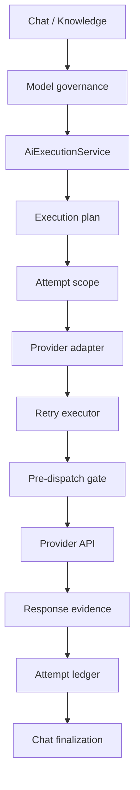
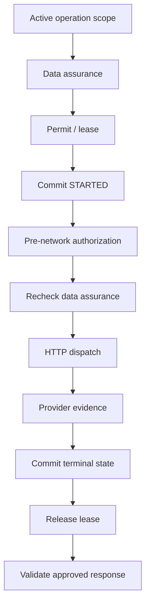
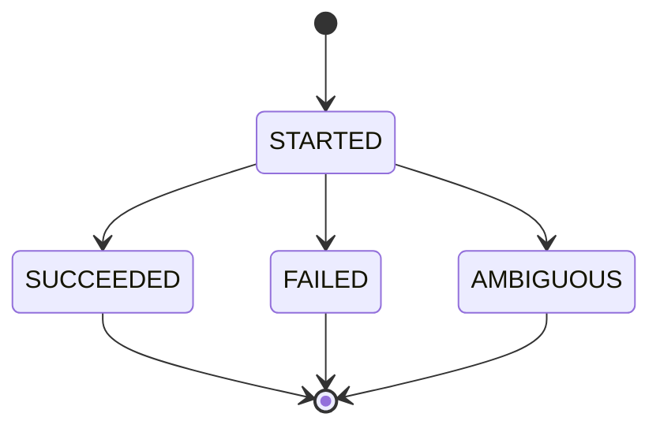
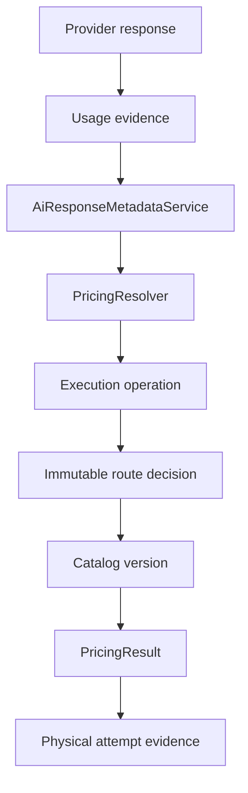
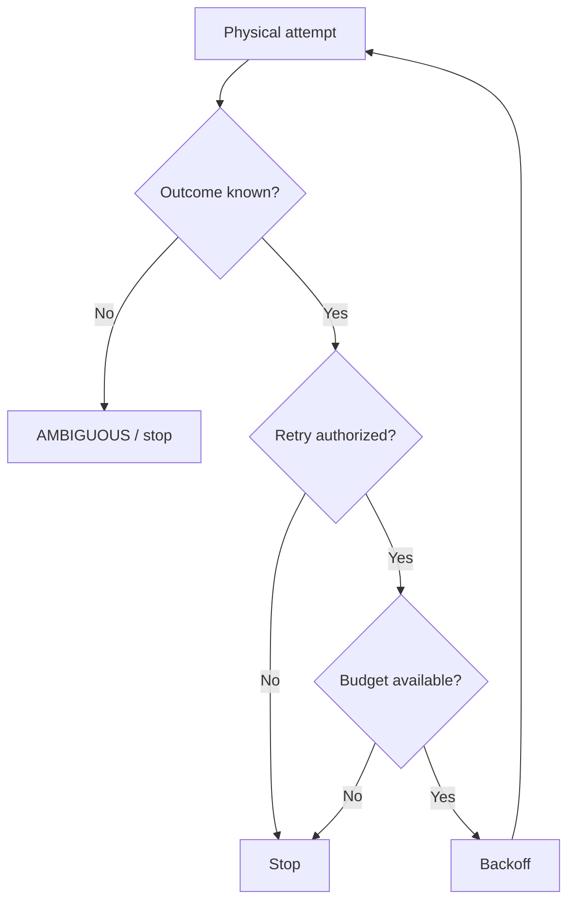
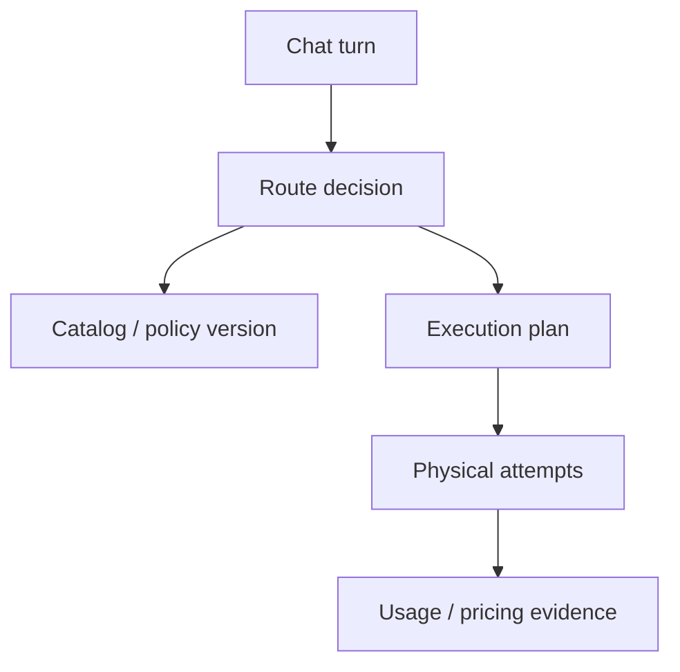

# SafeAI-Desk — AI Runtime

Контролируемое выполнение AI-запросов, интеграция с провайдерами,
доказательства исполнения и расчёт стоимости.

> **Пакет:** `ru.safeai.gateway.ai`  
> **Проект:** SafeAI-Desk / backend  
> **Актуальность:** 17.11.2026, схема Flyway V1–V92  
> **Стек:** Java, Spring Boot, Spring MVC, RestClient, Spring Data JPA, PostgreSQL  
> **Production-код:** 80 Java-файлов  
> **Тестовый пакет:** 47 Java-файлов, включая fixtures и self-check  
> Документ описывает реализованный runtime, а не подтверждает состояние
> развернутого production или успешность последнего полного CI.

## Содержание

- [Назначение](#назначение)
- [Архитектура](#архитектура)
- [Структура production-кода](#структура-production-кода)
- [Компоненты и реализации](#компоненты-и-реализации)
- [Жизненный цикл операции](#жизненный-цикл-операции)
- [Провайдеры и транспорт](#провайдеры-и-транспорт)
- [Контекст и лимиты](#контекст-и-лимиты)
- [Безопасность и Knowledge](#безопасность-и-knowledge)
- [Учёт токенов и стоимость](#учёт-токенов-и-стоимость)
- [Ошибки и повторные попытки](#ошибки-и-повторные-попытки)
- [Конфигурация](#конфигурация)
- [Хранение и миграции](#хранение-и-миграции)
- [Тестирование](#тестирование)
- [Эксплуатация](#эксплуатация)

## Назначение

AI — горизонтальный runtime-слой backend, отвечающий за безопасную
физическую отправку запросов в LLM API. Он отделяет прикладной сценарий
чата от формата запроса и ответа конкретного поставщика.

Модуль реализует:

- унифицированный immutable-контракт запроса и ответа;
- текстовую генерацию через OpenAI Responses API и Anthropic Messages API;
- локальный mock для разработки и тестирования;
- проверку разрешённой физической модели, операции и организации;
- привязку отправляемого payload к зарезервированному input/output envelope;
- оценку входных единиц и fingerprint фактического запроса;
- подготовку контекста, лимиты сообщений и физический output cap;
- долговечный план выполнения и журнал каждой физической попытки;
- запрет неразрешённых повторов, классификацию неопределённых исходов;
- контроль Knowledge execution permit и lease непосредственно перед I/O;
- использование evidence политики обработки данных провайдера;
- извлечение фактических usage, cache usage и provenance ответа;
- расчёт USD-стоимости по закреплённой версии каталога моделей;
- унифицированное преобразование ошибок во внешний API.

### Границы ответственности

AI не является владельцем всего жизненного цикла чата.

- **chat** — ChatTurn, история, идемпотентность, квоты, финализация,
  восстановление после ошибок и пользовательский API.
- **model** — каталог, версии, политика организации, маршрутизация,
  стоимость и бюджет, разрешение физического исполнения.
- **knowledge** — retrieval, RAG, доступ к источникам, разрешения и leases,
  управление жизненным циклом и удалением данных.
- **usage** — агрегаты фактических расходов, аналитика и reconciliation.
- **auth / organization / security** — аутентификация, роли,
  tenant isolation и отзыв разрешений.
- **ai** — преобразование утверждённого запроса в provider call,
  доказательства его отправки/исхода и технические ограничения.

Контракты AI не означают, что уже реализованы агенты, tool calling,
streaming, vision или автоматический multi-provider fallback. Текущий
runtime — управляемая текстовая генерация через один активный adapter.
Embeddings и OCR реализуются отдельными компонентами Knowledge.

## Архитектура

### Общий поток



### Порты и реализации

Модуль использует границы в виде Java-интерфейсов. Это позволяет AI
runtime зависеть от контрактов, не перенося бизнес-политику в HTTP client.

```text
AiModelExecutionPort
  └─ model.service.ModelRouteExecutionBindingService

AiExecutionIdentity
  └─ model.service.ModelRouteExecutionIdentity

AiDataAssurancePort
  └─ model.service.ProviderDataDispatchGuard

AiExecutionAttemptAuthorization
  └─ knowledge.rag.KnowledgeRagExecutionPermitService

AiKnowledgeExecutionMode
  └─ knowledge.rag.KnowledgeMode

PricingResolver
  └─ model.pricing.VersionedCatalogPricingResolver

AiProvider
  ├─ OpenAiProvider
  ├─ AnthropicProvider
  └─ MockAiProvider
```

Порты позволяют менять реализацию, но не обходить model governance.
Наличие интерфейса или registry не делает все модели доступными
для физического исполнения.

### Три уровня идентичности

- Логический запрос — идентичность ChatTurn и route decision.
- AI-операция — `providerOperationId`, связанный с execution plan.
- Физическая попытка — уникальный `attemptId` и порядковый номер.

Один запрос может иметь несколько физических попыток только при
доказанной допустимости retry. Повтор не является новой бизнес-операцией.

## Структура production-кода

Путь: `backend/src/main/java/ru/safeai/gateway/ai/`.

Расширения `.java` опущены для компактности в Markdown Preview IDEA.

```text
ai/
├── config/
│   ├── AiConfiguration
│   ├── AiProductionConfigurationValidator
│   ├── AiRetryTimeoutBudgetValidator
│   ├── AnthropicProviderConfiguration
│   └── OpenAiProviderConfiguration
├── dto/
│   ├── AiChatRequest
│   ├── AiChatResponse
│   ├── AiMessage
│   └── AiMessageRole
├── exception/
│   ├── AiContextLimitException
│   ├── AiProviderBillingException
│   ├── AiProviderErrorType
│   ├── AiProviderException
│   ├── AiProviderOverloadedException
│   ├── AiProviderQuotaExceededException
│   ├── AiProviderRateLimitedException
│   ├── AiProviderResponseTooLargeException
│   ├── AiProviderTimeoutException
│   └── AiProviderUnavailableException
├── execution/
│   ├── AiDataAssurancePort
│   ├── AiDispatchAbortedException
│   ├── AiExecutionAttemptAuthorization
│   ├── AiExecutionAttemptObserver
│   ├── AiExecutionAttemptRecorder
│   ├── AiExecutionAttemptScope
│   ├── AiExecutionIdentity
│   ├── AiExecutionPlanService
│   ├── AiExecutionRequest
│   ├── AiExecutionResult
│   ├── AiExecutionService
│   ├── AiKnowledgeExecutionMode
│   ├── AiModelExecutionPort
│   ├── AiOrganizationExecutionDeniedException
│   ├── ExecutionAttemptOutcome
│   ├── FallbackSafety
│   ├── ModelExecutionAttemptEntity
│   ├── ModelExecutionAttemptRepository
│   ├── ModelExecutionPlanEntity
│   ├── ModelExecutionPlanRepository
│   ├── OutcomeCertainty
│   ├── PhysicalAttemptReconciliationRequiredException
│   ├── ProviderExecutionTarget
│   ├── ProviderFailureCertainty
│   ├── ProviderPricingEvidence
│   ├── ProviderUsageEvidence
│   ├── ResolvedModelMismatchException
│   ├── ResponseValidationStatus
│   └── RetrySafety
├── input/
│   ├── AiInputUnitEstimator
│   └── AiRequestFingerprint
├── metadata/
│   ├── AiResponseStatus
│   ├── AiTokenUsage
│   ├── PricingStatus
│   └── UsageStatus
├── pricing/
│   ├── ModelPricingScheme
│   ├── PricingResolver
│   └── PricingResult
├── provider/
│   ├── anthropic/
│   │   ├── AnthropicProperties
│   │   └── AnthropicProvider
│   ├── mock/
│   │   └── MockAiProvider
│   ├── openai/
│   │   ├── OpenAiProperties
│   │   └── OpenAiProvider
│   ├── AiBoundedHttpRequestFactory
│   ├── AiContextWindowProperties
│   ├── AiContextWindowService
│   ├── AiJsonNodeSupport
│   ├── AiProvider
│   ├── AiProviderAttemptContext
│   ├── AiProviderDispatchDeadline
│   ├── AiProviderExceptionFactory
│   ├── AiProviderProperties
│   ├── AiProviderRetryExecutor
│   ├── AiProviderSupport
│   ├── AiResponseMetadataService
│   ├── AiResponseTooLargeIOException
│   ├── AiRestClientFactory
│   ├── AiRetryProperties
│   ├── ProviderDataAssuranceProperties
│   ├── ProviderDataEvidence
│   ├── ProviderEvidenceText
│   ├── ProviderPropertyValidator
│   └── ProviderRegistry
├── web/
│   └── AiExceptionHandler
└── README.md
```

## Компоненты и реализации

### config — конфигурация и запуск

- `AiConfiguration` — регистрация общих AI-компонентов и properties.
- `AiProductionConfigurationValidator` — startup gate; production
  допускает только `openai` или `anthropic`, а не mock или пустой provider.
- `AiRetryTimeoutBudgetValidator` — согласование сетевых тайм-аутов
  активного адаптера с общим retry budget.
- `AnthropicProviderConfiguration` — условная конфигурация Anthropic.
- `OpenAiProviderConfiguration` — условная конфигурация OpenAI.

### dto — неизменяемые контракты

- `AiChatRequest` (record) — идентификаторы пользователя, организации,
  чата и операции, system/developer instructions, текущий user message,
  история и утверждённые input/output limits. Методы преобразования
  сохраняют governance envelope.
- `AiChatResponse` (record) — текст, requested/resolved model,
  provider request/message IDs, статус и finish reason, usage,
  specialized billing evidence и pricing metadata.
- `AiMessage` (record) — нормализованное сообщение с ролью.
- `AiMessageRole` (enum) — роли сообщений; история канонична,
  USER/ASSISTANT парами, инструкции передаются отдельно.

### exception — иерархия ошибок

- `AiContextLimitException` — обязательный контекст превышает лимит.
- `AiProviderException` — общий тип ошибки провайдера, HTTP status,
  тип, идентификатор запроса, retry hint и признак неопределённости.
- `AiProviderErrorType` — машинно-читаемая классификация сбоя.
- `AiProviderBillingException` — проблема оплаты у провайдера.
- `AiProviderQuotaExceededException` — исчерпание provider quota.
- `AiProviderRateLimitedException` — rate limit.
- `AiProviderOverloadedException` — перегрузка upstream.
- `AiProviderResponseTooLargeException` — превышение response limit.
- `AiProviderTimeoutException` — превышение времени ожидания.
- `AiProviderUnavailableException` — недоступность upstream.

Provider quota и billing не равнозначны внутренним квотам SafeAI-Desk.

### execution — orchestration и журнал выполнения

Оркестрация:

- `AiExecutionService` — входная точка governed execution.
  Авторизует физическую отправку, сверяет target, создаёт plan,
  открывает scope, подключает observer и вызывает адаптер.
  Передаёт в scope настроенный `safeai.ai.retry.max-attempts`,
  а для ограниченной финансовой политики — строго одну попытку.
- `AiExecutionRequest` (record) — запрос, связанный с identity,
  target и контекстом Knowledge-исполнения.
- `AiExecutionResult` (record) — результат выполнения.
- `AiExecutionIdentity` — порт неизменяемой идентичности операции.
- `AiModelExecutionPort` — проверка сохранённого решения и физического
  запроса; определяет, требуется ли ровно одна попытка.
- `ProviderExecutionTarget` (record) — утверждённые provider/model
  и правила допустимости resolved response.
- `AiKnowledgeExecutionMode` — контракт режима Knowledge без прямой
  зависимости AI от его enum.
- `AiDataAssurancePort` — проверка допустимости передачи данных
  конкретному provider target.

Журнал и физическая авторизация:

- `AiExecutionPlanService` — создание или чтение durable plan,
  проверка идентичности повторного обращения, отдельная транзакция.
- `ModelExecutionPlanEntity` — JPA-модель execution plan.
- `ModelExecutionPlanRepository` — доступ к сохранённым планам.
- `AiExecutionAttemptScope` — граница операции в текущем потоке,
  контроль активной попытки и lifecycle callbacks.
  Самостоятельно проверяет предел, последовательность и уникальность ID,
  неизменность объявленного максимума, однократный допуск dispatch
  и соответствие возвращённого ответа подтверждённому success evidence.
- `AiExecutionAttemptObserver` — контракт событий started,
  before dispatch, succeeded, failed и ambiguous.
  Проверка before dispatch обязательна для каждой реализации observer.
- `AiExecutionAttemptAuthorization` — permit/lease на конкретную
  физическую попытку, проверка отзыва и завершение lease.
- `AiExecutionAttemptRecorder` — запись STARTED и terminal evidence
  в отдельных транзакциях `REQUIRES_NEW`, проверка предшественника.
- `ModelExecutionAttemptEntity` — JPA-модель физической попытки,
  outcome, target, provider IDs, usage, pricing evidence, timestamps.
- `ModelExecutionAttemptRepository` — чтение/запись попыток,
  проверка security epoch и поиск последнего предшественника.

Доказательства и состояния:

- `ExecutionAttemptOutcome` — состояние физической попытки.
- `OutcomeCertainty` — достоверность выполнения/отказа.
- `ProviderFailureCertainty` — консервативная классификация сбоя;
  неизвестный исход не превращается в доказанный отказ.
- `RetrySafety` — допустимость повторной отправки на тот же target.
- `FallbackSafety` — evidence допустимости fallback, не механизм
  автоматического переключения между провайдерами.
- `ResponseValidationStatus` — пригодность provider response
  с точки зрения протокола, модели и поддерживаемой функциональности.
- `ProviderUsageEvidence` (record) — структурированные usage-данные.
- `ProviderPricingEvidence` (record) — доказательства стоимости
  и исходной версии pricing.
- `AiOrganizationExecutionDeniedException` — отказ из-за отключения
  организации или изменения её authorization epoch.
- `ResolvedModelMismatchException` — физически возвращённая модель
  не соответствует утверждённой.
- `PhysicalAttemptReconciliationRequiredException` — состояние,
  требующее сверки после нарушения durable attempt boundary.

### input — консервативный input accounting

- `AiInputUnitEstimator` — оценка верхнего envelope входа на основе
  UTF-8 и структурного overhead, версия `UTF8_STRUCTURAL_UNITS_V2`.
  Это не точный vendor tokenizer и не фактический оплаченный usage.
- `AiRequestFingerprint` — детерминированный fingerprint запроса
  с length-framed полями; используется при доказательстве привязки
  утверждённого запроса к фактическому исполнению.

### metadata — семантика ответа и расхода

- `AiResponseStatus` — результат генерации, включая refusal
  и незавершённый ответ.
- `AiTokenUsage` (record) — input/output, cached/cache-write tokens,
  признаки наличия и валидности specialized billing dimensions.
- `UsageStatus` — полнота/применимость usage.
- `PricingStatus` — результат расчёта цены; unknown не равен zero.

### pricing — контракт тарификации

- `ModelPricingScheme` — stable identity алгоритма settlement:
  FLAT_TOKEN_V1, LEGACY_FLAT_UNVERIFIED_V1, UNSUPPORTED_COMPLEX_V1.
- `PricingResolver` — operation-bound интерфейс расчёта стоимости.
  Реализация находится в `model.pricing`.
- `PricingResult` (record) — статус, BigDecimal costUsd, валюта,
  версия цены и момент расчёта; валидирует согласованность данных.

### provider — общий provider runtime

- `AiProvider` — SPI адаптера: отправка запроса, physical target
  и признак учёта физических попыток.
- `AiProviderProperties` — выбор активного провайдера.
- `AiProviderAttemptContext` (record) — operation UUID, attempt UUID,
  номер и максимум попыток.
- `AiContextWindowProperties` — настройки размера контекста.
- `AiContextWindowService` — проверка обязательных полей и
  выбор максимально свежей допустимой истории целыми парами.
- `AiJsonNodeSupport` — безопасная работа с полями JSON ответа.
- `AiProviderExceptionFactory` — построение унифицированных ошибок.
- `AiProviderRetryExecutor` — controlled retry и lifecycle попыток.
- `AiProviderSupport` — общие операции provider parsing/validation,
  извлечение usage, обработка resolved model и HTTP metadata.
- `AiResponseMetadataService` — связывает usage, provider operation,
  target/resolved model и PricingResolver; нормализует price metadata.
- `AiResponseTooLargeIOException` — внутренний транспортный сигнал
  превышения допустимого размера тела ответа.
- `AiRestClientFactory` — создание ограниченного HTTP-клиента.
- `AiRetryProperties` — параметры retry и временного бюджета.
- `ProviderDataAssuranceProperties` — binding независимых evidence
  для chat, embedding, OCR.
- `ProviderDataEvidence` — структурированное проверяемое evidence
  о подключении и политике обращения с данными.
- `ProviderEvidenceText` — нормализация ограниченного evidence text.
- `ProviderPropertyValidator` — общие проверки настроек адаптеров.
- `ProviderRegistry` — сведения о зарегистрированных provider adapters;
  не является разрешением обойти выбранный execution target.

Реализации адаптеров:

- `provider.openai.OpenAiProperties` — настройки OpenAI API.
- `provider.openai.OpenAiProvider` — Responses API и его parsing.
- `provider.anthropic.AnthropicProperties` — настройки Anthropic API.
- `provider.anthropic.AnthropicProvider` — Messages API и parsing.
- `provider.mock.MockAiProvider` — локальная имитация ответа и
  lifecycle; недоступен в production.

### web — HTTP-граница ошибок

- `AiExceptionHandler` — специализированный REST ControllerAdvice,
  стандартизированные ApiErrorResponse, ограниченная diagnostics,
  Retry-After там, где он применим, и отдельный ответ reconciliation.

В пакете нет собственного публичного AI chat controller:
пользовательский сценарий предоставляет модуль chat.

## Жизненный цикл операции

### Planning

1. Chat/model утверждают route decision и резервируют ресурсы.
2. AI получает identity, request и точный ProviderExecutionTarget.
3. `AiModelExecutionPort.authorizePhysicalExecution` проверяет
   зарезервированный и окончательный запрос.
4. Активный адаптер обязан поддерживать запись физических попыток.
   Его target должен совпасть с утверждённым target.
5. `AiExecutionPlanService` создаёт или читает plan, не заменяя
   сохранённую идентичность новой.
6. `AiExecutionAttemptScope` открывает scope для конкретной операции.

### Physical attempt



Отдельное сохранение STARTED выполняется до внешнего вызова.
Невозможность записать STARTED означает, что отправка не разрешена.
Проверка lease и data assurance повторяется у границы сетевого I/O.

После успешного ответа в ledger сначала фиксируется полученное evidence.
Затем проверяется, допустимо ли принять ответ утверждённой модели.
Это принципиально: несовпадение model не стирает уже совершённый вызов.

Основной lifecycle, записываемый текущим recorder:



SUCCEEDED описывает физическую сторону операции, а не гарантирует
пригодность текста для ChatTurn. `ResponseValidationStatus` отдельно
отражает protocol rejection, tool use и другие ошибки валидации.
В enum также предусмотрено состояние PROTOCOL_REJECTED; наличие
этого значения в DB-контракте не означает, что любой сбой парсинга
текущие адаптеры уже сохраняют именно в этой форме.

### Idempotency, concurrency и транзакции

- Plan и attempt не являются временными объектами в памяти.
- Повторный plan не должен изменять его operation/route identity.
- Scope не создаётся автоматически из произвольного provider call.
  Проверка operationId предшествует I/O; nested scope запрещён.
- Scope очищается после завершения, включая исключения.
- Попытки получают уникальные UUID и последовательные номера.
- Recorder проверяет допустимый предшествующий исход и target.
- V53 сериализует правила INSERT в БД; Java-проверка не заменяет SQL.
- V72 повторно защищает STARTED по current organization epoch.
- Commit внешнего LLM API и локальной транзакции не атомарен:
  crash/timeout между ними требует reconciliation.
- `REQUIRES_NEW` сохраняет evidence независимо от rollback ChatTurn;
  отсутствие локального результата не доказывает отсутствие оплаты.

## Провайдеры и транспорт

### OpenAI

`OpenAiProvider` формирует запрос Responses API (`/responses`):

- system/developer instructions и сообщения истории;
- текущий пользовательский текст;
- утверждённую модель;
- `max_output_tokens` с учётом утверждённого cap;
- контролируемый параметр `store` (по умолчанию false).

Из ответа извлекаются текстовые output items, статус, refusal,
incomplete reason, ID ответа, header request ID, явно сообщённая
модель и usage, включая cached input tokens.

Отсутствие или неподтверждённость resolved model не исправляется
подстановкой requested model. Неподдерживаемые content items
не должны считаться полноценным успешно принятым текстовым ответом.

### Anthropic

`AnthropicProvider` формирует запрос Messages API (`/messages`):

- system/developer instructions приводятся к wire-контракту Anthropic;
- история и текущий user message передаются в messages;
- model, `max_tokens`, API version и credentials;
- разбираются текстовые content blocks, stop reason, message/request IDs,
  physical model и usage с cache-read/cache-creation counters.

Служебные или неподдерживаемые блоки не исполняются как инструменты.
Провайдерский протокол и пригодность ответа проверяются отдельно.

### Mock

`MockAiProvider` позволяет тестировать orchestration без платных вызовов.
Он использует собственный target и общий lifecycle attempts.
Стоимость разрешается общим operation-bound pricing contract;
mock не является запасным production provider.

### HTTP boundary

`AiRestClientFactory` обеспечивает:

- ограничение connect/read timeout;
- запрет автоматических HTTP redirects;
- ограничение размера фактически прочитанного response body;
- проверку допустимых настроек endpoint и размеров.

Оба реальных адаптера также проверяют размер извлечённого текста.
Нельзя полагаться только на Content-Length: oversized/chunked
или некорректный response должен быть отклонён.

Транспортный вызов синхронный; сам факт использования RestClient
не означает streaming или реактивный API.

## Контекст и лимиты

Ограничения применяются слоями.

```text
AiChatRequest
  └─ DTO invariants и абсолютные пределы
      └─ AiInputUnitEstimator
          └─ Reservation / model binding
              └─ AiContextWindowService
                  └─ Проверка final request
                      └─ Physical output cap
```

### Подготовка запроса

- История хранится как полные USER/ASSISTANT turns.
- System/developer instructions отделены от истории.
- Текущее сообщение и обязательные инструкции нельзя молча усечь.
- При нехватке контекста выбираются самые свежие полные пары истории.
- Не оставляется orphan ASSISTANT или неполная пара.
- `withHistory` сохраняет operation identity, reservedInputTokens
  и maxOutputTokens; изменяется только history.
- Governed path проверяет fingerprint зарезервированного и окончательного
  запроса до входа в адаптер. Внутри адаптера prepare может дополнительно
  сократить историю, сохраняя envelope и не увеличивая расход.
  Не допускать последующего расширения отправляемого контекста.

### Разные типы измерений

1. Java-символы — защита от чрезмерно длинного текста.
2. Приблизительные context tokens — эвристика окна модели.
3. UTF-8 structural units — консервативный input accounting
   для reservation и binding.
4. Фактические provider tokens — доказательства после ответа.

Эти значения не взаимозаменяемы. Нельзя заменять отсутствующие
фактические токены оценкой и признавать полученную цену доказанной.

## Безопасность и Knowledge

### Authorization gate

Каждая физическая отправка обязана сохранять согласованность tenant,
operation, approved route, provider и model. AI не должен получать
доверенность только из пользовательского JSON.

Организация может быть отключена после route decision.
Перед STARTED recorder проверяет текущий epoch; V72 в PostgreSQL
является окончательной защитой от конкурентного изменения на этой границе.

### RAG permit и lease (V85)

Для Knowledge-режима AI требует действующий permit.  
`KnowledgeRagExecutionPermitService` реализует:

- получение durable lease до физической попытки;
- проверку допуска непосредственно перед отправкой;
- перевод lease в соответствующий результат;
- взаимодействие с механизмами revoke, erasure и reconciliation.

GENERAL и Knowledge имеют различную семантику допуска. No-op
реализация допуска не может разрешить Knowledge I/O.

V85 защищает уже начатое исполнение и связывает его с правилами
удаления данных. V89–V90 усиливают reconciliation/fencing и least
privilege в Knowledge; это не новая реализация RAG внутри ai.

### Provider data assurance

`ProviderDataEvidence` описывает подтверждение условий обработки данных
для конкретного подключения, а не только рекламное заявление поставщика.

Ключевые свойства:

- отдельные evidence для chat, embedding и OCR;
- идентификатор источника доказательства (договор, DPA, документация,
  ticket — в соответствии с validation contract);
- `verifiedAt` и `expiresAt`, ограниченный срок действия до 90 суток;
- fingerprint подключения, проверяемый на совпадение;
- отдельные признаки условий retention и использования данных;
- noTraining и zeroDataRetention независимы; ZDR требует также
  совместимой конфигурации retention;
- оценка условий по фактическому времени и подключению;
- отсутствие evidence, просрочка или mismatch не считаются подтверждением.

ProviderDataDispatchGuard проверяет evidence до STARTED и вновь
перед network dispatch. `store=false` — настройка запроса OpenAI,
не самостоятельное доказательство договорного ZDR.

Fingerprint и секрет API не следует публиковать в пользовательских
ответах. `ProviderEvidenceText` нормализует evidence text, но не
является универсальным DLP/redaction механизмом.

## Учёт токенов и стоимость

### Usage metadata

`AiTokenUsage` различает:

- обычный usage input/output;
- cached input;
- cache-write input;
- наличие и валидность specialized billing counters.

`UsageStatus` различает доступный, отсутствующий, неполный
и неприменимый usage согласно enum-контракту.
Отсутствующие/некорректные значения нельзя превращать в нулевой usage.

### Источник цены

С 17.11.2026 runtime использует **только operation-bound catalog pricing**.
Статические YAML-цены и legacy static resolver удалены из AI runtime.



Текущая сигнатура `PricingResolver`:

```java
PricingResult resolve(
        UUID providerOperationId,
        ProviderExecutionTarget target,
        String resolvedPhysicalModel,
        AiTokenUsage usage
);
```

`VersionedCatalogPricingResolver` — единственная production-реализация
контракта. Он использует привязанные к operation execution plan,
route decision и версию каталога, а не текущую произвольную цену модели.

Проверяются provenance операции, утверждённый target, фактическая
модель, integrity version решения, полнота usage и пригодность pricing.
`CatalogPricingEligibility` в model/pricing применяется в этом контуре.

Для автоматического settlement поддерживается `FLAT_TOKEN_V1`.
Legacy unverified и complex pricing не интерпретируются как flat rate.
Каталожные FREE и CONFIGURED должны соответствовать собственным
инвариантам и не подменяться произвольным нулём.

### Формула

Для поддерживаемой схемы стоимость складывается из отдельных категорий:

```text
Cost USD =
    uncached input × input rate / 1 000 000
  + cached input   × cache-read rate / 1 000 000
  + cache write    × cache-write rate / 1 000 000
  + output tokens  × output rate / 1 000 000
```

OpenAI: cached tokens входят в общий input, поэтому вычитаются
при расчёте uncached input (иначе получится двойное списание).
Resolver вычитает обе специализированные input-категории;
их сумма не может превышать общий input.

Anthropic: cache read и cache write учитываются отдельными
категориями по контракту Messages API.

Используется `BigDecimal`; денежное evidence имеет scale не более 12.
Расчёт стоимости в catalog resolver использует HALF_UP; это отличается
от округления вниз при конвертации лимита RUB → USD.
Отсутствие нужной ставки, некорректные счетчики или неподдерживаемая
тарификация не дают права списать сумму по неполной формуле.

### PricingStatus

| Статус | Смысл |
| --- | --- |
| PRICED | Подтверждённая положительная стоимость |
| FREE | Подтверждённая нулевая стоимость |
| UNPRICED | Нет доказуемой цены |
| CALCULATION_FAILED | Ошибка вычисления |
| NOT_APPLICABLE | Тарификация неприменима |

PRICED/FREE требуют currency и priceVersion. Неизвестная стоимость
не содержит искусственно созданных price metadata.

### Бюджеты RUB и USD (V91–V92)

AI runtime и usage/settlement сохраняют USD как каноническую валюту.
RUB — дополнительный способ задания лимитов организации в module model,
а не смена валюты провайдера.

- V91 сохраняет исходный RUB-лимит запроса/месяца, официальный
  курс ЦБ РФ (RUB за 1 USD), quote date, effective date, fetchedAt
  и проверяет вычисленный USD-equivalent.
- USD-equivalent округляется вниз до 12 десятичных знаков
  через точное целочисленное деление PostgreSQL `div`.
- Старые USD-only политики сохраняют пустой RUB evidence.
- Котировка закрепляется в версии политики, а не подменяется
  при последующем изменении общего курса.
- V92 запрещает NaN в USD-лимитах, включая исторические USD-only
  политики, и infinity / -infinity в датах RUB evidence.
- V91 сохраняет проверки полноты, неотрицательных лимитов,
  положительного курса и временной согласованности.

Текущий курс не должен пересчитывать предыдущие attempt costs
или историю потребления. В AI runtime нет самостоятельного FX-клиента,
отдельного RUB settlement или статической RUB цены на токены.

## Ошибки и повторные попытки

### Retry algorithm



`AiProviderRetryExecutor` проверяет активную operation scope,
максимум попыток, разрешение same-target retry и остающееся время.
Он создаёт новый attempt UUID только для очередной физической попытки.

- Backoff ограничен конфигурацией; учитываются jitter и Retry-After.
- Новая попытка не стартует, если задержка и её timeout
  не помещаются в retry deadline.
- Политика может требовать строго одну физическую попытку,
  даже если retry включён.
- Scope проверяет предел ещё до записи STARTED; адаптер не может
  самостоятельно расширить его или повторно использовать ID попытки.
- После отказа STARTED/dispatch, неоднозначного либо неподтверждённого
  terminal outcome новые попытки запрещены в текущей операции.
- Успех возможен только после однократного успешного dispatch gate.
  Из scope возвращается только тот экземпляр ответа, для которого
  observer подтвердил success; после FAILED вернуть ответ нельзя.
- Retry executor не повторяет ошибки admission/dispatch и отказ
  governance после записи физического успеха, даже при retry hint.
- Recorder допускает следующую попытку только после FAILED
  с доказанным отказом/неисполнением и допустимостью same-target retry.
- Общий HTTP connect failure сам по себе не доказывает,
  что провайдер не получил ни одного байта.
- HTTP 408, 5xx, timeout и неизвестный результат требуют
  консервативной классификации; 503/529 не автоматически безопасны.
- При невозможности записать terminal evidence после I/O требуется
  reconciliation, а не повтор запроса с новым operationId.

### API error mapping

| HTTP | Категория |
| --- | --- |
| 400 | Контекст превышает ограничения |
| 409 | Требуется reconciliation |
| 429 | Provider rate limit |
| 502 | Некорректный provider response / general error |
| 503 | Overload, unavailable, billing/quota |
| 504 | Provider timeout |

Коды и структура формируются `AiExceptionHandler`.
Retry-After используется только при применимом типе ошибки
и валидном ограниченном значении. Клиент не должен автоматически
превращать любой 409/503/504 в повтор новой AI-операции.

## Конфигурация

Файлы: `backend/src/main/resources/application*.yml`.
Credentials задаются через окружение/секреты.

### Общие настройки

| Ключ (под safeai.ai) | Назначение |
| --- | --- |
| provider | Активный адаптер |
| context.* | Ограничения контекста |
| retry.* | Retry и временной бюджет |
| openai.* | OpenAI transport/model |
| anthropic.* | Anthropic transport/model |

### Контекст (базовые значения)

Префикс: `safeai.ai.context`.

- max-user-message-chars: 16000
- max-instruction-chars: 32000
- max-history-messages: 100
- max-message-chars: 50000
- max-total-input-chars: 250000
- chars-per-estimated-token: 3
- message-overhead-tokens: 8
- safety-margin-tokens: 1024

### Retry (базовые значения)

Префикс: `safeai.ai.retry`.

- enabled: false
- max-attempts: 1
- initial-backoff: 250ms
- max-backoff: 2s
- max-retry-after: 10s
- total-timeout: 75s

### Провайдеры

Общие настройки базового конфига (могут переопределяться):

- max-input-tokens: 64000;
- максимальный output: 2048;
- max-response-chars: 100000;
- max-response-body-bytes: 2097152;
- connect-timeout: 5s;
- read-timeout: 60s.

OpenAI environment variables:

```text
SAFEAI_AI_PROVIDER=openai
OPENAI_BASE_URL
OPENAI_API_KEY
OPENAI_MODEL
OPENAI_MAX_INPUT_TOKENS
OPENAI_MAX_OUTPUT_TOKENS
OPENAI_MAX_RESPONSE_CHARS
OPENAI_MAX_RESPONSE_BODY_BYTES
OPENAI_STORE
OPENAI_CONNECT_TIMEOUT
OPENAI_READ_TIMEOUT
```

Anthropic environment variables:

```text
SAFEAI_AI_PROVIDER=anthropic
ANTHROPIC_BASE_URL
ANTHROPIC_API_KEY
ANTHROPIC_MODEL
ANTHROPIC_VERSION
ANTHROPIC_MAX_INPUT_TOKENS
ANTHROPIC_MAX_TOKENS
ANTHROPIC_MAX_RESPONSE_CHARS
ANTHROPIC_MAX_RESPONSE_BODY_BYTES
ANTHROPIC_CONNECT_TIMEOUT
ANTHROPIC_READ_TIMEOUT
```

Локально допустим `mock`, production требует явный реальный адаптер.
ProductionEnvironmentCondition и startup validators не заменяют
deployment controls: должен быть корректно выбран production profile.

Provider data assurance имеет отдельный префикс
`safeai.provider-data-assurance`, без разрешения неизвестных полей.
При заполнении его необходимо привязывать к реальному подключению
и действующему доказательству, не к вымышленным значениям.

## Хранение и миграции

### Таблицы AI

- `model_execution_plans` — durable identity логической операции.
- `model_execution_attempts` — журнал физического исполнения.

Связанные данные принадлежат соседним модулям:
route decisions, версии каталога, organization model policy,
ChatTurn, quota/commitment ledger, Knowledge permit/lease.



Схема отражает логические зависимости, не полный перечень FK.
JPA-сущности не заменяют Flyway constraints, triggers и privileges.

### Evolution до V92

Основные миграции, влияющие на AI и его интеграции:

- **V17** — исходные AI usage/pricing metadata.
- **V34** — неоднозначность результата и качество chat usage.
- **V45–V46** — model control plane и первоначальные hardening
  ограничения для модели, каталога, политики и execution.
- **V48** — provenance input accounting.
- **V49** — strict routing и generic pricing.
- **V50–V51** — usage evidence физических попыток и их integrity.
- **V52** — strict execution и modality integrity.
- **V53** — переходы physical attempts и pricing integrity.
- **V54** — provider identity и безопасность reconciliation.
- **V60** — monthly cost commitment ledger.
- **V61–V62** — уникальность policy arrays и усиление control plane.
- **V64** — завершение дополнительных model-control-plane invariants.
- **V65** — enforcement привязки физического исполнения.
- **V66** — physical response и идентичность pricing scheme.
- **V67** — chat execution, quota и evidence hardening.
- **V72** — проверка organization authorization epoch при STARTED.
- **V85** — RAG execution leases и erasure guards.
- **V86–V88** — archive/restore/erasure и валидация chat constraints.
- **V89** — Knowledge erasure reconciliation и fencing.
- **V90** — least privilege для Knowledge generation GC.
- **V91** — RUB budget evidence в версионированной model policy.
- **V92** — finite values для USD limits и RUB evidence.

Файлы последних двух миграций:

```text
V91__organization_model_policy_rub_budget.sql
V92__organization_model_policy_budget_finite_values.sql
```

V92 добавляет ограничения, не изменяя checksum V91 и не переписывая
исторические записи. Некорректное старое evidence не исправляется
молчаливым удалением или подставным значением.

Правила эксплуатации:

- Flyway последовательно применяет V1–V92; не редактировать применённые
  versioned migrations.
- Не отключать integrity triggers для прохождения fixtures.
- Сохранить разделение bootstrap/migrator/runtime ролей:
  runtime не владеет миграциями и не выполняет произвольный DDL.
- При IDE warnings по RUB-колонкам проверить схему datasource,
  Flyway history и синхронизацию database introspection.
  Не удалять SQL constraints ради исчезновения предупреждений.

## Тестирование

### Структура тестового пакета

Путь: `backend/src/test/java/ru/safeai/gateway/ai/`.

47 Java-файлов: 42 класса с суффиксом Test, четыре вспомогательных
fixture/server класса и одна отдельная self-check программа.
Ниже дерево соответствует текущему состоянию исходников и IDE.

```text
ai/
├── config/
│   └── AiProductionConfigurationValidatorTest
├── dto/
│   ├── AiChatRequestTransformationTest
│   └── AiChatResponseSpecializedEvidenceTest
├── execution/
│   ├── AiExecutionAttemptOrganizationGateTest
│   ├── AiExecutionAttemptRecorderTest
│   ├── AiExecutionAttemptScopeTest
│   ├── AiExecutionPlanServiceTest
│   ├── AiExecutionPreDispatchGateTest
│   ├── AiExecutionServiceTest
│   ├── ExecutionEvidenceContractTest
│   ├── ModelExecutionAttemptEntityTest
│   └── ProviderFailureCertaintyTest
├── input/
│   └── AiInputUnitEstimatorTest
├── provider/
│   ├── anthropic/
│   │   ├── AnthropicProviderContractTest
│   │   ├── AnthropicResolvedModelProvenanceContractTest
│   │   └── AnthropicWireGovernanceContractTest
│   ├── mock/
│   │   └── MockAiProviderProductionConditionTest
│   ├── openai/
│   │   ├── OpenAiProviderContractTest
│   │   ├── OpenAiResolvedModelProvenanceContractTest
│   │   └── OpenAiWireGovernanceContractTest
│   ├── AiContextWindowGovernanceRegressionTest
│   ├── AiProviderRetryEvidenceRegressionTest
│   ├── AiProviderSupportResolvedModelTest
│   ├── AiProviderTransportHardeningTest
│   ├── AiResponseMetadataServiceTest
│   ├── AiRestClientFactoryBoundaryTest
│   ├── ProviderDataAssuranceBindingTest
│   ├── ProviderDataEvidenceSelfCheck
│   └── ProviderDataEvidenceTest
├── testsupport/
│   ├── AiTestFixtures
│   ├── CatalogPricingFixture
│   ├── GovernedAiTestFixtures
│   ├── GovernedAiTestFixturesTest
│   └── ProviderContractTestServer
├── web/
│   └── AiExceptionHandlerTest
├── AiChatResponseTest
├── AiContextWindowServiceTest
├── AiExceptionHandlerTest
├── AiMessageAndRequestTest
├── AiProviderPropertiesTest
├── AiProviderRetryExecutorTest
├── AiProviderSupportTest
├── AiRestClientFactoryTest
├── AiRetryPropertiesTest
├── AnthropicPropertiesTest
├── MockAiProviderTest
├── OpenAiPropertiesTest
└── PricingResultTest
```

### config — startup validation

- `AiProductionConfigurationValidatorTest` — доступность только
  разрешённых реальных providers в production.

### dto — immutable transformation и response contract

- `AiChatRequestTransformationTest` — сохранение operation identity
  и governance envelope при преобразовании запроса.
- `AiChatResponseSpecializedEvidenceTest` — совместимость cache
  counters с признаками наличия/валидности specialized dimensions.

### execution — критический контур

- `AiExecutionAttemptOrganizationGateTest` — отказ перед STARTED
  при отзыве организационного допуска.
- `AiExecutionAttemptRecorderTest` — predecessor checks,
  последовательность и безопасность записи попыток.
- `AiExecutionAttemptScopeTest` — активная операция и попытка,
  lifecycle callbacks, защита от использования вне scope.
  Прямые негативные сценарии обхода retry executor: превышение cap,
  повторный dispatch, подмена ответа, повторный ID, потеря ACK,
  запрет продолжения после неопределённого результата.
- `AiExecutionPlanServiceTest` — durable plan, совпадение
  идентичности при повторном обращении.
- `AiExecutionPreDispatchGateTest` — дополнительное разрешение
  непосредственно перед dispatch; revoke не допускает action.
- `AiExecutionServiceTest` — orchestration, binding, target,
  scope и взаимодействие с observer/recorder.
- `ExecutionEvidenceContractTest` — согласованность структурированных
  доказательств и их контрактов.
- `ModelExecutionAttemptEntityTest` — переходы состояния записи,
  usage/pricing evidence, недопустимые terminal updates.
- `ProviderFailureCertaintyTest` — консервативная классификация
  известного и неоднозначного исхода.

### input — оценка расхода

- `AiInputUnitEstimatorTest` — оценка structural input units,
  граничные значения и текст различной структуры/кодировки.

### provider — HTTP contracts

OpenAI:

- `OpenAiProviderContractTest` — контракт запроса/ответа,
  HTTP parsing, ошибки и metadata.
- `OpenAiResolvedModelProvenanceContractTest` — физическая
  модель должна происходить из ответа, а не requested model.
- `OpenAiWireGovernanceContractTest` — утверждённые лимиты
  и operation scope на фактическом HTTP wire.

Anthropic:

- `AnthropicProviderContractTest` — Messages API contract,
  content, stop reason, usage и ошибки.
- `AnthropicResolvedModelProvenanceContractTest` — provenance модели.
- `AnthropicWireGovernanceContractTest` — физический payload
  подчиняется governance envelope.

Mock:

- `MockAiProviderProductionConditionTest` — недоступность
  mock-адаптера при production condition.

Общие регрессии и metadata:

- `AiContextWindowGovernanceRegressionTest` — усечение истории
  не теряет governance metadata и не увеличивает утверждённые limits.
- `AiProviderRetryEvidenceRegressionTest` — retry не нарушает
  durable attempt evidence и не повторяет неоднозначный исход.
- `AiProviderSupportResolvedModelTest` — валидация модели ответа
  без fallback к requested model.
- `AiResponseMetadataServiceTest` — получение usage/pricing,
  передача identity/target в pricing resolver.
- `AiRestClientFactoryBoundaryTest` — реальные transport boundaries,
  ограничение body и ответов с небезопасными параметрами.
- `ProviderDataAssuranceBindingTest` — независимый binding chat,
  embedding, OCR, переменные Docker и error при частичной конфигурации.
- `ProviderDataEvidenceTest` — fingerprint, validity window
  и отклонение некорректного evidence.
- `ProviderDataEvidenceSelfCheck` — самостоятельная проверка
  evidence; не обычный JUnit-класс *Test.

### testsupport — тестовая инфраструктура

- `AiTestFixtures` — переиспользуемые запросы/ответы AI.
- `CatalogPricingFixture` — тестовый catalog pricing contract,
  не альтернативный production pricing resolver.
- `GovernedAiTestFixtures` — тестовое governed execution,
  scope/identity и lifecycle helpers.
- `GovernedAiTestFixturesTest` — проверка самих governed fixtures.
- `ProviderContractTestServer` — локальный HTTP test server,
  используемый для проверки wire data без платного LLM API.

### web — обработка ошибок

- `ai.web.AiExceptionHandlerTest` — специализированный контракт
  REST advice и ответы при AI/provider errors.

### Корневые тесты ai

- `AiChatResponseTest` — инварианты response DTO и metadata.
- `AiContextWindowServiceTest` — контекстные ограничения,
  сохранение обязательных инструкций и канонической истории.
- `AiExceptionHandlerTest` — отдельные проверки базового HTTP
  error mapping. Не путать с тестом из `ai.web`.
- `AiMessageAndRequestTest` — нормализация сообщений, ролей,
  истории и пределов запросов.
- `AiProviderPropertiesTest` — общая конфигурация provider.
- `AiProviderRetryExecutorTest` — политика повторов, budget,
  задержки и отказ при недопустимой попытке.
- `AiProviderSupportTest` — общая обработка provider metadata,
  JSON и ошибок.
- `AiRestClientFactoryTest` — создание и валидация HTTP client.
- `AiRetryPropertiesTest` — ограничения retry properties.
- `AnthropicPropertiesTest` — валидация настроек Anthropic.
- `MockAiProviderTest` — локальный provider response/lifecycle.
- `OpenAiPropertiesTest` — валидация настроек OpenAI.
- `PricingResultTest` — согласованность цены, статуса,
  валюты и priceVersion.

### Смежные тесты

Полноценный контроль AI требует также тестов за пределами пакета.
Не следует считать 47 файлов исчерпывающим количеством тестов проекта:
это только структура `src/test/java/ru/safeai/gateway/ai`.

В соседних пакетах проверяются:

- `VersionedCatalogPricingResolverTest` — versioned catalog pricing,
  операция, usage, cache accounting и отказ без provenance.
- `ModelRouteExecutionBindingServiceTest` — exact route binding.
- `ModelCatalogServicePricingSchemeTest` и
  `ModelCatalogPricingSchemeTest` — pricing scheme invariants.
- `UsagePricingCorrectnessIntegrationTest` — интеграционный
  сценарий корректности ценовых данных.
- `ModelBudgetCommitmentV64PostgresIntegrationTest` — бюджетные
  commitment и конкурентные инварианты PostgreSQL.
- `RubBudgetRateServiceTest` — получение и проверка FX quote.
- `EmbeddingDataAssuranceTest` и `OcrDataAssuranceTest` —
  отдельные границы отправки данных Knowledge.
- `FlywaySequentialUpgradeIT` — последовательное применение
  миграций на существующей схеме.

SQL-регрессии V91/V92 должны покрывать:

- полную и частичную котировку;
- нулевой/отрицательный/NaN курс;
- NaN в RUB и USD; переполнение monetary numeric;
- бесконечные даты и timestamp;
- временные границы котировки, точное округление вниз;
- отсутствие изменения уже сохранённой policy/quote;
- совместимость старых USD-only rows;
- последовательное обновление схемы без drop.

Fixture V92 должен создавать пользователя и его роль атомарно
в одной транзакции, удовлетворяя действующему role-presence constraint.
Обход или отключение constraint ради прохождения теста недопустим.

### Запуск

Из корня backend (Maven):

```bash
cd backend
mvn test '-Dtest=ru.safeai.gateway.ai.**.*Test'
```

Точечные тесты:

```bash
mvn test -Dtest=AiExecutionServiceTest
mvn test -Dtest=AiExecutionPreDispatchGateTest
mvn test -Dtest=AiProviderRetryEvidenceRegressionTest
mvn test -Dtest=ProviderDataEvidenceTest
mvn test -Dtest=VersionedCatalogPricingResolverTest
```

Проверка последовательности миграций и полный прогон:

```bash
mvn test -Dtest=FlywaySequentialUpgradeIT
mvn clean verify
```

Для PostgreSQL/Testcontainers integration tests нужен доступный Docker.
Не направлять тесты на production database и не использовать реальные
ключи провайдеров там, где достаточно локального fixture/server.
Текущий Surefire включает *IT, поэтому часть integration tests
выполняется уже на Maven-фазе test.

Итоги и отчёты:

- `backend/target/surefire-reports/`;
- `backend/target/failsafe-reports/` — для применимого профиля;
- JaCoCo отчёт согласно настройкам `backend/pom.xml`.

README описывает покрываемые области, но не заявляет, что полный
набор тестов заново успешно выполнен при обновлении документации.

## Эксплуатация

### Диагностика

- Сначала определить operationId и route decision.
- Проверить execution plan и последнюю physical attempt.
- Сопоставить provider request/message IDs и resolved model.
- Проверить outcome certainty, retry safety и evidence.
- Сопоставить priceVersion с неизменяемой версией каталога.
- При Knowledge проверить permit, lease и состояние отзыва.
- Не логировать API keys, user prompt или retrieved documents
  ради диагностики. Для correlation использовать технические IDs.

### Если результат неоднозначен

1. Не переотправлять текущий запрос как новую AI-операцию.
2. Проверить durable attempt и статус ChatTurn.
3. Использовать существующий recovery/reconciliation процесс.
4. Разрешать расходы только по подтверждённому evidence.
5. Не обнулять фактическую стоимость из-за ошибки отображения ответа.

### Checklist изменения AI runtime

- [ ] Новый adapter реализует operation-bound SPI.
- [ ] Нет внешнего HTTP без active scope и committed STARTED.
- [ ] Final payload соответствует модели и reservation.
- [ ] Output cap одинаково учтён в контексте и wire request.
- [ ] Pre-dispatch gate не обходится retry или mock.
- [ ] Knowledge permit/lease и data assurance проверяются.
- [ ] Missing resolved model не подменяется requested model.
- [ ] Неоднозначная ошибка запрещает слепой retry/fallback.
- [ ] Cache usage и pricing привязаны к точной версии каталога.
- [ ] Неизвестная стоимость не интерпретируется как FREE.
- [ ] Изменения сохраняют constraints и immutable evidence.
- [ ] Добавлены unit, contract и необходимые PostgreSQL tests.
- [ ] Новый versioned migration не изменяет применённые checksum.
- [ ] Пройдены Flyway sequential upgrade и полный CI.

### Текущие архитектурные границы

- Сетевой API и PostgreSQL не образуют общей ACID-транзакции;
  durable ledger и reconciliation уменьшают риск, но не устраняют
  фундаментальную неопределённость внешнего выполнения.
- retry.total-timeout ограничивает планирование повторов, а не является
  универсальным принудительным deadline для любой операции HTTP/body read.
- Текущая классификация считает HTTP 4xx, кроме 408, доказанным
  отказом при отсутствии признака неоднозначности. При расширении
  адаптеров следует отдельно проверять семантику конкретного API.
- Неопределённо оплаченный failure не равен бесплатной операции.
  Сквозное settlement/recovery поведение проверяется в chat/model/usage.
- Context estimation не заменяет vendor tokenizer.
- Поддерживаемые pricing schemes ограничены реализованным алгоритмом.
- Заявленные возможности моделей в каталоге не означают поддержку
  новых modalities/tool calls в AI adapter.
- Активный adapter задаётся конфигурацией; автоматической
  multi-provider оркестрации в данном runtime нет.
- V91/V92 усиливают целостность бюджетных политик; они не превращают
  AI runtime в систему валютных расчётов.

---

**Главный инвариант:** физический AI-вызов разрешён только как часть
утверждённой, идентифицированной и журналируемой операции.
Неопределённость допуска, результата или цены не даёт права
обойти защиту или подменить фактические доказательства.

## 7.5E.3 — Независимый физический допуск (V100)

- `AiExecutionAttemptScope` сохраняет одноразовый callback,
  последовательность попыток и запрет retry при неизвестном исходе.
- `AiExecutionAttemptRecorder.started` сохраняет STARTED; SQL
  V100 повторно проверяет текущую версию model policy, epoch и lease.
- `beforeNetworkDispatch` вызывает `consume_model_dispatch_v100`
  в REQUIRES_NEW. Только подтверждённый commit разрешает продолжить
  адаптеру; отказ или неопределённость commit не разрешают сетевой I/O.
- `model_physical_dispatch_receipts_v100` — неизменяемая запись
  одноразового допуска с PK/FK на физическую попытку. Повторная
  выдача разрешения невозможна даже с другого backend-инстанса.
- V96 Chat quota и V85 RAG-барьеры сохраняются. При HARD бюджете
  V100 проверяет фактические и зарезервированные расходы по V62,
  неизвестные обязательства и текущий UTC-месяц.
- Перед выдачей receipt PostgreSQL независимо проверяет V64 RAG
  binding, актуальный permit, источники и lease конкретной попытки
  V85. Проверка повторяется на границе допуска после ожидания locks.
- При отказе до HTTP recorder фиксирует `DISPATCH_ABORTED` только
  для нового protocol marker V100 и только при отсутствии receipt.
  Исход KNOWN_NOT_EXECUTED запрещает retry; Chat завершает его
  штатным unambiguous failure. Исторические строки остаются NULL.
- Terminal persistence использует отдельные READ COMMITTED
  транзакции, tenant lock до блокировки attempt и до трёх попыток
  записи при временной ошибке БД. Повтор идентичного terminal evidence
  не меняет исходную запись; противоречие требует сверки.

Запись допуска не является доказательством доставки или выполнения
запроса провайдером. При потере подтверждения PostgreSQL либо аварии
между commit и HTTP исход сохраняется консервативно; повторное
использование записи запрещено. V100 не откатывает уже отправленный
запрос и не защищает от произвольного обхода адаптера сторонним кодом.
Исторические попытки не получают искусственных записей допуска.
Полная потеря процесса до записи ответа или длительная недоступность
БД сохраняет консервативное обязательство и требует reconciliation.
Повтор HTTP не является способом восстановления terminal evidence.

Приёмка: JUnit recorder/scope, PostgreSQL V100, последовательный
Flyway upgrade, реальные права safeai_app и полный Maven verify.
