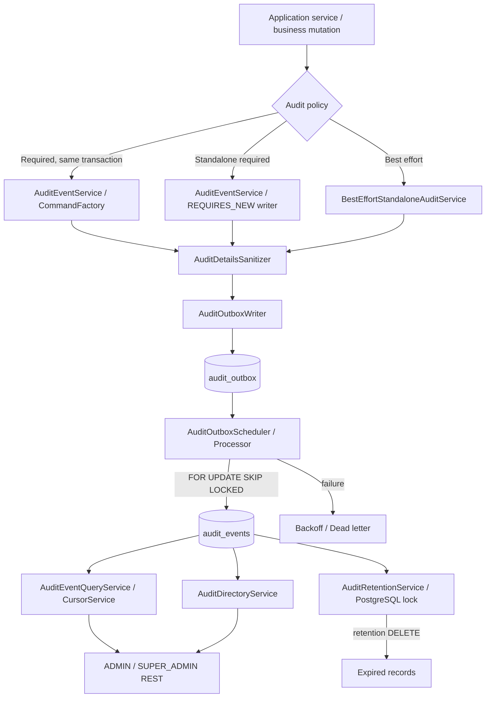

# SafeAI Desk — Audit Module

> **Архитектурный и security-аудит `ru.safeai.gateway.audit`**  
> Проверка: **17 октября 2026 г.** · Горизонт рекомендаций: **2026–2027** · Язык: Java / Spring Boot / PostgreSQL / Flyway.  
> Основа: присланные исходные тексты + сверка с `Amid-1/Safeai-desk`, ветка `main`, а также миграции V24, V26, V27, V37, V68–V70 и существующие тесты `backend/src/test/java/ru/safeai/gateway/audit`.  
> **Тип работы:** статический аудит, README и рекомендации. **Код production-классов и Flyway-миграции этим документом не изменялись.** Полная компиляция Maven и тесты с PostgreSQL в рамках этого аудита не запускались.

## 1. Назначение и границы модуля

Модуль `audit` фиксирует **кто**, **что**, **в отношении какой организации**, **когда** сделал и **какие допустимые метаданные** характеризуют действие. Он обеспечивает проверяемую историю административных, security-, chat-, AI-, rate-limit- и knowledge-операций без сохранения исходных prompt/response, паролей, токенов и других секретов в audit details.

Основные функции:

1. **Required audit**: обязательное событие сохраняется в `audit_outbox` **в транзакции изменяющей бизнес-операции**. Отказ сохранения audit intent отменяет бизнес-транзакцию.
2. **Standalone required audit**: для независимых security/operational событий применяется отдельная `REQUIRES_NEW`-транзакция; отказ явно передаётся вызывающему коду.
3. **Best-effort audit**: запись диагностического события через отдельную транзакцию допускает отказ аудита без отмены исходной операции. Это **не** замена required-аудиту важных изменений.
4. **Asynchronous materialization**: фоновый обработчик переносит immutable audit intent из `audit_outbox` в `audit_events` с повторными попытками, backoff, dead-letter и защитой от дублирования.
5. **Чтение истории**: HTTP API для ADMIN/SUPER_ADMIN с фильтрами, page-/cursor-пагинацией и tenant isolation по **target organization**.
6. **Directory**: получение типов событий, инициаторов и целевых организаций из исторических снимков.
7. **Retention**: пакетная очистка записей старше установленного срока по времени PostgreSQL, с межрепличной блокировкой.
8. **Защита details**: typed DTO, списки допустимых полей, подавление секретных значений, Unicode-контроль и бюджеты объёма JSON.
9. **Наблюдаемость**: метрики backlog, возраста старейшего pending-события, dead-letter, сбоев доставки и сбоев самого worker.

**Важная граница:** `audit` — журнал действий и решений приложения. Он **не заменяет** физический реестр AI-вызовов `model_execution_attempts`, финансовую reconciliation и отдельный security monitoring / SIEM.

## 2. Краткий вывод

**Общая оценка:** зрелая реализация *transactional outbox + immutable evidence + tenant-safe read model*. По устройству это современная архитектура для 2026–2027 годов. Важнейшие защитные механизмы размещены в **нескольких слоях**: domain, service, transaction manager, SQL constraints/triggers и тесты.

Но готовность к production нельзя оценивать только по наличию outbox или `@Immutable`: необходимо исправить обнаруженную потерю некоторых **типизированных audit details**, подтвердить безопасное логирование ошибок и доказать эксплуатационную обработку dead-letter / retention / отказов БД. В предоставленном коде **подтверждённого P0** (например, прямого межорганизационного чтения или подтверждённой потери каждого audit intent) не установлено; это **не** означает доказанного отсутствия P0 во всей системе.

### 2.1. Приоритеты

| Приоритет | Вывод | Статус | Рекомендуемое действие |
|---|---|---|---|
| **P1** | **Типизированный обязательный аудит по ошибке проходит unstructured sanitizer.** В `AuditEventService.record(AuditActor, …, AuditDetails)` вызывается `record(..., details.toMap())` → `commandFactory.create(...)`, а не `createTyped(...)`. Допустимые `ip` и `userAgentSha256` для `SecurityRefreshReuseAuditDetails` заменяются `[OMITTED_UNAPPROVED_TEXT]`. | **Подтверждено по production-коду** | Перевести только typed-overload на `commandFactory.createTyped(...)`; сохранить отдельный строгий `create(...)` для `Map`. Добавить сквозной тест `DTO → factory → outbox → audit_events`. |
| **P1** | **Полный Throwable передаётся в логгер при ошибке best-effort audit**, тогда как `AuditOutboxFailureService.last_error` специально сохраняет только класс исключения / SQLState. Текст SQL/driver exceptions в стеке теоретически может содержать значения и персональные данные. | **Подтверждён небезопасный путь логирования; фактическая утечка не продемонстрирована** | Для данного пути выводить безопасный error descriptor без `exception` и без исходных SQL/parameter values; трассировку писать лишь в специально контролируемом канале по утверждённой политике. Тест с секретом в exception message. |
| **P1 / эксплуатационный** | **Доставка в dead-letter не означает материализацию события.** После `maxAttempts` запись остаётся в `audit_outbox`, перестаёт выбираться worker и требует операционной обработки. Счётчики/логи есть, но по рассмотренным классам не доказаны alerting, runbook и безопасный ручной replay. | **Механика подтверждена; наличие внешних alerting/runbook не проверено** | Alert на dead-letter > 0, oldest pending age и delivery-failure rate; runbook расследования, повторная обработка только с сохранением event ID и идемпотентности. |
| **P1 / compliance-dependent** | **Неизменяемость БД не является криптографическим доказательством отсутствия подмены.** Runtime-trigger препятствует `UPDATE`, но владелец схемы/привилегированный DBA может изменить триггеры или удалить данные; retention намеренно делает `DELETE`. | **Архитектурное ограничение, не установленная уязвимость runtime API** | Для требований регуляторного доказательства: отдельные роли, write-once/off-site export, внешние контрольные суммы/цепочка хэшей, аудит админ-доступа и резервного восстановления. |
| **P2** | **Глубокая OFFSET-пагинация не ограничена**: `pageSize <= 100`, но `pageNumber` может быть очень большим. Список аудит-событий дополнительно делает count query. | **Подтверждено по query service** | Ввести предел `pageNumber × pageSize` с явной ошибкой; для глубокой истории использовать имеющийся `/cursor`. |
| **P2** | **Период запроса контролируется только если заданы обе границы**. Только `dateFrom`, только `dateTo` или полностью пустой диапазон могут охватывать годы записей. | **Подтверждено по `AuditEventQueryPolicy`** | Сохранить compatibility при обосновании, но ограничить стоимость запроса: statement timeout, rate limit, адекватный range policy, EXPLAIN на prod-like объёме. |
| **P2** | **Поиск справочников организаций/инициаторов может дорого обходиться**: DISTINCT ON по журналу и подстрочный `position(...)` зависят от всего объёма истории, даже если ответ `LIMIT 20–50`. | **Подтверждено по SQL; эффект зависит от объёма и плана** | EXPLAIN (ANALYZE, BUFFERS), лимиты, при необходимости materialized directory/search index; не добавлять индексы без профилирования. |
| **P2** | **Cursor — base64-кодировка, не криптографически подписанный токен** и не связан с хэшем фильтров. Это **не обход прав**, потому что tenant scope пересчитывается каждый запрос, но cursor можно менять и использовать с другим фильтром, получая нестабильную семантику продолжения. | **Подтверждено; security-эксплуатация не показана** | Для строгой истории добавить версионированный HMAC cursor, filter fingerprint, TTL, сохранив совместимость `v1` при миграции. |
| **P2** | **Возраст очереди в метриках вычисляется по JVM `Clock`, а retry / retention — по БД**. При clock skew наблюдаемый возраст может быть неточным. | **Подтверждено по коду; масштаб зависит от синхронизации времени** | Использовать DB clock или фиксировать допуск рассинхронизации; мониторить NTP. |
| **P2** | **Лок retention удерживает JDBC connection во время `REQUIRES_NEW` batch transactions**, которым нужны другие соединения. При слишком маленьком Hikari pool возможна самоблокировка/timeout. | **Риск подтверждён по архитектуре; тест уже использует pool = 4** | Проверять минимальный размер pool и таймауты, добавить стресс-тест с pool=2/3 и конкурентной нагрузкой; не переносить lock на случайное соединение. |
| **P2** | В `AuditEventRepository.insertFromOutbox` `ON CONFLICT (id) DO NOTHING` обеспечивает отсутствие дублей, **но не сверяет содержимое** уже существующей записи и источника при конфликте. | **Подтверждено по SQL; практическая вероятность при random UUID мала** | Для строгой reconciliation проверять равенство immutable evidence в collision/uncertain commit path; не заменять на overwrite/upsert. |

### 2.2. Что уже сделано правильно

- **Fail-closed required audit**: невозможно молча пропустить обязательное событие при successful business commit.
- **Transactional outbox**, а не «сначала бизнес commit, потом отправим лог в очереди».
- **`REQUIRES_NEW` только там, где нужна независимая сохранность**; три режима аудита имеют разные обещания.
- **`FOR UPDATE SKIP LOCKED`** позволяет нескольким репликам обрабатывать разные outbox rows без общего JVM mutex.
- **Idempotency по `audit_events.id`** — повторная доставка не должна создавать второй event с тем же ID.
- **`@Immutable` + PostgreSQL UPDATE guard** защищают историю в ORM и на уровне таблицы.
- **V70 отделяет FK живого пользователя от immutable actor snapshot**. Это важное исправление сценария физического удаления аккаунта.
- **Отдельный `AuditEventQueryPolicy`** повторно проверяет ADMIN/SUPER_ADMIN и tenant scope, независимо от controller annotation.
- **Детерминированная сортировка `(created_at DESC, id DESC)`** и cursor-based pagination.
- **Immutable snapshots** email, display name, actor organization и target organization name защищают историю от изменений текущих справочников.
- **Unicode validation + NFKC внутри sanitizer**, лимиты количества узлов, размера строк и итогового JSON; для actor identity применяется сознательно иная NFC-нормализация.
- **SQL-side wall-clock** для retention cutoffs и попыток доставки, чтобы не полагаться на локальные часы разных JVM.
- **SQL/DB constraints** запрещают нетипичные состояния retry/dead-letter и невалидные JSON details.
- **Есть интеграционные PostgreSQL-тесты**, включая rollback required audit, tenant isolation, cursor pagination, retention и межрепличную advisory lock.

## 3. Архитектура записи, доставки и чтения



### 3.1. Required audit: атомарность с бизнес-операцией

Обязательный audit вызван в существующей бизнес-транзакции. `AuditEventService.record*` создаёт `AuditCommand`; `AuditOutboxWriter.writeRequiredInCurrentTransaction` требует `Propagation.MANDATORY`, выполняет `saveAndFlush` и тем самым не позволяет вызывающему коду игнорировать ошибки вставки outbox. `flush` **не равен commit**: при последующем rollback исчезают и изменение бизнес-данных, и audit intent. При success оба commit-ятся вместе.

**Гарантия:** атомарность `business mutation ↔ outbox intent` при правильном вызове required path внутри той же JDBC/JPA транзакции.

**Не гарантируется:** мгновенное наличие записи в `audit_events`. Между commit и worker есть eventual consistency. Для административного UI отставание должно быть мониторируемым.

### 3.2. Standalone required и best-effort

- **Standalone required:** `AuditEventService.recordStandaloneRequired` → writer с `REQUIRES_NEW`. Создаёт отдельный durable intent независимо от rollback основного workflow; исключение не подавляется.
- **Best effort:** `BestEffortStandaloneAuditService.tryRecord` оборачивает создание/sanitization/write/commit в `try/catch RuntimeException` и сохраняет доступность основного workflow. Для login/refresh-token abuse, финансовых, IAM/ACL и иных обязательных следов допустимость этого режима надо решать **по явной audit policy**, а не по удобству вызова.
- **Rate limit:** `RateLimitAuditListener` синхронно получает `RateLimitExceededEvent`, не восстанавливает actor по email, а использует идентификаторы события. Standalone required enqueue необходим для повторной попытки уведомления при ошибке.

### 3.3. Доставка из outbox

1. `AuditOutboxScheduler` запускает `processor.processBatch()` с интервалом из `safeai.audit.outbox.poll-delay-ms`.
2. Worker открывает **новую транзакцию на один элемент** через `TransactionTemplate` + `REQUIRES_NEW`.
3. `AuditOutboxRepository.findNextForUpdate()` выбирает due row по `next_attempt_at <= clock_timestamp()` с `FOR UPDATE SKIP LOCKED`.
4. `AuditEventRepository.insertFromOutbox(id)` переносит все снимки/тип/details/`occurred_at` одной SQL-командой; `ON CONFLICT (id) DO NOTHING` предотвращает повторную materialization одного event ID.
5. Worker удаляет доставленную запись из `audit_outbox` **в той же транзакции** и выполняет flush. При ошибке materialization/deletion вся item transaction откатывается.
6. `AuditOutboxFailureService.markFailure` в отдельной транзакции увеличивает `attempt_count`, рассчитывает экспоненциальную задержку до `maxBackoff` либо переводит row в terminal dead-letter при достижении `maxAttempts`.
7. `AuditOutboxMetrics` обновляет счётчики для системы мониторинга.

**Uncertain commit:** если клиент видит ошибку подтверждения commit, уже удалённая из outbox row может означать успешный server-side commit. Реализация корректно допускает `missing` как *возможное* успешное завершение. Это следует отражать в метриках и тестировать, но не слепо считать отсутствие строки достаточным доказательством существования materialized evidence при произвольных внешних модификациях таблицы.

### 3.4. Чтение и tenant isolation

- ADMIN читает только события `audit_events.organization_id = currentUser.organizationId`.
- SUPER_ADMIN может читать глобальную историю и фильтровать `organizationId`.
- `organization_id` в audit event — это **target organization**, не организация actor-а. Для последней отдельно существует `actor_organization_id`.
- `userId` в legacy HTTP response является alias для immutable `actor_user_id`. Даже после удаления пользователя snapshot остаётся; служебная таблица `audit_event_user_links` хранит лишь несущественную для доказательства ссылку на живую строку пользователя.
- Политика проверяется и на уровне контроллера (`@PreAuthorize`), и на уровне `AuditEventQueryPolicy`; `findByUserId` вызывает общий scoped query path.

## 4. HTTP API и контракт

Все маршруты требуют роли ADMIN либо SUPER_ADMIN, если явно не указано более строгое условие.

| Метод | URL | Назначение |
|---|---|---|
| `GET` | `/api/admin/audit-events` | Страницы audit history с `AuditEventFilter` и `Pageable` |
| `GET` | `/api/admin/audit-events/cursor` | Keyset-пагинация по `(createdAt, id)`; `cursor`, `limit` |
| `GET` | `/api/admin/audit-events/users/{userId}` | События инициатора с повторной проверкой tenant scope |
| `GET` | `/api/admin/audit-event-types` | Доступные типы событий |
| `GET` | `/api/admin/audit-organizations` | Исторический справочник target organizations; **только SUPER_ADMIN** |
| `GET` | `/api/admin/audit-actors` | Исторические инициаторы, scoped для ADMIN |

**Фильтры:** `eventType`, `userEmail` (prefix, в lowercase), `userId`, `dateFrom` (inclusive), `dateTo` (exclusive), `organizationId`. `dateFrom < dateTo`. На пару границ действует серверный потолок 367 × 24h, допускающий транспортные колебания из-за DST. Если одной границы нет, этот потолок сейчас не применяется.

**Пагинация:** page default 50, максимальный size 100. Допустимые поля сортировки: `createdAt`, `eventType`, `organizationId`, `id`; при отсутствии `id` добавляется tie-breaker для детерминированности. Cursor API отдаёт до 100 элементов и маркер продолжения, используя `LIMIT limit+1`.

**DTO:** `AuditEventResponse` стабилизирует имена actor/target metadata; `AuditEventPageResponse` скрывает внутренний формат Spring Data `PageImpl`; `AuditEventCursorResponse` отдаёт `items`, `nextCursor` и `hasNext`.

## 5. Инвентаризация Java-классов

Все ниже перечисленные классы находятся под `backend/src/main/java/ru/safeai/gateway/audit/`.

### 5.1. `config/` — настройки и проверка инвариантов

| Класс | Реализация и роль |
|---|---|
| `AuditDetailsProperties` | `@ConfigurationProperties(safeai.audit.details)`: ограничения дерева details, контейнеров, узлов, текстового бюджета, длины значения, размера JSON и числового текста. Fail-fast проверка диапазонов. |
| `AuditOutboxConfiguration` | Регистрация `AuditOutboxProperties` и `AuditDetailsProperties`. |
| `AuditOutboxProperties` | `batchSize`, `maxAttempts`, `initialBackoff`, `maxBackoff`, `maxErrorLength`; защита от недопустимых настроек и `effective*` accessors. |
| `AuditRetentionConfiguration` | Регистрация настроек retention. |
| `AuditRetentionProperties` | Включение retention; срок 30–3650 суток, bounded batch size и количество batch за запуск. Отсутствие обязательного period приводит к fail-fast. |

### 5.2. `controller/` — REST

| Класс | Реализация и роль |
|---|---|
| `AuditController` | REST для page-, cursor- и by-user-чтения. `@PreAuthorize`, Jakarta Validation, `@AuthenticationPrincipal`, `@PageableDefault`. |
| `AuditDirectoryController` | Получение типов событий, организаций и инициаторов. Отдельное `@PreAuthorize(hasRole('SUPER_ADMIN'))` для каталога организаций. |

### 5.3. `details/` — типизированные разрешённые метаданные

| Класс | Реализация и роль |
|---|---|
| `AuditDetails` | Функциональный интерфейс `toMap()`; contract **метаданных**, а не произвольных raw payloads. |
| `AiResponseAuditDetails` | Chat/message IDs, model, token usage, USD price, latency, provider message ID, finish/status, pricing provenance. Проверяет неотрицательные метрики. |
| `ChatTurnAuditDetails` | Идентификаторы turn/request/provider operation, состояния AI-turn, model/provenance и токены/стоимость. `LinkedHashMap → Map.copyOf`. |
| `RateLimitAuditDetails` | Тип лимита, лимит, окно, текущее количество; проверяет положительный `limit` и неотрицательный `count`. |
| `SecurityRefreshReuseAuditDetails` | Token family, IP, request ID и **SHA-256 от User-Agent** вместо исходного User-Agent. Сейчас на required audit path часть строковых полей обесценивается из-за P1-дефекта. |

### 5.4. `dto/` — контракты выдачи и фильтры

| Класс | Реализация и роль |
|---|---|
| `AuditActorDirectoryResponse` | Снимок actor user/org/email/displayName. |
| `AuditEventCursorResponse` | Неизменяемая копия items + cursor + hasNext. |
| `AuditEventFilter` | Нормализация email, защита от control chars, проверка границ времени, `@Size` для HTTP. |
| `AuditEventPageResponse` | Собственный стабильный пагинированный JSON и адаптер `Page<AuditEventResponse>`. |
| `AuditEventResponse` | Явное представление immutable event; `details` защищена поверхностной копией Map. |
| `AuditTargetOrganizationDirectoryResponse` | ID и snapshot имени target organization. |

### 5.5. `entity/` — JPA

| Класс | Реализация и роль |
|---|---|
| `AuditEventEntity` | Read-only entity таблицы `audit_events`, Hibernate `@Immutable`, `jsonb` через `@JdbcTypeCode(SqlTypes.JSON)`. Database trigger запрещает UPDATE. |
| `AuditOutboxEntity` | Mutable лишь delivery metadata: `attempt_count`, `next_attempt_at`, `last_error`, `dead_lettered_at`; immutable audit intent. `@PrePersist/@PreUpdate` проверяет согласованность состояний. |

### 5.6. `listener/` и `model/`

| Класс | Реализация и роль |
|---|---|
| `RateLimitAuditListener` | Синхронная подписка на `RateLimitExceededEvent`; durable standalone audit, actor snapshot из фактических полей события, без косвенного восстановления личности. |
| `AuditActor` | Immutable snapshot actor identity. NFC normalization email/displayName, длина по Unicode code points, проверка UTF-16 и control chars; `system()` для системного субъекта. |

### 5.7. `repository/` — persistence/read model

| Класс | Реализация и роль |
|---|---|
| `AuditDirectoryQueryRepository` | JDBC `DISTINCT ON` latest snapshot каталогов, поиск по имени/email/UUID; исторический email можно найти даже после смены идентификатора отображения. |
| `AuditEventCriteria` | Общие JPA Specifications/predicates tenant, type, user, email prefix, date; keyset predicate `(created_at < c) OR (created_at=c AND id < id)`. |
| `AuditEventCursorRepository` | Контракт keyset-чтения. |
| `AuditEventCursorRepositoryImpl` | Criteria API, stable descending sort, `setMaxResults`. |
| `AuditEventRepository` | Spring Data JPA/Specification API; нативное `INSERT ... SELECT FROM audit_outbox ON CONFLICT DO NOTHING`; bounded retention DELETE по DB clock. |
| `AuditOutboxRepository` | JPA pending/dead counts, oldest pending, due-row с `FOR UPDATE SKIP LOCKED`, row-level lock для failure bookkeeping. |

### 5.8. `service/` — прикладные use cases и orchestration

| Класс | Реализация и роль |
|---|---|
| `AuditCommand` | Immutable request: event UUID, actor, target organization, eventType, sanitized details, occurredAt. |
| `AuditCommandFactory` | Создание commands, `sanitize` vs `sanitizeTyped`, время из `AuditDatabaseClock`. Здесь реализовано правильное разделение, но один caller использует не тот метод. |
| `AuditCursorCodec` | Кодирование/декодирование `v1|timestamp|id` через URL-safe Base64, строгий parse/ошибка. |
| `AuditDatabaseClock` | `SELECT clock_timestamp()` как общий источник времени PostgreSQL. |
| `AuditDetailsSanitizer` | Центральная защита details: typed/unstructured modes, ключи и значения, рекурсивные ограничения, redaction, JSON size validation. |
| `AuditDirectoryService` | Service-level RBAC и tenant scoping для исторических каталогов, нормализация строк поиска. |
| `AuditEventCursorService` | Authorization scope, cursor decode, limit+1, stable continuation marker, общий entity-to-DTO mapper. |
| `AuditEventQueryPolicy` | Повторное право ADMIN/SUPER_ADMIN вне HTTP, строгий tenant scope, диапазон времени. |
| `AuditEventQueryService` | Пагинированное чтение, сортировки только по allowlist, tie-breaker `id`, mapper. |
| `AuditEventService` | Публичные required/standalone audit APIs, actor snapshot provider, интеграция command factory и outbox writer. **Содержит P1 typed-routing defect.** |
| `AuditOutboxFailureService` | Отдельная `REQUIRES_NEW` транзакция для retries/backoff/dead-letter, безопасный descriptor причины без raw message. |
| `AuditOutboxMetrics` | Micrometer counters/gauges + периодический refresh backlog. |
| `AuditOutboxProcessor` | Batch orchestrator и транзакция на одну доставку, идемпотентность, обработка uncertain commit/failure. |
| `AuditOutboxScheduler` | Poller с конфигурируемым fixed delay и логированием итога. |
| `AuditOutboxWriter` | `MANDATORY` или `REQUIRES_NEW` enqueue; snapshot организации; `saveAndFlush`. |
| `AuditRetentionBatchService` | `REQUIRES_NEW` транзакция на batch удаления истёкших записей. |
| `AuditRetentionLockService` | Межрепличная PostgreSQL session-level advisory lock, connection pinning и explicit unlock/abort через `PostgresAdvisoryLockExecutor`. |
| `AuditRetentionService` | Планировщик cleanup, bounded batches под глобальной lock. |
| `BestEffortStandaloneAuditService` | Добровольная audit-запись без rollback исходного workflow; отдельная ветка для typed и raw details. **Требует безопасного логирования Throwable.** |

### 5.9. `spi/` и корневой enum

| Класс | Реализация и роль |
|---|---|
| `AuditActorSnapshotProvider` | SPI: user-модуль предоставляет tenant-scoped snapshot actor без зависимости audit от `UserRepository`. |
| `AuditTargetOrganizationSnapshotProvider` | SPI: organization-модуль предоставляет immutable snapshot имени target organization. |
| `AuditEventType` | Центральный enum категорий событий: login, chat, AI, user/org management, rate limit, security, knowledge base/document/ingestion/retrieval, model governance. |

**Вывод по структуре:** границы `controller → service/policy → repository`, immutable DTO, разделение команды от read model и SPI для чужих агрегатов выполнены разумно. Полностью переписывать модуль **не нужно**.

## 6. PostgreSQL и Flyway — подтверждённые гарантии

| Миграция | Важные решения |
|---|---|
| **V24** | Transactional `audit_outbox`, event type FK, отдельный actor snapshot вместо зависимости только от живого User; первичные индексы. |
| **V26** | Actor organization snapshot, `occurred_at`, retries/dead-letter metadata, ограничения согласованности и `details::text <= 65536` байт. |
| **V27** | Конкурентное создание составных индексов для `(org, type, actor, created_at, id)` и due/dead outbox. **Flyway выполняется без транзакции**; важна настройка `spring.flyway.postgresql.transactional-lock=false`. |
| **V37** | `target_organization_name` как снимок при enqueue; historical backfill фиксирует только имя, известное на момент миграции, а не реконструирует прошлое. |
| **V68** | Append-only `audit_events` через UPDATE trigger, неизменность audit intent в `audit_outbox`, JSON object constraints, DB checks snapshot полей и event type. |
| **V69** | Промежуточное исключение для FK `ON DELETE SET NULL` при удалении пользователя. **Не считать финальной моделью.** |
| **V70** | Окончательно выносит live user pointer в `audit_event_user_links` с `ON DELETE CASCADE`, удаляет конфликтующий `audit_events.user_id`, возвращает безусловный UPDATE guard. |

### 6.1. Фактическая неизменяемость

`audit_events` не должен изменяться после вставки; V70 запрещает UPDATE **всех колонок**. В `audit_outbox` запрещено менять actor, target, event type, details, timestamps; допустима только регламентированная эволюция retry/dead-letter bookkeeping. Hibernate `@Immutable` дополняет, но не заменяет триггеры PostgreSQL.

**Оговорка:** это **append-only на уровне доступного runtime SQL update path**, а не WORM на физическом носителе. Retention делает DELETE. Для внешнего доказательства непрерывной истории нужны отдельные гарантии привилегий, backup/export, tamper evidence и настройки мониторинга.

### 6.2. Снимки и удаление User

Поле `actor_user_id` — исторический идентификатор, не ссылка, которая обязана существовать в актуальной users table. Связь для UI хранится отдельно в `audit_event_user_links`; удаление пользователя не переписывает actor snapshot в событии. Это корректное разрешение конфликта privacy lifecycle и непрерывности audit evidence.

### 6.3. Индексная стратегия

V27 уже покрывает наиболее частые scoped keyset и offset order patterns. **Нельзя автоматически плодить btree indexes**: сначала посмотреть `EXPLAIN (ANALYZE, BUFFERS)` на типовых фильтрах (ADMIN own-org, SUPER_ADMIN global, actorEmail prefix, eventType, retention cutoff, due outbox). Для тяжелых `DISTINCT ON` directory и `position()` могут потребоваться не обычные дублирующие индексы, а отдельный поисковый read model либо иной план запроса.

## 7. Санитизация details и чувствительные данные

### 7.1. Нынешний контракт

- **Typed** (`AuditDetails`): объект определяет разрешённую форму, sanitizer дополнительно проверяет secret-patterns, size/UTF-8/Unicode, ключи и глубину.
- **Unstructured** (`Map<String,Object>`): строковые значения допускаются только по `SAFE_UNSTRUCTURED_TEXT_KEYS`; неизвестные текстовые поля заменяются `[OMITTED_UNAPPROVED_TEXT]`.
- Независимо от режима `SENSITIVE_KEYS` заменяются `[REDACTED]` (в том числе в nested maps и разделённых именах).
- Значения, похожие на Bearer/Basic, JWT, PEM/private keys и ряд распространённых secret prefixes, подавляются.
- Ограничены `maxDepth`, `maxContainerItems`, `maxTotalNodes`, `maxTotalStringChars`, `maxStringLength`, `maxJsonBytes`, `maxNumberTextLength`.
- Некорректная Unicode-последовательность отвергается, большие/non-finite numbers получают маркеры, сложные неразрешённые типы не сериализуются произвольно.
- Итог сериализуется через `JsonMapper`; при превышении размера возвращается маркер усечения вместо переполнения `jsonb`.

### 7.2. P1: правильное сохранение typed details

**Фактическая цепочка сейчас:**

```java
// AuditEventService — текущая схема
public void record(AuditActor actor, UUID targetOrgId,
                   AuditEventType type, AuditDetails details) {
    record(actor, targetOrgId, type, details.toMap());
}

// Далее record(... Map ...) -> commandFactory.create(...)
// -> sanitizer.sanitize(... UNSTRUCTURED),
// хотя factory уже имеет createTyped(...).
```

**Предлагаемое локальное исправление без ослабления защиты:**

```java
public void record(AuditActor actor, UUID targetOrgId,
                   AuditEventType type, AuditDetails details) {
    AuditCommand command = commandFactory.createTyped(
            actor,
            targetOrgId,
            type,
            java.util.Objects.requireNonNull(details, "details")
    );
    outboxWriter.writeRequiredInCurrentTransaction(command);
}
```

`record(..., Map<String,Object>)` должен **сохранить** текущий вызов `commandFactory.create(...)` и unstructured allowlist. Метод `BestEffortStandaloneAuditService.tryRecord(..., AuditDetails)` уже корректно вызывает `createTyped`.

**Конкретный проявляющийся пример:** `SecurityRefreshReuseAuditDetails.toMap()` формирует `ip` и `userAgentSha256`, но этих ключей нет среди `SAFE_UNSTRUCTURED_TEXT_KEYS`; значит запись в required-path теряет значения и получает статические маркеры. Безопаснее исправить вызов, а не включать эти ключи в общий unstructured allowlist.

**Новые тесты обязательны:** Mockito `verify(commandFactory).createTyped(...)` для `recordPrincipalSnapshot` и `record(AuditActor, AuditDetails)`; инъекция `SecurityRefreshReuseAuditDetails` через реальную `AuditCommandFactory` и проверка `ip` / 64-символьного SHA-256 в `audit_outbox` и доставленном `audit_events`; негативный тест, что `Map` с ключом `userAgentSha256` всё ещё получает unstructured redaction. Существующий `AuditEventServiceTest` **ожидает текущий некорректный вызов `create`**, поэтому его нужно обновлять одновременно с production-кодом.

### 7.3. Важные границы безопасности

1. **Typed не означает «можно доверять любому тексту».** В `AuditDetails` должны передаваться контролируемые метаданные, не prompt, не HTTP bodies. Secret-patterns не доказывают полного отсутствия всех возможных секретов.
2. **No raw User-Agent**: хранить хэш, но не сам header. Имеется известный plaintext IP — его обработка/retention зависит от privacy policy организации.
3. **Точность evidence:** маркеры `[REDACTED]`, `[MAX_DEPTH]`, `[BUDGET_EXCEEDED]`, `[OMITTED_UNAPPROVED_TEXT]` означают, что подробности изменены при записи; не трактовать такой payload как полную исходную историю параметров.
4. **Ошибки санитизации:** required-path не должен молча падать на best-effort, а best-effort не должен логировать сырые секретосодержащие сообщения исключений.

## 8. Retention и эксплуатация

`AuditRetentionService.cleanupExpiredAuditEvents` работает по cron **03:30 UTC** по умолчанию. `AuditRetentionLockService` держит PostgreSQL **session-level advisory lock**, поэтому разные pods не выполняют retention одновременно. Lock соединения явно снимается; при неопределённости release `PostgresAdvisoryLockExecutor` пытается аварийно закрыть connection, потому что session-level lock переживает rollback. Работа каждой пачки выполняется отдельно через `AuditRetentionBatchService.deleteBatch(REQUIRES_NEW)`. SQL `DELETE` выбирает до `batchSize` событий, у которых `created_at < clock_timestamp() - retention`.

**Текущая конфигурация по умолчанию (`application.yml`):** `enabled=true`, `period=1095d` (3 года, приблизительно), `batchSize=10000`, `maxBatchesPerRun=10`. За запуск будет удалено **не более 100 000 событий**, поэтому при backlog очистка может занимать несколько плановых запусков. `AuditRetentionProperties` ограничивает период диапазоном 30–3650 суток.

Операционная политика должна отдельно определить: правовое основание удаления, сроки для разных категорий событий, наличие legal hold, откаты restore, поведение audit при удалении пользователя, окно нагрузки для cleanup, мониторинг длительности batch и recovery при dead-letter. **Нельзя самовольно увеличить или уменьшить retention ради устранения предупреждения статического анализа.**

## 9. Конфигурация

Значения по умолчанию из классов `Audit*Properties` (для непереопределённых настроек) и `application.yml`:

| Параметр | Default | Ограничение / смысл |
|---|---:|---|
| `safeai.audit.details.max-depth` | `4` | 1–16 |
| `safeai.audit.details.max-container-items` | `100` | 1–10 000 |
| `safeai.audit.details.max-total-nodes` | `500` | 10–100 000 |
| `safeai.audit.details.max-total-string-chars` | `24000` | 100–1 000 000 |
| `safeai.audit.details.max-string-length` | `1024` | 16–100 000 |
| `safeai.audit.details.max-json-bytes` | `61440` | 1024–61440; отдельный DB предел 65536 |
| `safeai.audit.details.max-number-text-length` | `256` | 16–10000 |
| `safeai.audit.outbox.batch-size` | `100` | 1–1000 |
| `safeai.audit.outbox.max-attempts` | `10` | 1–100 |
| `safeai.audit.outbox.initial-backoff` | `2s` | строго > 0 |
| `safeai.audit.outbox.max-backoff` | `1h` | >= initial |
| `safeai.audit.outbox.max-error-length` | `1000` | 100–1000, без exception message |
| `safeai.audit.outbox.poll-delay-ms` | `1000` | Worker schedule; отдельно проверить положительность конфигурации |
| `safeai.audit.retention.enabled` | `true` | Включение регулярной очистки |
| `safeai.audit.retention.period` | `1095d` в YAML | 30d–3650d; без YAML значение обязательно |
| `safeai.audit.retention.batch-size` | `10000` в YAML | 100–100000 |
| `safeai.audit.retention.max-batches-per-run` | `10` в YAML | 1–1000 |
| `safeai.audit.retention.cron` | `0 30 3 * * *` | 03:30 по configured zone |
| `safeai.audit.retention.zone` | `UTC` | UTC для предсказуемого расписания |

Некоторые defaults указываются в Java record, некоторые — в YAML. Для production следует проверять итоговые значения через property binding и startup tests; не считать Java default гарантирующим настройку, если она обязательна в record constructor.

## 10. Тестирование: что есть и чего не хватает

В репозитории присутствуют тесты следующих направлений:

| Функция | Реальные тесты |
|---|---|
| HTTP/RBAC | `AuditControllerSecurityTest`, `AuditServiceAuthorizationBoundaryTest`, `AuditTenantIsolationIntegrationTest` |
| Typed details / sanitizer | `AuditDetailsRecordsTest`, `AuditDetailsSanitizerTest`, `AuditDetailsPropertiesTest` |
| DTO/фильтры/чтение | `AuditEventPageResponseTest`, `AuditEventQueryServiceTest`, `AuditCursorCodecTest`, `AuditCursorPaginationIntegrationTest` |
| Actor/target snapshots | `AuditActorSnapshotIntegrationTest`, `AuditDirectoryServiceTest` |
| Outbox durability/delivery | `AuditEventServiceTest`, `AuditOutboxWriterTest`, `AuditOutboxProcessorTest`, `AuditOutboxFailureServiceTest`, `AuditOutboxIntegrationTest` |
| Required / best effort policy | `RequiredAuditPolicyIntegrationTest`, `BestEffortAuditPolicyIntegrationTest`, `BestEffortStandaloneAuditServiceTest` |
| Retention | `AuditRetentionBatchServiceTest`, `AuditRetentionLockServiceTest`, `AuditRetentionLockIntegrationTest`, `AuditRetentionServiceTest`, `AuditRetentionIntegrationTest` |
| Schema/indexes | `AuditMigrationIntegrityIntegrationTest`, `AuditEmailPrefixIndexIntegrationTest`, `AuditRepositoryContractTest` |
| Rate limit audit | `RateLimitAuditListenerTest` |
| PostgreSQL test harness | `AbstractAuditPostgresIntegrationTest` |

**Подтверждённые сильные сценарии:** rollback бизнес-транзакции не создаёт audit intent; бизнес-commit создаёт outbox intent, worker materializes event; повторный worker не создаёт дубликат; чужие события недоступны ADMIN; keyset-чтение стабильно; DB cutoff retention соблюдён; advisory lock не берётся одновременно двумя конкурентами.

### 10.1. Новые тесты по приоритету

1. **P1 — typed end-to-end:** `SecurityRefreshReuseAuditDetails` сохраняет `ip`, `userAgentSha256` без raw UA; Map-вариант по-прежнему обрезает неизвестные строки. Плюс `verify(createTyped)`, обновление старого `AuditEventServiceTest`.
2. **P1 — logging privacy:** принудительно бросить `RuntimeException("Authorization: Bearer secret-test-value")` и `SQLException` с PII в сообщении; убедиться, что best-effort error logs не содержат message, bind params или raw payload.
3. **P1 — dead-letter operations:** многоцикловый retry до maxAttempts, terminal-state constraints, метрики и сценарий контролируемого повторного запуска; проверить, что bad row не блокирует good rows.
4. **P2 — deep OFFSET/range:** предел при `page=veryLarge`, все варианты `dateFrom/dateTo`, `pageSize > 100`, sort whitelist; сравнить query cost.
5. **P2 — cursor security/semantics:** подмена timestamp/UUID не даёт чужих данных; изменение фильтра/tenant при том же cursor документировано или блокируется новой версией.
6. **P2 — retention/resource:** конкурентная нагрузка `AuditRetentionService` + workers + API при малом Hikari pool; искусственная ошибка unlock и проверка уничтожения unsafe connection.
7. **P2 — PostgreSQL DDL:** V70 snapshot неизменен после удаления user; прямая попытка UPDATE `audit_events`/immutable intent отвергается; разрешённая правка `attempt_count`/`next_attempt_at` работает.
8. **P2 — performance:** план выполнения `DISTINCT ON`, prefix-email filter, org-scoped query, retention DELETE на 1–10 млн строк; latency SLO, buffers, WAL, indexes.
9. **P2 — uncertain commit:** смоделировать lost commit acknowledgment; проверить, что `audit_events` содержит именно ожидаемое evidence и outbox обработан идемпотентно.

**Команды для локального прогона:**

```bash
cd backend
./mvnw test -Dtest='Audit*Test,BestEffort*Test,RequiredAuditPolicyIntegrationTest'
# Для полного набора интеграционных тестов нужен доступный Docker/Testcontainers + PostgreSQL.
./mvnw test
```

Проверить корректность конкретного набора `-Dtest` и поддерживаемые build profiles следует на вашей версии Maven Surefire; команда выше — пример запуска, **не свидетельство выполненного теста**.

## 11. План доработки без регресса

**Этап 1 — сохранить корректную семантику и исправить typed path.** Изменить лишь `AuditEventService.record(AuditActor, …, AuditDetails)` на `commandFactory.createTyped`. Не менять `AuditDetailsSanitizer` allowlist и никаким образом не ослаблять блокировку паролей/prompt/token. Обновить unit tests и добавить end-to-end PostgreSQL integration test.

**Этап 2 — безопасные логи и гарантии обязательной записи.** Исключить raw exception messages из best-effort audit log, добавить контроль секретов в тестах. Документировать перечень событий, где разрешён best-effort, а где required является обязательным инвариантом.

**Этап 3 — эксплуатационная надёжность.** Подключить alerts к `safeai.audit.outbox.dead.letter.rows`, pending/backlog/oldest-age, failure counters, закрепить runbook расследования и controlled replay. Подтвердить Hikari sizing при retention lock + batch processing.

**Этап 4 — масштабирование read path.** Ограничить pathological page offset, задокументировать max date range; профилировать directory query. Рассматривать signed cursor и индексную оптимизацию только после воспроизведённого сценария/нагрузки.

**Этап 5 — контроль неизменяемости 2027.** При требованиях юридически значимого evidence внедрить независимый хранилище/репликацию с tamper-evident digest; разграничить runtime role и migration owner; описать backup/restore и legal hold.

## 12. Важные архитектурные инварианты — не нарушать при рефакторинге

- Не заменять `MANDATORY` на `REQUIRES_NEW` для required security/business audit: потеряется атомарность с mutation.
- Не переводить required audit на best-effort ради доступности.
- Не выполнять insert `audit_events` и delete `audit_outbox` в разных транзакциях.
- Не удалять `FOR UPDATE SKIP LOCKED`: конкурентная доставка в Kubernetes перестанет быть безопасной.
- Не использовать `user_id` текущего пользователя вместо event-time `actor_user_id` snapshot и не смешивать actor org с target org.
- Не удалять SQL UPDATE-guard из V70 или `@Immutable` без доказанной альтернативы.
- Не расширять бездумно `SAFE_UNSTRUCTURED_TEXT_KEYS` для исправления typed path.
- Не писать raw User-Agent, credentials, prompts, provider responses или exception messages в `details`/`last_error`.
- Не хранить PostgreSQL **session-level** lock только в thread-local переменной, освобождая его на другом pooled connection.
- Не менять уже применённые Flyway V24…V70. Любые исправления схемы — новая миграция со свободным номером.
- Не допускать silent truncation финансовых или security-critical fields без явно видимого маркера неполноты.

## 13. Итоговая оценка зрелости (качественная, без искусственных баллов)

| Область | Оценка по просмотренному коду |
|---|---|
| Разделение слоёв и зависимостей | **Хорошо:** API, query-policy, command, writer, worker, retention, SPI. |
| Транзакционная сохранность обязательных событий | **Сильно:** MANDATORY, outbox в business Tx, flush, rollback integration. |
| Конкурентная обработка / Kubernetes | **Сильно:** `SKIP LOCKED`, per-item transactions, PostgreSQL lock для retention. |
| Иммутабельность БД | **Сильно для runtime-инвариантов:** V68/V70, immutable snapshots; не криптографическая WORM. |
| Tenant isolation | **Сильно:** HTTP + service check и scoped SQL/JPA; подтверждено integration tests. |
| Privacy / sanitizer | **Архитектура хорошая**, но P1 typed-routing defect и небезопасный путь логирования. |
| Наблюдаемость и dead-letter ops | **Есть метрики и состояние**; production alerts/runbook вне рассмотренного кода не подтверждены. |
| Read scalability | **Работает для умеренных нагрузок**, есть cursor; потенциально дорогие global counts, OFFSET и directory scans. |
| Compliance / non-repudiation | **Условно:** зависит от policy, привилегий, срока хранения, внешней проверки целостности. |
| Автоматические тесты | **Хорошее покрытие основных workflows**, но явный пробел typed end-to-end и нагрузочных/операционных отказов. |

**Заключение:** модуль `audit` **не нуждается в переписывании**. Наиболее оправданное исправление — минимально исправить routing typed events, усилить privacy logging, затем закрыть эксплуатационные gaps. Текущие сильные гарантии **обязательно сохранять**.

---

### Методика и ограничения проверки

Статически сопоставлены присланные файлы и фактические файлы ветки `main` GitHub: конфигурация, enum/DTO, `AuditEventService`, `AuditCommandFactory`, `AuditDetailsSanitizer`, `AuditOutboxProcessor`, persistence и migration guards, различные unit/integration tests. Наблюдение P1 typed-routing подтверждено прямой цепочкой методов, а не гипотезой. Другие риски помечены как *подтверждённая структура*, *условная утечка* или *нагрузочная гипотеза* по степени доказательности. Содержимое текущей production DB, реально применённый `flyway_schema_history`, пул и права PostgreSQL, Kubernetes deployment, external alerts, SLO, volumes и конкретный CI run не были доступны. Следовательно, документ **не утверждает**, что все тесты пройдены или что production deployment соответствует `main`.

Ссылки для повторной проверки: [`audit` sources](https://github.com/Amid-1/Safeai-desk/tree/main/backend/src/main/java/ru/safeai/gateway/audit), [`audit` tests](https://github.com/Amid-1/Safeai-desk/tree/main/backend/src/test/java/ru/safeai/gateway/audit), [`Flyway migrations`](https://github.com/Amid-1/Safeai-desk/tree/main/backend/src/main/resources/db/migration).
