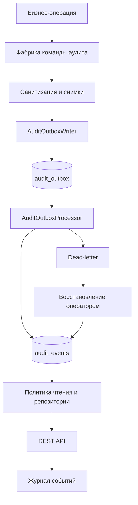
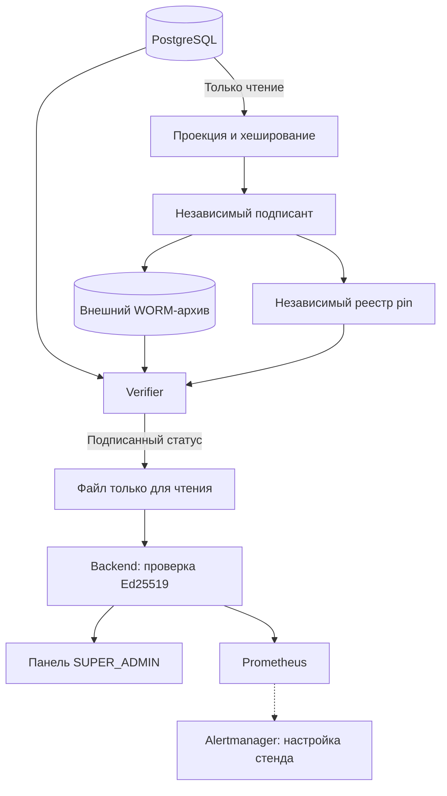
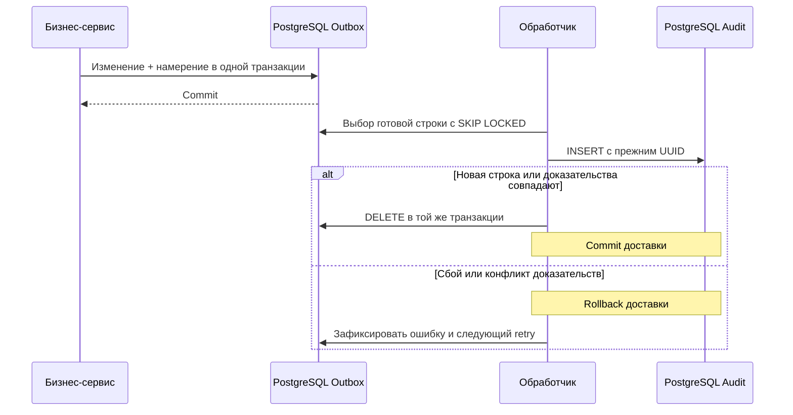
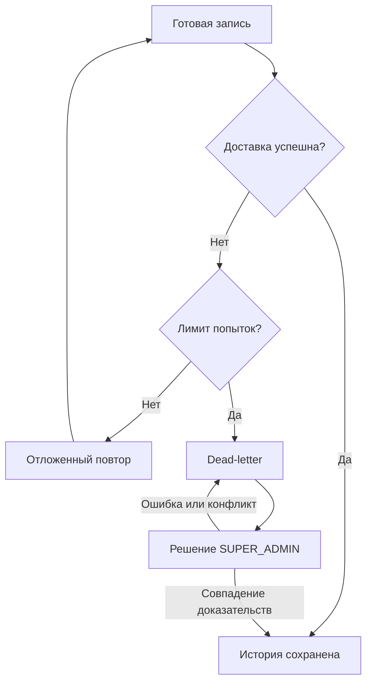
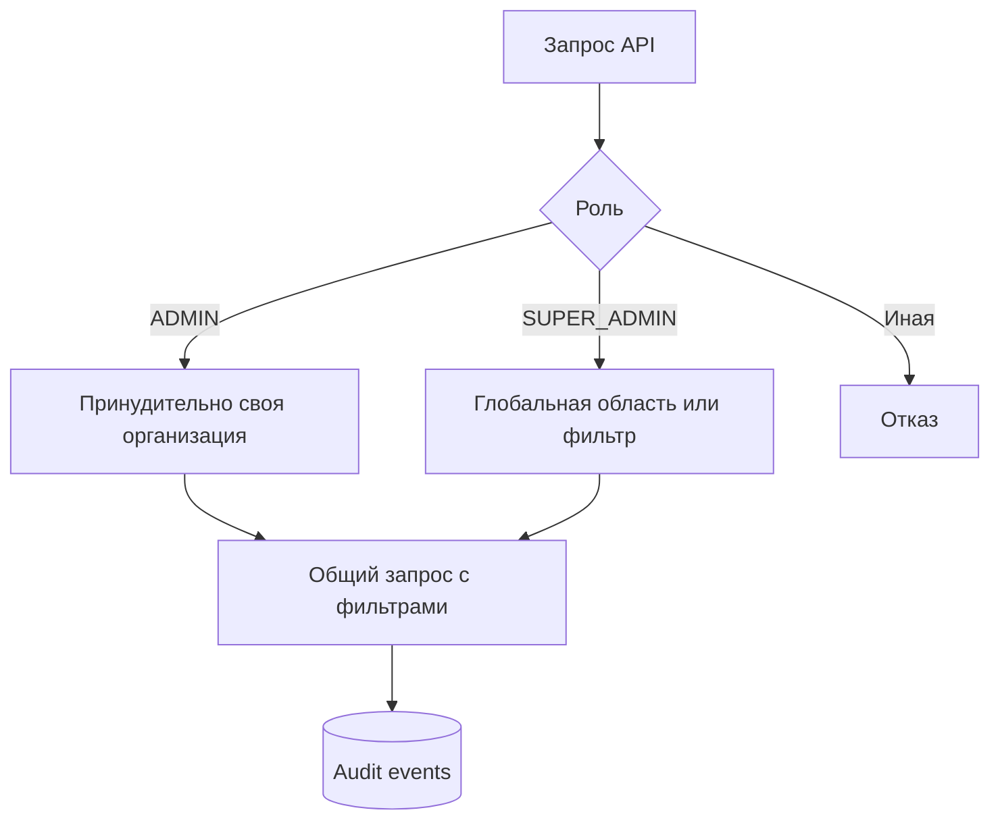
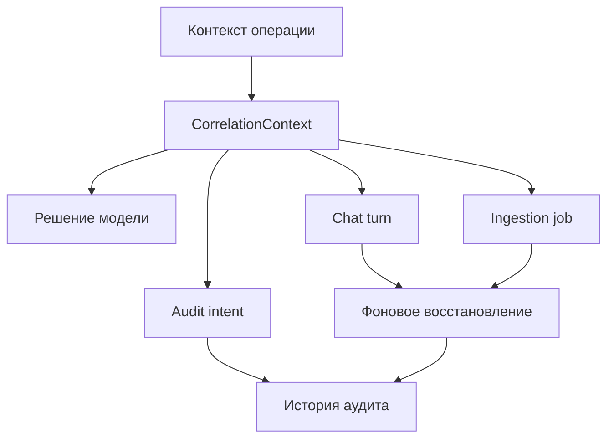
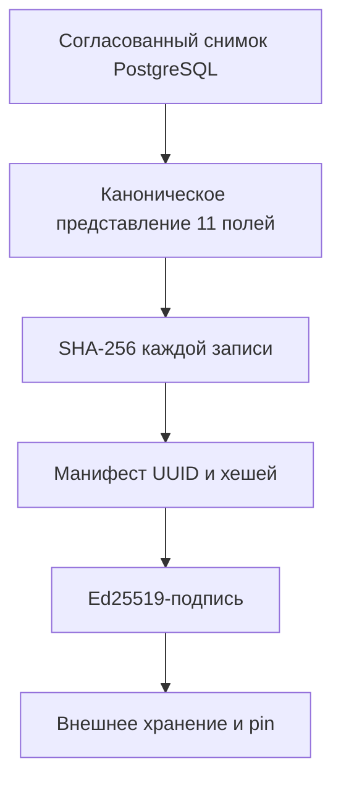

# SafeAI Desk — Audit

Техническая документация модуля аудита: регистрация действий, надёжная доставка,
расследование инцидентов, криптографическая целостность и эксплуатационный мониторинг.

> **Пакет:** `ru.safeai.gateway.audit`  
> **Актуальность:** 21.11.2026, этап 7.5B.4.3, Flyway V1–V94.  
> **Стек:** Java 21, Spring Boot 4.1.1, Spring Security, JPA/JDBC, PostgreSQL 16, Flyway,  
> React/TypeScript, Micrometer, Prometheus, Python 3, OpenSSL 3, AWS S3 Object Lock.  
> **Состав:** 61 Java-файл основного кода, 34 Java-файла тестового пакета, включая support.  
> Реализация соответствует текущему этапу разработки. Это не сертификат готовности production.

## Содержание

- [1. Назначение](#1-назначение)
- [2. Архитектура](#2-архитектура)
- [3. Структура модуля](#3-структура-модуля)
- [4. Модель данных и PostgreSQL](#4-модель-данных-и-postgresql)
- [5. Запись и доставка](#5-запись-и-доставка)
- [6. Классификация событий](#6-классификация-событий)
- [7. Чтение, API и безопасность](#7-чтение-api-и-безопасность)
- [8. Сквозной Correlation ID](#8-сквозной-correlation-id)
- [9. Защита метаданных](#9-защита-метаданных)
- [10. Криптографическая целостность](#10-криптографическая-целостность)
- [11. Независимый статус проверки](#11-независимый-статус-проверки)
- [12. Интерфейс аудита](#12-интерфейс-аудита)
- [13. Retention](#13-retention)
- [14. Конфигурация](#14-конфигурация)
- [15. Метрики и оповещения](#15-метрики-и-оповещения)
- [16. Реагирование на инциденты](#16-реагирование-на-инциденты)
- [17. Тестирование](#17-тестирование)
- [18. Границы и готовность к production](#18-границы-и-готовность-к-production)
- [19. Архитектурные инварианты](#19-архитектурные-инварианты)

## 1. Назначение

Audit отвечает на вопросы: кто, когда, что сделал, в отношении какой организации,
с каким результатом и какие безопасные метаданные позволяют расследовать операцию.

В модуле реализованы:

- обязательная транзакционная запись намерения аудита (Transactional Outbox);
- автономный обязательный и диагностический best-effort режимы;
- фоновые доставка, повторные попытки, backoff и dead-letter;
- проверка равенства доказательств при конфликте идентификаторов доставки;
- операторское восстановление с сохранением исходного ID и собственным аудитом;
- неизменяемые исторические снимки инициатора и целевой организации;
- ограничение доступа по ролям и целевой организации (tenant isolation);
- серверные категории, статистика, фильтрация, страничная и курсорная выдача;
- сквозная корреляция HTTP, AI, чатовых и фоновых операций;
- типизированные details, санитизация и ограничение размера данных;
- пакетная очистка по сроку хранения с межрепличной блокировкой;
- независимые SHA-256-снимки, Ed25519-подпись и цепочка контрольных снимков;
- внешний WORM-архив, протокол ротации ключей и разрешений на удаление;
- подписанный статус независимой проверки, API и панель для `SUPER_ADMIN`;
- мониторинг Outbox и криптографической проверки, правила оповещений.

Audit — журнал действий приложения, а не хранилище содержимого чатов, база
финансовых операций или SIEM. Он не заменяет платёжную reconciliation,
реестр физических AI-вызовов, резервное копирование и контроль доступа к данным.

### Границы ответственности

| Модуль | Ответственность |
| --- | --- |
| `auth`, `common` | Аутентификация, роли, principal, контекст корреляции |
| `user`, `organization` | Управление пользователями, организациями и снимки участников |
| `model` | Политики, каталог, маршрутизация, разрешения и отказы AI |
| `chat`, `ai` | Чатовые операции и результаты AI без исходных текстов в аудите |
| `knowledge` | Базы знаний, документы, обработка и удаление контента |
| `usage` | Финансовый учёт и потребление ресурсов |
| `audit` | Сохранение, доставка, чтение и контроль доказательств |
| `infra` | Независимый архив, проверяющий процесс и мониторинг |

## 2. Архитектура

### 2.1. Запись и чтение



Контур записи и контур чтения разделены. Бизнес-модули передают событие через
`AuditEventService`, а не изменяют таблицу `audit_events` напрямую.

### 2.2. Независимый контур доверия



Приватные ключи подписи и доступ к WORM не передаются приложению. Backend получает
только ограниченные метаданные подписанного отчёта. Пунктир — эксплуатационная
интеграция, требующая отдельной настройки и приёмки.

## 3. Структура модуля

Путь: `backend/src/main/java/ru/safeai/gateway/audit/`.
Расширения `.java` опущены для компактности в IntelliJ IDEA.

```text
audit/
├── config/
│   ├── AuditDetailsProperties
│   ├── AuditOutboxConfiguration
│   ├── AuditOutboxProperties
│   ├── AuditRetentionConfiguration
│   └── AuditRetentionProperties
├── controller/
│   ├── AuditController
│   ├── AuditDirectoryController
│   ├── AuditIntegrityController
│   └── AuditOutboxRecoveryController
├── details/
│   ├── AiResponseAuditDetails
│   ├── AuditDeadLetterRecoveryDetails
│   ├── AuditDetails
│   ├── ChatTurnAuditDetails
│   ├── RateLimitAuditDetails
│   └── SecurityRefreshReuseAuditDetails
├── dto/
│   ├── AuditActorDirectoryResponse
│   ├── AuditEventCursorResponse
│   ├── AuditEventFilter
│   ├── AuditEventPageResponse
│   ├── AuditEventResponse
│   ├── AuditEventSummary
│   ├── AuditIntegrityStatus
│   └── AuditTargetOrganizationDirectoryResponse
├── entity/
│   ├── AuditEventEntity
│   └── AuditOutboxEntity
├── listener/
│   └── RateLimitAuditListener
├── model/
│   └── AuditActor
├── repository/
│   ├── AuditDirectoryQueryRepository
│   ├── AuditEventCriteria
│   ├── AuditEventCursorRepository
│   ├── AuditEventCursorRepositoryImpl
│   ├── AuditEventRepository
│   └── AuditOutboxRepository
├── service/
│   ├── AuditCommand
│   ├── AuditCommandFactory
│   ├── AuditCursorCodec
│   ├── AuditDatabaseClock
│   ├── AuditDeliveryEvidence
│   ├── AuditDetailsSanitizer
│   ├── AuditDirectoryService
│   ├── AuditEventCursorService
│   ├── AuditEventQueryPolicy
│   ├── AuditEventQueryService
│   ├── AuditEventService
│   ├── AuditEvidenceConflictException
│   ├── AuditIntegrityReport
│   ├── AuditIntegrityService
│   ├── AuditOutboxFailureService
│   ├── AuditOutboxMetrics
│   ├── AuditOutboxProcessor
│   ├── AuditOutboxRecoveryService
│   ├── AuditOutboxScheduler
│   ├── AuditOutboxWriter
│   ├── AuditRetentionBatchService
│   ├── AuditRetentionLockService
│   ├── AuditRetentionService
│   └── BestEffortStandaloneAuditService
├── spi/
│   ├── AuditActorSnapshotProvider
│   └── AuditTargetOrganizationSnapshotProvider
├── AuditEventClassification
├── AuditEventType
└── README.md
```

### 3.1. Ключевые компоненты

| Компонент | Назначение |
| --- | --- |
| `AuditEventService` | Публичный прикладной вход для записи событий |
| `AuditCommandFactory` | Создание команды, снимки участников, correlation ID |
| `AuditDetailsSanitizer` | Очистка и ограничение метаданных |
| `AuditOutboxWriter` | Транзакционное сохранение намерения аудита |
| `AuditOutboxScheduler` | Периодический запуск доставки |
| `AuditOutboxProcessor` | Перенос событий в историю, транзакция на запись |
| `AuditDeliveryEvidence` | Проверка идентичности повторной доставки |
| `AuditOutboxFailureService` | Повторы, backoff, переход в dead-letter |
| `AuditOutboxRecoveryService` | Контролируемое восстановление терминальной записи |
| `AuditEventQueryPolicy` | Авторизация и принудительная область организации |
| `AuditEventQueryService` | Страничная выдача и серверная статистика |
| `AuditEventCursorService` | Курсорное чтение глубокой истории |
| `AuditDirectoryService` | Исторические справочники участников |
| `AuditRetention*Service` | Планировщик, блокировка и пакетная очистка |
| `AuditOutboxMetrics` | Метрики очереди, конфликтов и живости |
| `AuditIntegrityReport` | Разбор и проверка подписанного статуса |
| `AuditIntegrityService` | Текущее состояние и метрика криптографической проверки |

## 4. Модель данных и PostgreSQL

### 4.1. Таблицы

| Таблица | Смысл |
| --- | --- |
| `audit_outbox` | Долговечное намерение аудита и состояние доставки |
| `audit_events` | Материализованные исторические доказательства |
| `audit_event_user_links` | Отдельная связь события с существующим пользователем (V70) |

`audit_outbox` и `audit_events` используют один UUID для одного доставляемого
события. Это логическое соответствие, а не внешний ключ между таблицами.
После успешной доставки строка Outbox удаляется.

### 4.2. Поля доказательства

Все 11 полей `audit_events`, включая nullable значения, входят в контрольный снимок V94.

| Поле | Назначение |
| --- | --- |
| `id` | UUID события, ключ идемпотентной доставки |
| `actor_user_id` | Исторический идентификатор инициатора, может отсутствовать |
| `actor_organization_id` | Организация инициатора на момент события |
| `actor_email` | Исторический email инициатора |
| `actor_display_name` | Историческое отображаемое имя |
| `organization_id` | Целевая организация события, граница tenant scope |
| `target_organization_name` | Историческое название целевой организации |
| `event_type` | Код из `AuditEventType` |
| `details` | Ограниченный JSONB с безопасными метаданными |
| `created_at` | Время произошедшего события |
| `correlation_id` | Диагностический UUID операции, nullable для истории |

В Outbox дополнительно хранятся `occurred_at`, `created_at`, `attempt_count`,
`next_attempt_at`, `last_error`, `dead_lettered_at`.
При доставке `occurred_at` становится `audit_events.created_at`.

Инициатор и целевая организация — разные сущности. Например, супер-администратор
изменяет AI-политику Demo Company: actor относится к платформе, target — к Demo Company.
История не должна измениться при переименовании организации или удалении пользователя.
Таблица живых связей содержит только технические FK-ссылки на событие и пользователя.
Удаление любой стороны каскадно удаляет ссылку, а не историческое доказательство.

### 4.3. Миграции и ACL

| Миграция | Назначение |
| --- | --- |
| V5, V9–V11, V15 | События, индексы, ограничения и раннее расширение журнала |
| V18, V19 | Снимки инициатора и события управления пользователями |
| V24, V26, V27 | Outbox, повторная доставка, индексы и очистка |
| V37 | Снимки целевой организации |
| V68 | Защита неизменяемых полей, состояний Outbox и терминальных записей |
| V69, V70 | Отделение живых FK-связей от исторического доказательства |
| V75 | Событие операторского восстановления dead-letter |
| V79, V83, V84 | События удаления и контроля хранения знаний |
| V94 | Correlation ID, частичные индексы и иммутабельность новых полей |

Это основные профильные миграции, а не полный перечень изменений соседних модулей.
V93 относится к подтверждениям preview AI-политик; она не вводит таблицу аудита.
Этапы 7.5B.4.1–7.5B.4.3 не требуют новых миграций.

- `AuditEventEntity` использует ORM `@Immutable`; DB-триггеры запрещают подмену истории.
- Runtime ACL предоставляет только необходимые права, не владение схемой.
- `audit_events`: чтение, вставка, удаление по предусмотренным операциям; UPDATE не разрешён.
- `audit_outbox`: UPDATE только в рамках допустимых переходов, контролируемых БД.
- Внешний `safeai_audit_verifier` — отдельная роль, не runtime и не migrator.
- Flyway runtime ACL review фиксирует границу V94 и проверяет SHA-256 миграций.

Ограничения runtime не защищают от всех действий владельца схемы или DBA.
Для независимого обнаружения подмены используется отдельный криптографический контур.

## 5. Запись и доставка

### 5.1. Три режима записи

| Режим | Транзакция | Гарантия |
| --- | --- | --- |
| Обязательный в текущей транзакции | `MANDATORY` | Изменение и Outbox коммитятся вместе |
| Обязательный автономный | `REQUIRES_NEW` | Ошибка записи возвращается вызывающему коду |
| Диагностический best effort | Отдельная транзакция | Сбой не отменяет исходный результат |

Для важных изменений требуется обязательный режим. Успешный commit означает
сохранённое намерение аудита, но не мгновенное появление строки в журнале.
Если сохранение намерения не удалось, бизнес-транзакция должна быть отменена.

Типизированные вызовы используют `AuditDetails` и `createTyped`.
Не следует заменять required audit на best effort ради успешного ответа API.

### 5.2. Асинхронная доставка



Обработчик выбирает готовые записи через `FOR UPDATE SKIP LOCKED`. Несколько
реплик могут обрабатывать разные строки без общей JVM-блокировки.
Каждое событие доставляется в отдельной транзакции `REQUIRES_NEW`.

Обычный INSERT использует `ON CONFLICT (id) DO NOTHING`. При конфликте
`AuditDeliveryEvidence` требует точного совпадения всех immutable полей истории
и Outbox, включая JSONB, исходное время и Correlation ID. Сравнение nullable
значений осуществляется через `IS NOT DISTINCT FROM`.

Если содержимое отличается, выбрасывается `AuditEvidenceConflictException`,
строки сохраняются для расследования и фиксируется метрика конфликта.
Прежнее поведение «одинаковый UUID достаточно» усилено в 7.5B.4.1.

### 5.3. Повторы и dead-letter



По умолчанию начальная задержка повтора — 2 секунды, максимальная — 1 час,
лимит попыток — 10. Retry и время хранения опираются на часы PostgreSQL.
Dead-letter не исчезает по исчерпанию повторов. Терминальное состояние нельзя
сбросить произвольным UPDATE. `last_error` не содержит сырого сообщения исключения.

### 5.4. Восстановление оператором

`POST /api/admin/audit-events/outbox/dead-letters/{eventId}/recover`.

Только `SUPER_ADMIN`. В одной транзакции сервис:

1. Блокирует исходную строку и проверяет терминальное состояние.
2. Материализует событие под исходным UUID или проверяет равенство доказательств.
3. Записывает обязательное событие `AUDIT_OUTBOX_DEAD_LETTER_RECOVERED`.
4. Удаляет восстановленную строку Outbox и коммитит изменения.

Результат: HTTP 204; отсутствующий ID — 404; pending или конфликт evidence — 409.
Любой сбой обязательной записи восстановления откатывает всю транзакцию.
Не исправлять конфликты ручной перезаписью события или обнулением счётчика retry.

## 6. Классификация событий

`AuditEventType` — источник машинных кодов. `AuditEventClassification` определяет
серверные категории и показатели. Классификация не изменяет историческую запись.

| Категория | События и смысл |
| --- | --- |
| `SECURITY` | Вход, выход, rate limit, обнаружение повторного refresh token |
| `USERS` | Создание, изменение, роли, блокировка, пароль, окончательное удаление |
| `ORGANIZATIONS` | Создание, переименование, изменение активности организации |
| `AI` | Чаты, сообщения, AI-ответы, каталог, политика, маршрут, удаление чатов |
| `KNOWLEDGE` | Базы знаний, участники, документы, ingestion, retrieval, erasure |
| `SYSTEM` | Операторское восстановление dead-letter |

В частности, `MODEL_POLICY_VERSION_CREATED` показывает изменение правил AI,
`MODEL_ROUTE_DECIDED` — разрешённое решение маршрутизации,
`MODEL_ROUTE_DENIED` — отказ. Preview и токен подтверждения политики относятся
к модулю `model`, а не к реализации криптографического архива аудита.

Сводка `AuditEventSummary` содержит `total`, `successful`, `denied`, `critical`.
Она считается на сервере по доступной выборке до пагинации.
При вычислении карточек активный фильтр `metric` исключается, остальные сохраняются.
Обе границы периода обязательны для сводки; запрос ограничен таймаутом 10 секунд.

| Показатель | Семантика |
| --- | --- |
| `total` | Все события, удовлетворяющие базовым фильтрам |
| `SUCCESS` | Явно классифицированные успешные исходы |
| `DENIED` | Ошибка входа, отказ AI-маршрута, превышение rate limit |
| `CRITICAL` | В текущей классификации `SECURITY_REFRESH_REUSE_DETECTED` |

`SUCCESS`, `DENIED` и `CRITICAL` — не исчерпывающее разбиение журнала.
Нейтральные события и ошибки выполнения могут не входить в эти показатели.
Критичность по смыслу независима от результата операции.
Криптографическое нарушение отражается в отдельной панели и метрике, а не
автоматически в счётчике `critical` прикладных событий.

### 6.1. Полный справочник машинных кодов

Безопасность (`SECURITY`):

- `USER_LOGIN_SUCCESS`, `USER_LOGIN_FAILED`, `USER_LOGOUT`;
- `RATE_LIMIT_EXCEEDED`, `SECURITY_REFRESH_REUSE_DETECTED`.

Пользователи (`USERS`):

- `USER_CREATED`, `USER_UPDATED`, `USER_ENABLED_CHANGED`;
- `USER_ROLES_CHANGED`, `USER_PASSWORD_RESET`, `USER_PERMANENTLY_DELETED`.

Организации (`ORGANIZATIONS`):

- `ORGANIZATION_CREATED`, `ORGANIZATION_NAME_CHANGED`, `ORGANIZATION_ENABLED_CHANGED`.

Чаты и AI (`AI`):

- `CHAT_CREATED`, `CHAT_RENAMED`, `CHAT_ARCHIVED`, `CHAT_RESTORED`;
- `CHAT_MESSAGE_SENT`, `AI_RESPONSE_RECEIVED`, `AI_RESPONSE_FAILED`;
- `CHAT_CONTENT_ERASURE_REQUESTED`, `CHAT_CONTENT_ERASURE_COMPLETED`;
- `CHAT_CONTENT_ERASURE_REVIEW_REQUIRED`, `CHAT_CONTENT_ERASURE_RETENTION_BLOCKED`;
- `CHAT_CONTENT_ERASURE_RESUMED`, `CHAT_CONTENT_ERASURE_CANCELLED`;
- `CHAT_RETENTION_HOLD_RELEASED`, `CHAT_ERASURE_OPERATOR_APPROVED`;
- `MODEL_CATALOG_VERSION_CREATED`, `MODEL_POLICY_VERSION_CREATED`;
- `MODEL_ROUTE_DECIDED`, `MODEL_ROUTE_DENIED`.

Базы знаний (`KNOWLEDGE`):

- `KNOWLEDGE_BASE_CREATED`, `KNOWLEDGE_BASE_UPDATED`;
- `KNOWLEDGE_BASE_MEMBER_ADDED`, `KNOWLEDGE_BASE_MEMBER_UPDATED`;
- `KNOWLEDGE_BASE_MEMBER_REMOVED`;
- `KNOWLEDGE_BASE_DELETION_REQUESTED`, `KNOWLEDGE_BASE_DELETION_RESUMED`;
- `KNOWLEDGE_BASE_DELETION_COMPLETED`, `KNOWLEDGE_BASE_DELETION_REVIEW_REQUIRED`;
- `KNOWLEDGE_BASE_DELETION_RETENTION_BLOCKED`;
- `KNOWLEDGE_DOCUMENT_CREATED`, `KNOWLEDGE_DOCUMENT_UPDATED`;
- `KNOWLEDGE_DOCUMENT_VERSION_UPLOADED`, `KNOWLEDGE_DOCUMENT_DOWNLOADED`;
- `KNOWLEDGE_DOCUMENT_DELETION_REQUESTED`, `KNOWLEDGE_DOCUMENT_DELETION_RESUMED`;
- `KNOWLEDGE_DOCUMENT_DELETION_COMPLETED`, `KNOWLEDGE_DOCUMENT_DELETION_REVIEW_REQUIRED`;
- `KNOWLEDGE_DOCUMENT_DELETION_RETENTION_BLOCKED`;
- `KNOWLEDGE_REINDEX_REQUESTED`, `KNOWLEDGE_INGESTION_READY`, `KNOWLEDGE_INGESTION_FAILED`;
- `KNOWLEDGE_RETRIEVAL_COMPLETED`, `KNOWLEDGE_EVALUATION_COMPLETED`;
- `KNOWLEDGE_ANSWER_GENERATED`.

Системные (`SYSTEM`): `AUDIT_OUTBOX_DEAD_LETTER_RECOVERED`.

При добавлении нового кода синхронно обновлять backend-классификацию, ограничения
PostgreSQL новой миграцией, справочник frontend и контрактные тесты.

## 7. Чтение, API и безопасность

### 7.1. HTTP API

Базовый префикс таблицы — `/api/admin`. Полные адреса получаются добавлением пути.

| Метод и путь | Роли | Назначение |
| --- | --- | --- |
| `GET /audit-events` | ADMIN, SUPER_ADMIN | Страничная выдача |
| `GET /audit-events/summary` | ADMIN, SUPER_ADMIN | Серверная сводка |
| `GET /audit-events/cursor` | ADMIN, SUPER_ADMIN | Курсорная выдача |
| `GET /audit-events/users/{userId}` | ADMIN, SUPER_ADMIN | История инициатора |
| `GET /audit-event-types` | ADMIN, SUPER_ADMIN | Справочник типов |
| `GET /audit-organizations` | SUPER_ADMIN | Исторические целевые организации |
| `GET /audit-actors` | ADMIN, SUPER_ADMIN | Исторические инициаторы |
| `GET /audit-events/integrity` | SUPER_ADMIN | Независимый статус целостности |
| `POST /audit-events/outbox/dead-letters/{eventId}/recover` | SUPER_ADMIN | Восстановление |

`USER` не получает доступ к административному API. Анонимный запрос требует
аутентификации. Ограничения проверяются Spring Security и методами чтения,
а не только видимостью кнопок на frontend. Восстановление также проверяет роль в сервисе.

### 7.2. Tenant isolation



`AuditEventQueryPolicy` вычисляет scope заново на каждом запросе. Для `ADMIN`
фильтрация происходит по **целевой организации**, а не по организации инициатора.
Попытка задать чужую организацию запрещена. Правила распространяются на сводку,
курсор, исторические справочники и поиск по Correlation ID.
Справочники поддерживают поисковую строку и `limit` 1–50 (по умолчанию 20),
читаются в транзакции с таймаутом 5 секунд. Email и имена берутся из снимков истории.

### 7.3. Фильтры

| Параметр | Семантика |
| --- | --- |
| `eventType` | Код события |
| `userEmail` | Нормализованный email или префикс, до 320 символов |
| `userId` | UUID исторического инициатора |
| `organizationId` | UUID целевой организации в пределах разрешённой области |
| `dateFrom`, `dateTo` | UTC Instant, полуоткрытый диапазон |
| `category` | Серверная категория |
| `metric` | Фильтр по одной карточке статистики |
| `correlationId` | Точное совпадение UUID операции |

Интервал `[dateFrom, dateTo)` допускает обе календарные даты UI посредством
преобразования окончания в начало следующего локального дня. Если указаны обе
границы, backend допускает до 367 суток с учётом DST; UI — до 366 календарных дней.
Открытый диапазон может быть дорогим: требуется нагрузочное профилирование.

### 7.4. Пагинация

- Страничная выдача: размер по умолчанию 50, максимум 100, OFFSET до 10 000.
- Курсор: `limit` от 1 до 100, по умолчанию 50; размер токена до 512 символов.
- Порядок по умолчанию и для курсора: `created_at DESC, id DESC`.
- Для страничной выдачи разрешены `createdAt`, `eventType`, `organizationId`, `id`;
  если сортировка не содержит `id`, он добавляется как последний критерий.
- Токен v1 содержит timestamp и UUID в URL-safe Base64.
- Курсор не подписан и не связан с отпечатком фильтра: передавать прежние фильтры.
  Он не является полномочием; tenant scope всегда пересчитывается сервером.
- Keyset-пагинация не обещает MVCC-снимок всей истории на протяжении всех запросов.

Стабильный DTO страничного ответа: `content`, `number`, `size`, `totalElements`,
`totalPages`. Курсорный ответ: `items`, `nextCursor`, `hasNext`.
В `AuditEventResponse` поля `userId`, `userEmail` совместимы со старыми клиентами:
они содержат исторический снимок инициатора, а не данные текущего пользователя.

## 8. Сквозной Correlation ID

Этап 7.5B.3 связывает события одной операции для расследования и поиска в логах.
Корреляция принадлежит серверному контексту, а не произвольному идентификатору клиента.
`RequestIdFilter` создаёт серверный UUID, возвращает его в HTTP `X-Request-Id`
и помещает в MDC (`requestId`). Входящий `X-Request-Id` обрабатывается отдельно
как недоверенный `clientRequestId` и не используется для серверной корреляции.

V94 добавляет nullable UUID в пять таблиц:

- `audit_events`;
- `audit_outbox`;
- `model_route_decisions`;
- `chat_turns`;
- `knowledge_ingestion_jobs`.



`AuditCommandFactory` берёт текущий ID или создаёт новый при отсутствии контекста.
Фоновые обработчики восстанавливают сохранённый контекст на время операции
и закрывают его после выхода, не допуская утечки между задачами.

ID переносится из Outbox в историю, участвует в сравнении evidence и внешнем хеше.
Исторические строки остаются `NULL`: миграция не выдумывает связи задним числом.
V94 защищает новые поля от изменения и добавляет частичные индексы в нужных таблицах.
Correlation ID не заменяет авторизацию, ключ идемпотентности, audit event ID
или криптографическую подпись. Он не меняет существующий decision hash модели.

В интерфейсе доступны дополнительный фильтр UUID, копирование Correlation ID
и переход «Найти связанные события» из подробностей события. Значение включено в CSV.

## 9. Защита метаданных

Типизированные `AuditDetails` проходят `AuditCommandFactory.createTyped` и
`AuditDetailsSanitizer`. Нетипизированный `Map` проверяется по отдельному allowlist
текстовых ключей. Типизированный объект не даёт разрешения записывать произвольный текст.

Санитайзер контролирует Unicode, нормализацию NFKC, глубину, число узлов, длины строк,
размер чисел, допустимые типы и итоговый JSON. Распознанные секреты редактируются.
При превышении бюджета используются явные маркеры, например `[REDACTED]`,
`[MAX_DEPTH]`, `[BUDGET_EXCEEDED]`, `[OMITTED_UNAPPROVED_TEXT]`.

| Источник | Допустимое доказательство |
| --- | --- |
| Auth refresh reuse | ID семейства, допустимый IP, SHA-256 User-Agent |
| Login rate limit | HMAC-отпечатки email/IP, системный инициатор |
| AI/Chat | Тип результата, ID и разрешённые диагностические поля |
| User/Organization | Исторические снимки, факт изменения |
| Восстановление очереди | Исходный UUID и число попыток |

Запрещено сохранять prompt, ответ модели, raw User-Agent, пароли, access/refresh token,
ключи API, DB credentials, приватные ключи, HTTP bodies и сырые тексты исключений.
Снимки email и IP могут содержать персональные данные; применять privacy policy,
ограниченный доступ и согласованные сроки хранения. Санитайзер не гарантирует
распознавание абсолютно всех секретов — ответственность лежит и на вызывающем коде.

## 10. Криптографическая целостность

### 10.1. Контрольные снимки (7.5B.4.2.1)

Контрольный снимок (checkpoint) — подписанный манифест идентификаторов и SHA-256
неизменяемых полей `audit_events`. Он не содержит текстов событий.



`audit-checkpoint-export.sql` формирует согласованную проекцию PostgreSQL V94.
`audit-checkpoint.py` поддерживает capture, sign и verify. Подписанный снимок
содержит dataset UUID и SHA-256 предшественника. При сравнении выявляются изменения
и исчезновение закреплённых записей, а новые записи учитываются отдельно.
Исходные строки обрабатываются доверенным процессом по TLS; не сохранять их на диск
и не логировать. Формат зависит от UTF-8 и представления JSONB PostgreSQL 16.

SHA-256 отвечает за отпечаток содержимого; Ed25519 подтверждает подпись
доверенным ключом. Независимый pin (закреплённый SHA-256) защищает от подмены
точки доверия старой, даже корректно подписанной версией.

Первый снимок фиксирует исходное состояние, но не доказывает подлинность истории
до его создания. Checkpoint подтверждает только уже закреплённое доказательство.

### 10.2. WORM-архив (7.5B.4.2.2)

`audit-checkpoint-archive.py` создаёт и проверяет подписанные архивные конверты,
публикует их в выделенном AWS S3 с Object Lock в режиме COMPLIANCE.

WORM — Write Once, Read Many: записанные версии объекта нельзя произвольно
перезаписать или удалить до окончания срока блокировки.

Публикация требует проверки владельца bucket, versioning, Object Lock, retention,
байтов, точной версии объекта, подписи и отсутствия неожиданных версий/маркеров.
Используется условная запись `If-None-Match: *`. Ключи и AWS credentials отсутствуют
в backend и PostgreSQL. Хеши и UUID остаются чувствительными метаданными.

Доверенный реестр pin должен находиться вне PostgreSQL и независимого bucket,
принимать следующий переход атомарно (CAS) и предотвращать откат и развилки.
Утилита проверяет связь и следующий слот, но не разворачивает реестр сама.

### 10.3. Ключи и ротация

| Ключ | Назначение |
| --- | --- |
| Корневой архивный | Подписывает исходный архивный конверт, закреплён fingerprint |
| Текущий архивный | Подписывает очередные checkpoint; ротация подтверждается старым ключом |
| Независимый retention | Подписывает точное разрешение удаления |
| Status-signing | Подписывает отчёт Verifier для backend |

Приватные ключи хранятся раздельно, вне приложения. Архивная ротация сохраняет
проверяемость ранее подписанных конвертов. Утечка старого ключа не устраняется
обычной ротацией: требуется остановка подписания, расследование и новый
согласованный trust anchor при необходимости. Ротация status-signing выполняется
отдельно, с согласованным переключением закреплённого публичного ключа backend.

### 10.4. Защищённое удаление и ограничения

Реализован протокол подписанного разрешения retention с точным набором UUID,
отпечатком политики, сроком разрешения и внешней WORM-версией.
Проверяются только допустимые удаления, отсутствие подмены сохранившихся записей
и повторного появления уже удалённых идентификаторов.

Важно: протокол **ещё не интегрирован в SQL-очистку приложения**.
Утилита не выполняет DELETE и не оценивает правомерность удаления.
До production необходимо связать подписанное разрешение с транзакционным retention.

Ограничения текущих утилит: манифест до 128 MiB, цепочка до 2000 переходов,
до 50 000 удалений на разрешение и 1 млн удалённых ID в истории.
Истечение WORM-блокировки предшественника или достижение лимита требует
предварительно согласованной процедуры продолжения, а не сброса genesis.

Архив содержит доказательства, не полные данные журнала; он не заменяет backup.
До первого закрепления события могут быть скрыты/подменены источником.
Компрометация одновременно Verifier, signer и независимого pin выходит за пределы
гарантий этой схемы. Требуются независимые роли, инфраструктурный мониторинг и копии.

## 11. Независимый статус проверки

Этап 7.5B.4.3 реализует `audit-integrity-report.py` на отдельном verifier-хосте.
Процесс проверяет цепочку WORM, подписи, ротацию, retention, доверенный pin,
состояние следующего слота и текущий снимок PostgreSQL. Публикуется только статус.

### 11.1. Контракт статуса

`GET /api/admin/audit-events/integrity` возвращает `AuditIntegrityStatus`.
Ответ предназначен исключительно для `SUPER_ADMIN`, с `Cache-Control: no-store`.

| Поле | Значение |
| --- | --- |
| `state` | Состояние проверки |
| `checkedEvents` | Размер закреплённого внешнего снимка, а не текущего фильтра UI |
| `violations` | Число выявленных несоответствий |
| `unanchoredEvents` | Новые события, ещё не закреплённые снаружи |
| `checkedAt` | Время проверки |
| `freshUntil` | Конец срока действительности отчёта |
| `archiveStatus` | `AVAILABLE` или `UNKNOWN` |

Неизвестные значения — `null` в DTO, а не искусственные нули. Jackson с настройкой
`default-property-inclusion: non_null` может не включать эти поля в JSON. Состояния `VERIFIED`,
`PENDING`, `VIOLATION` содержат проверенные счётчики; неизвестное состояние
не подтверждает доступность архива. `checkedAt` относится к отчёту, не к нажатию кнопки.

### 11.2. Состояния

| Код | Состояние | Смысл |
| --- | --- | --- |
| 0 | `NOT_CONFIGURED` | Все три настройки отсутствуют |
| 1 | `VERIFIED` | Снимок совпадает, зелёный статус подтверждён |
| 2 | `VIOLATION` | Обнаружена подмена, исчезновение или возврат удалённого события |
| 3 | `UNAVAILABLE` | Отчёт или независимая проверка недоступны |
| 4 | `STALE` | Срок действия отчёта истёк |
| 5 | `INVALID` | Конфигурация, подпись, формат или поля не прошли проверку |
| 6 | `PENDING` | Есть ещё не закреплённые события, нарушений не обнаружено |

`PENDING` сам по себе не означает криптографическую подмену. Он блокирует зелёный статус.
Незавершённое разрешение retention или неожиданный следующий слот приводят
к `UNAVAILABLE`: Verifier не подтверждает актуальность цепочки в таком состоянии.
Ошибка и отсутствие данных никогда не трактуются как `VERIFIED`.

### 11.3. Граница backend

`AuditIntegrityReport` читает ограниченный ASCII-отчёт формата `safeai-audit-status-v1`:
dataset, Unix timestamp, состояние, три счётчика, статус архива и Base64-подпись.

- До 4096 байт, только обычный файл, без следования конечной символической ссылке.
- Канонический UUID dataset, публичный Ed25519 SPKI DER и подпись 64 байта.
- Проверка подписи над исходными байтами до доверия содержимому.
- Запрет будущего времени, некорректных счётчиков и противоречивых полей.
- Счётчики ограничены 10 млн; TTL — 900 секунд (15 минут), на границе отчёт устарел.
- Число нарушений не должно превышать сумму закреплённых и незакреплённых событий.
- I/O-сбой даёт `UNAVAILABLE`, ошибка криптографии или структуры — `INVALID`.
- Свежий подписанный `UNAVAILABLE` не содержит подтверждённых счётчиков.
- Отчёт перечитывается при запросе API и получении метрики; устаревший кеш не выдаётся.

Backend не выполняет запросы S3 и не создаёт новые checkpoint при чтении статуса.
Он доверяет только ограниченному отчёту с закреплённым публичным ключом.
Повтор ещё действительного отчёта возможен в пределах TTL; это не real-time ledger.

Пример ответа локального окружения без настроенного Verifier:

```json
{
  "state": "NOT_CONFIGURED",
  "archiveStatus": "UNKNOWN"
}
```

Это не ошибка API и не свидетельство успешной криптографической проверки.
HTTP 200 сообщает только о получении корректного статуса.

### 11.4. Настройка независимого контура

Подробные команды приведены в профильных README инфраструктуры (ссылки в конце).
На staging/production необходимо:

1. Создать отдельную PostgreSQL-роль `safeai_audit_verifier` с CONNECT только к нужной БД,
   USAGE на `public`, SELECT только на `audit_events`, без DDL/DML и лишних членств.
2. Настроить TLS `verify-full`, защищённые credentials, отдельный read-only IAM и S3 COMPLIANCE.
3. Независимо закрепить dataset, ключи, genesis и текущий pin.
4. Настроить запуск Verifier примерно каждые 5 минут без параллельного выполнения,
   с ограничением времени, подтверждённым SLA и синхронизацией NTP.
   Коды утилиты: 0 — VERIFIED, 1 — UNAVAILABLE или ошибка публикации,
   2 — VIOLATION, 3 — PENDING. Доставлять новый подписанный отчёт и при ненулевом коде.
5. Доставлять подписанный файл атомарной заменой в защищённый каталог.
   Backend имеет только доступ на чтение. В контейнер монтируется каталог, не отдельный inode.
6. Передать backend три публичные настройки и проверить доступность статуса на всех репликах.

```dotenv
SAFEAI_AUDIT_INTEGRITY_REPORT_PATH=/run/audit-integrity/status.txt
SAFEAI_AUDIT_INTEGRITY_DATASET=UUID_ИЗ_ДОВЕРЕННОЙ_КОНФИГУРАЦИИ
SAFEAI_AUDIT_INTEGRITY_PUBLIC_KEY=BASE64_DER_ED25519
```

Не помещать приватный ключ в переменную backend, Git, Docker-образ или `.env`.
Без настроек локальный интерфейс показывает «Независимая проверка не настроена».
Это корректное состояние разработки, но блокирующее условие для production.

## 12. Интерфейс аудита

Frontend: `frontend/src/features/audit/`, страница `/admin/audit`.

```text
features/audit/
├── api/           Контракты API, запросы, разбор и проверка данных
├── constants/     Русские названия и справочник типов событий
├── controller/    Управление фильтрами, запросами, URL и экспортом
├── hooks/         Загрузка журнала, сводки и справочников
├── lib/           Нормализация фильтров, дат и URL
├── styles/        Стили журнала и панели целостности
└── ui/            Карточки, таблица, фильтры, подробности, CSV
```

### 12.1. Основные возможности

- Серверные карточки «Всего событий», «Успешные», «Отказы», «Критические».
- Категории: все события, безопасность, пользователи, организации, AI и чаты,
  базы знаний и системные события.
- Поиск типа события по названию, организации, инициатора, диапазона и Correlation ID.
- Быстрые интервалы: сегодня, вчера, 7, 30, 90 и 365 дней.
- Исторические снимки участников и переход к карточке пользователя.
- Подробности события, копирование Correlation ID и поиск связанных событий.
- Пагинация, сворачиваемые фильтры и регулируемая высота таблицы.
- CSV текущей страницы и ограниченный экспорт по фильтрам (до 100 событий).
- Безопасная обработка CSV-ячеек, в том числе защита от spreadsheet formula injection.

Экспорт ограничен намеренно; это не асинхронный полный экспорт многомиллионного журнала.
Курсор предоставляется backend API, основной интерфейс использует страничную выдачу.

### 12.2. Панель криптографической целостности

`AuditIntegrityPanel` и `auditIntegrityApi` доступны в контуре `SUPER_ADMIN`.
Панель независима от текущей категории, поиска, периода и пагинации.
Состояние обновляется примерно каждые 30 секунд и по кнопке «Обновить состояние»;
запрос отменяется при размонтировании, истёкший отчёт перестаёт быть зелёным.

В развёрнутом виде отображаются закреплённые события, нарушения, незакреплённые
события, Ed25519, внешнее хранение, время проверки и доступность архива.
В компактном виде отображаются заголовок и статус. При неизвестном состоянии
счётчики заменяются прочерками, архив не считается подтверждённым.
Подпись `WORM COMPLIANCE` означает подтверждение по отчёту, а не постоянный live-доступ.

## 13. Retention

`AuditRetentionService` запускает пакетную очистку по cron, по умолчанию в 03:30 UTC.
`AuditRetentionLockService` использует session-level PostgreSQL advisory lock,
исключающий одновременный запуск очистки разными репликами.

`AuditRetentionBatchService` удаляет партии в отдельных `REQUIRES_NEW`-транзакциях.
Cutoff рассчитывается через `clock_timestamp()` PostgreSQL. Событие не удаляется,
если в Outbox существует строка с тем же ID: конфликтующее доказательство сохраняется.

По умолчанию срок — 1095 суток, партия — 10 000, максимум 10 партий за запуск.
Таким образом, штатный предел составляет 100 000 записей за запуск.
Advisory lock занимает своё соединение; для пакетных транзакций нужны дополнительные
соединения пула. При ошибке release необходимо исключить unsafe connection из пула.

Поскольку протокол WORM retention пока не связан с SQL-очисткой, штатное удаление
закреплённой строки без корректного внешнего разрешения обнаружится как нарушение.
До производственной эксплуатации согласовать политику, legal hold, разрешения и
транзакционную интеграцию. Не обходить проблему отключением проверок или новым genesis.

## 14. Конфигурация

Префикс Spring Boot: `safeai.audit`. Ниже относительные свойства внутри этого префикса.
Значения по умолчанию определяются Java properties и `application.yml`.

### 14.1. Метаданные

| Свойство | Default | Допустимый диапазон |
| --- | --- | --- |
| `details.max-depth` | 4 | 1–16 |
| `details.max-container-items` | 100 | 1–10 000 |
| `details.max-total-nodes` | 500 | 10–100 000 |
| `details.max-total-string-chars` | 24000 | 100–1 000 000 |
| `details.max-string-length` | 1024 | 16–100 000 |
| `details.max-json-bytes` | 61440 | 1024–61440 |
| `details.max-number-text-length` | 256 | 16–10 000 |

### 14.2. Очередь и очистка

| Свойство | Default | Ограничение / смысл |
| --- | --- | --- |
| `outbox.batch-size` | 100 | 1–1000 |
| `outbox.max-attempts` | 10 | 1–100 |
| `outbox.initial-backoff` | 2s | Положительное значение |
| `outbox.max-backoff` | 1h | Не меньше начального |
| `outbox.max-error-length` | 1000 | 100–1000 |
| `outbox.poll-delay-ms` | 1000 | Задержка планировщика |
| `retention.enabled` | true | Регулярная очистка |
| `retention.period` | 1095d | 30–3650 суток |
| `retention.batch-size` | 10000 | 100–100000 |
| `retention.max-batches-per-run` | 10 | 1–1000 |
| `retention.cron` | `0 30 3 * * *` | Cron-расписание |
| `retention.zone` | UTC | Часовой пояс |

Поддерживаемые переменные из `application.yml`:

```dotenv
SAFEAI_AUDIT_OUTBOX_BATCH_SIZE=100
SAFEAI_AUDIT_OUTBOX_POLL_DELAY_MS=1000
SAFEAI_AUDIT_RETENTION_ENABLED=true
SAFEAI_AUDIT_RETENTION_PERIOD=1095d
SAFEAI_AUDIT_RETENTION_BATCH_SIZE=10000
SAFEAI_AUDIT_RETENTION_MAX_BATCHES_PER_RUN=10
SAFEAI_AUDIT_RETENTION_CRON="0 30 3 * * *"
SAFEAI_AUDIT_RETENTION_ZONE=UTC
```

Переменные независимой проверки перечислены в разделе 11.4; срок отчёта и лимиты
парсера заданы кодом. Не увеличивать их для сокрытия проблем с доставкой или SLA.

## 15. Метрики и оповещения

Micrometer публикует метрики через внутренний Prometheus endpoint
`/actuator/prometheus`. Management-интерфейс не предназначен для публичного доступа.

### 15.1. Метрики (имена Prometheus)

| Метрика | Смысл |
| --- | --- |
| `safeai_audit_outbox_pending` | Число строк в обычной очереди |
| `safeai_audit_outbox_dead_letter_rows` | Текущее число dead-letter |
| `safeai_audit_outbox_oldest_age_seconds` | Возраст старейшей pending-записи |
| `safeai_audit_outbox_dead_letter_total` | Переходы в dead-letter |
| `safeai_audit_outbox_delivery_failures_total` | Ошибки доставки |
| `safeai_audit_outbox_processor_failures_total` | Ошибки обработчика |
| `safeai_audit_outbox_metrics_refresh_failures_total` | Ошибки обновления метрик |
| `safeai_audit_outbox_metrics_last_success_timestamp_seconds` | Heartbeat чтения очереди |
| `safeai_audit_outbox_integrity_conflicts_total` | Заблокированные конфликты доказательств |
| `safeai_audit_integrity_state` | Код статуса независимой проверки (0–6) |

Backlog обновляется раз в 15 секунд независимо от обработчика. При ошибке прежние
gauge сохраняются, а отдельный счётчик ошибок и heartbeat выявляют недостоверность.
Реплики видят одну БД: для количества строк использовать `max`, не `sum`.
Счётчики процессов агрегируются по приросту, а состояния проверки оцениваются по репликам.

### 15.2. Правила Outbox

| Алерт | Условие | Уровень |
| --- | --- | --- |
| `SafeAiAuditDeadLettersPresent` | Dead-letter > 0, 2 мин | critical |
| `SafeAiAuditOutboxBacklogStale` | Возраст > 600 с, 5 мин | warning |
| `SafeAiAuditOutboxMetricsRefreshFailed` | Ошибки за 10 мин, 1 мин | warning |
| `SafeAiAuditOutboxProcessorFailed` | Ошибки за 10 мин, 1 мин | warning |
| `SafeAiAuditEvidenceConflict` | Конфликт за 5 мин | critical |
| `SafeAiAuditOutboxMetricsStale` | Heartbeat старше 90 с, 2 мин | critical |
| `SafeAiAuditOutboxHeartbeatMissing` | Heartbeat отсутствует, 3 мин | critical |
| `SafeAiBackendMetricsScrapeFailed` | Scrape недоступен, 2 мин | critical |
| `SafeAiBackendMetricsTargetMissing` | Нет target backend, 2 мин | critical |
| `SafeAiAuditDeadLetterMetricMissing` | Нет метрики dead-letter, 3 мин | critical |

### 15.3. Правила криптографической проверки

| Алерт | Условие | Уровень |
| --- | --- | --- |
| `SafeAiAuditIntegrityViolation` | Код 2, без дополнительной выдержки | critical |
| `SafeAiAuditIntegrityUnavailable` | Коды 3–5, 2 мин | critical |
| `SafeAiAuditIntegrityNotConfigured` | Код 0, 5 мин | warning |
| `SafeAiAuditIntegrityPending` | Код 6, 15 мин | warning |
| `SafeAiAuditIntegrityMetricMissing` | Нет метрики/target или сбой scrape, 3 мин | critical |

Выдержка `for` относится к оценке Prometheus, а не гарантированному времени
доставки сообщения дежурному. Правила и тесты реализованы; внешний Alertmanager,
маршруты уведомлений и подтверждение доставки ещё требуют стендовой приёмки.

## 16. Реагирование на инциденты

### Dead-letter или конфликт Outbox

1. Проверить backlog, возраст старейшей строки, heartbeat, ошибки доставки.
2. Проверить исходный ID и наличие соответствующего immutable evidence.
3. При конфликте сохранить обе записи, эскалировать ответственному за безопасность.
4. После устранения причины выполнить разрешённое восстановление через API.
5. Проверить исходный ID в истории, событие восстановления и прогресс очереди.

### Нарушение криптографической целостности (`VIOLATION`)

1. Объявить инцидент; сохранить отчёт, pin, версии объектов, манифесты и логи Verifier.
2. Операционно приостановить публикацию checkpoint и retention до расследования.
   Автоматическая блокировка SQL-очистки по отчёту пока не реализована.
3. Сверить независимые копии и восстановить обстоятельства изменения/удаления.
4. Не перезаписывать доказательства, не менять pin ради зелёного статуса.
5. Возобновлять операции по решению ответственного за безопасность.

### Нет доверенного отчёта (`INVALID`, `STALE`, `UNAVAILABLE`, `NOT_CONFIGURED`)

Проверить конфигурацию dataset/key/path, права файлов, доставку, подпись,
время, доступность PostgreSQL, TLS, IAM, S3 и внешний реестр pin.
Проверить отдельно работоспособность самого Verifier и Prometheus.
Не выдавать отсутствующий или просроченный отчёт за подтверждённую целостность.

## 17. Тестирование

### 17.1. Backend

| Направление | Основные тесты |
| --- | --- |
| HTTP и RBAC | `AuditControllerSecurityTest`, `AuditServiceAuthorizationBoundaryTest` |
| Tenant isolation | `AuditTenantIsolationIntegrationTest` |
| Сводка и категории | `AuditEventClassificationTest`, `AuditEventQueryServiceTest` |
| Курсор | `AuditCursorCodecTest`, `AuditCursorPaginationIntegrationTest` |
| Снимки | `AuditActorSnapshotIntegrationTest`, `AuditDirectoryServiceTest` |
| Details | `AuditDetailsSanitizerTest`, `AuditDetailsRecordsTest`, `AuditDetailsPropertiesTest` |
| Доставка | `AuditOutboxWriterTest`, `AuditOutboxProcessorTest`, `AuditOutboxIntegrationTest` |
| Надёжность | `AuditOutboxFailureServiceTest`, `AuditOutboxMetricsTest` |
| Транзакционность | `RequiredAuditPolicyIntegrationTest`, `BestEffortAuditPolicyIntegrationTest` |
| Очистка | `AuditRetentionIntegrationTest`, `AuditRetentionLockIntegrationTest` |
| DDL и индексы | `AuditMigrationIntegrityIntegrationTest`, `AuditEmailPrefixIndexIntegrationTest` |
| Независимый статус | `AuditIntegrityReportTest` |
| Rate limit | `RateLimitAuditListenerTest` |

Дополнительно проверяются контракты репозиториев, fallback best effort, защита
исторических снимков, запреты изменения evidence, восстановление dead-letter,
совпадение повторов, подмена полей, Correlation ID и работа после обновления схемы.

```bash
cd backend
./mvnw test -Dtest='Audit*Test,BestEffort*Test,RequiredAuditPolicyIntegrationTest'
./mvnw test
```

Для PostgreSQL integration tests необходим рабочий Docker/Testcontainers.
Не подменять PostgreSQL тестами H2 при проверке триггеров, JSONB и блокировок.

### 17.2. Frontend и инфраструктура

Frontend содержит тесты API-парсера статуса, панели, ролевой видимости,
серверной статистики, фильтров, CSV и расследований. Browser E2E:
`frontend/e2e/tests/admin-audit-diagnostics.spec.cjs`.

```bash
# Из корня репозитория
(cd frontend && npm ci && npm run ci)

python3 -m unittest discover -s .github/scripts -p 'test_audit_event_contract.py' -v
python3 -m unittest discover -s .github/scripts -p 'test_audit_checkpoint.py' -v
python3 -m unittest discover -s .github/scripts -p 'test_audit_checkpoint_archive.py' -v
python3 -m unittest discover -s .github/scripts -p 'test_audit_integrity_report.py' -v
```

CI включает тесты криптографических утилит, правила Prometheus с фикстурами,
runtime ACL, PostgreSQL clean/upgrade и межмодульные контракты.
Для локального runtime ACL нужны уже собранные тестируемые образы:

```bash
bash infra/scripts/test-runtime-acl.sh "$POSTGRES_IMAGE" "$BACKEND_IMAGE"
```

Переменные должны указывать на конкретные локальные образы PostgreSQL и backend.
Скрипт создаёт временные ресурсы Docker, проверяет clean и upgrade пути и
не предназначен для запуска против production БД.
Проверки с настоящим OpenSSL и тестовой имитацией S3 не заменяют проверку
реального WORM bucket. Для последней существует отдельный staging-only probe.
Он создаёт неизменяемые синтетические объекты и требует явного подтверждения оператора.

### 17.3. Последний известный результат

По предоставленному отчёту Maven от 21.11.2026 11:52 МСК полный backend-прогон:
2812 тестов, 0 failures, 0 errors, 5 skipped, `BUILD SUCCESS`.
Это результат всего backend, а не количество тестов модуля `audit`.
Причины skipped и итоговый CI должны быть проверены при приёмке.
На локальных скриншотах панель корректно показывает `NOT_CONFIGURED`
без вымышленных значений и внешнего подтверждения. Реальные production S3,
проверка доставки уведомлений и нагрузочная приёмка этим не подтверждаются.

## 18. Границы и готовность к production

| Этап | Состояние на 21.11.2026 |
| --- | --- |
| 7.5B.1 — Статистика и категории | Реализовано |
| 7.5B.2 — Серверное подтверждение политик | Реализовано в `model`, аудит изменений |
| 7.5B.3 — Correlation ID | Реализовано, V94 |
| 7.5B.4.1 — Надёжность доставки | Реализовано |
| 7.5B.4.2.1 — Контрольные снимки | Реализовано |
| 7.5B.4.2.2 — WORM и ротация | Реализован протокол, нужен реальный стенд |
| 7.5B.4.3 — Независимый статус и алерты | Реализовано, финальная приёмка |
| 7.5C — Deployment Readiness | Следующий этап |
| 7.6 — Full Production Audit | Запланировано |
| 8 — Production Deployment | Только после GO |

### Обязательные условия GO

- [ ] Проверить актуальный полный CI, frontend E2E, причины skipped, PostgreSQL runtime ACL.
- [ ] Подтвердить реальные WORM COMPLIANCE, ограничения IAM, точные версии и восстановление.
- [ ] Развернуть независимые signer, Verifier и реестр pin, защитить ключи и доверенные отпечатки.
- [ ] Подключить защищённую доставку статуса, read-only mount, TTL и мониторинг всех реплик.
- [ ] Интегрировать подписанные разрешения retention с транзакционной SQL-очисткой.
- [ ] Подтвердить независимую маршрутизацию Alertmanager, доставку и эскалацию инцидентов.
- [ ] Провести backup/restore, проверку отсутствия подмены после restore и сценарии отказа.
- [ ] Измерить latency, планы запросов, WAL, нагрузку полного снимка и ресурсы JDBC pool.
- [ ] Провести финальный security review и зафиксировать GO ответственным оператором.

### Производительность и известные ограничения

Открытые интервалы и исторические справочники (`DISTINCT ON`, поиск подстроки)
могут требовать сканирования большой истории. Проверять планы запросов на
репрезентативных объёмах, прежде чем добавлять индексы. Не считать ограничение
размера ответа ограничением стоимости SQL. При необходимости применять timeout,
rate limit и согласованный range policy без обхода tenant isolation.

Курсор v1 не имеет HMAC и привязки к фильтрам. Возможное усиление — новый формат
с отпечатком фильтров, TTL и проверкой подписи, с сохранением совместимости.
Это не подтверждённый обход авторизации: каждая выдача заново ограничивается scope.

Возраст backlog в метриках рассчитывается по JVM Clock, retry и retention — по
PostgreSQL. Требуется NTP. Не использовать age gauge как основание для удаления.
Нагрузочный прогон должен включать совместную работу retention, workers и API.

Приоритет после инфраструктуры: отдельная метрика ошибок выполнения и полный
асинхронный экспорт с лимитами, авторизацией, сроком хранения и собственным аудитом.
Они не являются уже реализованными возможностями.

**Текущий вердикт:** реализация этапа 7.5B.4.3 готова к дальнейшей стендовой приёмке;
production остаётся NO-GO до выполнения эксплуатационных условий.

## 19. Архитектурные инварианты

- Не нарушать атомарность обязательного аудита с бизнес-операцией.
- Не ослаблять required, RBAC, tenant isolation, Runtime ACL или миграционные проверки.
- Не переносить INSERT истории и DELETE Outbox в разные транзакции.
- Не удалять `SKIP LOCKED`, блокировки recovery и проверки равенства evidence.
- Не изменять immutable snapshots, `correlation_id` и терминальные записи Outbox.
- Не подменять исторического инициатора текущими данными пользователя.
- Не использовать Correlation ID, курсор или UUID как средство авторизации.
- Не расширять allowlist без анализа приватности; не логировать секреты и raw details.
- Не изменять применённые Flyway-миграции V1–V94; новые изменения — новой миграцией.
- Не смешивать ключ подписи архива, retention и статусный ключ; не передавать их backend.
- Не считать наличие файла, S3-объекта или HTTP 200 доказательством целостности.
- Не сообщать зелёный статус без свежей доверенной подписи и согласованных данных.
- Не перезаписывать checkpoint, не откатывать pin и не сбрасывать genesis при инциденте.
- Не удалять закреплённое evidence без одобренного протокола retention.
- Не ослаблять тесты, coverage и правила проверки ради зелёного CI.

---

### Связанные исходники и инструкции

Ссылки относительны каталогу модуля Audit в backend.

- [Тестовый пакет Audit](../../../../../../test/java/ru/safeai/gateway/audit/)
- [Flyway-миграции](../../../../../resources/db/migration/)
- [Frontend Audit][frontend-audit]
- [Контрольные снимки][checkpoint]
- [Архив, WORM, ротация и retention][archive]
- [Независимый Verifier и статус][verifier]
- [Правила Prometheus: Outbox][outbox-alerts]
- [Правила Prometheus: целостность][integrity-alerts]
- [Runtime ACL test][runtime-acl]

[frontend-audit]: ../../../../../../../../frontend/src/features/audit/
[checkpoint]: ../../../../../../../../infra/scripts/audit-checkpoint.README.md
[archive]: ../../../../../../../../infra/scripts/audit-checkpoint-archive.README.md
[verifier]: ../../../../../../../../infra/scripts/audit-integrity-report.README.md
[outbox-alerts]: ../../../../../../../../infra/prometheus/rules/safeai-audit-outbox.yml
[integrity-alerts]: ../../../../../../../../infra/prometheus/rules/safeai-audit-integrity.yml
[runtime-acl]: ../../../../../../../../infra/scripts/test-runtime-acl.sh
