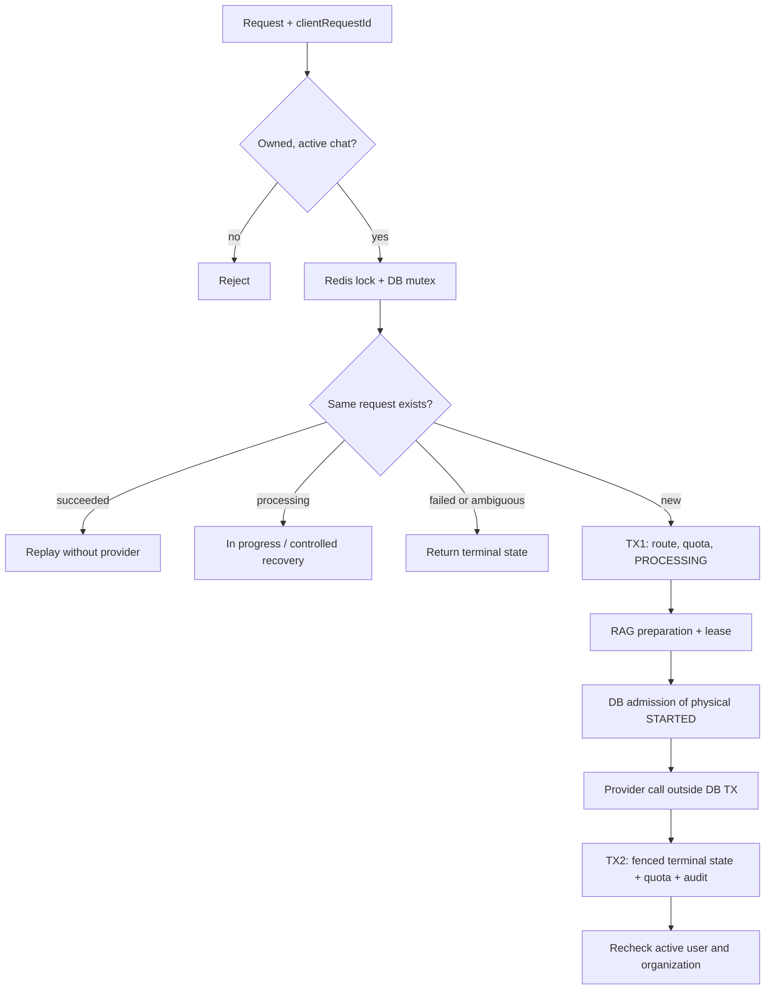

<!-- module: backend/src/main/java/ru/safeai/gateway/chat/README.md -->
# Chat — архитектура, контракты и тесты

> **Актуальность:** 14.11.2026. Java 21, Spring Boot, PostgreSQL, Redis, Flyway V1–V90.
> **Состав:** `ru.safeai.gateway.chat`; отдельно реализованные сервисы AI, Model, Audit,
> Usage и Knowledge используются по своим контрактам.
> **Статус:** техническая документация реализованных механизмов, не production approval.
> **Политика:** никакие `erase`, SQL-роли, feature flags и разрешения не включаются README.

## Содержание

1. [Назначение и границы](#назначение-и-границы)
2. [Архитектура взаимодействия](#архитектура-взаимодействия)
3. [Структура production-кода](#структура-production-кода)
4. [Контракт HTTP API](#контракт-http-api)
5. [Жизненный цикл AI-turn](#жизненный-цикл-ai-turn)
6. [Безопасность, идемпотентность и квоты](#безопасность-идемпотентность-и-квоты)
7. [Названия, архив и удаление содержимого](#названия-архив-и-удаление-содержимого)
8. [Миграции Flyway](#миграции-flyway)
9. [Конфигурация и мониторинг](#конфигурация-и-мониторинг)
10. [Каталог классов](#каталог-классов-назначение-и-ответственность)
11. [Структура тестов](#структура-тестов)
12. [Каталог тестов](#каталог-тестов-зачем-каждый-нужен)
13. [Запуск и критерии готовности](#запуск-и-критерии-готовности)
14. [Ограничения и эксплуатационные решения](#ограничения-и-эксплуатационные-решения)

## Назначение и границы

`Chat` предоставляет личные сессии AI-диалога внутри организации. Он отвечает за
создание, выдачу, архив, восстановление, ручные/автоматические названия, отправку
сообщений, чтение истории, статус выполнения, безопасное возобновление после сбоя
и долговечное редактирование содержимого при явно разрешённом erasure.

**Принцип разделения:** Chat управляет состоянием диалога. Внешний провайдер
вызывается через слой AI, выбор и binding модели принадлежат Model, реальный
физический расход подтверждается Usage/Model evidence, RAG-источники принадлежат
Knowledge. Нельзя использовать HTTP-success Chat как доказательство одной
физической попытки или достоверной суммы биллинга.

| Что реализовано | Граница ответственности |
|---|---|
| CRUD, archive/restore, поиск и история | Tenant/owner ACL, soft lifecycle |
| Request и turn idempotency | Не запускает второй AI по тому же UUID |
| Reservation → execution → finalization | Раздельные короткие DB-транзакции |
| Redis lock + PostgreSQL fencing | Redis не заменяет проверку права на запись |
| Model route evidence и quota | Нельзя терять неизвестные физические расходы |
| Knowledge-assisted / Knowledge-only | Допуск к источникам и RAG evidence в Knowledge |
| Recovery `FAILED` / `AMBIGUOUS` | Сетевой retry не равен повтору provider call |
| V86 content erasure | Не удаляет финансовый ledger и неизменяемые evidence |

## Архитектура взаимодействия

```text
Client (React / API)
  |
  v
ChatController / ChatLifecycleController / ChatTitleController
  |
  +-- ChatService ------------------------------------> owner / tenant scope
  |     |
  |     +-- ChatTurnExecutionCoordinator
  |           |
  |           +-- ChatLockService --------------------> Redis owner-token
  |           +-- ChatTurnReservationService --------> PostgreSQL TX #1
  |           |     +-- advisory mutex + idempotency
  |           |     +-- model route + quota + audit
  |           +-- KnowledgeRagService ----------------> context / receipt
  |           +-- ChatTurnLeaseService ---------------> DB lease/watchdog
  |           +-- AiExecutionService -----------------> provider call
  |           +-- ChatTurnFinalizationService -------> PostgreSQL TX #2
  |                 +-- fenced UPDATE + quota + audit
  |
  +-- ChatLifecycleService ---------------------------> archive/restore
  |     +-- V86 durable erasure intent
  |     +-- ChatErasureWorker (separate DB login) ----> bounded redaction
  |
  +-- ChatTurnRecoveryScheduler
        +-- ChatTurnRecoveryService ------------------> SKIP LOCKED TX
```

**Почему именно так:** длительный HTTP-вызов модели не должен держать JDBC
соединение и строковые блокировки. Между транзакциями сохраняется durable
`PROCESSING` и `processing_token`. Redis координирует нагрузку, но только SQL
fencing и уникальные ограничения БД определяют, кто может финализировать ход.

## Структура production-кода

Базовый путь: `backend/src/main/java/ru/safeai/gateway/chat/`.
Структура включает дополнения V86–V88 и выделенный worker.

```text
├── config/
│   ├── ChatConfiguration.java
│   ├── ChatErasureWorkerDatabaseConfig.java
│   ├── ChatLockProperties.java
│   ├── ChatProperties.java
│   ├── ChatQuotaProperties.java
│   └── ChatRecoveryProperties.java
├── controller/
│   ├── ChatController.java
│   ├── ChatLifecycleController.java
│   └── ChatTitleController.java
├── dto/
│   ├── AutomaticChatTitleRequest.java
│   ├── ChatCapabilitiesResponse.java
│   ├── ChatDetailsResponse.java
│   ├── ChatErasureCapabilityResponse.java
│   ├── ChatErasureOperationResponse.java
│   ├── ChatErasureRequest.java
│   ├── ChatErrorResponse.java
│   ├── ChatPageRequest.java
│   ├── ChatPageResponse.java
│   ├── ChatResponse.java
│   ├── ChatTurnStatusResponse.java
│   ├── CreateChatRequest.java
│   ├── MessagePageRequest.java
│   ├── MessageResponse.java
│   ├── SendMessageRequest.java
│   ├── SendMessageResponse.java
│   └── UpdateChatTitleRequest.java
├── entity/
│   ├── ChatErasureState.java
│   ├── ChatMessageEntity.java
│   ├── ChatMessageRole.java
│   ├── ChatMessageStatus.java
│   ├── ChatQuotaReservationState.java
│   ├── ChatSessionEntity.java
│   ├── ChatTurnEntity.java
│   └── ChatTurnState.java
├── exception/
│   ├── AiOutcomeAmbiguousException.java
│   ├── ChatAccessRevokedException.java
│   ├── ChatApiException.java
│   ├── ChatApiExceptionHandler.java
│   ├── ChatBusyException.java
│   ├── ChatInfrastructureExceptionHandler.java
│   ├── ChatLeaseUnavailableException.java
│   ├── ChatLockUnavailableException.java
│   ├── ChatQuotaExceededException.java
│   ├── ChatStaleProcessorException.java
│   ├── ChatTurnFailedException.java
│   ├── ChatTurnInProgressException.java
│   └── IdempotencyKeyReusedException.java
├── observability/
│   └── ChatMetrics.java
├── quota/
│   ├── ChatQuotaConsumption.java
│   ├── ChatQuotaPolicy.java
│   └── ChatQuotaReservation.java
├── repository/
│   ├── ChatHistoryRepository.java
│   ├── ChatHistoryTurn.java
│   ├── ChatMessageRepository.java
│   ├── ChatQuotaRepository.java
│   ├── ChatSecurityStateRepository.java
│   ├── ChatSessionRepository.java
│   ├── ChatTurnMutexRepository.java
│   ├── ChatTurnRecoveryRepository.java
│   ├── ChatTurnRepository.java
│   └── RecoveredChatTurn.java
├── service/
│   ├── AiHistoryBuilder.java
│   ├── ChatContentNormalizer.java
│   ├── ChatDatabaseClockRepository.java
│   ├── ChatErasureLimits.java
│   ├── ChatErasurePreconditions.java
│   ├── ChatErasureWorker.java
│   ├── ChatLifecycleService.java
│   ├── ChatLockService.java
│   ├── ChatMapper.java
│   ├── ChatProcessingContext.java
│   ├── ChatQuotaService.java
│   ├── ChatSecurityStateService.java
│   ├── ChatService.java
│   ├── ChatTurnAuditDetailsFactory.java
│   ├── ChatTurnExecutionCoordinator.java
│   ├── ChatTurnFinalizationService.java
│   ├── ChatTurnLeaseService.java
│   ├── ChatTurnReadSupport.java
│   ├── ChatTurnRecoveryCoordinator.java
│   ├── ChatTurnRecoveryScheduler.java
│   ├── ChatTurnRecoveryService.java
│   └── ChatTurnReservationService.java
└── title/
    ├── ChatTitlePolicy.java
    ├── ChatTitleService.java
    └── ChatTitleSource.java
```

Тесты хранятся независимо в `backend/src/test/java/ru/safeai/gateway/chat/`.
Полный список и назначение даны далее, а не спрятаны в ссылке на весь репозиторий.

## Контракт HTTP API

Базовый префикс: `/api/chats`. Авторизация проводится на controller и service
уровнях. `organizationId` нельзя брать из произвольного клиентского параметра.

### Основные операции

- `GET /api/chats/capabilities`: технические ограничения формы запроса.
- `POST /api/chats`: создаёт персональный чат, возвращает `201 Created`.
- `GET /api/chats`: список активных чатов владельца, `Slice` без full count.
- `GET /api/chats/{chatId}`: сессия и ограниченная по размеру история.
- `DELETE /api/chats/{chatId}`: legacy soft archive, не удаление содержимого.
- `POST /api/chats/{chatId}/messages`: новый ход или идемпотентный replay.
- `GET /api/chats/{chatId}/messages`: страничная история по времени и UUID.
- `GET /api/chats/{chatId}/turns/by-client-request/{clientRequestId}`: статус хода.
- `GET /api/chats/{chatId}/turns/{clientRequestId}`: совместимый legacy alias.
- `PATCH /api/chats/{chatId}`: ручное переименование.

### Lifecycle V86

- `GET /api/chats/archived`: только архивные чаты данного владельца.
- `GET /api/chats/{chatId}/archived`: содержание архивной сессии.
- `POST /api/chats/{chatId}/archive`: перевод в архив, `204`.
- `POST /api/chats/{chatId}/restore`: восстановление архива, `204`.
- `GET /api/chats/{chatId}/erasure/capability`: защищённая проверка допуска.
- `DELETE /api/chats/{chatId}/erasure`: admission; только `202 Accepted`.
- `GET /api/chats/erasure-operations`: история операций для администратора.
- `GET /api/chats/{chatId}/erasure`: статус операции.

В V86 `DELETE /erasure` требует `ADMIN`, а также strong `If-Match` с числовой
версией в двойных кавычках, `Idempotency-Key` и проверяемое подтверждение.
Статус `202` не свидетельствует о завершённой редакции контента.

### Неизменяемые договорённости с клиентом

- `clientRequestId` генерируется один раз и сохраняется для сетевого повтора.
- Другой текст/Knowledge-scope с тем же UUID даёт `IDEMPOTENCY_KEY_REUSED`.
- Нормализованный текст содержит валидный Unicode и корректные LF.
- `SendMessageResponse` означает только терминальное успешное выполнение.
- Неполное состояние читается status endpoint, а не маскируется успехом.
- `409 AI_OUTCOME_AMBIGUOUS` не разрешает сделать новую платную попытку.
- `Slice` содержит признаки дальнейших страниц, не обещает `totalPages`.
- Название `USER` никогда не затирается автоматически.

## Жизненный цикл AI-turn



1. Резервирование под PostgreSQL advisory mutex подтверждает owner, scope,
   актуальный user/org epoch, quota и единственность active turn.
2. Успешный reserve коммитит данные **до** вызова сети; watchdog и Redis lock
   поддерживают исполнителя, но не заменяют DB fencing.
3. Knowledge RAG выполняет разрешённый retrieval, сохраняет context receipt,
   проверяет возможность реального provider STARTED.
4. AI возвращает результат с отдельным evidence реальной физической попытки.
   Неизвестный исход не становится `KNOWN_NOT_EXECUTED` по оптимизму.
5. Финализация обновляет turn условным SQL, записывает assistant message,
   учитывает quota/usage, Answer Passport и audit в согласованных транзакциях.
6. После commit повторно проверяются полномочия caller. При отзыве можно
   запретить выдачу HTTP-ответа, не теряя уже подтверждённый расход.

### Состояния

- `NEW`: историческая/подготовительная форма; не разрешает дубль исполнения.
- `PROCESSING`: владелец определяется `processing_token` и `lease_until`.
- `SUCCEEDED`: terminal с ответом; последующие запросы получают replay.
- `FAILED`: доказанный окончательный отказ; тот же UUID не запускается снова.
- `AMBIGUOUS`: физический исход неизвестен; дальнейшее решение требует evidence.

`ChatQuotaReservationState`: `RESERVED` → `SETTLED`, `UNPRICED`, `AMBIGUOUS`
или `RELEASED`. Резерв нельзя закрыть успешно, если стоимость не доказана.

## Безопасность, идемпотентность и квоты

### Tenant boundary и отзыв доступа

Доступ проверяется одновременно по `user_id`, `organization_id` и владению
сессией. Сам по себе UUID чужого чата не предоставляет прав. `SUPER_ADMIN`
не должен автоматически обходить tenant ACL. После начального admission
проверяются `tokenVersion` и `organizationAuthVersion` перед STARTED и после
финализации. V72 удерживает организационную эпоху в критической DB-точке.

### Почему два замка

Redis `ownerToken + TTL` защищает от лишних параллельных физических вызовов.
PostgreSQL `pg_advisory_xact_lock` сериализует reserve, уникальные constraints
фиксируют idempotency, а `UPDATE ... WHERE state AND processing_token`
останавливает stale writer. Истечение одного Redis TTL не даёт старому узлу
право перезаписать результат.

### Денежная корректность

Физические retries считаются отдельными попытками. Маршрут и upper bound
резервируются до вызова; фактические usage/pricing могут быть `UNPRICED`,
`PARTIAL` или `MISSING`. В этих случаях нельзя подставлять ноль и объявлять
финансовый отчёт полным. `KNOWN_NOT_EXECUTED` является самостоятельным
подтверждённым фактом, не синонимом тайм-аута.

### Recovery

Периодический scheduler выбирает просроченные `PROCESSING` через
`FOR UPDATE SKIP LOCKED`. Если physical STARTED не доказан, предусмотрено
`FAILED`; если запрос уже мог уйти провайдеру, результат `AMBIGUOUS`.
Turn, quota и audit должны обновляться атомарно. Повторный HTTP-request с
тем же UUID не отменяет это решение.

## Названия, архив и удаление содержимого

### Название и архив

`ChatTitlePolicy` формирует детерминированный короткий заголовок из первого
принятого сообщения без нового платного AI-вызова. `ChatTitleSource` явно
различает `DEFAULT`, `AUTO`, `USER`. Ручное название приоритетнее автоматического.

Архив скрывает чат из активной выдачи и блокирует начало новых ходов. Restore
не разрешён для стираемой/стёртой сессии. Обычный `DELETE /api/chats/{id}`
в предыдущем API является soft archive, а не уничтожением данных.

### V86–V88: отдельная операция content erasure

```text
chat_sessions.erasure_state:
  AVAILABLE --> ERASING --> ERASED

chat_erasure_operations_v86.state:
  ERASING --> ERASED
          --> NEEDS_REVIEW
          --> BLOCKED_BY_RETENTION
          --> CANCELLED (строго по разрешённому операторскому пути)
```

- Приём требует архив, current owner/admin, optimistic version, идемпотентность,
  подтверждённую retention policy и разрешающие feature flags.
- Внешняя попытка удаления не запускается HTTP-контроллером.
- Выделенный DB-login `safeai_chat_erasure_worker` запускает bounded redaction
  текста сообщений, legacy retrieval-query и названия чата.
- Для одного claim redaction атомарна: превышение лимита или ошибка делает
  rollback и, если безопасно, переводит операцию в `NEEDS_REVIEW`.
- Удержание по retention/active RAG нельзя обойти изменением одного флага.
- SQL triggers охраняют state, immutable evidence и запрещают новые записи
  после перехода к стиранию.
- Two-person approvals для отдельных операторских действий разделены от
  runtime `safeai_app`, worker и migration identity.

**Что остаётся:** идентификаторы session/turn, provider execution evidence,
quota/usage, audit, RAG provenance и юридически сохраняемые факты. Статус
`ERASED` обозначает обработку предусмотренного online content, но не удаление
всех копий и резервных данных.

`safeai.chat.erasure.accept-enabled`, `.executor-enabled` и
`.retention-approved` по умолчанию `false`. Не считать наличие API основанием
включать их. Отдельная DB-role и подготовленный runbook обязательны.

## Миграции Flyway

Миграции применяются в порядке номеров и не изменяются после deployment.
**V0** в тестовом classpath настраивает роли; последовательный тест обязан
учитывать V0 до V1. Наличие 91 миграции до V90 в тестовом профиле нормально.

- **V3** — `V3__denormalize_chat_organization.sql`: denormalize chat organization.
- **V8** — `V8__usage_chat_messages_indexes.sql`: usage chat messages indexes.
- **V13** — `V13__identity_refresh_and_message_integrity.sql`: identity refresh and message
  integrity.
- **V14** — `V14__chat_turn_idempotency_and_integrity.sql`: chat turn idempotency and integrity.
- **V17** — `V17__ai_usage_and_pricing_metadata.sql`: ai usage and pricing metadata.
- **V22** — `V22__chat_single_reply_index.sql`: chat single reply index.
- **V32** — `V32__chat_turn_state_machine.sql`: chat turn state machine.
- **V33** — `V33__chat_turn_indexes.sql`: chat turn indexes.
- **V34** — `V34__chat_ambiguous_usage_quality.sql`: chat ambiguous usage quality.
- **V35** — `V35__chat_turn_composite_integrity.sql`: chat turn composite integrity.
- **V36** — `V36__validate_chat_composite_integrity.sql`: validate chat composite integrity.
- **V43** — `V43__archive_chat_sessions.sql`: archive chat sessions.
- **V45** — `V45__model_control_plane.sql`: model control plane.
- **V48** — `V48__model_input_accounting_provenance.sql`: model input accounting provenance.
- **V50** — `V50__ai_execution_attempt_usage_evidence.sql`: ai execution attempt usage evidence.
- **V51** — `V51__ai_execution_attempt_integrity_hardening.sql`: ai execution attempt integrity
  hardening.
- **V52** — `V52__model_strict_execution_and_modality_integrity.sql`: model strict execution and
  modality integrity.
- **V53** — `V53__physical_attempt_transition_and_pricing_integrity.sql`: physical attempt
  transition and pricing integrity.
- **V54** — `V54__provider_identity_and_reconciliation_safety.sql`: provider identity and
  reconciliation safety.
- **V58** — `V58__chat_title_lifecycle.sql`: chat title lifecycle.
- **V60** — `V60__monthly_cost_commitment_ledger.sql`: monthly cost commitment ledger.
- **V65** — `V65__model_execution_binding_enforcement.sql`: model execution binding enforcement.
- **V66** — `V66__physical_response_and_pricing_scheme.sql`: physical response and pricing scheme.
- **V67** — `V67__chat_execution_quota_and_evidence_hardening.sql`: chat execution quota and
  evidence hardening.
- **V72** — `V72__organization_auth_epoch_physical_attempt_gate.sql`: organization auth epoch
  physical attempt gate.
- **V76** — `V76__knowledge_retrieval_query_privacy.sql`: knowledge retrieval query privacy.
- **V77** — `V77__backfill_legacy_default_chat_titles.sql`: backfill legacy default chat titles.
- **V85** — `V85__knowledge_rag_execution_leases_and_erasure_guards.sql`: knowledge rag execution
  leases and erasure guards.
- **V86** — `V86__chat_archive_restore_erasure.sql`: chat archive restore erasure.
- **V87** — `V87__chat_archive_owner_online_index.sql`: chat archive owner online index.
- **V88** — `V88__chat_erasure_validate_constraints.sql`: chat erasure validate constraints.

### Особенности V86–V88

- `V86__chat_archive_restore_erasure.sql`: intent, retention holds, guards,
  отдельный worker/operator, redaction-boundary и audit.
- `V87__chat_archive_owner_online_index.sql`: concurrent index вне DB-транзакции.
  Не считать неполный индекс успешным из-за его существования в каталоге.
- `V88__chat_erasure_validate_constraints.sql`: валидация ограничения и
  проверка `indisvalid/indisready` индекса V87.
- V89–V90 усиливают Knowledge; не следует смешивать их GC и chat erasure.

## Конфигурация и мониторинг

- `safeai.chat.*`: пределы истории, страницы, контента и lease.
- `safeai.chat.lock.*`: Redis TTL, key prefix, watchdog и конкуренция.
- `safeai.chat.quota.*`: организация/пользователь, период, токены и стоимость.
- `safeai.chat.recovery.*`: cron, batch size, bounded run.
- `safeai.chat.erasure.*`: admission, worker, retention approval, poll delay.

Используются метрики жизненного цикла, recovery и потери ownership с метками
малой кардинальности. Метрики не должны содержать raw content, user/chat UUID,
API keys или storage object keys. Наличие метрики не доказывает доставку alert.

---

## Каталог классов: назначение и ответственность

Список построен по архивам исходников и дополняющим патчам. Для каждого файла указан его
контракт и, где это уместно, реальные имена публичных методов. Изменения реализации сверяют
с исходным `.java`: документация не заменяет контракт компилятора и SQL.

### `config/` — Конфигурация и fail-fast validation (6)

- **`ChatConfiguration`** — Включает параметры Chat и планирование, связывает bounded настройки с
  Spring.
- **`ChatErasureWorkerDatabaseConfig`** — Создаёт изолированный JDBC и transaction manager для
  логина стирания; проверяет роли. Публичные операции: `jdbc()`, `transactionManager()`,
  `chatErasureWorkerConnections()`.
- **`ChatLockProperties`** — Проверяет Redis TTL, префикс, watchdog и безопасные границы блокировок.
  Публичные операции: `renewalInterval()`.
- **`ChatProperties`** — Валидирует размеры сообщений, пагинацию, историю и processing lease.
  Публичные операции: `leaseRenewalInterval()`.
- **`ChatQuotaProperties`** — Задаёт консервативные лимиты квот и проверяет денежную точность.
  Публичные операции: `isEnabled()`, `effectivePeriodZone()`.
- **`ChatRecoveryProperties`** — Проверяет cron, размер и предел числа recovery-пакетов. Публичные
  операции: `isEnabled()`.

### `controller/` — HTTP entry points и авторизация (3)

- **`ChatController`** — HTTP-граница обычных чатов: CRUD, сообщения, статусы, capability. Публичные
  операции: `capabilities()`, `create()`, `findAll()`, `findById()`.
- **`ChatLifecycleController`** — HTTP-граница архива, восстановления и защищённого стирания V86.
  Публичные операции: `archived()`, `archivedDetails()`, `archive()`, `restore()`.
- **`ChatTitleController`** — Отдельный PATCH переименования; передаёт управление доменной политике.
  Публичные операции: `assignAutomaticTitle()`, `rename()`.

### `dto/` — Публичные/внутренние контракты JSON (17)

- **`AutomaticChatTitleRequest`** — Внутренний контракт формирования автоматического названия.
- **`ChatCapabilitiesResponse`** — Публикует только технические пределы API, не личные остатки квот.
- **`ChatDetailsResponse`** — Формирует ответ с деталями сессии и неизменяемой коллекцией сообщений.
- **`ChatErasureCapabilityResponse`** — Безопасный снимок доступности стирания с проверками роли и
  состояния.
- **`ChatErasureOperationResponse`** — Статус долговечной операции редактирования, не обещание
  удаления всех следов.
- **`ChatErasureRequest`** — Тело подтверждения чувствительной операции удаления контента.
- **`ChatErrorResponse`** — Публичная модель ошибки обработки Chat с кодом и допустимым retry-after.
- **`ChatPageRequest`** — Строгая страничная выдача с whitelist сортировок и tie-breaker ID.
  Публичные операции: `toPageable()`.
- **`ChatPageResponse`** — Ответ Slice: наличие следующей страницы без лишнего полного COUNT.
  Публичные операции: `from()`.
- **`ChatResponse`** — Публичные метаданные чата без текста сообщений.
- **`ChatTurnStatusResponse`** — Состояние и evidence одного AI-turn по идемпотентному
  идентификатору.
- **`CreateChatRequest`** — Контракт создания с необязательным пользовательским названием.
- **`MessagePageRequest`** — Валидирует выдачу истории, фиксирует порядок времени и UUID. Публичные
  операции: `toPageable()`.
- **`MessageResponse`** — Ответ сообщения с provider/model, токенами и качеством стоимости.
- **`SendMessageRequest`** — Контракт содержимого, clientRequestId и опционального Knowledge-scope.
- **`SendMessageResponse`** — Только успешно завершённый turn либо его идемпотентный replay.
- **`UpdateChatTitleRequest`** — Контракт ручного переименования; доменная Unicode-проверка
  отдельно.

### `entity/` — Состояние и инварианты JPA (8)

- **`ChatErasureState`** — Разделяет доступный, стираемый и отредактированный контент сессии.
- **`ChatMessageEntity`** — JPA-сущность с role/status, usage/pricing и lifecycle-инвариантами.
  Публичные операции: `user()`, `completedAssistant()`, `system()`.
- **`ChatMessageRole`** — Типы сообщения: USER, ASSISTANT и SYSTEM.
- **`ChatMessageStatus`** — Разделяет pending, completed и failed сообщение.
- **`ChatQuotaReservationState`** — Жизненный цикл денежного/токенового резерва на физический вызов.
- **`ChatSessionEntity`** — Владение, организация, название, provenance, archive и erasure state.
  Публичные операции: `create()`, `touch()`, `assignAutomaticTitle()`, `renameByUser()`.
- **`ChatTurnEntity`** — Долговечное выполнение AI: request identity, fencing token, lease, state.
  Публичные операции: `processing()`.
- **`ChatTurnState`** — Состояния NEW, PROCESSING, SUCCEEDED, FAILED и AMBIGUOUS.

### `exception/` — Безопасные ошибки API (13)

- **`AiOutcomeAmbiguousException`** — Неизвестный исход физической попытки: запрещает слепой платный
  retry.
- **`ChatAccessRevokedException`** — Отказ в выдаче после отзыва права в ходе обработки.
- **`ChatApiException`** — Типизированная основа Chat HTTP-ошибок и безопасных публичных полей.
- **`ChatApiExceptionHandler`** — Преобразует доменные Chat-ошибки в согласованный JSON-ответ.
  Публичные операции: `handle()`.
- **`ChatBusyException`** — Сообщает о конкурирующей операции над тем же чатом.
- **`ChatInfrastructureExceptionHandler`** — Безопасно классифицирует инфраструктурные ошибки, не
  раскрывая секретов. Публичные операции: `handleChatBusy()`, `handleChatLockUnavailable()`.
- **`ChatLeaseUnavailableException`** — Отказ при невозможности надёжно продлить право записи
  результата.
- **`ChatLockUnavailableException`** — Неисправность Redis lock, которая не должна становиться
  разрешением работать без lock.
- **`ChatQuotaExceededException`** — Контракт блокировки нового AI-расхода при превышении квот.
- **`ChatStaleProcessorException`** — Устаревший обработчик теряет право на terminal UPDATE.
- **`ChatTurnFailedException`** — Идемпотентное представление окончательной ошибки хода.
- **`ChatTurnInProgressException`** — Повтор уже выполняемого turn без запуска второй модели.
- **`IdempotencyKeyReusedException`** — Защищает от повторного UUID с другим содержимым или
  KB-scope.

### `observability/` — Метрики жизненного цикла (1)

- **`ChatMetrics`** — Micrometer-события после commit с метками малой кардинальности. Публичные
  операции: `recordReservedAfterCommit()`, `recordReplay()`, `recordTerminalAfterCommit()`,
  `recordRecoveryBatchAfterCommit()`.

### `quota/` — Расход и резервы (3)

- **`ChatQuotaConsumption`** — Фактически потреблённые запросы, токены, деньги и флаги unknown.
- **`ChatQuotaPolicy`** — Применимые ограничения организации и пользователя на период. Публичные
  операции: `unlimited()`.
- **`ChatQuotaReservation`** — Route-bound консервативное представление будущего AI-расхода.
  Публичные операции: `databaseReservedCostUsd()`.

### `repository/` — Изоляция SQL и atomic updates (10)

- **`ChatHistoryRepository`** — SQL истории только полных успешно завершённых USER/ASSISTANT пар.
  Публичные операции: `findNewestSucceededTurns()`.
- **`ChatHistoryTurn`** — Неизменяемая проекция успешного хода для модели.
- **`ChatMessageRepository`** — Точечная и постраничная выборка сообщений с контролем ownership.
- **`ChatQuotaRepository`** — Атомарная бронь/settlement/release квот и учёт unknown стоимости.
  Публичные операции: `lockOrganizationPolicy()`, `lockUserPolicy()`, `organizationConsumption()`,
  `userConsumption()`.
- **`ChatSecurityStateRepository`** — Повторная DB-проверка активности, tokenVersion и epoch
  организации. Публичные операции: `isActive()`.
- **`ChatSessionRepository`** — Tenant-scoped поиск, archive/restore и условные изменения session.
- **`ChatTurnMutexRepository`** — PostgreSQL transaction advisory mutex по конкретному chatId.
  Публичные операции: `lockChat()`.
- **`ChatTurnRecoveryRepository`** — Claim просроченных turn через SKIP LOCKED и условные переходы.
  Публичные операции: `recoverExpired()`.
- **`ChatTurnRepository`** — Fenced SQL-операции над turn, включая lease и terminal transitions.
- **`RecoveredChatTurn`** — Проекция результата восстановления без раскрытия содержимого.

### `service/` — Сценарии и транзакционные границы (21)

- **`AiHistoryBuilder`** — Собирает хронологический безопасный AI-контекст из завершённых пар.
  Публичные операции: `build()`.
- **`ChatContentNormalizer`** — Нормализует Unicode/новые строки, вычисляет SHA-256 с KB-scope.
  Публичные операции: `normalize()`, `sha256()`, `requestHash()`.
- **`ChatDatabaseClockRepository`** — Получает wall-clock PostgreSQL для lease и финансовых границ.
  Публичные операции: `now()`.
- **`ChatErasureLimits`** — Защитные пределы объёма и батчей атомарной операции стирания.
- **`ChatErasureWorker`** — Изолированный V86 worker: bounded атомарная redaction с lease/fencing.
  Публичные операции: `poll()`.
- **`ChatLifecycleService`** — Архив, restore и admission V86 с ролью, If-Match и idempotency.
  Публичные операции: `archived()`, `archivedDetails()`, `archive()`, `restore()`.
- **`ChatLockService`** — Redis owner-token блокировка и watchdog, дополняющий DB fencing. Публичные
  операции: `lock()`, `ensureValid()`, `unlock()`, `unlockQuietly()`.
- **`ChatMapper`** — Согласованная конверсия JPA/проекций в публичные DTO. Публичные операции:
  `toChatResponse()`, `toMessageResponse()`, `toChatDetailsResponse()`, `toTurnStatusResponse()`.
- **`ChatProcessingContext`** — Immutable execution/replay snapshot с неизменяемой identity запроса.
  Публичные операции: `withAiRequest()`.
- **`ChatQuotaService`** — Резервирует и погашает квоты в коротких транзакциях. Публичные операции:
  `reserve()`, `settleSuccess()`, `releaseFailure()`, `markAmbiguous()`.
- **`ChatSecurityStateService`** — Перепроверяет право перед/после физического вызова модели.
  Публичные операции: `assertStillActive()`.
- **`ChatService`** — Сценарии CRUD и владения; для AI делегирует execution coordinator. Публичные
  операции: `setLifecycleService()`, `create()`, `findAll()`, `archive()`.
- **`ChatTurnAuditDetailsFactory`** — Формирует audit details без сырого prompt и секретов.
- **`ChatTurnExecutionCoordinator`** — Управляет lock, lease, RAG, физической попыткой и
  финализацией.
- **`ChatTurnFinalizationService`** — Транзакционно сохраняет terminal state, ответ,
  usage/quota/audit. Публичные операции: `failBeforeProviderCall()`, `succeed()`, `succeedRag()`,
  `failAfterProviderContextRevoked()`.
- **`ChatTurnLeaseService`** — Продлевает lease и фиксирует потерю права обновлять turn. Публичные
  операции: `watch()`, `ensureValid()`, `close()`, `LeaseWatch()`.
- **`ChatTurnReadSupport`** — Единое чтение результата, статуса и идемпотентного replay.
- **`ChatTurnRecoveryCoordinator`** — В одной транзакции согласует turn, quota и audit при recovery.
  Публичные операции: `recoverInline()`, `completeScheduledBatch()`.
- **`ChatTurnRecoveryScheduler`** — Ограниченный по числу батчей периодический запуск recovery.
  Публичные операции: `recover()`.
- **`ChatTurnRecoveryService`** — Транзакционный recovery одной пачки просроченных операций.
  Публичные операции: `recoverExpiredBatch()`.
- **`ChatTurnReservationService`** — Идемпотентный reserve/replay, governance, квота и начало хода.
  Публичные операции: `reserveOrReplay()`.

### `title/` — Название и provenance (3)

- **`ChatTitlePolicy`** — Детерминированное название без LLM, безопасная Unicode-нормализация.
  Публичные операции: `normalizeCreationTitle()`, `normalizeStoredTitle()`,
  `normalizeManualTitle()`, `automaticTitle()`.
- **`ChatTitleService`** — Ручное переименование с DB mutex, owner check и аудитом. Публичные
  операции: `assignAutomaticTitle()`, `rename()`.
- **`ChatTitleSource`** — Provenance названия: DEFAULT, AUTO, USER; ручное всегда приоритетнее.

## Структура тестов

Путь: `backend/src/test/java/ru/safeai/gateway/chat/`.

```text
├── config/
│   └── ChatConfigurationPropertiesTest.java
├── controller/
│   ├── ChatControllerContractTest.java
│   ├── ChatControllerSecurityTest.java
│   └── ChatLifecycleVersionTest.java
├── dto/
│   └── ChatDtoContractTest.java
├── entity/
│   ├── ChatEntityInvariantTest.java
│   ├── ChatErasureStateTest.java
│   └── ChatTurnOrganizationEpochTest.java
├── exception/
│   ├── ChatExceptionAdviceMvcTest.java
│   └── ChatInfrastructureExceptionHandlerTest.java
├── integration/
│   ├── AbstractChatPostgresIntegrationTest.java
│   ├── ChatConcurrencyIntegrationTest.java
│   ├── ChatContentErasureV86IntegrationTest.java
│   ├── ChatDatabaseStateConstraintIntegrationTest.java
│   ├── ChatErasureAdmissionLimitIT.java
│   ├── ChatErasureBatchBoundaryV86IntegrationTest.java
│   ├── ChatErasureLimitsTest.java
│   ├── ChatErasureOperatorV86IntegrationTest.java
│   ├── ChatErasureSecurityV86IntegrationTest.java
│   ├── ChatExplainPlanIntegrationTest.java
│   ├── ChatHistoryIntegrationTest.java
│   ├── ChatIntegrationClockConfiguration.java
│   ├── ChatLegacyUpgradeMigrationIntegrationTest.java
│   ├── ChatMigrationIntegrityIntegrationTest.java
│   ├── ChatTenantIsolationIntegrationTest.java
│   ├── ChatTurnRecoveryIntegrationTest.java
│   ├── ChatTurnRepositoryTransactionIntegrationTest.java
│   ├── ChatTurnStateMachineIntegrationTest.java
│   └── ChatUsageQualityIntegrationTest.java
├── observability/
│   └── ChatMetricsTest.java
├── service/
│   ├── AiHistoryBuilderTest.java
│   ├── ChatContentNormalizerTest.java
│   ├── ChatErasureCombinedHoldPreconditionsTest.java
│   ├── ChatErasureFeatureGateTest.java
│   ├── ChatErasurePreconditionsTest.java
│   ├── ChatLockServiceTest.java
│   ├── ChatProcessingContextTest.java
│   ├── ChatProcessingContextTestFixtures.java
│   ├── ChatQuotaServiceTest.java
│   ├── ChatServiceTest.java
│   ├── ChatTurnFinalizationServiceTest.java
│   ├── ChatTurnLeaseServiceTest.java
│   ├── ChatTurnRecoverySchedulerTest.java
│   ├── ChatTurnRecoveryServiceTest.java
│   └── ChatTurnReservationServiceTest.java
├── testsupport/
│   └── ChatTestFixtures.java
└── title/
    ├── ChatSessionTitleLifecycleTest.java
    ├── ChatTitlePolicyTest.java
    └── ChatTitleServiceSubmissionTest.java
```

## Каталог тестов: зачем каждый нужен

Это дерево соответствует предоставленной структуре тестов, включая V86–V90.
Названия `*IT` и `*IntegrationTest` описывают тестовые файлы, но сами по себе
не доказывают, что запущен Docker или получен зелёный CI.

### `config/` (1)

- **`ChatConfigurationPropertiesTest`** — Проверяет границы конфигурации. Примеры проверок:
  `pageSizeCannotExceedPublicApiMaximum()`, `quotaDefaultsReserveConservativelyInUtc()`.

### `controller/` (3)

- **`ChatControllerContractTest`** — Проверяет HTTP контракт и безопасность. Примеры проверок:
  `emptyContentIsRejected()`, `testSecurityFilterChain()`.
- **`ChatControllerSecurityTest`** — Проверяет HTTP контракт и безопасность. Примеры проверок:
  `chatProperties()`, `testSecurityFilterChain()`.
- **`ChatLifecycleVersionTest`** — Проверяет strong If-Match и версия для операций жизненного цикла.
  Примеры проверок: `missingIfMatchIsHttp428()`, `ifMatchRequiresStrongQuotedNonNegativeVersion()`.

### `dto/` (1)

- **`ChatDtoContractTest`** — Проверяет валидацию и JSON-формат. Примеры проверок:
  `blankMessageIsRejected()`, `clientRequestIdIsMandatory()`.

### `entity/` (3)

- **`ChatEntityInvariantTest`** — Проверяет доменные инварианты. Примеры проверок:
  `nonAssistantMetadataIsNotSilentlyCleared()`, `oversizedProviderMetadataIsRejectedBeforeSql()`.
- **`ChatErasureStateTest`** — Проверяет допустимые состояния редактирования содержимого.
- **`ChatTurnOrganizationEpochTest`** — Проверяет доменные инварианты. Примеры проверок:
  `factoryCapturesOrganizationEpochBeforePersistence()`.

### `exception/` (2)

- **`ChatExceptionAdviceMvcTest`** — Проверяет HTTP ошибки без утечек. Примеры проверок:
  `chatService()`, `chatProperties()`.
- **`ChatInfrastructureExceptionHandlerTest`** — Проверяет HTTP ошибки без утечек. Примеры проверок:
  `chatBusyPreservesApiErrorContract()`, `chatLockUnavailablePreservesSafe503WithoutCauseLeak()`.

### `integration/` (19)

- **`AbstractChatPostgresIntegrationTest`** — Вспомогательный тестовый компонент: общий набор
  данных, setup или отдельный JVM-процесс. Примеры проверок: `prepareChatFixture()`.
- **`ChatConcurrencyIntegrationTest`** — Проверяет одновременное резервирование запросов, lock и
  гонки. Примеры проверок: `organizationQuotaReservationIsAtomicAcrossTwoChats()`,
  `concurrentDuplicateRequestsCreateOneUserMessageAndOneTurn()`.
- **`ChatContentErasureV86IntegrationTest`** — Проверяет V86 redaction и сохранение immutable
  evidence. Примеры проверок: `legacyArchiveCannotRaceActiveChatTurnAtDatabaseBoundary()`,
  `activeRetentionHoldBlocksContentErasureWithoutTriggerBypass()`.
- **`ChatDatabaseStateConstraintIntegrationTest`** — Проверяет реальное взаимодействие с БД и
  потоками. Примеры проверок: `startedExecutionAttemptCannotBeDeleted()`,
  `unpricedQuotaCannotMasqueradeAsKnownZeroCost()`.
- **`ChatErasureAdmissionLimitIT`** — Проверяет границы приёма удаления и отказ при слишком большом
  объёме. Примеры проверок: `exactlyTenThousandMessagesAreWithinAdmissionLimit()`,
  `tenThousandAndOneMessagesAreRejectedBeforeErasureIntent()`.
- **`ChatErasureBatchBoundaryV86IntegrationTest`** — Проверяет атомарные пределы батчей; отсутствие
  частичного удаления. Примеры проверок: `runCase()`, `smallBoundariesFullyErase()`.
- **`ChatErasureLimitsTest`** — Проверяет ограничения нагрузки и размера удаления.
- **`ChatErasureOperatorV86IntegrationTest`** — Проверяет раздельные approvals и защищённые
  операторские действия. Примеры проверок: `operatorReleaseHoldAndResumeIsAudited()`,
  `operatorCanCancelQuarantinedAttemptWithoutRedacting()`.
- **`ChatErasureSecurityV86IntegrationTest`** — Проверяет изоляцию SQL-ролей и запрет обхода guards.
- **`ChatExplainPlanIntegrationTest`** — Проверяет SQL планы для критических chat-запросов. Примеры
  проверок: `staleRecoveryQueryUsesProcessingLeaseIndex()`,
  `visibleMessageQueryUsesTenantChatReadIndex()`.
- **`ChatHistoryIntegrationTest`** — Проверяет реальное взаимодействие с БД и потоками. Примеры
  проверок: `failedAndOrphanUserMessagesNeverEnterAiHistory()`,
  `historyContainsOnlyCompleteChronologicalTurnPairs()`.
- **`ChatIntegrationClockConfiguration`** — Вспомогательный тестовый компонент: общий набор данных,
  setup или отдельный JVM-процесс.
- **`ChatLegacyUpgradeMigrationIntegrationTest`** — Проверяет совместимость схемы и прежних
  состояний при upgrade. Примеры проверок: `legacyFailedReplyBecomesStableFailedTurn()`,
  `legacyOrphanUserBecomesAmbiguousAndIsNeverAutoRetried()`.
- **`ChatMigrationIntegrityIntegrationTest`** — Проверяет инварианты Flyway/SQL реальной схемы.
  Примеры проверок: `requiredProductionIndexesExist()`, `v32CreatesPersistentTurnAndQuotaLedger()`.
- **`ChatTenantIsolationIntegrationTest`** — Проверяет изоляцию пользовательских/организационных
  данных. Примеры проверок: `userCannotReadForeignTenantChat()`,
  `superAdminCannotAccessTenantChat()`.
- **`ChatTurnRecoveryIntegrationTest`** — Проверяет восстановление незавершённых ходов после lease
  expiry. Примеры проверок: `activeLeaseIsNotRecovered()`, `recoveryIsBoundedAndIdempotent()`.
- **`ChatTurnRepositoryTransactionIntegrationTest`** — Проверяет реальное взаимодействие с БД и
  потоками. Примеры проверок: `renewLeaseRejectsStaleFencingToken()`,
  `watchdogRenewalCannotReviveAnExpiredLease()`.
- **`ChatTurnStateMachineIntegrationTest`** — Проверяет fencing, STARTED, auth epoch, quota и
  terminal transitions. Примеры проверок: `sameIdWithDifferentNormalizedContentIsConflict()`,
  `sameIdAndSameContentReplaysSinglePersistedResult()`.
- **`ChatUsageQualityIntegrationTest`** — Проверяет реальное взаимодействие с БД и потоками. Примеры
  проверок: `ambiguousQualityRebuildIsIdempotent()`,
  `failedPreCallTurnDoesNotInflateAmbiguousOperations()`.

### `observability/` (1)

- **`ChatMetricsTest`** — Проверяет низкую кардинальность и публикацию метрик после commit. Примеры
  проверок: `recoveryBatchRecordsTerminalStates()`, `terminalMetricsUseOnlyBoundedStateTag()`.

### `service/` (13)

- **`AiHistoryBuilderTest`** — Проверяет бизнес-сценарии. Примеры проверок: `nullHistoryIsEmpty()`,
  `incompleteSucceededTurnFailsFast()`.
- **`ChatContentNormalizerTest`** — Проверяет Unicode, управляющие символы, SHA-256 и scope. Примеры
  проверок: `blankContentIsRejected()`, `isoControlCharacterIsRejected()`.
- **`ChatErasureFeatureGateTest`** — Проверяет fail-closed выключенные флаги удаления. Примеры
  проверок: `workerRefusesApplicationDatabaseCredentials()`,
  `erasureIsOffByDefaultAndDoesNotTouchDependencies()`.
- **`ChatLockServiceTest`** — Проверяет Redis lock с owner token, TTL и обновлением. Примеры
  проверок: `redisOutageFailsClosed()`, `activeLockCapacityIsBounded()`.
- **`ChatProcessingContextTest`** — Проверяет бизнес-сценарии. Примеры проверок:
  `processingContextCarriesV45RouteDecisionIdentity()`,
  `withAiRequestPreservesDurableRouteAndProcessingIdentity()`.
- **`ChatProcessingContextTestFixtures`** — Вспомогательный тестовый компонент: общий набор данных,
  setup или отдельный JVM-процесс.
- **`ChatQuotaServiceTest`** — Проверяет границы резерва, settlement и неопределённый расход.
  Примеры проверок: `disabledQuotaDoesNothing()`, `unpricedRouteCannotPassHardMoneyLimit()`.
- **`ChatServiceTest`** — Проверяет прикладные сценарии и отказ доступа до/после AI. Примеры
  проверок: `succeededReplaySkipsRateProviderLeaseAndQuotaPath()`,
  `unambiguousProviderFailureBecomesStableFailedTurn()`.
- **`ChatTurnFinalizationServiceTest`** — Проверяет атомарность сохранения результата и доходного
  evidence. Примеры проверок: `lostFencingTokenPreventsSecondAssistantReply()`,
  `connectFailureBecomesStableFailedAndReleasesQuota()`.
- **`ChatTurnLeaseServiceTest`** — Проверяет watchdog, утрату lease и отказ старому обработчику.
  Примеры проверок: `repositoryFailureInvalidatesWatch()`,
  `closeIsIdempotentAndReleasesCapacityOnce()`.
- **`ChatTurnRecoverySchedulerTest`** — Проверяет бизнес-сценарии. Примеры проверок:
  `recoveryStopsWhenQueueIsEmpty()`, `recoveryStopsAtConfiguredBatchLimit()`.
- **`ChatTurnRecoveryServiceTest`** — Проверяет бизнес-сценарии. Примеры проверок:
  `configuredBatchSizeIsPassedToRepository()`, `emptyRecoveryBatchIsStillDelegatedToCoordinator()`.
- **`ChatTurnReservationServiceTest`** — Проверяет идемпотентный reserve/replay и запрет второго
  provider call. Примеры проверок: `succeededReplayDoesNotConsumeRateLimitOrQuota()`,
  `staleProcessingAfterProviderCallBecomesAmbiguous()`.

### `testsupport/` (1)

- **`ChatTestFixtures`** — Вспомогательный тестовый компонент: общий набор данных, setup или
  отдельный JVM-процесс.

### `title/` (3)

- **`ChatSessionTitleLifecycleTest`** — Проверяет приоритет пользовательского названия над
  автоматическим. Примеры проверок: `automaticTitleCanReplaceDefaultOnlyOnce()`,
  `userRenamePermanentlyWinsOverAutomaticNaming()`.
- **`ChatTitlePolicyTest`** — Проверяет сжатые читаемые заголовки без платного LLM вызова. Примеры
  проверок: `truncatesOnReadableBoundary()`, `manualTitleIsSingleLineAndCannotBeBlank()`.
- **`ChatTitleServiceSubmissionTest`** — Проверяет названия и provenance. Примеры проверок:
  `foreignChatIsNotModified()`, `manualRenameIsNeverOverwritten()`.


## Запуск и критерии готовности

Для запуска нужен Java 21 и доступный Docker/Testcontainers для PostgreSQL
и других интеграционных зависимостей. Выполнять из корня репозитория:

```bash
cd backend
./mvnw -Dtest=ChatServiceTest,ChatTurnReservationServiceTest test
./mvnw -Dtest=ChatContentErasureV86IntegrationTest test
./mvnw -Dtest=ChatErasureSecurityV86IntegrationTest test
./mvnw -Dtest=FlywaySequentialUpgradeIT test
./mvnw clean verify
```

`FlywaySequentialUpgradeIT` должен проверять **V0 → V1 → ... → V90**,
а не считать тестовую V0 ошибкой. Применимость V86–V88 и корректность
DB-role bootstrapping проверяются отдельно от Java unit-tests.

### Release gate

1. Все тесты Maven и Flyway validation успешны; проверен перечень skipped.
2. На disposable PostgreSQL выполнены clean install и populated upgrade.
3. Есть реальный SQL role/tenant/isolation и auth-epoch test, а не mock-only.
4. Физический STARTED и финансовые evidence не теряются после failure.
5. Lease loss, Redis expiry, crash, double-click/retry не дают второго AI.
6. Content erasure тестируется только на synthetic test tenant; flags OFF
   до юридического и технического решения о включении.
7. Проверены audit, metrics freshness, owner revoke и backup policy.

## Ограничения и эксплуатационные решения

- Нельзя считать `AMBIGUOUS` `FAILED` без подтверждения провайдера.
- Неравновесные часы JVM/PostgreSQL проверяют на lease и границе месяца.
- Redis rate limiter и DB commit не являются распределённой транзакцией.
- Не менять старые DB constraints ради прохождения тестов.
- Не включать HTTP content erasure без DBA provisioning и retention approval.
- Старые миграции и публичные endpoint aliases сохраняются при rolling deploy.
- Тестовые скриншоты IntelliJ показывают дерево классов, а не proof release.

**Связанные каталоги:** [Knowledge](../knowledge/README.md),
[SQL миграции](../../../../../resources/db/migration),
[Chat тесты](../../../../../../test/java/ru/safeai/gateway/chat).
