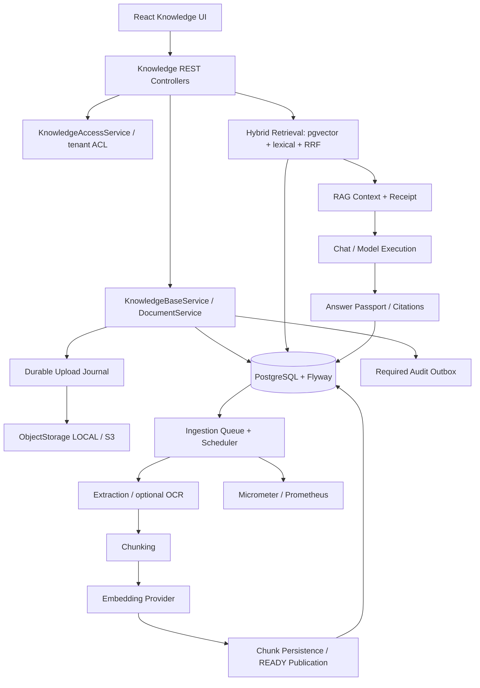
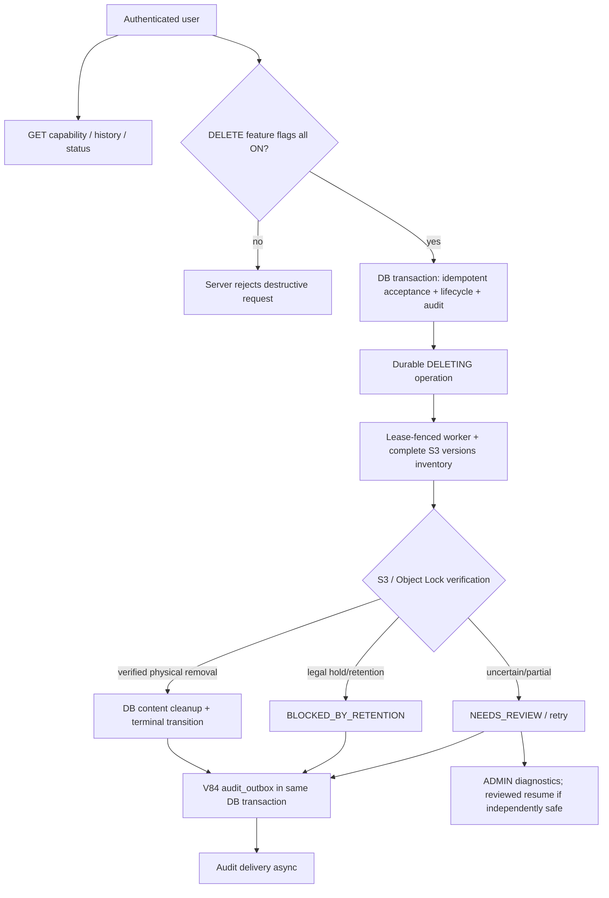
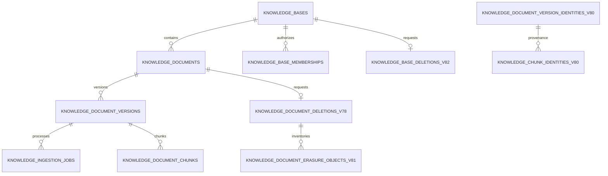

<!-- SafeAI-Desk/backend/src/main/java/ru/safeai/gateway/knowledge/README.md -->
# Knowledge — архитектура, API и эксплуатация

Модуль управляет доступом к базам знаний, версиями файлов и их индексацией. Он выполняет гибридный поиск,
подготавливает контекст для Chat, проверяет ссылки ответа и сохраняет паспорт ответа. Текущий контракт
схемы включает Flyway V85. Приём и исполнение физического удаления документов и баз включаются отдельно.

## Содержание

1. [Назначение и границы](#1-назначение-и-границы)
2. [Статус возможностей](#2-статус-возможностей)
3. [Архитектура и схемы](#3-архитектура-и-схемы)
4. [Полная структура исходников](#4-полная-структура-исходников)
5. [Полная структура тестов](#5-полная-структура-тестов)
6. [REST API и модель доступа](#6-rest-api-и-модель-доступа)
7. [Базы знаний и membership](#7-базы-знаний-и-membership)
8. [Документы, загрузка, версии и скачивание](#8-документы-загрузка-версии-и-скачивание)
9. [Object Storage, reconciliation, GC](#9-object-storage-reconciliation-gc)
10. [Ingestion и extraction](#10-ingestion-и-extraction)
11. [Embeddings, индексы, retrieval](#11-embeddings-индексы-retrieval)
12. [RAG, цитаты, Answer Passport, evaluation](#12-rag-цитаты-answer-passport-evaluation)
13. [Безвозвратное удаление V78–V85](#13-безвозвратное-удаление-v78v85)
14. [Flyway и модель данных](#14-flyway-и-модель-данных)
15. [Конфигурация и защитные флаги](#15-конфигурация-и-защитные-флаги)
16. [Метрики, алерты и runbooks](#16-метрики-алерты-и-runbooks)
17. [Тестирование и критерии приёмки](#17-тестирование-и-критерии-приёмки)
18. [Технический аудит: сильные стороны и риски](#18-технический-аудит-сильные-стороны-и-риски)
19. [План доведения до production](#19-план-доведения-до-production)
20. [Предложения по новым возможностям](#20-предложения-по-новым-возможностям)
21. [Инвентаризация и справочник классов](#21-инвентаризация-и-подробный-справочник-всех-java-файлов)
22. [Связанные документы](#22-связанные-документы)

---

## 1. Назначение и границы

`ru.safeai.gateway.knowledge` — модульный контур корпоративных знаний SafeAI Desk. PostgreSQL/pgvector управляет
tenant-метаданными, версиями, жизненным циклом, индексами, поисковыми и аудиторскими доказательствами; `ObjectStorage`
хранит исходные байты; Spring Boot управляет HTTP, ACL и фоновыми процессами. Данные Knowledge используются RAG/Chat
через отдельные контракты; сам модуль **не** является универсальным LLM runtime.

Рабочие принципы: изоляция организаций по `organization_id`, проверка доступа в service/SQL, неизменяемость
version/provenance там, где она закреплена схемой, идемпотентные операции, durable upload journal, разделение внешнего
I/O и DB-транзакций, lease/fencing для фоновой работы, `fail closed` при неопределённом состоянии хранилища или
недостатке доказательств, минимизация PII в audit/metrics.

**Разграничение терминов:** `enabled=false` выключает участие документа в обслуживании; `PENDING/READY` описывает
обработку версии; `AVAILABLE/DELETING` — lifecycle документа; `DELETED` — конечный статус **операции удаления** с
собственным контрактом, а не синоним отключения поиска; `NEEDS_REVIEW` и `BLOCKED_BY_RETENTION` нельзя автоматически
считать успешным purge.

## 2. Статус возможностей

- **Подсистема:** Базы знаний
  - **Реализовано:** CRUD, visibility, membership, role-aware search, ACL
  - **Что не следует считать доказанным:** Полная UX- и нагрузочная приёмка
- **Подсистема:** Документы
  - **Реализовано:** Upload, uploadVersion, download, validation, SHA-256, версионирование
  - **Что не следует считать доказанным:** Безопасность каждого возможного входного файла без sandbox
- **Подсистема:** Object Storage
  - **Реализовано:** Local/S3 (MinIO SDK), upload intents, reconciliation, проверяемый version purge
  - **Что не следует считать доказанным:** Поддержка каждого S3-провайдера и каждой политики Object Lock
- **Подсистема:** Ingestion
  - **Реализовано:** Scheduler, bounded workers, heartbeat, leases, processing, retries
  - **Что не следует считать доказанным:** HA/latency в реальном кластере и отсутствие повторных provider charges
- **Подсистема:** Extraction
  - **Реализовано:** PDF/Office/HTML/CSV/JSON/XML/Markdown/plain text, optional OCR
  - **Что не следует считать доказанным:** Многопользовательская нагрузка с malicious/zip-bomb файлами
- **Подсистема:** Embedding
  - **Реализовано:** Hashing/test и OpenAI, фиксированная размерность 384
  - **Что не следует считать доказанным:** Любая новая модель/размерность без миграции
- **Подсистема:** Retrieval
  - **Реализовано:** pgvector + русский lexical, RRF, tenant/ACL и evidence
  - **Что не следует считать доказанным:** P95/P99 latency и релевантность на большом корпусе
- **Подсистема:** RAG
  - **Реализовано:** Citation contract, receipt, Answer Passport, evaluation
  - **Что не следует считать доказанным:** Фактическая истинность каждого утверждения LLM
- **Подсистема:** Erasure V78–V85
  - **Реализовано:** Durable операции, fencing, V80 immutable provenance, terminal audit, metrics
  - **Что не следует считать доказанным:** Физическое удаление в production и очистка backup/external provider
- **Подсистема:** Monitoring
  - **Реализовано:** Micrometer, Review metrics, V84 erasure metrics, Prometheus rules
  - **Что не следует считать доказанным:** Проверенная маршрутизация Alertmanager/pager и runbook drill

## 3. Архитектура и схемы

### 3.1. Компоненты



Это логические связи, не исчерпывающий Java dependency graph.

### 3.2. Lifecycle загрузки/публикации

```text
HTTP multipart / file validation / ACL
    ↓
S3 upload INTENT (durable DB journal) → ObjectStorage.put (outside DB metadata TX)
    ↓
STORED → version metadata + ingestion job + LINKED + required audit
    ↓
PENDING → claimed job (token, lease) → VALIDATING → EXTRACTING → CHUNKING
    ↓
embeddings + chunks → fenced generation publication → READY
    ↓
searchable version/generation → tenant-scoped retrieval → RAG evidence
```

При недостоверном результате PUT/DELETE запись не уничтожается молча: она переходит в review/reconciliation. Не путать
storage upload intent `NEEDS_REVIEW` с erasure-operation `NEEDS_REVIEW`.

### 3.3. Read-only monitoring и destructive path



`NEEDS_REVIEW → DELETING` — отдельное контролируемое продолжение (V83), **не** `NEEDS_REVIEW → BLOCKED_BY_RETENTION`.
V84 не делает сетевых обращений к S3.

---
## 4. Полная структура исходников

```text
knowledge/
├── chunking/
│   ├── KnowledgeChunkCandidate.java
│   └── KnowledgeChunker.java
├── config/
│   ├── KnowledgeEmbeddingConfigurationInvariantVerifier.java
│   ├── KnowledgeEmbeddingProperties.java
│   ├── KnowledgeErasureReleaseInvariantVerifier.java
│   ├── KnowledgeIngestionProperties.java
│   ├── KnowledgeOcrConfigurationInvariantVerifier.java
│   ├── KnowledgeOcrProperties.java
│   ├── KnowledgeProcessingConfiguration.java
│   ├── KnowledgeRagProperties.java
│   └── KnowledgeRetrievalProperties.java
├── controller/
│   ├── AnswerPassportController.java
│   ├── KnowledgeBaseController.java
│   ├── KnowledgeBaseDeletionController.java
│   ├── KnowledgeBaseSearchController.java
│   ├── KnowledgeDeletionOperatorController.java
│   ├── KnowledgeDocumentController.java
│   ├── KnowledgeDocumentDeletionCapabilityController.java
│   ├── KnowledgeDocumentDeletionController.java
│   ├── KnowledgeDocumentDeletionReadController.java
│   ├── KnowledgeEvaluationController.java
│   └── KnowledgeRetrievalController.java
├── dto/
│   ├── AnswerCitationResponse.java
│   ├── AnswerPassportResponse.java
│   ├── CreateKnowledgeBaseMemberRequest.java
│   ├── CreateKnowledgeBaseRequest.java
│   ├── KnowledgeBaseAccessResponse.java
│   ├── KnowledgeBaseDeletionResponse.java
│   ├── KnowledgeBaseMemberPageResponse.java
│   ├── KnowledgeBaseMemberResponse.java
│   ├── KnowledgeBasePageResponse.java
│   ├── KnowledgeBaseResponse.java
│   ├── KnowledgeDocumentDeletionResponse.java
│   ├── KnowledgeDocumentPageResponse.java
│   ├── KnowledgeDocumentResponse.java
│   ├── KnowledgeDocumentVersionPageResponse.java
│   ├── KnowledgeDocumentVersionResponse.java
│   ├── KnowledgeEvaluationCaseRequest.java
│   ├── KnowledgeEvaluationCaseResponse.java
│   ├── KnowledgeEvaluationRequest.java
│   ├── KnowledgeEvaluationResponse.java
│   ├── KnowledgeHealthResponse.java
│   ├── KnowledgeMemberCandidateResponse.java
│   ├── KnowledgeReindexResponse.java
│   ├── KnowledgeRetrievalHitResponse.java
│   ├── KnowledgeRetrievalRequest.java
│   ├── KnowledgeRetrievalResponse.java
│   ├── UpdateKnowledgeBaseMemberRequest.java
│   ├── UpdateKnowledgeBaseRequest.java
│   └── UpdateKnowledgeDocumentRequest.java
├── embedding/
│   ├── HashingKnowledgeEmbeddingProvider.java
│   ├── KnowledgeEmbeddingException.java
│   ├── KnowledgeEmbeddingProductionInvariantVerifier.java
│   ├── KnowledgeEmbeddingProvider.java
│   ├── OpenAiKnowledgeEmbeddingProvider.java
│   └── PgVectorSupport.java
├── entity/
│   ├── KnowledgeBaseEntity.java
│   ├── KnowledgeBaseMembershipEntity.java
│   ├── KnowledgeDocumentEntity.java
│   ├── KnowledgeDocumentVersionEntity.java
│   └── KnowledgeIngestionJobEntity.java
├── evaluation/
│   └── KnowledgeRetrievalMetrics.java
├── exception/
│   └── KnowledgeStorageUnavailableException.java
├── extraction/
│   ├── CsvKnowledgeExtractor.java
│   ├── DocxKnowledgeExtractor.java
│   ├── ExtractedDocument.java
│   ├── ExtractedSection.java
│   ├── ExtractionTextSupport.java
│   ├── HtmlKnowledgeExtractor.java
│   ├── JsonKnowledgeExtractor.java
│   ├── KnowledgeDocumentExtractor.java
│   ├── KnowledgeExtractionService.java
│   ├── MarkdownKnowledgeExtractor.java
│   ├── OoxmlPackageSupport.java
│   ├── PdfKnowledgeExtractor.java
│   ├── PlainTextKnowledgeExtractor.java
│   ├── PptxKnowledgeExtractor.java
│   ├── XlsxKnowledgeExtractor.java
│   └── XmlKnowledgeExtractor.java
├── generation/
│   ├── KnowledgeGenerationGc.java
│   └── KnowledgeGenerationGcScheduler.java
├── ingestion/
│   ├── EmbeddedKnowledgeChunk.java
│   ├── ExpiredKnowledgeIngestionJob.java
│   ├── KnowledgeChunkPersistenceService.java
│   ├── KnowledgeIngestionClaim.java
│   ├── KnowledgeIngestionException.java
│   ├── KnowledgeIngestionFailureService.java
│   ├── KnowledgeIngestionMaintenanceService.java
│   ├── KnowledgeIngestionProcessor.java
│   ├── KnowledgeIngestionQueueRepository.java
│   ├── KnowledgeIngestionScheduler.java
│   └── StaleIngestionOwnershipException.java
├── model/
│   ├── KnowledgeBaseAccessLevel.java
│   ├── KnowledgeBaseVisibility.java
│   ├── KnowledgeDocumentLifecycleState.java
│   ├── KnowledgeHealthState.java
│   └── KnowledgeIngestionStatus.java
├── ocr/
│   ├── DisabledKnowledgeOcrProvider.java
│   ├── HttpKnowledgeOcrProvider.java
│   ├── KnowledgeOcrProvider.java
│   ├── OcrDocument.java
│   └── OcrPage.java
├── rag/
│   ├── AnswerPassportService.java
│   ├── KnowledgeChatContext.java
│   ├── KnowledgeCitationValidator.java
│   ├── KnowledgeContextAssembler.java
│   ├── KnowledgeContextSource.java
│   ├── KnowledgeHashing.java
│   ├── KnowledgeMode.java
│   ├── KnowledgeRagContextReceiptRepository.java
│   ├── KnowledgeRagContextReceiptService.java
│   ├── KnowledgeRagContextRevokedException.java
│   ├── KnowledgeRagErasureGuard.java
│   ├── KnowledgeRagExecutionPermitService.java
│   ├── KnowledgeRagService.java
│   ├── RagCitation.java
│   ├── RagCompletion.java
│   └── RagPreparation.java
├── repository/
│   ├── KnowledgeBaseMembershipRepository.java
│   ├── KnowledgeBaseRepository.java
│   ├── KnowledgeDocumentDeletionRepository.java
│   ├── KnowledgeDocumentQueryRepository.java
│   ├── KnowledgeDocumentRepository.java
│   ├── KnowledgeDocumentVersionRepository.java
│   ├── KnowledgeIngestionJobRepository.java
│   └── KnowledgeMemberDirectoryRepository.java
├── retrieval/
│   ├── KnowledgeRetrievalExecution.java
│   ├── KnowledgeRetrievalHit.java
│   └── KnowledgeRetrievalRepository.java
├── service/
│   ├── KnowledgeAccessService.java
│   ├── KnowledgeBaseDeletionExecutor.java
│   ├── KnowledgeBaseDeletionService.java
│   ├── KnowledgeBaseNameNormalizer.java
│   ├── KnowledgeBaseSearchPattern.java
│   ├── KnowledgeBaseSearchService.java
│   ├── KnowledgeBaseService.java
│   ├── KnowledgeDeletionDiagnostics.java
│   ├── KnowledgeDeletionOperatorService.java
│   ├── KnowledgeDocumentDeletionAcceptanceService.java
│   ├── KnowledgeDocumentDeletionExecutor.java
│   ├── KnowledgeDocumentFileValidator.java
│   ├── KnowledgeDocumentMediaTypeDetector.java
│   ├── KnowledgeDocumentMediaTypes.java
│   ├── KnowledgeDocumentNameNormalizer.java
│   ├── KnowledgeDocumentService.java
│   ├── KnowledgeDocumentWriteService.java
│   ├── KnowledgeErasureObservability.java
│   ├── KnowledgeEvaluationService.java
│   ├── KnowledgeNameNormalizerSupport.java
│   ├── KnowledgeOoxmlDetector.java
│   ├── KnowledgeOperationsService.java
│   ├── KnowledgeRetrievalService.java
│   ├── KnowledgeStructuredTextValidator.java
│   ├── KnowledgeUploadFileSupport.java
│   └── KnowledgeValidationErrors.java
├── storage/
│   ├── reconciliation/
│   │   ├── KnowledgeStorageReconciliationConfiguration.java
│   │   ├── KnowledgeStorageReconciliationProperties.java
│   │   ├── KnowledgeStorageReconciliationScheduler.java
│   │   ├── KnowledgeStorageReviewMetrics.java
│   │   └── KnowledgeStorageUploadJournal.java
│   ├── ErasureTombstoneJournal.java
│   ├── KnowledgeErasureTombstoneJournal.java
│   ├── KnowledgeStorageConfiguration.java
│   ├── KnowledgeStorageProductionInvariantVerifier.java
│   ├── KnowledgeStorageProperties.java
│   ├── KnowledgeStorageType.java
│   ├── LocalObjectStorage.java
│   ├── ObjectStorage.java
│   ├── S3ObjectStorage.java
│   ├── StoredObject.java
│   └── VerifiedObjectLockException.java
└── README.md
```

## 5. Полная структура тестов

```text
knowledge/
├── chunking/
│   ├── KnowledgeChunkerRegressionTest.java
│   ├── KnowledgeChunkerTest.java
│   └── KnowledgeStructureAwareChunkerTest.java
├── config/
│   ├── KnowledgeConfigurationBoundariesTest.java
│   ├── KnowledgeErasureReleaseInvariantVerifierTest.java
│   ├── KnowledgeIngestionPropertiesConcurrencyTest.java
│   ├── KnowledgeOcrSafetyMarginTest.java
│   └── KnowledgeSecretPropertiesTest.java
├── controller/
│   ├── KnowledgeControllerSecurityTest.java
│   ├── KnowledgeDocumentControllerTest.java
│   ├── KnowledgeDocumentDeletionCapabilityControllerTest.java
│   └── KnowledgeDtoValidationTest.java
├── dto/
│   ├── KnowledgeBaseAccessResponseTest.java
│   └── KnowledgeDocumentResponseJsonTest.java
├── embedding/
│   ├── KnowledgeEmbeddingBoundaryTest.java
│   ├── KnowledgeEmbeddingProductionConditionTest.java
│   ├── KnowledgeEmbeddingProductionInvariantVerifierTest.java
│   ├── OpenAiKnowledgeEmbeddingProvenanceRegressionTest.java
│   ├── OpenAiKnowledgeEmbeddingProviderRegressionTest.java
│   └── OpenAiKnowledgeEmbeddingProviderTest.java
├── evaluation/
│   ├── KnowledgeRetrievalMetricsRegressionTest.java
│   └── KnowledgeRetrievalMetricsTest.java
├── extraction/
│   ├── KnowledgeDocumentExtractorContractTest.java
│   ├── KnowledgeExtractionServiceRegressionTest.java
│   └── PdfKnowledgeExtractorOcrTest.java
├── generation/
│   └── KnowledgeGenerationGcTest.java
├── ingestion/
│   ├── KnowledgeIngestionProcessorRegressionTest.java
│   ├── KnowledgeIngestionQueueIntegrationTest.java
│   └── KnowledgeIngestionSafeLoggingTest.java
├── integration/
│   ├── KnowledgeAccessControlIntegrationTest.java
│   ├── KnowledgeBaseConcurrencyIntegrationTest.java
│   ├── KnowledgeBaseDeletionEndToEndIntegrationTest.java
│   ├── KnowledgeBaseDeletionFoundationIntegrationTest.java
│   ├── KnowledgeBaseDeletionRealJvmCrashIntegrationTest.java
│   ├── KnowledgeBaseDeletionRecoveryConcurrencyIntegrationTest.java
│   ├── KnowledgeBaseObjectLockIntegrationTest.java
│   ├── KnowledgeChunkPublicationIntegrationTest.java
│   ├── KnowledgeDeletionOperatorSafetyIntegrationTest.java
│   ├── KnowledgeDeletionWorkerProcessMain.java
│   ├── KnowledgeDocumentDeletionAcceptanceIntegrationTest.java
│   ├── KnowledgeDocumentDeletionExecutorIntegrationTest.java
│   ├── KnowledgeDocumentDeletionFoundationIntegrationTest.java
│   ├── KnowledgeDocumentVersionConcurrencyIntegrationTest.java
│   ├── KnowledgeErasureEvidenceIntegrationTest.java
│   ├── KnowledgeErasureTerminalAuditIntegrationTest.java
│   ├── KnowledgeGenerationLifecycleIntegrationTest.java
│   ├── KnowledgeGenerationUpgradeIntegrationTest.java
│   ├── KnowledgeMigrationIntegrityIntegrationTest.java
│   ├── KnowledgePersistenceIntegrationTest.java
│   ├── KnowledgeRagErasureGuardIntegrationTest.java
│   └── KnowledgeS3EndToEndIntegrationTest.java
├── ocr/
│   └── KnowledgeOcrBoundaryRegressionTest.java
├── rag/
│   ├── AnswerPassportServiceBoundaryTest.java
│   ├── KnowledgeCitationHomoglyphAndMalformedTest.java
│   ├── KnowledgeCitationValidatorRegressionTest.java
│   ├── KnowledgeCitationValidatorTest.java
│   ├── KnowledgeContextAssemblerRegressionTest.java
│   ├── KnowledgeContextAssemblerTest.java
│   ├── KnowledgeRagErasureGuardTest.java
│   ├── KnowledgeRagExpiredLeaseRecoveryPolicyTest.java
│   ├── KnowledgeRagGovernedEnvelopeTest.java
│   ├── KnowledgeRagServiceRegressionTest.java
│   ├── KnowledgeRagV85SchemaIntegrationTest.java
│   └── RagPreparationContractRegressionTest.java
├── retrieval/
│   └── KnowledgeRetrievalRepositoryIntegrationTest.java
├── service/
│   ├── KnowledgeBaseDeletionServiceSafetyTest.java
│   ├── KnowledgeBaseNameNormalizerTest.java
│   ├── KnowledgeBaseSearchPatternTest.java
│   ├── KnowledgeBaseServiceTest.java
│   ├── KnowledgeDocumentDeletionExecutorWiringTest.java
│   ├── KnowledgeDocumentFileValidatorTest.java
│   ├── KnowledgeDocumentNameNormalizerTest.java
│   ├── KnowledgeDocumentServiceTest.java
│   ├── KnowledgeErasureObservabilityTest.java
│   ├── KnowledgeOoxmlUploadLimitRegressionTest.java
│   ├── KnowledgeOperationsServiceRegressionTest.java
│   └── KnowledgeRealFixtureContractTest.java
├── storage/
│   ├── reconciliation/
│   │   ├── KnowledgeStorageReconciliationSchedulerTest.java
│   │   └── KnowledgeStorageReviewMetricsTest.java
│   ├── KnowledgeDocumentErasureRealMinioIntegrationTest.java
│   ├── KnowledgeErasureJournalCompliancePolicyTest.java
│   ├── KnowledgeErasureTombstoneJournalWiringTest.java
│   ├── KnowledgeStorageConfigurationBindingTest.java
│   ├── KnowledgeStorageProductionConditionTest.java
│   ├── KnowledgeStorageProductionInvariantVerifierTest.java
│   ├── KnowledgeStoragePropertiesTest.java
│   ├── LocalObjectStorageFailureRegressionTest.java
│   ├── LocalObjectStorageTest.java
│   ├── S3ObjectStorageIntegrationTest.java
│   ├── S3VerifiedKnowledgeObjectPurgeIntegrationTest.java
│   └── VerifiedKnowledgeObjectPurgeTest.java
├── testsupport/
│   ├── KnowledgeErasureTestJournal.java
│   └── KnowledgeRegressionFixtures.java
└── README.md
```

Команды запуска и сценарии приёмки — в
[README тестов](../../../../../../test/java/ru/safeai/gateway/knowledge/README.md).

## 6. REST API и модель доступа

### 6.1. Точки входа, подтверждённые контроллерами

- **HTTP:** GET
  - **Маршрут:** `/api/knowledge-bases`
  - **Реализация / смысл:** `KnowledgeBaseController.findAll`
  - **Авторизация и нюансы:** ADMIN/USER, service ACL
- **HTTP:** GET
  - **Маршрут:** `/api/knowledge-bases/{knowledgeBaseId}`
  - **Реализация / смысл:** `findById`
  - **Авторизация и нюансы:** tenant/visibility
- **HTTP:** GET
  - **Маршрут:** `/api/knowledge-bases/{knowledgeBaseId}/access`
  - **Реализация / смысл:** `effectiveAccess`
  - **Авторизация и нюансы:** scoped read
- **HTTP:** POST
  - **Маршрут:** `/api/knowledge-bases`
  - **Реализация / смысл:** `create`
  - **Авторизация и нюансы:** ADMIN
- **HTTP:** PATCH
  - **Маршрут:** `/api/knowledge-bases/{knowledgeBaseId}`
  - **Реализация / смысл:** `update`
  - **Авторизация и нюансы:** ADMIN, optimistic version
- **HTTP:** GET
  - **Маршрут:** `/api/knowledge-bases/{knowledgeBaseId}/members`
  - **Реализация / смысл:** `findMembers`
  - **Авторизация и нюансы:** ADMIN
- **HTTP:** GET
  - **Маршрут:** `/api/knowledge-bases/member-candidates`
  - **Реализация / смысл:** `searchMemberCandidates`
  - **Авторизация и нюансы:** ADMIN
- **HTTP:** POST
  - **Маршрут:** `/api/knowledge-bases/{knowledgeBaseId}/members`
  - **Реализация / смысл:** `addMember`
  - **Авторизация и нюансы:** ADMIN
- **HTTP:** PATCH
  - **Маршрут:** `/api/knowledge-bases/{knowledgeBaseId}/members/{userId}`
  - **Реализация / смысл:** `updateMember`
  - **Авторизация и нюансы:** ADMIN
- **HTTP:** DELETE
  - **Маршрут:** `/api/knowledge-bases/{knowledgeBaseId}/members/{userId}`
  - **Реализация / смысл:** `removeMember`
  - **Авторизация и нюансы:** ADMIN; **не** удаление базы
- **HTTP:** GET
  - **Маршрут:** `/api/knowledge-bases/search`
  - **Реализация / смысл:** `KnowledgeBaseSearchController`
  - **Авторизация и нюансы:** ADMIN/USER
- **HTTP:** GET
  - **Маршрут:** `/api/knowledge-bases/{knowledgeBaseId}/documents`
  - **Реализация / смысл:** Document list
  - **Авторизация и нюансы:** viewer+
- **HTTP:** GET
  - **Маршрут:** `/api/knowledge-bases/{knowledgeBaseId}/documents/health`
  - **Реализация / смысл:** Health
  - **Авторизация и нюансы:** ACL
- **HTTP:** POST
  - **Маршрут:** `/api/knowledge-bases/{knowledgeBaseId}/documents`
  - **Реализация / смысл:** Upload
  - **Авторизация и нюансы:** multipart, editor+
- **HTTP:** POST
  - **Маршрут:** `/api/knowledge-bases/{knowledgeBaseId}/documents/{documentId}/versions`
  - **Реализация / смысл:** New version
  - **Авторизация и нюансы:** ACL, write guards
- **HTTP:** PATCH
  - **Маршрут:** `/api/knowledge-bases/{knowledgeBaseId}/documents/{documentId}`
  - **Реализация / смысл:** Update metadata
  - **Авторизация и нюансы:** ACL/version
- **HTTP:** GET
  - **Маршрут:** `/api/knowledge-bases/{knowledgeBaseId}/documents/{documentId}/versions`
  - **Реализация / смысл:** Version list
  - **Авторизация и нюансы:** ACL
- **HTTP:** GET
  - **Маршрут:** `/api/knowledge-bases/{knowledgeBaseId}/documents/{documentId}/download`
  - **Реализация / смысл:** Current binary
  - **Авторизация и нюансы:** ACL, attachment policy
- **HTTP:** GET
  - **Маршрут:** `/api/knowledge-bases/{knowledgeBaseId}/documents/{documentId}/versions/{versionId}/download`
  - **Реализация / смысл:** Specific version
  - **Авторизация и нюансы:** ACL
- **HTTP:** POST
  - **Маршрут:** `/api/knowledge-bases/{knowledgeBaseId}/documents/{documentId}/reindex`
  - **Реализация / смысл:** New generation
  - **Авторизация и нюансы:** write guard
- **HTTP:** POST
  - **Маршрут:** `/api/knowledge-bases/{knowledgeBaseId}/retrieval`
  - **Реализация / смысл:** Retrieval
  - **Авторизация и нюансы:** ADMIN/USER, tenant scoped
- **HTTP:** POST
  - **Маршрут:** `/api/knowledge-bases/{knowledgeBaseId}/evaluations`
  - **Реализация / смысл:** Evaluation
  - **Авторизация и нюансы:** ADMIN
- **HTTP:** GET
  - **Маршрут:** `/api/chats/{chatId}/turns/{turnId}/answer-passport`
  - **Реализация / смысл:** Answer Passport
  - **Авторизация и нюансы:** ADMIN/USER, chat access
- **HTTP:** GET
  - **Маршрут:** `/api/knowledge-bases/{knowledgeBaseId}/document-deletions/capability`
  - **Реализация / смысл:** Doc capability
  - **Авторизация и нюансы:** OWNER/tenant checks even OFF
- **HTTP:** GET
  - **Маршрут:** `/api/knowledge-bases/{knowledgeBaseId}/document-deletions`
  - **Реализация / смысл:** Doc operation list
  - **Авторизация и нюансы:** OWNER; mapped regardless of flags
- **HTTP:** GET
  - **Маршрут:** `/api/knowledge-bases/{knowledgeBaseId}/document-deletions/{operationId}`
  - **Реализация / смысл:** Doc status
  - **Авторизация и нюансы:** OWNER; mapped regardless of flags
- **HTTP:** DELETE
  - **Маршрут:** `/api/knowledge-bases/{knowledgeBaseId}/documents/{documentId}`
  - **Реализация / смысл:** Doc erasure acceptance, HTTP 202
  - **Авторизация и нюансы:** Controller mapped only when both document flags ON; If-Match/Idempotency-Key
- **HTTP:** GET
  - **Маршрут:** `/api/knowledge-bases/{baseId}/base-deletions/capability`
  - **Реализация / смысл:** Base capability
  - **Авторизация и нюансы:** ADMIN; stays mapped OFF
- **HTTP:** GET
  - **Маршрут:** `/api/knowledge-bases/base-deletions`
  - **Реализация / смысл:** Base history
  - **Авторизация и нюансы:** ADMIN
- **HTTP:** GET
  - **Маршрут:** `/api/knowledge-bases/{baseId}/base-deletions/current`
  - **Реализация / смысл:** Current base op
  - **Авторизация и нюансы:** ADMIN
- **HTTP:** GET
  - **Маршрут:** `/api/knowledge-bases/{baseId}/base-deletions/{operationId}`
  - **Реализация / смысл:** Base status
  - **Авторизация и нюансы:** ADMIN
- **HTTP:** DELETE
  - **Маршрут:** `/api/knowledge-bases/{baseId}`
  - **Реализация / смысл:** Base erasure acceptance, HTTP 202
  - **Авторизация и нюансы:** ADMIN; controller always mapped, **service gates flags**
- **HTTP:** GET
  - **Маршрут:** `/api/knowledge-bases/{baseId}/document-deletions/{operationId}/diagnostics`
  - **Реализация / смысл:** Document diagnostics
  - **Авторизация и нюансы:** current DB ADMIN
- **HTTP:** GET
  - **Маршрут:** `/api/knowledge-bases/{baseId}/base-deletions/{operationId}/diagnostics`
  - **Реализация / смысл:** Base diagnostics
  - **Авторизация и нюансы:** current DB ADMIN
- **HTTP:** POST
  - **Маршрут:** `/api/knowledge-bases/{baseId}/document-deletions/{operationId}/resume`
  - **Реализация / смысл:** Reviewed doc resume
  - **Авторизация и нюансы:** current DB ADMIN + all five flags
- **HTTP:** POST
  - **Маршрут:** `/api/knowledge-bases/{baseId}/base-deletions/{operationId}/resume`
  - **Реализация / смысл:** Reviewed base resume
  - **Авторизация и нюансы:** current DB ADMIN + all five flags

Маршруты приведены по комбинации `@RequestMapping` и методных mapping. Для точных media types, headers, validation и
имен полей JSON ориентируйтесь на контроллеры/DTO и OpenAPI/HTTP contract tests. **`DELETE /.../members/{userId}` не
является erasure; `202 Accepted` не означает `DELETED`.**

### 6.2. Роли Knowledge

`KnowledgeBaseVisibility` — ORGANIZATION или MEMBERS; `KnowledgeBaseAccessLevel` — VIEWER / EDITOR / OWNER. Внешняя
системная роль ADMIN даёт административные полномочия, но tenant scoping обязателен. Service access boundary проверяет
membership, организацию и необходимый уровень; frontend guards не являются security boundary. `SUPER_ADMIN` не следует
автоматически считать имеющим право читать документы любого tenant без явного и протестированного контракта.

Все tenant-запросы должны предикатироваться `organization_id` и идентификаторами base/document/version. Для MEMBERS не
раскрывать факт существования чужой базы через разницу сообщений. При отключённом erasure read-only операции продолжают
требовать полномочий.

## 7. Базы знаний и membership

`KnowledgeBaseService` реализует создание, обновление, выдачу списков, effective ACL и членство;
`KnowledgeBaseSearchService`/`KnowledgeBaseSearchPattern` управляют поиском по каталогу баз. `KnowledgeBaseRepository`,
`KnowledgeBaseMembershipRepository` и `KnowledgeMemberDirectoryRepository` отвечают за persistence и выборку участников.
Имена нормализуются отдельным `KnowledgeBaseNameNormalizer`. Изменения защищаются оптимистичной версией сущности и audit
evidence.

Важные инварианты: невозможно пересечь границу tenant; MEMBERS-видимость должна проверяться на чтении и при поиске;
старый UI member list не должен обходить server-side OWNER/ADMIN boundary; конкурентный PATCH нельзя превращать в
last-write-wins. Тесты: `KnowledgeAccessControlIntegrationTest`, `KnowledgeBaseConcurrencyIntegrationTest`,
`KnowledgeBaseServiceTest`, `KnowledgeBaseSearchPatternTest`.

## 8. Документы, загрузка, версии и скачивание

### 8.1. Контракт upload

`KnowledgeDocumentController` выполняет HTTP boundary. `KnowledgeDocumentFileValidator`, media-type detector/registry и
structured text validator проверяют расширения, сигнатуры, размер, безопасные structured formats;
`KnowledgeDocumentService`, `KnowledgeDocumentWriteService`, `KnowledgeUploadFileSupport` управляют метаданными,
версиями, object key, journal, статусами, timestamp и обязательным audit. Сервис должен исключать прямой trust
MIME/header клиента и filename для storage key.

Внешняя загрузка не должна проходить в длинной DB-транзакции. Перед физическим PUT создаётся durable upload intent;
после подтверждённого хранения происходит атомарная привязка версии и ingestion job. При неопределённом исходе сетевого
вызова нельзя считать storage свободным и удалять объект наугад. Metadata и bytes проверяются size/SHA-256. Для
исправления файлов создаётся **новая версия**, а не перезапись уже использованной.

### 8.2. Версии и serving pointers

`KnowledgeDocumentEntity`, `KnowledgeDocumentVersionEntity` и `KnowledgeIngestionJobEntity` разделяют логический
документ, immutable version и обработку. `current_version_id` и `searchable_version_id` имеют различную семантику; новая
загруженная версия не обязана сразу становиться searchable. READY публикуется после сохранения chunks и индекса в
соответствующей транзакционной/фенсированной процедуре.

`KnowledgeOperationsService` координирует отдельные операции над документом, reindex и health. В `DELETING` запрещены
новые версии, ingestion-публикация и late chunk writes согласно V78/V81 guards. Любое расширение API должно повторно
валидировать lifecycle под DB lock, иначе возникает TOCTOU.

### 8.3. Скачивание

`ObjectStorage.get()` возвращает `StoredObject` (resource + contentLength). Доступ проверяется по base/document/version
и tenant перед запросом к хранилищу; downloading HTML/XML/plain text должен иметь безопасную `Content-Disposition`, не
превращаясь в active content в origin приложения. Не путать `404` storage с временным отказом provider. Auditing
download в существующей архитектуре отличается от обязательного evidence для mutation: до релиза нужно явно утвердить
уровень обязательности и тестировать ошибку outbox.

## 9. Object Storage, reconciliation, GC

### 9.1. Хранилище и journal

`ObjectStorage` имеет `put`, `get`, `delete` и отдельный `purgeAllVersionsVerified`. Последний по умолчанию
**отказывает** (`IOException`) для неподдерживающего provider — это защитный контракт. `LocalObjectStorage` предназначен
для local/test, `S3ObjectStorage` — для S3/MinIO и версии объектов; `VerifiedObjectLockException` допускается лишь после
подтверждения retention/legal hold, а не по любому `AccessDenied`.

`KnowledgeStorageUploadJournal` ведёт `INTENT → STORED → LINKED`, а при неоднозначности — `NEEDS_REVIEW`.
`KnowledgeStorageReconciliationScheduler` выполняет осторожный карантин, обработку подтверждённых orphan и
reconciliation. `KnowledgeStorageReviewMetrics` экспортирует число нерешённых upload intents и `-1` при ошибке измерения
(не маскирует недоступность БД нулём).

### 9.2. Версионный S3 purge

`S3ObjectStorage.purgeAllVersionsVerified(key)` итерирует полный список версий **и delete markers**, фильтруя строгое
совпадение `objectName` (не только prefix), удаляет версии по `versionId`, затем повторно проверяет список и `HEAD`.
Есть предел итераций. Код не устанавливает `bypass governance retention`; проверка Object Lock читается отдельно для
конкретной отказавшей версии. Неудача или невозможность удостовериться в результате сохраняет операцию незавершённой.

Это усиливает безопасность по сравнению с одиночным `DELETE key`, но **не доказывает** универсальную корректность для
всех S3 API/consistency/permission/retention combinations. Необходимы тесты на реальном versioned bucket: разные version
IDs, delete markers, prefix collision, governance/compliance/legal hold, 403 при недостатке прав, lost response,
timeout, две реплики и restart.

### 9.3. Garbage collection

`KnowledgeGenerationGc` и scheduler удаляют старые index generations с учётом ссылок, retention и ограничений V57/V80;
нельзя удалять searchable generation, на который ещё ссылаются retrieval/Answer Passport. Параметры `keep-latest-*`,
retention и interval требуют capacity planning. Контракт generation GC **отдельный** от erasure V81 и не должен служить
обходом V80 immutable provenance.

## 10. Ingestion и extraction

### 10.1. Очередь и конкуренция

`KnowledgeIngestionQueueRepository` заявляет работу через PostgreSQL claim/lease; `KnowledgeIngestionScheduler`
использует `newFixedThreadPool(workerThreads)` и не захватывает больше заданного числа активных слотов;
`KnowledgeIngestionProcessor` регулярно продлевает lease через отдельный scheduled heartbeat и перепроверяет ownership
до публикации. `KnowledgeIngestionFailureService`/`MaintenanceService` управляют error code, retry, exhausted job;
`KnowledgeChunkPersistenceService` сохраняет chunks и публикацию. `KnowledgeGenerationGc` сохраняет раздельную
lifecycle-дисциплину поколений.

**Исправлено относительно README от 17 октября:** старое утверждение «все задачи последовательно» больше неверно;
поддерживаются ограниченные `workerThreads` (1–8). Старое замечание «в provider call нет heartbeat» тоже больше неверно
— в processor есть scheduled heartbeat. Это не освобождает от конкурентного crash/slow-network теста.

### 10.2. Extractors

В ZIP представлены `PdfKnowledgeExtractor`, `DocxKnowledgeExtractor`, `PptxKnowledgeExtractor`,
`XlsxKnowledgeExtractor`, `HtmlKnowledgeExtractor`, `CsvKnowledgeExtractor`, `JsonKnowledgeExtractor`,
`XmlKnowledgeExtractor`, `MarkdownKnowledgeExtractor`, `PlainTextKnowledgeExtractor`, `OoxmlPackageSupport`,
`ExtractionTextSupport`, `ExtractedDocument`/`ExtractedSection`. `KnowledgeExtractionService` координирует извлечение с
ограниченным пулом и timeout. OCR — `DisabledKnowledgeOcrProvider`/`HttpKnowledgeOcrProvider`, `OcrDocument`/`OcrPage`,
configurable endpoint и ограничение ответа.

Наличие timeout на `Future.cancel(true)` **не является гарантией принудительного прекращения** злонамеренного
native/Java parser. Для production чувствительных документов стоит вынести untrusted parsing/OCR в отдельный sandboxed
worker с CPU/memory/time limit и запретом произвольного egress. Нужны тесты PDF bomb, XML/OOXML zip bomb, огромные
изображения, path traversal в архиве, формулы/внешние ссылки Office, очень длинные строки и отключённый parser thread.

### 10.3. Логи и безопасность

В новом `KnowledgeIngestionProcessor` unexpected exception логируется по **классу исключения**, а не с полным stack
trace; подробности, потенциально содержащие текст файла или секреты, не должны попадать в общие логи. Heartbeat logger
использует jobId и type. Старый риск из README-17 о прямом `log.error(..., exception)` следует считать **адресованным в
представленном срезе**, но повторно проверить все другие пути ошибок/HTTP clients.

## 11. Embeddings, индексы, retrieval

### 11.1. Embeddings

`KnowledgeEmbeddingProvider` — интерфейс; `HashingKnowledgeEmbeddingProvider` предназначен для детерминированного
local/test fallback; `OpenAiKnowledgeEmbeddingProvider` — внешний embedding provider. `KnowledgeEmbeddingProperties`
разрешает `hashing` и `openai`, размерность фиксирована **384**. `KnowledgeEmbeddingProductionInvariantVerifier`
запрещает неприемлемую production-конфигурацию; `PgVectorSupport` контролирует представление векторов.

**Не менять размерность просто в YAML.** Для другой embedding model/dimension нужен совместимый schema/vector index
plan, model version metadata, новый индекс/reindex, контроль недопущения смешанных embedding spaces, rollback. В
production должны быть TLS allowlist, секреты вне Git, таймауты/лимиты и контроль затрат.

### 11.2. Hybrid Retrieval

`KnowledgeRetrievalRepository` и `KnowledgeRetrievalService` используют vector и lexical candidates (в том числе русский
языковой профиль), объединение Reciprocal Rank Fusion, ограничения `maxQueryChars`, `maxTopK`, `candidateLimit`, `rrfK`,
tenant/ACL и materialized hit provenance. Результат включает retrieval run identity и query digest. V76 регламентирует
privacy для новых retrieval runs (redacted query + SHA-256), но **исторические raw query** требуют отдельной ревизии и
retention/migration plan.

До эксплуатации на больших корпусах проверить `EXPLAIN (ANALYZE, BUFFERS)`, соответствие expression/GIN/vector indexes
SQL миграциям, индексируемость русского lexical path, selectivity tenant/ACL, распределение размеров chunks, plan
stability и P95/P99. Не считать SQL без полного DDL/rehearsal доказательством хорошего плана.

## 12. RAG, цитаты, Answer Passport, evaluation

`KnowledgeRagService` использует `KnowledgeContextAssembler` и `KnowledgeContextSource` для ограничения длины контекста;
`KnowledgeRagContextReceiptRepository`/`KnowledgeRagContextReceiptService` сохраняют связку retrieval с подготовленным
Chat request. `KnowledgeCitationValidator` проверяет формат/identity citation и допустимость ссылки;
`AnswerPassportService` фиксирует итоговые metadata, citations и provenance. `KnowledgeEvaluationService` и
`KnowledgeRetrievalMetrics` реализуют тестирование качества retrieval.

Поддерживаются `GENERAL`, `KNOWLEDGE_ASSISTED`, `KNOWLEDGE_ONLY`. Отсутствие валидной citation в строгом Knowledge-only
режиме требует abstention согласно контракту. Это **не** доказывает логическую истинность сгенерированного ответа:
ссылка `[C1]` может быть синтаксически допустима, но не подтверждать утверждение. Для production нужны
groundedness/faithfulness eval, adversarial prompt-injection corpus, multilingual query set, long-document retrieval и
human review.

Chat, Audit и Knowledge транзакционно разделяют raw retrieval и модельный ответ. При сбое Chat остающееся retrieval
receipt может быть законным durable evidence, но для него нужны lifecycle, retention и аудит orphan records. Не делать
несанкционированный cascade delete из-за отсутствия final Chat answer.

## 13. Безвозвратное удаление V78–V85

### 13.1. Основные сущности и состояния

`knowledge_documents.lifecycle_state`: `AVAILABLE → DELETING` (монотонно; обратно в AVAILABLE нельзя). Долговечный
документный запрос — `knowledge_document_deletions_v78`; у operation состояния `DELETING`, `NEEDS_REVIEW`,
`BLOCKED_BY_RETENTION`, `DELETED`. V82 добавляет `knowledge_base_deletions_v82` и tombstone identity баз. Доказательство
операции сохраняется независимо от живой строки документа или базы.

`V78`: idempotency (`organization_id + idempotency_key`), уникальность операции на документ, expected version, lease
token/until, attempts, last_error_code и completion; DB-триггеры защищают identity и запрещают новый ingest/chunks после
перехода к удалению. `V79` регистрирует `KNOWLEDGE_DOCUMENT_DELETION_REQUESTED`.

`V80`: `knowledge_document_version_identities_v80`, `knowledge_chunk_identities_v80` и проверенный переход исторических
FKs retrieval hits/index generations на immutable identity. **Идентификаторы/provenance остаются** при физическом
удалении содержимого.

`V81`: durable storage key inventory, fencing по operation/lease/token, защищённые удаления chunks и допустимая
редактировка исторического имени в citation; terminal `DELETED` запрещён, пока остаётся online-content или inventory.
Внешняя проверка provider versions обязательна и не может быть доказана одним DB constraint.

`V82`: coordinator удаления базы, собственный lifecycle, зависимости от дочерних удалений, ограничения новых операций и
блокировка финализации при незавершённом дочернем cleanup. Parent executor сам не удаляет S3 и не обходит V78/V81
worker.

`V83`: ADMIN diagnostics и контролируемое повторное выполнение только для `NEEDS_REVIEW` при действующих правах,
совпадении `updated_at`, отсутствии active lease и неразобранных upload intents/child statuses. `BLOCKED_BY_RETENTION`
нельзя возобновить.

`V84`: `AFTER UPDATE OF state` на документных и базовых операциях делает **тот же commit** зависимым от обязательной
записи в `audit_outbox` для реального `DELETING → DELETED / NEEDS_REVIEW / BLOCKED_BY_RETENTION`. Если outbox INSERT
запрещён/падает, transition откатывается. При обновлении полей без смены state второе событие не создаётся. Запрещён
переход `NEEDS_REVIEW → BLOCKED_BY_RETENTION` напрямую; операторский resume — отдельная проверяемая операция.

### 13.2. Реальные Java-компоненты

- **Компонент:** `KnowledgeDocumentDeletionAcceptanceService`
  - **Функция / граница:** Atomic accept, OWNER + tenant, `If-Match`, idempotency, durable request, disabled document
- **Компонент:** `KnowledgeDocumentDeletionRepository`
  - **Функция / граница:** Запросы durable operation и status
- **Компонент:** `KnowledgeDocumentDeletionExecutor`
  - **Функция / граница:** Claim lease, prepare inventory, verified external S3 purge, fenced DB erase, terminal state
- **Компонент:** `KnowledgeBaseDeletionService`
  - **Функция / граница:** ADMIN accept/capability/history, parent lifecycle + child intents
- **Компонент:** `KnowledgeBaseDeletionExecutor`
  - **Функция / граница:** Координация завершения после дочерних операций; S3 напрямую не трогает
- **Компонент:** `KnowledgeDeletionOperatorService`
  - **Функция / граница:** Read-only diagnostics, строго gated resume из `NEEDS_REVIEW`
- **Компонент:** `KnowledgeErasureObservability`
  - **Функция / граница:** Read-only counters/ages/retries/freshness/failure без tenant/operation labels
- **Компонент:** `KnowledgeDocumentDeletionCapabilityController`
  - **Функция / граница:** Safe GET даже если destructive routes OFF
- **Компонент:** `KnowledgeDocumentDeletionReadController`
  - **Функция / граница:** GET status/list независимо от DELETE flags
- **Компонент:** `KnowledgeDocumentDeletionController`
  - **Функция / граница:** HTTP DELETE документного erasure, mapped только при обеих document flags
- **Компонент:** `KnowledgeBaseDeletionController`
  - **Функция / граница:** Base read-only endpoints и service-gated HTTP DELETE
- **Компонент:** `KnowledgeDeletionOperatorController`
  - **Функция / граница:** ADMIN read-only diagnostics и controlled resume

### 13.3. Feature flags — все по умолчанию выключены

```yaml
safeai:
  knowledge:
    deletion:
      accept-enabled: false
      executor-enabled: false
      recovery-enabled: false
      poll-delay: PT20S
    base-deletion:
      accept-enabled: false
      executor-enabled: false
      poll-delay: PT20S
```

Документный DELETE доступен только при обеих document flags. Удаление базы требует также обе base flags. Operator resume
требует **все пять** флагов (2 document + 2 base + 1 recovery), что подтверждено конструктором
`KnowledgeDeletionOperatorService`. При выключенных флагах история/status/capability должны оставаться читаемыми для
авторизованных пользователей. Обязательны: `If-Match: "<version>"`, `Idempotency-Key` длиной 12–128 допустимых символов,
tenant scope и role/ACL.

### 13.4. Ограничения обещания «безвозвратно»

Завершённое `DELETED` по V81 **не** является заявлением об уничтожении каждой копии данных: отдельно существуют backups,
provider-side snapshots, immutable audit, V80 identities и исторические AI/RAG артефакты, которые подчиняются
собственным retention/legal policies. Перед активацией DELETE разработать прозрачный договорной scope удаления, disaster
recovery и purge-proof evidence.

### 13.5. Удаление одновременно с RAG

V85 добавляет разрешение на выполнение для конкретного хода Chat и аренду физической попытки.
Разрешение привязывает организацию, базу и версии источников, в том числе когда поиск не дал результатов.
Перед попыткой и непосредственно перед сетевой отправкой повторно проверяются условия допуска.
Финализация также проверяет разрешение и актуальность источников.

При принятии удаления новые попытки с отозванным разрешением блокируются. Физическое удаление ждёт
завершения активной аренды или её обработки по правилам восстановления. Уже отправленный запрос может
продолжать выполняться у провайдера. Его данные и срок их хранения проверяются отдельно при приёмке.

`KnowledgeRagV85SchemaIntegrationTest` проверяет таблицы, колонки и активность триггеров.
`KnowledgeRagErasureGuardIntegrationTest` проверяет гонки удаления с RAG, привязку к ходу и отзыв повторных попыток.

### 13.6. Почему удаление недоступно и как оно должно работать: объяснение для разработчика и администратора

**Короткий ответ:** в Knowledge реализованы компоненты удаления, но само право принимать запросы и запускать физическую
очистку управляется отдельными настройками. По умолчанию они выключены. Наличие кнопки в React и Java-классов удаления
не означает, что запущенный сервер разрешает эту операцию. Статус конкретного окружения проверяют через capability API,
активную конфигурацию Spring и результаты приёмочных испытаний, а не по одному виду интерфейса.

#### 13.6.1. Почему нельзя просто удалить запись PostgreSQL

Один загруженный PDF — это не одна строка таблицы. У документа могут существовать одновременно:

- **PostgreSQL:** запись базы знаний, документ, несколько версий, задания обработки, связи и состояния публикации.
- **Object Storage:** исходные байты файла; при версионировании S3 — несколько физических версий и delete markers.
- **Поисковый индекс:** извлечённый текст, fragments/chunks, embeddings и поколения индекса.
- **История и аудит:** операции, разрешённые ссылки на источники, неизменяемые идентификаторы provenance и события
  аудита.

Например, документ `Guide.pdf` загружали три раза. В PostgreSQL может находиться одна запись логического документа и
три записи версий, а в S3 — несколько физических объектов и/или версий объектов. Отдельно существуют фрагменты текста,
векторы и исторические ссылки на найденные источники.

```sql
-- ПРИМЕР ТОГО, ЧЕГО НЕ СЛЕДУЕТ ДЕЛАТЬ ДЛЯ ФИЗИЧЕСКОГО УДАЛЕНИЯ.
-- Прямой DELETE не заменяет защищённую операцию удаления Knowledge.
DELETE FROM public.knowledge_documents WHERE id = '<document-uuid>';
```

Такой запрос может быть отклонён внешними ключами и защитными триггерами. Даже успешное удаление строки
**не доказывает**,
что S3 удалил все версии файла и что очищены поисковые данные. Если же сначала удалить файл, а затем получить ошибку
PostgreSQL, в базе может остаться ссылка на уже отсутствующее содержимое.

**Причина:** PostgreSQL-транзакция не охватывает сетевые операции S3/MinIO. Для согласованного результата нужны
долговечная операция, проверяемые этапы, повторные попытки и запрет ложного подтверждения успеха.

#### 13.6.2. Что происходит после разрешённого нажатия «Удалить документ»

1. **Проверка запроса.** Сервер проверяет организацию, полномочия владельца, версию записи (`If-Match`),
   `Idempotency-Key`, жизненный цикл документа и разрешающие настройки. Название, введённое в браузере, — только
   дополнительное подтверждение намерения, а не серверная авторизация.
2. **Фиксация намерения.** В PostgreSQL атомарно регистрируется durable операция V78, документ выводится из обычного
   использования и получает `lifecycle_state=DELETING`. Повтор того же запроса должен опираться на тот же ключ
   идемпотентности, а не создавать независимые удаления.
3. **Запрет новых записей.** Ограничения V78/V81 не позволяют поздним upload/ingestion/chunk writes восстановить
   удаляемое содержимое. Работа исполнителя защищена lease/token/fencing от параллельных и устаревших процессов.
4. **Физическая очистка.** Исполнитель собирает долговечный inventory объектов, проверяет и удаляет нужные версии S3
   или локальные объекты. Он не считает одиночный `DELETE key` доказательством физического удаления всех версий.
5. **Проверка и завершение.** Только после подтверждённой очистки выполняются допустимые изменения PostgreSQL;
   операция становится `DELETED`. V84 записывает terminal audit intent в `audit_outbox` в той же DB-транзакции.

HTTP-ответ `202 Accepted` означает **«запрос принят»**, но не **«файлы уже удалены»**. Итог смотрят через API статуса
операции и историю; frontend должен различать принятие запроса и его фактическое завершение.

| Состояние операции | Значение для пользователя и администратора |
|---|---|
| `DELETING` | Запрос принят; очистка ещё выполняется или ожидает исполнителя. |
| `DELETED` | Предусмотренная онлайн-очистка подтверждена; доказательства и часть архивных копий могут сохраняться. |
| `NEEDS_REVIEW` | Возникла ошибка либо неопределённость; требуется диагностика, а не объявление успеха. |
| `BLOCKED_BY_RETENTION` | Подтверждён запрет удаления конкретной версии по retention или legal hold. |

При удалении **целой базы знаний** V82 сначала координирует дочерние операции для всех документов, а завершение
родительской операции допускается только после удовлетворения необходимых инвариантов. Удалять базу простой каскадной
SQL-командой нельзя: это обошло бы проверки её содержимого.

#### 13.6.3. Для чего нужны настройки и почему их несколько

Здесь существуют два независимых решения: **принимать новые запросы** и **запускать исполнитель очистки**. Отдельные
переключатели предусмотрены для удаления документа и базы, а также для операторского восстановления после ошибок.

| Полное имя параметра | Назначение |
|---|---|
| `safeai.knowledge.deletion.accept-enabled` | Разрешает приём новых операций удаления документов. |
| `safeai.knowledge.deletion.executor-enabled` | Разрешает исполнителю физическую очистку документов. |
| `safeai.knowledge.base-deletion.accept-enabled` | Разрешает приём операций удаления баз знаний. |
| `safeai.knowledge.base-deletion.executor-enabled` | Разрешает координацию удаления баз знаний. |
| `safeai.knowledge.deletion.recovery-enabled` | Разрешает проверяемое операторское продолжение `NEEDS_REVIEW`. |

По контракту этого среза документный DELETE доступен лишь при **обоих** документных флагах, а удаление базы требует
**всех четырёх** флагов приёма/исполнения. Операторское продолжение дополнительно требует пятый флаг и действующую
авторизацию ADMIN. Такое разделение не позволяет принять новую необратимую операцию при неготовом исполнителе.

Значения в §13.3 — **значения по умолчанию**, а не доказательство эффективной конфигурации запущенного сервера.
Активный профиль, переменные окружения и внешние настройки способны переопределять YAML. Из ответа capability
`allowed=false` нельзя автоматически заключать, что выключен конкретный флаг: проверяют также ACL, lifecycle и
состояние операции. Роль ADMIN сама по себе не отменяет feature flags или ограничения хранения.

При выключенном удалении чтение истории, статуса и capability остаётся предусмотренным контрактом для пользователя с
соответствующими правами. В интерфейсе действие удаления можно показывать с объяснением недоступности, но отправлять
запрещённый DELETE или обходить серверную проверку нельзя.

#### 13.6.4. Почему нельзя включить всё сразу в production

Миграции V78–V85 последовательно добавили долговечное намерение, неизменяемую provenance, защищённый исполнитель,
координацию удаления баз, восстановление после проблем и обязательный транзакционный аудит. **Реализация в исходниках
не равнозначна production-приёмке.** До разрешения функции необходимо отдельно подтвердить:

- полный успешный `./mvnw clean verify`, проверки frontend и обновление заполненной БД с Flyway;
- удаление всех физических версий S3/MinIO, delete markers и отсутствие ложного успеха при сбое сети;
- поведение при Object Lock, legal hold, недостаточных правах, тайм-аутах и частичном удалении;
- восстановление после падения JVM, потерянного lease, повторов запроса и работы нескольких реплик;
- атомарность переходов состояния и аудита, сохранность ссылок V80 и корректность диагностики `NEEDS_REVIEW`;
- объём сохраняемых backups, snapshots, audit и других доказательств, а также политику их хранения.

Проверки физического удаления проводят **только на отдельной тестовой БД и отдельном хранилище**, не на рабочих данных.

#### 13.6.5. Что такое Object Lock и почему текущий запрет — не обязательно он

S3 Object Lock и legal hold могут запрещать удаление отдельных версий объекта. Например, срок обязательного хранения
конкретной версии ещё не истёк; тогда даже корректно запущенный исполнитель не вправе считать её уничтоженной.

Это **другая причина**, нежели отключённая возможность удаления на уровне приложения:

- **Feature flags OFF / capability недоступна:** запрос на физическое удаление ещё не допускается.
- **Object Lock / legal hold:** запрос мог быть принят, но хранилище подтвердило защиту конкретной версии;
  операция может получить `BLOCKED_BY_RETENTION`.
- **Неоднозначный ответ провайдера:** невозможность подтвердить отсутствие объекта не равна Object Lock или успеху;
  нужен retry или `NEEDS_REVIEW` согласно контракту.

Из неактивной кнопки и одного `allowed=false` **нельзя** сделать вывод, что все документы заблокированы Object Lock.
Обходить retention, legal hold или SQL-инварианты ради включения кнопки запрещено.

#### 13.6.6. Какие сообщения должны видеть пользователи

**Если удаление не разрешено**, не нужно предлагать вводить название объекта и подтверждать действие, которое всё равно
не выполнится. Достаточно понятного сообщения, например:

> **Удаление базы недоступно.** Удаление баз знаний пока отключено в настройках системы.
> Чтобы воспользоваться этой функцией, её необходимо включить и проверить.

Для документа аналогично: **«Удаление документа недоступно»**. При этом причину нужно выбирать по достоверной
серверной диагностике: недостаток прав, операция уже `DELETING`, отключённая функция и ошибка связи — разные ситуации.
Не следует автоматически называть каждое `allowed=false` именно отключённой настройкой.

**Если удаление разрешено**, пользователь видит действие «Удалить…», подтверждение имени и понятное предупреждение:

> После подтверждения система начнёт удаление. Процесс может занять некоторое время.
> Результат можно проверить по статусу операции. После завершения восстановить исходные файлы через приложение нельзя.

Форма подтверждения может игнорировать регистр букв и крайние пробелы, но не должна приравнивать латинскую `X` к
кириллической `Х` либо цифру `3` к букве `З`. Это только UX-проверка; реальные права и идентификаторы проверяет сервер.
Подпись поля должна располагаться отдельно от ввода; техническое слово `backend` в пользовательском предупреждении не
нужно. Эти UX-требования не являются доказательством, что их реализация прошла frontend CI.

#### 13.6.7. Что на самом деле означает «безвозвратное»

После подтверждённого `DELETED` обычного способа отменить действие или восстановить объект через Knowledge API нет.
Но это не обещание уничтожить **все существующие копии информации**: V80 identity, обязательный аудит, резервные копии,
снимки провайдера и законно сохраняемые исторические данные управляются отдельными правилами хранения (см. §13.4).
Поэтому пользовательский текст, политика хранения и фактические гарантии исполнителя должны совпадать.

## 14. Flyway и модель данных

### 14.1. Хронология ключевых Knowledge migrations

| Номер | Смысл |
|---|---|
| V38 | Knowledge Base core |
| V39 | Document и version metadata |
| V40–V41 | Ingestion job identities, durable processing/hybrid retrieval |
| V42 | RAG answers и Answer Passports |
| V44 | Knowledge integrity/tenant constraints |
| V47 | Chunk generation uniqueness |
| V55 | Русский lexical profile |
| V56 | Upload-intent journal |
| V57 | Index generations, publication/GC fences |
| V63 | Publication/retention hardening |
| V76 | Privacy новых retrieval queries, redaction/hash; старые строки требуют анализа |
| V78 | Lifecycle `AVAILABLE/DELETING`, durable request, service-independent SQL guards |
| V79 | Audit acceptance event type |
| V80 | Immutable version/chunk identities и перестройка исторических FK |
| V81 | Lease-fenced physical erasure guards, inventory, completion constraints |
| V82 | Knowledge Base erasure foundation/identity/operation |
| V83 | Operator recovery audit types |
| V84 | Транзакционный audit outbox для terminal/attention переходов |
| V85 | Разрешения и аренда физических RAG-попыток, ограничения удаления и финализации |

Полные определения хранятся в `backend/src/main/resources/db/migration`.

### 14.2. Таблицы (логическая группировка)

- Governance: `knowledge_bases`, `knowledge_base_memberships`, `knowledge_documents`, `knowledge_document_versions`.
- Processing/index: `knowledge_ingestion_jobs`, `knowledge_document_chunks`, `knowledge_index_generations`.
- Object storage: `knowledge_storage_upload_intents`.
- Retrieval/audit evidence: `knowledge_retrieval_runs`, `knowledge_retrieval_hits`, RAG receipt/Answer Passport tables.
- Erasure: `knowledge_document_deletions_v78`, `knowledge_document_version_identities_v80`,
  `knowledge_chunk_identities_v80`, `knowledge_document_erasure_objects_v81`, `knowledge_base_deletions_v82`,
  `knowledge_base_identities_v82`.
- Audit cross-module: `audit_outbox`, `audit_events`, `audit_event_types`.

Ниже — **логические** связи, не точная ER-диаграмма всех FK:



**Не переписывать уже применённые Flyway V1–V85** для исправления обнаруженных недостатков. Если потребуется изменить
DB-инвариант, создать следующую append-only миграцию (после теста `flyway validate` и populated DB upgrade). Никогда не
делать `flyway clean` на пользовательской или production БД.

## 15. Конфигурация и защитные флаги

### 15.1. Конфигурационные области

| Префикс / настройка | Назначение |
|---|---|
| `safeai.knowledge.ingestion.*` | scheduler, batch, threads, lease, retry, extraction limits |
| `safeai.knowledge.embedding.*` | provider, dimensions=384, OpenAI endpoint/model/key |
| `safeai.knowledge.retrieval.*` | maxQueryChars, maxTopK, candidateLimit, rrfK |
| `safeai.knowledge.rag.*` | topK, maxContextChars, maxChunkChars |
| `safeai.knowledge.ocr.*` | disabled/http provider, endpoint, allowed hosts, timeout, response limits |
| `safeai.knowledge.storage.*` | LOCAL/S3, endpoint/bucket/access keys, max upload bytes |
| `safeai.knowledge.storage-reconciliation.*` | guarded reconciliation scheduler |
| `safeai.knowledge.storage-review.metrics-delay` | review metrics polling |
| `safeai.knowledge.generation.gc.*` | generation retention, keep-latest, batch/interval |
| `safeai.knowledge.deletion.*` | document accept/executor/recovery + poll-delay |
| `safeai.knowledge.base-deletion.*` | base accept/executor + poll-delay |
| `safeai.knowledge.erasure.observability.poll-delay` | Интервал обновления метрик удаления |
| `safeai.knowledge.execution-lease.ttl` | Срок аренды физической попытки RAG |
| `safeai.knowledge.execution-lease.permit-ttl` | Срок разрешения на выполнение хода RAG |

`KnowledgeIngestionProperties` задаёт по умолчанию `pollDelay=2s`, `processingLease=3m`, `extractionTimeout=60s`,
`batchSize=4`, `workerThreads=1` (разрешено 1–8), `extractionThreads=2`, `maxAttempts=5`, `chunkSizeChars=1200`,
`chunkOverlapChars=150`. `KnowledgeRetrievalProperties`: `maxQueryChars=4000`, `maxTopK=20`, `candidateLimit=100`,
`rrfK=60`. `KnowledgeRagProperties`: `topK=8`, `maxContextChars=24000`, `maxChunkChars=6000`. Реальный effective value
зависит от Spring profile/overrides — значения выше **дефолты класса**, не production config.

`KnowledgeEmbeddingProperties` проверяет provider и dimension, `KnowledgeOcrProperties` запрещает неизвестного provider,
production invariant verifier должен fail fast при HTTP, local, hashing, некорректном key/host policy. Секреты и `.env`
не хранить в репозитории, не публиковать в README, stack traces или diagnostics.

### 15.2. Деплой без включения удаления

Сначала проверить локальные настройки с маскированием секретов, затем `./mvnw clean verify`, frontend CI,
`flyway validate` и upgrade staging populated snapshot, MinIO/S3 E2E с versioned bucket, limits, Prometheus scrape и
Alertmanager. Для первой эксплуатации READ/UPLOAD/RETRIEVAL допустимы только после этих регрессий; destructive flags
остаются `false`. Включение эрейзера требует отдельного письменного критерия приёмки, backup/snapshots и out-of-band
restore plan.

## 16. Метрики, алерты и runbooks

`KnowledgeErasureObservability` реализует фиксированные `scope={document,base}`,
`state={DELETING,NEEDS_REVIEW,BLOCKED_BY_RETENTION,DELETED}`; экспортирует `safeai.knowledge.erasure.operations`,
`oldest.age.seconds`, `retries`, `metrics.last.success.epoch.seconds`, `metrics.refresh.failures`. Метки **не содержат**
organization/document/operation ID или object keys. При сбое SQL сохраняются предыдущие успешные gauge + error counter,
устаревание видно по timestamp; значение `0` не подставляется как «здоровье» после failure.

Дополнительно `KnowledgeStorageReviewMetrics` публикует `safeai.knowledge.storage.needs.review.rows`, а ошибка
обновления выставляет `-1` и инкрементирует `safeai.knowledge.storage.review.metrics.failures`. Monitoring должен
отдельно отличать «нет операций» от «метрики отсутствуют/устарели».

По консольному подтверждению конфигурации `infra/prometheus/rules` содержит три файла с 7 + 6 + 3 правилами; erasure
unit tests прошли. Это не является доказательством, что Alertmanager настроен, доставляет и эскалирует сигналы.
Требуются runbooks для: ingestion backlog, S3 NEEDS_REVIEW, длительный DELETING, подтверждённый Object Lock, operator
resume, failure/outbox dead-letter, stale metrics, repeated lease loss.

## 17. Тестирование и критерии приёмки

### 17.1. Что покрывает тестовый набор

- Chunker и structure-aware chunking.
- Валидация конфигураций, секретов, MIME и DTO.
- S3/MinIO/local provider, versioned purge, Object Lock, upload journal, reconciliation.
- Ingestion scheduler/processor/queue/GC и stale ownership.
- PostgreSQL multi-tenant access, документные версии, publication, lifecycle/Flyway.
- Base/document deletion, real JVM crash, restart, recovery concurrency и actor safety.
- V84 terminal/attention audit + observability unit tests.
- Embedding provider boundaries и regression.
- Retrieval repository и RAG context/citation/Passport.

### 17.2. Запуск

Из корня репозитория с Java 21 и запущенным Docker:

```bash
cd backend
./mvnw test '-Dtest=ru.safeai.gateway.knowledge.**.*Test'
./mvnw clean verify
```

Интеграции используют тестовый PostgreSQL с pgvector и тестовое хранилище MinIO.
Для приёмки выбранного S3-провайдера нужен отдельный стенд.

### 17.3. Release gates

1. Flyway V1–V85 на **пустой** disposable PostgreSQL и upgrade с **заполненной** копии БД; checksums прежних миграций
неизменны.
2. Maven `verify` = 0 failures / 0 errors; проверить skipped tests с объяснением.
3. Frontend CI, contract/API tests, OpenAPI и access/feature flag checks.
4. Изолированные S3/MinIO E2E: versioned/unversioned; legal hold/compliance/governance; error/timeout/abort; exact
key/prefix collision; power-off/restart.
5. Конкурентные сценарии 2+ backend instances, stale lease, revoked role, disabled tenant, idempotency replay,
write-after-DELETING.
6. Privacy/log review: документный текст/PII не попадает в metrics, errors, logs, Prometheus labels; audit retains
minimum evidence.
7. Load tests PDF/OCR/embedding/retrieval, heap/CPU/storage/cost, 95/99 latency; `EXPLAIN (ANALYZE, BUFFERS)` на
реалистичном корпусе.
8. Alertmanager delivery + runbook dry-run; резервные копии и тестовый restore.
9. Отдельное решение о включении каждого destructive flag и самостоятельный rollback/incident stop plan.

Документ и база знаний имеют отдельные флаги приёма и исполнения удаления. Проверить оба контура,
журнал удаления с Object Lock, восстановление резервной копии и поведение при параллельном RAG.
Проверки V85 должны подтверждать отказ для удаляемого источника и отсутствие новой физической
попытки после отзыва разрешения. Состояние после уже начатой попытки проверяется отдельно.

Для приёмки RAG подготовить синтетический корпус с ожидаемыми ответами и версиями источников.
Проверить обычный PDF, скан с включённым OCR, новую версию, вопрос без ответа, закрытую базу
и пользователя другой организации. Для PDF/OOXML измерить время и пик памяти при предельных
размерах файлов и параллельных загрузках.

### 17.4. Расширенная матрица тестирования из исходного аудита

- **ACL:** ORGANIZATION vs MEMBERS, viewer/editor/owner, disabled KB/document.
- **Tenant:** одинаковые IDs под разными организациями, запрещённый download.
- **Storage:** ambiguous S3 PUT, journal crash, orphan cleanup fencing, 404/503.
- **Upload:** MIME mismatch, polyglot/zip bomb, UTF-8/OOXML/XML безопасность.
- **PDF:** native/scanned/mixed страницы, неполный OCR, некорректные page IDs.
- **Lease:** re-claim, выбывший worker, двойная публикация, поздний commit.
- **Embeddings:** model mismatch, переставленные индексы, NaN, zero vector.
- **Retrieval:** ACL revoke во время запроса, vector-only/lexical-only, RRF.
- **RAG:** bogus citations, homoglyphs, sources as prompt injection, abstention.
- **Passport:** сбой сохранения citations должен откатывать finalization.
- **GC:** retained evidence не теряется при конкурентных retrieval и reindex.
- **Load:** 100 MB файлы, OCR latency, тысячи chunks, Hikari pool exhaustion.
- **Observability:** запрет raw document и токенов в exception logs.

### 17.5. Эксплуатационный чеклист из исходного аудита

- `safeai.knowledge.storage.type=s3` в production; endpoint только HTTPS.
- `safeai.knowledge.embedding.provider=openai` в production.
- OCR включать осознанно; при disabled scanned PDF не должен стать READY.
- Размерности embeddings согласованы с pgvector: 384.
- Управлять max-upload-bytes, max-extracted-chars, parser threads и timeout.
- Следить за статусами ingestion, возрастом lease, retries и backlog FAILED.
- Следить за NEEDS_REVIEW journal, stale CLEANING, retired generations и V84 erasure metrics.
- Развести Secrets и диагностические логи; хранить private key вне Git.
- Проверять применённые миграции Knowledge и фактические индексы отдельно.
- Alertmanager, retention и внешний OCR требуют deployment-конфигурации.

## 18. Технический аудит: сильные стороны и риски

### 18.1. Что сделано удачно

| Область | Основание |
|---|---|
| Tenant/ACL | service checks + tenant-scoped repositories + integration tests |
| Durable upload | PostgreSQL intent перед внешним PUT и последующий linking |
| Concurrency | SKIP LOCKED/lease, bounded workers + heartbeat + fenced publication |
| Provider abstraction | ObjectStorage, OCR/embedding interfaces и fail-closed verified purge |
| RAG evidence | immutable references, query digest, retrieval run, citations, Answer Passport |
| Erasure | V78–V85 layered guards, независимая provenance, storage inventory, audited terminal transition |
| Monitoring | фиксированные low-cardinality metrics, stale/failure visibility |
| Test discipline | отдельные тесты crash, Object Lock, concurrent deletion, role revocation и rollback |

### 18.2. Риски и необходимые улучшения

Категории: **P0** — до запуска destructive production; **P1** — до обработки чувствительных файлов/масштабирования;
**P2** — следующий hardening; **P3** — roadmap. Это технические приоритеты по прочитанному коду, не автоматически
найденные CVE.

- **Приоритет:** P0
  - **Факт, риск / неготовность:** Erasure Object Lock/version consistency не подтверждён для production S3
  - **Действие / критерий готовности:** E2E matrix, failure injection, two-node failover, immutable evidence, флаги OFF
    до подписанной приёмки
- **Приоритет:** P0
  - **Факт, риск / неготовность:** Влияние immutable audit/provenance, backups, snapshot providers на обещание удаления
    отдельно от V81
  - **Действие / критерий готовности:** Legal/retention scope, privacy notice, backup erasure policy, договорной статус
    DELETED
- **Приоритет:** P1
  - **Факт, риск / неготовность:** Untrusted PDF/OOXML/OCR parser работает с ресурсами backend процесса; interrupt
    timeout не строгая изоляция
  - **Действие / критерий готовности:** Sandbox worker/process limits, antivirus/malware scan policy, decompression
    limits и budget на tenant
- **Приоритет:** P1
  - **Факт, риск / неготовность:** Нужна полноценная проверка ролей, tenant, user/org disable во **всех** асинхронных
    точках
  - **Действие / критерий готовности:** Matrix unauthorized/stale principal, SQL scope review, replay/concurrency tests
- **Приоритет:** P1
  - **Факт, риск / неготовность:** Retrieval latency и качество релевантности не измерены на реальном большом корпусе
  - **Действие / критерий готовности:** EXPLAIN, index tuning, per-tenant corpus, NDCG/MRR/Recall@K, P95/P99
- **Приоритет:** P1
  - **Факт, риск / неготовность:** Provider/model failures могут давать retry/cost amplification при lease loss
  - **Действие / критерий готовности:** Rate/concurrency budgets, backpressure, permanent error classification,
    timeouts, usage metrics
- **Приоритет:** P1
  - **Факт, риск / неготовность:** Рабочий Alertmanager/paging для erasure и S3 NEEDS_REVIEW не доказан
  - **Действие / критерий готовности:** Routing, escalation, durable runbooks, incident simulation
- **Приоритет:** P1
  - **Факт, риск / неготовность:** Не показана end-to-end совместимость копии заполненной БД с V80 FK/retention и V84
    triggers
  - **Действие / критерий готовности:** Rehearsal, locks, checksum validate, recovery/rollback plan
- **Приоритет:** P2
  - **Факт, риск / неготовность:** 384-dim ограничивает смену embedding provider/model
  - **Действие / критерий готовности:** Versioned embedding spaces, dual-index migration, rolling reindex и safe
    rollback
- **Приоритет:** P2
  - **Факт, риск / неготовность:** Citation проверяет допустимость ID/формата, но не semantic groundedness
  - **Действие / критерий готовности:** Offline/adversarial RAG eval, human-reviewed gold set
- **Приоритет:** P2
  - **Факт, риск / неготовность:** Линейка живых/сохранившихся evidence rows после failure требует retention политики
  - **Действие / критерий готовности:** Orphan receipt/retrieval dashboard, retention jobs без потери legal evidence
- **Приоритет:** P2
  - **Факт, риск / неготовность:** Большие multipart files, buffers, OCR response и embeddings могут суммарно
    перегружать heap
  - **Действие / критерий готовности:** Streaming/spooling, max concurrent uploads, heap profiling и upload budgets
- **Приоритет:** P2
  - **Факт, риск / неготовность:** Раздельные `Knowledge_README.md`, test/README.md и корневой README устаревали
    несинхронно
  - **Действие / критерий готовности:** Один канонический module README, автоматическая inventory drift-check в CI
- **Приоритет:** P3
  - **Факт, риск / неготовность:** Для operator resume CLI/REST diagnostics не предоставлен согласованный UI/runbook
  - **Действие / критерий готовности:** Admin review dashboard c reason code, action history, second-person approval for
    high-risk

### 18.3. Что НЕ следует считать текущими дефектами без новой проверки

- **«Ingestion worker не реализован».** Неверно для этих архивов: `KnowledgeIngestionProcessor`/scheduler/tests
  представлены.
- **«Scheduler всегда последовательный».** Неверно: теперь bounded executor с `workerThreads` и claim по свободным
  слотам.
- **«Нет lease heartbeat во время embeddings».** Неверно: есть отдельный scheduled renewal; проверять
  отказоустойчивость, а не требовать повторного внедрения.
- **«В ingestion обязательно печатается полный stack trace».** Указанный ранее блок исправлен на error type; провести
  полный safe-logging audit остальных путей.
- **«Никаких метрик NEEDS_REVIEW».** Есть storage-review metrics и V84 erasure metrics; открыть вопрос о реальной
  доставке алертов и freshness.
- **«Raw query всегда сохраняется без redaction».** V76 вводит privacy для новых retrieval runs; исторические строки и
  полный SQL-контракт нужно проверить отдельно.

### 18.4. Детальная сверка всех 14 замечаний README от 17 октября

Устаревший аудит сохранён как след принятия решений. Его формулировки относятся к исходникам
на 17.10.2026 и **не считаются автоматически текущими дефектами**. В каждом пункте указан
статус по архивам V84. Оригинальные подтверждения из прежнего аудита приведены далее
как исторические сведения; номера строк исходников прежнего архива неактуальны.

#### P1-K1. Полный stack trace в ingestion-логах

**Статус на 31.10.2026:** Адресовано в срезе V84. Ingestion больше не печатает полный exception stack trace в старой
ветке. Остальные логирующие пути проверить отдельно.

<details>
<summary>Историческая запись от 17 октября — K1</summary>

**Подтверждено исходником.** `ingestion/KnowledgeIngestionProcessor.java:176`
вызывает `log.error(..., exception)` для неожиданного RuntimeException.
Причина может содержать текст документа, URL с параметрами, ответы OCR или
данные провайдера из вложенных exceptions. Само наличие утечки не доказано,
но поверхность чувствительного логирования есть.

**Исправление:** логировать jobId и безопасную категорию сбоя, отдельно
собирать конфиденциальную диагностику в защищённом канале без raw payload.
Тестом проверить отсутствие document text, S3 key, Authorization и API token.

</details>

#### P2-K2. Длинные provider calls могут пережить lease

**Статус на 31.10.2026:** Изменилось; повторная приёмка требуется. Появился scheduled heartbeat lease, однако зависшие
provider вызовы и утрата владения требуют concurrency/failure тестов.

<details>
<summary>Историческая запись от 17 октября — K2</summary>

**Подтверждено расположением renewals.** `KnowledgeIngestionProcessor`
продлевает lease перед/после embedding batch, но не в течение самого вызова.
Также OCR и тяжёлое извлечение не имеют отдельного heartbeat в processor.
Если latency превысит lease, задача может быть re-claimed другой репликой.
Fencing защищает публикацию, но возможны повторные платные API-вызовы.

**Исправление:** ограничить время каждой стадии относительно lease или добавить
контролируемый heartbeat с токеном; тестировать pause/timeout/failover.

</details>

#### P2-K3. Ingestion scheduler обрабатывает batch последовательно

**Статус на 31.10.2026:** Адресовано архитектурно. Scheduler использует ограниченные worker threads. Проверить реальную
throughput и backpressure под нагрузкой.

<details>
<summary>Историческая запись от 17 октября — K3</summary>

**Подтверждено.** `ingestion/KnowledgeIngestionScheduler.java:68–91`
вызывает `processor.process()` внутри цикла. `batchSize=4` не означает
четыре одновременно работающих задачи. Один медленный PDF/OCR/embedding
задержит последующие задачи в этой реплике.

**Исправление:** измерить backlog и tail latency, затем вводить управляемую
конкурентность с ограничением внешних provider requests и JDBC connections.

</details>

#### P2-K4. В retrieval сохраняется исходный текст запроса

**Статус на 31.10.2026:** Изменилось начиная с V76. Для новых retrieval runs применяется redaction/hash. Исторический
raw query, TTL и privacy-policy требуют отдельной ревизии.

<details>
<summary>Историческая запись от 17 октября — K4</summary>

**Подтверждено.** `service/KnowledgeRetrievalService.java:309–332`
пишет `query_text` вместе с `query_sha256`. Поле может содержать PII,
коммерческую тайну и фрагменты запроса пользователя. Сам хеш этого не
устраняет. Политика retention/шифрования этих строк не видна в данном наборе.

**Исправление:** документировать lawful purpose, TTL/retention, доступ и
маскирование; оценить хранение только хеша там, где raw query не требуется.

</details>

#### P2-K5. Дорогой lexical path в PostgreSQL

**Статус на 31.10.2026:** Открытый риск производительности. Нужен EXPLAIN (ANALYZE, BUFFERS), анализ русской lexical
индексации на production-like данных.

<details>
<summary>Историческая запись от 17 октября — K5</summary>

**Потенциальный риск производительности.** `KnowledgeRetrievalRepository`
вычисляет `to_tsvector('russian', allowed.content)` во время поиска.
На большом числе chunks это может дорого обходиться без подходящего
выражения/предрасчитанного индекса. Это не доказательство плохого plan.

**Исправление:** выполнить `EXPLAIN (ANALYZE, BUFFERS)` на рабочих данных,
сверить индексы, ограничение кандидатов и использование pgvector.

</details>

#### P2-K6. Timeout extraction — не изоляция от злоумышленных файлов

**Статус на 31.10.2026:** Открыто для недоверенных документов. Future.cancel(true) не заменяет отдельный sandbox/process
с жёсткими CPU, memory, time и egress лимитами.

<details>
<summary>Историческая запись от 17 октября — K6</summary>

**Подтверждено.** `KnowledgeExtractionService.cancelAndRemove()`
использует `Future.cancel(true)`. Парсер может игнорировать interrupt
и продолжить потреблять CPU/memory. Комментарий в классе это признаёт.

**Исправление:** для недоверенных файлов применять отдельный worker/container
с memory/CPU/time лимитами, собственным lifecycle и kill после timeout.

</details>

#### P2-K7. Повышенная память при параллельных больших загрузках

**Статус на 31.10.2026:** Открытый capacity-риск. Нужны лимиты одновременных upload/OCR, streaming/spool и heap
profiling.

<details>
<summary>Историческая запись от 17 октября — K7</summary>

**Условный ресурсный риск.** `KnowledgeDocumentFileValidator` читает upload
полностью в `byte[]`; ещё есть копии, parser data, OCR base64 и embedding
batch. Даже если один файл ограничен по размеру, параллельность может
вызвать большой пик heap. Для 25–100 MB лимитов требуется load test.

**Исправление:** измерить heap peaks, задать предел одновременной загрузки,
ограничение размерности распаковки и документировать capacity envelope.

</details>

#### P2-K8. Ручной процесс NEEDS_REVIEW необходимо операционализировать

**Статус на 31.10.2026:** Частично закрыто. Метрики NEEDS_REVIEW появились. Не доказана доставка через Alertmanager и
отработка runbook оператором.

<details>
<summary>Историческая запись от 17 октября — K8</summary>

**Подтверждено кодом.** S3 reconciliation намеренно переводит неоднозначные
операции в `NEEDS_REVIEW`, вместо опасного auto-retry/delete.
В предоставленном `KnowledgeStorageReconciliationScheduler` есть логи,
но не обнаружены метрики backlog NEEDS_REVIEW или alert rules.

**Исправление:** экспортировать gauge backlog/oldest age и alert,
записать runbook для подтверждения объекта и безопасного ручного решения.

</details>

#### P2-K9. Проверка цитат не равна проверке истинности утверждений

**Статус на 31.10.2026:** Функциональное ограничение. Синтаксическая и provenance проверка цитат не доказывает semantic
entailment; нужны groundedness eval.

<details>
<summary>Историческая запись от 17 октября — K9</summary>

**Функциональное ограничение.** `KnowledgeCitationValidator` проверяет
канонический синтаксис и связь `[C#]` с разрешённым hit, но не проверяет,
действительно ли текст источника подтверждает утверждение модели.

**Исправление:** добавить offline evaluation на groundedness/entailment и
ручной аудит регрессий, отдельно измерять ложные корректные цитаты.

</details>

#### P2-K10. Retrieval и RAG receipt живут в разных транзакциях

**Статус на 31.10.2026:** Осознанная модель evidence; нуждается в политике. Нужно связать receipts/retrieval/Chat-turn,
контролировать orphan-state и retention.

<details>
<summary>Историческая запись от 17 октября — K10</summary>

**Подтверждено.** `KnowledgeRetrievalService` сохраняет run/hits/audit
в собственной транзакции, `KnowledgeRagContextReceiptService.record()`
использует `REQUIRES_NEW`, а паспорт ответа сохраняется при финализации.
При сбое LLM/Chat эти evidence-записи могут остаться без completed answer.

**Это может быть правильным evidence-дизайном**, но ему требуются
retention, orphan-state monitoring и связи между receipt/retrieval/turn.

</details>

#### P2-K11. Изменение индекса требует контроля GC и locking

**Статус на 31.10.2026:** Открытый эксплуатационный риск. Нужны нагрузочные EXPLAIN/reindex/GC с проверкой пинов
исторических evidence.

<details>
<summary>Историческая запись от 17 октября — K11</summary>

**Потенциальный нагрузочный риск.** `KnowledgeGenerationGc.collect()`
использует bounded batch и `SKIP LOCKED`, но выполняет много
соединений/подзапросов на поколения и связи с `knowledge_retrieval_hits`.
Дороговизна зависит от реальных индексов, количества поколений и data skew.

**Исправление:** EXPLAIN на production-like данных + параллельный
load test с retrieval, reindex и GC под мониторингом Hikari.

</details>

#### P2-K12. Download выполняется с best-effort аудитом

**Статус на 31.10.2026:** Требует продуктового контракта. Best-effort аудит скачиваний не равен обязательному mutation
audit; определить допустимость и тесты.

<details>
<summary>Историческая запись от 17 октября — K12</summary>

**Подтверждено.** `service/KnowledgeDocumentService.java:443–459`
использует `audit.tryRecord()` при выдаче документа. Если audit storage
недоступен, скачивание может продолжиться без надёжного audit event.
Это осознанный trade-off, а не автоматически уязвимость. Если обязательна
полнота журнала чтений конфиденциальных файлов, потребуется fail-closed
контракт и отдельный UX/доступность тест; менять поведение без требований нельзя.

</details>

#### P3-K13. Нет защитной проверки null в evaluation metrics

**Статус на 31.10.2026:** Низкий приоритет. Добавить отрицательные null-tests для evaluation при использовании вне
валидированных HTTP DTO.

<details>
<summary>Историческая запись от 17 октября — K13</summary>

**Подтверждено.** `KnowledgeRetrievalMetrics.evaluate()` проверяет
пустоту expectedSet, но не проверяет null для обоих аргументов.
Из API они обычно формируются из уже валидированных DTO.
Отдельный unit-test контракт лучше сделать явным.

</details>

#### P3-K14. Базовый AccessService проверяет только ROLE_ADMIN

**Статус на 31.10.2026:** Не расширять права без согласования. SUPER_ADMIN не должен автоматически обходить tenant
isolation; контракт должен быть явным и протестированным.

<details>
<summary>Историческая запись от 17 октября — K14</summary>

**Требует сверки с проектным контрактом ролей.** `KnowledgeAccessService`
проверяет `ROLE_ADMIN`, но не `ROLE_SUPER_ADMIN`. Это может быть осознанным
запретом глобальному администратору читать tenant knowledge. Не добавляйте
суперправа без доказанного требования: это ухудшило бы tenant isolation.

</details>

## 19. План доведения до production

- **Этап:** 0. Документация, source freeze
  - **Результат (definition of done):** Точная inventory по checkout и git diff, восстановление исходного README,
    миграционный ledger
  - **Приоритет:** P0
- **Этап:** 1. Исправление regressions
  - **Результат (definition of done):** Backend clean verify, frontend ci, Flyway clean+populated upgrade, JUnit report
    archive
  - **Приоритет:** P0
- **Этап:** 2. Security/property review
  - **Результат (definition of done):** Пройдена role/tenant/revocation matrix; secure configs, secrets, egress, upload
    limits
  - **Приоритет:** P0/P1
- **Этап:** 3. S3/MinIO acceptance
  - **Результат (definition of done):** Real-version purge + Object Lock/legal hold/lost response, audit/fencing/worker
    kill, repeatability
  - **Приоритет:** P0
- **Этап:** 4. Parse isolation
  - **Результат (definition of done):** Sandboxed CPU/memory/time, malicious corpus и egress policy
  - **Приоритет:** P1
- **Этап:** 5. Performance & relevance
  - **Результат (definition of done):** Реальные KB sizes, concurrency, index tuning, P95/P99, retrieval eval
  - **Приоритет:** P1
- **Этап:** 6. Observability & incident drills
  - **Результат (definition of done):** Healthy scrape, recording rules, alerts, Alertmanager, runbooks, restore
    rehearsal
  - **Приоритет:** P1
- **Этап:** 7. Non-destructive release
  - **Результат (definition of done):** Feature flags OFF, upload/retrieval/Chat use-case smoke, tenant audit
  - **Приоритет:** P1
- **Этап:** 8. Guarded erasure canary
  - **Результат (definition of done):** Только отдельный staging/test tenant, включение после всех gates, ручное
    подтверждение
  - **Приоритет:** P0 gate
- **Этап:** 9. Controlled production rollout
  - **Результат (definition of done):** Gradual enablement + kill switch + monitoring, signed policy/legal approval
  - **Приоритет:** Только после gates

Выполнение пунктов 1–7 **не включает автоматически** флаги удаления. Нельзя подменять consent/retention checks согласием
оператора. Rollback Java-флага не должен предполагать обратную миграцию Flyway либо восстановление уже физически
удалённых версий.

## 20. Предложения по новым возможностям

Это **предложения**, а не уже реализованный функционал.

- **Функция:** Admin Review Center
  - **Польза:** Единая очередь `NEEDS_REVIEW`, age, error code, last lease, защищённый resume
  - **Зависимости/ограничения:** RBAC, bounded queries, required audit, approve-then-act
- **Функция:** Document ingestion timeline
  - **Польза:** Понятные статусы upload → extract → index, причины отказа, retry counts
  - **Зависимости/ограничения:** Не раскрывать S3 keys/исходный текст/внутренние stack traces
- **Функция:** Reindex/diff preview
  - **Польза:** Безопасное сравнение поиска до/после новой версии
  - **Зависимости/ограничения:** Generation pinning, isolation, deterministic evaluation
- **Функция:** Hybrid retrieval tuning
  - **Польза:** Query expansion, reranker, per-language lexical profiles
  - **Зависимости/ограничения:** Cost budgets, ranking metrics, anti-injection
- **Функция:** Citation verification report
  - **Польза:** Coverage, answer support/confidence, ссылки на конкретные версии
  - **Зависимости/ограничения:** Human eval, не путать model confidence с фактом
- **Функция:** File security pipeline
  - **Польза:** Malware scanning, sandbox extraction, content-type verification
  - **Зависимости/ограничения:** Отдельная ресурсная очередь/worker
- **Функция:** Embedding model migrations
  - **Польза:** Два векторных пространства и backfill без даунтайма
  - **Зависимости/ограничения:** Schema/index compatibility, RAG provenance
- **Функция:** Retention policy dashboard
  - **Польза:** Кто/почему хранит immutable provenance, audit, S3 version и backup
  - **Зависимости/ограничения:** Юридический scope, tenant rights, audit
- **Функция:** Cost and capacity per tenant
  - **Польза:** Ingestion bytes, OCR pages, embeddings tokens, retry budgets
  - **Зависимости/ограничения:** Privacy, счетчики высокой точности, zero PII labels
- **Функция:** Knowledge quality lifecycle
  - **Польза:** Scheduled evaluation datasets, canary retrieval, drift alerts
  - **Зависимости/ограничения:** Immutable evaluation provenance, backward compatibility
- **Функция:** Bulk import + connectors
  - **Польза:** SharePoint/Drive/wiki/URL с controlled sync
  - **Зависимости/ограничения:** ACL mapping, SSRF/egress policy, DLP, deletion semantics

## 21. Инвентаризация и подробный справочник всех Java-файлов

Деревья §4 и §5 отражают исходники и тесты. Справочник ниже описывает назначение классов и ключевые методы.

| Пакет | Java-файлы |
|---|---:|
| `chunking/` | 2 |
| `config/` | 9 |
| `controller/` | 11 |
| `dto/` | 28 |
| `embedding/` | 6 |
| `entity/` | 5 |
| `evaluation/` | 1 |
| `exception/` | 1 |
| `extraction/` | 16 |
| `generation/` | 2 |
| `ingestion/` | 11 |
| `model/` | 5 |
| `ocr/` | 5 |
| `rag/` | 16 |
| `repository/` | 8 |
| `retrieval/` | 3 |
| `service/` | 26 |
| `storage/` | 11 |
| `storage/reconciliation/` | 5 |
| **Всего** | **171** |

### 21.1. Каталог файлов и краткие источниковые описания

Каждое имя ниже взято из предоставленного ZIP. **Краткие Javadoc-выжимки частично сокращены; это не полный контракт
методов**; для методов и прав доступа источник истины — `.java` и соответствующие tests. При наличии Javadoc приведено
его краткое содержание; отсутствие Javadoc не означает отсутствия функциональности.

#### `chunking/` (2 Java)

- `chunking/KnowledgeChunkCandidate.java` — Immutable chunk candidate produced by deterministic character-boundary
  chunking. {@code estimatedTokens} is an informational retrieval/chunking heuristic only. It is not a conservative
  model-governance bound and MUST NOT be used for routing
- `chunking/KnowledgeChunker.java` — Structure-aware deterministic chunking. Page/slide/sheet sections are always hard
  boundaries. Blank-line-separated paragraphs are preferred boundaries; Markdown headings start new groups and update
  provenance. Long paragraphs fall back to t

#### `config/` (8 Java)

- `config/KnowledgeEmbeddingConfigurationInvariantVerifier.java`
- `config/KnowledgeEmbeddingProperties.java` — Configuration contains an API credential and therefore must never rely on
  the record-generated toString(), because that would expose apiKey.
- `config/KnowledgeIngestionProperties.java` — Select the canonical record constructor for Spring configuration binding.
  The legacy overload below is retained solely for Java caller compatibility.
- `config/KnowledgeOcrConfigurationInvariantVerifier.java`
- `config/KnowledgeOcrProperties.java` — This configuration contains an OCR API credential. Never rely on the
  record-generated toString(), because it would expose apiKey in logs, diagnostics or accidental configuration dumps.
- `config/KnowledgeProcessingConfiguration.java`
- `config/KnowledgeRagProperties.java`
- `config/KnowledgeRetrievalProperties.java`

#### `controller/` (11 Java)

- `controller/AnswerPassportController.java`
- `controller/KnowledgeBaseController.java`
- `controller/KnowledgeBaseDeletionController.java` — Capability/status remain readable while actual erasure is
  disabled.
- `controller/KnowledgeBaseSearchController.java` — Additive endpoint: leaves GET /api/knowledge-bases and its clients
  intact.
- `controller/KnowledgeDeletionOperatorController.java` — Admin-only operator boundary. Diagnostics are read-only even
  when recovery is OFF.
- `controller/KnowledgeDocumentController.java`
- `controller/KnowledgeDocumentDeletionCapabilityController.java` — Read-only capability endpoint. It is intentionally
  mapped even when hard deletion is disabled, so the UI does not mistake an absent controller for a network error. The
  destructive DELETE endpoint remains separately gated by BOTH feature fla
- `controller/KnowledgeDocumentDeletionController.java` — Destructive endpoint only. Read-only deletion history is
  mapped separately so existing operations remain observable while deletion flags are OFF.
- `controller/KnowledgeDocumentDeletionReadController.java` — Read-only operation history is available even when
  destructive features are OFF.
- `controller/KnowledgeEvaluationController.java`
- `controller/KnowledgeRetrievalController.java`

#### `dto/` (28 Java)

- `dto/AnswerCitationResponse.java`
- `dto/AnswerPassportResponse.java`
- `dto/CreateKnowledgeBaseMemberRequest.java`
- `dto/CreateKnowledgeBaseRequest.java`
- `dto/KnowledgeBaseAccessResponse.java`
- `dto/KnowledgeBaseDeletionResponse.java` — Never includes the deleted base's name, description or document contents.
- `dto/KnowledgeBaseMemberPageResponse.java`
- `dto/KnowledgeBaseMemberResponse.java`
- `dto/KnowledgeBasePageResponse.java`
- `dto/KnowledgeBaseResponse.java` — Legacy positional constructor retained for existing test fixtures.
- `dto/KnowledgeDocumentDeletionResponse.java` — DELETING means accepted, not physically erased.
- `dto/KnowledgeDocumentPageResponse.java`
- `dto/KnowledgeDocumentResponse.java`
- `dto/KnowledgeDocumentVersionPageResponse.java`
- `dto/KnowledgeDocumentVersionResponse.java`
- `dto/KnowledgeEvaluationCaseRequest.java`
- `dto/KnowledgeEvaluationCaseResponse.java`
- `dto/KnowledgeEvaluationRequest.java`
- `dto/KnowledgeEvaluationResponse.java`
- `dto/KnowledgeHealthResponse.java`
- `dto/KnowledgeMemberCandidateResponse.java`
- `dto/KnowledgeReindexResponse.java`
- `dto/KnowledgeRetrievalHitResponse.java`
- `dto/KnowledgeRetrievalRequest.java`
- `dto/KnowledgeRetrievalResponse.java`
- `dto/UpdateKnowledgeBaseMemberRequest.java`
- `dto/UpdateKnowledgeBaseRequest.java`
- `dto/UpdateKnowledgeDocumentRequest.java`

#### `embedding/` (6 Java)

- `embedding/HashingKnowledgeEmbeddingProvider.java` — Deterministic, offline feature-hashing embedding. It keeps
  local/demo retrieval fully functional and reproducible. Production semantic providers implement the same interface and
  use a distinct immutable model name.
- `embedding/KnowledgeEmbeddingException.java`
- `embedding/KnowledgeEmbeddingProductionInvariantVerifier.java`
- `embedding/KnowledgeEmbeddingProvider.java` — Preferred upper bound for one provider batch. The ingestion processor
  uses it as a lease-renewal boundary.
- `embedding/OpenAiKnowledgeEmbeddingProvider.java` — Hard aggregate request-body guard. This is intentionally
  independent from batchSize. A batch containing a small number of very large strings must not be allowed to create an
  unexpectedly large HTTP request.
- `embedding/PgVectorSupport.java`

#### `entity/` (5 Java)

- `entity/KnowledgeBaseEntity.java`
- `entity/KnowledgeBaseMembershipEntity.java`
- `entity/KnowledgeDocumentEntity.java` — Latest uploaded version, regardless of ingestion outcome.
- `entity/KnowledgeDocumentVersionEntity.java`
- `entity/KnowledgeIngestionJobEntity.java`

#### `evaluation/` (1 Java)

- `evaluation/KnowledgeRetrievalMetrics.java`

#### `exception/` (1 Java)

- `exception/KnowledgeStorageUnavailableException.java` — Controlled retryable-facing classification for object-storage
  outages.

#### `extraction/` (16 Java)

- `extraction/CsvKnowledgeExtractor.java`
- `extraction/DocxKnowledgeExtractor.java`
- `extraction/ExtractedDocument.java`
- `extraction/ExtractedSection.java`
- `extraction/ExtractionTextSupport.java`
- `extraction/HtmlKnowledgeExtractor.java`
- `extraction/JsonKnowledgeExtractor.java`
- `extraction/KnowledgeDocumentExtractor.java`
- `extraction/KnowledgeExtractionService.java` — Attempts to cancel the extraction task and removes a still-queued
  cancelled task from the bounded executor queue. Thread interruption is not a hard process boundary. A parser that
  ignores interruption can continue executing. Full isolation
- `extraction/MarkdownKnowledgeExtractor.java`
- `extraction/OoxmlPackageSupport.java` — A single bounded OOXML ZIP scanner used at upload and at ingestion. Both the
  count of entries and ALL inflated bytes are bounded while reading each entry. The content types manifest is retained
  only up to its independent limit; other entrie
- `extraction/PdfKnowledgeExtractor.java` — Returns exact 1-based PDF page numbers that require OCR.
- `extraction/PlainTextKnowledgeExtractor.java`
- `extraction/PptxKnowledgeExtractor.java`
- `extraction/XlsxKnowledgeExtractor.java`
- `extraction/XmlKnowledgeExtractor.java`

#### `generation/` (2 Java)

- `generation/KnowledgeGenerationGc.java` — Conservative generation retention. Searchable generations are never
  collected. Retrieval evidence remains a hard pin. Reindex history and superseded document-version history have
  deliberately separate retention counts so an old document ver
- `generation/KnowledgeGenerationGcScheduler.java`

#### `ingestion/` (11 Java)

- `ingestion/EmbeddedKnowledgeChunk.java`
- `ingestion/ExpiredKnowledgeIngestionJob.java`
- `ingestion/KnowledgeChunkPersistenceService.java`
- `ingestion/KnowledgeIngestionClaim.java`
- `ingestion/KnowledgeIngestionException.java`
- `ingestion/KnowledgeIngestionFailureService.java`
- `ingestion/KnowledgeIngestionMaintenanceService.java`
- `ingestion/KnowledgeIngestionProcessor.java`
- `ingestion/KnowledgeIngestionQueueRepository.java`
- `ingestion/KnowledgeIngestionScheduler.java`
- `ingestion/StaleIngestionOwnershipException.java`

#### `model/` (5 Java)

- `model/KnowledgeBaseAccessLevel.java`
- `model/KnowledgeBaseVisibility.java`
- `model/KnowledgeDocumentLifecycleState.java` — Physical deletion is distinct from enabled/disabled search visibility.
- `model/KnowledgeHealthState.java` — Stable wire states for knowledge-base readiness.
- `model/KnowledgeIngestionStatus.java`

#### `ocr/` (5 Java)

- `ocr/DisabledKnowledgeOcrProvider.java`
- `ocr/HttpKnowledgeOcrProvider.java`
- `ocr/KnowledgeOcrProvider.java`
- `ocr/OcrDocument.java`
- `ocr/OcrPage.java`

#### `rag/` (13 Java)

- `rag/AnswerPassportService.java` — Answer Passport is part of the durable chat-finalization boundary. It must never
  commit independently from the assistant message/turn.
- `rag/KnowledgeChatContext.java` — Minimal immutable view of a chat turn needed for Knowledge RAG and Answer Passport
  persistence. Owned by Knowledge, implemented by Chat. No replay, lease or processing-token state crosses this
  boundary.
- `rag/KnowledgeCitationValidator.java` — Application-looking marker, including malformed candidates. Cyrillic С/с is
  matched explicitly to prevent homoglyph citations from looking authoritative in the visible response. Valid citation
  syntax remains exactly [C1]..[C999] (ASCII C/c,
- `rag/KnowledgeContextAssembler.java`
- `rag/KnowledgeContextSource.java`
- `rag/KnowledgeHashing.java`
- `rag/KnowledgeMode.java`
- `rag/KnowledgeRagContextReceiptRepository.java` — Durable write boundary for the exact context materialized by
  Knowledge RAG.
- `rag/KnowledgeRagContextReceiptService.java` — Persists immutable proof of the exact Knowledge context and exact
  prepared request before control returns to the chat execution boundary. The bean is intentionally non-final because
  Spring may create a class-based proxy for the {@link Trans
- `rag/KnowledgeRagService.java`
- `rag/RagCitation.java`
- `rag/RagCompletion.java`
- `rag/RagPreparation.java`

#### `repository/` (8 Java)

- `repository/KnowledgeBaseMembershipRepository.java`
- `repository/KnowledgeBaseRepository.java`
- `repository/KnowledgeDocumentDeletionRepository.java` — Tenant-scoped access to the immutable-identity V78 deletion
  intent.
- `repository/KnowledgeDocumentQueryRepository.java`
- `repository/KnowledgeDocumentRepository.java`
- `repository/KnowledgeDocumentVersionRepository.java`
- `repository/KnowledgeIngestionJobRepository.java`
- `repository/KnowledgeMemberDirectoryRepository.java`

#### `retrieval/` (3 Java)

- `retrieval/KnowledgeRetrievalExecution.java`
- `retrieval/KnowledgeRetrievalHit.java`
- `retrieval/KnowledgeRetrievalRepository.java`

#### `service/` (25 Java)

- `service/KnowledgeAccessService.java`
- `service/KnowledgeBaseDeletionExecutor.java` — Parent coordinator. Never deletes objects directly: each V78 child
  operation runs through the existing verified version-aware document erasure executor. Disabled by default and fenced
  against multi-instance processing.
- `service/KnowledgeBaseDeletionService.java` — Transactional acceptance of KB deletion; never performs external
  object-store I/O.
- `service/KnowledgeBaseNameNormalizer.java`
- `service/KnowledgeBaseSearchPattern.java` — Validates and escapes an untrusted, literal, case-insensitive name search.
  SQL wildcard characters in user input must never expand the result set.
- `service/KnowledgeBaseSearchService.java` — Server-side, tenant-scoped filtering BEFORE pagination. Does not change
  the existing KnowledgeBaseService listing or ACL endpoints.
- `service/KnowledgeBaseService.java`
- `service/KnowledgeDeletionOperatorService.java` — Safe, explicitly authorized continuation of NEEDS_REVIEW operations
  only. BLOCKED_BY_RETENTION is immutable under V81 and cannot be retried here. The operator never deletes S3 or SQL
  content; only the original fenced V78/V82 executors can d
- `service/KnowledgeDocumentDeletionAcceptanceService.java` — Phase 2: atomic, durable deletion acceptance. This class
  NEVER purges content. The HTTP controller stays disabled until the verified purge worker is released.
- `service/KnowledgeDocumentDeletionExecutor.java` — Disabled by default. Implements a restart-safe, fenced two-phase
  erasure: (1) commit a durable inventory, (2) purge every object version outside any DB transaction, (3) atomically
  remove online content and acknowledge DELETED. V80/V57 prove
- `service/KnowledgeDocumentFileValidator.java` — Backwards-compatible constructor for existing isolated unit tests.
- `service/KnowledgeDocumentMediaTypeDetector.java`
- `service/KnowledgeDocumentMediaTypes.java`
- `service/KnowledgeDocumentNameNormalizer.java` — Нормализует пользовательское название документа.
- `service/KnowledgeDocumentService.java` — One upload path for the first document version and all later versions.
  Persist the intent before the physical PUT; record STORED only after the storage provider has acknowledged completion.
  The caller performs metadata publication in its ow
- `service/KnowledgeDocumentWriteService.java` — Shared upload-registration sequence for initial and subsequent
  versions. Called only from the public transactional entry points; all JPA writes, audit evidence and STORED -> LINKED
  stay in the SAME database transaction. currentVersionId tra
- `service/KnowledgeErasureObservability.java` — Read-only, low-cardinality visibility into deletion evidence. This
  works when all destructive flags are OFF and never claims/renews worker leases. A stale last-success gauge is an
  alert, not a silently healthy zero.
- `service/KnowledgeEvaluationService.java`
- `service/KnowledgeNameNormalizerSupport.java` — Общая нормализация человекочитаемых имён Knowledge-модуля.
  Нормализатор: не допускает {@code null}; отклоняет ISO control characters; сворачивает последовательности Unicode
  whitespace/space chars в один пробел; удаляет пробелы по краям; про
- `service/KnowledgeOoxmlDetector.java`
- `service/KnowledgeOperationsService.java`
- `service/KnowledgeRetrievalService.java`
- `service/KnowledgeStructuredTextValidator.java`
- `service/KnowledgeUploadFileSupport.java`
- `service/KnowledgeValidationErrors.java`

#### `storage/` (9 Java)

- `storage/KnowledgeStorageConfiguration.java`
- `storage/KnowledgeStorageProductionInvariantVerifier.java`
- `storage/KnowledgeStorageProperties.java` — Object-storage configuration for Knowledge documents. Secrets must come
  from environment variables or an external secret manager. Do not keep real credentials in application*.yml committed
  to Git. This record contains storage credentials. I
- `storage/KnowledgeStorageType.java` — Поддерживаемый backend объектного хранилища базы знаний.
- `storage/LocalObjectStorage.java`
- `storage/ObjectStorage.java` — Destructive erasure requires verification of *all* physical versions. A plain
  delete(key) must never be used as proof of physical erasure. Providers not implementing this MUST fail closed.
- `storage/S3ObjectStorage.java` — Removes every enumerated version and delete marker; never bypasses Object Lock. A
  storage failure or ambiguous result is NOT success. Caller must keep the durable deletion operation pending for
  reconciliation. Only call when document public
- `storage/StoredObject.java`
- `storage/VerifiedObjectLockException.java` — Permanent S3 version deletion was refused and the same version was
  verified as protected by active Object Lock retention or legal hold. Never construct this from an error code alone.
  Generic access-denied or invalid-request errors are not p

#### `storage/reconciliation/` (5 Java)

- `storage/reconciliation/KnowledgeStorageReconciliationConfiguration.java` — Registers the reconciliation properties
  even while the worker is disabled.
- `storage/reconciliation/KnowledgeStorageReconciliationProperties.java` — Opt-in reconciliation settings. Keeping a
  typed configuration contract makes application YAML discoverable by Spring Boot configuration metadata. The scheduler
  remains off until it is explicitly enabled.
- `storage/reconciliation/KnowledgeStorageReconciliationScheduler.java` — Safe automatic subset only: INTENT
  (unconfirmed PUT) is NEVER auto-deleted. STORED objects are fenced, linked() cannot succeed after cleanup claim.
  Disabled by default until the V56 migration, metrics and operational review.
- `storage/reconciliation/KnowledgeStorageReviewMetrics.java` — Conservative gauge: failed refreshes do not silently
  turn incidents into zero.
- `storage/reconciliation/KnowledgeStorageUploadJournal.java` — V56: physical S3 work must never happen inside the
  metadata transaction.

### 21.2. Подробный справочник классов и методов (объединённая редакция)

Для просмотра сигнатур и подробностей реализации используйте связанный Java-файл.

#### 21.2.1. `chunking` — 2 файлов

Детерминированные сегменты, смещения и source provenance.

##### `KnowledgeChunkCandidate`

**Файл:** `chunking/KnowledgeChunkCandidate.java`.

Immutable chunk: текст, порядковый номер, источник и хеш фрагмента.
**Record-поля:** `ordinal`, `content`, `contentSha256`, `estimatedTokens`, `pageFrom`, `pageTo`,
`heading`.
**Методы:** отсутствуют явные объявления; используются значения record/enum.

##### `KnowledgeChunker`

**Файл:** `chunking/KnowledgeChunker.java`.

Разбивал извлечённые секции на перекрывающиеся сегменты с границами предложений.

**Методы/конструкторы (включая private и nested):**

- `конструктор(KnowledgeIngestionProperties)`: Инициализировал зависимости и проверял
  параметры создания.
- `chunk(ExtractedDocument)`: Делил секции на ограниченные куски с перекрытием и provenance.
- `structuralUnits(String, String)`: Выделял структурные единицы (абзацы/предложения) из
  секции.
- `emit(4 арг.)`: Добавлял сформированный сегмент и его метаданные в итоговый список.
- `chooseEnd(String, int)`: Выбирал правую границу chunk с учётом разделителей и размера.
- `addClampedToLength(String, int, int)`: Добавлял «clamped to length» в реализации
  KnowledgeChunker.
- `findBoundaryBackward(String, int, int, boolean)`: Искал подходящую границу
  предложения/слова в обратном направлении.
- `isSentenceBoundary(int)`: Определял «sentence boundary» в реализации KnowledgeChunker.
- `isWhitespace(int)`: Определял «whitespace» в реализации KnowledgeChunker.
- `skipLeadingWhitespace(String, int)`: Пропускал ведущие пробельные символы перед сегментом.
- `toCodePointBoundary(String, int)`: Корректировал индекс так, чтобы не разорвать Unicode
  code point.
- `normalize(String)`: Канонизировал входное значение по правилам конкретного компонента.
- `truncateHeading(String)`: Реализовывал шаг «truncate heading» функции KnowledgeChunker.
- `estimateTokens(String)`: Оценивал объём chunk в токенах для bounded indexing.
- `sha256(String)`: Вычислял SHA-256 от содержимого для проверки целостности.

#### 21.2.2. `config` — 8 файлов

Spring binding и проверки инвариантов параметров.

##### `KnowledgeEmbeddingConfigurationInvariantVerifier`

**Файл:** `config/KnowledgeEmbeddingConfigurationInvariantVerifier.java`.

Проверял допустимость embedding-конфигурации при старте.

**Методы/конструкторы (включая private и nested):**

- `конструктор(2 арг.)`: Инициализировал зависимости и проверял параметры создания.
- `verify()`: Проверял конфигурационные инварианты при создании компонента.

##### `KnowledgeEmbeddingProperties`

**Файл:** `config/KnowledgeEmbeddingProperties.java`.

Задавал провайдера, модель, размерность, batch и транспортные лимиты.
**Record-поля:** `provider`, `baseUrl`, `apiKey`, `model`, `dimensions`, `batchSize`,
`maxInputChars`, `connectTimeout`, `readTimeout`.

**Методы/конструкторы (включая private и nested):**

- `конструктор(9 арг.)`: Инициализировал зависимости и проверял параметры создания.
- `toString()`: Формировал представление без раскрытия секретов там, где это предусмотрено.
- `parseUri(String)`: Разбирал «uri» в реализации KnowledgeEmbeddingProperties.
- `bounded(Integer, int, int, int, String)`: Реализовывал шаг «bounded» функции
  KnowledgeEmbeddingProperties.
- `positive(Duration, Duration, String)`: Реализовывал шаг «positive» функции
  KnowledgeEmbeddingProperties.
- `invalid(String)`: Формировал исключение для некорректного параметра/ответа.
- `конструктор()`: Инициализировал зависимости и проверял параметры создания.

##### `KnowledgeIngestionProperties`

**Файл:** `config/KnowledgeIngestionProperties.java`.

Задавал очередь, lease, retries, backoff, парсинг и размер результата.
**Record-поля:** `enabled`, `pollDelay`, `batchSize`, `processingLease`, `extractionTimeout`,
`extractionThreads`, `maxAttempts`, `initialBackoff`, `maxBackoff`, `maxExtractedChars`,
`maxDocxUncompressedBytes`, `chunkSizeChars`, `chunkOverlapChars`.

**Методы/конструкторы (включая private и nested):**

- `конструктор(13 арг.)`: Инициализировал зависимости и проверял параметры создания.
- `backoffForAttempt(int)`: Реализовывал шаг «backoff for attempt» функции
  KnowledgeIngestionProperties.
- `defaultDuration(Duration, Duration)`: Реализовывал шаг «default duration» функции
  KnowledgeIngestionProperties.
- `bounded(Integer, int, int, int, String)`: Реализовывал шаг «bounded» функции
  KnowledgeIngestionProperties.
- `invalid(String)`: Формировал исключение для некорректного параметра/ответа.

##### `KnowledgeOcrConfigurationInvariantVerifier`

**Файл:** `config/KnowledgeOcrConfigurationInvariantVerifier.java`.

Сверял сетевые и временные OCR-ограничения.

**Методы/конструкторы (включая private и nested):**

- `конструктор`: Инициализировал зависимости и проверял параметры создания.
- `verify()`: Проверял конфигурационные инварианты при создании компонента.

##### `KnowledgeOcrProperties`

**Файл:** `config/KnowledgeOcrProperties.java`.

Проверял OCR endpoint, allowlist, секрет, лимит PDF/ответа и тайм-ауты.
**Record-поля:** `provider`, `endpoint`, `apiKey`, `allowedHosts`, `minNativeCharsPerPage`,
`connectTimeout`, `readTimeout`, `maxResponseBytes`, `maxInputBytes`.

**Методы/конструкторы (включая private и nested):**

- `конструктор(9 арг.)`: Инициализировал зависимости и проверял параметры создания.
- `toString()`: Формировал представление без раскрытия секретов там, где это предусмотрено.
- `parseUri(String)`: Разбирал «uri» в реализации KnowledgeOcrProperties.
- `positive(Duration, Duration, String)`: Реализовывал шаг «positive» функции
  KnowledgeOcrProperties.
- `invalid(String)`: Формировал исключение для некорректного параметра/ответа.

##### `KnowledgeProcessingConfiguration`

**Файл:** `config/KnowledgeProcessingConfiguration.java`.

Регистрировал инфраструктурные bean-компоненты обработки.
**Методы:** отсутствуют явные объявления; используются значения record/enum.

##### `KnowledgeRagProperties`

**Файл:** `config/KnowledgeRagProperties.java`.

Проверял лимиты RAG top-k и длины materialized context.
**Record-поля:** `topK`, `maxContextChars`, `maxChunkChars`.

**Методы/конструкторы (включая private и nested):**

- `конструктор(Integer, Integer, Integer)`: Инициализировал зависимости и проверял параметры
  создания.
- `bounded(Integer, int, int, int, String)`: Реализовывал шаг «bounded» функции
  KnowledgeRagProperties.
- `invalid(String)`: Формировал исключение для некорректного параметра/ответа.

##### `KnowledgeRetrievalProperties`

**Файл:** `config/KnowledgeRetrievalProperties.java`.

Ограничивал query, top-k, кандидатов и коэффициент RRF.
**Record-поля:** `maxQueryChars`, `maxTopK`, `candidateLimit`, `rrfK`.

**Методы/конструкторы (включая private и nested):**

- `конструктор(Integer, Integer, Integer, Integer)`: Инициализировал зависимости и проверял
  параметры создания.
- `valueOrDefault(Integer, int)`: Реализовывал шаг «value or default» функции
  KnowledgeRetrievalProperties.
- `invalid(String)`: Формировал исключение для некорректного параметра/ответа.

#### 21.2.3. `controller` — 11 файлов

Контроллеры HTTP и безопасная маршрутизация.

##### `AnswerPassportController`

**Файл:** `controller/AnswerPassportController.java`.

Отдавал подтверждённый паспорт ответа по chat/turn.

**Методы/конструкторы (включая private и nested):**

- `конструктор(AnswerPassportService)`: Инициализировал зависимости и проверял параметры
  создания.
- `get(UUID, UUID, SafeAiUserPrincipal)`: Получал физический или логический ресурс по
  идентификатору.

##### `KnowledgeBaseController`

**Файл:** `controller/KnowledgeBaseController.java`.

Предоставлял CRUD БЗ и администрирование участников.

**Методы/конструкторы (включая private и nested):**

- `findAll(SafeAiUserPrincipal, int, int)`: Возвращал tenant-scoped список элементов с
  фильтрацией/пагинацией.
- `findById(UUID, SafeAiUserPrincipal)`: Искал ресурс по идентификатору и области доступа.
- `effectiveAccess(UUID, SafeAiUserPrincipal)`: Реализовывал шаг «effective access» функции
  KnowledgeBaseController.
- `create(CreateKnowledgeBaseRequest, SafeAiUserPrincipal)`: Создавал ресурс по API с
  проверкой условий и прав.
- `update(UUID, UpdateKnowledgeBaseRequest, SafeAiUserPrincipal)`: Изменял ресурс по API с
  проверками доступа и версии.
- `findMembers(UUID, SafeAiUserPrincipal, int, int)`: Выбирал участников указанной БЗ с ролью
  и пагинацией.
- `searchMemberCandidates(String, int, SafeAiUserPrincipal)`: Искал «member candidates» в
  реализации KnowledgeBaseController.
- `addMember(3 арг.)`: Добавлял «member» в реализации KnowledgeBaseController.
- `updateMember(4 арг.)`: Обновлял «member» в реализации KnowledgeBaseController.
- `removeMember(UUID, UUID, long, SafeAiUserPrincipal)`: Удалял «member» в реализации
  KnowledgeBaseController.

##### `KnowledgeBaseDeletionController`

**Файл:** `controller/KnowledgeBaseDeletionController.java`.

Capability, история и управление запросом удаления базы; service-проверки обязательны.

**Ключевые методы/конструкторы, обнаруженные в исходнике:**

- `KnowledgeBaseDeletionController()`, `capability()`, `delete()`, `list()`, `current()`.
- `status()`, `parseVersion()`.

##### `KnowledgeBaseSearchController`

**Файл:** `controller/KnowledgeBaseSearchController.java`.

HTTP-поиск баз знаний с организационной фильтрацией и серверной пагинацией.

**Ключевые методы/конструкторы, обнаруженные в исходнике:**

- `search()`.

##### `KnowledgeDeletionOperatorController`

**Файл:** `controller/KnowledgeDeletionOperatorController.java`.

ADMIN diagnostics и строго контролируемое возобновление операций NEEDS_REVIEW.

**Ключевые методы/конструкторы, обнаруженные в исходнике:**

- `KnowledgeDeletionOperatorController()`, `documentDiagnostics()`, `baseDiagnostics()`, `resumeDocument()`,
  `resumeBase()`.

##### `KnowledgeDocumentController`

**Файл:** `controller/KnowledgeDocumentController.java`.

Предоставлял загрузку, версии, скачивание, health и reindex.

**Методы/конструкторы (включая private и nested):**

- `health(UUID, SafeAiUserPrincipal)`: Вычислял агрегированное состояние выбранной базы
  знаний.
- `reindex(UUID, UUID, SafeAiUserPrincipal)`: Инициировал повторную обработку текущей версии
  документа.
- `list(UUID, int, int, SafeAiUserPrincipal)`: Возвращал страницу ресурсов после проверки
  параметров и доступа.
- `listVersions(UUID, UUID, int, int, SafeAiUserPrincipal)`: Возвращал страницу исторических
  версий документа.
- `update(4 арг.)`: Изменял ресурс по API с проверками доступа и версии.
- `upload(UUID, MultipartFile, String, SafeAiUserPrincipal)`: Выполнял REST-приём нового
  документа.
- `uploadVersion(UUID, UUID, MultipartFile, SafeAiUserPrincipal)`: Принимал новую физическую
  версию существующего документа.
- `downloadCurrent(UUID, UUID, SafeAiUserPrincipal)`: Возвращал содержимое текущей версии по
  HTTP.
- `downloadVersion(UUID, UUID, UUID, SafeAiUserPrincipal)`: Возвращал содержимое явно
  указанной исторической версии.
- `download(KnowledgeDocumentService.Download)`: Готовил выдачу версии документа с проверкой
  разрешений.

##### `KnowledgeDocumentDeletionCapabilityController`

**Файл:** `controller/KnowledgeDocumentDeletionCapabilityController.java`.

Чтение возможности удаления документа без включения destructive endpoint.

**Ключевые методы/конструкторы, обнаруженные в исходнике:**

- `KnowledgeDocumentDeletionCapabilityController()`, `capability()`.

##### `KnowledgeDocumentDeletionController`

**Файл:** `controller/KnowledgeDocumentDeletionController.java`.

Приём DELETE документа с If-Match/idempotency; физический purge не выполняется HTTP-потоком.

**Ключевые методы/конструкторы, обнаруженные в исходнике:**

- `delete()`, `parseExpectedVersion()`.

##### `KnowledgeDocumentDeletionReadController`

**Файл:** `controller/KnowledgeDocumentDeletionReadController.java`.

История и статусы документных операций доступны даже при выключенном DELETE.

**Ключевые методы/конструкторы, обнаруженные в исходнике:**

- `KnowledgeDocumentDeletionReadController()`, `status()`, `list()`.

##### `KnowledgeEvaluationController`

**Файл:** `controller/KnowledgeEvaluationController.java`.

Открывал административную оценку retrieval.

**Методы/конструкторы (включая private и nested):**

- `конструктор(KnowledgeEvaluationService)`: Инициализировал зависимости и проверял параметры
  создания.
- `evaluate(UUID, KnowledgeEvaluationRequest, SafeAiUserPrincipal)`: Запускал оценку качества
  выдачи на наборе кейсов.

##### `KnowledgeRetrievalController`

**Файл:** `controller/KnowledgeRetrievalController.java`.

Открывал ручную операцию поиска по базе знаний.

**Методы/конструкторы (включая private и nested):**

- `конструктор(KnowledgeRetrievalService)`: Инициализировал зависимости и проверял параметры
  создания.
- `retrieve(UUID, KnowledgeRetrievalRequest, SafeAiUserPrincipal)`: Реализовывал шаг
  «retrieve» функции KnowledgeRetrievalController.

#### 21.2.4. `dto` — 28 файлов

Точные контракты REST и модели ответа.

##### `AnswerCitationResponse`

**Файл:** `dto/AnswerCitationResponse.java`.

Передавал ссылку цитаты на физический chunk и версию документа.
**Record-поля:** `label`, `chunkId`, `documentId`, `documentVersionId`, `documentName`,
`versionNumber`, `chunkOrdinal`, `pageFrom`, `pageTo`, `heading`, `contentSha256`.
**Методы:** отсутствуют явные объявления; используются значения record/enum.

##### `AnswerPassportResponse`

**Файл:** `dto/AnswerPassportResponse.java`.

Возвращал маршрут, источник, хеши и достаточность доказательств ответа.
**Record-поля:** `id`, `chatTurnId`, `retrievalRunId`, `knowledgeBaseId`, `modelRouteDecisionId`,
`knowledgeMode`, `provider`, `requestedModel`, `resolvedModel`, `embeddingModel`, `contextSha256`,
`answerSha256`, `evidenceSufficient`, `citationsValid`, `createdAt`, `citations`.

**Методы/конструкторы (включая private и nested):**

- `конструктор(16 арг.)`: Инициализировал зависимости и проверял параметры создания.

##### `CreateKnowledgeBaseMemberRequest`

**Файл:** `dto/CreateKnowledgeBaseMemberRequest.java`.

Запрашивал выдачу роли участнику Knowledge Base.
**Record-поля:** `userId`, `accessLevel`.
**Методы:** отсутствуют явные объявления; используются значения record/enum.

##### `CreateKnowledgeBaseRequest`

**Файл:** `dto/CreateKnowledgeBaseRequest.java`.

Создавал БЗ с именем, видимостью и включённым состоянием.
**Record-поля:** `name`, `description`, `visibility`.
**Методы:** отсутствуют явные объявления; используются значения record/enum.

##### `KnowledgeBaseAccessResponse`

**Файл:** `dto/KnowledgeBaseAccessResponse.java`.

Возвращал эффективный уровень прав текущего пользователя.
**Record-поля:** `knowledgeBaseId`, `accessLevel`, `administrator`, `canEditDocuments`,
`canManageBase`, `canManageMembers`.

**Методы/конструкторы (включая private и nested):**

- `конструктор(6 арг.)`: Инициализировал зависимости и проверял параметры создания.
- `from(KnowledgeAccessService.Access)`: Создавал DTO/модель из входного объекта.

##### `KnowledgeBaseDeletionResponse`

**Файл:** `dto/KnowledgeBaseDeletionResponse.java`.

DTO статуса операции удаления базы без раскрытия удалённого содержимого.

**Кодовый контракт:** декларативный DTO, record, enum или interface.
Публичные поля/компоненты следует сверять с самим `.java`.

##### `KnowledgeBaseMemberPageResponse`

**Файл:** `dto/KnowledgeBaseMemberPageResponse.java`.

Упаковывал страницу участников с пагинацией.
**Record-поля:** `content`, `page`, `size`, `totalElements`, `totalPages`.

**Методы/конструкторы (включая private и nested):**

- `конструктор(5 арг.)`: Инициализировал зависимости и проверял параметры создания.
- `from(Page<KnowledgeBaseMemberResponse>)`: Создавал DTO/модель из входного объекта.

##### `KnowledgeBaseMemberResponse`

**Файл:** `dto/KnowledgeBaseMemberResponse.java`.

Передавал роль участника и версионные поля.
**Record-поля:** `knowledgeBaseId`, `userId`, `email`, `fullName`, `accessLevel`, `version`,
`createdAt`, `updatedAt`.
**Методы:** отсутствуют явные объявления; используются значения record/enum.

##### `KnowledgeBasePageResponse`

**Файл:** `dto/KnowledgeBasePageResponse.java`.

Упаковывал страницу БЗ и метаданные пагинации.
**Record-поля:** `content`, `page`, `size`, `totalElements`, `totalPages`.

**Методы/конструкторы (включая private и nested):**

- `конструктор(List<KnowledgeBaseResponse>, int, int, long, int)`: Инициализировал зависимости
  и проверял параметры создания.
- `from(Page<KnowledgeBaseResponse>)`: Создавал DTO/модель из входного объекта.

##### `KnowledgeBaseResponse`

**Файл:** `dto/KnowledgeBaseResponse.java`.

Возвращал свойства и версию БЗ.
**Record-поля:** `id`, `organizationId`, `name`, `description`, `visibility`, `enabled`,
`createdByUserId`, `version`, `createdAt`, `updatedAt`.

**Методы/конструкторы (включая private и nested):**

- `from(KnowledgeBaseEntity)`: Создавал DTO/модель из входного объекта.

##### `KnowledgeDocumentDeletionResponse`

**Файл:** `dto/KnowledgeDocumentDeletionResponse.java`.

DTO operation ID, статуса удаления и связанных безопасных метаданных.

**Кодовый контракт:** декларативный DTO, record, enum или interface.
Публичные поля/компоненты следует сверять с самим `.java`.

##### `KnowledgeDocumentPageResponse`

**Файл:** `dto/KnowledgeDocumentPageResponse.java`.

Упаковывал страницу документов.
**Record-поля:** `content`, `page`, `size`, `totalElements`, `totalPages`.

**Методы/конструкторы (включая private и nested):**

- `конструктор`: Инициализировал зависимости и проверял параметры создания.

##### `KnowledgeDocumentResponse`

**Файл:** `dto/KnowledgeDocumentResponse.java`.

Описывал документ, его текущую версию и ingest-статус.
**Record-поля:** `id`, `knowledgeBaseId`, `name`, `enabled`, `version`, `currentVersionId`,
`searchableVersionId`, `versionNumber`, `originalFilename`, `mediaType`, `sizeBytes`, `status`,
`createdAt`, `updatedAt`.

**Методы/конструкторы (включая private и nested):**

- `from(3 арг.)`: Создавал DTO/модель из входного объекта.

##### `KnowledgeDocumentVersionPageResponse`

**Файл:** `dto/KnowledgeDocumentVersionPageResponse.java`.

Упаковывал историю версий документа.
**Record-поля:** `content`, `page`, `size`, `totalElements`, `totalPages`.

**Методы/конструкторы (включая private и nested):**

- `конструктор(5 арг.)`: Инициализировал зависимости и проверял параметры создания.
- `from(Page<KnowledgeDocumentVersionResponse>)`: Создавал DTO/модель из входного объекта.

##### `KnowledgeDocumentVersionResponse`

**Файл:** `dto/KnowledgeDocumentVersionResponse.java`.

Передавал метаданные версии, SHA-256 и состояние.
**Record-поля:** `id`, `documentId`, `versionNumber`, `originalFilename`, `mediaType`, `sizeBytes`,
`sha256`, `createdByUserId`, `createdAt`.

**Методы/конструкторы (включая private и nested):**

- `from(KnowledgeDocumentVersionEntity)`: Создавал DTO/модель из входного объекта.

##### `KnowledgeEvaluationCaseRequest`

**Файл:** `dto/KnowledgeEvaluationCaseRequest.java`.

Передавал запрос поиска и множество ожидаемых версий.
**Record-поля:** `query`, `expectedDocumentVersionIds`.

**Методы/конструкторы (включая private и nested):**

- `конструктор(String, Set<UUID>)`: Инициализировал зависимости и проверял параметры создания.

##### `KnowledgeEvaluationCaseResponse`

**Файл:** `dto/KnowledgeEvaluationCaseResponse.java`.

Возвращал показатели качества отдельного evaluation-кейса.
**Record-поля:** `ordinal`, `retrievalRunId`, `recall`, `reciprocalRank`, `ndcg`,
`firstRelevantRank`.
**Методы:** отсутствуют явные объявления; используются значения record/enum.

##### `KnowledgeEvaluationRequest`

**Файл:** `dto/KnowledgeEvaluationRequest.java`.

Запрашивал batch evaluation с dataset name и top-k.
**Record-поля:** `datasetName`, `topK`, `cases`.

**Методы/конструкторы (включая private и nested):**

- `конструктор(3 арг.)`: Инициализировал зависимости и проверял параметры создания.

##### `KnowledgeEvaluationResponse`

**Файл:** `dto/KnowledgeEvaluationResponse.java`.

Возвращал итоговые значения recall, MRR и nDCG.
**Record-поля:** `evaluationRunId`, `knowledgeBaseId`, `datasetName`, `topK`, `meanRecall`,
`meanReciprocalRank`, `meanNdcg`, `createdAt`, `cases`.

**Методы/конструкторы (включая private и nested):**

- `конструктор(9 арг.)`: Инициализировал зависимости и проверял параметры создания.

##### `KnowledgeHealthResponse`

**Файл:** `dto/KnowledgeHealthResponse.java`.

Передавал агрегированное состояние БЗ и счётчики задач.
**Record-поля:** `knowledgeBaseId`, `state`, `activeEmbeddingModel`, `totalDocuments`,
`enabledDocuments`, `searchableDocuments`, `pendingDocuments`, `processingDocuments`,
`failedDocuments`, `staleEmbeddingDocuments`, `activeChunks`, `checkedAt`.
**Методы:** отсутствуют явные объявления; используются значения record/enum.

##### `KnowledgeMemberCandidateResponse`

**Файл:** `dto/KnowledgeMemberCandidateResponse.java`.

Представлял кандидата для приглашения в БЗ.
**Record-поля:** `userId`, `email`, `fullName`.
**Методы:** отсутствуют явные объявления; используются значения record/enum.

##### `KnowledgeReindexResponse`

**Файл:** `dto/KnowledgeReindexResponse.java`.

Подтверждал постановку версии документа на переиндексацию.
**Record-поля:** `knowledgeBaseId`, `documentId`, `documentVersionId`, `ingestionJobId`, `status`,
`requestedAt`.
**Методы:** отсутствуют явные объявления; используются значения record/enum.

##### `KnowledgeRetrievalHitResponse`

**Файл:** `dto/KnowledgeRetrievalHitResponse.java`.

Описывал источник, ранги и оценки одного retrieval hit.
**Record-поля:** `rank`, `chunkId`, `documentId`, `documentVersionId`, `documentName`,
`versionNumber`, `chunkOrdinal`, `content`, `pageFrom`, `pageTo`, `heading`, `fusedScore`,
`lexicalRank`, `semanticRank`, `lexicalScore`, `cosineSimilarity`, `contentSha256`.

**Методы/конструкторы (включая private и nested):**

- `from(int, KnowledgeRetrievalHit)`: Создавал DTO/модель из входного объекта.

##### `KnowledgeRetrievalRequest`

**Файл:** `dto/KnowledgeRetrievalRequest.java`.

Запрашивал строку поиска и top-k.
**Record-поля:** `query`, `topK`.
**Методы:** отсутствуют явные объявления; используются значения record/enum.

##### `KnowledgeRetrievalResponse`

**Файл:** `dto/KnowledgeRetrievalResponse.java`.

Возвращал ID retrieval run, хеш запроса и отсортированные hits.
**Record-поля:** `retrievalRunId`, `knowledgeBaseId`, `querySha256`, `embeddingModel`,
`completedAt`, `hits`.

**Методы/конструкторы (включая private и nested):**

- `конструктор(6 арг.)`: Инициализировал зависимости и проверял параметры создания.

##### `UpdateKnowledgeBaseMemberRequest`

**Файл:** `dto/UpdateKnowledgeBaseMemberRequest.java`.

Менял права участника с контролем ожидаемой версии.
**Record-поля:** `accessLevel`, `expectedVersion`.
**Методы:** отсутствуют явные объявления; используются значения record/enum.

##### `UpdateKnowledgeBaseRequest`

**Файл:** `dto/UpdateKnowledgeBaseRequest.java`.

Менял свойства БЗ с ожидаемой версией.
**Record-поля:** `name`, `description`, `visibility`, `enabled`, `expectedVersion`.
**Методы:** отсутствуют явные объявления; используются значения record/enum.

##### `UpdateKnowledgeDocumentRequest`

**Файл:** `dto/UpdateKnowledgeDocumentRequest.java`.

Менял метаданные документа.
**Record-поля:** `name`, `enabled`, `expectedVersion`.
**Методы:** отсутствуют явные объявления; используются значения record/enum.

#### 21.2.5. `embedding` — 6 файлов

Провайдеры embedding и pgvector.

##### `HashingKnowledgeEmbeddingProvider`

**Файл:** `embedding/HashingKnowledgeEmbeddingProvider.java`.

Детерминированный локальный hashing embedding для тестов и демонстраций.

**Методы/конструкторы (включая private и nested):**

- `dimensions()`: Возвращал размерность вектора текущей модели.
- `model()`: Возвращал идентификатор применяемой модели embedding.
- `embed(String)`: Вычислял или валидировал embedding для одного элемента.
- `addCharacterNgrams(float[], String)`: Добавлял «character ngrams» в реализации
  HashingKnowledgeEmbeddingProvider.
- `addFeature(float[], String, float)`: Добавлял «feature» в реализации
  HashingKnowledgeEmbeddingProvider.
- `sha256(String)`: Вычислял SHA-256 от содержимого для проверки целостности.
- `normalize(float[])`: Канонизировал входное значение по правилам конкретного компонента.

##### `KnowledgeEmbeddingException`

**Файл:** `embedding/KnowledgeEmbeddingException.java`.

Хранил код ошибки и retryable-классификацию embedding.

**Методы/конструкторы (включая private и nested):**

- `конструктор(String, String, boolean)`: Инициализировал зависимости и проверял параметры
  создания.
- `конструктор(String, String, boolean, Throwable)`: Инициализировал зависимости и проверял
  параметры создания.
- `code()`: Возвращал стабильный классификатор ошибки.
- `retryable()`: Возвращал признак возможности повторного выполнения.
- `requireCode(String)`: Проверял и требовал «code» в реализации KnowledgeEmbeddingException.
- `requireMessage(String)`: Проверял и требовал «message» в реализации
  KnowledgeEmbeddingException.

##### `KnowledgeEmbeddingProductionInvariantVerifier`

**Файл:** `embedding/KnowledgeEmbeddingProductionInvariantVerifier.java`.

Запрещал тестовый hashing embedding в production.

**Методы/конструкторы (включая private и nested):**

- `конструктор(KnowledgeEmbeddingProperties)`: Инициализировал зависимости и проверял
  параметры создания.
- `verify()`: Проверял конфигурационные инварианты при создании компонента.

##### `KnowledgeEmbeddingProvider`

**Файл:** `embedding/KnowledgeEmbeddingProvider.java`.

Контракт для одиночной и пакетной векторизации.

**Методы/конструкторы (включая private и nested):**

- `dimensions()`: Возвращал размерность вектора текущей модели.
- `model()`: Возвращал идентификатор применяемой модели embedding.
- `embed(String)`: Вычислял или валидировал embedding для одного элемента.
- `embedAll(List<String>)`: Обрабатывал пакет текстов с сохранением позиционного соответствия.
- `preferredBatchSize()`: Возвращал оптимальный размер batch для провайдера.

##### `OpenAiKnowledgeEmbeddingProvider`

**Файл:** `embedding/OpenAiKnowledgeEmbeddingProvider.java`.

Вызывал внешний embedding API с строгой проверкой ответа и ограничениями.

**Методы/конструкторы (включая private и nested):**

- `конструктор(KnowledgeEmbeddingProperties)`: Инициализировал зависимости и проверял
  параметры создания.
- `конструктор(KnowledgeEmbeddingProperties, RestClient)`: Инициализировал зависимости и
  проверял параметры создания.
- `dimensions()`: Возвращал размерность вектора текущей модели.
- `model()`: Возвращал идентификатор применяемой модели embedding.
- `preferredBatchSize()`: Возвращал оптимальный размер batch для провайдера.
- `embed(String)`: Вычислял или валидировал embedding для одного элемента.
- `embedAll(List<String>)`: Делил запросы на допустимые batch и обеспечивал порядок
  embeddings.
- `requestBatch(List<String>)`: Отправлял запрос с ограничением размера и корректной
  retry-классификацией.
- `validateBatchPayloadUpperBound(List<String>)`: Проверял корректность «batch payload upper
  bound» в реализации OpenAiKnowledgeEmbeddingProvider.
- `calculateBasePayloadBytes()`: Оценивал базовый JSON payload перед embedding вызовом.
- `parse(JsonNode, int)`: Проверял модель, индексы, размеры, численные и ненулевые значения.
- `estimateJsonStringUpperBoundBytes(String)`: Оценивал «json string upper bound bytes» в
  реализации OpenAiKnowledgeEmbeddingProvider.
- `validateInput(String)`: Проверял корректность «input» в реализации
  OpenAiKnowledgeEmbeddingProvider.
- `safeAdd(long, long)`: Формировал безопасное значение «add» в реализации
  OpenAiKnowledgeEmbeddingProvider.
- `invalidResponse(String)`: Реализовывал шаг «invalid response» функции
  OpenAiKnowledgeEmbeddingProvider.

##### `PgVectorSupport`

**Файл:** `embedding/PgVectorSupport.java`.

Сериализовал проверенные float-векторы для PostgreSQL pgvector.

**Методы/конструкторы (включая private и nested):**

- `конструктор()`: Инициализировал зависимости и проверял параметры создания.
- `encode(float[])`: Реализовывал шаг «encode» функции PgVectorSupport.

#### 21.2.6. `entity` — 5 файлов

Сущности базы данных и состояние обработки.

##### `KnowledgeBaseEntity`

**Файл:** `entity/KnowledgeBaseEntity.java`.

JPA-сущность БЗ с tenant ID, видимостью, флагом enabled и version.

**Методы/конструкторы (включая private и nested):**

- `prePersist()`: Устанавливал инварианты сущности перед записью JPA.

##### `KnowledgeBaseMembershipEntity`

**Файл:** `entity/KnowledgeBaseMembershipEntity.java`.

Связь пользователя с Knowledge Base и уровнем доступа.

**Методы/конструкторы (включая private и nested):**

- `prePersist()`: Устанавливал инварианты сущности перед записью JPA.

##### `KnowledgeDocumentEntity`

**Файл:** `entity/KnowledgeDocumentEntity.java`.

Сущность документа с current/searchable версиями.

**Методы/конструкторы (включая private и nested):**

- `prePersist()`: Устанавливал инварианты сущности перед записью JPA.

##### `KnowledgeDocumentVersionEntity`

**Файл:** `entity/KnowledgeDocumentVersionEntity.java`.

Immutable metadata версии, storage key, хеш, media type и размер.

**Методы/конструкторы (включая private и nested):**

- `prePersist()`: Устанавливал инварианты сущности перед записью JPA.

##### `KnowledgeIngestionJobEntity`

**Файл:** `entity/KnowledgeIngestionJobEntity.java`.

Состояние ingestion job, attempt, lease, token и технические результаты.

**Методы/конструкторы (включая private и nested):**

- `prePersist()`: Устанавливал инварианты сущности перед записью JPA.

#### 21.2.7. `evaluation` — 1 файлов

Математические оценки качества поиска.

##### `KnowledgeRetrievalMetrics`

**Файл:** `evaluation/KnowledgeRetrievalMetrics.java`.

Считал recall, reciprocal rank и nDCG для retrieval run.

**Методы/конструкторы (включая private и nested):**

- `конструктор()`: Инициализировал зависимости и проверял параметры создания.
- `evaluate(List<UUID>, Set<UUID>)`: Считал recall, MRR и nDCG на уровне document version IDs.
- `log2(double)`: Вычислял двоичный логарифм для метрики DCG.

#### 21.2.8. `exception` — 1 файлов

Типизированные ошибки внешних зависимостей.

##### `KnowledgeStorageUnavailableException`

**Файл:** `exception/KnowledgeStorageUnavailableException.java`.

Переводил недоступность object storage в безопасный HTTP 503.

**Методы/конструкторы (включая private и nested):**

- `конструктор(String, Throwable)`: Инициализировал зависимости и проверял параметры создания.

#### 21.2.9. `extraction` — 16 файлов

Извлечение и нормализация недоверенного содержимого.

##### `CsvKnowledgeExtractor`

**Файл:** `extraction/CsvKnowledgeExtractor.java`.

Разбирал CSV и превращал таблицы в извлекаемый текст.

**Методы/конструкторы (включая private и nested):**

- `конструктор(KnowledgeIngestionProperties)`: Инициализировал зависимости и проверял
  параметры создания.
- `supports(String)`: Сообщал, поддерживает ли компонент данный тип входа.
- `extract(byte[])`: Извлекал содержимое поддерживаемого типа с ограничением ресурсов.
- `parse(String)`: Разбирал внешний формат в проверенную внутреннюю модель.
- `addRecord(List<List<String>>, List<String>)`: Добавлял «record» в реализации
  CsvKnowledgeExtractor.
- `normalizeField(StringBuilder)`: Нормализовал «field» в реализации CsvKnowledgeExtractor.
- `render(List<List<String>>)`: Реализовывал шаг «render» функции CsvKnowledgeExtractor.
- `appendRow(StringBuilder, List<String>, List<String>)`: Форматировал одну строку таблицы.
- `invalidCsv()`: Реализовывал шаг «invalid csv» функции CsvKnowledgeExtractor.

##### `DocxKnowledgeExtractor`

**Файл:** `extraction/DocxKnowledgeExtractor.java`.

Извлекал абзацы и таблицы DOCX с проверкой OOXML.

**Методы/конструкторы (включая private и nested):**

- `конструктор(KnowledgeIngestionProperties)`: Инициализировал зависимости и проверял
  параметры создания.
- `supports(String)`: Сообщал, поддерживает ли компонент данный тип входа.
- `extract(byte[])`: Извлекал содержимое поддерживаемого типа с ограничением ресурсов.
- `validateArchive(byte[])`: Проверял корректность «archive» в реализации
  DocxKnowledgeExtractor.
- `appendTable(StringBuilder, XWPFTable)`: Добавлял содержимое таблицы.
- `appendLine(StringBuilder, String)`: Добавлял строку с проверкой форматирования.
- `ensureTextLimit(int)`: Реализовывал шаг «ensure text limit» функции
  DocxKnowledgeExtractor.

##### `ExtractedDocument`

**Файл:** `extraction/ExtractedDocument.java`.

Группировал секции и версию алгоритма извлечения.
**Record-поля:** `extractorVersion`, `sections`, `characterCount`.

**Методы/конструкторы (включая private и nested):**

- `конструктор(String, List<ExtractedSection>, int)`: Инициализировал зависимости и проверял
  параметры создания.

##### `ExtractedSection`

**Файл:** `extraction/ExtractedSection.java`.

Хранил текст секции и её страницу/заголовок.
**Record-поля:** `pageNumber`, `heading`, `text`.
**Методы:** отсутствуют явные объявления; используются значения record/enum.

##### `ExtractionTextSupport`

**Файл:** `extraction/ExtractionTextSupport.java`.

Нормализовал extracted text, UTF-8 и ограничивал объём.

**Методы/конструкторы (включая private и nested):**

- `конструктор()`: Инициализировал зависимости и проверял параметры создания.
- `normalize(String)`: Канонизировал входное значение по правилам конкретного компонента.
- `decodeUtf8(byte[], String)`: Декодировал «utf8» в реализации ExtractionTextSupport.
- `addAndCheck(int, String, int)`: Добавлял «and check» в реализации ExtractionTextSupport.
- `tooLarge()`: Преобразовывал «o large» в реализации ExtractionTextSupport.

##### `HtmlKnowledgeExtractor`

**Файл:** `extraction/HtmlKnowledgeExtractor.java`.

Извлекал полезный текст из HTML через парсер.

**Методы/конструкторы (включая private и nested):**

- `конструктор(KnowledgeIngestionProperties)`: Инициализировал зависимости и проверял
  параметры создания.
- `supports(String)`: Сообщал, поддерживает ли компонент данный тип входа.
- `extract(byte[])`: Извлекал содержимое поддерживаемого типа с ограничением ресурсов.
- `blankToNull(String)`: Реализовывал шаг «blank to null» функции HtmlKnowledgeExtractor.

##### `JsonKnowledgeExtractor`

**Файл:** `extraction/JsonKnowledgeExtractor.java`.

Проверял JSON и извлекал текстовую репрезентацию.

**Методы/конструкторы (включая private и nested):**

- `конструктор(KnowledgeIngestionProperties)`: Инициализировал зависимости и проверял
  параметры создания.
- `supports(String)`: Сообщал, поддерживает ли компонент данный тип входа.
- `extract(byte[])`: Извлекал содержимое поддерживаемого типа с ограничением ресурсов.

##### `KnowledgeDocumentExtractor`

**Файл:** `extraction/KnowledgeDocumentExtractor.java`.

Единый интерфейс извлечения текста по media type.

**Методы/конструкторы (включая private и nested):**

- `supports(String)`: Сообщал, поддерживает ли компонент данный тип входа.
- `extract(byte[])`: Извлекал содержимое поддерживаемого типа с ограничением ресурсов.

##### `KnowledgeExtractionService`

**Файл:** `extraction/KnowledgeExtractionService.java`.

Исполнял извлечение в ограниченном thread pool с timeout.

**Методы/конструкторы (включая private и nested):**

- `конструктор(2 арг.)`: Инициализировал зависимости и проверял параметры создания.
- `extract(String, byte[])`: Выполнял extraction в bounded executor с timeout и cancellation.
- `cancelAndRemove(Future<ExtractedDocument>)`: Отменял Future; это не гарантировало
  остановку нативного парсера.
- `shutdown()`: Реализовывал шаг «shutdown» функции KnowledgeExtractionService.
- `threadFactory()`: Реализовывал шаг «thread factory» функции KnowledgeExtractionService.

##### `MarkdownKnowledgeExtractor`

**Файл:** `extraction/MarkdownKnowledgeExtractor.java`.

Извлекал Markdown и заголовки документа.

**Методы/конструкторы (включая private и nested):**

- `конструктор(KnowledgeIngestionProperties)`: Инициализировал зависимости и проверял
  параметры создания.
- `supports(String)`: Сообщал, поддерживает ли компонент данный тип входа.
- `extract(byte[])`: Извлекал содержимое поддерживаемого типа с ограничением ресурсов.
- `firstHeading(String)`: Извлекал первый Markdown-заголовок.

##### `OoxmlPackageSupport`

**Файл:** `extraction/OoxmlPackageSupport.java`.

Проверял zip/OOXML структуру, имена entry и декомпрессию.

**Методы/конструкторы (включая private и nested):**

- `конструктор()`: Инициализировал зависимости и проверял параметры создания.
- `validate(byte[], String, long, String)`: Реализовывал шаг «validate» функции
  OoxmlPackageSupport.
- `конструктор(Map<String, Integer>, byte[])`: Инициализировал зависимости и проверял
  параметры создания.
- `contentTypes()`: Возвращал байты metadata OOXML архива.
- `count(String)`: Подсчитывал количество связанных записей.
- `inspect(byte[], long, String)`: Проверял архив на небезопасные entries и лимит распаковки.
- `isUnsafeEntryName(String)`: Определял «unsafe entry name» в реализации
  OoxmlPackageSupport.
- `invalid(String, String)`: Формировал исключение для некорректного параметра/ответа.
- `invalid(String, String, Throwable)`: Формировал исключение для некорректного
  параметра/ответа.

##### `PdfKnowledgeExtractor`

**Файл:** `extraction/PdfKnowledgeExtractor.java`.

Читал PDF постранично и запрашивал OCR только для нужных страниц.

**Методы/конструкторы (включая private и nested):**

- `конструктор(3 арг.)`: Инициализировал зависимости и проверял параметры создания.
- `supports(String)`: Сообщал, поддерживает ли компонент данный тип входа.
- `extract(byte[])`: Читал текст постранично, выбирал OCR-страницы, проверял полноту.
- `requiredOcrPages(List<String>)`: Определял PDF-страницы, где native text недостаточен.
- `validateAndMapOcrPages(OcrDocument, int, Set<Integer>)`: Проверял полноту обязательных
  OCR-страниц и их нумерацию.
- `boundedVersion(String)`: Реализовывал шаг «bounded version» функции PdfKnowledgeExtractor.
- `invalidOcrResponse(String)`: Реализовывал шаг «invalid ocr response» функции
  PdfKnowledgeExtractor.

##### `PlainTextKnowledgeExtractor`

**Файл:** `extraction/PlainTextKnowledgeExtractor.java`.

Декодировал и валидировал plain text.

**Методы/конструкторы (включая private и nested):**

- `конструктор(KnowledgeIngestionProperties)`: Инициализировал зависимости и проверял
  параметры создания.
- `supports(String)`: Сообщал, поддерживает ли компонент данный тип входа.
- `extract(byte[])`: Извлекал содержимое поддерживаемого типа с ограничением ресурсов.

##### `PptxKnowledgeExtractor`

**Файл:** `extraction/PptxKnowledgeExtractor.java`.

Извлекал содержимое слайдов, групп и таблиц PPTX.

**Методы/конструкторы (включая private и nested):**

- `конструктор(KnowledgeIngestionProperties)`: Инициализировал зависимости и проверял
  параметры создания.
- `supports(String)`: Сообщал, поддерживает ли компонент данный тип входа.
- `extract(byte[])`: Извлекал содержимое поддерживаемого типа с ограничением ресурсов.
- `extractShapes(List<XSLFShape>)`: Извлекал «shapes» в реализации PptxKnowledgeExtractor.
- `appendTable(StringBuilder, XSLFTable)`: Добавлял содержимое таблицы.
- `appendText(StringBuilder, String)`: Добавлял выделенный текст в итоговый буфер.
- `heading(XSLFSlide, int)`: Извлекал название заголовка секции.

##### `XlsxKnowledgeExtractor`

**Файл:** `extraction/XlsxKnowledgeExtractor.java`.

Извлекал значения ячеек и листов XLSX.

**Методы/конструкторы (включая private и nested):**

- `конструктор(KnowledgeIngestionProperties)`: Инициализировал зависимости и проверял
  параметры создания.
- `supports(String)`: Сообщал, поддерживает ли компонент данный тип входа.
- `extract(byte[])`: Извлекал содержимое поддерживаемого типа с ограничением ресурсов.
- `extractSheet(Sheet, DataFormatter)`: Извлекал «sheet» в реализации XlsxKnowledgeExtractor.

##### `XmlKnowledgeExtractor`

**Файл:** `extraction/XmlKnowledgeExtractor.java`.

Использовал безопасный streaming XML reader.

**Методы/конструкторы (включая private и nested):**

- `конструктор(KnowledgeIngestionProperties)`: Инициализировал зависимости и проверял
  параметры создания.
- `supports(String)`: Сообщал, поддерживает ли компонент данный тип входа.
- `extract(byte[])`: Извлекал содержимое поддерживаемого типа с ограничением ресурсов.
- `extract(XMLStreamReader)`: Извлекал содержимое поддерживаемого типа с ограничением
  ресурсов.
- `appendAttributes(3 арг.)`: Добавлял XML-атрибуты в извлечённое представление.
- `appendLine(StringBuilder, String, String)`: Добавлял строку с проверкой форматирования.
- `path(Deque<ElementState>, String)`: Реализовывал шаг «path» функции XmlKnowledgeExtractor.
- `secureFactory()`: Создавал XML-парсер с защитой от DTD/XXE.
- `closeQuietly(XMLStreamReader)`: Освобождал ресурс, не подменяя исходную ошибку.
- `конструктор(String)`: Инициализировал зависимости и проверял параметры создания.

#### 21.2.10. `generation` — 2 файлов

Жизненный цикл поколений поискового индекса.

##### `KnowledgeGenerationGc`

**Файл:** `generation/KnowledgeGenerationGc.java`.

Очищал неиспользуемые поколения индекса при сохранении retrieval evidence.

**Методы/конструкторы (включая private и nested):**

- `конструктор(JdbcTemplate)`: Инициализировал зависимости и проверял параметры создания.
- `collect(Duration, int, int)`: Удалял RETIRED generations без retrieval evidence в bounded
  TX.
- `collect(Duration, int, int, int)`: Удалял RETIRED generations без retrieval evidence в
  bounded TX.
- `validate(Duration, int, int, int)`: Реализовывал шаг «validate» функции
  KnowledgeGenerationGc.

##### `KnowledgeGenerationGcScheduler`

**Файл:** `generation/KnowledgeGenerationGcScheduler.java`.

Запускал ограниченный плановый garbage collection индексов.

**Методы/конструкторы (включая private и nested):**

- `конструктор(KnowledgeGenerationGc, Duration, int, int, int)`: Инициализировал зависимости и
  проверял параметры создания.
- `collect()`: Реализовывал шаг «collect» функции KnowledgeGenerationGcScheduler.

#### 21.2.11. `ingestion` — 11 файлов

Очередь и проверяемая атомарная публикация.

##### `EmbeddedKnowledgeChunk`

**Файл:** `ingestion/EmbeddedKnowledgeChunk.java`.

Связывал chunk с рассчитанным вектором.
**Record-поля:** `chunk`, `embedding`.

**Методы/конструкторы (включая private и nested):**

- `конструктор(KnowledgeChunkCandidate, float[])`: Инициализировал зависимости и проверял
  параметры создания.
- `embedding()`: Реализовывал шаг «embedding» функции EmbeddedKnowledgeChunk.

##### `ExpiredKnowledgeIngestionJob`

**Файл:** `ingestion/ExpiredKnowledgeIngestionJob.java`.

Идентифицировал задачу с потерянным lease.
**Record-поля:** `jobId`, `organizationId`, `knowledgeBaseId`, `documentId`, `documentVersionId`,
`attempt`.
**Методы:** отсутствуют явные объявления; используются значения record/enum.

##### `KnowledgeChunkPersistenceService`

**Файл:** `ingestion/KnowledgeChunkPersistenceService.java`.

Атомарно публиковал chunks/поколение и READY + обязательный audit.

**Методы/конструкторы (включая private и nested):**

- `конструктор(3 арг.)`: Инициализировал зависимости и проверял параметры создания.
- `replaceChunksAndComplete(5 арг.)`: Писал chunks и READY + обязательный Audit в одной
  транзакции.
- `lockOwnedJob(KnowledgeIngestionClaim, Instant)`: Проверял processing token и lease перед
  физической публикацией.
- `setNullableInteger(PreparedStatement, int, Integer)`: Устанавливал «nullable integer» в
  реализации KnowledgeChunkPersistenceService.
- `setNullableHeading(PreparedStatement, String)`: Устанавливал «nullable heading» в
  реализации KnowledgeChunkPersistenceService.

##### `KnowledgeIngestionClaim`

**Файл:** `ingestion/KnowledgeIngestionClaim.java`.

Фиксировал владение задачей через jobId, processing token и attempt.
**Record-поля:** `jobId`, `organizationId`, `knowledgeBaseId`, `documentId`, `documentVersionId`,
`processingToken`, `attempt`, `leaseUntil`.
**Методы:** отсутствуют явные объявления; используются значения record/enum.

##### `KnowledgeIngestionException`

**Файл:** `ingestion/KnowledgeIngestionException.java`.

Передавал стабильный код failure и флаг возможности повторной попытки.

**Методы/конструкторы (включая private и nested):**

- `конструктор(String, String, boolean)`: Инициализировал зависимости и проверял параметры
  создания.
- `конструктор(String, String, boolean, Throwable)`: Инициализировал зависимости и проверял
  параметры создания.
- `code()`: Возвращал стабильный классификатор ошибки.
- `retryable()`: Возвращал признак возможности повторного выполнения.

##### `KnowledgeIngestionFailureService`

**Файл:** `ingestion/KnowledgeIngestionFailureService.java`.

Регистрировал ошибку/повтор и системное audit-событие.

**Методы/конструкторы (включая private и nested):**

- `конструктор`: Инициализировал зависимости и проверял параметры создания.
- `recordFailure(7 арг.)`: Фиксировал «failure» в реализации KnowledgeIngestionFailureService.

##### `KnowledgeIngestionMaintenanceService`

**Файл:** `ingestion/KnowledgeIngestionMaintenanceService.java`.

Закрывал исчерпанные lease задачи и инициировал maintenance.

**Методы/конструкторы (включая private и nested):**

- `конструктор`: Инициализировал зависимости и проверял параметры создания.
- `failExhaustedExpired(Instant, int)`: Переводил в ошибку «exhausted expired» в реализации
  KnowledgeIngestionMaintenanceService.

##### `KnowledgeIngestionProcessor`

**Файл:** `ingestion/KnowledgeIngestionProcessor.java`.

Оркестрировал validate → extract → chunk → embed → publish.

**Методы/конструкторы (включая private и nested):**

- `конструктор(11 арг.)`: Инициализировал зависимости и проверял параметры создания.
- `process(KnowledgeIngestionClaim)`: Проверял объект, извлекал, chunk-ил, embed-ил и
  публиковал версию.
- `embedWithLeaseRenewal(2 арг.)`: Запрашивал embeddings пакетами, продлевал lease между
  вызовами.
- `requireExactVersion(KnowledgeIngestionClaim)`: Проверял и требовал «exact version» в
  реализации KnowledgeIngestionProcessor.
- `readAndValidateObject(KnowledgeDocumentVersionEntity)`: Сверял размер объекта и SHA-256 с
  неизменяемыми метаданными.
- `validateStoredLength(3 арг.)`: Сравнивал размер объекта с immutable metadata.
- `readContent(StoredObject, int)`: Читал «content» в реализации KnowledgeIngestionProcessor.
- `validateReadLength`: Сверял число реально прочитанных байтов.
- `validateContentHash(byte[], KnowledgeDocumentVersionEntity)`: Сверял SHA-256 фактического
  объекта и версии.
- `maximumObjectBytes()`: Вычислял максимум «imum object bytes» в реализации
  KnowledgeIngestionProcessor.
- `embed(KnowledgeChunkCandidate, float[])`: Отбрасывал нечисловые, нулевые и неверной
  размерности векторы.
- `transition(3 арг.)`: Реализовывал шаг «transition» функции KnowledgeIngestionProcessor.
- `renewLease(KnowledgeIngestionClaim, KnowledgeIngestionStatus)`: Продлевал «lease» в
  реализации KnowledgeIngestionProcessor.
- `renewLeaseAt(3 арг.)`: Продлевал «lease at» в реализации KnowledgeIngestionProcessor.
- `fail(KnowledgeIngestionClaim, String, String, boolean)`: Реализовывал шаг «fail» функции
  KnowledgeIngestionProcessor.
- `sha256Bytes(byte[])`: Вычислял SHA-256 «256 bytes» в реализации
  KnowledgeIngestionProcessor.
- `decodeExpectedSha256(String)`: Декодировал «expected sha256» в реализации
  KnowledgeIngestionProcessor.

##### `KnowledgeIngestionQueueRepository`

**Файл:** `ingestion/KnowledgeIngestionQueueRepository.java`.

Реализовал SKIP LOCKED claim, lease renewal, retries и state transitions.

**Методы/конструкторы (включая private и nested):**

- `конструктор(JdbcTemplate)`: Инициализировал зависимости и проверял параметры создания.
- `claimNext(Instant, Instant, int)`: Атомарно claim с SKIP LOCKED и новым processing token.
- `transition(5 арг.)`: Менял статус только при совпадении token, статуса и действующего
  lease.
- `renewLease(4 арг.)`: Продлевал lease при сохранённом владении задачей.
- `fail(7 арг.)`: Сохранял retryable состояние PENDING либо терминальный FAILED.
- `failExhaustedExpiredAndReturn(Instant, int)`: Закрывал просроченные задачи с исчерпанными
  попытками.
- `scheduleRetry(5 арг.)`: Реализовывал шаг «schedule retry» функции
  KnowledgeIngestionQueueRepository.
- `markFailed(KnowledgeIngestionClaim, String, String, Instant)`: Помечал «failed» в
  реализации KnowledgeIngestionQueueRepository.
- `mapClaim(ResultSet)`: Преобразовывал «claim» в реализации
  KnowledgeIngestionQueueRepository.
- `mapExpired(ResultSet)`: Преобразовывал «expired» в реализации
  KnowledgeIngestionQueueRepository.
- `requireOwnership(int)`: Отбрасывал stale token или потерянный lease.
- `truncateErrorMessage(String)`: Реализовывал шаг «truncate error message» функции
  KnowledgeIngestionQueueRepository.

##### `KnowledgeIngestionScheduler`

**Файл:** `ingestion/KnowledgeIngestionScheduler.java`.

Периодически захватывал и обрабатывал bounded batch задач.

**Методы/конструкторы (включая private и nested):**

- `конструктор(5 арг.)`: Инициализировал зависимости и проверял параметры создания.
- `poll()`: Последовательно захватывал до batchSize задач и вызывал процессор.

##### `StaleIngestionOwnershipException`

**Файл:** `ingestion/StaleIngestionOwnershipException.java`.

Обозначал устаревший processing token или истёкший lease.

**Методы/конструкторы (включая private и nested):**

- `конструктор()`: Инициализировал зависимости и проверял параметры создания.

#### 21.2.12. `model` — 5 файлов

Типизированные состояния/права.

##### `KnowledgeBaseAccessLevel`

**Файл:** `model/KnowledgeBaseAccessLevel.java`.

Типизированные роли OWNER, EDITOR и VIEWER.
**Методы:** отсутствуют явные объявления; используются значения record/enum.

##### `KnowledgeBaseVisibility`

**Файл:** `model/KnowledgeBaseVisibility.java`.

Разделял доступ уровня организации и приглашённых участников.
**Методы:** отсутствуют явные объявления; используются значения record/enum.

##### `KnowledgeDocumentLifecycleState`

**Файл:** `model/KnowledgeDocumentLifecycleState.java`.

Отдельное состояние жизненного цикла документа: AVAILABLE / DELETING.

**Кодовый контракт:** декларативный DTO, record, enum или interface.
Публичные поля/компоненты следует сверять с самим `.java`.

##### `KnowledgeHealthState`

**Файл:** `model/KnowledgeHealthState.java`.

Перечислял состояния здоровья индекса БЗ.
**Методы:** отсутствуют явные объявления; используются значения record/enum.

##### `KnowledgeIngestionStatus`

**Файл:** `model/KnowledgeIngestionStatus.java`.

Перечислял статусы очереди и обработки.
**Методы:** отсутствуют явные объявления; используются значения record/enum.

#### 21.2.13. `ocr` — 5 файлов

Внешний опциональный OCR.

##### `DisabledKnowledgeOcrProvider`

**Файл:** `ocr/DisabledKnowledgeOcrProvider.java`.

Отказывал в OCR при отключённой интеграции.

**Методы/конструкторы (включая private и nested):**

- `enabled()`: Возвращал состояние включения провайдера/функциональности.
- `extractPdf(byte[])`: Извлекал «pdf» в реализации DisabledKnowledgeOcrProvider.

##### `HttpKnowledgeOcrProvider`

**Файл:** `ocr/HttpKnowledgeOcrProvider.java`.

Отправлял PDF в OCR API и валидировал страницы и версию модели.

**Методы/конструкторы (включая private и nested):**

- `конструктор(KnowledgeOcrProperties)`: Инициализировал зависимости и проверял параметры
  создания.
- `enabled()`: Возвращал состояние включения провайдера/функциональности.
- `extractPdf(byte[])`: Проверял размер PDF и вызывал OCR API с bearer-token.
- `parse(JsonNode)`: Проверял ответ, порядок/номера страниц и метаданные модели.
- `stringValue(JsonNode, String)`: Реализовывал шаг «string value» функции
  HttpKnowledgeOcrProvider.
- `pageNumber(JsonNode)`: Извлекал и проверял номер страницы.
- `validModelVersion(String)`: Проверял допустимость версии OCR-модели.
- `invalidResponse()`: Реализовывал шаг «invalid response» функции HttpKnowledgeOcrProvider.

##### `KnowledgeOcrProvider`

**Файл:** `ocr/KnowledgeOcrProvider.java`.

Интерфейс извлечения текста страниц через OCR.

**Методы/конструкторы (включая private и nested):**

- `enabled()`: Возвращал состояние включения провайдера/функциональности.
- `extractPdf(byte[])`: Извлекал «pdf» в реализации KnowledgeOcrProvider.

##### `OcrDocument`

**Файл:** `ocr/OcrDocument.java`.

Хранил результат OCR с версией модели.
**Record-поля:** `modelVersion`, `pages`.

**Методы/конструкторы (включая private и nested):**

- `конструктор(String, List<OcrPage>)`: Инициализировал зависимости и проверял параметры
  создания.

##### `OcrPage`

**Файл:** `ocr/OcrPage.java`.

Описывал страницу OCR с нумерацией и распознанным текстом.
**Record-поля:** `pageNumber`, `text`.

**Методы/конструкторы (включая private и nested):**

- `конструктор(int, String)`: Инициализировал зависимости и проверял параметры создания.

#### 21.2.14. `rag` — 13 файлов

RAG, источники, receipt, citations, Answer Passport.

##### `AnswerPassportService`

**Файл:** `rag/AnswerPassportService.java`.

Транзакционно сохранял и выдавал evidence/persistent citation для ответа.

**Методы/конструкторы (включая private и nested):**

- `конструктор(JdbcTemplate, AuditEventService)`: Инициализировал зависимости и проверял
  параметры создания.
- `persist(6 арг.)`: Встраивал паспорт ответа и citations в транзакцию финализации чата.
- `findByTurn(UUID, SafeAiUserPrincipal)`: Находил «by turn» в реализации
  AnswerPassportService.
- `requireByTurn(UUID, UUID, SafeAiUserPrincipal)`: Требовал существующий passport для
  конкретного turn.
- `findCitations(UUID)`: Находил «citations» в реализации AnswerPassportService.
- `validateCompletion(RagPreparation, RagCompletion)`: Проверял непротиворечивость
  завершённой RAG-операции.
- `sourceIndex(List<KnowledgeContextSource>)`: Реализовывал шаг «source index» функции
  AnswerPassportService.
- `requireSource(Map<String, KnowledgeContextSource>, String)`: Находил цитируемый источник
  либо завершал с ошибкой.
- `normalizeProvider(String)`: Нормализовал «provider» в реализации AnswerPassportService.
- `toResponse(9 арг.)`: Собирал публичное DTO из внутренней модели.
- `toResponse(PassportRow, List<AnswerCitationResponse>)`: Собирал публичное DTO из
  внутренней модели.
- `mapPassport(ResultSet, int)`: Преобразовывал «passport» в реализации
  AnswerPassportService.
- `mapCitation(ResultSet, int)`: Преобразовывал «citation» в реализации
  AnswerPassportService.
- `nullableInteger(ResultSet, String)`: Реализовывал шаг «nullable integer» функции
  AnswerPassportService.

##### `KnowledgeChatContext`

**Файл:** `rag/KnowledgeChatContext.java`.

Передавал контекст chat-turn в RAG слой.

**Методы/конструкторы (включая private и nested):**

- `chatId()`: Возвращал идентификатор чата.
- `turnId()`: Возвращал идентификатор текущего turn.
- `modelRouteDecisionId()`: Возвращал идентификатор решения маршрутизации.
- `aiRequest()`: Возвращал подготовленный AI request.
- `knowledgeBaseId()`: Возвращал идентификатор базы знаний.
- `knowledgeMode()`: Возвращал выбранный режим использования знаний.

##### `KnowledgeCitationValidator`

**Файл:** `rag/KnowledgeCitationValidator.java`.

Проверял формат и принадлежность цитат конкретному набору источников.

**Методы/конструкторы (включая private и nested):**

- `validate(RagPreparation, AiChatResponse)`: Проверял допустимые [C1]..[C999] и связь с
  materialized sources.
- `parseOrdinal(String)`: Проверял канонический номер цитаты C1–C999.
- `withContent(AiChatResponse, String)`: Возвращал AiChatResponse с заменённым видимым
  текстом.

##### `KnowledgeContextAssembler`

**Файл:** `rag/KnowledgeContextAssembler.java`.

Составлял bounded AI-контекст с политикой untrusted sources.

**Методы/конструкторы (включая private и nested):**

- `конструктор(KnowledgeRagProperties)`: Инициализировал зависимости и проверял параметры
  создания.
- `assemble(3 арг.)`: Собирал контекст с untrusted-source policy и input envelope check.
- `largestFittingSourceBlock(7 арг.)`: Подбирал наибольший source-block внутри input
  envelope.
- `materializeRequest(AiChatRequest, String, String, String)`: Собирал фактический AI request
  из system/context исходников.
- `fitsReservedInput(AiChatRequest, Long)`: Оценивал вхождение текста в зарезервированный
  input envelope.
- `requireWithinReservedInput(AiChatRequest, Long)`: Проверял и требовал «within reserved
  input» в реализации KnowledgeContextAssembler.
- `renderSourceBlock(String, KnowledgeRetrievalHit, String)`: Форматировал блок `[C#]` с
  метаданными версии/chunk.
- `sanitizeSourceText(String)`: Обезвреживал похожие на цитаты маркеры в недоверенном тексте.
- `sanitizeMetadata(String)`: Экранировал служебные маркеры и переводы строк в метаданных.
- `truncateCodePoints(String, int)`: Реализовывал шаг «truncate code points» функции
  KnowledgeContextAssembler.
- `page(KnowledgeRetrievalHit)`: Вычислял/возвращал страницу документа или ответа.
- `combine(String[])`: Реализовывал шаг «combine» функции KnowledgeContextAssembler.
- `конструктор`: Инициализировал зависимости и проверял параметры создания.

##### `KnowledgeContextSource`

**Файл:** `rag/KnowledgeContextSource.java`.

Связывал метку [C1] и конкретный retrieved hit.
**Record-поля:** `label`, `hit`.
**Методы:** отсутствуют явные объявления; используются значения record/enum.

##### `KnowledgeHashing`

**Файл:** `rag/KnowledgeHashing.java`.

Формировал стабильные SHA-256-хеши evidence.

**Методы/конструкторы (включая private и nested):**

- `конструктор()`: Инициализировал зависимости и проверял параметры создания.
- `sha256(String)`: Вычислял SHA-256 от содержимого для проверки целостности.

##### `KnowledgeMode`

**Файл:** `rag/KnowledgeMode.java`.

Определял обычный, assisted и knowledge-only режимы.

**Методы/конструкторы (включая private и nested):**

- `usesKnowledge()`: Реализовывал шаг «uses knowledge» функции KnowledgeMode.

##### `KnowledgeRagContextReceiptRepository`

**Файл:** `rag/KnowledgeRagContextReceiptRepository.java`.

Сохранял hash prepared RAG-запроса для последующей проверки.

**Методы/конструкторы (включая private и nested):**

- `конструктор(JdbcTemplate)`: Инициализировал зависимости и проверял параметры создания.
- `insert(9 арг.)`: Добавлял проверенную запись в PostgreSQL.

##### `KnowledgeRagContextReceiptService`

**Файл:** `rag/KnowledgeRagContextReceiptService.java`.

Фиксировал immutable receipt RAG в отдельной транзакции.

**Методы/конструкторы (включая private и nested):**

- `конструктор(KnowledgeRagContextReceiptRepository, Clock)`: Инициализировал зависимости и
  проверял параметры создания.
- `record(8 арг.)`: Сохранял SHA-256 prepared request в отдельной REQUIRES_NEW транзакции.
- `requirePreparedRequestIdentity(AiChatRequest, UUID, UUID)`: Проверял и требовал «prepared
  request identity» в реализации KnowledgeRagContextReceiptService.
- `validateEmbeddingModel(String)`: Проверял корректность «embedding model» в реализации
  KnowledgeRagContextReceiptService.
- `validateSha256(String, String)`: Проверял корректность «sha256» в реализации
  KnowledgeRagContextReceiptService.

##### `KnowledgeRagService`

**Файл:** `rag/KnowledgeRagService.java`.

Координировал retrieval, materialization, receipt и citation validation.

**Методы/конструкторы (включая private и nested):**

- `конструктор(5 арг.)`: Инициализировал зависимости и проверял параметры создания.
- `prepare(KnowledgeChatContext, SafeAiUserPrincipal)`: Проверял chat identity, готовил
  retrieval/context и durable receipt.
- `complete(RagPreparation, AiChatResponse)`: Проверял ответ и оформлял валидированную RAG
  completion.

##### `RagCitation`

**Файл:** `rag/RagCitation.java`.

Связывал валидную метку цитирования и UUID chunk.
**Record-поля:** `label`, `ordinal`, `chunkId`.
**Методы:** отсутствуют явные объявления; используются значения record/enum.

##### `RagCompletion`

**Файл:** `rag/RagCompletion.java`.

Хранил проверенный результат LLM и набор цитат.
**Record-поля:** `preparation`, `response`, `citations`, `citationsValid`, `evidenceSufficient`.

**Методы/конструкторы (включая private и nested):**

- `конструктор(5 арг.)`: Инициализировал зависимости и проверял параметры создания.
- `general(RagPreparation, AiChatResponse)`: Создавал контекст без обращения к Knowledge
  источникам.

##### `RagPreparation`

**Файл:** `rag/RagPreparation.java`.

Хранил подготовленный RAG-запрос, источники и хеши.
**Record-поля:** `mode`, `knowledgeBaseId`, `retrievalRunId`, `embeddingModel`, `contextSha256`,
`sources`, `aiRequest`.

**Методы/конструкторы (включая private и nested):**

- `конструктор(7 арг.)`: Инициализировал зависимости и проверял параметры создания.
- `general(AiChatRequest)`: Создавал контекст без обращения к Knowledge источникам.
- `validateGeneralState(5 арг.)`: Проверял корректность «general state» в реализации
  RagPreparation.
- `validateKnowledgeState(UUID, UUID, String, String)`: Проверял корректность «knowledge
  state» в реализации RagPreparation.
- `requireEmbeddingModel(String)`: Проверял и требовал «embedding model» в реализации
  RagPreparation.
- `requireSha256(String)`: Проверял и требовал «sha256» в реализации RagPreparation.

#### 21.2.15. `repository` — 8 файлов

Tenant-safe JPA/JDBC доступ.

##### `KnowledgeBaseMembershipRepository`

**Файл:** `repository/KnowledgeBaseMembershipRepository.java`.

Читал/блокировал членство пользователя в БЗ.

**Методы/конструкторы (включая private и nested):**

- `existsByKnowledgeBaseIdAndOrganizationIdAndUserId(3 арг.)`: Реализовывал шаг «exists by
  knowledge base id and organization id and user id» функции KnowledgeBaseMembershipRepository.
- `findByKnowledgeBaseIdAndOrganizationIdAndUserId`: Находил «by knowledge base id and
  organization id and user id» в реализации KnowledgeBaseMembershipRepository.
- `findForUpdate(UUID, UUID, UUID)`: Блокировал найденную строку для конкурентно-безопасного
  изменения.
- `findMemberResponses(UUID, UUID, Pageable)`: Находил «member responses» в реализации
  KnowledgeBaseMembershipRepository.

##### `KnowledgeBaseRepository`

**Файл:** `repository/KnowledgeBaseRepository.java`.

Выбирал БЗ с tenant-scoped условиями и блокировками.

**Методы/конструкторы (включая private и nested):**

- `findAllByOrganizationId(UUID, Pageable)`: Находил «all by organization id» в реализации
  KnowledgeBaseRepository.
- `findByIdAndOrganizationId(UUID, UUID)`: Находил «by id and organization id» в реализации
  KnowledgeBaseRepository.
- `findForUpdate(UUID, UUID)`: Блокировал найденную строку для конкурентно-безопасного
  изменения.
- `findVisibleForUser`: Находил «visible for user» в реализации KnowledgeBaseRepository.
- `existsByOrganizationIdAndNameIgnoreCase(UUID, String)`: Реализовывал шаг «exists by
  organization id and name ignore case» функции KnowledgeBaseRepository.
- `existsByOrganizationIdAndNameIgnoreCaseAndIdNot(3 арг.)`: Реализовывал шаг «exists by
  organization id and name ignore case and id not» функции KnowledgeBaseRepository.

##### `KnowledgeDocumentDeletionRepository`

**Файл:** `repository/KnowledgeDocumentDeletionRepository.java`.

Tenant-scoped поиск операций удаления по idempotency key, документу, operation ID и базе.

**Ключевые методы/конструкторы, обнаруженные в исходнике:**

- `KnowledgeDocumentDeletionRepository()`, `findByKey()`, `findByDocument()`, `findById()`, `listByBase()`.
- `insertIfAbsent()`, `map()`, `first()`, `response()`.

##### `KnowledgeDocumentQueryRepository`

**Файл:** `repository/KnowledgeDocumentQueryRepository.java`.

Реализовал эффективные списки и проекции документов.

**Методы/конструкторы (включая private и nested):**

- `конструктор(JdbcTemplate)`: Инициализировал зависимости и проверял параметры создания.
- `list(UUID, UUID, int, int, boolean)`: Возвращал страницу ресурсов после проверки параметров
  и доступа.
- `countDocuments(UUID, UUID, String)`: Реализовывал шаг «count documents» функции
  KnowledgeDocumentQueryRepository.
- `map(ResultSet, int)`: Маппил строку/данные во внутреннюю структуру.
- `nullableVersionNumber(ResultSet)`: Реализовывал шаг «nullable version number» функции
  KnowledgeDocumentQueryRepository.
- `sizeBytesOrZero(ResultSet)`: Возвращал размер, подставляя ноль при отсутствии.
- `totalPages(long, int)`: Преобразовывал «tal pages» в реализации
  KnowledgeDocumentQueryRepository.
- `requireValidPage(int, int)`: Проверял и требовал «valid page» в реализации
  KnowledgeDocumentQueryRepository.

##### `KnowledgeDocumentRepository`

**Файл:** `repository/KnowledgeDocumentRepository.java`.

Читал и блокировал tenant-scoped документы.

**Методы/конструкторы (включая private и nested):**

- `findByIdAndKnowledgeBaseIdAndOrganizationId(UUID, UUID, UUID)`: Находил «by id and
  knowledge base id and organization id» в реализации KnowledgeDocumentRepository.
- `findForUpdate(UUID, UUID, UUID)`: Блокировал найденную строку для конкурентно-безопасного
  изменения.
- `existsByKnowledgeBaseIdAndOrganizationIdAndNameIgnoreCase`: Реализовывал шаг «exists by
  knowledge base id and organization id and name ignore case» функции KnowledgeDocumentRepository.
- `existsByKnowledgeBaseIdAndOrganizationIdAndNameIgnoreCaseAndIdNot`: Реализовывал шаг
  «exists by knowledge base id and organization id and name ignore case and id not» функции
  KnowledgeDocumentRepository.
- `currentVersionNumber(UUID, UUID, UUID)`: Реализовывал шаг «current version number» функции
  KnowledgeDocumentRepository.

##### `KnowledgeDocumentVersionRepository`

**Файл:** `repository/KnowledgeDocumentVersionRepository.java`.

Выбирал неизменяемую версию по составной области доступа.

**Методы/конструкторы (включая private и nested):**

- `findByIdAndDocumentIdAndKnowledgeBaseIdAndOrganizationId`: Находил «by id and document id
  and knowledge base id and organization id» в реализации KnowledgeDocumentVersionRepository.
- `findAllByDocumentIdAndKnowledgeBaseIdAndOrganizationId(4 арг.)`: Находил «all by document
  id and knowledge base id and organization id» в реализации KnowledgeDocumentVersionRepository.

##### `KnowledgeIngestionJobRepository`

**Файл:** `repository/KnowledgeIngestionJobRepository.java`.

JPA-доступ к ingest-job.

**Методы/конструкторы (включая private и nested):**

- `findByDocumentVersionIdAndOrganizationId(UUID, UUID)`: Находил «by document version id and
  organization id» в реализации KnowledgeIngestionJobRepository.

##### `KnowledgeMemberDirectoryRepository`

**Файл:** `repository/KnowledgeMemberDirectoryRepository.java`.

Подбирал кандидатов в участники из организации.

**Методы/конструкторы (включая private и nested):**

- `search(UUID, String, Pageable)`: Реализовывал шаг «search» функции
  KnowledgeMemberDirectoryRepository.

#### 21.2.16. `retrieval` — 3 файлов

Гибридный поиск, provenance и ранжирование.

##### `KnowledgeRetrievalExecution`

**Файл:** `retrieval/KnowledgeRetrievalExecution.java`.

Связывал результаты одного поискового запуска и его identity.
**Record-поля:** `retrievalRunId`, `knowledgeBaseId`, `chatTurnId`, `querySha256`, `embeddingModel`,
`completedAt`, `hits`.

**Методы/конструкторы (включая private и nested):**

- `конструктор(7 арг.)`: Инициализировал зависимости и проверял параметры создания.

##### `KnowledgeRetrievalHit`

**Файл:** `retrieval/KnowledgeRetrievalHit.java`.

Хранил provenance chunk и rank/score из гибридного поиска.
**Record-поля:** `chunkId`, `documentId`, `documentVersionId`, `documentName`, `versionNumber`,
`chunkOrdinal`, `content`, `pageFrom`, `pageTo`, `heading`, `fusedScore`, `lexicalRank`,
`semanticRank`, `lexicalScore`, `cosineSimilarity`, `contentSha256`.
**Методы:** отсутствуют явные объявления; используются значения record/enum.

##### `KnowledgeRetrievalRepository`

**Файл:** `retrieval/KnowledgeRetrievalRepository.java`.

Выполнял tenant-safe hybrid SQL: tsvector + pgvector + RRF.

**Методы/конструкторы (включая private и nested):**

- `конструктор(NamedParameterJdbcTemplate)`: Инициализировал зависимости и проверял параметры
  создания.
- `hybridSearch(10 арг.)`: Делал tenant/ACL-filtered lexical+cosine поиск и RRF top-k.
- `mapHit(ResultSet, int)`: Преобразовывал «hit» в реализации KnowledgeRetrievalRepository.
- `nullableInteger(ResultSet, String)`: Реализовывал шаг «nullable integer» функции
  KnowledgeRetrievalRepository.
- `nullableFloat(ResultSet, String)`: Реализовывал шаг «nullable float» функции
  KnowledgeRetrievalRepository.

#### 21.2.17. `service` — 25 файлов

Бизнес-операции и безопасные процессы удаления.

##### `KnowledgeAccessService`

**Файл:** `service/KnowledgeAccessService.java`.

Вычислял effective ACL с tenant isolation и скрытием MEMBERS БЗ.

**Методы/конструкторы (включая private и nested):**

- `конструктор(2 арг.)`: Инициализировал зависимости и проверял параметры создания.
- `requireAccess`: Проверял tenant, видимость и минимальную роль, возвращал ACL snapshot.
- `atLeast(KnowledgeBaseAccessLevel, KnowledgeBaseAccessLevel)`: Реализовывал шаг «at least»
  функции KnowledgeAccessService.
- `isAdmin(SafeAiUserPrincipal)`: Проверял явную authority ROLE_ADMIN; SUPER_ADMIN здесь
  отдельно не распознаётся.
- `rank(KnowledgeBaseAccessLevel)`: Реализовывал шаг «rank» функции KnowledgeAccessService.
- `notFound()`: Формировал унифицированный not-found ответ без раскрытия tenant.
- `конструктор(3 арг.)`: Инициализировал зависимости и проверял параметры создания.
- `atLeast(KnowledgeBaseAccessLevel)`: Реализовывал шаг «at least» функции
  KnowledgeAccessService.

##### `KnowledgeBaseDeletionExecutor`

**Файл:** `service/KnowledgeBaseDeletionExecutor.java`.

Parent-worker координирует V78 дочерние операции, сам S3-объекты не удаляет.

**Ключевые методы/конструкторы, обнаруженные в исходнике:**

- `KnowledgeBaseDeletionExecutor()`, `poll()`, `claim()`, `finishOrReschedule()`, `requireLease()`.
- `transition()`, `reschedule()`, `fail()`.

##### `KnowledgeBaseDeletionService`

**Файл:** `service/KnowledgeBaseDeletionService.java`.

Атомарный прием удаления базы, capability/history и дочерние intents с правами ADMIN.

**Ключевые методы/конструкторы, обнаруженные в исходнике:**

- `KnowledgeBaseDeletionService()`, `enabled()`, `capability()`, `accept()`, `list()`.
- `current()`, `status()`, `byOperation()`, `findByKey()`, `exactReplay()`.
- `map()`.

##### `KnowledgeBaseNameNormalizer`

**Файл:** `service/KnowledgeBaseNameNormalizer.java`.

Нормализовал название Knowledge Base.

**Методы/конструкторы (включая private и nested):**

- `конструктор()`: Инициализировал зависимости и проверял параметры создания.
- `normalize(String)`: Канонизировал входное значение по правилам конкретного компонента.

##### `KnowledgeBaseSearchPattern`

**Файл:** `service/KnowledgeBaseSearchPattern.java`.

Нормализация буквального имени и экранирование wildcard-символов SQL LIKE.

**Ключевые методы/конструкторы, обнаруженные в исходнике:**

- `KnowledgeBaseSearchPattern()`.

##### `KnowledgeBaseSearchService`

**Файл:** `service/KnowledgeBaseSearchService.java`.

Tenant-scoped поиск по каталогу баз ДО пагинации; проверка прав и буквального запроса.

**Ключевые методы/конструкторы, обнаруженные в исходнике:**

- `search()`, `restrictions()`, `hasAuthority()`.

##### `KnowledgeBaseService`

**Файл:** `service/KnowledgeBaseService.java`.

Управлял БЗ и членством с блокировками и audit.

**Методы/конструкторы (включая private и nested):**

- `findAll(SafeAiUserPrincipal, int, int)`: Возвращал tenant-scoped список элементов с
  фильтрацией/пагинацией.
- `findById(UUID, SafeAiUserPrincipal)`: Искал ресурс по идентификатору и области доступа.
- `create(CreateKnowledgeBaseRequest, SafeAiUserPrincipal)`: Создавал БЗ под блокировкой
  организации и фиксировал обязательный audit.
- `update(UUID, UpdateKnowledgeBaseRequest, SafeAiUserPrincipal)`: Изменял БЗ с optimistic
  version/DB locking и повторной проверкой прав.
- `findMembers(UUID, SafeAiUserPrincipal, int, int)`: Выбирал участников указанной БЗ с ролью
  и пагинацией.
- `searchMemberCandidates(String, int, SafeAiUserPrincipal)`: Искал «member candidates» в
  реализации KnowledgeBaseService.
- `addMember(3 арг.)`: Добавлял участника после tenant-scoped проверки и защиты от
  конфликтов.
- `updateMember(4 арг.)`: Менял роль участника с ожидаемой версией и Audit.
- `removeMember(UUID, UUID, Long, SafeAiUserPrincipal)`: Удалял участника с проверкой
  полномочий и инвариантов владельца.
- `saveAndRefresh(KnowledgeBaseEntity)`: Сохранял «and refresh» в реализации
  KnowledgeBaseService.
- `saveMembershipAndRefresh(KnowledgeBaseMembershipEntity)`: Сохранял «membership and
  refresh» в реализации KnowledgeBaseService.
- `lockTenantUser(UUID, UUID)`: Блокировал «tenant user» в реализации KnowledgeBaseService.
- `lockEnabledOrganization(UUID)`: Блокировал «enabled organization» в реализации
  KnowledgeBaseService.
- `assertKnowledgeBaseExists(UUID, UUID)`: Проверял физическое существование БЗ в tenant
  scope.
- `requireAdmin(SafeAiUserPrincipal)`: Требовал административную роль в контексте операции.
- `requireDataPlaneUser(SafeAiUserPrincipal)`: Проверял, может ли principal выполнять tenant
  data-plane запрос.
- `hasAuthority(SafeAiUserPrincipal, String)`: Проверял присутствие требуемой роли.
- `knowledgePageRequest(int, int)`: Реализовывал шаг «knowledge page request» функции
  KnowledgeBaseService.
- `memberPageRequest(int, int)`: Реализовывал шаг «member page request» функции
  KnowledgeBaseService.
- `validatePage(int, int)`: Проверял корректность «page» в реализации KnowledgeBaseService.
- `normalizeDescription(String)`: Нормализовал «description» в реализации
  KnowledgeBaseService.
- `requireExpectedVersion(Long, long, String)`: Проверял ожидание optimistic version перед
  записью.
- `toMemberResponse(KnowledgeBaseMembershipEntity, UserEntity)`: Собирал DTO участника БЗ.
- `requireValue(T, String)`: Требовал корректное обязательное значение.
- `duplicateKnowledgeBaseName(String)`: Формировал конфликт повторного имени базы знаний.
- `duplicateMembership(UUID)`: Формировал конфликт повторного назначения членства.
- `knowledgeBaseNotFound(UUID)`: Формировал контролируемый not-found базы знаний.
- `membershipNotFound(UUID)`: Формировал контролируемый not-found участника.

##### `KnowledgeDeletionOperatorService`

**Файл:** `service/KnowledgeDeletionOperatorService.java`.

Актуальные DB ADMIN-права, snapshot, запрет retention resume, аудит восстановления.

**Ключевые методы/конструкторы, обнаруженные в исходнике:**

- `KnowledgeDeletionOperatorService()`, `documentDiagnostics()`, `baseDiagnostics()`, `resumeDocument()`,
  `resumeBase()`.
- `requireEnabled()`, `requireCurrentAdmin()`, `requireReviewAndFresh()`, `documentOperation()`, `baseOperation()`.
- `map()`, `documentDetails()`, `baseDetails()`, `unsettledDocument()`, `count()`.
- `parseUpdatedAt()`, `validateReason()`.

##### `KnowledgeDocumentDeletionAcceptanceService`

**Файл:** `service/KnowledgeDocumentDeletionAcceptanceService.java`.

Долговечное атомарное принятие запроса, ограничения доступа, idempotency и lifecycle.

**Ключевые методы/конструкторы, обнаруженные в исходнике:**

- `KnowledgeDocumentDeletionAcceptanceService()`, `accept()`, `status()`, `list()`, `capability()`.
- `requireSameRequest()`, `requireKey()`.

##### `KnowledgeDocumentDeletionExecutor`

**Файл:** `service/KnowledgeDocumentDeletionExecutor.java`.

Lease-fenced verified purge всех версий S3, DB content cleanup и терминальный аудит.

**Ключевые методы/конструкторы, обнаруженные в исходнике:**

- `KnowledgeDocumentDeletionExecutor()`, `LeaseLostException()`, `poll()`, `claim()`, `requireRenewedLease()`.
- `prepareInventory()`, `eraseDatabase()`, `assertDeletionLeaseUnderDocumentLock()`, `requireTerminalTransition()`,
  `fail()`.

##### `KnowledgeDocumentFileValidator`

**Файл:** `service/KnowledgeDocumentFileValidator.java`.

Проверял файл, размер, имя, содержимое и media type.

**Методы/конструкторы (включая private и nested):**

- `конструктор(KnowledgeStorageProperties)`: Инициализировал зависимости и проверял параметры
  создания.
- `конструктор(2 арг.)`: Инициализировал зависимости и проверял параметры создания.
- `validate(MultipartFile)`: Проверял физические байты, лимит, имя, extension, media type и
  SHA-256.
- `конструктор(byte[], String, String, String)`: Инициализировал зависимости и проверял
  параметры создания.
- `bytes()`: Возвращал защищённую копию массива байтов.
- `sizeBytes()`: Возвращал размер содержимого в байтах.
- `openStream()`: Открывал новый InputStream сохранённых байтов.

##### `KnowledgeDocumentMediaTypeDetector`

**Файл:** `service/KnowledgeDocumentMediaTypeDetector.java`.

Определял фактический формат по сигнатуре/структуре.

**Методы/конструкторы (включая private и nested):**

- `конструктор()`: Инициализировал зависимости и проверял параметры создания.
- `конструктор(long)`: Инициализировал зависимости и проверял параметры создания.
- `detect(byte[], String)`: Реализовывал шаг «detect» функции
  KnowledgeDocumentMediaTypeDetector.
- `detectBinaryType(byte[])`: Определял «binary type» в реализации
  KnowledgeDocumentMediaTypeDetector.
- `isPdf(byte[])`: Определял «pdf» в реализации KnowledgeDocumentMediaTypeDetector.
- `matchesAt(byte[], byte[], int)`: Реализовывал шаг «matches at» функции
  KnowledgeDocumentMediaTypeDetector.
- `extensionMatches(String, String)`: Реализовывал шаг «extension matches» функции
  KnowledgeDocumentMediaTypeDetector.

##### `KnowledgeDocumentMediaTypes`

**Файл:** `service/KnowledgeDocumentMediaTypes.java`.

Задавал разрешённые MIME-константы.

**Методы/конструкторы (включая private и nested):**

- `конструктор()`: Инициализировал зависимости и проверял параметры создания.

##### `KnowledgeDocumentNameNormalizer`

**Файл:** `service/KnowledgeDocumentNameNormalizer.java`.

Нормализовал имя документа.

**Методы/конструкторы (включая private и nested):**

- `конструктор()`: Инициализировал зависимости и проверял параметры создания.
- `normalize(String)`: Канонизировал входное значение по правилам конкретного компонента.

##### `KnowledgeDocumentService`

**Файл:** `service/KnowledgeDocumentService.java`.

Координировал upload/download, права, версии и S3 journal.

**Методы/конструкторы (включая private и nested):**

- `конструктор(8 арг.)`: Инициализировал зависимости и проверял параметры создания.
- `конструктор(9 арг.)`: Инициализировал зависимости и проверял параметры создания.
- `list(UUID, SafeAiUserPrincipal, int, int)`: Возвращал страницу ресурсов после проверки
  параметров и доступа.
- `listVersions(UUID, UUID, SafeAiUserPrincipal, int, int)`: Возвращал страницу исторических
  версий документа.
- `update(4 арг.)`: Изменял ресурс по API с проверками доступа и версии.
- `uploadNew(UUID, String, MultipartFile, SafeAiUserPrincipal)`: Валидировал upload, создавал
  storage intent и публиковал метаданные.
- `uploadVersion(UUID, UUID, MultipartFile, SafeAiUserPrincipal)`: Создавал следующую версию
  через object storage и DB транзакцию.
- `download(UUID, UUID, UUID, SafeAiUserPrincipal)`: Повторно проверял ACL и версию;
  возвращал resource и фиксировал best-effort audit.
- `requireDocument(UUID, UUID, UUID)`: Проверял и требовал «document» в реализации
  KnowledgeDocumentService.
- `storeUploadedContent(5 арг.)`: Реализовывал шаг «store uploaded content» функции
  KnowledgeDocumentService.
- `putObject`: Сохранял «object» в реализации KnowledgeDocumentService.
- `compensateFailedMetadataPublication(String, RuntimeException)`: Не удалял journaled STORED
  объект вне fenced cleanup; legacy fallback ограничен.
- `deleteObjectQuietly(String, RuntimeException)`: Удалял «object quietly» в реализации
  KnowledgeDocumentService.
- `storageKey(UUID, UUID, UUID, UUID)`: Собирал организационно-изолированный ключ объекта.
- `validatePage(int, int)`: Проверял корректность «page» в реализации
  KnowledgeDocumentService.
- `duplicateDocumentName()`: Формировал конфликт повторного имени документа.
- `documentNotFound()`: Формировал контролируемый not-found документа.
- `versionNotFound()`: Формировал контролируемый not-found версии.
- `конструктор(StoredObject, String, String)`: Инициализировал зависимости и проверял
  параметры создания.

##### `KnowledgeDocumentWriteService`

**Файл:** `service/KnowledgeDocumentWriteService.java`.

Атомарно публиковал метаданные документа, job и audit.

**Методы/конструкторы (включая private и nested):**

- `конструктор(5 арг.)`: Инициализировал зависимости и проверял параметры создания.
- `конструктор(6 арг.)`: Инициализировал зависимости и проверял параметры создания.
- `createInitialVersion(7 арг.)`: В одной транзакции создавал документ, версию, job и audit.
- `addVersion(6 арг.)`: В одной транзакции добавлял версию и ingestion job.
- `registerUploadedVersion(4 арг.)`: Реализовывал шаг «register uploaded version» функции
  KnowledgeDocumentWriteService.
- `updateDocument(4 арг.)`: Обновлял свойства документа под проверками доступа и целостности.
- `responseFor(KnowledgeDocumentEntity, SafeAiUserPrincipal)`: Реализовывал шаг «response
  for» функции KnowledgeDocumentWriteService.
- `createVersion(6 арг.)`: Создавал «version» в реализации KnowledgeDocumentWriteService.
- `createIngestionJob(3 арг.)`: Создавал «ingestion job» в реализации
  KnowledgeDocumentWriteService.
- `recordVersionUploaded(3 арг.)`: Записывал Audit о публикации версии.
- `duplicateDocumentName()`: Формировал конфликт повторного имени документа.

##### `KnowledgeErasureObservability`

**Файл:** `service/KnowledgeErasureObservability.java`.

Низкокардинальные метрики и stale/failure наблюдаемость операций удаления; только чтение.

**Ключевые методы/конструкторы, обнаруженные в исходнике:**

- `KnowledgeErasureObservability()`, `refresh()`.

##### `KnowledgeEvaluationService`

**Файл:** `service/KnowledgeEvaluationService.java`.

Прогонял тестовые retrieval dataset и записывал метрики.

**Методы/конструкторы (включая private и nested):**

- `конструктор(6 арг.)`: Инициализировал зависимости и проверял параметры создания.
- `evaluate(UUID, KnowledgeEvaluationRequest, SafeAiUserPrincipal)`: Проводил dataset
  evaluation и фиксировал recall/MRR/nDCG.
- `validateExpectedVersions(UUID, Set<UUID>, UUID)`: Проверял корректность «expected
  versions» в реализации KnowledgeEvaluationService.
- `normalizeDatasetName(String)`: Нормализовал «dataset name» в реализации
  KnowledgeEvaluationService.
- `average(List<CaseResult>, Metric)`: Вычислял среднее значение метрики на наборе кейсов.

##### `KnowledgeNameNormalizerSupport`

**Файл:** `service/KnowledgeNameNormalizerSupport.java`.

Проверял Unicode, controls, пробелы и длину имён.

**Методы/конструкторы (включая private и nested):**

- `конструктор()`: Инициализировал зависимости и проверял параметры создания.
- `normalize(String, String)`: Канонизировал входное значение по правилам конкретного
  компонента.
- `validateNoControlCharacters(String, String)`: Проверял корректность «no control characters»
  в реализации KnowledgeNameNormalizerSupport.
- `normalizeWhitespace(String)`: Нормализовал «whitespace» в реализации
  KnowledgeNameNormalizerSupport.
- `removeTrailingSpace(StringBuilder)`: Удалял «trailing space» в реализации
  KnowledgeNameNormalizerSupport.
- `validateNotBlank(String, String)`: Проверял корректность «not blank» в реализации
  KnowledgeNameNormalizerSupport.
- `validateLength(String, String)`: Проверял корректность «length» в реализации
  KnowledgeNameNormalizerSupport.

##### `KnowledgeOoxmlDetector`

**Файл:** `service/KnowledgeOoxmlDetector.java`.

Определял DOCX/PPTX/XLSX после проверки ZIP-структуры.

**Методы/конструкторы (включая private и nested):**

- `конструктор()`: Инициализировал зависимости и проверял параметры создания.
- `конструктор(long)`: Инициализировал зависимости и проверял параметры создания.
- `detect(byte[])`: Реализовывал шаг «detect» функции KnowledgeOoxmlDetector.
- `hasZipLocalHeader(byte[])`: Проверял наличие «zip local header» в реализации
  KnowledgeOoxmlDetector.
- `parseOoxmlMainTypes(byte[])`: Разбирал «ooxml main types» в реализации
  KnowledgeOoxmlDetector.

##### `KnowledgeOperationsService`

**Файл:** `service/KnowledgeOperationsService.java`.

Оценивал здоровье БЗ и отправлял версии на reindex.

**Методы/конструкторы (включая private и nested):**

- `конструктор(6 арг.)`: Инициализировал зависимости и проверял параметры создания.
- `health(UUID, SafeAiUserPrincipal)`: Вычислял агрегированное состояние выбранной базы
  знаний.
- `reindex(UUID, UUID, SafeAiUserPrincipal)`: Инициировал повторную обработку текущей версии
  документа.
- `resolveState(KnowledgeAccessService.Access, Counts)`: Реализовывал шаг «resolve state»
  функции KnowledgeOperationsService.
- `mapCounts(ResultSet, int)`: Преобразовывал «counts» в реализации
  KnowledgeOperationsService.
- `mapJob(ResultSet, int)`: Преобразовывал «job» в реализации KnowledgeOperationsService.
- `notFound()`: Формировал унифицированный not-found ответ без раскрытия tenant.

##### `KnowledgeRetrievalService`

**Файл:** `service/KnowledgeRetrievalService.java`.

Делал embedding запроса, hybrid search и сохранял run/hits/audit.

**Методы/конструкторы (включая private и nested):**

- `конструктор(8 арг.)`: Инициализировал зависимости и проверял параметры создания.
- `retrieve(UUID, KnowledgeRetrievalRequest, SafeAiUserPrincipal)`: Выполнял ручной retrieval
  с DTO ответа и run ID.
- `retrieveForChat(UUID, UUID, String, int, SafeAiUserPrincipal)`: Выполнял retrieval с
  привязкой к chat-turn для RAG.
- `execute(UUID, String, Integer, UUID, SafeAiUserPrincipal)`: Сверял ACL, embed-ил запрос,
  сохранял hits и обязательный audit.
- `normalizeQuery(String)`: Нормализовал «query» в реализации KnowledgeRetrievalService.
- `validateEmbedding(float[])`: Отбрасывал embedding с неверной размерностью или non-finite.
- `persistRun(9 арг.)`: Записывал run, включая исходный query_text и его SHA-256.
- `persistHits(UUID, UUID, UUID, List<KnowledgeRetrievalHit>)`: Сохранял «hits» в реализации
  KnowledgeRetrievalService.
- `setNullableInteger(PreparedStatement, int, Integer)`: Устанавливал «nullable integer» в
  реализации KnowledgeRetrievalService.
- `setNullableFloat(PreparedStatement, int, Float)`: Устанавливал «nullable float» в
  реализации KnowledgeRetrievalService.
- `sha256(String)`: Вычислял SHA-256 от содержимого для проверки целостности.

##### `KnowledgeStructuredTextValidator`

**Файл:** `service/KnowledgeStructuredTextValidator.java`.

Проверял строгие JSON/XML/UTF-8 и управляющие символы.

**Методы/конструкторы (включая private и nested):**

- `конструктор()`: Инициализировал зависимости и проверял параметры создания.
- `decodeStrictUtf8(byte[])`: Декодировал «strict utf8» в реализации
  KnowledgeStructuredTextValidator.
- `validateTextControls(String)`: Отбрасывал запрещённые управляющие символы входного текста.
- `looksLikeHtml(String)`: Реализовывал шаг «looks like html» функции
  KnowledgeStructuredTextValidator.
- `validateJson(String)`: Проверял корректность «json» в реализации
  KnowledgeStructuredTextValidator.
- `validateXml(String)`: Проверял корректность «xml» в реализации
  KnowledgeStructuredTextValidator.
- `containsForbiddenXmlDeclaration(String)`: Проверял наличие запрещённой XML-декларации.
- `secureXmlInputFactory()`: Создавал защищённый XMLInputFactory.
- `closeQuietly(XMLStreamReader)`: Освобождал ресурс, не подменяя исходную ошибку.
- `stripUtf8Bom(String)`: Удалял границы «utf8 bom» в реализации
  KnowledgeStructuredTextValidator.
- `конструктор(String)`: Инициализировал зависимости и проверял параметры создания.
- `parseDocument()`: Разбирал «document» в реализации KnowledgeStructuredTextValidator.
- `parseValue(int)`: Разбирал «value» в реализации KnowledgeStructuredTextValidator.
- `parseObject(int)`: Разбирал «object» в реализации KnowledgeStructuredTextValidator.
- `parseArray(int)`: Разбирал «array» в реализации KnowledgeStructuredTextValidator.
- `parseString()`: Разбирал «string» в реализации KnowledgeStructuredTextValidator.
- `parseEscape()`: Разбирал «escape» в реализации KnowledgeStructuredTextValidator.
- `parseUnicodeEscape()`: Разбирал «unicode escape» в реализации
  KnowledgeStructuredTextValidator.
- `isSimpleEscape(char)`: Определял «simple escape» в реализации
  KnowledgeStructuredTextValidator.
- `parseLiteral(String)`: Разбирал «literal» в реализации KnowledgeStructuredTextValidator.
- `parseNumber()`: Разбирал «number» в реализации KnowledgeStructuredTextValidator.
- `requireDigitOneToNine()`: Проверял и требовал «digit one to nine» в реализации
  KnowledgeStructuredTextValidator.
- `requireDigit()`: Проверял и требовал «digit» в реализации
  KnowledgeStructuredTextValidator.
- `skipWhitespace()`: Реализовывал шаг «skip whitespace» функции
  KnowledgeStructuredTextValidator.
- `consume(char)`: Реализовывал шаг «consume» функции KnowledgeStructuredTextValidator.
- `expect(char)`: Реализовывал шаг «expect» функции KnowledgeStructuredTextValidator.
- `isDigit(char)`: Определял «digit» в реализации KnowledgeStructuredTextValidator.
- `isHex(char)`: Определял «hex» в реализации KnowledgeStructuredTextValidator.
- `fail()`: Реализовывал шаг «fail» функции KnowledgeStructuredTextValidator.

##### `KnowledgeUploadFileSupport`

**Файл:** `service/KnowledgeUploadFileSupport.java`.

Безопасно читал MultipartFile, проверял расширение и SHA-256.

**Методы/конструкторы (включая private и nested):**

- `конструктор()`: Инициализировал зависимости и проверял параметры создания.
- `requireNonEmptyFile(MultipartFile)`: Проверял и требовал «non empty file» в реализации
  KnowledgeUploadFileSupport.
- `requireWithinUploadLimit(long, long)`: Проверял и требовал «within upload limit» в
  реализации KnowledgeUploadFileSupport.
- `readFileBytes(MultipartFile)`: Читал «file bytes» в реализации KnowledgeUploadFileSupport.
- `safeFilename(String)`: Формировал безопасное значение «filename» в реализации
  KnowledgeUploadFileSupport.
- `requireSupportedExtension(String)`: Проверял и требовал «supported extension» в реализации
  KnowledgeUploadFileSupport.
- `extension(String)`: Реализовывал шаг «extension» функции KnowledgeUploadFileSupport.
- `sha256(byte[])`: Вычислял SHA-256 от содержимого для проверки целостности.
- `requireOriginalFilename(String)`: Проверял и требовал «original filename» в реализации
  KnowledgeUploadFileSupport.
- `filenameBasename(String)`: Реализовывал шаг «filename basename» функции
  KnowledgeUploadFileSupport.
- `validateFilename(String)`: Проверял корректность «filename» в реализации
  KnowledgeUploadFileSupport.

##### `KnowledgeValidationErrors`

**Файл:** `service/KnowledgeValidationErrors.java`.

Формировал стандартные ошибки валидации входных файлов.

**Методы/конструкторы (включая private и nested):**

- `конструктор()`: Инициализировал зависимости и проверял параметры создания.
- `unsupportedType()`: Реализовывал шаг «unsupported type» функции KnowledgeValidationErrors.
- `extensionMismatch()`: Реализовывал шаг «extension mismatch» функции
  KnowledgeValidationErrors.
- `invalidStructuredFormat(String)`: Реализовывал шаг «invalid structured format» функции
  KnowledgeValidationErrors.
- `fileTooLarge(long)`: Реализовывал шаг «file too large» функции KnowledgeValidationErrors.

#### 21.2.18. `storage` — 9 файлов

Адаптеры хранилища и S3 Object Lock.

##### `KnowledgeStorageConfiguration`

**Файл:** `storage/KnowledgeStorageConfiguration.java`.

Регистрировал настройки object storage.
**Методы:** отсутствуют явные объявления; используются значения record/enum.

##### `KnowledgeStorageProductionInvariantVerifier`

**Файл:** `storage/KnowledgeStorageProductionInvariantVerifier.java`.

Требовал S3 и HTTPS в production.

**Методы/конструкторы (включая private и nested):**

- `конструктор(KnowledgeStorageProperties)`: Инициализировал зависимости и проверял параметры
  создания.
- `verify()`: Проверял конфигурационные инварианты при создании компонента.

##### `KnowledgeStorageProperties`

**Файл:** `storage/KnowledgeStorageProperties.java`.

Проверял локальные/S3 настройки и скрывал секреты в toString.
**Record-поля:** `type`, `localRoot`, `maxUploadBytes`, `endpoint`, `accessKey`, `secretKey`,
`bucket`.

**Методы/конструкторы (включая private и nested):**

- `конструктор(7 арг.)`: Инициализировал зависимости и проверял параметры создания.
- `toString()`: Маскировал accessKey/secretKey, но оставлял имя endpoint.
- `resolveMaxUploadBytes(Long)`: Реализовывал шаг «resolve max upload bytes» функции
  KnowledgeStorageProperties.
- `normalizeNullable(String)`: Нормализовал «nullable» в реализации
  KnowledgeStorageProperties.
- `requireConfigured(String, String)`: Проверял и требовал «configured» в реализации
  KnowledgeStorageProperties.
- `validateEndpoint(String)`: Проверял корректность «endpoint» в реализации
  KnowledgeStorageProperties.
- `validateBucket(String)`: Проверял корректность «bucket» в реализации
  KnowledgeStorageProperties.
- `invalid(String)`: Формировал исключение для некорректного параметра/ответа.
- `invalidEndpoint(Throwable)`: Реализовывал шаг «invalid endpoint» функции
  KnowledgeStorageProperties.

##### `KnowledgeStorageType`

**Файл:** `storage/KnowledgeStorageType.java`.

Выбирал LOCAL/S3 реализацию.
**Методы:** отсутствуют явные объявления; используются значения record/enum.

##### `LocalObjectStorage`

**Файл:** `storage/LocalObjectStorage.java`.

Хранил объекты локально для local/test профиля.

**Методы/конструкторы (включая private и nested):**

- `конструктор(KnowledgeStorageProperties)`: Инициализировал зависимости и проверял параметры
  создания.
- `put(String, InputStream)`: Размещал объект в сконфигурированном хранилище.
- `get(String)`: Получал физический или логический ресурс по идентификатору.
- `delete(String)`: Удалял объект с контролем допустимого ключа.
- `moveIntoPlace(Path, Path)`: Реализовывал шаг «move into place» функции LocalObjectStorage.
- `resolve(String)`: Реализовывал шаг «resolve» функции LocalObjectStorage.
- `normalizeKey(String)`: Нормализовал «key» в реализации LocalObjectStorage.
- `resolveInsideRoot(Path)`: Реализовывал шаг «resolve inside root» функции
  LocalObjectStorage.

**Дополнения к методам, появившиеся после старого среза:**

- `purgeAllVersionsVerified(String)`: Удаляет локальный файл с контролем символьных ссылок и последующей проверкой
  отсутствия.

##### `ObjectStorage`

**Файл:** `storage/ObjectStorage.java`.

Единый интерфейс операций put/get/delete.

**Методы/конструкторы (включая private и nested):**

- `put(String, InputStream)`: Размещал объект в сконфигурированном хранилище.
- `get(String)`: Получал физический или логический ресурс по идентификатору.
- `delete(String)`: Удалял объект с контролем допустимого ключа.

**Дополнения к методам, появившиеся после старого среза:**

- `purgeAllVersionsVerified(String)`: Защитный интерфейс verified purge: неподдерживающий провайдер отказывает, а не
  симулирует успешное удаление.

##### `S3ObjectStorage`

**Файл:** `storage/S3ObjectStorage.java`.

Хранил объекты в MinIO/S3, различал 404 и ошибки сети.

**Методы/конструкторы (включая private и nested):**

- `конструктор(KnowledgeStorageProperties)`: Инициализировал зависимости и проверял параметры
  создания.
- `put(String, InputStream)`: Размещал объект в сконфигурированном хранилище.
- `get(String)`: Получал физический или логический ресурс по идентификатору.
- `delete(String)`: Удалял объект с контролем допустимого ключа.
- `ensureBucketExists()`: Реализовывал шаг «ensure bucket exists» функции S3ObjectStorage.
- `isObjectNotFound(ErrorResponseException)`: Определял «object not found» в реализации
  S3ObjectStorage.
- `requireKey(String)`: Проверял и требовал «key» в реализации S3ObjectStorage.
- `closeClient()`: Закрывал «client» в реализации S3ObjectStorage.

**Дополнения к методам, появившиеся после старого среза:**

- `purgeAllVersionsVerified(String)`: Перечисляет версии и delete markers точного ключа, удаляет по versionId, повторно
  проверяет отсутствие.
- `listExactKeyVersions(String)`: Выбирает только полные совпадения ключа из списка object versions.
- `objectExists(String)`: Проверяет оставшийся текущий объект после версионного удаления.
- `isPossibleObjectLockRefusal(ErrorResponseException)`: Различает потенциальный Object Lock отказ и иные ошибки
  хранения.
- `isVersionProtectedByObjectLock(...)`: Проверяет retention/legal hold для конкретной отказавшей S3-версии.

##### `StoredObject`

**Файл:** `storage/StoredObject.java`.

Передавал Spring Resource и длину объекта.
**Record-поля:** `resource`, `contentLength`.
**Методы:** отсутствуют явные объявления; используются значения record/enum.

##### `VerifiedObjectLockException`

**Файл:** `storage/VerifiedObjectLockException.java`.

Подтверждённая на конкретной версии S3 защита Object Lock / legal hold.

**Ключевые методы/конструкторы, обнаруженные в исходнике:**

- `VerifiedObjectLockException()`.

#### 21.2.19. `storage/reconciliation` — 5 файлов

Upload journal и операционный мониторинг.

##### `KnowledgeStorageReconciliationConfiguration`

**Файл:** `storage/reconciliation/KnowledgeStorageReconciliationConfiguration.java`.

Включал конфигурацию reconciliation.
**Методы:** отсутствуют явные объявления; используются значения record/enum.

##### `KnowledgeStorageReconciliationProperties`

**Файл:** `storage/reconciliation/KnowledgeStorageReconciliationProperties.java`.

Валидировал настройки reconciliation scheduler.
**Record-поля:** `enabled`, `pollDelay`.

**Методы/конструкторы (включая private и nested):**

- `конструктор(Boolean, Duration)`: Инициализировал зависимости и проверял параметры создания.

##### `KnowledgeStorageReconciliationScheduler`

**Файл:** `storage/reconciliation/KnowledgeStorageReconciliationScheduler.java`.

Карантинировал неоднозначные S3 операции и чистил доказанные orphan.

**Методы/конструкторы (включая private и nested):**

- `конструктор`: Инициализировал зависимости и проверял параметры создания.
- `poll()`: Последовательно выполнял карантин, linked reconciliation и fenced delete.

##### `KnowledgeStorageReviewMetrics`

**Файл:** `storage/reconciliation/KnowledgeStorageReviewMetrics.java`.

Публикует backlog upload-intent NEEDS_REVIEW и отмечает ошибки опроса.

**Ключевые методы/конструкторы, обнаруженные в исходнике:**

- `KnowledgeStorageReviewMetrics()`, `refresh()`.

##### `KnowledgeStorageUploadJournal`

**Файл:** `storage/reconciliation/KnowledgeStorageUploadJournal.java`.

Фиксировал durable intent перед PUT и fencing перед cleanup.

**Методы/конструкторы (включая private и nested):**

- `конструктор(JdbcTemplate, PlatformTransactionManager)`: Инициализировал зависимости и
  проверял параметры создания.
- `begin`: Записывал durable INTENT в независимой транзакции перед S3 PUT.
- `stored(UUID, UUID)`: Подтверждал успешный PUT переходом INTENT → STORED.
- `linked(UUID, String, UUID)`: В той же транзакции метаданных связывал STORED → LINKED.
- `quarantineUncertain(Instant, int)`: Отправлял неоднозначные PUT в NEEDS_REVIEW без
  удаления.
- `quarantineExpiredCleanup(Instant, int)`: Отправлял устаревший cleanup в NEEDS_REVIEW вместо
  слепого повтора.
- `reconcileLinked(Instant, int)`: Сверял «linked» в реализации
  KnowledgeStorageUploadJournal.
- `claimStoredOrphan(Instant)`: Взял orphan в cleanup только при доказанном отсутствии
  версии.
- `cleaned(CleanupClaim)`: Фиксировал безопасное завершение очистки после физического DELETE.
- `cleanupUncertain(CleanupClaim)`: Помещал неоднозначный результат DELETE в NEEDS_REVIEW.
- `конструктор(UUID, String, UUID)`: Инициализировал зависимости и проверял параметры
  создания.

**Дополнения к методам, появившиеся после старого среза:**

- `countNeedsReview()`: Считает backlog NEEDS_REVIEW для безопасного мониторинга без выдачи содержимого.

## 22. Связанные документы

- [Тесты Knowledge](../../../../../../test/java/ru/safeai/gateway/knowledge/README.md)
- [Модуль Chat](../chat/README.md)

При добавлении пакета или класса обновляйте соответствующее дерево и сценарии проверки.
Результаты CI и стендовых прогонов фиксируются отдельно от описания функционала.
