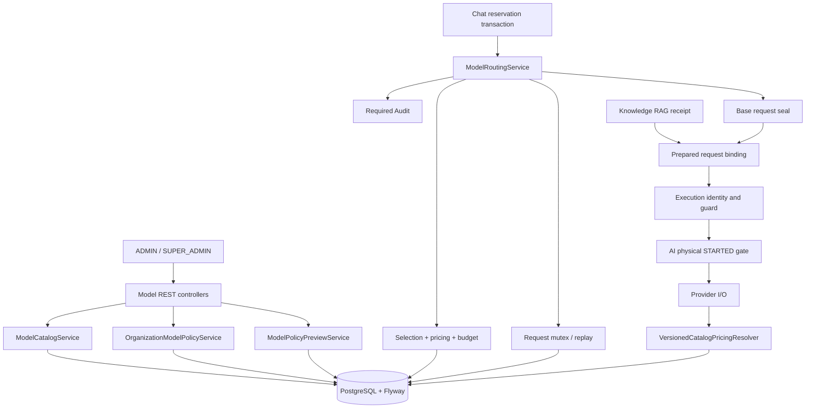

<!-- backend/src/main/java/ru/safeai/gateway/model/README.md -->
# Model Control Plane — архитектура, контракты, классы и production-readiness (V84)

SafeAI Desk · Java 21 / Spring Boot · 31 октября 2026 года.

> **Источники:** два приложенных ZIP с исходниками Model и тестами, предыдущий Model README от
> 17 октября и скриншоты IntelliJ IDEA. Из исходников взяты имена, сигнатуры и номера строк.
> Всего: **78 production Java-файлов**, **57 тестовых Java-файлов** (без `__MACOSX` и `.DS_Store`).
>
> **Статус:** это документальный и статический аудит, а не подтверждение действующего deployment.
> SQL-миграции целиком в эти ZIP не входят; успешный прогон Maven именно Model не предоставлен.
> Никакие текущие Java/SQL/конфигурационные файлы проекта при подготовке README не изменялись.
>
> **Критически важно:** старые замечания о потере `pricing_scheme` (M-01/M-03) и неполной
> проверке DB guards (M-04) больше нельзя безусловно считать действующими: код обновлён.
> В документе приведены новые доказательства, остающиеся риски и тестовые критерии.

## Содержание

1. Назначение и границы
2. Состояние возможностей и подтверждений
3. Архитектура и потоки
4. Полное дерево production-классов
5. Полное дерево тестов
6. Слои, инварианты и зависимости
7. HTTP API, роли и tenant isolation
8. Model Catalog и immutable версии
9. Organization Policy и preview
10. Выбор маршрута и семантика отказов
11. Стоимость, pricing scheme, бюджеты
12. Replay, блокировки, audit evidence
13. Execution binding: Chat, AI, Knowledge
14. Runtime health и metadata probe
15. PostgreSQL и миграции
16. Конфигурация и эксплуатация
17. Безопасность и модель угроз
18. Тестовая матрица и регрессионные проверки
19. Технический аудит и статус прежних проблем
20. План доведения до production
21. Новые функции и архитектурный roadmap
22. Справочник всех production-классов и методов
23. Справочник тестовых классов и сценариев
24. Поддержка документации и границы доказательств

---

## 1. Назначение и границы

`ru.safeai.gateway.model` — control plane маршрутизации моделей SafeAI Desk. Подсистема хранит версионированный каталог
моделей, политики организаций, доказательства выбора модели, финансовые ограничения, sealed request и авторизацию
физического выполнения. Она не является inference runtime: сетевой вызов модели исполняет AI/Chat data plane.
- Контроль: доступность модели, разрешённые capabilities и модальности, retention/training claims, input/output limits.
- Данные: append-only версии catalog и tenant policy, immutable route decisions, reserved/prepared request receipts.
- Финансы: денежные значения BigDecimal, явная схема тарифа, worst-case estimate, ledger actual/reserved/unknown.
- Безопасность: tenant-aware чтение, защита replay, транзакционная маршрутизация и execution binding.
- Интеграция: Chat создаёт маршрут, Knowledge при RAG добавляет контекст и доверенный receipt, AI проверяет identity.
- Режим исполнения: по коду RuntimeModelStatusService видит настроенный provider/model экземпляра, а не универсальное
  динамическое переключение между множеством активных провайдеров.

Статусы `ALLOWED` и `DENIED` — результаты принятия решения, но не доказательство внешнего provider call. Model policy
preview — диагностический dry-run, не бюджетная резервация. Runtime metadata probe — проверка API metadata endpoint, не
гарантия доступности реальной генерации.

## 2. Состояние возможностей и подтверждений

**Catalog.**
- В исходниках: Контроллер, сервис, JDBC, immutable version, tests.
- Ограничение подтверждения: Нет CI/release-подтверждения.

**Tenant policy.**
- В исходниках: Версии, правила, lock и оптимистичная проверка.
- Ограничение подтверждения: Нужны populated DB и сценарии concurrency.

**Preview.**
- В исходниках: Read-only оценка модели и budget snapshot.
- Ограничение подтверждения: Не reserved и не гарантия будущего ALLOWED.

**Routing.**
- В исходниках: MANDATORY, lock/replay, SHA-256, ALLOWED/DENIED audit.
- Ограничение подтверждения: Физический STARTED зависит от AI/DB guards.

**Pricing V66.**
- В исходниках: Scheme проходит через DTO/domain/JDBC/estimate/settlement.
- Ограничение подтверждения: Нужны реальные provider billing fixtures.

**Budgets.**
- В исходниках: HARD/SOFT и actual/reserved/unknown.
- Ограничение подтверждения: Нужны параллельные ledger/E2E тесты.

**Execution.**
- В исходниках: Base/prepared seals, Knowledge receipt и AI port.
- Ограничение подтверждения: Cross-module Testcontainers gate не предъявлен.

**Probe.**
- В исходниках: OpenAI/Anthropic/mock, safe metadata GET.
- Ограничение подтверждения: Не доказывает inference/баланс/квоты.

**Schema checks.**
- В исходниках: Проверки active triggers, CHECK и pricing_scheme.
- Ограничение подтверждения: Не доказана полнота всех constraints/indexes.

**Testing.**
- В исходниках: 57 test Java-файлов в переданном ZIP.
- Ограничение подтверждения: Количество файлов не равно успешному прогону.

Предыдущий результат 2455 тестов с одной ошибкой относился к общему backend-прогону V84 и Knowledge deletion fixture.
Его нельзя использовать ни как доказательство зелёных Model-тестов, ни как финальный результат полной регрессии. Новый
Maven-отчёт не приложен.

## 3. Архитектура и потоки

### 3.1. Основные компоненты



Стрелки — логическое распределение ответственности. PostgreSQL guards и AI/Chat execution layer являются необходимыми
дополнительными границами, а не заменяются одним Java-классом Model.

### 3.2. Последовательность маршрутизации

```text
Chat создал транзакционный контекст и semantic request identity
  |
  v
ModelRoutingService.decide() [MANDATORY]
  |-- сериализация chatId/clientRequestId
  |-- проверка replay с сохранённым requestContentHash
  |-- effective catalog + tenant policy + runtime match
  |-- capability, lifecycle, governance и input/output limits
  |-- worst-case pricing + HARD/SOFT budget snapshot
  |-- ALLOWED / DENIED + immutable integrity digest + required audit
  v
Базовый request seal до Knowledge RAG
  |
  +-- Knowledge добавляет untrusted context + immutable RAG receipt
  v
Final prepared request seal (binding version 2)
  |
  v
ModelRouteExecutionBindingService + guard + physical STARTED DB fence
  |
  v
AI provider I/O -> usage -> exact versioned pricing -> ledger evidence
```

### 3.3. Денежный контракт и неизвестная стоимость

```text
Persisted catalog pricingScheme
  |
  +-- FLAT_TOKEN_V1 + complete usage + exact identity
  |      -> допустимая оценка / verified settlement
  |
  +-- LEGACY_FLAT_UNVERIFIED_V1
  |      -> UNPRICED / budget cannot claim known upper bound
  |
  +-- UNSUPPORTED_COMPLEX_V1
         -> UNPRICED / incompatible billing dimensions

Monthly budget: actual + reserved + unknown liabilities
  |
  +-- HARD: unknown/unverifiable не приравнивается к нулю
  +-- SOFT: предупреждение фиксируется, но может не блокировать
```

## 4. Полное дерево production-классов

Дерево получено из приложенного production ZIP, а не из неполного изображения или чужой ветки Git. Подпакеты оставлены в
том же порядке, что в IntelliJ IDEA. `__MACOSX` и `.DS_Store` исключены.

```text
model/
├── config
│   └── ModelRoutingEnvelopeProperties.java
├── controller
│   ├── ModelCatalogController.java
│   ├── ModelPolicyPreviewController.java
│   ├── ModelRouteDecisionController.java
│   ├── ModelRuntimeController.java
│   └── OrganizationModelPolicyController.java
├── domain
│   ├── BudgetEnforcement.java
│   ├── ModelBudgetCommitmentSnapshot.java
│   ├── ModelCapability.java
│   ├── ModelCatalogEntry.java
│   ├── ModelCatalogSource.java
│   ├── ModelLifecycle.java
│   ├── ModelModality.java
│   ├── ModelPricingStatus.java
│   ├── ModelRetentionStatus.java
│   ├── ModelRouteDecision.java
│   ├── ModelRouteOutcome.java
│   ├── ModelRouteReason.java
│   ├── ModelRouteRequest.java
│   ├── ModelRouteResult.java
│   ├── ModelTrainingUseStatus.java
│   ├── MonthlyCommitmentState.java
│   ├── MonthlyCostState.java
│   ├── OrganizationModelPolicy.java
│   ├── RuntimeModelProbeResult.java
│   └── RuntimeModelProbeStatus.java
├── dto
│   ├── CreateModelCatalogVersionRequest.java
│   ├── CreateOrganizationModelPolicyVersionRequest.java
│   ├── ModelCatalogEntryResponse.java
│   ├── ModelPolicyPreviewItemResponse.java
│   ├── ModelPolicyPreviewResponse.java
│   ├── ModelRouteDecisionResponse.java
│   ├── OrganizationModelPolicyResponse.java
│   ├── RuntimeModelProbeResponse.java
│   ├── RuntimeModelStatusResponse.java
│   └── RuntimeModelStatusWireResponse.java
├── exception
│   ├── ModelRouteDeniedException.java
│   └── ModelRouteEnvelopeExceededException.java
├── pricing
│   └── VersionedCatalogPricingResolver.java
├── repository
│   ├── JdbcTextArrayReader.java
│   ├── ModelCatalogRepository.java
│   ├── ModelRouteDecisionRepository.java
│   ├── ModelRouteRequestBindingRepository.java
│   ├── ModelRouteRequestMutexRepository.java
│   └── OrganizationModelPolicyRepository.java
├── service
│   ├── AnthropicRuntimeModelHealthProbe.java
│   ├── DatabaseTimestampNormalizer.java
│   ├── MockRuntimeModelHealthProbe.java
│   ├── ModelCatalogAuditDetails.java
│   ├── ModelCatalogAuditDetailsFactory.java
│   ├── ModelCatalogRules.java
│   ├── ModelCatalogService.java
│   ├── ModelControlPlaneAccess.java
│   ├── ModelControlPlaneNumericValidation.java
│   ├── ModelControlPlaneSchemaVerifier.java
│   ├── ModelInputTokenEstimator.java
│   ├── ModelPolicyPreviewService.java
│   ├── ModelRouteDecisionAuditDetails.java
│   ├── ModelRouteDecisionFactory.java
│   ├── ModelRouteDecisionIntegrity.java
│   ├── ModelRouteExecutionBindingService.java
│   ├── ModelRouteExecutionGuard.java
│   ├── ModelRouteExecutionIdentity.java
│   ├── ModelRouteReservedRequestService.java
│   ├── ModelRoutingCostPolicy.java
│   ├── ModelRoutingEnvelopeService.java
│   ├── ModelRoutingExecutionCapabilityGate.java
│   ├── ModelRoutingSelectionPolicy.java
│   ├── ModelRoutingService.java
│   ├── OpenAiRuntimeModelHealthProbe.java
│   ├── OrganizationModelPolicyAuditDetailsFactory.java
│   ├── OrganizationModelPolicyRules.java
│   ├── OrganizationModelPolicyService.java
│   ├── RuntimeModelHealthProbe.java
│   ├── RuntimeModelProbeHttpSupport.java
│   ├── RuntimeModelProbeService.java
│   └── RuntimeModelStatusService.java
└── spi
    └── ModelRequestContentHashPort.java
```

В архиве **78** Java-файлов: `service` — 32; `domain` — 20; `dto` — 10; остальные пакеты перечислены выше. Это снимок
архива, а не доказательство точного количества в локальном checkout.

## 5. Полное дерево тестов

Тестовые исходники из второго ZIP. Вспомогательные `*TestSupport` и `*Fixtures` — Java-файлы, но не самостоятельные
JUnit test classes. Количество test methods считается отдельно.

```text
backend/src/test/java/ru/safeai/gateway/model/
├── controller
│   ├── ModelCatalogHistoryControllerTest.java
│   ├── ModelControllerContractTest.java
│   ├── ModelPolicyPreviewControllerTest.java
│   └── ModelRuntimeControllerTest.java
├── domain
│   ├── ModelDomainContractTest.java
│   ├── ModelRouteDecisionMonthlyCostStateTest.java
│   └── ModelRouteRequestV54ContractTest.java
├── dto
│   ├── ModelRequestValidationTest.java
│   ├── ModelRouteDecisionResponseTest.java
│   └── OrganizationModelPolicyResponseTest.java
├── integration
│   ├── ModelBudgetCommitmentV64PostgresIntegrationTest.java
│   ├── ModelControlPlanePostgresIntegrationTest.java
│   ├── ModelControlPlaneSchemaV64V65PostgresIntegrationTest.java
│   ├── ModelExecutionPreparedBindingV65PostgresIntegrationTest.java
│   ├── ModelExecutionV53V54PostgresIntegrationTest.java
│   ├── ModelGovernanceV59V60V61PostgresIntegrationTest.java
│   ├── ModelIntegrationTestSupport.java
│   └── ModelRoutingRequestMutexPostgresIntegrationTest.java
├── pricing
│   └── VersionedCatalogPricingResolverTest.java
├── repository
│   ├── JdbcTextArrayReaderTest.java
│   ├── ModelCatalogRepositoryBindingTest.java
│   ├── ModelRouteDecisionRepositoryContractTest.java
│   └── ModelRouteRequestMutexRepositoryTest.java
├── service
│   ├── DatabaseTimestampNormalizerTest.java
│   ├── ModelAuditDetailsFactoryTest.java
│   ├── ModelCatalogHistoryServiceTest.java
│   ├── ModelCatalogPricingSchemeTest.java
│   ├── ModelCatalogRulesTest.java
│   ├── ModelCatalogRulesV54RegressionTest.java
│   ├── ModelCatalogServicePricingSchemeTest.java
│   ├── ModelCatalogServiceTest.java
│   ├── ModelControlPlaneAccessTest.java
│   ├── ModelControlPlaneNumericValidationTest.java
│   ├── ModelExecutionBindingTestSupport.java
│   ├── ModelInputTokenEstimatorIntegrationTest.java
│   ├── ModelPolicyPreviewServiceTest.java
│   ├── ModelRouteDecisionFactoryTest.java
│   ├── ModelRouteExecutionBindingServiceTest.java
│   ├── ModelRouteExecutionGuardTest.java
│   ├── ModelRouteExecutionIdentityNumericTest.java
│   ├── ModelRouteExecutionIdentityTestFixtures.java
│   ├── ModelRouteExecutionPortTest.java
│   ├── ModelRouteReservedRequestServiceTest.java
│   ├── ModelRoutingCostEnvelopeV54Test.java
│   ├── ModelRoutingCostPolicyTest.java
│   ├── ModelRoutingEnvelopeServiceTest.java
│   ├── ModelRoutingExecutionCapabilityGateTest.java
│   ├── ModelRoutingReplayV54Test.java
│   ├── ModelRoutingSelectionPolicyTest.java
│   ├── ModelRoutingServiceTest.java
│   ├── OrganizationModelPolicyRulesTest.java
│   ├── OrganizationModelPolicyServiceTest.java
│   ├── RuntimeModelHealthProbeAdaptersTest.java
│   ├── RuntimeModelProbeHttpSupportTest.java
│   ├── RuntimeModelProbeServiceTest.java
│   └── RuntimeModelStatusServiceTest.java
└── testsupport
    └── ModelTestFixtures.java
```

В ZIP **57** Java-файлов. Тесты интеграции с PostgreSQL присутствуют, но запуск disposable Testcontainers и
соответствующий green result необходимо проверить отдельно.

## 6. Слои, инварианты и зависимости

- `config/`: Типизированное управление резервом input units и alias-compatibility.
- `controller/`: HTTP endpoints, role annotations, входная валидация и wire DTO.
- `domain/`: Immutable records/enums: каталог, policies, route outcomes, caps и budget snapshots.
- `dto/`: Контракты request/response, Bean Validation и безопасные публичные поля.
- `exception/`: Отказы маршрута и превышения input envelope с контролируемым ответом.
- `pricing/`: Физический settlement по verified каталогу и provider usage.
- `repository/`: Prepared JDBC, keyset pages, advisory locks и persisted seals.
- `service/`: Доменная оркестрация catalog/policy/routing, execution gate и runtime probe.
- `spi/`: Минимальный порт semantic hash от Chat без циклической зависимости.

- Model не доверяет данным frontend: права повторяются в service и SQL.
- Catalog/policy версионируются append-only; нельзя переписать исторический snapshot под изменившуюся цену.
- `ModelRouteDecisionIntegrity` сохраняет совместимость старых digest v1/v2 при создании новых по v3.
- Отказ DENIED имеет собственную доказательную ценность и может пережить исключение, если внешняя TX commit.
- Provider может исполняться только по согласованной identity/plan; route approval не достаточен сам по себе.
- Суммы не вычисляются в float/double и должны укладываться в PostgreSQL numeric(30,12).
- `ModelPricingScheme` расположен в `ai.pricing`, а не в `model.domain`; это видимая межмодульная зависимость.
- `ModelRequestContentHashPort` и AI execution ports разделяют владение семантикой Chat и права на I/O.

## 7. HTTP API, роли и tenant isolation

Маршруты ниже проверены по `@RequestMapping` и методным mapping пяти контроллеров. Это административный control plane;
прямой REST route физического inference здесь отсутствует.

- **`GET /api/admin/models/catalog`** — `ModelCatalogController.latest`; доступ: ADMIN / SUPER_ADMIN.
- **`GET /api/admin/models/catalog/effective`** — `effective`; доступ: ADMIN / SUPER_ADMIN.
- **`GET /api/admin/models/catalog/versions`** — `history`; доступ: ADMIN / SUPER_ADMIN.
- **`POST /api/admin/models/catalog`** — `createVersion`; доступ: SUPER_ADMIN.
- **`POST /api/admin/models/catalog/import-runtime`** — `importRuntime`; доступ: SUPER_ADMIN.
- **`GET /api/admin/models/policies/{organizationId}`** — `OrganizationModelPolicyController.current`; доступ: ADMIN /
  SUPER_ADMIN.
- **`POST /api/admin/models/policies/{organizationId}`** — `createVersion`; доступ: ADMIN own tenant / SUPER_ADMIN.
- **`POST /api/admin/models/policies/{organizationId}/preview`** — `ModelPolicyPreviewController.preview`; доступ: ADMIN
  / SUPER_ADMIN.
- **`GET /api/admin/models/route-decisions/{decisionId}`** — `ModelRouteDecisionController.findById`; доступ: ADMIN /
  SUPER_ADMIN.
- **`GET /api/admin/models/runtime`** — `ModelRuntimeController.runtime`; доступ: ADMIN / SUPER_ADMIN.
- **`POST /api/admin/models/runtime/probe`** — `probe`; доступ: SUPER_ADMIN.

Методы требуют не только аннотации, но и сервисной проверки организации и принципала. ADMIN не должен получать чужую
policy/decision и existence leak; SUPER_ADMIN не должен использовать свои полномочия для обхода защищённого physical
STARTED.

Для истории каталога применяются bounded cursor/page операции: API cursor не должен превращаться в неограниченный SQL
scan. Публикация нового catalog version требует SUPER_ADMIN, а политика организации должна учитывать owner tenant,
expectedPreviousVersion и audit.

## 8. Model Catalog и immutable версии

`ModelCatalogService`, `ModelCatalogRules` и `ModelCatalogRepository` реализуют создание, импорт, чтение
latest/effective/history по model key. Предикат effective зависит от времени публикации; последняя созданная версия и
действующая версия могут быть разными. Названия и provider/model ID канонизируются, версии неизменяемы, конкурентные
записи сериализуются advisory lock.
- Каталог содержит `provider`, `providerModelId`, lifecycle, capabilities, modalities, limits, retention и training
  declarations.
- Цена хранит ставки input/cached/cacheWrite/output, pricingVersion, pricingStatus и persisted `pricingScheme`.
- `ModelCatalogEntry` имеет legacy constructor: старый CONFIGURED не получает автоматически verified scheme.
- Для новой CONFIGURED версии сервис требует `FLAT_TOKEN_V1`, иначе запрос отклоняется до INSERT.
- `ModelCatalogEntryResponse` возвращает `pricingScheme` клиенту без утраты identity; тип живёт в `ai.pricing`.
- `ModelCatalogRepository.SELECT_COLUMNS`/`map()` включают реальное поле `pricing_scheme` из PostgreSQL.
- Перевод модели в DEPRECATED/DISABLED/RETIRED — новая версия каталога, не UPDATE старой.

Проверки: `ModelCatalogServicePricingSchemeTest`, `ModelCatalogPricingSchemeTest`, `ModelCatalogRepositoryBindingTest`,
`ModelCatalogHistoryServiceTest`, `ModelCatalogServiceTest`, `ModelCatalogHistoryControllerTest`. Они представлены в
архиве, но отдельно не запускались в рамках подготовки README.

## 9. Organization Policy и preview

`OrganizationModelPolicy` задаёт enablement, allow/deny model keys, default model, capability governance,
retention/training требования, потолки input/output, лимит цены запроса, месячный бюджет и HARD/SOFT enforcement.
`OrganizationModelPolicyService` создаёт append-only версии после optimistic check, tenant row lock и required audit.
- `OrganizationModelPolicyRules` нормализует и проверяет модельные ключи и денежные ограничения.
- `ModelPolicyPreviewService.preview()` применяет draft policy к ограниченному набору effective versions.
- Preview не сохраняет policy, не формирует route decision и не отправляет provider request.
- Preview получает read-only budget snapshot без exclusive data-plane lock; между preview и decide он устаревает.
- `wouldLockOutOrganization` полезен для UX, но не обещает конкретный результат следующего live decision.
- `ModelPolicyPreviewItemResponse` и `ModelPolicyPreviewResponse` фиксируют reasons и оценку стоимости.

Для операторов полезно дополнительно показывать as-of snapshot/effective version и предупреждать об изменении
catalog/policy после preview, не превращая preview в мутирующий путь.

## 10. Выбор маршрута и семантика отказов

`ModelRoutingService.decide()` запускается только в существующей транзакции: `@Transactional` с `Propagation.MANDATORY`.
Порядок: identity → mutex → replay → effective selection → cost/budget → immutable result → required audit.
`ModelRoutingSelectionPolicy` проверяет requested/default/runtime fallback, allow/deny, lifecycle, capability и data
governance.
- `ALLOWED` содержит выбранный catalog/policy snapshot и immutable route identity, но не разрешает I/O без guard.
- `DENIED` сохраняет стабильный `ModelRouteReason` и audit; `noRollbackFor` на этом исключении не гарантирует commit,
  если его отменяет внешний caller.
- `RUNTIME_MISMATCH` и `AMBIGUOUS_RUNTIME_MAPPING` нельзя превращать в silent fallback на другую модель.
- `ModelRoutingExecutionCapabilityGate` отказывает по ещё не поддерживаемым data-plane capabilities.
- `ModelInputTokenEstimator` предоставляет версионированную детерминированную оценку input units.
- Оценка input units не является точным provider tokenizer count; reserve envelope должен быть проверен отдельно.
- `ModelRouteDecisionFactory`/`ModelRouteDecisionIntegrity` сохраняют hashes и совместимость исторических решений.

## 11. Стоимость, pricing scheme, бюджеты

### 11.1. Исправленный контракт pricing V66

По текущим исходникам схема теперь передаётся по цепочке `CreateModelCatalogVersionRequest` → `ModelCatalogService` →
`ModelCatalogEntry` → `ModelCatalogRepository` → `ModelCatalogEntryResponse`/`ModelRoutingCostPolicy`/
`VersionedCatalogPricingResolver`. Эта цепочка отсутствовала в старом README от 17 октября.
- `FLAT_TOKEN_V1` — supported scheme для автоматического расчёта при complete price и допустимых usage counters.
- `LEGACY_FLAT_UNVERIFIED_V1` — исторический CONFIGURED без подтверждения схемы, остаётся UNPRICED.
- `UNSUPPORTED_COMPLEX_V1` — несовместимые многокомпонентные тарифы, расчёт не притворяется flat-token.
- Новый CONFIGURED должен явно назвать `FLAT_TOKEN_V1`, иначе `ModelCatalogService` отклоняет операцию.
- `VersionedCatalogPricingResolver` сверяет operation ID, plan, decision SHA/version, catalog и physical model.
- `VersionedCatalogPricingResolver.version()` включает `pricingScheme` в identity расчёта.
- `ModelRoutingCostPolicy.estimateCost()` отвергает неподдерживаемую схему для строгого worst-case.
- Cache read/write semantics и specialized usage dimensions валидируются, несовместимые размеры не становятся $0.

### 11.2. Monthly HARD/SOFT budget

`ModelRouteDecisionRepository.loadCommittedMonthlyCostSnapshot()` читает known actual/reserved и unknown cost count;
итоговые обязательства оцениваются на UTC-месяц. HARD budget отвергает недоказуемую стоимость, а известное превышение
нижней границы не скрывается из-за unknown. SOFT допускает предупреждающий режим по своим правилам без потери evidence.
`ModelControlPlaneNumericValidation` проверяет PostgreSQL `numeric(30,12)`, диапазон и отсутствие округления вне
контракта. Применение BigDecimal не заменяет тесты переполнения и конкурентного budget ledger. Неизвестный cost не
должен считаться нулём ни в одной ветви.

### 11.3. Границы billing

Поддержка OpenAI/Anthropic provider-specific counters зависит от версии API, классификации `AiTokenUsage` и каталожной
схемы. Новые billing dimensions (reasoning, audio, image, batch) должны получать отдельный versioned adapter/scheme; без
доказательства они остаются UNPRICED.

## 12. Replay, блокировки, audit evidence

- `ModelRouteRequestMutexRepository.lock()` сериализует единичный `(chatId, clientRequestId)` до replay read.
- `ModelRouteDecisionRepository.lockOrganizationBudget()` сериализует доступ к общему tenant budget context.
- `ModelRouteDecisionIntegrity` проверяет v1/v2 legacy и v3 canonical SHA-256 с нормализованным временем.
- `ModelRouteDecisionRepository.insertBudgetCommitmentSnapshot()` фиксирует route-time денежное evidence.
- `ModelRouteDecisionAuditDetails` и Audit factories формируют типизированное обязательное audit details.
- `DENIED` должен сохраняться при commit вызывающей транзакции; `noRollbackFor` не делает nested TX бессмертной.
- Повтор clientRequestId с другим смысловым содержимым должен отклоняться, а не возвращать старый ALLOWED.
- Stale или forged route decision/receipt не должен приводить к Redis/provider side effects.

## 13. Execution binding: Chat, AI, Knowledge

`ModelRouteReservedRequestService` пишет immutable SHA-256 исходного Chat request, читает Knowledge RAG receipt,
сохраняет final prepared request и проверяет эквивалентность при retry. `ModelRouteExecutionIdentity` связывает
пользователя, tenant, chat turn, catalog/route и digest на последовательных этапах. `ModelRouteExecutionGuard` отсекает
выход за reserved input envelope.
`ModelRouteExecutionBindingService` реализует AI-facing port: подтверждает route и receipt перед физическим исполнением.
Запись identity или вызов `authorizePhysicalExecution()` не заменяют DB-fenced `physical STARTED`; он зависит от AI
execution plan/attempt и миграций V65/V67/V72.
- Граница Chat: semantic hash и `clientRequestId` должны быть стабильными на повторе.
- Граница Knowledge: RAG receipt принадлежит конкретной организации, chat turn и prepared context.
- Граница AI: identity разрешает только согласованные provider/model и защищённый request.
- Поздняя подмена prepared request, model или значения digest должна приводить к отказу до external I/O.
- Повторный physical attempt при HARD/max-cost ограничениях требует собственной строгой политики.
- Неполное или повреждённое audit/persisted evidence не допускается заменять permissive fallback.

## 14. Runtime health и metadata probe

`RuntimeModelStatusService` читает настройки одного рабочего provider/model на экземпляр, сводит лимиты, статусы и
тарифы. `RuntimeModelProbeService` выбирает допустимый `RuntimeModelHealthProbe`: OpenAI, Anthropic или Mock.
`RuntimeModelProbeHttpSupport` использует HTTPS, проверяет URI и headers, отключает redirects, ограничивает timeout и не
сохраняет response body.
Metadata `2xx` означает только доступность metadata endpoint. Это не доказательство права на вызов completions,
поддержанных capabilities, достаточного баланса, квот, SLA, retention или корректности billed usage.
`ModelRuntimeController.probe` доступен SUPER_ADMIN.

## 15. PostgreSQL и миграции

Вложения содержат Java-код с прямыми ссылками на объекты V45–V72, но **не полный каталог SQL**. Ниже описаны только
договорённости, подтверждаемые Java и названиями таблиц/триггеров. Точный DDL, Flyway checksum, порядок блокировок и
populated-upgrade следует проверять по `backend/src/main/resources/db/migration` в рабочем checkout.
- **V45:** Immutable catalog/policy/decision identities и exact turn constraint по именам guard.
- **V53/V54:** Route execution, semantic request identity и input accounting (по тестам и Java).
- **V59–V61:** Governance и слои политики; точное распределение DDL требует проверки миграций.
- **V62:** Prepared request receipts, budget cost ledger и commitment evidence.
- **V64:** Knowledge RAG receipt, prepared provenance и route-time budget snapshot.
- **V65:** Execution prepared-binding guard, deferred ограничения и compatibility checks.
- **V66:** Persisted pricing_scheme, validated enum/CHECK и lifecycle контракты.
- **V67/V72:** Дополнительные физические execution fences в AI/DB; проверять SQL целиком.

Текущий `ModelControlPlaneSchemaVerifier` явно проверяет присутствие критических таблиц, активность ряда триггеров
(`tgenabled`), некоторые CHECK с учётом `convalidated` и `pricing_scheme NOT NULL`. Для исторического NOT VALID V65
предусмотрено осознанное исключение по `convalidated`; новые записи PostgreSQL при этом проверяются.
Осталось сверить **полноту** списка SQL guards (включая V67/V72), deferrability, критические индексы (`indisvalid`,
`indisready`) и эксплуатационные permissions. Не переписывать V1–V84: исправления схемы — следующими append-only Flyway
migrations.

## 16. Конфигурация и эксплуатация

- Runtime provider/model задаётся в AI конфигурации; Model не предоставляет динамический pool routing между deploys.
- `ModelRoutingEnvelopeProperties` задаёт резерв input units для system/developer, RAG и tool schema.
- `RuntimeModelStatusService` не должен раскрывать API keys, base URLs и другие чувствительные provider settings.
- Конфигурация pricingVersion и scheme — immutable свойства каталога, не глобальное значение для старых вызовов.
- Runtime metadata probe должен работать с защищённым egress allowlist и ограничением частоты.
- Не применять `.env.prod` к локальным/интеграционным тестам и не направлять их на настоящие ресурсы.
- Для бюджета фиксировать UTC-границы месяцев, точность numeric(30,12) и состояния unknown liability.
- Эксплуатировать отказ маршрута отдельно от ошибки provider и от неопределённой цены settlement.
- Собирать безопасные latency, deny-reasons, route/replay/settlement error counters без PII в tags.

## 17. Безопасность и модель угроз

- Подмена organizationId — должна блокироваться независимой сервисной и SQL tenant проверкой.
- Replay с прежним clientRequestId и другим payload — не может использовать старое ALLOWED.
- Переполнение money / long input estimate / неверный decimal scale — deny/fail closed.
- Отсутствующая или legacy pricing scheme — UNKNOWN/UNPRICED, никогда verified FREE.
- Несоответствие provider/model/execution plan — отказ до provider I/O.
- Недоверенный Knowledge context не меняет sealed базовую identity Chat-turn.
- Задержка между preview и decide — повторное чтение политики и бюджета внутри live transaction.
- Потеря DB trigger или invalid constraint — приложение должно fail fast или не исполнять side effects.
- Нельзя логировать полный request, sensitive headers, private tokens и raw RAG text в audit/details.
- Админский metadata probe не должен превращаться в SSRF из пользовательского URL.
- Исторические решения v1/v2 проверяются только по конкретным совместимым digest правилам.
- Состояние провайдера или catalog из кэша не должно обходить сохранённые route/tenant требования.

## 18. Тестовая матрица и регрессионные проверки

### 18. Каталог и цены

- ModelCatalogPricingSchemeTest: legacy остаётся неподтверждённым, verified FLAT разрешает расчёт.
- ModelCatalogServicePricingSchemeTest: CONFIGURED без explicit scheme отклоняется до INSERT.
- VersionedCatalogPricingResolverTest: exact physical identity, usage dimensions и unknown billing.
- ModelCatalogServiceTest / ModelCatalogHistoryServiceTest: append-only и bounded history.

### 18. Бюджет и маршрутизация

- ModelRoutingCostPolicyTest: HARD/SOFT, actual/reserved/unknown, numeric overflow.
- ModelRoutingReplayV54Test: same clientRequestId и semantic mismatch.
- ModelRoutingRequestMutexPostgresIntegrationTest: конкурентные повторы без двойного решения.
- ModelControlPlanePostgresIntegrationTest: транзакции, RBAC, required audit.

### 18. Execution safety

- ModelExecutionPreparedBindingV65PostgresIntegrationTest: prepared request и DB-fenced execution.
- ModelRouteExecutionBindingServiceTest: strict identity и final seal.
- ModelRouteExecutionIdentityNumericTest: численные и digest boundary.
- ModelRoutingExecutionCapabilityGateTest: запрет неподдерживаемых capabilities.

### 18. Runtime и preview

- ModelRuntimeControllerTest и RuntimeModelProbeHttpSupportTest: RBAC/HTTP/timeout/redirect.
- ModelPolicyPreviewServiceTest: read-only/no provider I/O/no reservation.
- ModelRouteDecisionResponseTest / OrganizationModelPolicyResponseTest: wire compatibility.

Для запуска в disposable среде:
```bash
cd ~/Workspace/Projects/Products/SafeAI-Desk/backend
./mvnw -Dtest=ModelCatalogPricingSchemeTest,ModelCatalogServicePricingSchemeTest test
./mvnw clean verify
```

Проверка без `-DskipTests`: Maven reports, статус Testcontainers, реальное применение Flyway к пустой/заполненной
disposable БД. Отдельно проверить frontend admin UI, contract/API и privacy logs.

## 19. Технический аудит и статус прежних проблем

Старый README от 17 октября содержал десять пунктов M-01–M-10. Ниже каждый из них пересмотрен по исходникам на 31
октября. Исправление в Java ещё не означает принятую production версию: необходимо подтвердить Testcontainers, миграции
и release gates.

### 19. M-01 — P1 → адресован в коде

- Замечание старой редакции: Схема тарифа терялась между JDBC и domain.
- Текущий статус/основание: Теперь `SELECT_COLUMNS` и mapper читают `pricing_scheme`; domain/DTO несут
  `ModelPricingScheme`.

### 19. M-02 — P1 → адресован в коде

- Замечание старой редакции: Новый CONFIGURED мог сохраняться с legacy scheme.
- Текущий статус/основание: `ModelCatalogService.selectManualPricingScheme()` требует explicit `FLAT_TOKEN_V1`.

### 19. M-03 — P1 → адресован в коде

- Замечание старой редакции: Worst-case estimate игнорировал поддержку pricing scheme.
- Текущий статус/основание: `ModelRoutingCostPolicy.estimateCost()` проверяет `supportedForAutomaticSettlement()`.

### 19. M-04 — P2 → частично адресован

- Замечание старой редакции: Schema verifier не проверял активность guards и CHECK.
- Текущий статус/основание: Проверяются `tgenabled`, часть `convalidated` и `pricing_scheme NOT NULL`; остаётся
  completeness/index audit.

### 19. M-05 — P2 → ограничение по дизайну

- Замечание старой редакции: Preview не резервирует бюджет и может устареть.
- Текущий статус/основание: Поведение осознанно read-only; требуется UX as-of indication и concurrency test.

### 19. M-06 — P2 → ограничение по дизайну

- Замечание старой редакции: Метаданные 2xx принимались за AVAILABLE.
- Текущий статус/основание: Это metadata-only availability; не считать её доказательством inference readiness.

### 19. M-07 — P2 → риск нагрузки

- Замечание старой редакции: Latest/effective/history используют keyset/SQL сортировки.
- Текущий статус/основание: Нужны `EXPLAIN (ANALYZE, BUFFERS)` и профилирование при большом каталоге.

### 19. M-08 — P2 → риск внешнего API

- Замечание старой редакции: Provider-specific cached usage может менять семантику.
- Текущий статус/основание: Нужны golden JSON fixtures и versioned billing dimensions; unsupported → UNPRICED.

### 19. M-09 — P2 → ограничение модели учёта

- Замечание старой редакции: Детерминированные input units не равны tokenizer provider.
- Текущий статус/основание: Добавить provider-native check или консервативный upper-bound по model family.

### 19. M-10 — P3 → сопровождение

- Замечание старой редакции: Сервисы routing, price и integrity довольно объёмны.
- Текущий статус/основание: Декомпозиция только при golden vectors, без смены persisted digest и публичных DTO.

### 19. Новые контрольные риски и улучшения

- **P0 — Финансовая корректность при неполной usage.** End-to-end проверка любых unknown/legacy/unsupported provider
  тарифов до production.
- **P0 — SQL fences перед physical STARTED.** Проверить `V65/V67/V72` и их enabled/validated свойства на populated БД.
- **P0 — Межмодульная replay/receipt целостность.** Провести race/failure injection на Chat + Knowledge + Model + AI.
- **P1 — Provider-specific billing drift.** Нужны реальные fixture matrices и тестирование новых usage dimensions.
- **P1 — Observability и incident response.** Нужны метрики refusal reason, freshness и settlement errors без
  чувствительных меток.
- **P1 — Доступность и rate-limiting metadata probes.** Запретить злоупотребление probe и рассогласование между
  probe/status и route.
- **P1 — Нагрузочные SQL свойства каталога.** Keyset/preview на 5k моделей, планы, индексные ограничения и timeout.
- **P2 — Смена runtime provider без перезаписи catalog.** Versioned rollout/canary, drift detection и fallback только по
  явной policy.
- **P2 — Валидация native context capacity.** Маршрут не должен вводить в заблуждение относительно реального token
  window.
- **P3 — Канонический README и drift checks.** Текущее полное дерево генерировать по архиву/локальному checkout, не по
  скриншотам.

Не исправлять риски выключением транзакций, ослаблением RBAC/tenant filters, очисткой SQL evidence, заменой UNKNOWN на
0, переписыванием Flyway или отключением checks/test failures.

## 20. План доведения до production

**0. Snapshot + traceability**
- Закрепить commit SHA, все зависимости Model/AI/Chat/Knowledge и состояния Flyway.

**1. Полная регрессия**
- Backend `clean verify`, JUnit XML, Testcontainers, frontend admin CI: 0 errors/failures.

**2. Populated upgrade**
- Flyway validate + empty/new и populated DB upgrade, сохранность старых catalog/policy/decision.

**3. Financial gate**
- Golden fixtures по схемам V66; unknown liability, cached usage, decimal overflow, HARD/SOFT.

**4. Execution safety**
- Сценарии forged identity, replay races, SQL trigger disable attempt, restart, binding mismatch.

**5. Security и compliance**
- RBAC/tenant denial, sensitive-data logging, probe egress и сохранение immutable audit.

**6. Performance**
- SQL EXPLAIN, 5k catalog preview, keyset pagination, большие tenant workloads.

**7. Monitoring**
- Dashboards, alerting, Pager/Alertmanager, ручной drill и безопасный rollback plan.

**8. Staging canary**
- Проверить точный provider/model/config, фактическое settlement и budget drift.

**9. Controlled rollout**
- Критерии приёмки, постепенное включение, runbook stop/rollback без SQL rollback.

Критерий production-ready — фактические результаты, привязанные к commit/build/image, а не наличие соответствующих
классов и тестов в архиве. README сам по себе не изменяет production поведение и не разрешает небезопасную миграцию.

## 21. Новые функции и архитектурный roadmap

Ниже предложения, а не реализованные возможности. Их внедрение не должно изменять persisted hashes, денежные
доказательства или прежние idempotency keys.
**Catalog diff & approval**
- Польза: Показать версии, тарифы и причины запрета до публикации.
- Зависимости: Dual-control для глобального catalog.

**Policy simulator 2.0**
- Польза: Сравнивать несколько draft policy с реальным corpora.
- Зависимости: Отметка as-of, никаких write side effects.

**Price-book verification**
- Польза: Привязать счета провайдера к versioned billing evidence.
- Зависимости: Exact scheme + structured usage fixtures.

**Cost anomaly detector**
- Польза: Отслеживать отклонения estimated/settled/unknown cost.
- Зависимости: PII-safe low-cardinality monitoring.

**Budget reservation dashboard**
- Польза: Показывать known actual/reserved/unknown liability.
- Зависимости: Не отображать UNKNOWN как $0.

**Provider readiness canary**
- Польза: Минимальный реальный synthetic inference при отдельном разрешении.
- Зависимости: Изолированный бюджет, платёжные лимиты.

**Multi-runtime catalogue**
- Польза: Несколько реально доступных provider runtimes на один deploy.
- Зависимости: Explicit route binding и fail-closed fallback.

**Routing explainability**
- Польза: Диагностика DENIED с policy/catalog snapshot и reason.
- Зависимости: RBAC, нет sensitive prompt в деталях.

**Quota/drift alerts**
- Польза: Уведомления о несогласованных provider model/pricing.
- Зависимости: Rate limit, provider status и dry-run.

**Golden policy regression**
- Польза: Прогон наборов golden route requests до смены каталога.
- Зависимости: Immutable fixtures и стабильные hash vectors.

**Context capacity contract**
- Польза: Provider-specific tokenizer caps для RAG/tools.
- Зависимости: No incorrect guarantee from estimated units.

**Release policy gates**
- Польза: Блокировка релиза при schema drift и неизвестном tariff.
- Зависимости: Readonly checks, подписанный audit.

## 22. Справочник всех production-классов и методов

Ниже все 78 файлов из текущего production ZIP. Для каждой записи сначала дано краткое назначение на основе старого
README и нового кода, затем фактически объявленные методы с актуальными номерами строк, извлечённые через Java 21
Compiler API. Встроенные сгенерированные record-accessors, `equals/hashCode/toString` не выдумываются. Вложенные классы
указаны отдельно, если объявлены в исходнике. Сведения о поведении подтверждаются исходником и тестами, а не успешной
компиляцией всего проекта.

### 22. Пакет `config` — 1 Java-файлов

#### `ModelRoutingEnvelopeProperties`

Конфигурация потолков добавочных input units; проверяет legacy-алиасы и границы.

**Компоненты record:** `systemAndDeveloperInputUnits`, `ragContextInputUnits`, `toolSchemaInputUnits`,
  `systemAndDeveloperTokens`, `ragContextTokens`, `toolSchemaTokens`

**Методы/конструкторы, объявленные в файле:**

- `L30 ModelRoutingEnvelopeProperties(Long, Long, Long, Long, Long, Long)` — Проверил инварианты параметров record.
- `L61 resolve(Long, Long, long, String, String)` — Разрешил effective значение, identity или физический тариф.

### 22. Пакет `controller` — 5 Java-файлов

#### `ModelCatalogController`

HTTP API чтения каталога и создания/импорта версий с разделением прав.

**Методы/конструкторы, объявленные в файле:**

- `L30 ModelCatalogController(ModelCatalogService)` — Инициализировал зависимости/объект и проверил обязательные
  значения.
- `L41 latest(String, int, SafeAiUserPrincipal)` [@GetMapping] — HTTP-версия принимает cursor+limit; helper-версия
  использует default page.
- `L59 latest(SafeAiUserPrincipal)` — HTTP-версия принимает cursor+limit; helper-версия использует default page.
- `L70 effective(String, int, SafeAiUserPrincipal)` [@GetMapping] — HTTP-версия принимает cursor+limit; helper-версия
  использует default page.
- `L88 effective(SafeAiUserPrincipal)` — HTTP-версия принимает cursor+limit; helper-версия использует default page.
- `L98 history(String, Integer, int, SafeAiUserPrincipal)` [@GetMapping] — HTTP-версия принимает beforeVersion; helper
  сохраняет legacy API.
- `L118 history(String, SafeAiUserPrincipal)` — HTTP-версия принимает beforeVersion; helper сохраняет legacy API.
- `L130 createVersion(CreateModelCatalogVersionRequest, SafeAiUserPrincipal)` [@PostMapping] — Проверил права, ожидаемую
  версию и создал append-only запись с audit.
- `L143 importRuntime(SafeAiUserPrincipal)` [@PostMapping] — Импортировал статически настроенный runtime как версию
  каталога.

#### `ModelPolicyPreviewController`

HTTP API dry-run проверки предлагаемой политики организации.

**Методы/конструкторы, объявленные в файле:**

- `L26 ModelPolicyPreviewController(ModelPolicyPreviewService)` — Инициализировал зависимости/объект и проверил
  обязательные значения.
- `L30 preview(UUID, CreateOrganizationModelPolicyVersionRequest, SafeAiUserPrincipal)` [@PostMapping] — Выполнил
  dry-run policy без сохранения её в БД и вызова провайдера.

#### `ModelRouteDecisionController`

HTTP API просмотра сохранённого решения маршрутизации.

**Методы/конструкторы, объявленные в файле:**

- `L23 ModelRouteDecisionController(ModelRoutingService)` — Инициализировал зависимости/объект и проверил обязательные
  значения.
- `L27 findById(UUID, SafeAiUserPrincipal)` [@GetMapping] — Передал вызов tenant-aware service для чтения route
  decision.

#### `ModelRuntimeController`

HTTP API текущего runtime и административного metadata probe.

**Методы/конструкторы, объявленные в файле:**

- `L23 ModelRuntimeController(RuntimeModelStatusService, RuntimeModelProbeService)` — Инициализировал зависимости/объект
  и проверил обязательные значения.
- `L31 runtime()` [@GetMapping] — Вернул публичный снимок настроенной модели без раскрытия credentials.
- `L38 probe()` [@PostMapping] — Запустил административную проверку provider metadata endpoint.

#### `OrganizationModelPolicyController`

HTTP API просмотра и публикации версий tenant model policy.

**Методы/конструкторы, объявленные в файле:**

- `L27 OrganizationModelPolicyController(OrganizationModelPolicyService)` — Инициализировал зависимости/объект и
  проверил обязательные значения.
- `L31 current(UUID, SafeAiUserPrincipal)` [@GetMapping] — Вернул актуальный runtime или текущую policy без изменения
  состояния.
- `L40 createVersion(UUID, CreateOrganizationModelPolicyVersionRequest, SafeAiUserPrincipal)` [@PostMapping] — Проверил
  права, ожидаемую версию и создал append-only запись с audit.

### 22. Пакет `domain` — 20 Java-файлов

#### `BudgetEnforcement`

Режим HARD/SOFT применения месячного бюджета.

**Значения enum:** `SOFT`, `HARD`.

Явных методов не объявлено; record/enum-контракт или декларация задают поведение.

#### `ModelBudgetCommitmentSnapshot`

Раздельное immutable evidence известных actual, reserved и unknown обязательств.

**Компоненты record:** `actualCostUsd`, `reservedCostUsd`, `unknownCostCount`, `commitmentState`

**Методы/конструкторы, объявленные в файле:**

- `L20 ModelBudgetCommitmentSnapshot(BigDecimal, BigDecimal, long, MonthlyCommitmentState)` — Проверил инварианты
  параметров record.
- `L67 committedCostUsd()` — Сложил known actual и reserved компоненты.

#### `ModelCapability`

Словарь capability: tools, vision и structured output.

**Значения enum:** `TOOLS`, `VISION`, `STRUCTURED_OUTPUT`.

Явных методов не объявлено; record/enum-контракт или декларация задают поведение.

#### `ModelCatalogEntry`

Immutable catalog snapshot со схемой тарифа, lifecycle и provider evidence.

**Компоненты record:** `id`, `modelKey`, `version`, `provider`, `providerModelId`, `displayName`, `lifecycle`,
  `maxInputTokens`, `maxOutputTokens`, `capabilities`, `inputModalities`, `outputModalities`, `retentionStatus`,
  `retentionDays`, `trainingUseStatus`, `pricingStatus`, `pricingComplete`, `inputUsdPer1mTokens`,
  `cachedInputUsdPer1mTokens`, `cacheWriteInputUsdPer1mTokens`, `outputUsdPer1mTokens`, `extraPricingJson`,
  `pricingVersion`, `effectiveFrom`, `source`, `createdByUserId`, `createdAt`, `pricingScheme`

**Методы/конструкторы, объявленные в файле:**

- `L42 ModelCatalogEntry(28 арг.)` — Формирует immutable catalog snapshot; legacy constructor не превращает тариф в
  verified.
- `L62 ModelCatalogEntry(27 арг.)` — Формирует immutable catalog snapshot; legacy constructor не превращает тариф в
  verified.
- `L127 immutableEnumSet(Set<E>, Class<E>)` — Скопировал enum-множество в immutable defensive snapshot.

#### `ModelCatalogSource`

Происхождение записи каталога (ручная, импорт или миграция).

**Значения enum:** `MANUAL`, `RUNTIME_IMPORT`, `MIGRATED`.

Явных методов не объявлено; record/enum-контракт или декларация задают поведение.

#### `ModelLifecycle`

Состояния жизненного цикла модели.

**Значения enum:** `ACTIVE`, `DEPRECATED`, `DISABLED`, `RETIRED`.

Явных методов не объявлено; record/enum-контракт или декларация задают поведение.

#### `ModelModality`

Типы входной и выходной модальности.

**Значения enum:** `TEXT`, `IMAGE`, `AUDIO`.

Явных методов не объявлено; record/enum-контракт или декларация задают поведение.

#### `ModelPricingStatus`

Классификация наличия/полноты тарифа.

**Значения enum:** `UNPRICED`, `FREE`, `CONFIGURED`, `INCOMPLETE`.

Явных методов не объявлено; record/enum-контракт или декларация задают поведение.

#### `ModelRetentionStatus`

Декларируемая поставщиком политика хранения данных.

**Значения enum:** `NOT_DECLARED`, `STANDARD`, `ZERO_DATA_RETENTION`, `CUSTOM`.

Явных методов не объявлено; record/enum-контракт или декларация задают поведение.

#### `ModelRouteDecision`

Immutable evidence одного routing decision с бюджетом и SHA-256.

**Компоненты record:** `id`, `organizationId`, `userId`, `chatId`, `chatTurnId`, `clientRequestId`,
  `requestContentHash`, `requestedModelKey`, `selectedCatalogEntryId`, `selectedCatalogVersion`, `selectedModelKey`,
  `selectedProvider`, `selectedProviderModelId`, `policyId`, `policyVersion`, `requiredCapabilities`,
  `inputAccountingVersion`, `additionalInputUnitUpperBound`, `estimatedInputTokens`, `estimatedOutputTokens`,
  `estimatedMaxCostUsd`, `monthlyBudgetUsd`, `monthlySpentUsd`, `monthlyProjectedUsd`, `monthlyCostKnown`,
  `budgetEnforcement`, `budgetExceeded`, `pricingComplete`, `outcome`, `reason`, `decisionIntegrityVersion`,
  `decisionSha256`, `createdAt`

**Методы/конструкторы, объявленные в файле:**

- `L54 ModelRouteDecision(33 арг.)` — Проверил инварианты параметров record.
- `L105 monthlyCostState()` — Вывел исторический KNOWN/UNKNOWN/NOT_EVALUATED state.
- `L117 monthlyCommitmentState()` — Вывел V62 commitment state для route evidence.
- `L142 monthlyCommittedUsd()` — Получил известное обязательство actual + reserved, где применимо.

#### `ModelRouteOutcome`

Результат разрешения маршрута: ALLOWED или DENIED.

**Значения enum:** `ALLOWED`, `DENIED`.

Явных методов не объявлено; record/enum-контракт или декларация задают поведение.

#### `ModelRouteReason`

Машинно-читаемая причина разрешения/отказа.

**Значения enum:** `REQUESTED_MODEL`, `POLICY_DEFAULT`, `RUNTIME_ONLY_MATCH`, `MODEL_NOT_ALLOWED`, `MODEL_DENIED`,
  `MODEL_NOT_FOUND`, `AMBIGUOUS_RUNTIME_MAPPING`, `MODEL_DISABLED`, `RUNTIME_MISMATCH`, `CAPABILITY_UNSUPPORTED`,
  `INPUT_LIMIT_EXCEEDED`, `OUTPUT_LIMIT_EXCEEDED`, `PRICING_INCOMPLETE`, `TRAINING_POLICY_UNSATISFIED`,
  `RETENTION_POLICY_UNSATISFIED`, `REQUEST_COST_LIMIT_EXCEEDED`, `MONTHLY_BUDGET_EXCEEDED`,
  `MONTHLY_BUDGET_UNVERIFIABLE`.

Явных методов не объявлено; record/enum-контракт или декларация задают поведение.

#### `ModelRouteRequest`

Запрос governance: principal, chat, semantic hash, контекст и envelope.

**Компоненты record:** `organizationId`, `userId`, `chatId`, `plannedTurnId`, `clientRequestId`,
  `requestContentHash`, `requestedModelKey`, `userMessage`, `history`, `requiredCapabilities`,
  `additionalInputUnitUpperBound`

**Методы/конструкторы, объявленные в файле:**

- `L27 ModelRouteRequest(11 арг.)` — Проверил инварианты параметров record.

#### `ModelRouteResult`

Промежуточный результат маршрутизации для вызывающего Chat слоя.

**Компоненты record:** `decisionId`, `catalogEntryId`, `catalogVersion`, `policyId`, `policyVersion`, `modelKey`,
  `provider`, `providerModelId`, `estimatedInputTokens`, `estimatedOutputTokens`, `estimatedMaxCostUsd`,
  `pricingComplete`, `budgetExceeded`, `reason`

Явных методов не объявлено; record/enum-контракт или декларация задают поведение.

#### `ModelTrainingUseStatus`

Декларируемый режим использования данных для обучения.

**Значения enum:** `NOT_DECLARED`, `NOT_USED`, `MAY_BE_USED`, `CONTRACTUAL_NO_TRAINING`.

Явных методов не объявлено; record/enum-контракт или декларация задают поведение.

#### `MonthlyCommitmentState`

Состояние точности и достаточности бюджетных обязательств.

**Значения enum:** `NOT_EVALUATED`, `KNOWN_WITHIN`, `KNOWN_EXCEEDED`, `UNKNOWN_WITHIN_LOWER_BOUND`,
  `UNKNOWN_EXCEEDED_LOWER_BOUND`, `UNVERIFIABLE`.

Явных методов не объявлено; record/enum-контракт или декларация задают поведение.

#### `MonthlyCostState`

Укрупнённое состояние KNOWN/UNKNOWN месячной стоимости.

**Значения enum:** `NOT_EVALUATED`, `KNOWN`, `UNKNOWN`.

Явных методов не объявлено; record/enum-контракт или декларация задают поведение.

#### `OrganizationModelPolicy`

Immutable политика tenant по моделям, ценам, бюджету и data governance.

**Компоненты record:** `id`, `organizationId`, `version`, `enabled`, `allowModelKeys`, `denyModelKeys`,
  `defaultModelKey`, `maxInputTokens`, `maxOutputTokens`, `maxRequestCostUsd`, `monthlyBudgetUsd`,
  `budgetEnforcement`, `requireCompletePricing`, `requireNoTraining`, `requireZeroDataRetention`, `createdByUserId`,
  `createdAt`

**Методы/конструкторы, объявленные в файле:**

- `L29 OrganizationModelPolicy(17 арг.)` — Проверил инварианты параметров record.
- `L34 immutableSortedSet(Set<String>)` — Вернул отсортированную защищённую копию model keys.

#### `RuntimeModelProbeResult`

Immutable результат последней проверки доступности provider/model.

**Компоненты record:** `provider`, `model`, `status`, `checkedAt`, `latencyMs`, `httpStatus`, `message`

**Методы/конструкторы, объявленные в файле:**

- `L22 RuntimeModelProbeResult(7 арг.)` — Проверил инварианты параметров record.
- `L67 requireText(String, String, int)` — Проверил непустой текст.

#### `RuntimeModelProbeStatus`

Классификация ответа metadata probe.

**Значения enum:** `AVAILABLE`, `AUTH_ERROR`, `RATE_LIMITED`, `MODEL_NOT_FOUND`, `UNAVAILABLE`,
  `CONFIGURATION_MISMATCH`, `ERROR`.

Явных методов не объявлено; record/enum-контракт или декларация задают поведение.

### 22. Пакет `dto` — 10 Java-файлов

#### `CreateModelCatalogVersionRequest`

DTO новой catalog версии, включая явный pricingScheme.

**Компоненты record:** `modelKey`, `provider`, `providerModelId`, `displayName`, `lifecycle`, `maxInputTokens`,
  `maxOutputTokens`, `capabilities`, `inputModalities`, `outputModalities`, `retentionStatus`, `retentionDays`,
  `trainingUseStatus`, `pricingStatus`, `pricingComplete`, `inputUsdPer1mTokens`, `cachedInputUsdPer1mTokens`,
  `cacheWriteInputUsdPer1mTokens`, `outputUsdPer1mTokens`, `extraPricingJson`, `pricingVersion`, `effectiveFrom`,
  `expectedPreviousVersion`, `pricingScheme`

**Методы/конструкторы, объявленные в файле:**

- `L49 CreateModelCatalogVersionRequest(23 арг.)` — Проверяет аргументы и создаёт объект; точный контракт определяется
  конструктором.

#### `CreateOrganizationModelPolicyVersionRequest`

Request DTO новой tenant policy с expectedPreviousVersion.

**Компоненты record:** `expectedPreviousVersion`, `enabled`, `allowModelKeys`, `denyModelKeys`, `defaultModelKey`,
  `maxInputTokens`, `maxOutputTokens`, `maxRequestCostUsd`, `monthlyBudgetUsd`, `budgetEnforcement`,
  `requireCompletePricing`, `requireNoTraining`, `requireZeroDataRetention`

Явных методов не объявлено; record/enum-контракт или декларация задают поведение.

#### `ModelCatalogEntryResponse`

Публичное DTO каталога, включая persisted pricingScheme.

**Компоненты record:** `id`, `modelKey`, `version`, `provider`, `providerModelId`, `displayName`, `lifecycle`,
  `maxInputTokens`, `maxOutputTokens`, `capabilities`, `inputModalities`, `outputModalities`, `retentionStatus`,
  `retentionDays`, `trainingUseStatus`, `pricingStatus`, `pricingComplete`, `inputUsdPer1mTokens`,
  `cachedInputUsdPer1mTokens`, `cacheWriteInputUsdPer1mTokens`, `outputUsdPer1mTokens`, `extraPricingJson`,
  `pricingVersion`, `effectiveFrom`, `source`, `createdByUserId`, `createdAt`, `pricingScheme`

**Методы/конструкторы, объявленные в файле:**

- `L55 ModelCatalogEntryResponse(27 арг.)` — Проверяет аргументы и создаёт объект; точный контракт определяется
  конструктором.
- `L120 from(ModelCatalogEntry)` — Преобразовал domain объект в API-ответ.
- `L155 decimal(BigDecimal)` — Преобразовал BigDecimal в строковую форму без float-ошибок.

#### `ModelPolicyPreviewItemResponse`

Оценка одной модели в dry-run, включая cost и причины отказа.

**Компоненты record:** `modelKey`, `catalogVersion`, `provider`, `providerModelId`, `lifecycle`, `outcome`, `reason`,
  `effectiveInputLimit`, `effectiveOutputLimit`, `pricingComplete`, `estimatedMaxCostUsd`, `monthlyBudgetUsd`,
  `monthlyActualCostUsd`, `monthlyReservedCostUsd`, `monthlyCommittedUsd`, `monthlyUnknownCostCount`,
  `monthlyProjectedUsd`, `monthlyCostKnown`, `monthlyCostState`, `monthlyCommitmentState`, `budgetExceeded`

**Методы/конструкторы, объявленные в файле:**

- `L35 decimal(BigDecimal)` — Преобразовал BigDecimal в строковую форму без float-ошибок.

#### `ModelPolicyPreviewResponse`

Результат preview политики со списком моделей и оценкой lockout.

**Компоненты record:** `organizationId`, `basePolicyVersion`, `enabled`, `evaluatedAt`, `runtimeProvider`,
  `runtimeModel`, `automaticOutcome`, `automaticReason`, `automaticModelKey`, `executableModelCount`,
  `wouldLockOutOrganization`, `models`, `nonBinding`

**Методы/конструкторы, объявленные в файле:**

- `L33 ModelPolicyPreviewResponse(12 арг.)` — Проверил инварианты параметров record.
- `L47 ModelPolicyPreviewResponse(13 арг.)` — Проверил инварианты параметров record.

#### `ModelRouteDecisionResponse`

Административная проекция immutable route/budget evidence.

**Компоненты record:** `id`, `organizationId`, `userId`, `chatId`, `chatTurnId`, `clientRequestId`,
  `requestContentHash`, `requestedModelKey`, `selectedCatalogEntryId`, `selectedCatalogVersion`, `selectedModelKey`,
  `selectedProvider`, `selectedProviderModelId`, `policyId`, `policyVersion`, `requiredCapabilities`,
  `inputAccountingVersion`, `additionalInputUnitUpperBound`, `estimatedInputTokens`, `estimatedOutputTokens`,
  `estimatedMaxCostUsd`, `monthlyBudgetUsd`, `monthlyActualCostUsd`, `monthlyReservedCostUsd`, `monthlyCommittedUsd`,
  `monthlySpentUsd`, `monthlyUnknownCostCount`, `monthlyProjectedUsd`, `monthlyCostKnown`, `monthlyCostState`,
  `monthlyCommitmentState`, `budgetEnforcement`, `budgetExceeded`, `pricingComplete`, `outcome`, `reason`,
  `decisionIntegrityVersion`, `decisionSha256`, `createdAt`

**Методы/конструкторы, объявленные в файле:**

- `L60 from(ModelRouteDecision, ModelBudgetCommitmentSnapshot)` — Преобразовал domain объект в API-ответ.
- `L119 decimal(BigDecimal)` — Преобразовал BigDecimal в строковую форму без float-ошибок.

#### `OrganizationModelPolicyResponse`

Ответ API по текущей или ещё не созданной tenant policy.

**Компоненты record:** `configured`, `id`, `organizationId`, `version`, `enabled`, `allowModelKeys`, `denyModelKeys`,
  `defaultModelKey`, `maxInputTokens`, `maxOutputTokens`, `maxRequestCostUsd`, `monthlyBudgetUsd`,
  `budgetEnforcement`, `requireCompletePricing`, `requireNoTraining`, `requireZeroDataRetention`, `createdByUserId`,
  `createdAt`

**Методы/конструкторы, объявленные в файле:**

- `L32 from(OrganizationModelPolicy)` — Преобразовал domain объект в API-ответ.
- `L57 unconfigured(UUID)` — Сформировал ответ о tenant policy без сохранённой версии.
- `L82 decimal(BigDecimal)` — Преобразовал BigDecimal в строковую форму без float-ошибок.

#### `RuntimeModelProbeResponse`

Короткий безопасный HTTP-ответ административного probe.

**Компоненты record:** `provider`, `model`, `status`, `checkedAt`, `latencyMs`, `httpStatus`, `message`

**Методы/конструкторы, объявленные в файле:**

- `L20 from(RuntimeModelProbeResult)` — Преобразовал domain объект в API-ответ.

#### `RuntimeModelStatusResponse`

Внутренний read model runtime provider/model и ценовых метаданных.

**Компоненты record:** `provider`, `model`, `enabled`, `routingMode`, `maxInputTokens`, `maxOutputTokens`,
  `toolsSupported`, `visionSupported`, `structuredOutputSupported`, `dataRetentionStatus`, `healthStatus`,
  `pricingStatus`, `inputUsdPer1mTokens`, `outputUsdPer1mTokens`, `pricingVersion`

Явных методов не объявлено; record/enum-контракт или декларация задают поведение.

#### `RuntimeModelStatusWireResponse`

Безопасная публичная проекция runtime без credentials и URL.

**Компоненты record:** `provider`, `model`, `enabled`, `routingMode`, `maxInputTokens`, `maxOutputTokens`,
  `toolsSupported`, `visionSupported`, `structuredOutputSupported`, `dataRetentionStatus`, `healthStatus`,
  `pricingStatus`, `inputUsdPer1mTokens`, `outputUsdPer1mTokens`, `pricingVersion`

**Методы/конструкторы, объявленные в файле:**

- `L23 from(RuntimeModelStatusResponse)` — Преобразовал domain объект в API-ответ.
- `L45 decimal(BigDecimal)` — Преобразовал BigDecimal в строковую форму без float-ошибок.

### 22. Пакет `exception` — 2 Java-файлов

#### `ModelRouteDeniedException`

Домена отказа маршрутизации с ID сохранённого решения.

**Методы/конструкторы, объявленные в файле:**

- `L26 ModelRouteDeniedException(UUID, ModelRouteReason, String)` — Инициализировал зависимости/объект и проверил
  обязательные значения.

#### `ModelRouteEnvelopeExceededException`

Отказ при превышении выделенного input envelope до provider I/O.

**Методы/конструкторы, объявленные в файле:**

- `L28 ModelRouteEnvelopeExceededException(UUID, long, long)` — Инициализировал зависимости/объект и проверил
  обязательные значения.
- `L51 decisionId()` — Вернул ID маршрута, вызвавшего отказ execution envelope.
- `L58 reservedInputUnits()` — Вернул зарезервированный input envelope.
- `L65 actualEstimatedInputUnits()` — Вернул измеренный deterministic input-unit объём.
- `L69 message(UUID, long, long)` — Сформировал публичное сообщение с учётом превышения envelope.

### 22. Пакет `pricing` — 1 Java-файлов

#### `VersionedCatalogPricingResolver`

Settlement physical usage по точной версии каталога и проверенной FLAT_TOKEN_V1.

**Методы/конструкторы, объявленные в файле:**

- `L49 VersionedCatalogPricingResolver(4 арг.)` — Инициализировал зависимости/объект и проверил обязательные значения.
- `L61 resolve(ProviderExecutionTarget, String, AiTokenUsage)` — Привязывает settlement к operation/plan/route/catalog и
  проверенной FLAT_TOKEN_V1.
- `L67 resolve(UUID, ProviderExecutionTarget, String, AiTokenUsage)` — Привязывает settlement к
  operation/plan/route/catalog и проверенной FLAT_TOKEN_V1.
- `L119 calculate(ModelCatalogEntry, String, AiTokenUsage, Instant)` — Рассчитал цену из physical usage и
  версионированного каталога.
- `L175 charge(long, BigDecimal)` — Применил ставку USD за миллион единиц.
- `L181 version(ModelCatalogEntry)` — Включает identity persisted pricingScheme в версию price-book evidence.

### 22. Пакет `repository` — 6 Java-файлов

#### `JdbcTextArrayReader`

Десериализует PostgreSQL text[] в Java; валидирует элементы.

**Методы/конструкторы, объявленные в файле:**

- `L13 JdbcTextArrayReader()` — Инициализировал зависимости/объект и проверил обязательные значения.
- `L16 read(Array, String)` — Прочитал SQL array с проверкой допустимых элементов.

#### `ModelCatalogRepository`

JDBC чтение/создание каталога с обязательным persisted pricingScheme и version locks.

**Методы/конструкторы, объявленные в файле:**

- `L105 ModelCatalogRepository(JdbcTemplate)` — Инициализировал зависимости/объект и проверил обязательные значения.
- `L110 findById(UUID)` — Прочитал immutable версию по ID; tenant authorization здесь НЕ выполняется.
- `L117 lockModelKey(String)` [@Transactional] — Поставил transaction-scoped advisory lock на ключ модели.
- `L131 findLatest(String)` — Загрузил последнюю созданную версию (включая будущие).
- `L139 findVersions(String, Integer, int)` — Прочитал ограниченную историю версий по cursor.
- `L155 findLatestPage(String, int)` — Вернул bounded keyset страницу по modelKey.
- `L165 findEffective(String, Instant)` — Загрузил effective-версию по времени.
- `L174 findEffectivePage(Instant, String, int)` — Вернул bounded keyset effective страницу.
- `L187 findEffectiveByRuntime(String, String, Instant)` — Сначала выбрал effective-версии, затем сопоставил runtime.
- `L193 hasEffectiveHistoryByRuntime(String, String, Instant)` — Проверил наличие исторического effective runtime
  matching.
- `L208 insert(ModelCatalogEntry)` — Записывает проверенный pricingScheme; legacy overload не повышает доверие к тарифу.
- `L217 insert(ModelCatalogEntry, String)` — Записывает проверенный pricingScheme; legacy overload не повышает доверие к
  тарифу.
- `L272 validatePage(String, int)` — Проверил keyset cursor и bounded limit репозитория.
- `L281 setNullableText(PreparedStatement, int, String)` — Записал nullable строковый JDBC-параметр.
- `L287 setNullableInteger(PreparedStatement, int, Integer)` — Записал nullable integer JDBC-параметр.
- `L293 map(ResultSet, int)` — Восстанавливает persisted pricingScheme и остальные immutable поля из JDBC ResultSet.

#### `ModelRouteDecisionRepository`

JDBC: routing evidence, monthly commitments, locks и budget snapshot.

Вложенные типы: `ModelRouteDecisionRepository.MonthlyCostSnapshot`.

**Методы/конструкторы, объявленные в файле:**

- `L72 ModelRouteDecisionRepository(JdbcTemplate)` — Инициализировал зависимости/объект и проверил обязательные
  значения. значения. значения.
- `L76 lockOrganizationBudget(UUID)` [@Transactional] — Сериализовал изменение budget commitment в рамках транзакции.
- `L96 validateAllowedTurnLinkBeforeExternalSideEffects()` [@Transactional] — Принудительно проверил deferred SQL
  constraint до Redis/I/O.
- `L103 findByRequest(UUID, UUID)` — Загрузил ранее сохранённое решение по semantic replay key.
- `L114 findById(UUID)` — Прочитал route decision по ID; tenant authorization выполняет caller.
- `L133 loadCommittedMonthlyCostSnapshot(UUID, Instant, Instant)` — Прочитал actual/reserved/unknown из V62 ledger для
  UTC-месяца.
- `L175 requiresSinglePhysicalAttempt(UUID)` — Проверил запрет повтора при immutable HARD/max-request-cost policy.
- `L188 insertBudgetCommitmentSnapshot(UUID, ModelBudgetCommitmentSnapshot, Instant)` — Сохранил immutable route-time
  budget evidence.
- `L221 findBudgetCommitmentSnapshot(UUID)` — Загрузил сохранённый route-time actual/reserved/unknown snapshot.
- `L242 insert(ModelRouteDecision)` — Вставил immutable запись; проверил количество затронутых строк.
- `L252 prepareInsert(Connection, ModelRouteDecision)` — Создал PreparedStatement с типизированной привязкой SQL-полей.
- `L320 map(ResultSet, int)` — Собрал ModelRouteDecision с полями integrity и budget из ResultSet.
- `L358 readBudgetEnforcement(ResultSet)` — Прочитал nullable budget enforcement enum из JDBC ResultSet.
- `L363 capabilityArray(Connection, Set<ModelCapability>)` — Преобразовал capability set в SQL array.
- `L374 capabilities(Array)` — Прочитал SQL array обратно в capability set.
- `L386 setNullableInteger(PreparedStatement, int, Integer)` — Записал nullable integer JDBC-параметр.
- `L398 setNullableLong(PreparedStatement, int, Long)` — Записал nullable bigint JDBC-параметр.
- `L416 MonthlyCostSnapshot(BigDecimal, long)` (ModelRouteDecisionRepository.MonthlyCostSnapshot) — Инициализировал
  зависимости/объект и проверил обязательные значения. значения. значения.
- `L420 MonthlyCostSnapshot(BigDecimal, long, BigDecimal, BigDecimal)`
  (ModelRouteDecisionRepository.MonthlyCostSnapshot) — Инициализировал зависимости/объект и проверил обязательные
  значения. значения. значения.

#### `ModelRouteRequestBindingRepository`

JDBC: sealed base request, prepared receipt и Knowledge RAG receipt.

Вложенные типы: `ModelRouteRequestBindingRepository.KnowledgeRagReceipt`,
`ModelRouteRequestBindingRepository.PreparedBinding`.

**Методы/конструкторы, объявленные в файле:**

- `L22 ModelRouteRequestBindingRepository(JdbcTemplate)` — Инициализировал зависимости/объект и проверил обязательные
  значения. обязательные значения. обязательные значения.
- `L26 insertReserved(UUID, UUID, UUID, String, Instant)` — Записал immutable hash исходного запроса до финальной
  сборки.
- `L59 findReservedHash(UUID, UUID, UUID)` — Прочитал digest previously sealed base request.
- `L84 findKnowledgeRagReceipt(UUID, UUID)` — Получил доверенный receipt точного Knowledge retrieval/context.
- `L130 insertPreparedIfAbsent(PreparedBinding)` — Идемпотентно записал final prepared request receipt.
- `L174 findPrepared(UUID)` — Прочитал persisted prepared-request seal.
- `L224 KnowledgeRagReceipt(UUID, UUID, UUID, UUID, UUID, String, String, String, Instant)`
  (ModelRouteRequestBindingRepository.KnowledgeRagReceipt) — Инициализировал зависимости/объект и проверил обязательные
  значения. обязательные значения. обязательные значения.
- `L251 PreparedBinding(12 арг.)` (ModelRouteRequestBindingRepository.PreparedBinding) — Инициализировал
  зависимости/объект и проверил обязательные значения. обязательные значения. обязательные значения.
- `L297 requireSha256(String, String)` — Проверил канонический lowercase SHA-256.
- `L305 requireSafeText(String, int, String)` — Проверил текстовую метку по длине/управляющим символам.

#### `ModelRouteRequestMutexRepository`

Детерминированная сериализация одного chat/clientRequestId в БД.

**Методы/конструкторы, объявленные в файле:**

- `L19 ModelRouteRequestMutexRepository(JdbcTemplate)` — Инициализировал зависимости/объект и проверил обязательные
  значения.
- `L28 lock(UUID, UUID)` [@Transactional] — Сериализовал route request по deterministic transaction-level lock.

#### `OrganizationModelPolicyRepository`

JDBC: доступ к policy, row lock tenant, append-only версии.

**Методы/конструкторы, объявленные в файле:**

- `L30 OrganizationModelPolicyRepository(JdbcTemplate)` — Инициализировал зависимости/объект и проверил обязательные
  значения.
- `L43 organizationExists(UUID)` — Проверил существование целевой organization.
- `L55 lockOrganization(UUID)` [@Transactional] — Заблокировал tenant row до публикации новой policy.
- `L68 findLatest(UUID)` — Загрузил последнюю созданную версию (включая будущие).
- `L92 insert(OrganizationModelPolicy)` — Вставил immutable запись; проверил количество затронутых строк.
- `L112 prepareInsert(Connection, OrganizationModelPolicy)` — Создал PreparedStatement с типизированной привязкой
  SQL-полей.
- `L162 map(ResultSet, int)` — Собрал domain record из ResultSet.
- `L189 textArray(Connection, Set<String>)` — Создал SQL text[] из set policy model keys.
- `L202 stringSet(Array)` — Восстановил Java Set из SQL text[] без невалидных значений.
- `L210 setNullableInteger(PreparedStatement, int, Integer)` — Записал nullable integer JDBC-параметр.

### 22. Пакет `service` — 32 Java-файлов

#### `AnthropicRuntimeModelHealthProbe`

Адаптер административного metadata probe Anthropic.

**Методы/конструкторы, объявленные в файле:**

- `L30 AnthropicRuntimeModelHealthProbe(AnthropicProperties, Clock)` — Инициализировал зависимости/объект и проверил
  обязательные значения.
- `L44 provider()` — Возвратил идентификатор адаптера provider.
- `L49 probe()` — Сделал ограниченный HTTPS metadata GET Anthropic.

#### `DatabaseTimestampNormalizer`

Приводит время к точности PostgreSQL для стабильного evidence/hash.

**Методы/конструкторы, объявленные в файле:**

- `L9 DatabaseTimestampNormalizer()` — Инициализировал зависимости/объект и проверил обязательные значения.
- `L11 normalize(Instant)` — Привёл timestamp к точности persisted DB.

#### `MockRuntimeModelHealthProbe`

Локальный контролируемый probe mock provider.

**Методы/конструкторы, объявленные в файле:**

- `L27 MockRuntimeModelHealthProbe(Clock)` — Инициализировал зависимости/объект и проверил обязательные значения.
- `L36 provider()` — Возвратил идентификатор адаптера provider.
- `L41 probe()` — Сформировал локальный mock результат без внешнего HTTP.

#### `ModelCatalogAuditDetails`

Типизированная проекция деталей аудита новой версии каталога.

**Компоненты record:** `catalogEntryId`, `modelKey`, `version`, `provider`, `providerModelId`, `lifecycle`,
  `pricingStatus`, `pricingComplete`, `source`, `maxInputTokens`, `maxOutputTokens`, `capabilities`,
  `inputModalities`, `outputModalities`, `retentionStatus`, `trainingUseStatus`, `effectiveFrom`, `pricingVersion`

**Методы/конструкторы, объявленные в файле:**

- `L40 ModelCatalogAuditDetails(18 арг.)` — Проверил инварианты параметров record.
- `L65 toMap()` — Преобразовал typed AuditDetails в структуру допустимых audit fields.

#### `ModelCatalogAuditDetailsFactory`

Создаёт AuditDetails из immutable записи каталога.

**Методы/конструкторы, объявленные в файле:**

- `L11 ModelCatalogAuditDetailsFactory()` — Инициализировал зависимости/объект и проверил обязательные значения.
- `L14 create(ModelCatalogEntry)` — Сконструировал типизированные AuditDetails из immutable source.

#### `ModelCatalogRules`

Проверки канонических ключей, денежных значений, ценовых схем и JSON.

**Методы/конструкторы, объявленные в файле:**

- `L26 ModelCatalogRules()` — Инициализировал зависимости/объект и проверил обязательные значения.
- `L29 normalizeMoney(BigDecimal, String)` — Проверил BigDecimal и согласовал numeric(30,12).
- `L34 validateCatalogSemantics(17 арг.)` — Проверил сочетания lifecycle/modalities/prices/retention.
- `L172 validateExtraPricingJson(String)` — Проверил JSON-object дополнительных тарифных полей.
- `L194 normalizeModelKey(String)` — Проверил/канонизировал modelKey.
- `L208 normalizeProvider(String)` — Нормализовал provider identity.
- `L225 normalizeRequired(String, int, String)` — Проверил обязательную текстовую метку.
- `L243 normalizeText(String, int, String)` — Убрал краевые пробелы и проверил допустимый текст.
- `L263 rejectControlCharacters(String, String)` — Отверг control characters.
- `L278 normalizePricingVersion(String)` — Проверил и нормализовал идентификатор ценовой версии.

#### `ModelCatalogService`

Версионированный каталог с явной verified scheme и обязательным аудитом.

**Методы/конструкторы, объявленные в файле:**

- `L40 ModelCatalogService(4 арг.)` — Инициализировал зависимости/объект и проверил обязательные значения.
- `L64 findLatest(String, int, SafeAiUserPrincipal)` [@Transactional] — Загрузил последнюю созданную версию (включая
  будущие).
- `L83 findEffective(String, int, SafeAiUserPrincipal)` [@Transactional] — Загрузил effective-версию по времени.
- `L105 findHistory(String, Integer, int, SafeAiUserPrincipal)` [@Transactional] — Прочитал bounded историю каталога.
- `L126 createVersion(CreateModelCatalogVersionRequest, SafeAiUserPrincipal)` [@Transactional] — Создаёт immutable
  версию с явным допустимым pricingScheme и required audit.
- `L329 importRuntime(SafeAiUserPrincipal)` [@Transactional] — Импортировал статически настроенный runtime как версию
  каталога.
- `L578 selectManualPricingScheme(ModelPricingStatus, ModelPricingScheme)` — Отвергает CONFIGURED без FLAT_TOKEN_V1;
  другие статусы проверяются отдельно.
- `L601 sameRuntimeSnapshot(12 арг.)` — Сравнил импорт runtime с последней immutable записью.
- `L677 moneyEquals(BigDecimal, BigDecimal)` — Сравнил BigDecimal математически без scale-ложных отличий.
- `L690 recordCatalogAudit(SafeAiUserPrincipal, ModelCatalogEntry)` — Зафиксировал обязательный audit новой версии
  каталога.
- `L702 validateLimit(int)` — Ограничил допустимую глубину/размер API-страницы.
- `L710 normalizeCursor(String)` — Привёл курсор к безопасному каноническому виду.
- `L716 normalizeModelKey(String)` — Проверил/канонизировал modelKey.

#### `ModelControlPlaneAccess`

Проверки RBAC и tenant boundary на уровне сервисов.

**Методы/конструкторы, объявленные в файле:**

- `L16 ModelControlPlaneAccess()` — Инициализировал зависимости/объект и проверил обязательные значения.
- `L19 requireAdminOrSuperAdmin(SafeAiUserPrincipal, String)` — Отверг роль ниже ADMIN.
- `L47 requireSuperAdmin(SafeAiUserPrincipal)` — Разрешил изменять global catalog только SUPER_ADMIN.
- `L72 isTenantScopeRestricted(SafeAiUserPrincipal)` — Определил, разрешён ли текущему principal доступ к чужому tenant.
- `L86 hasAuthority(SafeAiUserPrincipal, SystemRole)` — Сопоставил GrantedAuthority с required role.

#### `ModelControlPlaneNumericValidation`

Валидация money по границам PostgreSQL numeric(30,12).

**Методы/конструкторы, объявленные в файле:**

- `L20 ModelControlPlaneNumericValidation()` — Инициализировал зависимости/объект и проверил обязательные значения.
- `L23 requireNonNegativeNumeric30Scale12(BigDecimal, String)` — Проверил неотрицательность и диапазон money.
- `L43 normalizeNonNegativeNumeric30Scale12(BigDecimal, String)` — Преобразовал money к точной PostgreSQL scale без
  округления.
- `L60 requireWorstCaseCostFitsNumeric30Scale12(BigDecimal, int, BigDecimal, int)` — Отверг переполнение расчётного
  worst-case cost.
- `L93 violatesNonNegativeNumeric30Scale12(BigDecimal)` — Определил выход значения за границы PostgreSQL numeric.
- `L117 nextVersion(int)` — Без переполнения вычислил следующую integer-версию.
- `L124 tokenCost(long, BigDecimal)` — Пересчитал token units в USD по цене за миллион.

#### `ModelControlPlaneSchemaVerifier`

Fail-fast сверка PostgreSQL: существование таблиц, enabled triggers, CHECK и pricing scheme.

**Методы/конструкторы, объявленные в файле:**

- `L20 ModelControlPlaneSchemaVerifier(JdbcTemplate)` — Инициализировал зависимости/объект и проверил обязательные
  значения.
- `L24 afterSingletonsInstantiated()` — Fail-fast проверяет существование таблиц, активные guards, CHECK и NOT NULL
  pricing_scheme.

#### `ModelInputTokenEstimator`

Единый адаптер детерминированной оценки input units.

**Методы/конструкторы, объявленные в файле:**

- `L18 ModelInputTokenEstimator()` — Инициализировал зависимости/объект и проверил обязательные значения.
- `L21 version()` — Вернул version идентификатор evidence/алгоритма.
- `L25 estimateBaseRequest(AiChatRequest)` — Оценил input units sealed pre-RAG запроса.
- `L33 estimateBaseRequest(ModelRouteRequest)` — Оценил input units sealed pre-RAG запроса.
- `L41 estimateRouteRequest(ModelRouteRequest)` — Оценил input units маршрутизируемого запроса.
- `L48 estimatePreparedRequest(AiChatRequest)` — Оценил input units подготовленного запроса.

#### `ModelPolicyPreviewService`

Read-only оценка черновой policy без записи route/без provider I/O.

Вложенные типы: `ModelPolicyPreviewService.AutomaticPreview`.

**Методы/конструкторы, объявленные в файле:**

- `L46 ModelPolicyPreviewService(6 арг.)` — Инициализировал зависимости/объект и проверил обязательные значения.
- `L79 preview(UUID, CreateOrganizationModelPolicyVersionRequest, SafeAiUserPrincipal)` [@Transactional] — Проверил
  draft policy без записи и provider call; не является reservation.
- `L183 loadEffectiveCatalog(Instant)` — Прочитал каталог страницами с hard limit.
- `L207 evaluateEntry(5 арг.)` — Проверил отдельную модель по draft policy и budget snapshot.
- `L315 evaluateAutomaticSelection(6 арг.)` — Сопоставил default selection с dry-run выводом.
- `L381 syntheticRequest(UUID, UUID)` — Создал минимальный запрос для предварительной оценки.
- `L400 resolveVisibleOrganization(UUID, SafeAiUserPrincipal)` — Проверил права чтения tenant.

#### `ModelRouteDecisionAuditDetails`

Типизированный аудит routing decision с budget evidence.

**Компоненты record:** `decision`, `budget`

**Методы/конструкторы, объявленные в файле:**

- `L19 ModelRouteDecisionAuditDetails(2 арг.)` — Проверил инварианты параметров record.
- `L30 toMap()` — Преобразовал typed AuditDetails в структуру допустимых audit fields.
- `L161 putIfNonNull(Map<String, Object>, String, Object)` — Добавил разрешённый audit field только при наличии
  значения.

#### `ModelRouteDecisionFactory`

Создание ALLOWED/DENIED evidence, replay и публичных причин.

Вложенные типы: `ModelRouteDecisionFactory.DecisionDraft`.

**Методы/конструкторы, объявленные в файле:**

- `L22 buildDecision(ModelRouteRequest, OrganizationModelPolicy, DecisionDraft, UUID, Instant)` — Сформировал и sealed
  новое immutable ALLOWED/DENIED решение.
- `L109 replayDecision(ModelRouteDecision, ModelRouteRequest)` — Проверил semantic identity при повторе clientRequestId.
- `L163 toResult(ModelRouteDecision)` — Собрал результат маршрутизации для вызывающего кода.
- `L203 normalizeMoney(BigDecimal, String)` — Проверил BigDecimal и согласовал numeric(30,12).
- `L211 publicDenialMessage(ModelRouteReason, UUID)` — Сформировал контролируемое публичное сообщение об отказе.

#### `ModelRouteDecisionIntegrity`

SHA-256 от фиксированного набора полей, legacy совместимость v1/v2/v3.

**Методы/конструкторы, объявленные в файле:**

- `L23 ModelRouteDecisionIntegrity()` — Инициализировал зависимости/объект и проверил обязательные значения.
- `L26 seal(ModelRouteDecision)` — Вычислил persisted SHA-256 или сохранил base-request evidence.
- `L36 requireValid(ModelRouteDecision)` — Проверил неизменность route decision через SHA-256.
- `L67 calculateSha256(ModelRouteDecision)` — Рассчитал canonical route digest для версии integrity.
- `L78 requireValidV1(ModelRouteDecision, String)` — Проверил исторические допустимые V1 digest варианты.
- `L109 calculateV2Sha256(ModelRouteDecision)` — Рассчитал SHA-256 версии integrity V2.
- `L118 calculateV3Sha256(ModelRouteDecision)` — Рассчитал SHA-256 версии integrity V3.
- `L122 calculateLengthPrefixedSha256(ModelRouteDecision, short)` — Закодировал поля с префиксом длины для hash.
- `L182 calculateV1Sha256(ModelRouteDecision, boolean)` — Поддержал legacy историческую схему хеширования.
- `L234 matchesLegacyTimestampPrecision(ModelRouteDecision, String, boolean)` — Сопоставил исторический digest при
  разной точности timestamp.
- `L262 writeValue(DataOutputStream, Object)` — Сериализовал поле с явным nullable кодированием.
- `L266 writeDecimal(DataOutputStream, BigDecimal)` — Сериализовал decimal в canonical формат.
- `L270 writeUtf8(DataOutputStream, String)` — Сериализовал UTF-8 строку для digest.
- `L280 sha256(byte[])` — Рассчитал SHA-256 от байтов.
- `L289 hashMatches(String, String)` — Сопоставил сохранённое и рассчитанное значение.
- `L296 integrityFailure(ModelRouteDecision)` — Создал ошибку нарушенного evidence integrity.
- `L302 copyWithHash(ModelRouteDecision, String)` — Создал копию immutable record с заданным hash.
- `L343 copyWithCreatedAt(ModelRouteDecision, Instant)` — Создал копию с нормализованной точностью времени.
- `L384 nullable(Object)` — Преобразовал nullable numeric/field в ожидаемую форму для audit.
- `L388 decimal(BigDecimal)` — Преобразовал BigDecimal в строковую форму без float-ошибок.

#### `ModelRouteExecutionBindingService`

AI execution port: выпуск/повторная проверка identity, final seal.

**Методы/конструкторы, объявленные в файле:**

- `L27 ModelRouteExecutionBindingService(3 арг.)` — Инициализировал зависимости/объект и проверил обязательные значения.
- `L48 bind(UUID, UUID, UUID, UUID, AiChatRequest, UUID, KnowledgeMode)` [@Transactional] — Связал execution identity с
  persisted route и seals.
- `L124 authorizePhysicalExecution(7 арг.)` [@Transactional] — Повторно проверяет доверенную identity перед разрешением
  физического provider call.
- `L153 bindExecution(UUID, UUID, UUID, UUID, AiChatRequest, UUID, AiKnowledgeExecutionMode)` [@Transactional] —
  Адаптировал AI port к DB-backed Model identity.
- `L183 requireExecutable(7 арг.)` [@Transactional] — Повторно проверил route/request/target и сохранял final prepared
  seal.
- `L239 requiresSinglePhysicalAttempt(UUID)` [@Transactional] — Проверил запрет повтора при immutable
  HARD/max-request-cost policy.
- `L251 readDecision(UUID)` — Прочитал persisted decision и проверил SHA-256.

#### `ModelRouteExecutionGuard`

Финальная проверка базового запроса и upper input envelope.

**Методы/конструкторы, объявленные в файле:**

- `L20 ModelRouteExecutionGuard()` — Инициализировал зависимости/объект и проверил обязательные значения.
- `L36 assertWithinReservedInputEnvelope(3 арг.)` — Запретил несоответствие base request или превышение input units.

#### `ModelRouteExecutionIdentity`

Immutable execution capability с семантическими и SHA-привязками.

**Компоненты record:** `decisionId`, `catalogEntryId`, `catalogVersion`, `selectedModelKey`, `organizationId`,
  `userId`, `chatId`, `chatTurnId`, `clientRequestId`, `providerOperationId`, `semanticRequestHash`,
  `baseRequestSha256`, `inputAccountingVersion`, `reservedInputUnits`, `maxOutputUnits`, `provider`,
  `providerModelId`, `knowledgeBaseId`, `knowledgeMode`, `retrievalRunId`, `ragContextSha256`,
  `trustedPreparedRequestSha256`

**Методы/конструкторы, объявленные в файле:**

- `L49 ModelRouteExecutionIdentity(22 арг.)` — Проверил инварианты параметров record.
- `L107 ModelRouteExecutionIdentity(19 арг.)` — Проверил инварианты параметров record.
- `L154 bind(10 арг.)` — Связал execution identity с persisted route и seals.
- `L241 requireSameDecision(ModelRouteDecision)` — Сопоставил immutable identity и persisted route decision.
- `L268 requireSameBase(AiChatRequest)` — Проверил неизменность pre-RAG запроса.
- `L282 requirePreparedBase(AiChatRequest, AiChatRequest)` — Проверил что prepared request не меняет защищённую основу.
- `L318 requireTrustedPreparedProvenance(AiChatRequest)` — Проверил доверенный receipt итогового запроса.
- `L346 requireAppendOnly(String, String)` — Проверил append-only правило подготовки контекста.
- `L363 differentLong(Long, long)` — Безопасно сравнил nullable long value.
- `L367 differentInteger(Integer, int)` — Безопасно сравнил nullable integer value.
- `L371 preparedSha256(AiChatRequest)` — Рассчитал hash готового provider request.
- `L375 baseSha256(AiChatRequest)` — Рассчитал hash базового запроса.
- `L379 isSha256(String)` — Проверил синтаксис digest.

#### `ModelRouteReservedRequestService`

Запись и проверка base/prepared seals и точного Knowledge RAG provenance.

**Методы/конструкторы, объявленные в файле:**

- `L29 ModelRouteReservedRequestService(4 арг.)` — Инициализировал зависимости/объект и проверил обязательные значения.
- `L42 seal(UUID, UUID, UUID, AiChatRequest, UUID, KnowledgeMode)` [@Transactional] — Вычислил persisted SHA-256 или
  сохранил base-request evidence.
- `L110 requireKnowledgeReceipt(UUID, UUID, UUID, UUID)` [@Transactional] — Сверяет обязательный Knowledge RAG receipt,
  его scope и immutable identity.
- `L134 bindPrepared(ModelRouteExecutionIdentity, AiChatRequest, AiChatRequest)` [@Transactional] — Создал final V2
  sealed request с exact RAG receipt.
- `L211 requireSame(UUID, UUID, UUID, AiChatRequest)` [@Transactional] — Сверил переданный исходный запрос с persisted
  digest.
- `L235 readDecision(UUID)` — Прочитал persisted decision и проверил SHA-256.
- `L244 requireKnowledgeScopeShape(KnowledgeMode, UUID)` — Проверил согласование режима Knowledge и KB ID.
- `L260 requireEquivalentPreparedBinding(2 арг.)` — Сравнил новый final receipt с существующим при retry/race.

#### `ModelRoutingCostPolicy`

Worst-case cost и HARD/SOFT budget с проверкой поддерживаемого pricingScheme.

Вложенные типы: `ModelRoutingCostPolicy.PricingEstimate`, `ModelRoutingCostPolicy.BudgetContext`,
`ModelRoutingCostPolicy.BudgetSnapshot`.

**Методы/конструкторы, объявленные в файле:**

- `L20 ModelRoutingCostPolicy(ModelRouteDecisionRepository)` — Инициализировал зависимости/объект и проверил
  обязательные значения. значения. значения. значения.
- `L24 evaluateBudget(UUID, OrganizationModelPolicy, boolean, PricingEstimate, Instant)` — Рассчитал бюджетный
  отказ/состояние с known/unknown liability.
- `L43 loadBudgetContext(UUID, OrganizationModelPolicy, boolean, Instant)` — Загрузил актуальные месячные обязательства.
- `L62 loadBudgetContextForPreview(UUID, OrganizationModelPolicy, boolean, Instant)` — Прочитал бюджет без exclusive
  data-plane lock.
- `L77 loadBudgetContext(UUID, OrganizationModelPolicy, boolean, Instant, boolean)` — Загрузил актуальные месячные
  обязательства.
- `L125 evaluateBudget(BudgetContext, OrganizationModelPolicy, PricingEstimate)` — Рассчитал бюджетный отказ/состояние с
  known/unknown liability.
- `L223 knownCommitmentExceedsBudget(BigDecimal, BigDecimal, BigDecimal)` — Проверил превышение лимита по известной
  нижней границе.
- `L248 unverifiableBudget(OrganizationModelPolicy, BigDecimal, BigDecimal, long)` — Создал conservative unknown budget
  state.
- `L272 effectiveInputLimit(4 арг.)` — Вычислил минимум input limits runtime/catalog/policy.
- `L288 effectiveOutputLimit(4 арг.)` — Вычислил минимум output limits runtime/catalog/policy.
- `L304 estimateInputTokens(ModelRouteRequest)` — Детерминированно оценил input units route.
- `L309 estimateCost(ModelCatalogEntry, RuntimeModelStatusResponse, long, long)` — Оценивает worst-case только при
  supported pricingScheme; unknown остаётся unknown.
- `L379 calculateWorstCaseCost(long, long, BigDecimal, BigDecimal)` — Рассчитал предельную цену с округлением вверх.
- `L396 PricingEstimate(BigDecimal, boolean)` (ModelRoutingCostPolicy.PricingEstimate) — Инициализировал
  зависимости/объект и проверил обязательные значения. значения. значения. значения.
- `L414 BudgetContext(boolean, boolean, BigDecimal, BigDecimal, long)` (ModelRoutingCostPolicy.BudgetContext) —
  Инициализировал зависимости/объект и проверил обязательные значения. значения. значения. значения.
- `L431 committedCostUsd()` (ModelRoutingCostPolicy.BudgetContext) — Сложил known actual и reserved компоненты.
- `L435 none()` (ModelRoutingCostPolicy.BudgetContext) — Создал отсутствие оцененного budget.
- `L451 BudgetSnapshot(9 арг.)` (ModelRoutingCostPolicy.BudgetSnapshot) — Инициализировал зависимости/объект и проверил
  обязательные значения. значения. значения. значения.
- `L570 monthlyCommittedUsd()` (ModelRoutingCostPolicy.BudgetSnapshot) — Получил известное обязательство actual +
  reserved, где применимо.
- `L581 none()` (ModelRoutingCostPolicy.BudgetSnapshot) — Создал отсутствие оцененного budget.

#### `ModelRoutingEnvelopeService`

Расчёт дополнительного input-unit budget под RAG/tools/system.

**Методы/конструкторы, объявленные в файле:**

- `L17 ModelRoutingEnvelopeService(ModelRoutingEnvelopeProperties)` — Инициализировал зависимости/объект и проверил
  обязательные значения.
- `L26 additionalInputUnitUpperBound(boolean, Set<ModelCapability>)` — Сложил резерв под system/developer, RAG и tool
  schema.

#### `ModelRoutingExecutionCapabilityGate`

Fail-closed запрет пока не реализованных data-plane возможностей.

**Методы/конструкторы, объявленные в файле:**

- `L20 ModelRoutingExecutionCapabilityGate()` — Инициализировал зависимости/объект и проверил обязательные значения.
- `L23 hasUnsupported(Set<ModelCapability>)` — Определил невыполненные data-plane capabilities.

#### `ModelRoutingSelectionPolicy`

Deterministic выбор catalog version и application policy отказа.

Вложенные типы: `ModelRoutingSelectionPolicy.Selection`.

**Методы/конструкторы, объявленные в файле:**

- `L26 ModelRoutingSelectionPolicy(ModelCatalogRepository)` — Инициализировал зависимости/объект и проверил обязательные
  значения.
- `L33 selectCatalog(5 арг.)` — Выбрал explicit/default/runtime model с защитой от неоднозначности.
- `L123 validateCatalogAndPolicy(6 арг.)` — Проверил lifecycle, runtime match, allow/deny и data governance.
- `L175 isAllowedByLists(String, OrganizationModelPolicy, boolean)` — При выключенной policy не ограничивает списками;
  отказ решается выше.
- `L190 runtimeMissesCapability(RuntimeModelStatusResponse, Set<ModelCapability>)` — Проверил поддержку запрошенной
  capability runtime.
- `L207 normalizeNullableKey(String)` — Нормализовал optional model key.
- `L213 runtimeKey(RuntimeModelStatusResponse)` — Сформировал диагностическую runtime identity.
- `L225 resolved(ModelCatalogEntry, String, ModelRouteReason)` (ModelRoutingSelectionPolicy.Selection) — Создал успешный
  Selection.
- `L240 policyUnconfigured()` (ModelRoutingSelectionPolicy.Selection) — Создал fail-closed результат отсутствия policy.
- `L251 modelNotFound(String)` (ModelRoutingSelectionPolicy.Selection) — Создал Selection с причиной отсутствия модели.

#### `ModelRoutingService`

Главная транзакционная граница route, deny/allow и audit.

**Методы/конструкторы, объявленные в файле:**

- `L47 ModelRoutingService(7 арг.)` — Инициализировал зависимости/объект и проверил обязательные значения.
- `L75 decide(ModelRouteRequest, SafeAiUserPrincipal)` [@Transactional] — Принимает ALLOWED/DENIED в
  MANDATORY-транзакции с replay mutex и аудитом.
- `L307 validateAllowedTurnLinkBeforeExternalSideEffects()` [@Transactional] — Принудительно проверил deferred SQL
  constraint до Redis/I/O.
- `L312 findDecision(UUID, SafeAiUserPrincipal)` [@Transactional] — Прочитал decision c tenant-RBAC и проверкой
  integrity.
- `L339 enforceRequestPricingPolicy(9 арг.)` — Применил requireCompletePricing и maxRequestCostUsd.
- `L404 persistDenied(11 арг.)` — Фиксирует durable DENIED; итоговый commit зависит от внешней транзакции.
- `L473 persistBudgetCommitment(ModelRouteDecision, ModelRoutingCostPolicy.BudgetSnapshot)` — Записал route-time
  actual/reserved/unknown evidence.
- `L492 recordDecisionAudit(4 арг.)` — Записал typed обязательный Audit route outcome.
- `L506 validateIdentity(ModelRouteRequest, SafeAiUserPrincipal)` — Сопоставил пользовательский principal и semantic
  hash.
- `L527 isCrossTenantDecision(SafeAiUserPrincipal, UUID)` — Проверил попытку чтения решения чужой организации.

#### `OpenAiRuntimeModelHealthProbe`

Адаптер metadata probe OpenAI.

**Методы/конструкторы, объявленные в файле:**

- `L30 OpenAiRuntimeModelHealthProbe(OpenAiProperties, Clock)` — Инициализировал зависимости/объект и проверил
  обязательные значения.
- `L44 provider()` — Возвратил идентификатор адаптера provider.
- `L49 probe()` — Сделал ограниченный HTTPS metadata GET OpenAI.

#### `OrganizationModelPolicyAuditDetailsFactory`

Подготовка типизированной версии audit для tenant policy.

**Методы/конструкторы, объявленные в файле:**

- `L21 OrganizationModelPolicyAuditDetailsFactory()` — Инициализировал зависимости/объект и проверил обязательные
  значения.
- `L24 createAuditDetails(OrganizationModelPolicy)` — Подготовил детали Audit по версии policy.
- `L29 create(OrganizationModelPolicy)` — Сконструировал типизированные AuditDetails из immutable source.
- `L101 addModelKeySnapshot(Map<String, Object>, Set<String>, Set<String>)` — Добавил безопасную сводку набора
  allow/deny.
- `L149 sha256ModelKeys(Set<String>)` — Вычислил fingerprint множества модельных ключей.

#### `OrganizationModelPolicyRules`

Нормализация/валидация tenant policy и её денежных параметров.

**Методы/конструкторы, объявленные в файле:**

- `L19 OrganizationModelPolicyRules()` — Инициализировал зависимости/объект и проверил обязательные значения.
- `L22 buildPolicy(UUID, UUID, int, CreateOrganizationModelPolicyVersionRequest, UUID, Instant)` — Создал immutable
  policy после нормализации.
- `L74 normalizeMoney(BigDecimal, String)` — Проверил BigDecimal и согласовал numeric(30,12).
- `L85 validate(8 арг.)` — Применил набор доменных ограничений.
- `L153 normalizeModelKeys(Set<String>)` — Канонизировал и дедуплицировал model keys.
- `L173 normalizeNullableModelKey(String)` — Нормализовал optional default key.

#### `OrganizationModelPolicyService`

Просмотр и append-only мутация tenant model policy.

**Методы/конструкторы, объявленные в файле:**

- `L28 OrganizationModelPolicyService(3 арг.)` — Инициализировал зависимости/объект и проверил обязательные значения.
- `L47 current(UUID, SafeAiUserPrincipal)` [@Transactional] — Вернул актуальный runtime или текущую policy без изменения
  состояния.
- `L72 createVersion(UUID, CreateOrganizationModelPolicyVersionRequest, SafeAiUserPrincipal)` [@Transactional] —
  Проверил права, ожидаемую версию и создал append-only запись с audit.
- `L128 resolveVisibleOrganization(UUID, SafeAiUserPrincipal)` — Проверил права чтения tenant.
- `L153 resolveMutableOrganization(UUID, SafeAiUserPrincipal)` — Проверил право изменения tenant policy и нужную
  организацию.
- `L178 isCrossTenantAccess(SafeAiUserPrincipal, UUID)` — Выявил межтенантный доступ для ADMIN.

#### `RuntimeModelHealthProbe`

Контракт адаптера безопасного metadata probe.

**Методы/конструкторы, объявленные в файле:**

- `L14 provider()` — Возвратил идентификатор адаптера provider.
- `L16 probe()` — Запустил административную проверку provider metadata endpoint.

#### `RuntimeModelProbeHttpSupport`

HTTPS metadata probe, bounded timeout, no redirects, discard body.

**Методы/конструкторы, объявленные в файле:**

- `L38 RuntimeModelProbeHttpSupport()` — Инициализировал зависимости/объект и проверил обязательные значения.
- `L41 probeModel(String, String, String, Map<String, String>, Duration, Duration, Clock)` — Создал bounded metadata
  probe без redirects и raw body.
- `L116 executeProbe(HttpClient, HttpRequest, String, String, Clock, long)` — Проверяет только статус безопасного
  metadata HTTP GET, не inference readiness.
- `L152 buildRequest(URI, Map<String, String>, Duration)` — Собрал GET request с timeout и безопасными headers.
- `L182 addValidatedHeader(HttpRequest.Builder, String, String)` — Отверг пустые HTTP headers.
- `L204 modelUri(String, String)` — Сформировал endpoint `/models/{id}`.
- `L222 validatedBaseUri(String)` — Проверил HTTPS/host/absence of query, fragment, userinfo.
- `L239 normalizeBaseUrl(String)` — Привёл base URL к ожидаемому виду.
- `L250 stripTrailingSlashes(String)` — Удалил конечные `/` в URL.
- `L277 validateBaseUri(URI)` — Применил безопасные ограничения на URI.
- `L315 encodeModel(String)` — URL-encoded модельный идентификатор в path segment.
- `L331 requireText(String, String)` — Проверил непустой текст.
- `L353 boundedTimeout(Duration)` — Ограничил timeout 1..10 секунд.
- `L383 unavailable(String, String, Clock, long, String)` — Собрал результат недоступности без текста исключения.
- `L405 internalError(String, String, Clock, long)` — Собрал безопасную внутреннюю ошибку probe.
- `L426 elapsedMillis(long)` — Измерил длительность monotonic clock.
- `L438 mapStatus(int)` — Сопоставил HTTP status с model probe статусом.
- `L465 publicMessage(int)` — Сформировал безопасное сообщение для API.

#### `RuntimeModelProbeService`

Оркестрация разрешённого probe и консервативных состояний.

**Методы/конструкторы, объявленные в файле:**

- `L24 RuntimeModelProbeService(3 арг.)` — Инициализировал зависимости/объект и проверил обязательные значения.
- `L70 probe()` — Запустил административную проверку provider metadata endpoint.
- `L116 publicMessage(RuntimeModelProbeStatus)` — Сформировал безопасное сообщение для API.
- `L128 normalizeProvider(String)` — Нормализовал provider identity.

#### `RuntimeModelStatusService`

Единственный runtime provider/model на deployment, health cache и prices.

**Методы/конструкторы, объявленные в файле:**

- `L45 RuntimeModelStatusService(4 арг.)` — Инициализировал зависимости/объект и проверил обязательные значения.
  обязательные значения.
- `L54 RuntimeModelStatusService(5 арг.)` — Инициализировал зависимости/объект и проверил обязательные значения.
  обязательные значения.
- `L81 current()` — Вернул актуальный runtime или текущую policy без изменения состояния.
- `L98 fromOpenAi(OpenAiProperties)` — Построил статус настроенного OpenAI runtime.
- `L109 fromAnthropic(AnthropicProperties)` — Построил статус настроенного Anthropic runtime.
- `L120 response(String, String, int, int)` — Собрал conservative runtime status и static pricing metadata.
- `L171 normalizeRuntimeModel(String, String)` — Проверил допустимый model ID.
- `L192 recordProbe(RuntimeModelProbeResult)` — Обновил in-memory факт последнего probe.
- `L198 healthStatus(String, String)` — Вернул свежую probe оценку либо NOT_PROBED.
- `L209 requiredOpenAi()` — Загрузил OpenAI-конфигурацию или отказал.
- `L219 requiredAnthropic()` — Загрузил Anthropic-конфигурацию или отказал.

### 22. Пакет `spi` — 1 Java-файлов

#### `ModelRequestContentHashPort`

Контракт semantic hash из Chat для проверки модели без зависимости от Chat.

**Методы/конструкторы, объявленные в файле:**

- `L16 requestHash(String, UUID, KnowledgeMode)` — Определил semantic hash для запроса от Chat.

## 23. Справочник тестовых классов и сценариев

Методы `@Test` и `@ParameterizedTest` извлечены из второго ZIP Java 21 parser. Наличие теста в архиве не гарантирует,
что он исполнялся в последнем Maven-прогоне. Не все Java-файлы в test tree являются JUnit test classes.

### 23. Пакет `controller` — 4 Java-файлов

#### `ModelCatalogHistoryControllerTest`

JUnit-сценариев с явной `@Test`/`@ParameterizedTest`: 4.
- `L22 historyDelegatesNormalizedAuthorizationContextToService()` — проверка, обозначенная именем теста.
- `L48 twoArgumentJavaCallUsesTheDefaultBoundedPage()` — проверка, обозначенная именем теста.
- `L72 historyDelegatesExplicitPageCursorAndLimit()` — проверка, обозначенная именем теста.
- `L98 historyIsAReadEndpointUnderAdminControlPlaneBoundary()` — проверка, обозначенная именем теста.

#### `ModelControllerContractTest`

JUnit-сценариев с явной `@Test`/`@ParameterizedTest`: 10.
- `L54 catalogControllerKeepsMappingsAndAuthorizationBoundaries()` — проверка, обозначенная именем теста.
- `L189 routeEvidenceControllerKeepsMappingAndAdministrativeBoundary()` — проверка, обозначенная именем теста.
- `L227 organizationPolicyControllerKeepsMappingsAndAdministrativeBoundary()` — проверка, обозначенная именем теста.
- `L294 runtimeEndpointKeepsMappingAndAdministrativeBoundary()` — проверка, обозначенная именем теста.
- `L322 catalogControllerDelegatesLatestAndEffectiveWithExactPaginationAndPrincipal()` — проверка, обозначенная именем
  теста.
- `L403 catalogControllerDelegatesWritesWithExactArguments()` — проверка, обозначенная именем теста.
- `L487 runtimeControllerReturnsSanitizedWireReadModel()` — проверка, обозначенная именем теста.
- `L570 routeDecisionControllerDelegatesExactEvidenceIdentity()` — проверка, обозначенная именем теста.
- `L623 policyControllerDelegatesCurrentAndCreateVersionWithExactArguments()` — проверка, обозначенная именем теста.
- `L720 controllerConstructorsRejectNullServices()` — проверка, обозначенная именем теста.

#### `ModelPolicyPreviewControllerTest`

JUnit-сценариев с явной `@Test`/`@ParameterizedTest`: 3.
- `L30 previewDelegatesExactTenantDraftAndPrincipal()` — проверка, обозначенная именем теста.
- `L50 previewContractKeepsAdministrativeBoundaryAndValidationAnnotations()` — проверка, обозначенная именем теста.
- `L83 constructorRejectsNullService()` — проверка, обозначенная именем теста.

#### `ModelRuntimeControllerTest`

JUnit-сценариев с явной `@Test`/`@ParameterizedTest`: 3.
- `L26 runtimeReturnsSanitizedExactMoneyWireModel()` — проверка, обозначенная именем теста.
- `L73 probeReturnsOnlySanitizedProbeEvidence()` — проверка, обозначенная именем теста.
- `L110 runtimeAndProbeHaveDifferentAuthorizationBoundaries()` — проверка, обозначенная именем теста.

### 23. Пакет `domain` — 3 Java-файлов

#### `ModelDomainContractTest`

JUnit-сценариев с явной `@Test`/`@ParameterizedTest`: 5.
- `L15 catalogEntryDefensivelyCopiesCapabilityAndModalitySets()` — проверка, обозначенная именем теста.
- `L46 organizationPolicyCanonicalSetOrderIsStableAndImmutable()` — проверка, обозначенная именем теста.
- `L87 routeRequestDefensivelyCopiesHistoryAndCapabilities()` — проверка, обозначенная именем теста.
- `L145 responseFactoriesPreserveImmutableEvidenceFields()` — проверка, обозначенная именем теста.
- `L167 routeResultPreservesTheExactExecutableSnapshotWithoutNumericCoercion()` — проверка, обозначенная именем теста.

#### `ModelRouteDecisionMonthlyCostStateTest`

JUnit-сценариев с явной `@Test`/`@ParameterizedTest`: 3.
- `L14 absentMonthlyBudgetMeansNotEvaluatedEvenWhenEnforcementModeExists()` — проверка, обозначенная именем теста.
- `L20 evaluatedKnownMonthlyCostIsReportedAsKnown()` — проверка, обозначенная именем теста.
- `L26 evaluatedUnknownMonthlyCostIsReportedAsUnknown()` — проверка, обозначенная именем теста.

#### `ModelRouteRequestV54ContractTest`

JUnit-сценариев с явной `@Test`/`@ParameterizedTest`: 5.
- `L17 nullHistoryAndCapabilitiesAreNormalizedToImmutableEmptyCollections()` — проверка, обозначенная именем теста.
- `L27 nonEmptyCollectionsAreSnapshotCopiesAndCannotBeMutated()` — проверка, обозначенная именем теста.
- `L42 negativeRagEnvelopeIsRejectedBeforeRouting()` — проверка, обозначенная именем теста.
- `L49 absentTenantOrOperationIdentifiersAreRejected()` — проверка, обозначенная именем теста.
- `L65 userMessageAndSemanticHashAreRequiredInputs()` — проверка, обозначенная именем теста.

### 23. Пакет `dto` — 3 Java-файлов

#### `ModelRequestValidationTest`

JUnit-сценариев с явной `@Test`/`@ParameterizedTest`: 4.
- `L39 catalogRequestRejectsBlankIdentityAndInvalidMoneyScale()` — проверка, обозначенная именем теста.
- `L80 policyRequestRejectsNullEnforcementAndInvalidNumericScale()` — проверка, обозначенная именем теста.
- `L112 policyRequestRejectsBlankModelKeysAtHttpValidationBoundary()` — проверка, обозначенная именем теста.
- `L143 validCatalogAndPolicyRequestsPassBeanValidation()` — проверка, обозначенная именем теста.

#### `ModelRouteDecisionResponseTest`

JUnit-сценариев с явной `@Test`/`@ParameterizedTest`: 2.
- `L21 wireResponsePreservesExactDecimalStringsAndDerivedMonthlyState()` — проверка, обозначенная именем теста.
- `L161 previewMoneyFormatterNeverConvertsThroughBinaryFloatingPoint()` — проверка, обозначенная именем теста.

#### `OrganizationModelPolicyResponseTest`

JUnit-сценариев с явной `@Test`/`@ParameterizedTest`: 1.
- `L12 unconfiguredPolicyIsExplicitlyDisabled()` — проверка, обозначенная именем теста.

### 23. Пакет `integration` — 8 Java-файлов

#### `ModelBudgetCommitmentV64PostgresIntegrationTest`

JUnit-сценариев с явной `@Test`/`@ParameterizedTest`: 1.
- `L49 knownFreeRoutePersistsSeparatedKnownBudgetEvidenceAndItIsImmutable()` — проверка, обозначенная именем теста.

#### `ModelControlPlanePostgresIntegrationTest`

JUnit-сценариев с явной `@Test`/`@ParameterizedTest`: 14.
- `L200 catalogEffectiveSnapshotIsChosenBeforeRuntimeIdentityFiltering()` — проверка, обозначенная именем теста.
- `L233 futureCatalogVersionIsLatestButNotEffectiveEarly()` — проверка, обозначенная именем теста.
- `L262 futureOnlyRuntimeHistoryDoesNotCountAsEffectiveHistory()` — проверка, обозначенная именем теста.
- `L286 catalogRepositoryRoundTripsNonOpenAiProviderIdentity()` — проверка, обозначенная именем теста.
- `L307 controlPlaneRowsAreAppendOnlyAtDatabaseBoundary()` — проверка, обозначенная именем теста.
- `L333 databaseRejectsPolicyListOverlapWhenRepositoryIsBypassed()` — проверка, обозначенная именем теста.
- `L360 repositoryRoundTripsPolicyArraysDeterministically()` — проверка, обозначенная именем теста.
- `L394 allowedRoutingDecisionAndExactChatTurnCommitAtomicallyUnderV45Fk()` — проверка, обозначенная именем теста.
- `L465 deniedRouteDecisionIsAppendOnlyAndHashVerifiesAfterDatabaseRoundTrip()` — проверка, обозначенная именем теста.
- `L510 decisionHashSurvivesPostgresTimestampPrecisionRoundTrip()` — проверка, обозначенная именем теста.
- `L560 catalogServiceCreatesSecondVersionWhenExpectationMatches()` — проверка, обозначенная именем теста.
- `L597 catalogVersionAllocationIsSerializedAcrossConcurrentTransactions()` — проверка, обозначенная именем теста.
- `L633 policyServiceCreatesSecondVersionWhenExpectationMatches()` — проверка, обозначенная именем теста.
- `L671 policyVersionAllocationIsSerializedAcrossConcurrentTransactions()` — проверка, обозначенная именем теста.

#### `ModelControlPlaneSchemaV64V65PostgresIntegrationTest`

JUnit-сценариев с явной `@Test`/`@ParameterizedTest`: 4.
- `L28 v64DurableEvidenceTablesExist()` — проверка, обозначенная именем теста.
- `L38 v64PreparedBindingColumnsAreInstalled()` — проверка, обозначенная именем теста.
- `L53 v64PreparedGuardAndV65PhysicalAttemptGuardAreInstalled()` — проверка, обозначенная именем теста.
- `L68 v65PolicyBindingConstraintExistsWithoutRewritingHistory()` — проверка, обозначенная именем теста.

#### `ModelExecutionPreparedBindingV65PostgresIntegrationTest`

JUnit-сценариев с явной `@Test`/`@ParameterizedTest`: 7.
- `L281 physicalAttemptWithoutPreparedBindingIsRejectedByV65()` — проверка, обозначенная именем теста.
- `L292 physicalAttemptWithV64GeneralBindingIsAllowed()` — проверка, обозначенная именем теста.
- `L302 preparedBindingMustMatchTheExactSealedBaseRequest()` — проверка, обозначенная именем теста.
- `L321 v64GeneralBindingVersionTwoRejectsRagProvenance()` — проверка, обозначенная именем теста.
- `L373 generalPreparedBindingPersistsTheExactPreparedRequestHash()` — проверка, обозначенная именем теста.
- `L401 preparedBindingIsAppendOnly()` — проверка, обозначенная именем теста.
- `L431 v64AndV65BindingTriggersAreInstalled()` — проверка, обозначенная именем теста.

#### `ModelExecutionV53V54PostgresIntegrationTest`

JUnit-сценариев с явной `@Test`/`@ParameterizedTest`: 17.
- `L252 firstStartedAttemptIsDurableAndSecondIsRejectedWhileItRemainsOpen()` — проверка, обозначенная именем теста.
- `L260 ambiguousAndSucceededPreviousAttemptsNeverAuthorizeNextCall()` — проверка, обозначенная именем теста.
- `L269 succeededPhysicalAttemptPreventsReplayEvenIfChatFinalizationNeverCommits()` — проверка, обозначенная именем
  теста.
- `L301 retryForbiddenFailedAttemptCannotBeFollowed()` — проверка, обозначенная именем теста.
- `L309 onlyContiguousExactSameTargetIsAllowedAfterKnownRetryableRejection()` — проверка, обозначенная именем теста.
- `L327 routeRejectsWrongProviderAndWrongPhysicalModelBeforeAnyPhysicalCall()` — проверка, обозначенная именем теста.
- `L364 immutableStartedIdentityAndTerminalEvidenceCannotBeChangedOrDeleted()` — проверка, обозначенная именем теста.
- `L433 nullPricedFreeAndInconsistentUsageCannotBypassSqlThreeValuedLogic()` — проверка, обозначенная именем теста.
- `L487 validFreeZeroAndIncompleteSpecializedEvidenceRemainRepresentable()` — проверка, обозначенная именем теста.
- `L528 partialUsageWithInvalidSpecializedDimensionIsPreservedAsUnknownPrice()` — проверка, обозначенная именем теста.
- `L568 billedFailureAndSuccessBothContributeToMonthlyPhysicalCost()` — проверка, обозначенная именем теста.
- `L622 unknownAmbiguousPhysicalCostIsNeverMisrepresentedAsComplete()` — проверка, обозначенная именем теста.
- `L638 v52RejectsCatalogVisionAndImageMismatchAtDatabaseBoundary()` — проверка, обозначенная именем теста.
- `L676 v53RejectsFreeCatalogWithSqlNullCorePrices()` — проверка, обозначенная именем теста.
- `L714 rejectedRequestedModelDoesNotCreateSecondPlan()` — проверка, обозначенная именем теста.
- `L742 terminalChatTurnPreventsAnyAdditionalPhysicalAttempt()` — проверка, обозначенная именем теста.
- `L762 twoConcurrentWritersCannotBothStartAttemptTwo()` — проверка, обозначенная именем теста.

#### `ModelGovernanceV59V60V61PostgresIntegrationTest`

JUnit-сценариев с явной `@Test`/`@ParameterizedTest`: 8.
- `L57 v59RejectsCommaSmugglingAndV61RejectsDuplicatePolicyKeys()` — проверка, обозначенная именем теста.
- `L121 v61UniquenessConstraintIsInstalledAndValidated()` — проверка, обозначенная именем теста.
- `L134 v59TitleProvenanceCannotMoveBackwardAndLegacyEditBecomesUserOwned()` — проверка, обозначенная именем теста.
- `L215 v59CatalogFinancialProvenanceConstraintsAlsoHoldWhenServiceValidationIsBypassed()` — проверка, обозначенная
  именем теста.
- `L239 v59KnowledgeGenerationHardeningObjectsAreInstalledAndValidated()` — проверка, обозначенная именем теста.
- `L263 v60PendingReservationCarriesAcrossMonthBoundaryUntilPhysicalOutcomeIsKnown()` — проверка, обозначенная именем
  теста.
- `L301 v60TerminalProviderCostBelongsToPhysicalStartMonthNotDecisionMonth()` — проверка, обозначенная именем теста.
- `L365 v59MaxRequestCostMakesTheSealedDecisionSinglePhysicalAttemptEvenAfterLatestPolicyChanges()` — проверка,
  обозначенная именем теста.

#### `ModelIntegrationTestSupport`

Вспомогательный Java-файл или тест без явного стандартного JUnit-маркера в данном классе.

#### `ModelRoutingRequestMutexPostgresIntegrationTest`

JUnit-сценариев с явной `@Test`/`@ParameterizedTest`: 1.
- `L49 sameIdempotencyIdentityCannotCreateTwoFirstRouteDecisions()` — проверка, обозначенная именем теста.

### 23. Пакет `pricing` — 1 Java-файлов

#### `VersionedCatalogPricingResolverTest`

JUnit-сценариев с явной `@Test`/`@ParameterizedTest`: 9.
- `L57 priceCannotBeProvenWithoutDurableProviderOperationIdentity()` — проверка, обозначенная именем теста.
- `L66 exactCatalogVersionIsUsedForPhysicalSettlementAndExposesVersionedPriceBook()` — проверка, обозначенная именем
  теста.
- `L83 physicalResolvedModelMismatchMustNeverBePricedAsRequestedModel()` — проверка, обозначенная именем теста.
- `L96 catalogVersionMismatchCannotSilentlyUseNewOrStaleRates()` — проверка, обозначенная именем теста.
- `L110 openAiCacheWriteRateAboveOrdinaryInputIsValidAndNotDoubleCounted()` — проверка, обозначенная именем теста.
- `L125 invalidOrUndocumentedSpecializedDimensionsNeverClaimKnownCost()` — проверка, обозначенная именем теста.
- `L140 noCacheRateMeansUnpricedNotOrdinaryInputApproximation()` — проверка, обозначенная именем теста.
- `L151 legacyConfiguredCatalogMustRemainUnpricedDespiteValidTokenUsage()` — проверка, обозначенная именем теста.
- `L166 unsupportedPricingSchemeMustNotBeSettledAsFlatTokenPricing()` — проверка, обозначенная именем теста.

### 23. Пакет `repository` — 4 Java-файлов

#### `JdbcTextArrayReaderTest`

JUnit-сценариев с явной `@Test`/`@ParameterizedTest`: 7.
- `L20 sqlNullArrayIsAnEmptyList()` — проверка, обозначенная именем теста.
- `L25 readsOrderedTextElementsAndReleasesBothResources()` — проверка, обозначенная именем теста.
- `L40 emptyArrayIsReleased()` — проверка, обозначенная именем теста.
- `L53 nonTextArrayIsRejectedAndReleased()` — проверка, обозначенная именем теста.
- `L63 nullElementIsRejectedAndResourcesAreReleased()` — проверка, обозначенная именем теста.
- `L77 readFailureIsNotHiddenByCleanupFailure()` — проверка, обозначенная именем теста.
- `L94 cleanupFailureAfterSuccessfulReadIsReported()` — проверка, обозначенная именем теста.

#### `ModelCatalogRepositoryBindingTest`

JUnit-сценариев с явной `@Test`/`@ParameterizedTest`: 4.
- `L29 firstPageBindsSqlNullCursorAndExplicitLimit()` — проверка, обозначенная именем теста.
- `L51 subsequentPageBindsExclusiveCursorAndLimit()` — проверка, обозначенная именем теста.
- `L77 invalidPaginationDoesNotReachTheDatabase()` — проверка, обозначенная именем теста.
- `L90 insertBindsAllThirtyThreeParametersIncludingPricingScheme()` — проверка, обозначенная именем теста.

#### `ModelRouteDecisionRepositoryContractTest`

JUnit-сценариев с явной `@Test`/`@ParameterizedTest`: 8.
- `L27 monthlySnapshotKeepsActualReservedAndUnknownLiabilitySeparate()` — проверка, обозначенная именем теста.
- `L42 legacyTwoArgumentSnapshotConstructorRemainsBackwardCompatible()` — проверка, обозначенная именем теста.
- `L55 inconsistentOrNegativeSnapshotComponentsAreRejected()` — проверка, обозначенная именем теста.
- `L79 invalidMonthlyWindowFailsBeforeDatabaseAccess()` — проверка, обозначенная именем теста.
- `L94 budgetLockUsesTransactionScopedNamespacedAdvisoryLock()` — проверка, обозначенная именем теста.
- `L125 transactionSensitiveRepositoryMethodsAreFailFastAnnotated()` — проверка, обозначенная именем теста.
- `L143 deferredTurnValidationUsesTheExactNamedConstraint()` — проверка, обозначенная именем теста.
- `L163 nullBudgetLockIdentityIsRejectedBeforeDatabaseAccess()` — проверка, обозначенная именем теста.

#### `ModelRouteRequestMutexRepositoryTest`

JUnit-сценариев с явной `@Test`/`@ParameterizedTest`: 3.
- `L24 lockUsesStableNamespacedCompositeIdempotencyKey()` — проверка, обозначенная именем теста.
- `L55 lockRequiresAnExistingTransactionByContract()` — проверка, обозначенная именем теста.
- `L66 nullLockIdentityFailsBeforeJdbcInteraction()` — проверка, обозначенная именем теста.

### 23. Пакет `service` — 33 Java-файлов

#### `DatabaseTimestampNormalizerTest`

JUnit-сценариев с явной `@Test`/`@ParameterizedTest`: 3.
- `L12 truncatesNanosecondsToPostgresMicrosecondPrecisionWithoutRounding()` — проверка, обозначенная именем теста.
- `L19 alreadyCanonicalTimestampRemainsUnchanged()` — проверка, обозначенная именем теста.
- `L25 nullTimestampFailsFast()` — проверка, обозначенная именем теста.

#### `ModelAuditDetailsFactoryTest`

JUnit-сценариев с явной `@Test`/`@ParameterizedTest`: 4.
- `L16 catalogAuditSnapshotContainsBoundedGovernanceIdentity()` — проверка, обозначенная именем теста.
- `L45 policyAuditUsesExactDecimalStringsAndDeterministicModelKeyEvidence()` — проверка, обозначенная именем теста.
- `L93 oversizedPolicyModelKeyListsRemainAuditableWithoutInliningPayload()` — проверка, обозначенная именем теста.
- `L114 auditFactoriesRejectNullSnapshots()` — проверка, обозначенная именем теста.

#### `ModelCatalogHistoryServiceTest`

JUnit-сценариев с явной `@Test`/`@ParameterizedTest`: 6.
- `L51 adminCanReadFullVersionHistoryAndModelKeyIsNormalized()` — проверка, обозначенная именем теста.
- `L107 superAdminCanReadHistory()` — проверка, обозначенная именем теста.
- `L139 historyPaginationIsForwardedExactlyToRepository()` — проверка, обозначенная именем теста.
- `L177 invalidModelKeyIsRejectedBeforeRepositoryAccess()` — проверка, обозначенная именем теста.
- `L195 invalidPaginationIsRejectedBeforeRepositoryAccess()` — проверка, обозначенная именем теста.
- `L235 userCannotReadHistory()` — проверка, обозначенная именем теста.

#### `ModelCatalogPricingSchemeTest`

JUnit-сценариев с явной `@Test`/`@ParameterizedTest`: 2.
- `L16 legacyConfiguredCannotSilentlyAuthorizePricingOrBudget()` — проверка, обозначенная именем теста.
- `L31 explicitlyVerifiedTariffCanBeEstimated()` — проверка, обозначенная именем теста.

#### `ModelCatalogRulesTest`

JUnit-сценариев с явной `@Test`/`@ParameterizedTest`: 7.
- `L20 modelAndProviderIdentityAreCanonicalizedDeterministically()` — проверка, обозначенная именем теста.
- `L31 invalidModelKeyIsRejectedBeforeRepositoryAccess()` — проверка, обозначенная именем теста.
- `L42 emptyPricingJsonIsCanonicalizedToObject()` — проверка, обозначенная именем теста.
- `L49 nonObjectPricingJsonIsRejected()` — проверка, обозначенная именем теста.
- `L60 freePricingRequiresZeroOrdinaryAndSpecializedPrices()` — проверка, обозначенная именем теста.
- `L76 configuredPricingAllowsIndependentSpecializedRatesAboveInput()` — проверка, обозначенная именем теста.
- `L102 imageOutputCannotBePersistedByV45Schema()` — проверка, обозначенная именем теста.

#### `ModelCatalogRulesV54RegressionTest`

JUnit-сценариев с явной `@Test`/`@ParameterizedTest`: 11.
- `L32 cacheWritePriceCanExceedOrdinaryInputPriceWithoutInvalidatingCatalog()` — проверка, обозначенная именем теста.
- `L48 cacheReadPriceCanExceedOrdinaryInputPriceWithoutInvalidatingCatalog()` — проверка, обозначенная именем теста.
- `L64 visionRequiresImageInputModality()` — проверка, обозначенная именем теста.
- `L82 imageInputRequiresVisionCapability()` — проверка, обозначенная именем теста.
- `L100 matchingVisionAndImageInputMetadataIsValidEvenIfRuntimeCannotExecuteVisionYet()` — проверка, обозначенная именем
  теста.
- `L116 imageOutputIsNeverPersistableUnderCurrentCatalogSchema()` — проверка, обозначенная именем теста.
- `L144 freeRejectsNonZeroCacheWriteEvenThoughConfiguredDoesNot()` — проверка, обозначенная именем теста.
- `L162 pricingVersionRejectsControlCharactersAtApplicationBoundary()` — проверка, обозначенная именем теста.
- `L175 pricingVersionIsNormalizedBeforeCatalogSemanticValidation()` — проверка, обозначенная именем теста.
- `L197 specializedInputRateParticipatesInWorstCaseNumericOverflowCheck()` — проверка, обозначенная именем теста.
- `L225 configuredPricingRequiresAnExactVersion()` — проверка, обозначенная именем теста.

#### `ModelCatalogServicePricingSchemeTest`

JUnit-сценариев с явной `@Test`/`@ParameterizedTest`: 2.
- `L32 configuredWithoutExplicitVerifiedSchemeFailsBeforeInsert()` — проверка, обозначенная именем теста.
- `L40 explicitVerifiedSchemePersistsInImmutableCatalogSnapshot()` — проверка, обозначенная именем теста.

#### `ModelCatalogServiceTest`

JUnit-сценариев с явной `@Test`/`@ParameterizedTest`: 27.
- `L69 effectiveCatalogUsesServerClock()` — проверка, обозначенная именем теста.
- `L90 adminCanReadCatalogButUserCannot()` — проверка, обозначенная именем теста.
- `L115 onlySuperAdminCanCreateCatalogVersion()` — проверка, обозначенная именем теста.
- `L125 createVersionNormalizesIdentityAndUsesServerClockByDefault()` — проверка, обозначенная именем теста.
- `L198 configuredPricesAreCanonicalizedToDatabaseScaleBeforePersistence()` — проверка, обозначенная именем теста.
- `L234 scheduledEffectiveFromIsPreserved()` — проверка, обозначенная именем теста.
- `L257 optimisticVersionConflictFailsBeforeInsert()` — проверка, обозначенная именем теста.
- `L272 unpricedRejectsAnySpecializedPriceBeforeDatabaseWrite()` — проверка, обозначенная именем теста.
- `L288 freeRejectsNonZeroSpecializedPrice()` — проверка, обозначенная именем теста.
- `L304 configuredRequiresPricingVersion()` — проверка, обозначенная именем теста.
- `L320 configuredRejectsUnconfirmedPricingSchemeBeforeDatabaseWrite()` — проверка, обозначенная именем теста.
- `L363 configuredAcceptsCachedPriceAboveOrdinaryInputPrice()` — проверка, обозначенная именем теста.
- `L400 configuredAcceptsCacheWritePriceAboveOrdinaryInputPrice()` — проверка, обозначенная именем теста.
- `L437 configuredRejectsNegativeCachedInputPriceBeforeDatabaseWrite()` — проверка, обозначенная именем теста.
- `L451 configuredRejectsNegativeCacheWritePriceBeforeDatabaseWrite()` — проверка, обозначенная именем теста.
- `L465 incompleteCannotClaimCompletePricing()` — проверка, обозначенная именем теста.
- `L479 rejectsNumericScaleThatCannotFitDatabase()` — проверка, обозначенная именем теста.
- `L493 zeroDataRetentionRejectsPositiveRetentionDays()` — проверка, обозначенная именем теста.
- `L527 imageOutputModalityIsRejectedBeforeDatabaseWrite()` — проверка, обозначенная именем теста.
- `L568 nonObjectPricingJsonIsRejected()` — проверка, обозначенная именем теста.
- `L584 invalidPricingJsonIsRejected()` — проверка, обозначенная именем теста.
- `L600 importFreeRuntimeCreatesTruthfulCompleteFreeSnapshot()` — проверка, обозначенная именем теста.
- `L624 importConfiguredLegacyRuntimeDoesNotOverstatePricingCompleteness()` — проверка, обозначенная именем теста.
- `L645 disabledRuntimeCannotBeImportedAsActiveCatalogEntry()` — проверка, обозначенная именем теста.
- `L674 importRuntimeRejectsUnknownPricingStatusFailClosed()` — проверка, обозначенная именем теста.
- `L706 importRuntimeMapsVisionCapabilityToImageInputModality()` — проверка, обозначенная именем теста.
- `L750 catalogCreationWritesUsefulGovernanceAuditSnapshot()` — проверка, обозначенная именем теста.

#### `ModelControlPlaneAccessTest`

JUnit-сценариев с явной `@Test`/`@ParameterizedTest`: 3.
- `L13 administrativeReadAllowsAdminAndSuperAdminButRejectsUser()` — проверка, обозначенная именем теста.
- `L30 catalogMutationRequiresSuperAdmin()` — проверка, обозначенная именем теста.
- `L43 onlySuperAdminIsCrossTenantUnrestricted()` — проверка, обозначенная именем теста.

#### `ModelControlPlaneNumericValidationTest`

JUnit-сценариев с явной `@Test`/`@ParameterizedTest`: 9.
- `L15 nullIsAcceptedForOptionalMoneyFields()` — проверка, обозначенная именем теста.
- `L26 negativeValueIsRejectedBeforeDatabaseWrite()` — проверка, обозначенная именем теста.
- `L40 scaleGreaterThanTwelveIsRejected()` — проверка, обозначенная именем теста.
- `L53 moreThanEighteenIntegerDigitsIsRejected()` — проверка, обозначенная именем теста.
- `L66 trailingZerosDoNotCreateFalseScaleOverflow()` — проверка, обозначенная именем теста.
- `L78 validMoneyIsCanonicalizedToDatabaseScaleTwelve()` — проверка, обозначенная именем теста.
- `L97 nullMoneyRemainsNullDuringCanonicalization()` — проверка, обозначенная именем теста.
- `L108 worstCaseCostOverflowIsRejectedAtCatalogBoundary()` — проверка, обозначенная именем теста.
- `L124 validBoundaryValueIsAccepted()` — проверка, обозначенная именем теста.

#### `ModelExecutionBindingTestSupport`

Вспомогательный Java-файл или тест без явного стандартного JUnit-маркера в данном классе.

#### `ModelInputTokenEstimatorIntegrationTest`

JUnit-сценариев с явной `@Test`/`@ParameterizedTest`: 7.
- `L40 routeCostIncludesUtf8HistoryAndTheEntireAdditionalReservation()` — проверка, обозначенная именем теста.
- `L63 overflowingAdditionalReservationIsRejectedBeforeAUsableEstimateIsReturned()` — проверка, обозначенная именем
  теста.
- `L83 preparedEstimateIncludesSystemDeveloperHistoryAndMultibyteText()` — проверка, обозначенная именем теста.
- `L113 ragAppendAtTheExactReservedBoundaryIsAccepted()` — проверка, обозначенная именем теста.
- `L155 oneAdditionalUnitBeyondTheReservationIsRejected()` — проверка, обозначенная именем теста.
- `L188 changedRagPrefixIsRejectedEvenWhenItsEstimateFits()` — проверка, обозначенная именем теста.
- `L219 nonRagRouteCannotIntroduceInstructionsOrChangeItsBase()` — проверка, обозначенная именем теста.

#### `ModelPolicyPreviewServiceTest`

JUnit-сценариев с явной `@Test`/`@ParameterizedTest`: 9.
- `L55 ambiguousAutomaticRuntimeMappingFailsClosedButExplicitCandidatesRemainVisible()` — проверка, обозначенная именем
  теста.
- `L78 maxRequestCostDenialIsReflectedByAutomaticPreviewToo()` — проверка, обозначенная именем теста.
- `L103 maxEnvelopeAboveCapDoesNotCreateFalseLockoutWhenMinimumRequestFits()` — проверка, обозначенная именем теста.
- `L125 legacyPricingSchemeIsNotAcceptedAsVerifiedBudgetEvidence()` — проверка, обозначенная именем теста.
- `L149 unsupportedPricingSchemeIsNotAcceptedAsVerifiedBudgetEvidence()` — проверка, обозначенная именем теста.
- `L171 previewTraversesEffectiveCatalogThroughBoundedPages()` — проверка, обозначенная именем теста.
- `L253 monthlyBudgetPreviewReadsSnapshotWithoutTakingLiveRoutingLock()` — проверка, обозначенная именем теста.
- `L286 previewDoesNotPersistPolicyOrRouteDecision()` — проверка, обозначенная именем теста.
- `L304 transientUnverifiableMonthlyBudgetDoesNotMasqueradeAsStructuralPolicyLockout()` — проверка, обозначенная именем
  теста.

#### `ModelRouteDecisionFactoryTest`

JUnit-сценариев с явной `@Test`/`@ParameterizedTest`: 11.
- `L28 allowedDecisionIsSealedAndCanBeVerified()` — проверка, обозначенная именем теста.
- `L54 canonicalHashRemainsCompatibleWithOriginalV45FieldOrder()` — проверка, обозначенная именем теста.
- `L65 newDecisionTimestampIsCanonicalizedToPostgresMicroseconds()` — проверка, обозначенная именем теста.
- `L106 earlyV45NanosecondTimestampHashRemainsVerifiableAfterDbPrecisionLoss()` — проверка, обозначенная именем теста.
- `L129 earlyV45FreeZeroHashRemainsVerifiableAfterPostgresScaleCoercion()` — проверка, обозначенная именем теста.
- `L150 tamperedEvidenceFailsIntegrityVerification()` — проверка, обозначенная именем теста.
- `L173 replayRequiresSameRequestedModelKey()` — проверка, обозначенная именем теста.
- `L205 replayRequiresSameCapabilitiesEvenWhenContentHashMatches()` — проверка, обозначенная именем теста.
- `L237 replayRequiresSamePlannedTurnForAllowedDecision()` — проверка, обозначенная именем теста.
- `L271 deniedReplayReturnsStableGovernanceDenial()` — проверка, обозначенная именем теста.
- `L309 toResultRejectsDeniedDecisionInsteadOfFailingWithIncidentalNull()` — проверка, обозначенная именем теста.

#### `ModelRouteExecutionBindingServiceTest`

JUnit-сценариев с явной `@Test`/`@ParameterizedTest`: 8.
- `L26 bindRevalidatesSemanticHashAndPersistedBaseBeforeIssuingIdentity()` — проверка, обозначенная именем теста.
- `L126 bindKnowledgeRouteCarriesExactDurableRagProvenance()` — проверка, обозначенная именем теста.
- `L251 bindRejectsKnowledgeIdentityDriftBeforeBaseSealLookup()` — проверка, обозначенная именем теста.
- `L306 requireExecutableRejectsTargetOrTurnDriftBeforeRepositoryRead()` — проверка, обозначенная именем теста.
- `L366 requireExecutableRechecksPersistedDecisionSealSemanticHashAndEnvelope()` — проверка, обозначенная именем теста.
- `L455 requireExecutableDelegatesChangedKnowledgePreparedRequestToTrustedReceiptBoundary()` — проверка, обозначенная
  именем теста.
- `L564 requireExecutablePropagatesTrustedReceiptRejectionFromBindingBoundary()` — проверка, обозначенная именем теста.
- `L669 requiresSinglePhysicalAttemptUsesPersistedDecisionThenRepositoryPolicySnapshot()` — проверка, обозначенная
  именем теста.

#### `ModelRouteExecutionGuardTest`

JUnit-сценариев с явной `@Test`/`@ParameterizedTest`: 4.
- `L25 replacedTenantUserChatOrOperationIdentityIsRejectedBeforeProviderIo()` — проверка, обозначенная именем теста.
- `L90 replacedUserMessageAndHistoryCannotMasqueradeAsAllowedRagContext()` — проверка, обозначенная именем теста.
- `L155 generalModeForbidsNewInstructionsButKnowledgeModeAllowsAppendOnlyRag()` — проверка, обозначенная именем теста.
- `L225 overBudgetRagFailsBeforePhysicalExecution()` — проверка, обозначенная именем теста.

#### `ModelRouteExecutionIdentityNumericTest`

JUnit-сценариев с явной `@Test`/`@ParameterizedTest`: 12.
- `L35 equalNumericValuesOutsideWrapperCacheRemainExecutable()` — проверка, обозначенная именем теста.
- `L48 bindRejectsMissingReservedInputOrOutputCap()` — проверка, обозначенная именем теста.
- `L55 bindRejectsDifferentNumericCaps()` — проверка, обозначенная именем теста.
- `L62 baseCheckRejectsNullAndChangedCaps()` — проверка, обозначенная именем теста.
- `L75 preparedCheckRejectsNullAndChangedCaps()` — проверка, обозначенная именем теста.
- `L89 persistedDecisionWithMissingEstimateIsNotExecutable()` — проверка, обозначенная именем теста.
- `L97 replayAcceptsSameAdditionalBoundAndRejectsChangedBound()` — проверка, обозначенная именем теста.
- `L107 catalogVersionOutsideIntegerCacheIsComparedByValue()` — проверка, обозначенная именем теста.
- `L122 outputEstimateIsNotSilentlyNarrowedToInt()` — проверка, обозначенная именем теста.
- `L129 sealedButMissingOrChangedDecisionEstimatesCannotReplaceTheOriginal()` — проверка, обозначенная именем теста.
- `L143 legacyReplayRemainsReadableButCannotBindForStrictExecution()` — проверка, обозначенная именем теста.
- `L158 hashTamperingRemainsRejectedBeforeIdentityComparison()` — проверка, обозначенная именем теста.

#### `ModelRouteExecutionIdentityTestFixtures`

Вспомогательный Java-файл или тест без явного стандартного JUnit-маркера в данном классе.

#### `ModelRouteExecutionPortTest`

JUnit-сценариев с явной `@Test`/`@ParameterizedTest`: 2.
- `L24 rejectsForgedExecutionCapabilityWithoutTouchingPersistence()` — проверка, обозначенная именем теста.
- `L38 rejectsUnknownKnowledgeModeWithoutTouchingPersistence()` — проверка, обозначенная именем теста.

#### `ModelRouteReservedRequestServiceTest`

JUnit-сценариев с явной `@Test`/`@ParameterizedTest`: 6.
- `L20 sealPersistsTheExactPreRagBaseHashForMatchingV3Evidence()` — проверка, обозначенная именем теста.
- `L97 sealRejectsSemanticModeDriftBeforeAnyBindingWrite()` — проверка, обозначенная именем теста.
- `L152 sealRejectsUnexpectedRepositoryWriteCount()` — проверка, обозначенная именем теста.
- `L225 requireSameAcceptsExactlyMatchingPersistedSeal()` — проверка, обозначенная именем теста.
- `L280 requireSameRejectsMissingPersistedSeal()` — проверка, обозначенная именем теста.
- `L326 requireSameRejectsChangedPersistedSeal()` — проверка, обозначенная именем теста.

#### `ModelRoutingCostEnvelopeV54Test`

JUnit-сценариев с явной `@Test`/`@ParameterizedTest`: 2.
- `L28 cacheWriteRateMayExceedOrdinaryInputAndMustRaiseUpperBoundEstimate()` — проверка, обозначенная именем теста.
- `L89 hardBudgetDoesNotAllowExecutionWhenHistoricalPhysicalCostIsUnknown()` — проверка, обозначенная именем теста.

#### `ModelRoutingCostPolicyTest`

JUnit-сценариев с явной `@Test`/`@ParameterizedTest`: 13.
- `L49 inputEstimateUsesUtf8BytesAndPerMessageOverhead()` — проверка, обозначенная именем теста.
- `L84 effectiveLimitsUseTheMostRestrictiveRuntimeCatalogAndPolicyValue()` — проверка, обозначенная именем теста.
- `L128 freeCatalogEntryProducesKnownZeroCost()` — проверка, обозначенная именем теста.
- `L149 configuredCatalogEntryCalculatesWorstCaseCostAtScaleTwelve()` — проверка, обозначенная именем теста.
- `L170 governanceUpperBoundRoundsEveryPositiveFractionUpInsteadOfDown()` — проверка, обозначенная именем теста.
- `L196 incompleteEntryWithMissingOrdinaryPriceIsUnknown()` — проверка, обозначенная именем теста.
- `L227 legacyConfiguredRuntimeCanEstimateButNeverClaimsCompletePricing()` — проверка, обозначенная именем теста.
- `L248 budgetIsSkippedWhenPolicyIsDisabled()` — проверка, обозначенная именем теста.
- `L313 enabledPolicyWithoutMonthlyBudgetIsNotEvaluatedAndDoesNotLockBudget()` — проверка, обозначенная именем теста.
- `L386 hardBudgetFailsClosedWhenCommittedCostIsUnknown()` — проверка, обозначенная именем теста.
- `L452 hardBudgetRejectsProjectedSpendAboveLimit()` — проверка, обозначенная именем теста.
- `L494 softBudgetRecordsExceededStateWithoutDenying()` — проверка, обозначенная именем теста.
- `L543 budgetWindowUsesUtcCalendarMonthBoundaries()` — проверка, обозначенная именем теста.

#### `ModelRoutingEnvelopeServiceTest`

JUnit-сценариев с явной `@Test`/`@ParameterizedTest`: 5.
- `L14 reservesRagAndToolSchemasAdditivelyInInputUnits()` — проверка, обозначенная именем теста.
- `L26 doesNotReserveToolSchemaJustForVisionOrStructuredOutput()` — проверка, обозначенная именем теста.
- `L36 legacyAndPreferredAliasesMustAgree()` — проверка, обозначенная именем теста.
- `L48 governanceConfigurationFailsFastOnUnknownProperties()` — проверка, обозначенная именем теста.
- `L58 envelopeComponentAboveHardBoundFailsAtConfigurationTime()` — проверка, обозначенная именем теста.

#### `ModelRoutingExecutionCapabilityGateTest`

JUnit-сценариев с явной `@Test`/`@ParameterizedTest`: 3.
- `L16 plainTextRequestDoesNotRequireAnUnimplementedCapability()` — проверка, обозначенная именем теста.
- `L31 aCatalogDeclarationAloneCannotEnableUnimplementedProviderFeature()` — проверка, обозначенная именем теста.
- `L41 mixedRequiredCapabilitiesFailClosed()` — проверка, обозначенная именем теста.

#### `ModelRoutingReplayV54Test`

JUnit-сценариев с явной `@Test`/`@ParameterizedTest`: 2.
- `L19 replayMustPreserveVersionThreeRagAndInstructionUpperBound()` — проверка, обозначенная именем теста.
- `L37 replayMustNotReuseDecisionForAnotherTenant()` — проверка, обозначенная именем теста.

#### `ModelRoutingSelectionPolicyTest`

JUnit-сценариев с явной `@Test`/`@ParameterizedTest`: 10.
- `L41 explicitRequestUsesEffectiveCatalogSnapshotAtDecisionInstant()` — проверка, обозначенная именем теста.
- `L69 policyDefaultIsUsedWhenRequestDoesNotSelectModel()` — проверка, обозначенная именем теста.
- `L111 ambiguousExecutableRuntimeCandidatesFailClosed()` — проверка, обозначенная именем теста.
- `L151 currentDisabledRuntimeCandidateIsKeptForExplicitDenial()` — проверка, обозначенная именем теста.
- `L190 governedRuntimeIdentityCannotReturnToLegacyFallback()` — проверка, обозначенная именем теста.
- `L221 futureOnlyHistoryCannotAuthorizeRuntimeBeforeActivation()` — проверка, обозначенная именем теста.
- `L265 enabledPolicyWithoutMatchingCatalogNeverUsesLegacyFallback()` — проверка, обозначенная именем теста.
- `L301 denyListTakesPrecedenceOverAllowList()` — проверка, обозначенная именем теста.
- `L329 requiredCapabilityMustExistInCatalogAndRuntime()` — проверка, обозначенная именем теста.
- `L352 noTrainingAndZeroRetentionPoliciesFailClosedOnUnknownDeclarations()` — проверка, обозначенная именем теста.

#### `ModelRoutingServiceTest`

JUnit-сценариев с явной `@Test`/`@ParameterizedTest`: 21.
- `L86 runtimeSelectionUsesEffectiveCatalogAtDecisionInstant()` — проверка, обозначенная именем теста.
- `L117 explicitSelectionUsesEffectiveVersionAtDecisionInstant()` — проверка, обозначенная именем теста.
- `L137 previouslyGovernedRuntimeCannotFallBackAfterEffectiveRemap()` — проверка, обозначенная именем теста.
- `L166 futureOnlyCatalogHistoryCannotAuthorizeRuntimeBeforeActivation()` — проверка, обозначенная именем теста.
- `L209 replayDoesNotReconsultMutableRuntimeOrPolicyState()` — проверка, обозначенная именем теста.
- `L239 sameClientRequestAndContentButDifferentRequestedModelIsConflict()` — проверка, обозначенная именем теста.
- `L258 sameClientRequestAndContentButDifferentCapabilitiesIsConflict()` — проверка, обозначенная именем теста.
- `L272 unsupportedCapabilityIsPersistedAsStableDenial()` — проверка, обозначенная именем теста.
- `L289 tenantInputLimitIsEnforcedBeforeProviderReservation()` — проверка, обозначенная именем теста.
- `L321 requireCompletePricingFailsClosedForIncompleteCatalog()` — проверка, обозначенная именем теста.
- `L363 maxRequestCostIsEnforcedUsingWorstCaseOutputLimit()` — проверка, обозначенная именем теста.
- `L397 hardMonthlyBudgetFailsClosedWhenExistingCommitmentIsUnknown()` — проверка, обозначенная именем теста.
- `L428 hardMonthlyBudgetPersistsProjectedSpendEvidenceOnExceededDenial()` — проверка, обозначенная именем теста.
- `L477 legacyConfiguredPricingCannotBypassRequestCostLimit()` — проверка, обозначенная именем теста.
- `L484 unsupportedPricingSchemeCannotBypassRequestCostLimit()` — проверка, обозначенная именем теста.
- `L533 principalIdentityMismatchFailsBeforeRepositoryAccess()` — проверка, обозначенная именем теста.
- `L552 tenantAdminCannotDiscoverCrossTenantDecisionById()` — проверка, обозначенная именем теста.
- `L566 superAdminCanReadCrossTenantDecisionWhenIntegrityIsValid()` — проверка, обозначенная именем теста.
- `L585 evidenceReadFailsClosedWhenPersistedHashDoesNotMatchSnapshot()` — проверка, обозначенная именем теста.
- `L605 missingPolicyFailsClosedBeforeRuntimeOrCatalogSelection()` — проверка, обозначенная именем теста.
- `L637 allowedDecisionWritesAuditEvidence()` — проверка, обозначенная именем теста.

#### `OrganizationModelPolicyRulesTest`

JUnit-сценариев с явной `@Test`/`@ParameterizedTest`: 12.
- `L16 modelKeysAreNormalizedSortedAndImmutable()` — проверка, обозначенная именем теста.
- `L40 canonicalDuplicateModelKeysAreRejectedInsteadOfSilentlyDeduplicated()` — проверка, обозначенная именем теста.
- `L56 emptyAndNullModelKeySetsNormalizeToImmutableEmptySet()` — проверка, обозначенная именем теста.
- `L79 overlappingAllowAndDenyListsAreRejected()` — проверка, обозначенная именем теста.
- `L97 defaultModelMustBeVisibleThroughNonEmptyAllowList()` — проверка, обозначенная именем теста.
- `L115 defaultModelCannotBePresentInDenyList()` — проверка, обозначенная именем теста.
- `L133 nonPositiveInputTokenLimitIsRejected()` — проверка, обозначенная именем теста.
- `L151 nonPositiveOutputTokenLimitIsRejected()` — проверка, обозначенная именем теста.
- `L169 nullBudgetEnforcementFailsClosedAtServiceBoundary()` — проверка, обозначенная именем теста.
- `L187 policyMoneyIsCanonicalizedToDatabaseScale()` — проверка, обозначенная именем теста.
- `L203 negativePolicyMoneyIsRejected()` — проверка, обозначенная именем теста.
- `L215 nullableDefaultModelKeyUsesTheSameCanonicalModelKeyRules()` — проверка, обозначенная именем теста.

#### `OrganizationModelPolicyServiceTest`

JUnit-сценариев с явной `@Test`/`@ParameterizedTest`: 18.
- `L58 adminCanReadOwnUnconfiguredPolicy()` — проверка, обозначенная именем теста.
- `L80 superAdminGetsNotFoundForMissingOrganizationInsteadOfFakeUnconfiguredPolicy()` — проверка, обозначенная именем
  теста.
- `L95 ordinaryUserCannotReadPolicy()` — проверка, обозначенная именем теста.
- `L106 tenantAdminCannotReadAnotherOrganizationPolicy()` — проверка, обозначенная именем теста.
- `L114 superAdminCanReadAnotherOrganizationPolicy()` — проверка, обозначенная именем теста.
- `L153 createLocksOrganizationBeforeVersionAllocation()` — проверка, обозначенная именем теста.
- `L177 missingOrganizationFailsBeforePolicyLookupOrInsert()` — проверка, обозначенная именем теста.
- `L195 optimisticVersionConflictPreventsInsert()` — проверка, обозначенная именем теста.
- `L213 modelKeysAreCanonicalizedAndSorted()` — проверка, обозначенная именем теста.
- `L241 duplicateCanonicalModelKeysAreRejectedBeforeInsert()` — проверка, обозначенная именем теста.
- `L257 overlappingAllowAndDenyListsAreRejected()` — проверка, обозначенная именем теста.
- `L273 defaultModelMustBelongToNonEmptyAllowList()` — проверка, обозначенная именем теста.
- `L287 invalidNumericBudgetIsRejectedAtServiceBoundary()` — проверка, обозначенная именем теста.
- `L301 nullBudgetEnforcementFailsAsBadRequestEvenWhenBeanValidationIsBypassed()` — проверка, обозначенная именем теста.
- `L317 monetaryPolicyValuesAreCanonicalizedToDatabaseScaleBeforeInsert()` — проверка, обозначенная именем теста.
- `L344 largePolicyListsUseCompactAuditEvidenceInsteadOfRiskingAuditRowOverflow()` — проверка, обозначенная именем
  теста.
- `L392 adminCannotMutateAnotherTenantButSuperAdminCan()` — проверка, обозначенная именем теста.
- `L417 policyAuditContainsEffectiveGovernanceLimits()` — проверка, обозначенная именем теста.

#### `RuntimeModelHealthProbeAdaptersTest`

JUnit-сценариев с явной `@Test`/`@ParameterizedTest`: 4.
- `L25 mockProbeIsDeterministicAndContainsNoHttpEvidence()` — проверка, обозначенная именем теста.
- `L40 openAiAdapterDelegatesThroughHardenedHttpsBoundaryWithoutLeakingApiKey()` — проверка, обозначенная именем теста.
- `L58 anthropicAdapterDelegatesThroughHardenedHttpsBoundaryWithoutLeakingApiKey()` — проверка, обозначенная именем
  теста.
- `L77 adapterConstructorsRejectNullConfigurationOrClock()` — проверка, обозначенная именем теста.

#### `RuntimeModelProbeHttpSupportTest`

JUnit-сценариев с явной `@Test`/`@ParameterizedTest`: 4.
- `L21 nonHttpsBaseUrlFailsClosedWithoutLeakingUrlOrCredentials()` — проверка, обозначенная именем теста.
- `L41 userInfoQueryAndFragmentAreRejectedBeforeNetworkIo()` — проверка, обозначенная именем теста.
- `L58 blankHeaderIsConvertedToSanitizedInternalError()` — проверка, обозначенная именем теста.
- `L74 nullHeadersAndClockAreProgrammerErrorsRatherThanProviderHealthStates()` — проверка, обозначенная именем теста.

#### `RuntimeModelProbeServiceTest`

JUnit-сценариев с явной `@Test`/`@ParameterizedTest`: 7.
- `L29 successfulProbeIsReissuedAsSanitizedServerTimestampedEvidence()` — проверка, обозначенная именем теста.
- `L68 mismatchingProbeIdentityFailsClosedAndIsRecorded()` — проверка, обозначенная именем теста.
- `L102 uncheckedAdapterFailureBecomesSanitizedErrorAndIsRecorded()` — проверка, обозначенная именем теста.
- `L130 nullAdapterResultBecomesSanitizedError()` — проверка, обозначенная именем теста.
- `L153 missingProbeReturnsSanitizedErrorAndDoesNotCallAnyAdapter()` — проверка, обозначенная именем теста.
- `L180 duplicateNormalizedProviderRegistrationFailsFast()` — проверка, обозначенная именем теста.
- `L198 blankProviderRegistrationFailsFast()` — проверка, обозначенная именем теста.

#### `RuntimeModelStatusServiceTest`

JUnit-сценариев с явной `@Test`/`@ParameterizedTest`: 13.
- `L25 mockRuntimeIsTruthfulAndDoesNotPretendToHaveProviderCapabilities()` — проверка, обозначенная именем теста.
- `L58 freePricingSnapshotIsReportedAsFree()` — проверка, обозначенная именем теста.
- `L84 configuredFlatPricingIsReportedWithoutClaimingMoreMetadata()` — проверка, обозначенная именем теста.
- `L108 openAiRuntimeUsesOnlyConfiguredModelAndTokenLimits()` — проверка, обозначенная именем теста.
- `L134 anthropicRuntimeUsesConfiguredMaxTokens()` — проверка, обозначенная именем теста.
- `L160 blankConfiguredRuntimeModelFailsClosed()` — проверка, обозначенная именем теста.
- `L179 nonPositiveRuntimeLimitsFailClosed()` — проверка, обозначенная именем теста.
- `L198 missingOpenAiPropertiesFailsFastInsteadOfReturningPartialStatus()` — проверка, обозначенная именем теста.
- `L212 missingAnthropicPropertiesFailsFastInsteadOfReturningPartialStatus()` — проверка, обозначенная именем теста.
- `L226 freshMatchingProbeIsExposedOnlyWithinTheLocalTtl()` — проверка, обозначенная именем теста.
- `L250 probeAtExactTtlBoundaryIsNotReportedAsCurrentHealth()` — проверка, обозначенная именем теста.
- `L266 futureOrDifferentRuntimeProbeIsNeverReused()` — проверка, обозначенная именем теста.
- `L287 olderObservationCannotOverwriteANewerProbe()` — проверка, обозначенная именем теста.

### 23. Пакет `testsupport` — 1 Java-файлов

#### `ModelTestFixtures`

Вспомогательный Java-файл или тест без явного стандартного JUnit-маркера в данном классе.

## 24. Поддержка документации и границы доказательств

Канонический путь этого документа: `backend/src/main/java/ru/safeai/gateway/model/README.md`. Старый
`Model_Control_Plane_README.md` не требуется автоматически удалять: после ревью необходимо согласованно обновить ссылки
и явно обозначить deprecated. Исторический текст от 17 октября сохранён как источник, но его замечания M-01–M-04 нельзя
копировать без ревизии.

**Локальная сверка с checkout (Mac):**

```bash
cd ~/Workspace/Projects/Products/SafeAI-Desk
find backend/src/main/java/ru/safeai/gateway/model -type f -name '*.java' | sort
find backend/src/test/java/ru/safeai/gateway/model -type f -name '*.java' | sort
git status --short
git diff --check
```

Этот README отражает ZIP на 31 октября 2026 года. Скриншоты не доказывают полноту незакоммиченных локальных файлов.
Новые имена и изменения следует подтверждать по checkout, а не удалять или переименовывать Java ради совпадения
документации.

Проверено статически: два ZIP, 78+57 Java-исходников, методы с JDK 21 parser, REST-аннотации, pricingScheme V66 и его
тесты, routing/locks, execution binding, startup verifier. Не проверено запуском: Maven, PostgreSQL, Flyway, provider
I/O, Alertmanager, frontend CI, production configs. Инициативы из раздела 21 — не реализованные фичи.
