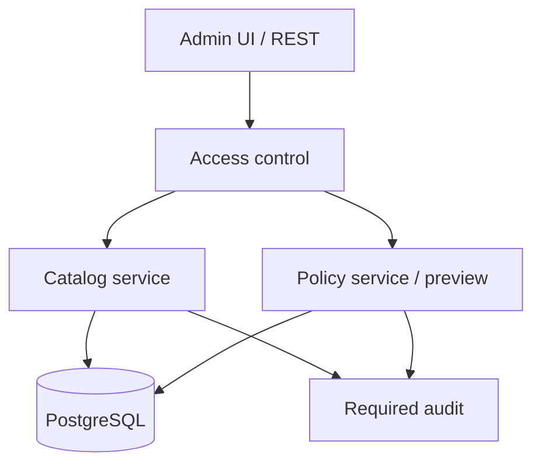
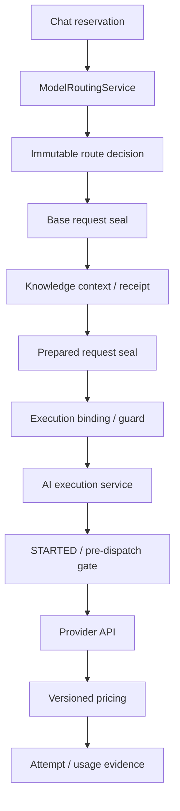
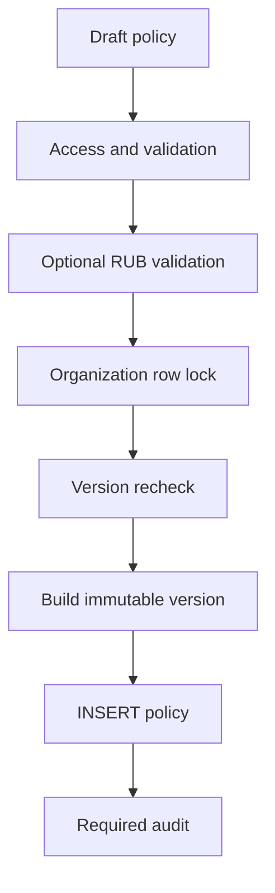
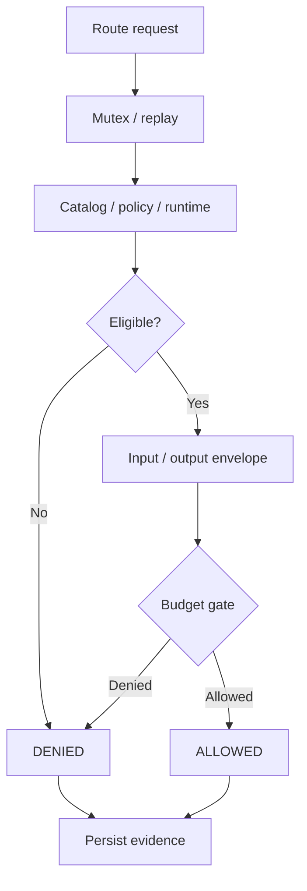
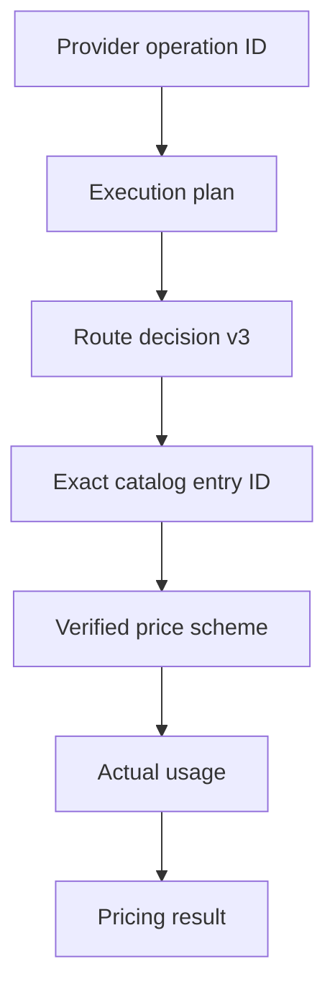
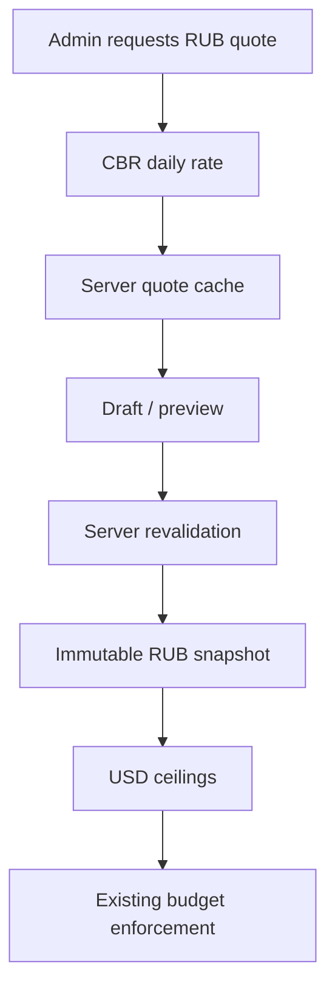
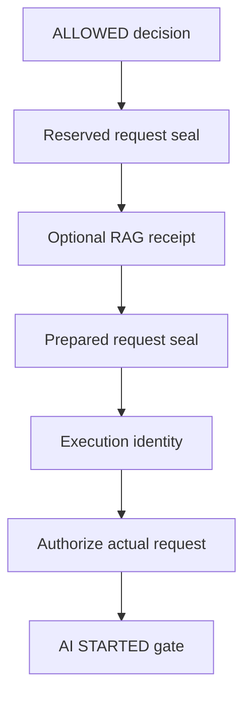
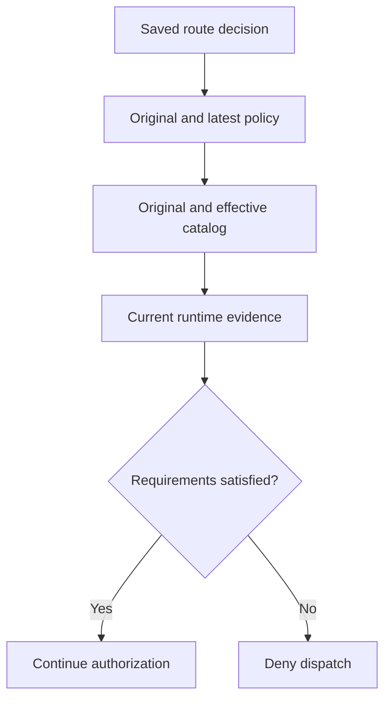
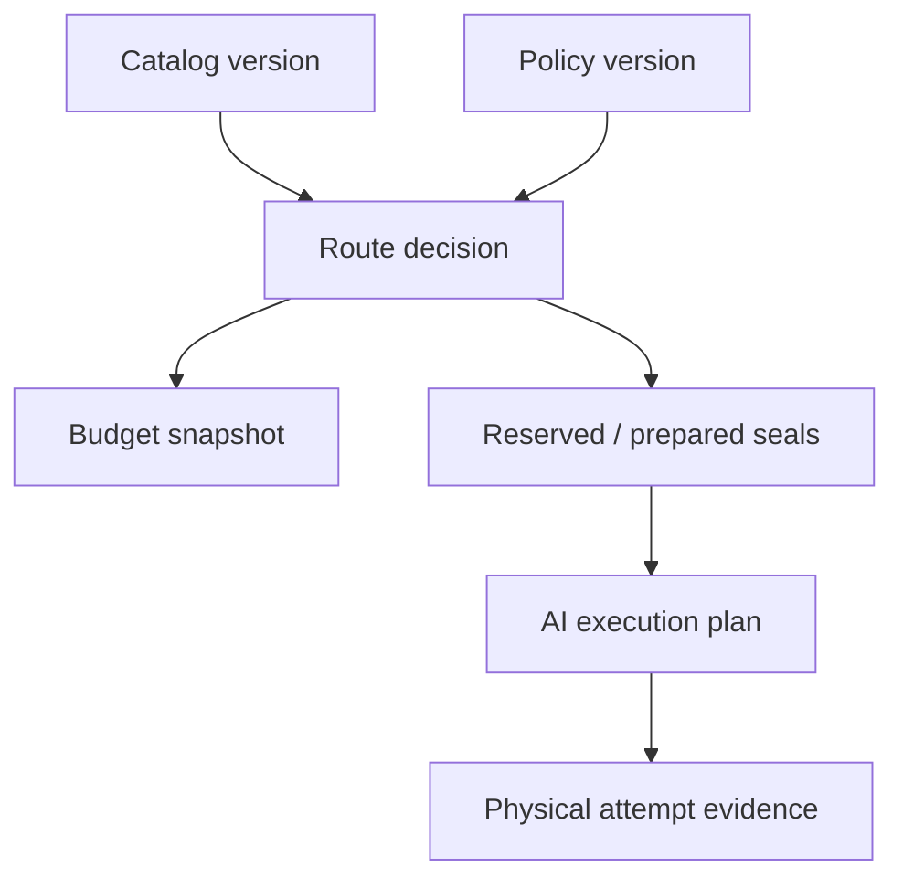

# SafeAI-Desk — Model Control Plane

Управление каталогом моделей, политиками организаций, маршрутизацией,
стоимостью, бюджетами и авторизацией физического AI-исполнения.

> **Пакет:** `ru.safeai.gateway.model`  
> **Проект:** SafeAI-Desk / backend  
> **Актуальность:** 17.11.2026, Flyway V1–V92  
> **Стек:** Java 21, Spring Boot 4.1.1, Spring MVC, JDBC, PostgreSQL  
> **Production-код:** 87 Java-файлов  
> **Тестовый пакет:** 60 Java-файлов (56 Test, 4 support/fixtures)  
> Документ отражает исходники модуля, а не подтверждает развёртывание
> V92 в production или успешность последнего полного CI.

## Содержание

- [Назначение](#назначение)
- [Архитектура](#архитектура)
- [Структура production-кода](#структура-production-кода)
- [Компоненты и реализации](#компоненты-и-реализации)
- [HTTP API и права](#http-api-и-права)
- [Каталог моделей](#каталог-моделей)
- [Политика организации](#политика-организации)
- [Маршрутизация](#маршрутизация)
- [Цены и бюджеты](#цены-и-бюджеты)
- [Рублёвые бюджеты](#рублёвые-бюджеты)
- [Execution binding](#execution-binding)
- [Provider data assurance](#provider-data-assurance)
- [Runtime и probe](#runtime-и-probe)
- [PostgreSQL и миграции](#postgresql-и-миграции)
- [Конфигурация](#конфигурация)
- [Тестирование](#тестирование)
- [Эксплуатация и границы](#эксплуатация-и-границы)

## Назначение

Model — control plane платформы SafeAI-Desk. Он определяет, какую
модель и при каких условиях организация может использовать, фиксирует
решение до выполнения и проверяет, что последующий физический запрос
соответствует этому решению.

Реализованы:

- централизованный версионированный каталог моделей;
- жизненный цикл, capabilities, modalities, контекст, pricing,
  retention/training declarations;
- неизменяемые версии model policy организации;
- административный preview проекта политики;
- выбор маршрута с учётом активной физической модели;
- консервативная оценка входных единиц и выходного лимита;
- денежные ограничения на запрос и месячный commitment;
- режимы HARD/SOFT и отдельное состояние неизвестной стоимости;
- ввод бюджетов в USD или RUB с закреплённой котировкой ЦБ РФ;
- PostgreSQL как единственный источник новых тарифов;
- сохранение route decision, audit evidence и request seals;
- идемпотентный replay, транзакционные блокировки и tenant isolation;
- серверная проверка execution identity, RAG receipt и final input;
- проверяемые условия обработки данных провайдером;
- административная диагностика runtime и metadata probe;
- fail-closed контроль целостности схемы и финансовых данных.

Model работает не как самостоятельный inference server и не вызывает
LLM для пользовательской генерации. Он выдаёт и проверяет разрешение
для data plane.

### Границы модулей

- **model** — control plane, catalog, policy, decision, envelope,
  cost estimate, execution binding и versioned pricing.
- **chat** — ChatTurn, идемпотентность пользовательского запроса,
  резервирование пользовательских квот и финализация.
- **ai** — provider adapters, physical attempt ledger, retry,
  разбор ответа, usage и применение PricingResolver.
- **knowledge** — retrieval, RAG receipt, permit/lease, erasure
  и управление источниками контекста.
- **usage** — фактический учёт, обязательства, отчёты и reconciliation.
- **audit** — неизменяемые доказательства административных операций.
- **auth / organization** — principal, роли, tenant и security epoch.

Catalog capability не равнозначен реализованному runtime capability.
Текущая конфигурация ориентирована на один активный provider/model
на экземпляр backend. Динамический multi-provider fallback не реализован.

## Архитектура

### Административный контур



### Data plane и control plane



GENERAL-запрос не требует RAG receipt. Knowledge используется только
в соответствующем execution mode; его проверка не заменяет binding.

### Порты и межмодульные реализации

```text
ai.execution.AiModelExecutionPort
  └─ ModelRouteExecutionBindingService

ai.execution.AiExecutionIdentity
  └─ ModelRouteExecutionIdentity

ai.execution.AiDataAssurancePort
  └─ ProviderDataDispatchGuard

ai.pricing.PricingResolver
  └─ VersionedCatalogPricingResolver

model.spi.ModelRequestContentHashPort
  └─ chat.service.ChatContentNormalizer

RuntimeModelHealthProbe
  ├─ OpenAiRuntimeModelHealthProbe
  ├─ AnthropicRuntimeModelHealthProbe
  └─ MockRuntimeModelHealthProbe
```

## Структура production-кода

Путь: `backend/src/main/java/ru/safeai/gateway/model/`.
Расширения .java опущены для удобного просмотра в IntelliJ IDEA.

```text
model/
├── config/
│   └── ModelRoutingEnvelopeProperties
├── controller/
│   ├── ModelCatalogController
│   ├── ModelPolicyPreviewController
│   ├── ModelRouteDecisionController
│   ├── ModelRuntimeController
│   ├── OrganizationModelPolicyController
│   └── RubBudgetRateController
├── domain/
│   ├── BudgetEnforcement
│   ├── ModelBudgetCommitmentSnapshot
│   ├── ModelCapability
│   ├── ModelCatalogEntry
│   ├── ModelCatalogSource
│   ├── ModelLifecycle
│   ├── ModelModality
│   ├── ModelPricingStatus
│   ├── ModelRetentionStatus
│   ├── ModelRouteDecision
│   ├── ModelRouteOutcome
│   ├── ModelRouteReason
│   ├── ModelRouteRequest
│   ├── ModelRouteResult
│   ├── ModelTrainingUseStatus
│   ├── MonthlyCommitmentState
│   ├── MonthlyCostState
│   ├── OrganizationModelPolicy
│   ├── RubBudgetSnapshot
│   ├── RuntimeModelProbeResult
│   └── RuntimeModelProbeStatus
├── dto/
│   ├── CreateModelCatalogVersionRequest
│   ├── CreateOrganizationModelPolicyVersionRequest
│   ├── ModelCatalogEntryResponse
│   ├── ModelPolicyPreviewItemResponse
│   ├── ModelPolicyPreviewResponse
│   ├── ModelRouteDecisionResponse
│   ├── OrganizationModelPolicyResponse
│   ├── PlatformBudgetSummaryResponse
│   ├── RubBudgetInput
│   ├── RubBudgetResponse
│   ├── RuntimeModelProbeResponse
│   ├── RuntimeModelStatusResponse
│   ├── RuntimeModelStatusWireResponse
│   └── StrictPolicyTokenLimitDeserializer
├── exception/
│   ├── ModelRouteDeniedException
│   └── ModelRouteEnvelopeExceededException
├── pricing/
│   ├── CatalogPricingEligibility
│   └── VersionedCatalogPricingResolver
├── repository/
│   ├── JdbcTextArrayReader
│   ├── ModelCatalogRepository
│   ├── ModelPolicyPreviewConfirmationRepository
│   ├── ModelRouteDecisionRepository
│   ├── ModelRouteRequestBindingRepository
│   ├── ModelRouteRequestMutexRepository
│   └── OrganizationModelPolicyRepository
├── service/
│   ├── AnthropicRuntimeModelHealthProbe
│   ├── CbrUsdRateSource
│   ├── DatabaseTimestampNormalizer
│   ├── MockRuntimeModelHealthProbe
│   ├── ModelCatalogAuditDetails
│   ├── ModelCatalogAuditDetailsFactory
│   ├── ModelCatalogRules
│   ├── ModelCatalogService
│   ├── ModelControlPlaneAccess
│   ├── ModelControlPlaneNumericValidation
│   ├── ModelControlPlaneSchemaVerifier
│   ├── ModelInputTokenEstimator
│   ├── ModelPolicyPreviewConfirmationService
│   ├── ModelPolicyPreviewFingerprint
│   ├── ModelPolicyPreviewService
│   ├── ModelRouteDecisionAuditDetails
│   ├── ModelRouteDecisionFactory
│   ├── ModelRouteDecisionIntegrity
│   ├── ModelRouteExecutionBindingService
│   ├── ModelRouteExecutionGuard
│   ├── ModelRouteExecutionIdentity
│   ├── ModelRouteReservedRequestService
│   ├── ModelRoutingCostPolicy
│   ├── ModelRoutingEnvelopeService
│   ├── ModelRoutingExecutionCapabilityGate
│   ├── ModelRoutingSelectionPolicy
│   ├── ModelRoutingService
│   ├── OpenAiRuntimeModelHealthProbe
│   ├── OrganizationModelPolicyAuditDetailsFactory
│   ├── OrganizationModelPolicyRules
│   ├── OrganizationModelPolicyService
│   ├── ProviderDataDispatchGuard
│   ├── RubBudgetRateService
│   ├── RuntimeModelHealthProbe
│   ├── RuntimeModelProbeHttpSupport
│   ├── RuntimeModelProbeService
│   └── RuntimeModelStatusService
├── spi/
│   └── ModelRequestContentHashPort
├── Model_Control_Plane_README.md
└── README.md
```

## Компоненты и реализации

### config — Конфигурация

- `ModelRoutingEnvelopeProperties` —
  Верхние границы system/developer, RAG и tool schema input units; legacy aliases и
  проверка конфликтов.

### controller — Административный REST API

- `ModelCatalogController` —
  Latest/effective/history каталога, создание новой версии и импорт активного
  runtime.
- `ModelPolicyPreviewController` —
  Read-only оценка draft policy для организации.
- `ModelRouteDecisionController` —
  Tenant-aware чтение сохранённого решения по decisionId.
- `ModelRuntimeController` —
  Безопасная публикация runtime status и административный metadata probe.
- `OrganizationModelPolicyController` —
  Получение текущей политики и публикация immutable версии.
- `RubBudgetRateController` —
  Получение текущей котировки ЦБ РФ для бюджетов; no-store и ADMIN/SUPER_ADMIN.

### domain — Доменная модель

- `BudgetEnforcement` —
  Enum режима применения бюджета HARD/SOFT.
- `ModelBudgetCommitmentSnapshot` —
  Immutable доказательства route-time actual/reserved/unknown commitment.
- `ModelCapability` —
  Каталожные TOOLS, VISION, STRUCTURED_OUTPUT; не гарантия runtime поддержки.
- `ModelCatalogEntry` —
  Immutable версия модели, physical identity, lifecycle, modalities, лимиты, pricing
  и governance.
- `ModelCatalogSource` —
  Происхождение записи каталога.
- `ModelLifecycle` —
  Состояния жизненного цикла модели.
- `ModelModality` —
  Входные и выходные модальности в каталоге.
- `ModelPricingStatus` —
  CONFIGURED/FREE/UNPRICED/INCOMPLETE — пригодность тарифа.
- `ModelRetentionStatus` —
  Декларируемый статус хранения данных.
- `ModelRouteDecision` —
  Immutable ALLOWED/DENIED, ссылки на версии, причины, суммы, input provenance и
  integrity digest.
- `ModelRouteOutcome` —
  Результат маршрутизации ALLOWED или DENIED.
- `ModelRouteReason` —
  Причина выбора или отказа; legacy fallback только для истории.
- `ModelRouteRequest` —
  Tenant/chat/request identity, requested model, потребности, input/output envelope.
- `ModelRouteResult` —
  Результат маршрутизации и выбранные данные для вызывающего слоя.
- `ModelTrainingUseStatus` —
  Декларируемые условия использования данных при обучении.
- `MonthlyCommitmentState` —
  Точная семантика known/unknown, lower-bound overrun и unverifiable.
- `MonthlyCostState` —
  Совместимая проекция полноты месячной стоимости.
- `OrganizationModelPolicy` —
  Immutable политика tenant, версия, allow/deny, default, ограничения и RUB
  evidence.
- `RubBudgetSnapshot` —
  Закреплённые RUB суммы, курс, даты и вычисление USD вниз с scale 12.
- `RuntimeModelProbeResult` —
  Результат metadata probe с безопасными диагностическими сведениями.
- `RuntimeModelProbeStatus` —
  Классификация результата metadata probe.
### dto — Контракты API

- `CreateModelCatalogVersionRequest` —
  Валидация создания версии, pricing scheme, official catalog attributes и expected
  version.
- `CreateOrganizationModelPolicyVersionRequest` —
  Draft/save policy с expectedPreviousVersion, лимитами, USD или RUB budget.
- `ModelCatalogEntryResponse` —
  Проекция immutable catalog entry и pricing identity.
- `ModelPolicyPreviewItemResponse` —
  Оценка конкретной модели в draft policy с причиной, лимитами и budget evidence.
- `ModelPolicyPreviewResponse` —
  Агрегат preview и предупреждение о возможном lockout.
- `ModelRouteDecisionResponse` —
  Безопасная проекция persisted route decision, cost и commitment evidence.
- `OrganizationModelPolicyResponse` —
  Текущая или unconfigured политика, версия и optional RUB snapshot.
- `RubBudgetInput` —
  Исходные RUB потолки и identity показанной клиенту котировки; не доверенный rate
  source.
- `RubBudgetResponse` —
  Закреплённые RUB суммы/курс decimal strings, даты, fetchedAt и source.
- `RuntimeModelProbeResponse` —
  Публичная проекция metadata probe.
- `RuntimeModelStatusResponse` —
  Runtime provider/model, limits, health, optional pricing и data assurance.
- `RuntimeModelStatusWireResponse` —
  Wire-проекция статуса с безопасным представлением значений.
- `StrictPolicyTokenLimitDeserializer` —
  Отклоняет дроби, строки и boolean для nullable Integer token limits.
### exception — Доменные отказы

- `ModelRouteDeniedException` —
  Отказ маршрутизации с сохранённым reason/decision.
- `ModelRouteEnvelopeExceededException` —
  Недопустимое превышение утверждённого execution envelope.
### pricing — Версионированный pricing

- `CatalogPricingEligibility` —
  Единый fail-closed predicate для цены при reservation, display и settlement.
- `VersionedCatalogPricingResolver` —
  Operation-bound resolver: точные plan/decision/catalog/physical model и provider
  usage; USD cost.
### repository — JDBC и PostgreSQL

- `JdbcTextArrayReader` —
  Чтение SQL text arrays и восстановление безопасного Java Set.
- `ModelCatalogRepository` —
  Immutable insert, latest/effective/history, lookup по exact ID и runtime identity,
  lock версии.
- `ModelRouteDecisionRepository` —
  Route history, replay, commitment snapshots, budget lock, exact turn invariants.
- `ModelRouteRequestBindingRepository` —
  Reserved hash, prepared binding, Knowledge receipt, immutable insert/read.
- `ModelRouteRequestMutexRepository` —
  Транзакционная сериализация одинакового chat/clientRequestId.
- `OrganizationModelPolicyRepository` —
  Tenant lock, immutable insert, чтение версий и RUB evidence.
### service — Бизнес-правила и оркестрация

- `AnthropicRuntimeModelHealthProbe` —
  Ограниченный административный metadata GET Anthropic.
- `CbrUsdRateSource` —
  Получение и безопасный XML parsing официального курса USD ЦБ РФ.
- `DatabaseTimestampNormalizer` —
  Нормализация времени до точности PostgreSQL для стабильных digest.
- `MockRuntimeModelHealthProbe` —
  Локальная имитация metadata probe.
- `ModelCatalogAuditDetails` —
  Типизированный audit snapshot версии каталога.
- `ModelCatalogAuditDetailsFactory` —
  Формирование безопасных деталей аудита catalog version.
- `ModelCatalogRules` —
  Канонизация ключей, проверка pricing, modalities, governance и lifecycle.
- `ModelCatalogService` —
  Version creation, effective/history reads и импорт runtime с optimistic version.
- `ModelControlPlaneAccess` —
  Общие требования к ролям и tenant scope.
- `ModelControlPlaneNumericValidation` —
  Точные границы numeric(30,12), токенов, денежных величин и версий.
- `ModelControlPlaneSchemaVerifier` —
  Startup-проверка необходимых DB-объектов/guard contracts; не полный SQL-аудит.
- `ModelInputTokenEstimator` —
  Мост к единому tokenizer-independent input unit estimator AI.
- `ModelPolicyPreviewService` —
  Read-only preview политики по effective catalog, runtime и budget snapshot.
- `ModelRouteDecisionAuditDetails` —
  Доказательства выбора/отказа, pricing и бюджетного состояния для audit.
- `ModelRouteDecisionFactory` —
  Создаёт immutable decision/snapshot и вычисляет integrity.
- `ModelRouteDecisionIntegrity` —
  Канонический digest, поддержка исторических версий и текущая v3 identity.
- `ModelRouteExecutionBindingService` —
  Реализация AI port: выдача, верификация и authorizing server-side execution
  identity.
- `ModelRouteExecutionGuard` —
  Проверки approved target, request envelope и корректности payload binding.
- `ModelRouteExecutionIdentity` —
  Проверенная identity tenant/user/chat/turn/route/operation, limits и seals.
- `ModelRouteReservedRequestService` —
  Sealing base input, prepared receipt и проверка доверенного RAG provenance.
- `ModelRoutingCostPolicy` —
  Ставки, worst-case estimate, request cap и месячный budget/commitment.
- `ModelRoutingEnvelopeService` —
  Вычисление верхнего envelope и ограничение materialized request.
- `ModelRoutingExecutionCapabilityGate` —
  Запрет неподдерживаемых текущим data plane возможностей.
- `ModelRoutingSelectionPolicy` —
  Effective catalog, requested/default/runtime selection и policy/governance checks.
- `ModelRoutingService` —
  Транзакционная маршрутизация, replay, locks, audit, decision и чтение истории.
- `OpenAiRuntimeModelHealthProbe` —
  Ограниченный административный metadata GET OpenAI.
- `OrganizationModelPolicyAuditDetailsFactory` —
  Audit snapshot политики, включая конверсию бюджета.
- `OrganizationModelPolicyRules` —
  Нормализация, валидация и построение версии политики.
- `OrganizationModelPolicyService` —
  Tenant authorization, rate validation, version lock, immutable save и audit.
- `ProviderDataDispatchGuard` —
  Повторная проверка original/latest policy, original/effective model и runtime
  evidence.
- `RubBudgetRateService` —
  Дневной single-flight cache курса, серверная проверка quote, сохранение старой
  конверсии.
- `RuntimeModelHealthProbe` —
  SPI административной metadata диагностики.
- `RuntimeModelProbeHttpSupport` —
  Ограниченные HTTPS GET, URI/header checks, timeout, classification.
- `RuntimeModelProbeService` —
  Выбор probe активного runtime и административный результат.
- `RuntimeModelStatusService` —
  Факты активной модели, data assurance; отдельно display catalog pricing.
### spi — Граница с Chat

- `ModelRequestContentHashPort` —
  Контракт нормализации semantic request identity без прямой зависимости от Chat.

## HTTP API и права

Все маршруты ниже имеют общий префикс:

```text
/api/admin/models
```

### Каталог

| Метод | Относительный путь |
| --- | --- |
| GET | /catalog |
| GET | /catalog/effective |
| GET | /catalog/versions |
| POST | /catalog |
| POST | /catalog/import-runtime |

Чтение: ADMIN и SUPER_ADMIN.
Создание версии и импорт runtime: только SUPER_ADMIN.

- latest и effective: `afterModelKey`, `limit`;
- история: `modelKey`, `beforeVersion`, `limit`;
- default limit = 100, допустимый диапазон 1–200;
- effective определяется серверным Clock, а не клиентским временем.

### Политики, курс и решения

| Метод | Относительный путь |
| --- | --- |
| GET | /policies/{organizationId} |
| POST | /policies/{organizationId} |
| POST | /policies/{organizationId}/preview |
| GET | /policies/rub-quote |
| GET | /route-decisions/{decisionId} |

ADMIN: policy/preview/decision только своей организации.
SUPER_ADMIN: административные межорганизационные операции.
Курс общедоступен внутри этого административного role scope,
не содержит tenant-specific данных; ответ Cache-Control: no-store.

### Runtime

| Метод | Относительный путь |
| --- | --- |
| GET | /runtime |
| POST | /runtime/probe |

Status доступен ADMIN и SUPER_ADMIN. Probe — только SUPER_ADMIN.

Контроллеры используют Spring Security и аутентифицированный
SafeAiUserPrincipal. Сервисная авторизация выполняется независимо от
наличия MVC-аннотации. USER не должен получить административные данные.
SUPER_ADMIN не имеет права обходить physical execution invariants.

## Каталог моделей

`ModelCatalogService` публикует неизменяемые версии по modelKey.
Версионируется не только provider/model, но и условия его применения.

### Поля каталога

- modelKey, provider, providerModelId, version, source;
- lifecycle, effectiveFrom, createdAt, actor;
- capabilities и input/output modalities;
- maxInputTokens и maxOutputTokens;
- retention status, retention days, training use status;
- input, cached input, cache write, output USD per 1m tokens;
- pricingStatus, pricingComplete, pricingVersion, pricingScheme;
- extraPricingJson как объект расширенных тарифных характеристик.

Latest — последняя созданная версия; effective — версия, действующая
на серверное время. Запланированная версия не должна преждевременно
менять активный маршрут.

```text
Version 1 ─── effective
    │
    └── Version 2 ─── effectiveFrom in future
            │
            └── Version 3 ─── новая публикация
```

История не переписывается при изменении модели, цены или lifecycle.
Создание версии выполняется с блокировкой modelKey, проверкой
expectedPreviousVersion, нормализацией и required audit.

### Проверки публикации

- Нормализация identity и допустимость model key.
- Согласованность modalities/capabilities (например, VISION и IMAGE).
- Недопустимые в текущей схеме output modalities отклоняются.
- Неотрицательные ставки, корректный numeric scale и priceVersion.
- FREE требует нулевых обычных и специализированных ставок.
- CONFIGURED требует явной подтверждённой схемы FLAT_TOKEN_V1.
- Расширенные pricing dimensions не получают автоматического settlement
  только из-за наличия JSON.
- Контракт ZDR не совместим с положительным retention days.

Импорт runtime не является импортом тарифов с внешнего API.
Внешний runtime получает UNPRICED catalog entry; local mock — FREE.
Для подтверждённого коммерческого тарифа создаётся отдельная версия.
Автоматическое обновление provider price book из интернета не реализовано.

## Политика организации

`OrganizationModelPolicy` — append-only версия правил tenant.
Она определяет:

- включена ли политика;
- разрешённые и запрещённые model keys;
- default model;
- governance требований no-training и zero-data-retention;
- требование complete pricing;
- maxInputTokens, maxOutputTokens;
- maxRequestCostUsd, monthlyBudgetUsd;
- HARD или SOFT;
- optional RubBudgetSnapshot.

Null денежного/токенного потолка означает отсутствие дополнительного
ограничения соответствующего типа, а не значение 0.
Нулевой денежный лимит — действительный строгий потолок.

### Создание версии



При RUB input внешний quote проверяется до захвата organization row lock.
После получения lock повторно читается версия; конфликт версии не даёт
незаметно применить draft поверх чужих изменений.

Политика и audit создаются в транзакции. Чтение и изменение выполняются
с обязательным tenant scope. Allow/deny model keys нормализуются;
пересечение и недопустимые значения отклоняются.

### Preview

Preview выполняет read-only оценку draft относительно текущего каталога,
runtime и бюджетного snapshot:

- проверка expectedPreviousVersion;
- те же policy validation и RUB quote rules;
- оценка подходящих effective catalog entries;
- причины допуска/отказа, прогноз цены и budget evidence;
- предупреждение wouldLockOutOrganization.

Preview не создаёт версию политики, route decision или budget
reservation, не получает data-plane budget lock и не вызывает LLM.
При RUB draft может получать quote ЦБ РФ. Preview не является гарантией
следующего live decision: между оценкой и сохранением условия меняются.

## Маршрутизация

### Decision lifecycle

`ModelRoutingService.decide()` имеет Propagation.MANDATORY:
операция должна выполняться в существующей транзакции Chat.

1. Проверка identity и semantic request hash.
2. Транзакционная блокировка chatId/clientRequestId.
3. Проверка существующего immutable decision для replay.
4. Чтение effective catalog, tenant policy и active runtime.
5. Выбор requested model, policy default или unique runtime match.
6. Проверка allow/deny, lifecycle, capabilities и governance.
7. Расчёт консервативного input/output envelope.
8. Оценка цены, request cap и месячных обязательств.
9. Сохранение ALLOWED/DENIED и неизменяемого integrity digest.
10. Сохранение budget snapshot и required audit по контракту.



ALLOWED означает утверждённое решение, а не подтверждение списания,
успеха генерации или наличия physical STARTED.
DENIED сохраняет стабильную причину. noRollbackFor на доменном отказе
не гарантирует сохранение записи, если outer transaction откатится.

### Selection и capability gate

Текущий runtime не является универсальным маршрутизатором нескольких
одновременно активных клиентов. Requested/default model проверяется
на совместимость с физически настроенным provider/model.

Если соответствие отсутствует или неоднозначно, нельзя молча выбрать
другую модель. `LEGACY_RUNTIME_FALLBACK` оставлен для исторических
решений, новый routing не должен его создавать.

Даже если каталог описывает TOOLS, VISION или STRUCTURED_OUTPUT,
`ModelRoutingExecutionCapabilityGate` проверяет реальную поддержку
data plane и отклоняет unsupported requests.

### Основные route reasons

- Выбор: REQUESTED_MODEL, POLICY_DEFAULT, RUNTIME_ONLY_MATCH.
- Каталог: MODEL_NOT_FOUND, MODEL_DISABLED, RUNTIME_MISMATCH,
  AMBIGUOUS_RUNTIME_MAPPING.
- Политика: MODEL_NOT_ALLOWED, MODEL_DENIED, CAPABILITY_UNSUPPORTED.
- Data governance: TRAINING_POLICY_UNSATISFIED,
  RETENTION_POLICY_UNSATISFIED.
- Envelope: INPUT_LIMIT_EXCEEDED, OUTPUT_LIMIT_EXCEEDED.
- Финансы: PRICING_INCOMPLETE, REQUEST_COST_LIMIT_EXCEEDED,
  MONTHLY_BUDGET_EXCEEDED, MONTHLY_BUDGET_UNVERIFIABLE.

### Input accounting

`ModelInputTokenEstimator` использует общий AI input accounting.
Это консервативная tokenizer-independent оценка, не billable usage.

`ModelRoutingEnvelopeService` учитывает предполагаемые компоненты:

```text
User / history input
  + system and developer envelope
  + RAG context envelope, если требуется
  + tool schema envelope, если требуется
  = reserved input units
```

В actual prepared request проверяется материализованный контекст.
Output limit должен соответствовать утверждённой модели, конфигурации
и policy. Рост output cap или выход за input envelope недопустим.

## Цены и бюджеты

### Единый источник тарифов

PostgreSQL `model_catalog_entries` является источником новых цен.
Статический ModelPricingService и YAML price book удалены из AI.
Не существует запасной статической цены для неподтверждённой версии.

`CatalogPricingEligibility.verified()` используется для единообразного
решения о пригодности цены в routing, runtime display и settlement.

Для автоматического settlement необходимы:

- pricingComplete;
- FLAT_TOKEN_V1;
- обычные input/output rates;
- неотрицательные optional cache rates;
- отсутствие неподдерживаемых дополнительных pricing dimensions
  (extraPricingJson равен пустому JSON-объекту);
- FREE — все ставки нулевые либо допустимо отсутствует optional rate;
- CONFIGURED — непустая pricingVersion и не все ставки нулевые.

### Pricing schemes (V66)

| Scheme | Автоматический расчёт |
| --- | --- |
| FLAT_TOKEN_V1 | Да, при полных доказательствах |
| LEGACY_FLAT_UNVERIFIED_V1 | Нет |
| UNSUPPORTED_COMPLEX_V1 | Нет |

Историческая CONFIGURED запись не становится проверенной
из-за миграции или чтения legacy constructor.
Неподдерживаемый тариф должен оставаться UNPRICED.

### Reservation estimate

`ModelRoutingCostPolicy.estimateCost()` оценивает верхнюю границу
одной физической попытки, а не точный будущий счёт.

```text
worstInputRate = max(input, cacheRead, cacheWrite)

input cost  = reservedInput × worstInputRate / 1 000 000
output cost = maxOutput × outputRate / 1 000 000

estimate USD = input cost + output cost
```

Используется BigDecimal и округление CEILING до 12 знаков.
Неполная цена не превращается в ноль. Overflow и несовместимая цена
не могут дать ложное доказательство соблюдения денежного cap.
Строгий per-request cap требует проверяемой верхней границы.

### Settlement

`VersionedCatalogPricingResolver` реализует
`ai.pricing.PricingResolver`:

```java
PricingResult resolve(
    UUID providerOperationId,
    ProviderExecutionTarget target,
    String resolvedPhysicalModel,
    AiTokenUsage usage
);
```

Проверяется связанная цепочка:



Resolver проверяет operation, physical provider/model, decision integrity,
точную версию тарифа и пригодность usage. Legacy identity-less overload
отсутствует. Текущий effective тариф не заменяет исторически выбранный.

OpenAI: cached input содержится в input_tokens, поэтому вычитается
из обычного input. Anthropic: cache-read/cache-creation counters —
самостоятельные категории, не вычитаемые из обычного input.

Стоимость складывается по ставкам каждой категории; вычисление
использует BigDecimal и HALF_UP до 12 знаков. При отсутствии
необходимой ставки или несовместимых counters цена недоказуема.
PRICED/FREE содержат priceVersion; UNPRICED/CALCULATION_FAILED
не подменяются нулём и вымышленным price identity.

### Monthly budget / commitment

Месяц определяется в UTC. При активном месячном лимите routing
сериализуется через organization budget lock.

```text
Committed cost
  ├─ actual cost USD
  ├─ reserved cost USD
  └─ unknown committed cost count
```

К известной части добавляется оценка нового запроса.
Unknown liability сохраняется отдельно и не равна нулю.
Известное превышение нижней границы не исчезает, даже если итоговая
стоимость пока неизвестна.

| Режим | Поведение |
| --- | --- |
| HARD | Отказ при превышении или unknown |
| SOFT | Допуск с сохранением предупреждения |

Это семантика месячного бюджета; отдельные request limits и остальные
policy gates продолжают действовать независимо от SOFT.

MonthlyCommitmentState различает:

- NOT_EVALUATED;
- KNOWN_WITHIN / KNOWN_EXCEEDED;
- UNKNOWN_WITHIN_LOWER_BOUND;
- UNKNOWN_EXCEEDED_LOWER_BOUND;
- UNVERIFIABLE.

MonthlyCostState — совместимая проекция exactness: NOT_EVALUATED,
KNOWN, UNKNOWN. Для UI/audit предпочтителен более точный commitment
state, поскольку он не скрывает уже доказанное превышение.

Для строгих финансовых ограничений AI data plane ограничивает операцию
одной физической попыткой, пока не реализован и не зарезервирован
подтверждённый multi-attempt cost envelope.
Точное условие requiresSinglePhysicalAttempt: сохранённый HARD с
месячным USD-лимитом или enabled policy с maxRequestCostUsd.
Наличие request cap требует complete pricing даже в SOFT режиме.

## Рублёвые бюджеты

### Что изменилось (V91)

Администратор может ввести цену запроса и месячный бюджет в RUB.
Сохранение политики фиксирует применённую котировку, а enforcement,
ledger и фактические provider costs остаются в USD.

Одновременно подавать USD ceilings и RUB budget запрещено.
В RUB варианте необходимо указать хотя бы один из двух лимитов.



### Источник курса

`CbrUsdRateSource` использует фиксированный официальный HTTPS endpoint:

```text
https://www.cbr.ru/scripts/XML_daily.asp
```

Запрашивается дата в формате dd/MM/yyyy. Из XML извлекается USD:
CharCode USD, NumCode 840, Nominal 1. Проверяются единственность записи,
формат и положительное значение курса, дата начала действия от
requested date минус 14 суток до requested date включительно.

Безопасность:

- фиксированный адрес, без пользовательского URL или credentials;
- redirects запрещены;
- connect timeout 4 секунды, read timeout 5 секунд;
- ограничение XML-ответа 128 KiB;
- secure processing, запрет DOCTYPE, external entities, DTD/schema;
- XInclude и expansion внешних сущностей отключены.

Разбор XML выполняется в Java, а не в PostgreSQL.
Не требуется возвращать runtime SQL-права на функции XML.

### Единая котировка на дату

`RubBudgetRateService` работает с датой Europe/Moscow.
Используется синхронизированный per-process daily cache:

- одна успешная котировка на текущий московский день;
- при сетевой ошибке cooldown 30 секунд;
- при переходе через полночь во время запроса результат отклоняется;
- вчерашняя котировка не применяется как fallback к новому бюджету;
- отсутствие курса возвращает HTTP 503 BUDGET_RATE_UNAVAILABLE.

HTTP endpoint возвращает rubPerUsd, quoteDate, effectiveDate,
fetchedAt и source CBR. Курс представлен десятичной строкой.

Клиентские поля rubPerUsd/quoteDate/effectiveDate идентифицируют
показанную котировку, но не являются источником доверенного курса.
Сервер проверяет их по сохранённой или актуальной котировке.
Несовпадение/устаревание — conflict (409), требуется обновление draft.

Фрагмент JSON для RUB policy draft (условная котировка):

```json
{
  "maxRequestCostUsd": null,
  "monthlyBudgetUsd": null,
  "rubBudget": {
    "maxRequestCostRub": 10,
    "monthlyBudgetRub": 10000,
    "rubPerUsd": 90,
    "quoteDate": "2026-11-17",
    "effectiveDate": "2026-11-17"
  }
}
```

Это только monetary fragment, не полный createVersion request.
Остальные поля берутся из текущего policy draft; rate/date —
исключительно из полученной серверной котировки.

При сохранении новой версии без изменения RUB сумм и identity курса
прежний RubBudgetSnapshot сохраняется неизменным. Редактирование
не связанных с бюджетом полей не должно пересчитывать старый потолок.
При изменении бюджета требуется current quote, а перед INSERT ещё
раз проверяется московская дата.

### Точность и immutability

RUB ceilings: numeric(30,12), курс: numeric(18,8).
USD-equivalent вычисляется через BigDecimal:

```java
rub.divide(rate, 12, RoundingMode.DOWN)
```

Пример: 10 000 RUB при курсе 90 RUB/USD дают
111.111111111111 USD. Это пример формулы, не текущая котировка.

Округление вниз принципиально: округление вверх расширило бы
утверждённый лимит организации.

В V91 PostgreSQL проверяет точное соответствие суммы через div,
полноту evidence и согласованность дат. В старых USD-only policies
все RUB columns остаются NULL.

### V92: усиление финансовой целостности

Добавлены проверяемые SQL constraints:

```text
chk_model_policy_usd_finite_v92
chk_model_policy_rub_dates_finite_v92
```

- NaN в max_request_cost_usd/monthly_budget_usd запрещён для всех
  политик, включая старые USD-only записи.
- При RUB evidence quote/effective dates, fetchedAt и createdAt
  должны быть конечными (isfinite).
- PostgreSQL constrained numeric(p,s) уже отклоняет +/-Infinity.
- V91 сохраняет запрет отрицательных сумм и недопустимого курса,
  проверку полноты, consistency, точной конверсии.
- Ограничения V92 валидируются на существующих записях.
  Исторические версии не переписываются, checksum V91 не изменяется.

Конвертация относится к потолку политики, не к цене токена или факту
запроса. Бюджетная котировка не обновляется ежедневно автоматически
сама по себе и не переоценивает исторический usage.

## Execution binding

Решение routing должно быть доказуемо связано с запросом, который
реально передаётся в AI, включая изменения после Knowledge retrieval.

### Immutable identity

`ModelRouteExecutionIdentity` хранит связь tenant/user, chat,
ChatTurn, clientRequestId, operation, decision, catalog и limits.
Она создаётся серверным binding service после чтения сохранённого
decision и проверки integrity, не из доверенного на слово JSON клиента.

`ModelRouteDecisionIntegrity` поддерживает historical v1/v2 hashes
для чтения; текущий v3 связывает канонические decision fields.
Нормализация timestamp до точности PostgreSQL необходима,
чтобы persisted digest не менялся после round-trip.

### Два request seals



- `ModelRouteReservedRequestService.seal()` сохраняет immutable hash
  исходного запроса в транзакции reservation.
- Knowledge добавляет retrieved context и доверенный context receipt,
  связанный с конкретной организацией и ChatTurn.
- Prepared binding фиксирует итоговый hash и provenance (version 2).
- `requireSame()` проверяет, что повтор не подменяет reserved identity.
- `ModelRouteExecutionBindingService.bindExecution()` реализует AI port.
- `authorizePhysicalExecution()` и `requireExecutable()` проверяют
  утверждённый provider/model, final request, identity и receipts.
- `ModelRouteExecutionGuard.assertWithinReservedInputEnvelope()`
  отклоняет выход материализованного запроса за reservation.

Сохранение binding не означает разрешение произвольного внешнего I/O.
AI дополнительно проверяет adapter target, active execution scope,
physical STARTED и pre-network authorization.

### Replay, concurrency и audit

- `ModelRouteRequestMutexRepository.lock()` сериализует одинаковый
  chatId/clientRequestId до чтения возможного replay.
- Повтор с тем же identity и тем же semantic content может использовать
  сохранённое решение; иной content должен приводить к отказу.
- Catalog versions защищены транзакционной блокировкой model key.
- Policy version защищена organization row lock и expected version.
- Общий бюджет сериализуется отдельным organization budget lock.
- Решения и request receipts не обновляются произвольным UPDATE.
- Перед внешними side effects проверяется exact ChatTurn link:
  `validateAllowedTurnLinkBeforeExternalSideEffects()`.

Audit details типизированы; не следует включать raw prompts,
provider credentials, retrieved documents или произвольное внешнее
тело ответа ради диагностики. Immutable digest — доказательство
согласованности, не замена авторизации и DB privileges.

### Knowledge lease и organization epoch (V72/V85)

V72 защищает создание STARTED при отключении организации или изменении
security epoch. V85 добавляет durable RAG permit/lease и erasure guards.

AI требует Knowledge permit для Knowledge execution; lease
приобретается перед физической попыткой и повторно проверяется
непосредственно перед dispatch. Запрет/отзыв между этапами не должен
приводить к новой отправке. V89/V90 усиливают смежные erasure recovery
и generation GC guards.

Operation-bound authorization, exact binding, lease и ledger
не взаимозаменяемы: все соответствующие gates должны быть соблюдены.

## Provider data assurance

Catalog retention/training declarations необходимы, но недостаточны:
фактическое подключение должно иметь действующее evidence,
если policy требует no-training или zero-data-retention.

### Доказательства реального подключения

AI `ProviderDataEvidence` содержит:

- источник evidence (CONTRACT/DPA/DOC/TICKET идентификатор);
- verifiedAt и expiresAt (не более 90 суток);
- SHA-256 fingerprint конкретного подключения;
- независимые noTraining и zeroDataRetention flags.

Runtime status вычисляет safe public projection без API key,
endpoint binding digest или иных секретов. Истёкшее/несовпадающее
evidence не разрешает обязательные гарантии. OpenAI store=false само
по себе не означает contractual ZDR.

ModelRoutingSelectionPolicy дополнительно проверяет runtime assurance
при наличии соответствующих требований policy.

### Recheck перед каждым вызовом

`ProviderDataDispatchGuard` реализует `AiDataAssurancePort`.
Проверяются tenant и ALLOWED decision, оригинальная и последняя
версия policy, выбранная версия catalog и текущая effective запись.



Если хотя бы одна применимая enabled policy требует no-training/ZDR,
должны удовлетворяться соответствующие требования original/effective
catalog и runtime evidence. При отсутствии требований guard
не выполняет дополнительных assurance-проверок каталога.
Это не отменяет другие route/organization gates.

Проверка вызывается в AI до STARTED и снова непосредственно перед
network dispatch. Отказ после STARTED не разрешает сетевое действие
или blind retry. Для Knowledge embedding/OCR существуют отдельные
data assurance bindings в соответствующих подсистемах.

## Runtime и probe

`RuntimeModelStatusService` собирает факты активного провайдера:

- provider/model и enabled;
- STATIC_SINGLE_PROVIDER;
- фактические configuration limits;
- поддерживаемые execution capabilities;
- data assurance и health status.

`current()` предназначен для data plane, не выполняет лишнего
catalog pricing scan. `currentWithCatalogPricing()` — administrative
projection: цена показывается только при однозначной effective
ACTIVE/DEPRECATED версии с verified catalog pricing.
При отсутствии или неоднозначности — UNPRICED.

`RuntimeModelProbeService` использует соответствующий
RuntimeModelHealthProbe. Реальные адаптеры проверяют metadata
endpoint OpenAI/Anthropic, mock формирует локальный результат.
Probe ограничен 1–10 секундами для соответствующих timeout,
HTTPS/URI/header validation и запретом redirect.

HTTP 2xx означает доступность metadata API. Он не доказывает:

- успешность будущего inference;
- наличие денег или provider quota;
- поддержку заявленной modality в runtime;
- корректность фактического usage/settlement;
- соблюдение договорных retention/training условий.

В probe не нужно передавать пользовательский prompt или вызывать
платную генерацию для получения health status.

## PostgreSQL и миграции

### Основные таблицы

- `model_catalog_entries` — immutable версии каталога.
- `organization_model_policies` — versioned tenant policy, RUB evidence.
- `model_route_decisions` — выбор/отказ, digest и snapshot.
- `model_route_reserved_requests` — base sealed request.
- `model_route_prepared_requests_v62` — final prepared binding.
- `model_cost_commitment_ledger_v62` — денежные обязательства.
- `model_route_budget_commitments_v64` — route-time budget snapshot.
- `knowledge_rag_context_receipts_v64` — provenance RAG.
- `model_execution_plans` / `model_execution_attempts` — AI ledger.



Схема показывает логические связи, не полный физический FK graph.
В Model используется JDBC, а не отдельные JPA entities на каждую
таблицу; AI execution ledger реализован в AI module.

### Evolution до V92

Миграции, непосредственно относящиеся к model governance:

- **V45** — model control plane: catalog, organization policy,
  route decisions и начальные constraints.
- **V46** — hardening контрольного контура.
- **V48** — provenance input accounting.
- **V49** — strict routing и generic pricing.
- **V50–V51** — physical attempt usage evidence и integrity.
- **V52** — strict execution и modality integrity.
- **V53** — transitions физических попыток, pricing integrity,
  reserved requests.
- **V54** — provider identity и reconciliation safety.
- **V59** — governance integrity hardening.
- **V60** — monthly cost commitment ledger.
- **V61** — уникальность массивов policy.
- **V62** — hardening control plane, prepared binding и commitment.
- **V64** — точный budget snapshot, Knowledge context receipts
  и дополнительные control plane invariants.
- **V65** — обязательная привязка физического исполнения.
- **V66** — physical response evidence и pricing scheme.
- **V67** — chat execution, quota и evidence hardening.
- **V72** — organization authorization epoch при physical STARTED.
- **V85** — durable RAG execution leases и erasure guards.
- **V86–V88** — chat archive/restore/erasure и validation.
- **V89–V90** — Knowledge erasure reconciliation/fencing и
  least-privilege generation GC.
- **V91** — RUB ceilings, applied quote и точная USD conversion.
- **V92** — запрет NaN в USD budget и non-finite RUB dates.

Последние миграции:

```text
V91__organization_model_policy_rub_budget.sql
V92__organization_model_policy_budget_finite_values.sql
```

### V91/V92: SQL-инварианты

V91 добавляет в organization_model_policies:

```text
max_request_cost_rub    numeric(30,12)
monthly_budget_rub      numeric(30,12)
rub_per_usd             numeric(18,8)
rub_quote_date         date
rub_effective_date     date
rub_fetched_at         timestamptz
```

Допустим либо USD-only snapshot (все новые поля NULL), либо
полностью согласованная RUB-котировка и хотя бы один RUB ceiling.
Effective date не позднее quote date и не старше 14 суток.
Moscow date fetchedAt совпадает с quote date; fetchedAt не позднее
createdAt. SQL-equivalent проверяется через точный div с scale 12.

V92 добавляет два validated CHECK без UPDATE исторических rows.
Нельзя изменять V91 после его применения, отключать immutable guards
или ослаблять numeric checks ради успешного upgrade.

`ModelControlPlaneSchemaVerifier` на старте проверяет ключевые
таблицы, constraints/triggers и pricing_scheme. Он не заменяет
полную проверку V1–V92 и production privileges.

### Ownership и роли БД

Роли bootstrap, migrator и runtime разделены. Runtime получает
необходимые DML/EXECUTE privileges, но не право на произвольный DDL,
подмену Flyway history или отключение audit/immutable triggers.

SQL migrations — единственный способ изменения схемы.
При upgrade существующей базы использовать резервную копию,
staging и валидировать реальные исторические данные.
Не исправлять неподходящий NaN/infinite evidence незаметным UPDATE.

## Конфигурация

### Routing envelope

Префикс: `safeai.model-routing.envelope`.

| Поле | Default |
| --- | ---: |
| system-and-developer-input-units | 8192 |
| rag-context-input-units | 32768 |
| tool-schema-input-units | 16384 |

Legacy поля с суффиксом -tokens допускаются только как aliases.
Если preferred и legacy заданы с разными значениями,
конфигурация отклоняется. Неизвестные свойства не игнорируются.
Каждая component upper bound ограничена 1 000 000 input units.

### AI и data assurance

- `safeai.ai.provider` — active provider; mock только вне production.
- `safeai.ai.openai.*`, `safeai.ai.anthropic.*` — endpoint, model,
  credentials, input/output, HTTP limits.
- `safeai.provider-data-assurance` — независимые evidence chat,
  embedding, OCR.
- `safeai.ai.retry.*` — retry budget; hard monetary constraints
  могут дополнительно запретить повторные физические попытки.

Цена не задаётся через старый static pricing YAML.
В рабочем каталоге должна существовать явно утверждённая версия,
совпадающая с активным provider/model.

Настройки CBR source фиксированы в Java; не требуется API key
или пользовательский endpoint. Бюджетная конверсия не зависит
от настроек локального часового пояса приложения.

## Тестирование

### Дерево тестов

Путь: `backend/src/test/java/ru/safeai/gateway/model/`.

```text
model/
├── controller/
│   ├── ModelCatalogHistoryControllerTest
│   ├── ModelControllerContractTest
│   ├── ModelPolicyPreviewControllerTest
│   └── ModelRuntimeControllerTest
├── domain/
│   ├── ModelDomainContractTest
│   ├── ModelRouteDecisionMonthlyCostStateTest
│   └── ModelRouteRequestV54ContractTest
├── dto/
│   ├── ModelRequestValidationTest
│   ├── ModelRouteDecisionResponseTest
│   ├── OrganizationModelPolicyResponseTest
│   └── PolicyNumericRequestTest
├── integration/
│   ├── ModelBudgetCommitmentV64PostgresIntegrationTest
│   ├── ModelControlPlanePostgresIntegrationTest
│   ├── ModelControlPlaneSchemaV64V65PostgresIntegrationTest
│   ├── ModelExecutionPreparedBindingV65PostgresIntegrationTest
│   ├── ModelExecutionV53V54PostgresIntegrationTest
│   ├── ModelGovernanceV59V60V61PostgresIntegrationTest
│   ├── ModelIntegrationTestSupport
│   └── ModelRoutingRequestMutexPostgresIntegrationTest
├── pricing/
│   └── VersionedCatalogPricingResolverTest
├── repository/
│   ├── JdbcTextArrayReaderTest
│   ├── ModelCatalogRepositoryBindingTest
│   ├── ModelRouteDecisionRepositoryContractTest
│   └── ModelRouteRequestMutexRepositoryTest
├── service/
│   ├── DatabaseTimestampNormalizerTest
│   ├── ModelAuditDetailsFactoryTest
│   ├── ModelCatalogHistoryServiceTest
│   ├── ModelCatalogPricingSchemeTest
│   ├── ModelCatalogRulesTest
│   ├── ModelCatalogRulesV54RegressionTest
│   ├── ModelCatalogServicePricingSchemeTest
│   ├── ModelCatalogServiceTest
│   ├── ModelControlPlaneAccessTest
│   ├── ModelControlPlaneNumericValidationTest
│   ├── ModelExecutionBindingTestSupport
│   ├── ModelInputTokenEstimatorIntegrationTest
│   ├── ModelPolicyPreviewConfirmationServiceTest
│   ├── ModelPolicyPreviewServiceTest
│   ├── ModelRouteDecisionFactoryTest
│   ├── ModelRouteExecutionBindingServiceTest
│   ├── ModelRouteExecutionGuardTest
│   ├── ModelRouteExecutionIdentityNumericTest
│   ├── ModelRouteExecutionIdentityTestFixtures
│   ├── ModelRouteExecutionPortTest
│   ├── ModelRouteReservedRequestServiceTest
│   ├── ModelRoutingCostEnvelopeV54Test
│   ├── ModelRoutingCostPolicyTest
│   ├── ModelRoutingEnvelopeServiceTest
│   ├── ModelRoutingExecutionCapabilityGateTest
│   ├── ModelRoutingReplayV54Test
│   ├── ModelRoutingSelectionPolicyTest
│   ├── ModelRoutingServiceTest
│   ├── OrganizationBudgetStatusServiceTest
│   ├── OrganizationModelPolicyRulesTest
│   ├── OrganizationModelPolicyServiceTest
│   ├── ProviderDataDispatchGuardTest
│   ├── RubBudgetRateServiceTest
│   ├── RuntimeModelHealthProbeAdaptersTest
│   ├── RuntimeModelProbeHttpSupportTest
│   ├── RuntimeModelProbeServiceTest
│   └── RuntimeModelStatusServiceTest
└── testsupport/
    └── ModelTestFixtures
```

### Назначение тестовых классов

56 файлов с суффиксом Test и 4 вспомогательных файла.
Количество файлов не равно числу JUnit-сценариев.

#### controller — REST и RBAC

- `ModelCatalogHistoryControllerTest` — history cursor и mapping.
- `ModelControllerContractTest` — REST contracts, validation, access.
- `ModelPolicyPreviewControllerTest` — preview contract и security.
- `ModelRuntimeControllerTest` — wire status, probe и роли.

#### domain — immutable records

- `ModelDomainContractTest` — domain invariants и numeric bounds.
- `ModelRouteDecisionMonthlyCostStateTest` — monthly cost exactness.
- `ModelRouteRequestV54ContractTest` — identity и request envelope.

#### dto — wire validation

- `ModelRequestValidationTest` — catalog и policy Bean Validation.
- `ModelRouteDecisionResponseTest` — response и budget evidence.
- `OrganizationModelPolicyResponseTest` — policy и unconfigured DTO.
- `PolicyNumericRequestTest` — строгие integer limits без coercion.

#### integration — PostgreSQL / Testcontainers

- `ModelBudgetCommitmentV64PostgresIntegrationTest` —
  V64 budget commitment, exactness и immutable snapshot.
- `ModelControlPlanePostgresIntegrationTest` —
  реальная schema, versions, append-only, exact turn, V91/V92 guards.
- `ModelControlPlaneSchemaV64V65PostgresIntegrationTest` —
  требования к DB objects и startup guards.
- `ModelExecutionPreparedBindingV65PostgresIntegrationTest` —
  привязка physical execution к сохранённому prepared request.
- `ModelExecutionV53V54PostgresIntegrationTest` —
  physical transition, provider identity и retry safety.
- `ModelGovernanceV59V60V61PostgresIntegrationTest` —
  governance hardening, commitment ledger и policy arrays.
- `ModelIntegrationTestSupport` —
  вспомогательная инфраструктура PostgreSQL integration tests.
- `ModelRoutingRequestMutexPostgresIntegrationTest` —
  concurrency и транзакционный mutex route request.

#### pricing — settlement

- `VersionedCatalogPricingResolverTest` —
  operation/catalog identity, verified scheme, usage/cache accounting
  и fail-closed scenarios.

#### repository — JDBC

- `JdbcTextArrayReaderTest` — безопасное чтение SQL arrays.
- `ModelCatalogRepositoryBindingTest` — SQL binding и pricing scheme.
- `ModelRouteDecisionRepositoryContractTest` — decision mapping.
- `ModelRouteRequestMutexRepositoryTest` — chat/client request lock.

#### service — бизнес-правила

- `DatabaseTimestampNormalizerTest` — PostgreSQL timestamp precision.
- `ModelAuditDetailsFactoryTest` — typed audit snapshot.
- `ModelCatalogHistoryServiceTest` — history, access, pagination.
- `ModelCatalogPricingSchemeTest` — legacy и verified pricing.
- `ModelCatalogRulesTest` — catalog normalization и invariants.
- `ModelCatalogRulesV54RegressionTest` —
  cache rates, unsupported modalities, overflow, pricing version.
- `ModelCatalogServicePricingSchemeTest` —
  проверка и сохранение явной схемы цены в immutable version.
- `ModelCatalogServiceTest` —
  create/import/read, optimistic version, validation и audit.
- `ModelControlPlaneAccessTest` — роли и tenant isolation.
- `ModelControlPlaneNumericValidationTest` —
  BigDecimal/integer bounds, precision, scale, overflow.
- `ModelExecutionBindingTestSupport` — binding test helpers.
- `ModelInputTokenEstimatorIntegrationTest` — общий input accounting.
- `ModelPolicyPreviewServiceTest` — read-only preview и budget.
- `ModelRouteDecisionFactoryTest` — decision snapshot и digest.
- `ModelRouteExecutionBindingServiceTest` —
  issue/verify identity и exact final binding.
- `ModelRouteExecutionGuardTest` — reserved input envelope.
- `ModelRouteExecutionIdentityNumericTest` — numeric identity limits.
- `ModelRouteExecutionIdentityTestFixtures` — verified identity fixtures.
- `ModelRouteExecutionPortTest` — AI port и authorization contract.
- `ModelRouteReservedRequestServiceTest` —
  reserved/prepared seals, same request и RAG provenance.
- `ModelRoutingCostEnvelopeV54Test` — worst-case стоимость envelope.
- `ModelRoutingCostPolicyTest` — HARD/SOFT, unknown, request cap.
- `ModelRoutingEnvelopeServiceTest` — system/RAG/tool reservations.
- `ModelRoutingExecutionCapabilityGateTest` — unsupported capabilities.
- `ModelRoutingReplayV54Test` — replay и semantic identity.
- `ModelRoutingSelectionPolicyTest` — catalog/policy/runtime selection.
- `ModelRoutingServiceTest` — orchestration, locks, budget и decision.
- `OrganizationModelPolicyRulesTest` — policy normalization.
- `OrganizationModelPolicyServiceTest` — tenant, version, lock, audit.
- `ProviderDataDispatchGuardTest` —
  original/latest policy и original/effective catalog при dispatch.
- `RubBudgetRateServiceTest` —
  quote cache, Down rounding, outage/cooldown, overflow, XML security.
- `RuntimeModelHealthProbeAdaptersTest` — metadata adapters.
- `RuntimeModelProbeHttpSupportTest` — URI/HTTPS/timeouts.
- `RuntimeModelProbeServiceTest` — probe orchestration.
- `RuntimeModelStatusServiceTest` — runtime facts и pricing projection.

#### testsupport — fixtures

- `ModelTestFixtures` — общие fixtures model request/catalog/policy.

### V91/V92: тестовая матрица

Рублёвый контур проверяется в RubBudgetRateServiceTest:

- официальный курс, дневной cache и строгая конверсия вниз;
- недоступный CBR без вымышленной котировки и cooldown;
- некорректные budgets до обращения к внешнему источнику;
- невозможное представление USD после конверсии;
- сохранение исторической котировки без нового HTTP;
- опасный XML, неверное определение USD и некорректная ставка.

ModelControlPlanePostgresIntegrationTest содержит отдельные
SQL-регрессии V91/V92, в том числе:

- JDBC round-trip RUB snapshot;
- запрет неполного evidence и mismatched currency pairs;
- zero/negative/NaN rate, отрицательные и NaN ceilings;
- USD-only NaN и RUB-backed USD NaN;
- infinity / -infinity для dates/timestamps;
- несовместимые quote dates, Moscow fetched date и future evidence;
- overflow и запрещённые numeric infinity;
- допустимые нули, один лимит и точные граничные значения;
- исторический USD-only snapshot;
- невозможность переписать или удалить persisted RUB quote.

В `migration.FlywaySequentialUpgradeIT` проверяется последовательное
применение схемы через V92, сохранение исторических USD-only и RUB
версий и наличие обоих validated constraints.
Fixture для V92 должен создавать пользователя вместе с обязательной
ролью в одной транзакции. Role-presence constraint сохраняется.

### Межмодульные проверки

Тесты Model не исчерпывают безопасность полного control/data plane.
Особенно важны:

- ai: AiExecutionServiceTest, AiExecutionPreDispatchGateTest,
  AiExecutionAttemptOrganizationGateTest;
- ai: provider wire governance и resolved model provenance contracts;
- ai: ProviderDataAssuranceBindingTest, ProviderDataEvidenceTest;
- usage: UsagePricingCorrectnessIntegrationTest;
- knowledge: permit, lease, erasure и generation GC regression;
- migration: FlywaySequentialUpgradeIT;
- architecture tests: соблюдение package boundaries.

При изменениях API также проверяются frontend формы каталога,
политик, RUB quote, preview, history и отображение unknown pricing.

### Запуск

Из корня репозитория:

```bash
cd backend
mvn test '-Dtest=ru.safeai.gateway.model.**.*Test'
```

Точечная регрессия:

```bash
mvn test -Dtest=RubBudgetRateServiceTest,PolicyNumericRequestTest
mvn test -Dtest=ModelControlPlanePostgresIntegrationTest
mvn test -Dtest=VersionedCatalogPricingResolverTest
mvn test -Dtest=ProviderDataDispatchGuardTest
mvn test -Dtest=FlywaySequentialUpgradeIT
```

Полный gate:

```bash
mvn clean verify
```

Integration tests используют PostgreSQL/Testcontainers.
Не направлять их на рабочую production database.
Surefire текущего проекта включает также *IT, а не только *Test.

Отчёты: backend/target/surefire-reports/; JaCoCo согласно pom.xml.
Успешность документационного обновления не доказывает, что все
runtime/CI проверки были проведены заново.

## Эксплуатация и границы

### Диагностика отказа маршрута

1. Проверить identity tenant/chat/turn и decisionId.
2. Проверить outcome, reason, integrity и выбранные версии.
3. Сопоставить effective catalog с активным runtime target.
4. Проверить policy, input/output limits и pricing eligibility.
5. Проверить actual/reserved/unknown commitments.
6. Проверить reserved/prepared seals и RAG receipt.
7. Сопоставить AI plan, attempt ledger и pre-dispatch evidence.

Не создавать новую AI-операцию как обход DENIED/AMBIGUOUS.
При неоднозначном результате использовать reconciliation.

### Диагностика бюджета

- Сравнивать USD-equivalent с сохранённой RUB quote.
- Не использовать текущий курс для проверки старой версии.
- Для ошибочного или просроченного draft получить новую котировку.
- При недоступности CBR не подставлять вчерашний или ручной курс.
- Не считать UNPRICED/FREE взаимозаменяемыми.
- IDE SQL inspections должны использовать схему с V91/V92.
  Не удалять valid CHECK constraints для устранения подсветки IDEA.

### Что остаётся ограничением архитектуры

- Runtime поддерживает один активный provider/model на экземпляр.
- Catalog metadata не реализует автоматически TOOLS/VISION/structured
  output; необходимы отдельные подтверждённые adapters.
- Metadata API probe не гарантирует реальную генерацию и billing.
- Tokenizer-independent envelope — консервативная оценка,
  не точный provider tokenizer.
- Catalog pricing поддерживает явно проверенную flat-token схему;
  batch/audio/image и другие complex schemes не получают вымышленную
  цену.
- Daily CBR cache является per-process, не распределённым cache.
  Расхождение quote разных реплик приводит к повторной проверке,
  не разрешает произвольную конверсию.
- Внешний provider call и PostgreSQL не образуют общей
  ACID-транзакции; сохраняются ambiguity и reclamation/reconciliation.
- Catalog preview ограничен текущим snapshot и может устареть.
- Startup schema verifier проверяет известные guards, но не заменяет
  полный SQL/privilege audit, включая populated database upgrade.

### Checklist изменения control plane

- [ ] API validation и domain invariants согласованы с DB.
- [ ] Новая версия каталога/политики не обновляет историческую строку.
- [ ] Optimistic version и tenant scope проверяются под нужным lock.
- [ ] Route reason, integrity, budget snapshot и audit не потеряны.
- [ ] Replay с изменённым semantic hash отклоняется.
- [ ] Exact provider/model и prepared binding проверяются до I/O.
- [ ] Original/effective catalog и data assurance не расходятся.
- [ ] Unknown price/budget не превращается в нулевой расход.
- [ ] HARD policies сохраняют strict physical attempt restrictions.
- [ ] RUB конверсия не увеличивает USD потолок.
- [ ] CBR XML parsing безопасен, quote не подменяется клиентом.
- [ ] V91/V92 finite checks и immutable evidence не ослаблены.
- [ ] Пользовательские prompts, документы и секреты не попали в audit.
- [ ] Добавлены JUnit и PostgreSQL regressions для новых инвариантов.
- [ ] Flyway sequential upgrade и полный CI зелёные.

---

**Главный инвариант Model Control Plane:** ни выбранная модель,
ни утверждённый бюджет, ни содержимое physical execution не могут
незаметно измениться после выдачи проверяемого route decision.
Неизвестная стоимость, отсутствующие доказательства безопасности
и неразрешённый target не являются основанием для обхода governance.
