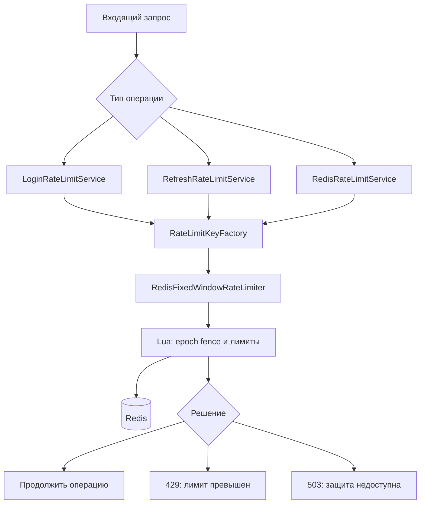

# SafeAI Desk — RateLimit

Этап: **7.5F.6 — финальная приёмка и документация**.

## 1. Назначение

RateLimit — распределённый механизм ограничения запросов backend на основе Redis и Lua.
Защищает аутентификацию, обновление токенов и отправку AI-сообщений от злоупотреблений,
перегрузки и неконтролируемого выделения памяти Redis.

| Область | Что ограничивается |
| --- | --- |
| Login | Попытки входа по email и IP независимо друг от друга |
| Refresh | Попытки обновления токена по IP, до обращения к хранилищу токенов |
| AI Message | Логические сообщения пользователя и организации за час |
| Allocation | Глобальная ёмкость резервов анонимного трафика login/refresh |
| Epoch fence | Допуск только при согласованном HMAC и подтверждённом Redis primary |
| Observability | Решения лимитера, доступность Redis, память, AOF и состояние epoch |

Redis является общим источником состояния для всех реплик backend. Решение о допуске
принимается на стороне Redis, а не на основании локальных JVM-счётчиков или метрик.

### Границы ответственности

- RateLimit не заменяет аутентификацию, авторизацию, финансовый ledger и аудит.
- Логический допуск AI-сообщения не равен физическому вызову провайдера.
- RPM, TPM и распределённые лимиты конкурентности физических вызовов AI — отдельный
  контур 7.5F.2. Их наличие нельзя подтвердить только исходниками данного пакета.
- Nginx ограничивает входящий трафик до backend; RateLimit защищает прикладные операции.
- Алерты и метрики диагностируют состояние, но никогда не разрешают обход лимитов.

## 2. Структура production-кода

Пакет: `ru.safeai.gateway.ratelimit`.

Расположение: `backend/src/main/java/ru/safeai/gateway/ratelimit/`.

```text
ratelimit/
├── exception/
│   ├── RateLimitExceededException
│   ├── RateLimitExceptionHandler
│   ├── RateLimitUnavailableException
│   └── RateLimitUnavailableLogger
├── AiMessageRateLimitProperties
├── AnonymousCapacityExceededException
├── DualRateLimitResult
├── LoginRateLimitExceededEvent
├── LoginRateLimitProperties
├── LoginRateLimitService
├── RateLimitDecision
├── RateLimitEpochFence
├── RateLimitExceededEvent
├── RateLimitKeyFactory
├── RateLimitMetrics
├── RateLimitProductionConfigurationValidator
├── RateLimitProductionProperties
├── RateLimitRedisKeyProperties
├── RateLimitRedisMonitor
├── RateLimitResult
├── README.md
├── RedisFixedWindowRateLimiter
├── RedisRateLimitService
├── RefreshRateLimitProperties
└── RefreshRateLimitService
```

Всего: 24 Java-типа (классы, records, enum и исключения), включая 4 в `exception/`.

## 3. Архитектура и основные инварианты



Сервис формирует ключи, передаёт их общему Redis-лимитеру и интерпретирует результат.
При разрешении запроса продолжается обычный сценарий приложения; это не гарантия
успешной аутентификации, авторизации или выполнения AI-вызова.

### 3.1. Fixed window

- TTL устанавливается при создании счётчика и не продлевается каждым запросом.
- Новое окно начинается при создании нового счётчика после истечения предыдущего.
- Lua проверяет и обновляет связанные счётчики без гонок между клиентами Redis.
- Некорректные счётчики, TTL, параметры и недопустимые значения отклоняются.
- Redis Lua обеспечивает атомарность выполнения относительно других команд,
  но не общий rollback произвольных записей при runtime error или OOM.
- Fixed window допускает всплески на границе двух окон; это не sliding window.

### 3.2. Login

`LoginRateLimitService.checkAllowed()` проверяет две размерности: email и IP.

1. Email нормализуется: `trim`, нижний регистр с `Locale.ROOT`.
2. IP очищается от пробелов; отсутствующие значения заменяются на `unknown`.
3. `RateLimitKeyFactory` строит HMAC-ключи без исходных идентификаторов.
4. Lua проверяет epoch и допустимость выделения новой ёмкости.
5. `incrementBothAndCheck()` учитывает попытки входа и определяет превышение лимитов.
6. При допуске сервис возвращает `Attempt` — receipt конкретной попытки входа.
7. После успешной аутентификации и фиксации сессии `onLoginSuccess()` компенсирует
   именно эту попытку; ранее накопленные ошибки по email и общему IP сохраняются.

Компенсация идемпотентна: повторная обработка receipt не уменьшает счётчики повторно.
Проверка поколения окна предотвращает списание попытки из нового окна после истечения
старого. Ошибка компенсации не отменяет уже успешную операцию аутентификации.

При блокировке одной размерности не выделяются новые identity keys другой размерности.
Существующие счётчики продолжают учитывать предусмотренные алгоритмом попытки.
Резерв allocation не возвращается при успешной аутентификации.

IP должен поступать из доверенного механизма определения адреса клиента. Сам сервис
не заменяет конфигурацию trusted proxy и не является валидатором сетевой топологии.

### 3.3. Refresh

`RefreshRateLimitService.checkAllowed()` ограничивает попытки по IP ещё до трудоёмкой
проверки refresh token. При недоступности Redis дальнейший refresh не разрешается.

- `incrementRefreshAndGet()` резервирует глобальную ёмкость, затем учитывает попытку.
- Резервирование и обновление счётчика — отдельные фазы; потеря ответа может оставить
  резерв до его штатного истечения. Это консервативная защита от переполнения.
- Dispatch margin составляет 10 секунд (`REFRESH_DISPATCH_MARGIN_MS`).
- Повторная попытка не сдвигает абсолютное время истечения fixed window.

### 3.4. AI Message

`RedisRateLimitService.checkAiMessageAllowed()` проверяет лимиты пользователя и его
организации. Для административных ролей предусмотрен отдельный пользовательский лимит.

Метод `tryIncrementBoth()` увеличивает оба счётчика только при допустимости обеих
размерностей. Если лимит пользователя или организации исчерпан, новый допуск не списывает
квоту второй размерности. Ключи разных организаций изолированы друг от друга.

Окно составляет один час. Это ограничение логических AI-сообщений, а не токенов,
стоимости, числа повторных физических вызовов или параллельных запросов провайдера.

## 4. Защита памяти, конфигурации и отказоустойчивость

### 4.1. Глобальное ограничение allocation (7.5F.1)

Анонимный трафик может генерировать большое число новых email/IP. Помимо персональных
лимитов применяются общие для реплик backend реестры резервов на основе Redis ZSET.

| Контур | Максимум активных резервов |
| --- | ---: |
| Login | 4096 |
| Refresh | 8192 |

Это константы `LOGIN_ALLOCATION_LIMIT` и `REFRESH_ALLOCATION_LIMIT` из кода, а не
лимиты количества уникальных пользователей или общего количества Redis-ключей.
Для refresh резерв создаётся на попытку. Истёкшие записи удаляются по времени Redis.

Глобальные ключи не зависят от поколения HMAC:

```text
safeai:rate-limit:guard:{login}:allocations
safeai:rate-limit:guard:{refresh}:allocations
```

При исчерпании ёмкости новый допуск отклоняется с 429 (`capacity`). Redis OOM, сбой
команды или потеря связи — другая категория отказа: 503. Нельзя смешивать эти причины.

Защитная конфигурация Redis предусматривает `maxmemory 192mb`, `noeviction`, AOF,
`appendfsync always`, `no-appendfsync-on-rewrite no` и `aof-load-truncated no`.
Фактические параметры, RSS и резерв памяти контейнера проверяются при развёртывании.
`maxmemory` не равен общему потреблению процесса или cgroup.

Запрещено снимать блокировку удалением reservations, сбросом базы или сменой HMAC.

### 4.2. HMAC и Redis key isolation (7.5F.3)

`RateLimitKeyFactory` использует HMAC-SHA256 с разделением назначений ключей,
настраиваемым namespace и версией ключа. Исходные email, IP и UUID не должны попадать
в Redis key names. Секрет HMAC — не менее 32 байт; одинаковая конфигурация обязательна
для всех реплик, которые совместно обслуживают один контур RateLimit.

Login-ключи общей Lua-операции используют общий hash tag. AI-ключи пользователя
и организации согласованы по Redis slot внутри одной организации. Это контракт
размещения ключей, а не заявление о поддержке Redis Cluster в production epoch fence.

Для аудита используются отдельные безопасные fingerprints анонимных идентификаторов.
В AI-аудите идентификаторы акторов используются по контракту события; это не разрешение
публиковать их в Prometheus, логах ошибок или именах Redis-ключей.

### 4.3. Epoch fence

`RateLimitEpochFence` проверяет согласованность HMAC, активность epoch, роль Redis,
идентификатор процесса (`run_id`), `master_replid` и отсутствие TTL у epoch-записи.

```text
safeai:rate-limit:guard:{login}:epoch
```

В production epoch обязателен независимо от локального флага. Отсутствующий,
повреждённый, приостановленный или несовместимый epoch, смена primary и ошибка Redis
блокируют допуск. Максимальное поддерживаемое окно — 24 часа.

Для операторского управления используется `infra/scripts/rate-limit-epoch.py`.
Инициализация пустого контура, pause/activate и rebind сохранённого состояния допускаются
только по протоколу 7.5F.3. При ротации с ожиданием требуется полное защитное окно
24 часа плюс 10 секунд. Rebind не заменяет проверку сохранности счётчиков и fencing
прежнего primary. Backend и монитор не восстанавливают epoch автоматически.

### 4.4. Redis topology

| Топология | Назначение и ограничения |
| --- | --- |
| Standalone | Текущий production Compose; единственная точка отказа Redis |
| Sentinel | Поддерживаемая модель epoch fence; нужен реальный failover и приёмка |
| Cluster | Контракт slot и отдельный внешний тест; не production epoch fence |

Sentinel не означает автоматический безопасный допуск после failover. Сначала необходимо
подтвердить новый primary, сохранность состояния и выполнить предусмотренный rebind.
Текущий standalone deployment не следует называть HA.

### 4.5. Production configuration

| Префикс свойств | Назначение |
| --- | --- |
| `safeai.rate-limit.login` | Включение, email/IP limits, окно, организация аудита |
| `safeai.rate-limit.refresh` | Включение, IP limit, окно |
| `safeai.rate-limit.ai-messages` | Включение, лимиты пользователя, админа и организации |
| `safeai.rate-limit.redis` | Namespace Redis, версия ключей, HMAC и epoch |
| `safeai.rate-limit.production` | Явно разрешённые эксплуатационные исключения |

`RateLimitProductionConfigurationValidator` проверяет конфигурацию при старте production.
Login и refresh должны быть включены. Отключение AI-лимитера допустимо только при явно
заданном `allow-unlimited-ai-traffic=true` (по умолчанию false). Это операторское
исключение, а не автоматический fail-open при ошибке Redis.

Эффективные числовые лимиты следует сверять с конфигурацией конкретного deployment.
Значения 20, 30, 7 и 25 из приёмочных тестов — тестовые фикстуры, не production SLA.

## 5. Назначение Java-классов

### 5.1. Сервисы и Redis enforcement

| Класс | Ответственность |
| --- | --- |
| `LoginRateLimitService` | Двойной лимит входа, receipt и компенсация успешной попытки |
| `RefreshRateLimitService` | Проверка IP и общей ёмкости перед обновлением токена |
| `RedisRateLimitService` | Допуск AI-сообщений по пользователю и организации |
| `RedisFixedWindowRateLimiter` | Lua, fixed windows, allocation, audit markers, компенсация |
| `RateLimitKeyFactory` | HMAC, namespace, Redis slot, fingerprints и имена ключей |
| `RateLimitEpochFence` | Проверка допустимости текущего epoch и Redis primary |

### 5.2. Конфигурация

| Record / класс | Ответственность |
| --- | --- |
| `LoginRateLimitProperties` | Параметры и ограничения конфигурации login |
| `RefreshRateLimitProperties` | Параметры и ограничения refresh |
| `AiMessageRateLimitProperties` | Часовые квоты AI-сообщений по ролям и организации |
| `RateLimitRedisKeyProperties` | HMAC, версия, префикс Redis и политика epoch |
| `RateLimitProductionProperties` | Политика допустимых исключений в production |
| `RateLimitProductionConfigurationValidator` | Запрет небезопасного запуска production |

### 5.3. Результаты, решения и события

| Record / enum | Ответственность |
| --- | --- |
| `RateLimitResult` | Значение одного счётчика и оставшийся TTL |
| `DualRateLimitResult` | Два счётчика, TTL, решение, признаки уведомления и operation ID |
| `RateLimitDecision` | ALLOWED, FIRST_EXCEEDED, SECOND_EXCEEDED, BOTH_EXCEEDED |
| `LoginRateLimitExceededEvent` | Событие превышения лимита login с fingerprints |
| `RateLimitExceededEvent` | Событие превышения лимита AI-сообщений для аудита |

`DualRateLimitResult.retryAfterSeconds()` использует максимальный оставшийся срок
среди блокирующих размерностей. Маркеры уведомлений ограничивают дублирование событий
в рамках окна. Сбой публикации не превращает отказ в разрешение. При освобождении
созданных маркеров проверяется принадлежность операции; exactly-once не гарантируется.

### 5.4. Ошибки и HTTP-контракт

| Класс | Ответственность |
| --- | --- |
| `AnonymousCapacityExceededException` | Внутренний признак исчерпания общей ёмкости |
| `RateLimitExceededException` | Прикладной отказ по лимиту и расчёт Retry-After |
| `RateLimitUnavailableException` | Невозможность безопасно выполнить проверку |
| `RateLimitExceptionHandler` | Преобразование исключений в безопасный HTTP-ответ |
| `RateLimitUnavailableLogger` | Ограничение частоты и sanitization логов недоступности |

| Результат | HTTP / API error code |
| --- | --- |
| Допуск | Продолжение стандартного сценария приложения |
| Лимит или allocation capacity исчерпаны | 429 / `RATE_LIMIT_EXCEEDED` |
| Redis, epoch или проверка недоступны | 503 / `RATE_LIMIT_UNAVAILABLE` |

Для 429 при наличии срока ожидания заголовок `Retry-After` выражен в целых секундах
с округлением вверх. Детали Redis и секреты не передаются клиенту. Logger ограничивает
частоту диагностических сообщений, сохраняя сведения о числе подавленных сообщений.

### 5.5. Наблюдаемость

| Класс | Ответственность |
| --- | --- |
| `RateLimitMetrics` | Micrometer: счётчики, таймеры, allowlist значений labels |
| `RateLimitRedisMonitor` | Периодический read-only snapshot Redis, gauges и epoch state |

## 6. Эксплуатационный мониторинг (7.5F.4)

Каждые 30 секунд после начального ожидания 10 секунд backend запрашивает один
read-only Lua snapshot с Redis. Используется настроенный Redis command timeout.
Prometheus scrape читает только снимок в памяти JVM: дополнительных обращений к Redis нет.

При ошибке Redis, неправильной структуре данных или неподдерживаемой топологии:

- `healthy=0`, числовые значения `NaN`, состояние `unavailable`;
- время последнего успешного снимка не обновляется;
- наблюдатель не инициализирует, не очищает, не продлевает и не ремонтирует ключи.

Lua наблюдателя использует `no-writes`, чтобы чтение было возможно и при превышении
лимита памяти Redis, если сам Redis и необходимый набор команд доступны.

### 6.1. Метрики запросов

- `safeai_rate_limit_allowed_total` — разрешённые логические проверки, label `type`.
- `safeai_rate_limit_rejected_total` — отказы по `type,dimension`; capacity отдельно.
- `safeai_rate_limit_unavailable_total` — ошибки Redis-проверок и компенсации, `type`.
  Не обязательно соответствует числу HTTP 503.
- `safeai_rate_limit_audit_publish_failed_total` — сбои публикации уведомлений, `type`.
- `safeai_rate_limit_redis_duration_seconds_bucket` — latency histogram Redis-операций.
  Labels: `type,operation,outcome,le`. Используется для расчёта p95/p99.

Типы: `login`, `refresh`, `ai_message`. Значения labels ограничены allowlist;
неизвестные значения отображаются как `unknown`.

### 6.2. Redis gauges

- `safeai_rate_limit_redis_observation_healthy`
  — 1, если snapshot получен и разобран; это не гарантия безопасности Redis.
- `safeai_rate_limit_redis_last_observation_timestamp`
  — Unix seconds последнего успешного snapshot; 0 до первого успеха.
- `safeai_rate_limit_redis_memory_accounted_bytes`
  — `max(0,used_memory-mem_not_counted_for_evict)`.
- `safeai_rate_limit_redis_memory_max_bytes`
  — `maxmemory`; 0 означает отсутствие ограничения.
- `safeai_rate_limit_redis_memory_rss_bytes`
  — RSS процесса Redis; не равен cgroup usage.
- `safeai_rate_limit_redis_noeviction`
  — 1 только для политики `noeviction`.
- `safeai_rate_limit_redis_evicted_keys`
  — число evictions процесса (gauge); сбрасывается при его перезапуске.
- `safeai_rate_limit_redis_aof_healthy`
  — 1, если AOF включён, запись и последний rewrite успешны, загрузка завершена.
- `safeai_rate_limit_redis_primary`
  — 1 только для primary.
- `safeai_rate_limit_redis_epoch_required`
  — 1, если epoch обязателен.
- `safeai_rate_limit_redis_epoch_state`
  — one-hot: active, disabled, missing, invalid, paused, mismatch,
  primary_changed, unavailable.
- `safeai_rate_limit_redis_allocation_active`
  — действующие reservations, `ZCOUNT` по Redis TIME; тип login/refresh.
- `safeai_rate_limit_redis_allocation_limit`
  — лимит reserves из кода: 4096 для login, 8192 для refresh.

### 6.3. Правила работы с метриками

- Не добавлять в labels UUID, email, IP, HMAC, run_id, Redis keys, токены,
  содержимое запросов, адреса и детали исключений.
- Запросы Prometheus не должны инициировать новые Redis-операции.
- Для одного общего Redis gauges с нескольких backend не суммировать:
  применять `max` и проверять каждую instance отдельно при расследовании.
- Счётчики запросов агрегировать через `sum(increase(...))`, учитывая рестарты.
- Не смешивать capacity rejection с Redis failure.
- Prometheus и management endpoint не публиковать в Интернет.

Snapshot AOF не доказывает корректность fsync, непрерывность истории, quorum Sentinel
или отсутствие evictions до перезапуска процесса. Нужны отдельные проверки F.3,
сохранности счётчиков, памяти и реальной топологии.

### 6.4. Prometheus alerts

Все имена правил имеют префикс `SafeAiRateLimit` (14 правил).

| Суффикс правила | Условие | Уровень |
| --- | --- | --- |
| ScrapeUnavailable | Нет scrape 2м | Critical |
| InstrumentationMissing | Нет обязательных серий 2м | Critical |
| ObservationUnhealthy | Нет снимка, старше 120с или часы впереди >30с; 1м | Critical |
| EpochUnavailable | Обязательный epoch не active; 1м | Critical |
| RedisUnsafe | Небезопасные maxmemory, policy, role или AOF; 1м | Critical |
| RedisEvictions | Обнаружены evictions | Critical |
| RedisMemoryCritical | Память ≥95%; 1м | Critical |
| Unavailable | ≥1 ошибка за 5м | Critical |
| RedisMemoryHigh | Память ≥80%; 5м | Warning |
| AllocationHigh | ≥80% резервов; 2м | Warning |
| CapacityRejects | ≥1 отказ capacity за 5м | Warning |
| AuditPublishFailed | ≥1 сбой публикации за 5м | Warning |
| RejectionRatio | ≥50% и ≥20 отказов за 5м; 3м | Warning |
| RedisSlow | p95 >250мс, ≥20 успешных проверок за 5м; 3м | Warning |

### 6.5. Runbook: реакция на алерты

- **ScrapeUnavailable / InstrumentationMissing:** проверить management endpoint, сеть,
  версию backend и регистрацию обязательных метрик.
- **ObservationUnhealthy:** проверить Redis, command timeout, scheduler и часы.
- **EpochUnavailable:** остановить неконтролируемый rollout, проверить epoch и primary;
  выполнить только предусмотренные протоколом 7.5F.3 действия.
- **RedisUnsafe:** проверить maxmemory, noeviction, role, AOF, диск и права.
- **RedisEvictions:** security-инцидент; проверить сохранность счётчиков.
  Не выполнять `FLUSHDB` или `CONFIG RESETSTAT`, чтобы убрать тревогу.
- **RedisMemoryHigh / RedisMemoryCritical:** ограничить ingress, проверить RSS, cgroup,
  диск/AOF, масштабировать ресурсы по согласованному плану.
- **AllocationHigh / CapacityRejects:** проверить Nginx и анонимный трафик.
  Не удалять reservations для восстановления допуска.
- **Unavailable:** проверить Redis, epoch и безопасные логи причин отказа.
- **AuditPublishFailed:** проверить Audit/outbox. Отказ 429 остаётся отказом 429.
- **RejectionRatio:** исследовать лимиты, нагрузку и распределённые атаки.
  Не повышать лимиты автоматически.
- **RedisSlow:** проверить Redis latency, CPU, сеть и AOF fsync.

Нельзя устранять алерты отключением fence, сменой HMAC или разрешением fail-open.

Проверка реальных конфигураций и правил:

```bash
bash infra/scripts/check-prometheus-config.sh
```

После deployment подтвердить доступность scrape каждой реплики, обязательные серии,
`healthy=1`, активный обязательный epoch, безопасные Redis gauges и отсутствие evictions.

Grafana, Redis Exporter/cgroup, Alertmanager, receiver, TLS, routing, deduplication,
inhibition и проверка доставки оповещений дежурному относятся к этапу 7.5C.
Наличие правил Prometheus не означает, что внешняя доставка уже настроена.

## 7. Структура тестов

Расположение: `backend/src/test/java/ru/safeai/gateway/ratelimit/`.

```text
ratelimit/
├── exception/
│   ├── RateLimitExceptionHandlerTest
│   └── RateLimitUnavailableLoggerTest
├── external/
│   ├── RedisClusterRateLimitIT
│   └── RedisSentinelFailoverIT
├── DualRateLimitResultTest
├── LoginRateLimitServiceTest
├── RateLimitEpochFenceIntegrationTest
├── RateLimitExceededEventPiiTest
├── RateLimitExceededExceptionTest
├── RateLimitKeyFactoryTest
├── RateLimitMetricsTest
├── RateLimitProductionAcceptanceIT
├── RateLimitProductionConfigurationValidatorTest
├── RateLimitPropertiesTest
├── RateLimitRedisMonitorIntegrationTest
├── RedisClusterSlotContractTest
├── RedisFixedWindowRateLimiterIntegrationTest
├── RedisFixedWindowRateLimiterIT
├── RedisFixedWindowRateLimiterSingleKeyIntegrationTest
├── RedisRateLimitServiceTest
└── RefreshRateLimitServiceTest
```

Всего: 21 тестовый класс, из них 19 локальных и 2 внешних топологических.

### 7.1. Unit и contract tests

- `DualRateLimitResultTest` — инварианты результата, решение, retry и уведомления.
- `LoginRateLimitServiceTest` — нормализация, допуск/отказ, receipt, capacity,
  компенсация, события, метрики и ошибки Redis.
- `RateLimitExceededEventPiiTest` — безопасность данных событий и audit details.
- `RateLimitExceededExceptionTest` — округление Retry-After и контракт исключения.
- `RateLimitKeyFactoryTest` — детерминированный HMAC, разделение назначений ключей,
  версии, fingerprints и отсутствие исходных PII в key names.
- `RateLimitMetricsTest` — имена метрик, гистограммы и allowlist labels.
- `RateLimitProductionConfigurationValidatorTest` — запрет небезопасной конфигурации
  production и обработка явного операторского исключения для AI.
- `RateLimitPropertiesTest` — defaults, граничные и недопустимые значения свойств.
- `RedisClusterSlotContractTest` — совместимость hash slots связанных ключей
  и стабильность глобальных guard keys.
- `RedisRateLimitServiceTest` — квоты пользователя и организации, роли, события,
  решения и обработка недоступности Redis.
- `RefreshRateLimitServiceTest` — ограничение по IP, capacity и обработка отказов.
- `RateLimitExceptionHandlerTest` — HTTP 429/503, API error codes, заголовки,
  безопасное тело ответа.
- `RateLimitUnavailableLoggerTest` — ограничение частоты логирования и защита данных.

### 7.2. Redis integration tests

- `RedisFixedWindowRateLimiterSingleKeyIntegrationTest` — одиночные счётчики,
  конкурентные операции, TTL и некорректные параметры.
- `RedisFixedWindowRateLimiterIntegrationTest` — двойные операции, allocation,
  атака 10 000 fresh-email, OOM/noeviction, TTL, receipt и audit markers.
- `RedisFixedWindowRateLimiterIT` — атомарность, конкурентность, некорректные
  счётчики и overflow.
- `RateLimitEpochFenceIntegrationTest` — обязательный epoch, несовместимый HMAC,
  повреждённое состояние, restart и rebind.
- `RateLimitRedisMonitorIntegrationTest` — реальный Redis snapshot, состояния epoch,
  признаки безопасности и отсутствие изменения ключей наблюдателем.
- `RateLimitProductionAcceptanceIT` — совокупная нагрузочная и security-приёмка
  прикладных сервисов на двух независимых Redis-клиентах (7.5F.5).

### 7.3. Внешние topology tests

- `RedisClusterRateLimitIT` — контракт Redis Cluster в отдельном тестовом окружении.
  Не подтверждает поддержку production epoch fence в Cluster.
- `RedisSentinelFailoverIT` — проверка поведения при реальном Sentinel failover.

Тесты запускаются только на изолированном окружении для испытаний. Они могут менять
состояние Redis и инициировать failover. Нельзя использовать production endpoints.

## 8. Нагрузочная и Security-приёмка (7.5F.5)

`RateLimitProductionAcceptanceIT` использует реальные сервисы, две независимые
`LettuceConnectionFactory`, Redis Testcontainers с паролем, AOF always, noeviction,
maxmemory 192 MB и включённый production epoch fence. Без внешних рабочих секретов.

| Сценарий | Ожидаемый результат |
| --- | --- |
| 128 login, 16 workers | 20 допусков, 108 отказов, оба счётчика 128 |
| 64 login receipts, 128 cleanup | Идемпотентность, сохранена прежняя ошибка за NAT |
| 128 refresh | 30 допусков, 98 отказов, счётчик 128, TTL не сдвигается |
| 128 AI checks, 4 пользователя | 25 допусков организации, изоляция tenant |
| 128 AI checks, 1 пользователь | 7 допусков, нет расхода квоты org после отказа |
| Allocation capacity | По 32 отказа login/refresh, нет новых identity keys |
| HMAC mismatch / missing epoch | Fail-closed во всех трёх сервисах |
| Redis stopped | Fail-closed на обеих инстанциях всех трёх сервисов |

Проверяются точные прикладные результаты, Redis-счётчики и Micrometer. Для login
также проверяются нормализация email, уникальность receipt и единственный audit marker.
Для AI сумма пользовательских счётчиков должна соответствовать допускам организации.
При недоступном fence не должны создаваться новые ключи и audit-события превышения.

Конкурентные сценарии стартуют синхронно. Все future должны завершиться в общий
75-секундный дедлайн; unexpected errors не засчитываются в число ожидаемых отказов.
Elapsed, p95 и p99 итераций — диагностические данные, а не SLA production VPS.

Глобальная capacity в новом IT заполняется фикстурой. Дополнительный обязательный тест
`distributedAttackCannotExceedSharedAllocationCapacityAcrossInstances` проверяет
фактическое выделение резервов до границы в распределённом сценарии.

### 8.1. Запуск проверок

Из корня репозитория (JDK 21, Docker, доступные образы и зависимости Maven):

```bash
bash infra/scripts/verify-ratelimit-acceptance.sh
bash infra/scripts/test-ratelimit-nginx.sh
bash infra/scripts/check-prometheus-config.sh
bash infra/scripts/check-redis-memory.sh
bash infra/scripts/check-redis-durability.sh
```

Последние два скрипта предназначены для проверки настроенного Redis окружения;
перед запуском использовать только соответствующий стенд и его параметры.

Полная backend-проверка:

```bash
cd backend
./mvnw clean verify
```

Для нового service IT можно указать точный digest тестируемого Redis image:

```bash
SAFEAI_RATELIMIT_TEST_REDIS_IMAGE='redis@sha256:<digest>' \
  bash infra/scripts/verify-ratelimit-acceptance.sh
```

Команда выполняется из корня репозитория; `<digest>` нужно заменить реальным digest.
Исторические интеграционные тесты сохраняют собственные test image tags.

### 8.2. CI gate

`verify-ratelimit-acceptance.sh` запускает чистый целевой Maven test по десяти классам
и проверяет наличие всех 50 обязательных тестовых методов в XML-отчётах.

Gate завершается ошибкой при отсутствии отчёта или метода, skipped, failed, error,
rerun/flaky или повреждённом XML. Десять дополнительных Python-сценариев проверяют
сам механизм анализа отчётов. Нулевой exit code Maven сам по себе недостаточен.

- Backend CI (`backend-ci.yml`) проверяет gate после полного clean verify.
- Performance CI (`performance-ci.yml`) запускает отдельный job с Redis и Nginx,
  проверяет Prometheus через `promtool check rules` и `promtool test rules`.
- Production release использует Performance CI; существующие ACL, PostgreSQL,
  security и release gates сохраняются.
- `redis-topology-ci.yml` — отдельный workflow для внешних тестов, защищённого
  окружения `redis-topology-test` и изолированной топологии.

Для внешней топологии используется профиль Maven `rate-limit-topology-it` и явно
подтверждённое изолированное окружение (`SAFEAI_REDIS_TOPOLOGY_ISOLATED=true`).
Параметры подключения и секреты берутся из защищённой конфигурации CI.

## 9. Финальная приёмка (7.5F.6)

Документация описывает реализованный пакет и тестовые контракты. Подготовленные тесты
не равны успешной приёмке. Для закрытия этапа нужны отчёты на одном конечном commit SHA.

| Этап | Состояние |
| --- | --- |
| 7.5F.1 — защита памяти Redis | Реализация и тесты подготовлены |
| 7.5F.2 — RPM/TPM и конкурентность provider calls | Требуется подтверждение |
| 7.5F.3 — HMAC, epoch fence, Sentinel | Реализация есть; реальный failover ожидает приёмки |
| 7.5F.4 — Prometheus и алерты | Реализация есть; реальный promtool/scrape ожидают |
| 7.5F.5 — нагрузочная и Security-приёмка | Сценарии и CI gate подготовлены |
| 7.5F.6 — финальная приёмка и README | README актуализирован; приёмочные отчёты ожидают |

### 9.1. Обязательный чек-лист перед закрытием 7.5F

- [ ] Полный Maven `clean verify` и все Testcontainers на конечном SHA.
- [ ] 50 обязательных тестовых методов успешно пройдены, без skipped и flaky.
- [ ] Проверены 8 сценариев `RateLimitProductionAcceptanceIT` и точные инварианты.
- [ ] Подтверждены Nginx edge HTTP, 429/503, trusted proxy, память и Redis durability.
- [ ] Подтверждены физические RPM/TPM/concurrency для provider calls (F.2), включая
  retry, fallback, probe, embeddings и recovery по применимым путям исполнения.
- [ ] Выполнен реальный Sentinel failover на изолированном стенде, если требуется HA.
- [ ] Проверены epoch rotation/rebind, fencing старого primary и сохранность счётчиков.
- [ ] Реальный promtool, scrape и 14 alert rules проверены на целевой конфигурации.
- [ ] Flyway V1–V101, Runtime ACL clean/upgrade и обязательные security gates — PASS.
- [ ] Зафиксированы commit SHA, образы/digest, CI reports и результаты стенда.

До получения доказательств пункты не считаются выполненными. Миграции V1–V101
в состав изменений этого README и пакета нагрузочной приёмки не входят.

### 9.2. Дальнейшая дорожная карта

| Этап | Цель |
| --- | --- |
| 7.5G | Frontend UI/UX Production Hardening, обработка 429/503 |
| 7.5C | Deployment Readiness, Redis topology, monitoring и alert delivery |
| 7.6 | Full Production Audit: безопасность, нагрузка, данные, эксплуатация |
| 8 | Production Deployment после формального решения GO |

В 7.5C дополнительно подтвердить TLS/egress, ресурсы, фактические image digests,
Grafana, Redis Exporter, Alertmanager и доставку тревог, целевые latency/throughput,
поведение при memory pressure, а также backup/recovery и план rollback.

**Production GO:** только после успешной приёмки всех обязательных контуров и
решения на этапе 7.6. Standalone Compose, подготовленный README или наличие зелёных
проверок отдельных компонентов сами по себе не доказывают общую готовность к production.
