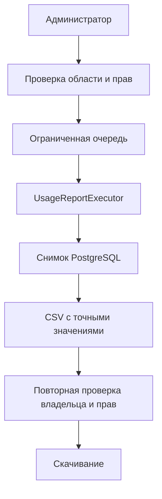
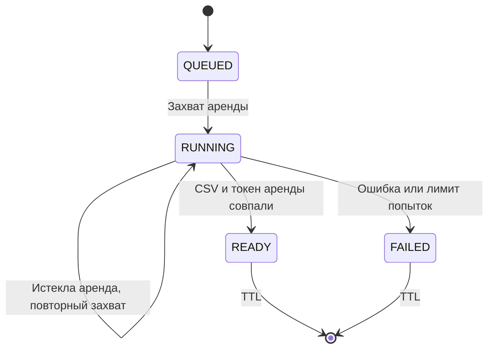
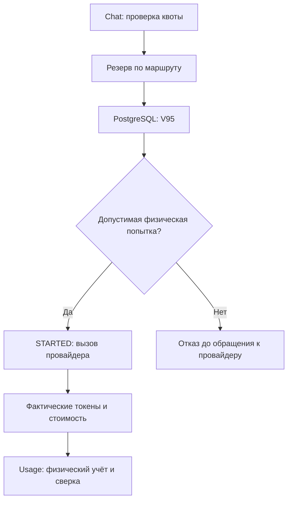
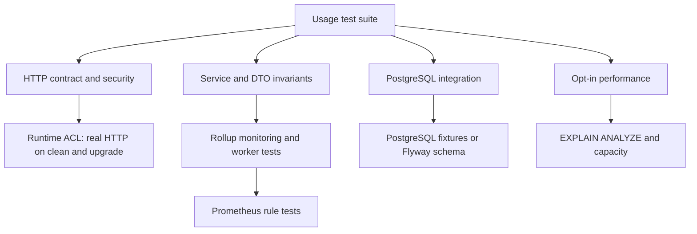

# Usage — отчёты по сообщениям и вызовам провайдера

Актуализация: **21.11.2026**, этап 7.5D.4.5 / Fix1, Flyway V1–V99.
Пакет `ru.safeai.gateway.usage`: **53 production Java-файла**, **42 тестовых класса**
и **1 общий класс тестовой поддержки** (без учёта межмодульных проверок).
Документ описывает реализацию, а не подтверждает прохождение финальной приёмки.

**Расположение:** `backend/src/main/java/ru/safeai/gateway/usage/README.md`.

### Навигация

- [Актуальные этапы и функциональность](#75d32--аналитика-провайдеров-и-серверный-csv)
- [Дерево production-классов](#структура)
- [Архитектура и потоки](#2-структура-зависимости-и-поток-данных)
- [REST API](#3-контракты-rest-api)
- [Каталог всех Java-классов](#4-полный-каталог-java-классов--53-файла)
- [PostgreSQL и миграции](#5-взаимодействие-с-postgresql-миграции-индексы-ограничения)
- [Безопасность и multi-tenancy](#8-безопасность-и-multi-tenancy)
- [Производительность и мониторинг](#9-производительность-расписание-и-конкуренция)
- [Дерево и каталог тестов](#10-тестирование-структура-покрытие-и-приёмка)
- [Runbook](#12-runbook-как-проверять-usage-после-инцидента)
- [Security-приёмка](#13-security-приёмка-75d45-v1v99)

## 7.5D.3.2 — Аналитика провайдеров и серверный CSV

Вкладка «По провайдерам» учитывает исторический `provider_type` из
`model_execution_attempts`, а не текущие настройки каталога моделей.
Каждая физическая попытка учитывается один раз. Повторы включены.
Период — UTC, начало включено, конец исключён. Фильтр модели использует
исходно запрошенную логическую модель из плана, фильтр пользователя — владельца turn.
Фильтр месячного бюджета относится только к сравнению организаций.

| Метод | Адрес относительно `/api/admin/usage` | Назначение |
| --- | --- | --- |
| GET | `/physical-attempts/providers` | Физические расходы по провайдерам, область и период |
| POST | `/exports` | Создание серверного задания, HTTP 202 |
| GET | `/exports/{id}` | Состояние задания |
| GET | `/exports/{id}/download` | Готовый CSV, без кеширования |



- Обычный ADMIN получает данные только своей организации; SUPER_ADMIN может выбрать
  организацию или всю платформу. Сравнение всех организаций доступно только SUPER_ADMIN.
- Задание привязано к userId, organizationId, ролям, tokenVersion и organizationAuthVersion.
  Чужое, истёкшее или недоступное после изменения прав задание возвращает 404.
- Выгрузка создаётся в одном снимке через существующий ограничитель отчётов PostgreSQL.
  Для больших выборок применяется предел 10 000 строк, 8 МиБ, без усечения. Существующие
  более строгие ограничения по моделям и периоду сохраняются.
- CSV содержит границы периода, область, применённые фильтры, точные десятичные суммы,
  счётчики полноты, сортировку и момент формирования. Месяц бюджетного фильтра фиксируется
  по UTC на начало генерации, а не по дате скачивания. Неизвестная сумма не выдаётся за ноль.
  Текстовые ячейки экранируются, включая возможные формулы электронных таблиц.
- Один действительный worker на кластер, очередь до четырёх ожидающих заданий, восемь
  заданий в PostgreSQL, не более двух заданий одного пользователя за 15 минут, из них
  одно активное. Истёкшие результаты удаляются, CSV не записываются в публичные каталоги.
- Состояния: QUEUED, RUNNING, READY, FAILED. Файл скачивается только после READY.
  Превышение лимита — явная ошибка, без частичного файла.
- V98 хранит задания и завершённые CSV в PostgreSQL; перезапуск backend не очищает очередь.
  Любая реплика может получить задание и продолжить истёкшую аренду. Миграции V1–V96
  неизменны, Runtime ACL расширен только на новую таблицу, финансовый допуск сохранён.
- Серверный CSV экспортирует весь допустимый набор строк по полям `UsageExportRequest`, не только текущую страницу.
  `organizationQuery` и `usedOnly` присутствуют в API сравнения организаций, но отсутствуют в этом DTO экспорта:
  не обещать перенос этих двух фильтров в CSV; расширение потребует изменения контракта, DB guard и тестов.
- CSV содержит UTF-8 BOM, разделитель `;`, экранированные ячейки и CRLF. Допускается независимый повтор генерации
  после истечения lease: одна действующая аренда не гарантирует, что старый worker физически остановил работу.
  Публикация fenced по токену; отчётный admission по-прежнему ограничивает общий SQL.

Зелёный индикатор «Сверка пройдена» показывает только ненулевую выборку планов
с доказанным совпадением стоимости без расхождений и непроверяемых планов.
Красный индикатор выделяет обнаруженные расхождения. Это сверка внутреннего учёта,
а не подтверждение счета внешнего провайдера.

### Интерфейс и frontend-контракты

Frontend расположен в `frontend/src/features/usage/`. Панели разделяют два источника отчётности:
сохранённые ответы Chat (детализация, пользователи, модели, UTC-дни, организации) и физические попытки
(сверка и провайдеры). Стоимости этих контуров не суммируются друг с другом.

| Компонент / пакет | Назначение |
| --- | --- |
| `ui/AdminUsageWorkspace.tsx`, `AdminUsageControls.tsx`, `UsageReportView.tsx` | Рабочая область, применённые фильтры, вкладки и таблицы/графики. |
| `controller/useAdminUsageReport.ts`, `useAdminUsageReportQuery.ts` | Состояние отчёта, фильтры и запроса, серверный export task. |
| `ui/UsagePhysicalReportPanel.tsx`, `controller/usePhysicalUsageReport.ts`, `api/physicalUsageApi.ts`, `ui/physicalUsageCsv.ts` | Отдельный физический отчёт, no-store, корректное состояние покрытия/сверки, CSV агрегатов. |
| `ui/UsageProviderPanel.tsx`, `api/usageProviderApi.ts` | Исторические провайдеры, точные строки, scope и фильтры. |
| `controller/useUsageExport.ts`, `api/usageExportApi.ts` | POST один раз, polling job id, ограниченный retry GET, download после READY; отмена UI-запроса по scopeKey (не удаление серверного задания). |
| `ui/UsageOrganizationRows.tsx`, `api/platformBudgetApi.ts`, `controller/useUsageBudget.ts` | Сравнение организаций, бюджет из соседнего финансового контура, известная/неизвестная стоимость. |
| `ui/UsageKpis.tsx`, `UsageBreakdownChart.tsx`, `UsageDailyChart.tsx`, `UsageTableViewport.tsx`, `usageCsv.ts`, `usageMetrics.ts` | KPI, динамика, представление данных, экспорт отображаемой страницы и трактовка полноты; CSV страницы не заменяет серверный export. |
| `api/`, `lib/` | Wire parsers и validation, подготовка фильтров, presentation/loader helpers; не отменяют проверку scope backend. |

Frontend-тесты: `usageApi.modelFilter.test.ts`, `usageApi.organizationRoutes.test.ts`, `physicalUsageApi.test.ts`,
`usageProviderApi.test.ts`, `platformBudgetApi.test.ts`, `useAdminUsageReport.test.tsx`, `useUsageExport.test.tsx`,
`UsagePhysicalReportPanel.test.tsx`, `UsageProviderPanel.test.tsx`, `UsageOrganizationComparison.test.tsx`,
`UsageTableViewport.test.tsx`, `usageCsv.test.ts`, `usageMetrics.test.ts` и остальные тесты UI/API/helpers.
Точные денежные значения и большие счётчики не переводить в floating point для экспортируемого доказательства;
графическое форматирование не является исходными данными. Для нулевой применимой выборки показывать её размер,
а не интерпретировать пустоту как доказательство полного физического учёта.

## 7.5D.4 — PostgreSQL, отказоустойчивость и приёмка Usage



- V97: индекс `(execution_plan_id, started_at)` дополняет V74 `(started_at, execution_plan_id)`.
  Построение `CONCURRENTLY` выполняется вне транзакции; при ошибке операционной процедуры
  нельзя автоматически выполнять Flyway repair или удалять невалидный индекс.
- V98: общая транзакционная блокировка допуска, `FOR UPDATE SKIP LOCKED`, аренда 2 минуты,
  максимум 3 захвата, публикация по совпадающему токену. Старый worker не перезапишет файл.
  Повтор генерации допустим; общий запрос отчёта остаётся под действующим ограничителем.
- V99: триггер ограничивает операции записи уровнем `READ COMMITTED`, проверяет неизменность
  владельца и фильтров, новый токен и границу аренды, а также полномочия при INSERT и READY.
  V97/V98 не переписываются, новых таблиц и расширения Runtime ACL нет.
- Владелец, роль, организация, версии авторизации и фильтры неизменяемы runtime-ролью.
  Актуальные роли/активность/версии проверяются в PostgreSQL перед генерацией и выдачей CSV.
  Истёкший результат недоступен даже до физической очистки. SQL не содержит пользовательского текста.
- Максимум 10 000 строк / 8 МиБ; TTL 15 минут с момента создания. Не более 64 МиБ CSV
  одновременно в живой таблице. WAL, резервные копии и реплики могут хранить данные дольше TTL:
  нужны шифрование диска, ограниченный доступ, политика retention и восстановление на staging.
- UI повторно опрашивает то же задание при временных сетевых/5xx ошибках, не повторяя POST.
  Отказ 401/403/404 не превращается в автоматический повтор. Смена области отменяет опрос.
- `safeai.usage.export.*` — состояние очереди, ошибки, аренды, время генерации, свежесть наблюдений.
  Метрики rollup: количество грязных закрытых дат, отставание watermark, свежесть наблюдений.
  В labels нет UUID, email, имени модели или текста отчёта. SQL не выполняется при scrape.
  При ошибке подсчёта rollup публикует NaN, сохраняет время последнего успешного наблюдения
  и увеличивает счётчик ошибок. SQL использует единую границу суток UTC на запрос.
- Prometheus загружает `infra/prometheus/rules/safeai-usage.yml`; правила проверяются promtool.
  Доставка уведомлений требует отдельно настроенного Alertmanager и проверки маршрута уведомления.
- Проверка производительности: 100 000 планов / 200 000 попыток, реальные запросы репозитория,
  EXPLAIN (ANALYZE, BUFFERS), tenant/global, проверка точных агрегатов и сохранение планов в
  `backend/target/usage-explain/`. Порог синтетического теста по умолчанию 5 000 мс.
  Он не заменяет измерение p95/p99 и планов с объёмом и распределением staging.

Критерии GO: зелёные Maven, frontend CI, PostgreSQL performance CI, Runtime ACL, promtool;
на staging дополнительно — рестарт двух реплик, отказ PostgreSQL, восстановление, проверка
выдачи файла после отзыва прав, p95/p99 на целевой нагрузке и доставка реальных оповещений.
До выполнения этих критериев модуль находится на финальной приёмке, не в статусе production GO.

## Физические повторы и бюджетный резерв (7.5D.2.2 / V95)

Chat резервирует лимиты организации и пользователя по неизменяемому маршруту.
PostgreSQL фиксирует наличие токенной или денежной квоты и границы месяца резерва.
При строгой квоте допускается только первая физическая попытка; для новой попытки
потребуется новый допуск. Смена политики не снимает уже зафиксированное ограничение.



- Нельзя изменить сумму, исполнителя, месяц или признак ограничения уже созданного резерва.
- Старый резерв не разрешает новое строгое исполнение за пределами своего месяца.
- История до V95 не переписывается. У старых резервов признак отсутствует; новый физический
  запуск по таким резервам блокируется, завершение ранее начатого вызова не запрещается.
- При отсутствии строгих квот сохраняются разрешённые state machine повторы того же маршрута.
- При изменении квоты уже совершённый допуск не пересчитывается задним числом. Новая строгая
  квота не разрешает запуск по прежнему неограниченному резерву.
- V95 не заменяет ранее введённый контроль бюджета модели и не отменяет физический учёт.
- Данные провайдера могут быть неполными. Неопределённый исход не означает нулевой расход.

Перед развёртыванием новой миграции необходимо остановить приём новых запросов, завершить
активные вызовы и выполнить резервное копирование. V1–V94 остаются неизменными.
Отдельная доработка пользовательской отчётности и выгрузок относится к 7.5D.3.

## Согласованный финансовый допуск (7.5D.2.3 / V96)

Проверки V95 сохранены. V96 использует общую транзакционную advisory-блокировку при допуске
и эксклюзивную при изменении квот. Создание отсутствующей строки политики также синхронизировано.
Блокировки политик организации и пользователя по-прежнему берутся в прежнем порядке.
При конфликте или тайм-ауте запрос не получает допуск.

Каждая новая редакция квоты получает UUID, который БД фиксирует в резерве. Изменение лимита,
отключение, удаление или пересоздание политики требует нового допуска для ещё не отправленного
запроса. Неизменяемые исторические резервы и уже учтённые обязательства не переписываются.

Расчётный календарь хранится в `chat_quota_calendar_v96` (по умолчанию UTC). Runtime имеет только
чтение. Значение должно совпадать с `SAFEAI_CHAT_QUOTA_PERIOD_ZONE` на всех backend-инстансах.
Если используется другой IANA-часовой пояс, его нужно согласовать до приёма новых запросов
в отдельной операции мигратора, после проверки прежней истории расходов. Изменять календарь
в рабочем режиме нельзя. База проверяет точное начало и конец месяца, независимо от TimeZone
сессии. Новые route-bound резервы вне своего периода не допускаются даже без строгой квоты.

Перед HTTP-вызовом повторно проверяются STARTED, версия квоты и период отдельной транзакцией.
При отказе сеть не вызывается; неопределённые исходы остаются финансовым обязательством.
Между фиксацией допуска и внешним I/O атомарной транзакции нет: уже допущенный сетевой запрос
может завершиться позднее. V96 не гарантирует exactly-once у внешнего провайдера и не сверяет
его фактический счёт. Наличие старого резерва не является разрешением нового исполнения.

Контроль суммы по действующим квотам остаётся в ChatQuotaService внутри транзакции;
V95/V96 дополнительно защищают границы физического исполнения. Измерение планов и задержек
на больших объёмах данных и миграция под нагрузкой относятся к приёмке 7.5D.4.

## Структура

```text
usage/
├── config/
│   ├── UsageConfiguration.java
│   ├── UsageHikariPoolInvariantVerifier.java
│   ├── UsageJdbcClients.java
│   └── UsageProperties.java
├── controller/
│   ├── UsageController.java
│   ├── UsageExportController.java
│   ├── UsagePhysicalSpendController.java
│   └── UsageRebuildController.java
├── dto/
│   ├── PagedResponse.java
│   ├── UsageCostSummary.java
│   ├── UsageDailySummaryResponse.java
│   ├── UsageDataQualityResponse.java
│   ├── UsageDateFilter.java
│   ├── UsageDateModelFilter.java
│   ├── UsageExportRequest.java
│   ├── UsageModelSummaryResponse.java
│   ├── UsageOrganizationSummaryResponse.java
│   ├── UsagePageRequest.java
│   ├── UsagePhysicalReconciliationResponse.java
│   ├── UsagePhysicalReportResponse.java
│   ├── UsagePhysicalSpendResponse.java
│   ├── UsageProblemModelResponse.java
│   ├── UsageProviderReportResponse.java
│   ├── UsageProviderRow.java
│   ├── UsageResponseSummary.java
│   ├── UsageSummaryInvariants.java
│   ├── UsageSummaryResponse.java
│   ├── UsageTokenSummary.java
│   └── UsageUserSummaryResponse.java
├── repository/
│   ├── JdbcUsageQueryRepository.java
│   ├── UsageDirtyDateRepository.java
│   ├── UsageExportJobRepository.java
│   ├── UsageFactQueryBuilder.java
│   ├── UsageFactSql.java
│   ├── UsageInstantRange.java
│   ├── UsagePhysicalSpendRepository.java
│   ├── UsageQueryCriteria.java
│   ├── UsageQueryPlan.java
│   ├── UsageQueryRepository.java
│   ├── UsageRollupStateRepository.java
│   ├── UsageRowMapperSupport.java
│   └── UsageSqlFragments.java
├── service/
│   ├── UsageAccessPolicy.java
│   ├── UsageDirtyDateProcessor.java
│   ├── UsageExportCsv.java
│   ├── UsageExportService.java
│   ├── UsageForcedRebuildService.java
│   ├── UsagePhysicalSpendService.java
│   ├── UsageQueryService.java
│   ├── UsageReportExecutor.java
│   ├── UsageRollupDayProcessor.java
│   ├── UsageRollupMonitor.java
│   └── UsageRollupScheduler.java
└── README.md
```

Тестовое дерево и назначение классов приведены в [разделе 10](#10-тестирование-структура-покрытие-и-приёмка).
Если в тестовом пакете ведётся собственная документация: [README тестов Usage](../../../../../../test/java/ru/safeai/gateway/usage/README.md).

## Источники и границы отчётов

| Отчёт | Источник | Критерий периода |
| --- | --- | --- |
| По сообщениям | `chat_messages`, `chat_turns` и UTC-rollup | Время факта, полуоткрытый интервал. |
| Физические расходы | `model_execution_attempts` и организация плана | `started_at >= from AND started_at < to`. |
| Сверка | Все попытки выбранного плана и связанное сообщение ASSISTANT | Достаточно одной попытки внутри периода. |
| По провайдерам | `model_execution_attempts.provider_type`, план и владелец turn | Старт попытки; tenant, логическая модель и userId применяются до группировки. |

Отчёты по сообщениям показывают сохранённые ответы Chat. Физические отчёты учитывают
каждый вызов отдельно, включая повторы. Сверка сначала выбирает уникальные планы
по интервалу, затем суммирует всю историю попыток каждого выбранного плана, включая
попытки до и после его границ. Обе физические выборки применяют tenant scope к плану.

План считается совпавшим, когда известны цены физических попыток и завершённого
сообщения, а суммы равны. При двух известных разных суммах план классифицируется
как расхождение. При неизвестной стоимости либо отсутствии пригодного сообщения
план остаётся непроверяемым. Пустая выборка возвращает `fullyReconciled=false`.
Сверка сравнивает внутренние данные SafeAI Desk. Внешние счета провайдера требуют
отдельного источника и процедуры сверки.

### Единый физический отчёт (7.5D.3.1)

Раздел «Использование» показывает отдельную раскрываемую панель физического
исполнения. При раскрытии выполняется один GET-запрос. Сервер получает покрытие
и сверку целых планов под одним допуском и транзакцией `REPEATABLE READ`.
Счётчики и стоимость передаются точными десятичными строками, без округления
при обработке JSON. Ответ не кэшируется.

ADMIN читает только свою организацию; SUPER_ADMIN — все организации или
выбранную организацию. Период задаётся календарными днями UTC. Фильтры модели,
пользователя и бюджета относятся к отчётам по сообщениям, поэтому панель требует
их снять. При изменении области открытый запрос отменяется.

Пустой отчёт не является доказательством отсутствия расходов у провайдера.
Непроверяемые попытки и расхождения планов показываются отдельно. Не следует
складывать физические расходы с суммами сохранённых сообщений.

CSV физического отчёта содержит одну агрегированную строку с границами UTC,
областью организации, базой агрегации и сверки, счётчиками и полнотой данных.
CSV по сообщениям дополнительно содержит дату, область, применённые фильтры,
страницу и счётчики качества данных. Сохраняются ограничение выгрузки,
экранирование формул и исходная десятичная точность файлов. Электронная таблица
может округлить длинные числа при импорте: импортируйте эти столбцы как текст.

## Токены, стоимость и качество данных

- `AVAILABLE` входит в подтверждённые токены. `PARTIAL` отражается отдельно.
  `MISSING` сохраняет признак отсутствия данных. `NOT_APPLICABLE` учитывается отдельно.
- `PRICED` и `FREE` входят в известную стоимость USD. `UNPRICED` и
  `CALCULATION_FAILED` снижают полноту. Нулевая известная сумма может сопровождаться
  неполным покрытием.
- Для физических попыток `KNOWN_NOT_EXECUTED` исключается из счётчиков неизвестных
  затрат и токенов. `STARTED` и `AMBIGUOUS` отражаются как неполные данные.
- `KNOWN_REJECTED` не доказывает нулевую стоимость или отсутствие токенов.
  Даже после освобождения логической квоты такие попытки блокируют выдачу новых
  резервов в пределах настроенных месячных токенных и денежных ограничений.
  Это касается обеих областей: организации и пользователя. Старые статические
  оценки не допускаются для денежного лимита. Операции `ChatQuotaService`
  требуют существующей транзакции, поэтому блокировки строк и записи ledger
  не могут выполняться раздельно в режиме autocommit.
- `__unattributed__` — ключ группы сообщений с `model IS NULL`. V28 зарезервировала
  значение в `chat_messages`, а V30 валидировала ограничение для исторических строк.
  В каталоге моделей для маршрутов, сохраняющих сообщения Chat, используйте другие ID.
- Запрос data quality вычисляет общие показатели и проблемные модели в одном снимке
  PostgreSQL. Состояние rollup и данные фактов читаются в той же транзакции.

### Stage 7.5D.1 — точность исторических отчётов

Watermark сам по себе не подтверждает актуальность агрегата. В том же снимке
`REPEATABLE READ` отчёт читает очередь `usage_dirty_dates` для закрытых UTC-дней.
Каждый отмеченный день исключается из всех трёх семейств rollup и полностью
заменяется исходными фактами. Смежные live-интервалы объединяются. Двойной учёт
при пересечении диапазонов запрещён инвариантами `UsageQueryPlan`.

Если суммарная длительность live-интервалов (границы периода и dirty-дни)
превышает `safeai.usage.max-live-range`, сервер возвращает HTTP 503,
а не устаревший отчёт. Пересчёт и удаление dirty-маркера остаются атомарными.
Существующие Flyway-миграции и Runtime ACL не меняются.

Роли ADMIN и SUPER_ADMIN проверяются дополнительно внутри сервисов чтения,
включая физические расходы и сверку, независимо от Spring method security.

## API

Все пути ниже относительны к `/api/admin/usage`. ADMIN ограничен собственной
организацией. SUPER_ADMIN может читать глобальные отчёты и отчёты организации.
Фильтры SQL передаются параметрами. Пагинируемые отчёты используют навигацию Slice без общего
количества элементов; отчёты по моделям и дням возвращают ограниченные списки.
Параметры дат и пагинации валидируются перед запросом.

| Метод | Путь | Назначение |
| --- | --- | --- |
| GET | `/summary`, `/daily`, `/data-quality` | Детализация user/model (Slice), дневные группы и качество данных. |
| GET | `/users`, `/models` | Группировка по пользователям и моделям. |
| GET | `/by-user/{userId}` | Отчёт по пользователю. |
| GET | `/by-organization/{organizationId}` | Итоги организации. |
| GET | `/by-organization/{organizationId}/{users,models,daily}` | Разрезы организации. |
| GET | `/physical-attempts` | Покрытие и известная стоимость вызовов по интервалу. |
| GET | `/physical-attempts/reconciliation` | Сверка целых планов. |
| GET | `/physical-attempts/report` | Покрытие и сверка в одном снимке; точные строки, optional organizationId. |
| GET | `/physical-attempts/providers` | Аналитика исторических провайдеров; tenant/model/user, точные строки; обе даты обязательны. |
| GET | `/organizations` | Сравнение организаций с фильтрами, только SUPER_ADMIN. |
| POST | `/exports` | Асинхронная генерация CSV, 202. |
| GET | `/exports/{id}` | Текущее состояние только своего задания. |
| GET | `/exports/{id}/download` | READY, CSV attachment, no-store, nosniff. |
| POST | `/rebuild` | Запрос пересчёта, только SUPER_ADMIN. Возвращает 202. |

Для физических отчётов `dateFrom` и `dateTo` передаются как ISO-8601 timestamps.
При насыщении отчётных слотов executor отклоняет новые запросы с HTTP 429.

## Транзакции и UTC-rollup

`UsageReportExecutor` сначала захватывает локальный permit. Затем открывает
read-only `REPEATABLE READ` и получает один общий PostgreSQL advisory xact slot.
Слот освобождается с завершением транзакции, локальный permit — в `finally`.
Для общего лимита все реплики должны иметь одинаковый `max-concurrent-reports`.

Исторические закрытые UTC-дни могут читаться из rollup. Непокрытые, частичные и
требующие пересчёта интервалы планируются с чтением исходных фактов. Полные rollup
и live-границы одного отчёта не пересекаются. Ручной пересчёт ставит даты в очередь.

V74 добавляет в очередь и текущую UTC-дату в исходной транзакции. Это сохраняет
маркер при коммите после полуночи. Worker обрабатывает даты до watermark закрытых
дней. Ревизия маркера защищает повторное изменение даты от удаления обработчиком.
V74 также добавляет индексы для времени начала попытки и организации плана.

## Конфигурация

| Свойство под `safeai.usage` | По умолчанию |
| --- | --- |
| `default-range`, `max-range`, `max-live-range` | 30d, 366d, 31d |
| `max-page-size`, `fetch-size` | 200, 200 |
| `query-timeout`, `slow-query-threshold` | 10s, 2s |
| `max-concurrent-reports` | 4 |
| `rollup.enabled`, `rollup.cron` | true, `0 */10 * * * *` |
| `rollup.lookback-days`, `rollup.backfill-days-per-run` | 3, 31 |
| `rollup.advisory-lock-key`, `rollup.statement-timeout` | 8026001, 2m |

При включённом production-rollup проверяется минимальный размер Hikari pool.
При приёмке измеряйте ожидание соединения и p95/p99 отчётов при работающем rollup,
а также планы физических запросов на объёме, близком к production. Проверяйте
watermark и возраст dirty dates после восстановления PostgreSQL. При расхождении
используйте пересчёт производных агрегатов с сохранением исходных фактов.


## 1. Назначение и границы отчётности

`usage` — подсистема аналитики использования AI, не самостоятельный процессор вызовов модели. Она формирует
административные
отчёты по пользователям, организациям, моделям и UTC-дням, суммирует известные токены и стоимость, сообщает об
отсутствии
либо неполноте данных, хранит дневные материализованные агрегаты (`rollup`), автоматически пересчитывает
изменившуюся историю
и ограничивает ресурсоёмкость запросов.

Отчётность сочетает UTC-rollup и чтение исходных фактов, использует watermark,
очередь пересчёта и ограничение конкуренции. У сообщений и физических попыток
свои источники и правила периода. Внутренняя сверка опирается на данные проекта.
Сопоставление со счетами поставщика требует отдельного источника.

### 1.1. Краткий статус

- Разграничение доступа
  - **Статус** — Хорошо
  - **Комментарий** — `ADMIN` видит собственную организацию, `SUPER_ADMIN` — глобальные и явно выбранные срезы.
    Проверки на уровне контроллера и сервиса.
- API и валидация
  - **Статус** — Хорошо с оговорками
  - **Комментарий** — `Instant`, ограничение периода, размер страницы, запрет произвольной сортировки. У некоторых
    DTO самостоятельная валидация минимальна.
- Известные vs неизвестные токены
  - **Статус** — Хорошо
  - **Комментарий** — `AVAILABLE`, `PARTIAL`, `MISSING`, `NOT_APPLICABLE` разнесены. Число токенов из `PARTIAL` не
    смешивается с подтверждённым.
- Известная vs неизвестная стоимость
  - **Статус** — Хорошо для аналитики
  - **Комментарий** — `knownCostUsd` — только известная часть; полнота отражается счётчиками. Не финальное
    подтверждение полной физической себестоимости.
- Дневные агрегаты
  - **Статус** — Хорошо
  - **Комментарий** — UTC, компактные SQL-таблицы, watermark, lookback, dirty-date queue.
- Многорепличный rollup
  - **Статус** — Хорошо по конструкции
  - **Комментарий** — PostgreSQL advisory lock сериализует scheduler; результат зависит от надёжности соединения и
    транзакций.
- Допуск
  - **Статус** — Реализован
  - **Комментарий** — Локальный permit и общий PostgreSQL-слот в read-only транзакции.
- Пересборка
  - **Статус** — Реализована
  - **Комментарий** — V74 включает текущую UTC-дату в очередь пересчёта.
- Физические расходы
  - **Статус** — Реализованы
  - **Комментарий** — Есть покрытие попыток, единый отчёт, внутренняя сверка целых планов и аналитика провайдеров.
- Сравнение организаций и экспорт
  - **Статус** — Реализованы
  - **Комментарий** — Глобальное сравнение только для SUPER_ADMIN; PostgreSQL-очередь V98/V99, TTL, lease fencing, повторная проверка прав и точный CSV без усечения.
- Мониторинг и Security Acceptance
  - **Статус** — Реализация подготовлена; финальная приёмка
  - **Комментарий** — Micrometer, 11 правил Prometheus, тесты правил, Runtime ACL на clean и upgrade. Production GO требует фактических успешных прогонов и staging.

### 1.2. Термины

- **Usage** — потребление AI: токены, число ответов, признаки полноты, стоимость.
- **Rollup** — предрассчитанный агрегат за закрытые UTC-дни; вместо повторного сканирования всех сообщений.
- **Live** — прямой SQL-расчёт по исходным записям для непокрытого rollup диапазона.
- **Watermark** — последняя UTC-дата, для которой последовательный первичный расчёт завершён.
- **Dirty date** — ранее закрытая дата, источник которой изменился и требует повторного расчёта.
- **Advisory lock** — сессионная кооперативная блокировка PostgreSQL для координации нескольких экземпляров приложения.
- **Tenant scope** — ограничение записей конкретной организации (`organization_id`).
- **Fail-closed** — при невозможности гарантировать требуемую безопасность или лимит операция отклоняется, а не
  незаметно разрешается.
- **Known cost** — достоверно классифицированная стоимость `PRICED` или `FREE`, а не сумма всех потенциальных затрат.
- **Physical attempt** — отдельный фактический вызов провайдера; один логический chat turn способен содержать
  несколько попыток при разрешённом retry.

---

## 2. Структура, зависимости и поток данных

```text
HTTP client
  └─ /api/admin/usage/**
       ├─ UsageController / UsageRebuildController
       │    └─ Spring Security role checks / @Valid
       ├─ UsageQueryService
       │    ├─ validate date range, page, model and tenant scope
       │    ├─ UsageRollupStateRepository → completed UTC watermark
       │    ├─ UsageQueryPlan → full-day rollup + exact live edges
       │    └─ UsageReportExecutor → per-JVM semaphore, PostgreSQL xact slot, metrics
       │         └─ UsageQueryRepository
       │             └─ JdbcUsageQueryRepository
       │                 ├─ UsageFactQueryBuilder
       │                 ├─ UsageSqlFragments
       │                 ├─ UsageRowMapperSupport
       │                 └─ PostgreSQL
       ├─ UsagePhysicalSpendController → UsagePhysicalSpendService
       │    └─ UsageReportExecutor → UsagePhysicalSpendRepository → execution ledger
       ├─ UsageExportController → UsageExportService → UsageExportJobRepository
       │    └─ PostgreSQL usage_export_jobs → lease worker → report executor → UsageExportCsv
       └─ UsageForcedRebuildService → usage_dirty_dates

Scheduled every 10 minutes (UTC by default)
  └─ UsageRollupScheduler
       └─ UsageRollupStateRepository.executeWithAdvisoryLock()
           ├─ UsageRollupDayProcessor.rebuildDay(date, advanceWatermark)
           │    ├─ DELETE old aggregates for UTC date
           │    ├─ INSERT user/model, org/model, quality rollups
           │    ├─ UPSERT count of ambiguous turns
           │    └─ markCompleted(date) when backfilling
           ├─ lookback reconciliation
           └─ UsageDirtyDateRepository.findPending()
                └─ UsageDirtyDateProcessor.rebuildIfPending()
                     ├─ new transaction + SELECT FOR UPDATE
                     ├─ rebuildDay(date, false)
                     └─ DELETE dirty marker if revision unchanged

Scheduled monitor (60 seconds):
  └─ UsageRollupMonitor → usage_dirty_dates + usage_rollup_state → Micrometer
Scheduled export poll (2 seconds):
  └─ UsageExportService → claim / generate / finish → cached queue metrics

PostgreSQL V71/V74 triggers:
  chat_messages / chat_turns mutation → usage_dirty_dates
```

### 2.1. Источники истины и границы ответственности

1. `chat_messages` содержит сохранённые ответы ассистента, модель, состояние, usage/pricing status,
   подтверждённые/частичные токены и известную цену.
2. `chat_turns` предоставляет данные о логической операции и состоянии `AMBIGUOUS`; эти операции учитываются в
   **quality**, но не как полноценные оплаченные физические attempts.
3. `model_execution_plans` / `model_execution_attempts` (появились в V50, далее ужесточались V53 и V66) хранят
   physical-attempt evidence; `UsagePhysicalSpendRepository` напрямую агрегирует их для отдельных
   физических отчётов, провайдеров и сверки. Логические отчёты по сообщениям не смешиваются с ними.
4. `usage_daily_user_model_rollups`, `usage_daily_org_model_rollups`, `usage_daily_quality_rollups` — производные
   таблицы, которые можно пересчитывать из исходников в рамках поддерживаемой модели.
5. `usage_rollup_state` хранит непрерывный watermark. `usage_dirty_dates` — ревизионную очередь повторных пересчётов.
6. `usage_export_jobs` (V98/V99) — ограниченная durable-очередь и временное хранение CSV, не финансовый ledger.
7. Справочник организаций и финансовые данные соседнего модуля используются для глобального сравнения и фильтра
   по месячному бюджету; исторический tenant факта не заменяется текущим tenant пользователя.

Важно: **usage-аналитика, финансовое ledger и ограничение квот — разные задачи**. Не нужно подменять one-way
аналитический `knownCostUsd` доказательством фактического долга клиента.

### 2.2. Правильная временная семантика

Вход — `Instant` (UTC-направленная точка времени). Интервал в SQL полуоткрытый: `[dateFrom, dateTo)`; граничное событие
входит ровно в один интервал. Rollup выбирается только для **целых** UTC-дней, а частичные дни читаются live.
`UsageDailySummaryResponse.aggregationZone` жёстко фиксирует `UTC`. Это правильный подход для серверной аналитики,
если интерфейс явно показывает используемый часовой пояс.

---

## 3. Контракты REST API

Базовый путь: `/api/admin/usage`; общая защита контроллера `@PreAuthorize("hasAnyRole('ADMIN', 'SUPER_ADMIN')")`.

- GET
  - **Endpoint** — `/summary`
  - **Назначение и контракт** — `Slice` потребления по `userId + model`, фильтр дат/модели, `page/size`.
- GET
  - **Endpoint** — `/users`
  - **Назначение и контракт** — `Slice` сгруппированного потребления по пользователю.
- GET
  - **Endpoint** — `/models`
  - **Назначение и контракт** — Полный список сводок по моделям, без постраничности.
- GET
  - **Endpoint** — `/daily`
  - **Назначение и контракт** — Дневная UTC-сводка, без постраничности.
- GET
  - **Endpoint** — `/by-user/{userId}`
  - **Назначение и контракт** — Потребление конкретного пользователя; ADMIN дополнительно ограничен своей
    организацией.
- GET
  - **Endpoint** — `/by-organization/{organizationId}`
  - **Назначение и контракт** — Потребление организации по пользователю/модели.
- GET
  - **Endpoint** — `/by-organization/{organizationId}/users`
  - **Назначение и контракт** — Пользователи явно выбранной организации.
- GET
  - **Endpoint** — `/by-organization/{organizationId}/models`
  - **Назначение и контракт** — Модели выбранной организации.
- GET
  - **Endpoint** — `/by-organization/{organizationId}/daily`
  - **Назначение и контракт** — UTC-дни выбранной организации.
- GET
  - **Endpoint** — `/data-quality`
  - **Назначение и контракт** — Полнота usage, pricing, ambiguity и топ-20 проблемных моделей.
- POST
  - **Endpoint** — `/rebuild?date=YYYY-MM-DD`
  - **Назначение и контракт** — Запрос принудительного пересчёта **закрытого** UTC-дня, **SUPER_ADMIN**. Ответ
    `202 Accepted`; запрос ставится в очередь, это не сообщение о завершённом пересчёте.
- GET
  - **Endpoint** — `/physical-attempts`
  - **Назначение и контракт** — Попытки с `started_at` в полуоткрытом диапазоне.
- GET
  - **Endpoint** — `/physical-attempts/reconciliation`
  - **Назначение и контракт** — Сверка всех попыток выбранных планов.
- GET
  - **Endpoint** — `/physical-attempts/report`
  - **Назначение и контракт** — единый снимок покрытия и сверки; `organizationId` optional, no-store.
- GET
  - **Endpoint** — `/physical-attempts/providers`
  - **Назначение и контракт** — физические попытки по историческому провайдеру; `organizationId`, `model`, `userId`, даты; no-store.
- GET
  - **Endpoint** — `/organizations`
  - **Назначение и контракт** — Slice сравнения организаций, только SUPER_ADMIN; `organizationQuery`, `usedOnly`, `budgetStatus`, фильтры периода/модели/пользователя и валидированная пагинация.
- POST
  - **Endpoint** — `/exports`
  - **Назначение и контракт** — `UsageExportRequest`, 202, серверный job UUID, состояние и срок истечения.
- GET
  - **Endpoint** — `/exports/{id}` и `/exports/{id}/download`
  - **Назначение и контракт** — статус и файл владельца; 404 при недоступности, 409 если результат ещё не READY, no-store и attachment/nosniff для CSV.

`dateFrom/dateTo` принимаются в ISO DATE_TIME как `Instant`, отсутствующие границы разрешаются сервисом: конец — текущие
часы приложения, начало — конец минус `defaultRange`. `UsagePageRequest`: `page` по умолчанию 0, `size` — 50,
максимум 200.
Для `models`, `daily` и списка проблемных моделей собственная пагинация отсутствует (у проблемных моделей SQL
`LIMIT 20`); models ограничен 1 000 группами с проверкой переполнения, daily — диапазоном 366 дней.
Страничные отчёты допускают только `order=tokens|total|cost|responses|coverage` (DESC), либо серверный порядок по умолчанию;
OFFSET не выше 50 000. Произвольный SQL от клиента не принимается. Опция сортировки не превращается в произвольный ORDER BY.
В `UsageExportRequest` даты обязательны; период не более 366 дней, далее действует конфигурация отчётов.

**Авторизация:** наличие HTTP `@PreAuthorize` само по себе недостаточно для защиты от неконтроллерных вызовов;
правильно,
что `UsageQueryService` дополнительно проверяет tenant scope и имеет class-level `@PreAuthorize`.
`UsageForcedRebuildService`
тоже проверяет `SUPER_ADMIN` на сервисе. Для аутентификации используется `SafeAiUserPrincipal`, который не должен
доверяться
из параметров запроса, а создаётся Spring Security. Контроллер использует `@AuthenticationPrincipal` без
`errorOnInvalidType=true` в `UsageController`; физический и экспортный контроллеры используют строгий тип principal.
Это скорее диагностическое улучшение старого контроллера, чем доказанная брешь.

**Семантика `Slice`:** не предоставляет общего количества страниц или записей. `first`, `last`, `hasNext`,
`hasPrevious` — навигационные флаги, не `Page` с `totalElements`. Это снижает стоимость запросов, но клиент не должен
рассчитывать абсолютное количество результатов.

---

## 4. Полный каталог Java-классов — 53 файла

Ниже назначение, ключевые поля, методы, инварианты и точечные замечания по каждому исходнику. Простые getter-аксессоры
record не описываются по одной строке; анализируются их контракт и вычисляемые поля.

### 4.1. `usage.config` — 4 файла

#### 4.1.1. `UsageConfiguration.java`

- `@Configuration(proxyBeanMethods=false)` — современная облегчённая конфигурация; проксирование вызовов `@Bean` внутри
- класса здесь не требуется.
- `@EnableConfigurationProperties(UsageProperties.class)` — регистрация типизированных свойств конфигурации.
- `@Bean UsageJdbcClients usageJdbcClients(DataSource, UsageProperties)` — создаёт специфичную для usage обёртку
  без добавления
- второго `JdbcTemplate` как самостоятельного бина.
- **Верно:** не создаёт неявную двусмысленность autowiring существующих JDBC-клиентов.
- **Риск:** переданный `DataSource` должен быть именно транзакционно управляемым, общий datasource Spring; сам класс это
- не проверяет.

#### 4.1.2. `UsageHikariPoolInvariantVerifier.java`

- `ApplicationRunner.run(@NonNull ApplicationArguments)` — проверяет pool на старте приложения, только если
  активен `prod/production` и включён rollup.
- Поля `dataSource`, `environment`, `usageProperties` валидируются через `Objects.requireNonNull`.
- Требует `dataSource instanceof HikariDataSource` и `maximumPoolSize >= 3`.
- **Верно:** fail-fast/ fail-closed при неподтверждённом pool. Отдельная сессия advisory lock плюс транзакция
  worker действительно
- требуют нескольких соединений.
- **Ограничение:** размер 3 — необходимое минимальное предположение, а **не доказательство** отсутствия
  starvation, когда
- параллельно идут отчёты, HTTP и прочие background jobs. Wrapped datasource (`LazyConnectionDataSourceProxy`,
  другие обёртки)
- может быть корректным, но отвергнутым этим `instanceof` — осознанная жёсткая политика, требующая проверки
  инфраструктуры.
- **Рекомендация:** integration-тест на реальный пул при `maxConcurrentReports`, нескольких репликах и активном rollup;
- измерять `hikaricp.connections.pending`, время ожидания и connection acquisition timeout.

#### 4.1.3. `UsageJdbcClients.java`

- Поля `NamedParameterJdbcTemplate query` и `JdbcTemplate rollup` ссылаются на один `DataSource`, но имеют
  **разные конфигурации** `queryTimeout` и `fetchSize`.
- Конструктор валидирует зависимости, задаёт `queryTemplate.setQueryTimeout(properties.queryTimeoutSeconds())`,
  `setFetchSize(properties.fetchSize())`, аналогично timeout для rollup.
- `query()` / `rollup()` — открывают соответствующую абстракцию репозиториям.
- **Верно:** JDBC для агрегирующих запросов с параметрами, отсутствие SQL-инъекции через bind-параметры,
  разграничение тайм-аутов.
- **Ограничение:** JDBC statement timeout — тайм-аут конкретного SQL statement, а не жёсткий deadline всего отчёта
  с подготовкой,
- ожиданием пула, несколькими SQL-запросами и сериализацией ответа. `fetchSize` не гарантирует server-side
  streaming при всех
- условиях драйвера и transaction/autocommit.

#### 4.1.4. `UsageProperties.java` и вложенный `Rollup`

- Типизированный immutable record свойств `safeai.usage`; канонический конструктор выставляет дефолты и валидирует
  положительные
- диапазоны, связанные ограничения, размер страницы, fetchSize и максимум конкурентных отчётов.
- `defaultRange=30d`, `maxRange=366d`, `maxLiveRange=31d`; `maxPageSize=200`; `queryTimeout=10s`,
  `slowQueryThreshold=2s`, `fetchSize=200`, `maxConcurrentReports=4`.
- Методы `queryTimeoutSeconds()` и `rollupStatementTimeoutSeconds()` переводят `Duration` в секунды **с
  округлением вверх**: частично заданная секунда не ослабляет deadline до меньшего целого; выход за `int`
  отклоняется.
- Вспомогательные `positiveDuration`, `atLeastOneSecond`, `boundedPositiveInt`, `durationSecondsCeil` — проверка
  входной конфигурации, `Math.addExact/toIntExact` предотвращает молчаливое переполнение.
- Вложенный record `Rollup`: `enabled=true`, `cron="0 */10 * * * *"`, `lookbackDays=3`, `backfillDaysPerRun=31`,
  `advisoryLockKey=8_026_001`, `statementTimeout=2min`. `defaults()` и `isEnabled()`.
- **Плюс:** несогласованность `defaultRange > maxRange` и `maxLiveRange > maxRange` отклоняется на старте.
- **Замечание:** сам record не валидирует синтаксис CRON при создании; Spring Scheduling обычно выявляет ошибку
  регистрации расписания. `advisoryLockKey` может совпасть с ключом другой задачи при ручной конфигурации.
  `Duration.toNanos()` у slow-threshold при экстремальном значении может переполниться — не подтверждённый
  эксплуатационный дефект при обычных настройках, но нужна верхняя разумная граница.

### 4.2. `usage.controller` — 4 файла

#### 4.2.1. `UsageController.java`

- Поле `usageQueryService` — один application-service вход для всех отчётов.
- Методы `summary`, `users`, `models`, `usersByOrganization`, `modelsByOrganization`, `daily`,
  `dailyByOrganization`, `byUser`, `byOrganization`, `dataQuality`, `organizations`: маппинг конкретных REST endpoints без SQL и
  бизнес-логики.
- `@Validated` и `@Valid @ModelAttribute` проверяют фильтры; `@PreAuthorize` ограничивает роли.
  `@AuthenticationPrincipal` передаёт principal в сервис; не принимает organization ID из тела без последующей
  проверки.
- **Хорошо:** тонкий контроллер; `PagedResponse.from` отделяет Spring Data `Slice` от внешнего JSON-контракта.
- **Проверить:** HTTP 400/403/503 контракт при некорректном `Instant`, `@ModelAttribute` и особых кодировках имени
  модели; тесты покрытия security есть. По дополнительной защите типов можно применить
  `@AuthenticationPrincipal(errorOnInvalidType=true)` как в `user`/`organization`, но это не обязательное
  исправление безопасности.

#### 4.2.2. `UsageRebuildController.java`

- `@PreAuthorize("hasRole('SUPER_ADMIN')")` на уровне класса, `requestRebuild(LocalDate date)` в POST
  `/api/admin/usage/rebuild`.
- `@DateTimeFormat(iso=DATE)` разбирает дату, `@ResponseStatus(ACCEPTED)` правильно обещает только постановку задачи.
- Сервис повторно проверяет роль и закрытый UTC-день.
- **Улучшение:** добавить структурированный аудит административного rebuild-запроса (кто/когда/дата/причина) и
  HTTP-отображение `IllegalArgumentException` в понятную 400, если оно ещё не централизовано глобальным
  обработчиком.

#### 4.2.3. `UsagePhysicalSpendController.java`

Публикует отчёт по попыткам, сверку, единый `/report` и `/providers`. Передаёт principal,
границы периода и поддерживаемые фильтры сервису. ADMIN/SUPER_ADMIN, строгий тип principal,
no-store для единого отчёта и отчёта по провайдерам.

#### 4.2.4. `UsageExportController.java`

- `start`, `status`, `download` — HTTP-входы PostgreSQL-очереди, не выполняют тяжёлый SQL синхронно в POST.
- `202 Accepted` означает созданное задание, не готовый файл; статус и файл не кэшируются.
- CSV: `text/csv; charset=UTF-8`, `Content-Disposition: attachment; filename="safeai-usage.csv"`,
  `X-Content-Type-Options: nosniff`. Авторизация владельца выполняется сервисом/репозиторием на каждом обращении.

### 4.3. `usage.dto` — 21 файл

#### 4.3.1. `PagedResponse<T>.java`

- Поля `content, page, size, first, last, hasNext, hasPrevious`.
- Компактный конструктор `List.copyOf` исключает изменение списка после формирования ответа; проверяет `page >=
  0`, `size >= 1`.
- `from(Slice<T>)` отображает навигационную метаинформацию Spring Data без expensive COUNT. Корректно.
- **Нюанс:** `List.copyOf` запрещает `null`-элементы. Это полезная fail-fast политика.

#### 4.3.2. `UsageCostSummary.java`

- `knownCostUsd`: только доказанная сумма, nonnegative; если null, заменяется **на ноль известной части**, не на
  утверждение об общей цене. Этот нюанс обязателен в интерфейсе.
- `currency` — строго `USD`, `pricedMessages`, `freeMessages`, `unpricedMessages`, `pricingFailedMessages`,
  `pricingNotApplicableMessages` — независимые неотрицательные классификаторы.
- Компактный конструктор вычисляет `pricingComplete = (unpriced == 0 && pricingFailed == 0)`; переданный boolean
  намеренно не считается доверенным.
- Дополнительный конструктор без currency/complete — совместимость, всегда выбирает USD.
- `classifiedMessages()` — `Math.addExact` исключает переполнение счётчиков.
- **Верно:** `unpriced` и `calculation failed` не замаскированы под FREE.
- **UX-опасность:** финансовое приложение не должно показывать `knownCostUsd = 0` без индикаторов
  неполноты/фактических attempts. При обновлении контрактов полезны `costCompleteness` и `sourceOfCost`, но
  требуется сквозное изменение SQL/API.

#### 4.3.3. `UsageDailySummaryResponse.java`

- `usageDate` и `aggregationZone="UTC"`, `responses`, `usage`, `cost`.
- Проверяет дату, строго поддерживаемый UTC и все агрегаты; `UsageSummaryInvariants.validate` требует
  согласованную классификацию сообщений. Правильно.

#### 4.3.4. `UsageDataQualityResponse.java`

- Содержит число сообщений ассистента, stored completed/failed, отсутствие модели, число ambiguous операций,
  usage/cost, проценты покрытия и проблемные модели.
- В конструкторе проверяются все счётчики; `UsageSummaryInvariants` согласует количество классификаций.
- `usageCoveragePercent = available / (available + partial + missing)`, `pricingCoveragePercent = (priced + free)
  / (priced + free + unpriced + failed)`; округление `HALF_UP`, 2 знака.
- Если applicable = 0, возвращается 100.00% — **математическая конвенция**, но в интерфейсе может выглядеть как
  «полнота подтверждена», когда данных вообще нет. Нужны `applicableCount` или статус `NO_DATA`, при сохранении
  обратной совместимости.
- `problemModels = List.copyOf` — immutable.
- **Критически:** `ambiguousProviderOperations` в этом DTO относится к логическим turns в состоянии `AMBIGUOUS`, а
  не ко всем physical attempts с неизвестным итогом; не выдавать этот показатель за полное финансовое покрытие.

#### 4.3.5. `UsageDateFilter.java`

- `Instant dateFrom/dateTo` с `@DateTimeFormat(ISO.DATE_TIME)`; null разрешён намеренно — default range
  устанавливает сервис.
- Сам DTO не проверяет порядок дат: это делает `UsageQueryService.normalizeRange` с общей конфигурацией.

#### 4.3.6. `UsageDateModelFilter.java`

- То же, плюс `@Size(max=100) String model` и optional `UUID userId`. `normalizedModel()` делает `trim()` и возвращает null для blank.
- На уровне сервиса повторная проверка длины нужна для programmatic вызовов. Проверено: она есть.
- Изменение Unicode-whitespace при `trim` vs `strip` может быть заметно для необычных значений — если модель
  является идентификатором, следует выбрать одну стабильную каноникализацию; без смены контракта автоматически не
  менять.

#### 4.3.7. `UsageModelSummaryResponse.java`

- `model` непустой, `trim`, nonnull `responses/usage/cost`; межобъектные инварианты.
- Чистая DTO, хорошо.

#### 4.3.8. `UsagePageRequest.java`

- `page`: `@Min(0)`; `size`: `@Min(1) @Max(200)`; default 0/50.
- `toPageable()` вызывает `PageRequest.of`, который откажет при неверном числе даже при обходе Bean Validation.
  `Order` — закрытый enum `tokens`, `total`, `cost`, `responses`, `coverage`; при наличии передаётся DESC.
  Сервис дополнительно проверяет `properties.maxPageSize()`, OFFSET <= 50 000 и запрещает произвольную сортировку.
- Возможное несоответствие: аннотация верхнего предела захардкожена `200`, а эксплуатационная конфигурация может
  снижать `maxPageSize`; сервис компенсирует, но клиент получит разные сообщения об ошибке в зависимости от
  лимита.

#### 4.3.9. `UsageProblemModelResponse.java`

- `model` непустая, `trim`, `usageProblems` и `pricingProblems` неотрицательны.
- SQL возвращает максимум 20, отсортированных по количеству проблем; это **top-N**, не полный список проблемных моделей.

#### 4.3.10. `UsageResponseSummary.java`

- Разделяет `assistantMessages`, `completedResponses`, `refusedResponses`, `incompleteResponses`,
  `failedMessages`; вычисляет `unclassifiedMessages` как остаток.
- `Math.addExact` проверяет переполнение; классифицированных записей не может быть больше `assistantMessages`.
- **Правильно:** «неизвестная классификация» остаётся видимой, а не становится COMPLETED.

#### 4.3.11. `UsageSummaryInvariants.java`

- Package-private utility с двумя `validate` overload: проверяет `usage.classifiedMessages() == assistantMessages`
  и `cost.classifiedMessages() == assistantMessages`.
- **Хорошо:** обнаруживает потерю категории в SQL/RowMapper, но не гарантирует, что каждый исходный физический
  вызов представлен в отчёте.

#### 4.3.12. `UsageSummaryResponse.java`

- `(userId, currentUserEmail, model, responses, usage, cost)`; `userId` — неизменяемый исторический идентификатор,
  email — **текущее** отображаемое значение.
- Проверка nonnull/nonblank, trim и агрегатных инвариантов.
- **Конфиденциальность:** email — PII. API обязательно должен оставаться под авторизацией; логи/report query tags
  не должны содержать адресов пользователей.

#### 4.3.13. `UsageTokenSummary.java`

- Отдельно хранит `confirmedInput/Output/Total`, `partialKnownInput/Output/Total`, четыре класса completeness и
  вычисленный boolean `usageComplete`.
- `confirmedTotalTokens` и `partialKnownTotalTokens` **пересчитываются** через `Math.addExact`, не доверяют
  входным готовым суммам.
- `usageComplete = partial == 0 && missing == 0`. Это хорошая система выразительных DTO, где неизвестное usage не
  приравнено к нулевому.

#### 4.3.14. `UsageUserSummaryResponse.java`

- `(userId, currentUserEmail, responses, usage, cost)`; проверки userId, email, nonnull агрегатов и межобъектных
  инвариантов.
- Плюс: не смешивает email как mutable display field с стабильным `userId`.

#### 4.3.15. `UsagePhysicalSpendResponse.java`

Описывает расходы и признаки полноты по попыткам: известная стоимость, известные токены,
исходы/достоверность и число непроверяемых попыток. Производные флаги проверяются по evidence.

#### 4.3.16. `UsagePhysicalReconciliationResponse.java`

Разделяет планы на совпавшие, расходящиеся и непроверяемые; проверяет разбиение общего числа.
Пустая выборка не признаётся сверенной, неполнота не маскируется флагом `fullyReconciled`.

#### 4.3.17. `UsagePhysicalReportResponse.java`

Единый wire-контракт покрытия и сверки с диапазоном/областью; точные десятичные строки,
основания агрегации и сверки; `from(...)` преобразует обе части одного снимка.

#### 4.3.18. `UsageOrganizationSummaryResponse.java`

Сводка текущей записи справочника организации по историческим фактам её tenant.
Содержит UUID, имя, счётчики ответов, usage и вложенный `Cost`: точная десятичная строка,
незнание стоимости отражается `null`, а не придуманным нулём; классификация и полнота сохранены.

#### 4.3.19. `UsageProviderRow.java`

Строка агрегации исторического провайдера: попытки, неопределённые исходы, известные токены,
известная стоимость, счётчики неизвестных данных. Числа передаются строками без floating-point.

#### 4.3.20. `UsageProviderReportResponse.java`

Оболочка строк провайдеров с интервалом, областью и применёнными model/user фильтрами;
позволяет клиенту не смешивать разные критерии отчёта.

#### 4.3.21. `UsageExportRequest.java`

Запрос задания: `kind`, `dateFrom`, `dateTo`, `organizationId`, `userId`, `model`, `order`, `budgetStatus`.
Kind: SUMMARY, USERS, MODELS, DAILY, ORGANIZATIONS, PROVIDERS. Scope и допустимость параметров
проверяются сервисом; DTO не является самостоятельным разрешением на чтение.

### 4.4. `usage.repository` — 13 файлов

#### 4.4.1. `JdbcUsageQueryRepository.java`

- Реализация `UsageQueryRepository` на `NamedParameterJdbcTemplate`.
- `findSummary` собирает facts, группирует `user_id + current_user_email + model`, по умолчанию сортирует по `user_id, model`,
  выдаёт Slice.
- `findUsers`: группирует по пользователю, по умолчанию `ORDER BY user_id`.
- `findModels`: группирует по модели, `ORDER BY model`. Не пагинируется, проверяет предел 1 000 групп.
- `findOrganizations`: только platform scope; LEFT JOIN исторических facts к справочнику, включая организации без usage;
  literal escaped search имени (`LIKE ESCAPE`), `usedOnly` по подтверждённым токенам, фильтр реального месячного бюджета
  через `PlatformBudgetClassification.CTE`. Детерминированный UUID tie-break, при поиске — релевантность.
- `reportOrder`: только закрытые выражения ORDER BY для разрешённых метрик; пользовательская строка SQL не конкатенируется.
- `findDaily`: группирует по UTC-дате, `ORDER BY usage_date DESC`. Не пагинируется.
- `findDataQuality` читает aggregate и проблемные модели в одном снимке транзакции executor.
- `findProblemModels`: считает partial/missing и unpriced/calculation-failed по моделям, `LIMIT 20`. SQL
  согласован с семантикой известных/неизвестных записей.
- `addPage`: `LIMIT pageSize+1`, `OFFSET pageable.getOffset()`, проверка переполнения страницы через `Math.addExact`.
- `slice`: по лишней строке вычисляет `hasNext` и возвращает `SliceImpl`.
- `executeInternallyGeneratedQuery` и `executeRequiredInternallyGeneratedQueryForObject` — централизованные
  JDBC-boundary. Вложенные SQL-куски статичны, user values передаются через `MapSqlParameterSource`.
- **Риски:** OFFSET на глубокой странице — линейная потеря производительности; сервис уже ограничивает OFFSET 50 000,
  но запрос может оставаться тяжёлым. На будущее keyset/cursor pagination; существующий предел не увеличивать без замеров.
- **Security:** `@SuppressWarnings(SqlResolve/SqlNoDataSourceInspection)` снимает подсказки IDEA только для этого
  класса, не является эквивалентом SQL-тестов; динамическая SQL-композиция требует snapshot-тестов, объяснённых
  ниже.

#### 4.4.2. `UsageDirtyDateRepository.java`

- `findPending(latestClosedDate, limit)`: читает ограниченную пачку грязных дат, не блокируя всё при простом чтении.
- `lockDate(date)`: `SELECT ... FOR UPDATE` в отдельной транзакции.
- `acknowledgeIfUnchanged(DirtyDate)`: `DELETE` только при совпадении `revision`, ожидает ровно одну затронутую строку.
- `requestRebuild(date)`: UPSERT в `usage_dirty_dates`, увеличивает revision и заполняет `updated_at` через
  `clock_timestamp()`.
- `DirtyDate(date, revision)` — nonnull date и revision >= 1.
- **Верно:** ревизия устраняет lost-update при изменении источника во время повторного построения; если rebuilding
  fails, dirty marker не пропадает.
- **Проверить:** вызовы `acknowledgeIfUnchanged` вне одной транзакции с `lockDate + rebuildDay` запрещены
  контрактом, но репозиторий не может доказать это одной сигнатурой. Сервис использует корректный транзакционный
  контекст.

#### 4.4.3. `UsageFactQueryBuilder.java`

- Основной генератор SQL-плана: `userFacts`, `organizationFacts`, `qualityFacts` объединяют rollup-фрагмент и
  непересекающиеся live-фрагменты в `WITH facts AS (...)` с `UNION ALL`; dirty-дни исключаются из rollup.
- `baseParameters` регистрирует optional organizationId, userId, model; `appendRollupScope` и `appendLiveScope`
  выстраивают фильтры.
- `appendUserLiveFragments`: `chat_messages m` JOIN `chat_sessions s` JOIN `users u`, только `m.role='ASSISTANT'`;
  grouping по `s.user_id`, текущему email и модели.
- `appendOrganizationLiveFragments`: факты `chat_messages`, исторический tenant и UTC grouping для daily;
  при заданном userId используются пользовательские факты/rollup и пересечение tenant/user.
- `qualityFacts`: сводки `usage_daily_quality_rollups`, live counts для ASSISTANT и отдельных `AMBIGUOUS` turns,
  не смешивая «logical ambiguity» с количеством сообщений.
- `facts(...)` отклоняет пустой план; имена bind-параметров `liveFrom0`, `...1` вычисляются из внутреннего индекса
  и не зависят от пользовательского SQL-текста.
- `UNATTRIBUTED_MODEL="__unattributed__"` используется при `m.model IS NULL` как synthetic label.
- V28 резервирует значение в `chat_messages`. V30 валидирует ограничение для исторических строк.
- **Проверка:** порядок/типы столбцов во всех ветвях `UNION ALL`, особенно `qualityFacts`, должны совпадать — для
  этого нужны реальные PostgreSQL integration tests, а не только компиляция Java.

#### 4.4.4. `UsageFactSql.java`

- Package-private `record(String cte, MapSqlParameterSource parameters)` — простой перенос SQL+bind values из
  builder в executor.
- **Рекомендация:** immutable sql text плюс копия параметров при передаче, если появятся переиспользование одного
  объекта между потоками. Сейчас параметры создаются локально на запрос и переиспользование не просматривается.

#### 4.4.5. `UsageInstantRange.java`

- `record(Instant from, Instant to)` — nonnull и строго `from < to`.
- Инвариант исключает пустые и обратные интервалы, помогает корректному расчёту live-срезов.

#### 4.4.6. `UsageQueryCriteria.java`

- Обязательные `dateFrom/dateTo`, опциональные `organizationId/userId/model`, `organizationQuery`, `usedOnly`, `budgetFilter`.
- `BudgetFilter(Status, start, end)` фиксирует категорию и полуоткрытый UTC-месяц, требует `start < end`.
- Проверяет порядок дат, trim/nullable model. Нет встроенной проверки роли — она **должна** проходить в
  `UsageQueryService` до вызова репозитория.
- Обращать внимание: произвольный программный вызов repository в другом сервисе, минуя application authorization,
  потенциально способен сформировать глобальный запрос. Это доверенная внутренняя граница, а не публичный
  repository API для любого модуля.

#### 4.4.7. `UsageQueryPlan.java`

- `(rollupFrom, rollupToExclusive, liveRanges, excludedRollupDates)`; оба rollup-предела обязаны присутствовать совместно; начальная
  дата меньше конца.
- `List.copyOf` и `hasRollupRange()` обеспечивают простой immutable-план.
- `hybrid`, `validateDisjointCoverage`: fail-fast на пересечение live-интервалов, пересечение clean rollup,
  повтор dirty-даты, отсутствие полного live-покрытия исключённого дня; rollup внутри запроса, соседние live-части объединяются.
  Эти инварианты введены в рамках 7.5D.1, их нельзя удалять или ограничивать только проверками caller.

#### 4.4.8. `UsageQueryRepository.java`

- Интерфейс аналитического чтения: `findSummary`, `findUsers`, `findModels`, `findDaily`, `findDataQuality`, `findOrganizations`.
- **Хорошо:** сервис не знает о JDBC, builder не знает о REST, возможны альтернативные query backends без изменения API.

#### 4.4.9. `UsageRollupStateRepository.java`

- `findLastCompletedDate`: читает watermark по константе `JOB_NAME=usage-daily-rollup`.
- `findDirtyDates(from, toExclusive)` читает закрытые даты для исключения из rollup в том же снимке отчёта.
- `findEarliestUsageDate`: берёт минимум UTC-даты по `ASSISTANT chat_messages` и завершённым `AMBIGUOUS chat_turns`.
- `markCompleted`: UPSERT с условием «та же дата/предыдущая дата или следующий непрерывный UTC-день», не допускает
  пропусков внутри уже инициализированного watermark; бросает exception, если `affectedRows != 1`.
- `executeWithAdvisoryLock(long lockKey, Runnable action)`: берёт выделенное соединение, через общий
  `PostgresAdvisoryLockExecutor.tryExecute` удерживает сессионную блокировку, вызывает action, затем закрывает
  соединение.
- **Верно:** ни один из нескольких экземпляров scheduler не должен одновременно перестраивать один и тот же день
  при одинаковом advisoryLockKey.
- **Риск:** отдельное connection остаётся занятым во время выполнения полного backfill/lookback/dirty rebuild, а
  worker берёт другое; учитывайте нагрузку на Hikari.
- **Границы:** при новой пустой установке допускается инициализация watermark на последнем закрытом дне без
  предыдущих дней, потому что источников для них не обнаружено. Позднее появление исторических данных должно
  попадать в V71 dirty queue; это нужно регулярно проверять integration-тестом.

#### 4.4.10. `UsageRowMapperSupport.java`

- Статические singleton `RowMapper` для summary, user summary, model summary, daily summary, problem models,
  quality aggregate.
- `mapResponses`, `mapUsage`, `mapCost` централизуют чтение классификаторов, суммы known cost и токенов.
  `mapDailySummary` жёстко проставляет `UTC`.
- Внутренний `QualityAggregate` — carrier промежуточного результата, не API.
- **Хорошо:** DRY-мэппинг и DTO-инварианты ловят классификационные ошибки.
- **Замечание:** `ResultSet.getLong` возвращает 0 при SQL NULL; агрегирующие `coalesce(sum(...),0)` защищают
  текущие запросы. Если SQL изменится, нужно проверять `wasNull()` для полей, где NULL означает ошибку, а не
  легальный ноль.

#### 4.4.11. `UsageSqlFragments.java`

- Константа `UNATTRIBUTED_MODEL`, четыре крупные **статические** SQL-проекции: `AGGREGATE_COLUMNS`,
  `LIVE_AGGREGATE_COLUMNS`, `AGGREGATE_COLUMNS_WITHOUT_ASSISTANT`, `LIVE_AGGREGATE_COLUMNS_WITHOUT_ASSISTANT`.
- `assistant_message_count` — количество сообщений с ролью ASSISTANT; ответы классифицируются в
  COMPLETED/REFUSED/INCOMPLETE/FAILED, остальные остаются `unclassified`.
- `input_tokens/output_tokens` учитываются как **подтверждённые** только для `usage_status='AVAILABLE'`; `PARTIAL`
  вынесен в отдельные поля.
- `known_cost_usd` суммирует `cost_usd` только при `pricing_status IN ('PRICED','FREE')`; остальная стоимость
  неизвестна и выражена счётчиками.
- **Верно:** нет некорректного «неизвестно = бесплатно» на уровне понятий DTO.
- **Системный предел:** SQL считает *сообщения*; стоимость физической попытки, не породившей корректный
  `chat_messages`-ответ, в денежный итог не попадёт. При использовании в биллинге это серьёзный разрыв.
- **Поддерживаемость:** большие повторяющиеся SQL-фрагменты требуют автоматических регрессионных сценариев для
  каждой категории и единой схемы типов `UNION ALL`; вручную менять их опасно.

#### 4.4.12. `UsagePhysicalSpendRepository.java`

Агрегирует попытки по `started_at` и ограничивает выборку организацией плана.
Для сверки сначала выбирает планы, затем читает все их попытки.
`findProviders` группирует по историческому `provider_type` с bind-параметрами tenant/model/user.
Запросы не замещают неизвестное значение нулём без соответствующих счётчиков полноты.

#### 4.4.13. `UsageExportJobRepository.java`

- `enqueue`: REQUIRES_NEW, READ COMMITTED, общий advisory xact lock, purge, authoritative authorization, допуск с ограничениями V98/V99.
- `claim`: сериализует захват, обрабатывает исчерпанные аренды, `FOR UPDATE SKIP LOCKED`, выдаёт новый lease UUID на 2 минуты (не позже TTL).
- `finish`: CAS по id, действующему lease и срокам; READY только при актуальной авторизации; старый worker не публикует результат.
- `authorized`, `status`, `download`: проверяют пользователя, организацию, активность, единственную роль, обе версии авторизации; истёкший файл недоступен.
- `snapshot`: агрегированное состояние очереди без содержимого CSV; `purge` удаляет только истёкшие задания.
- Вложенные records `Owner`, `Job`, `Claim`, `Snapshot` отделяют идентичность, публичный статус, параметры аренды и мониторинг.
- Общие SQL-инварианты остаются в V98/V99 и Runtime ACL; нельзя заменять проверку lease простым UPDATE по id.

### 4.5. `usage.service` — 11 файлов

#### 4.5.1. `UsageDirtyDateProcessor.java`

- `rebuildIfPending(LocalDate date)` с `@Transactional(REQUIRES_NEW, isolation=READ_COMMITTED)`.
- `dirtyDates.lockDate` берёт FOR UPDATE; отсутствующий marker → false.
- `dayProcessor.rebuildDay(date, false)` пересчитывает агрегаты **в этой же транзакции**; `acknowledgeIfUnchanged`
  сверяет revision и подтверждает погашение dirty marker.
- **Хорошо:** атомарность «обновить результат + удалить уведомление», отсутствие бесследной потери dirty-наблюдения.
- **Граница:** при массовых dirty-датах длительность ожидания lock и нагрузка на пул требуют метрик.

#### 4.5.2. `UsageForcedRebuildService.java`

- `request(LocalDate usageDate)` с `@PreAuthorize(SUPER_ADMIN)` и `@Transactional`.
- Через внедрённый `Clock` и UTC проверяет, что дата строго раньше сегодняшней; вызывает `dirtyDates.requestRebuild`.
- **Правильно:** не перестраивать открытый UTC-день как закрытый материализованный агрегат, не обещать синхронного
  rebuild.
- **Потенциальное улучшение:** темп/лимит массовых rebuild запросов, аудит акторов, граф очереди. Сравнение дня с
  `Clock` приложения не тождественно времени БД — существенный риск только при плохой синхронизации
  NTP/подменённом Clock, что нужно тестировать.

#### 4.5.3. `UsageQueryService.java`

- `@Service` + class-level `@PreAuthorize(ADMIN/SUPER_ADMIN)`.
- Запросы: `getUsageSummary`, `getUsageByUsers`, `getUsageByModels`, `getUsageDaily`,
  `getUsageByUsersForOrganization`, `getUsageByModelsForOrganization`, `getUsageDailyForOrganization`,
  `getUsageByUserId`, `getUsageByOrganizationId`, `getDataQuality`, `getUsageByOrganizations`,
  пользовательские срезы с model/userId, `exportRows`.
- Вспомогательные `normalizeRange`, `organizationCriteria`, `requireOrganizationAccess`, `buildPlan`,
  `buildLiveRanges`, `liveOnlyPlan`, `validateLiveFallback`, `ceilUtcDay`, `floorUtcDay`, `min`, `normalizeModel`,
  `requireCurrentUser`, `requirePageable`, `isSuperAdmin`.
- `requireOrganizationAccess` исключает случайное чтение чужого tenant у ADMIN; global scope даётся лишь
  SUPER_ADMIN. `getUsageByUserId` у ADMIN устанавливает одновременно `userId` и собственный `organizationId` —
  корректно.
- `normalizeRange`: оба `Instant`, настройка дефолтного диапазона, `maxRange`, reject on invalid order.
- `buildPlan`: если rollup выключен или watermark отсутствует, только live; иначе вырезает **внутренний закрытый
  UTC-период**, подтверждённый watermark, а края и dirty-дни обрабатывает live. Нет двойного подсчёта границ.
- `validateLiveFallback`: суммирует длительность live-диапазонов; при превышении `maxLiveRange` возвращает 503,
  вместо внезапного тяжелого scan на год.
- `requirePageable`: диапазон size, OFFSET <= 50 000, закрытый набор сортировок DESC — стабильные серверные ORDER BY, предотвращение
  SQL-конкатенации произвольных колонок.
- Executor получает локальный permit до транзакции и общий слот внутри неё.
- Data quality читает итог и проблемные модели в одном снимке `REPEATABLE READ`.
- Сравнение организаций доступно только SUPER_ADMIN; фильтр месячного бюджета использует UTC-границы месяца.
- `exportRows` использует тот же executor и тот же план фактов; для Slice запрашивает до 10 000 результатов
  с детекцией превышения, не выдаёт усечённый CSV. PROVIDERS направляется в физический сервис.

#### 4.5.4. `UsageReportExecutor.java`

- Локальный semaphore отклоняет запрос с 429 до открытия транзакции.
- Executor открывает read-only `REPEATABLE READ` и берёт один общий advisory xact slot.
- В конце транзакции PostgreSQL освобождает слот. Локальный permit освобождается в finally.
- `timers`, `rejectedCounters`, `timeoutCounters`, `errorCounters` — concurrent maps Micrometer instruments, теги
  только по типу отчёта.
- Gauge `available_permits`, `Timer` с percentile histogram, counters rejected/timeout/error; ошибки метрик
  логируются, не ломая безопасность передачи permit.
- `slowQueryThresholdNanos` + `System.nanoTime` оценивает длительность, предупреждает о медленных отчётах.
- **Плюс:** нет произвольных пользовательских UUID/email в метриках, кардинальность bounded при использовании
  фиксированных labels сервиса.
- Общий бюджет действует на реплики, подключённые к той же БД с одинаковой конфигурацией.

#### 4.5.5. `UsageRollupDayProcessor.java`

- `rebuildDay(LocalDate usageDate, boolean advanceWatermark)`: `@Transactional`; вычисляет полуоткрытые
  UTC-границы, удаляет агрегаты **именно одной даты** из трёх таблиц, вставляет пересчитанные user/org/quality
  rollups, дополняет ambiguous counts; при первичном backfill с `advanceWatermark=true` двигает watermark.
- `insertUserRollups`: группировка по `organizationId + userId + model` из `chat_messages`/`chat_sessions`;
  `coalesce(model, '__unattributed__')`.
- `insertOrganizationRollups`: группировка по `organizationId + model`.
- `insertQualityRollups`: качество usage/pricing по организации и дню.
- `upsertAmbiguousTurnCounts`: сохраняет агрегат количества `chat_turns.state='AMBIGUOUS'` по `completed_at`; не
  интерпретирует физическую стоимость.
- **Хорошо:** delete+insert+watermark под одной транзакцией не показывают полупостроенную дату при нормальных
  transaction semantics PostgreSQL.
- **Риски:** полный rebuild закрытого дня дорог на крупных данных; нужны индексы/EXPLAIN ANALYZE, monitoring
  длительности, deadlocks/lock waits и growth dirty queue. `@Transactional` даёт атомарность только при вызове
  через Spring proxy; реальные вызовы из scheduler идут через отдельный bean, что корректно.

#### 4.5.6. `UsageRollupScheduler.java`

- `@ConditionalOnProperty(enabled=true)` и `@Scheduled(cron="${safeai.usage.rollup.cron:0 */10 * * * *}", zone="UTC")`.
- `rebuild()`: берёт advisory lock, вычисляет вчерашний UTC-день, выполняет `backfill`, `reconcileLookback`,
  `rebuildDirtyDates`.
- `backfill`: определяет следующую последовательную дату из watermark или самого раннего источника; не больше
  `backfillDaysPerRun`; при пустой истории инициализирует закрытый watermark.
- `reconcileLookback`: пересчитывает последние `lookbackDays`, исключая только что построенные даты.
- `rebuildDirtyDates`: читает bounded queue до watermark и вызывает отдельный `UsageDirtyDateProcessor`
  transaction per day.
- **Верно:** multi-replica mutex, bounded work per run, повторение короткого исторического окна и дополнительные
  trigger-driven invalidations.
- **Ограничение:** lookback и dirty batch вместе с backfill могут выполняться долго, удерживая advisory lock
  connection. Планирование каждые 10 минут не является гарантией, что latency/свежесть rollup составит 10 минут.

---

#### 4.5.7. `UsagePhysicalSpendService.java`

Проверяет роль, область организации и диапазон. `findCoverage`, `reconcile`, `report`, `providers`, `providerReport`
вызывают repository через общий executor; `report` объединяет покрытие и сверку в одной транзакции.
Обычный ADMIN не может получить глобальный или чужой отчёт даже при прямом вызове сервиса.

#### 4.5.8. `UsageAccessPolicy.java`

Внутренний helper `requireReader` и `isSuperAdmin`: проверка ADMIN/SUPER_ADMIN независимо от AOP,
используется сервисами как defense in depth. Определение tenant и проверка явной области остаются в use case.

#### 4.5.9. `UsageExportCsv.java`

Кодирует шесть типов отчётов, метаданные, точные десятичные значения; экранирует кавычки, переносы,
разделители и опасные формулы. `MAX_ROWS=10_000`, предел 8 МиБ, `LimitExceeded` исключает частичный результат.
CSV — временный бинарный результат задания, не источник истины ledger.

#### 4.5.10. `UsageExportService.java`

- `start`: проверяет actor, параметры и область, фиксирует Owner с tokenVersion/orgAuthVersion; SQL enqueue или 429.
- `poll` каждые 2 секунды, локальный `AtomicBoolean busy` и один worker-поток; кластерный предел реализуется БД.
- `runOnce` захватывает аренду и обновляет кэш мониторинга. `generate` заново проверяет права, создаёт ограниченный
  Spring Security context, выполняет `exportRows` или `providers`, проверяет права повторно, кодирует CSV.
- Транзиентная ошибка БД оставляет аренду до истечения (до трёх захватов). Остальные ошибки — безопасные failure codes,
  `finish` проверяет lease; устаревший worker не публикует READY. SecurityContext очищается в finally.
- `status`/`download` — только владелец с актуальными правами; 404 для недоступного, 409 для неготового результата.
- `State`, `Status` — публичное состояние; `@PreDestroy` завершает локальный worker; данные задания остаются в БД.
- Micrometer: queue gauges, last observation timestamp, duration, bounded result counters. Scrape не запускает SQL.

#### 4.5.11. `UsageRollupMonitor.java`

Условный компонент при включённом rollup. `observe` каждые 60 секунд единым SQL с UTC-границей
считает закрытые dirty-дни и отставание watermark; -1 означает неизвестный watermark,
0 — нет отставания. При отсутствии строки или SQL-ошибке публикует NaN, сохраняет timestamp
последнего успешного наблюдения, увеличивает counter; предупреждение логируется при входе в состояние ошибки.
Публикация неизменяемого `Observation` отделена от scrape; штатный `fixedDelay` не запускает следующий scheduled вызов до завершения текущего. SQL при чтении gauge нет; при добавлении альтернативных способов вызова необходимо сохранить исключение конкурентных observer-вызовов.

## 5. Взаимодействие с PostgreSQL: миграции, индексы, ограничения

- `V7__usage_quotas_and_rollups.sql`
  - **Фактическая роль в usage** — Базовые таблицы квот и дневных rollup, составные ключи и основные индексы.
- `V8__usage_chat_messages_indexes.sql`
  - **Фактическая роль в usage** — Индексы для аналитического чтения исходных сообщений.
- `V10__schema_hardening_timestamps_audit_rollups.sql`
  - **Фактическая роль в usage** — Значения/constraints агрегатов, временные поля.
- `V16__preserve_usage_history_on_user_delete.sql`
  - **Фактическая роль в usage** — `chat_sessions.user_id` с `ON DELETE RESTRICT`: исторические данные не должны
    теряться при физическом удалении пользователя.
- `V17__ai_usage_and_pricing_metadata.sql`
  - **Фактическая роль в usage** — Явные статусы usage/pricing, nullable cost при неизвестной цене,
    SQL-инварианты.
- `V28__usage_analytics_hardening.sql`
  - **Фактическая роль в usage** — Богатые категориальные rollup counters, `numeric(30,12)` для cost,
    quality-таблица, согласованность сумм и счётчиков.
- `V29__usage_analytics_indexes.sql`
  - **Фактическая роль в usage** — Индексы live/quality дат и организаций.
- `V30__validate_usage_constraints.sql`
  - **Фактическая роль в usage** — Валидация накопленных usage constraints.
- `V31__usage_user_report_index.sql`
  - **Фактическая роль в usage** — Индексы пользовательских срезов.
- `V34__chat_ambiguous_usage_quality.sql`
  - **Фактическая роль в usage** — `ambiguous_provider_operation_count` в quality rollup.
- `V50__ai_execution_attempt_usage_evidence.sql`
  - **Фактическая роль в usage** — Данные физических попыток для отдельного отчёта и сверки.
- `V53__physical_attempt_transition_and_pricing_integrity.sql`
  - **Фактическая роль в usage** — Строгие переходы physical attempts, защитные pricing invariants.
- `V66__physical_response_and_pricing_scheme.sql`
  - **Фактическая роль в usage** — Статусы физических ответов и схема ценообразования.
- `V71__usage_dirty_dates_and_recalculation_queue.sql`
  - **Фактическая роль в usage** — Очередь dirty UTC dates, database triggers после INSERT/UPDATE/DELETE сообщений
    и turns.
- V74
  - **Фактическая роль в usage** — Маркировка текущего UTC-дня и индексы физических отчётов.
- `V95__chat_quota_physical_attempt_gate.sql` — immutable reservation evidence, запрет повторов при строгой квоте.
- `V96__chat_quota_admission_fence.sql` — согласование создания/изменения политики с допуском, версии политик,
  точный календарь и повторная проверка перед dispatch; обе ранее утверждённые байтовые версии заголовка допустимы
  только при совпадении с соответствующей записью SHA-256.
- `V97__usage_physical_tenant_index.sql` — обратный по порядку колонок индекс `(execution_plan_id, started_at)`,
  `CREATE INDEX CONCURRENTLY`; companion `.sql.conf` обязателен, запуск вне транзакции.
- `V98__usage_export_jobs.sql` — durable queue, индексы TTL/owner, уникальность активного задания владельца и RUNNING,
  защитные переходы, пределы очереди, аренды и retention.
- `V99__usage_export_job_guard.sql` — неизменяемость идентичности/фильтров, READ COMMITTED, авторизация при INSERT/READY,
  строгая проверка смены lease и результата. Не заменяет ограничения V98.

### 5.1. Непустые инварианты схемы, которые нельзя ослаблять

1. `chat_messages.usage_status`/`pricing_status` должны сохранять различие
   AVAILABLE/PARTIAL/MISSING/NOT_APPLICABLE и PRICED/FREE/UNPRICED/CALCULATION_FAILED/NOT_APPLICABLE.
2. `cost_usd IS NULL` при неопределённой цене в исходной записи, а не `0` с мнимой определённостью.
3. `usage_daily_*_rollups.total_tokens = input_tokens + output_tokens` и счётчики категорий согласованы с
   количеством assistant messages.
4. `usage_dirty_dates.revision > 0`, delete-if-revision-current.
5. Не редактировать применённые Flyway V1–V99 задним числом, включая комментарии и `.sql.conf`;
   исправления — только новой миграцией с preflight и тестами обновления. `RuntimeAclPolicy.REVIEWED_THROUGH=99`,
   99 SQL + 7 конфигураций в `reviewed-migrations.sha256`. Не генерировать approval автоматически из текущих файлов,
   не выполнять Flyway repair для обхода проверки. Runtime ACL применяется только после подтверждения схемы/истории.
6. В V98/V99 сохранять неизменяемость задания, единственную действительную аренду, TTL и CAS публикации.
   SQL-права `safeai_app` только необходимые; не давать широких INSERT/UPDATE, DDL, TRUNCATE или TRIGGER.

### 5.2. Запись на границе UTC-полуночи

V74 регистрирует текущую дату в dirty queue в исходной транзакции. Маркер
становится видимым после commit, даже если дата успела закрыться.
Обработчик проверяет закрытие даты и подтверждает обработанную ревизию.
Проверку долгих транзакций и конкуренции выполняйте на PostgreSQL.

## 6. Приоритеты и эксплуатационные ограничения

### Реализованные гарантии

- Локальный permit берётся до открытия транзакции. Внутри read-only
  `REPEATABLE READ` берётся общий PostgreSQL advisory xact slot.
- V74 ставит в очередь в том числе текущую UTC-дату в исходной транзакции.
- Data quality читает итоговые показатели и проблемные модели в одном снимке.
- Буквальный `__unattributed__` запрещён V28, ограничение валидировано V30.
- Физические расходы и сверка целого плана доступны отдельными endpoint.

### Что измерять и сохранять при доработках

- Statement timeout действует на SQL. Полная задержка включает ожидание пула,
  несколько запросов и сериализацию. Измеряйте HTTP latency отдельно.
- Глубокий OFFSET и непагинированные models/daily требуют замеров.
- При нулевом знаменателе coverage показывайте отсутствие применимых записей.
- Session-level lock rollup удерживает соединение. Минимальный пул не исключает
  конкуренцию с отчётами и backfill.
- При изменении статусов повторяйте паритет live и rollup.
- Для ручного rebuild отдельно оценивайте операционное логирование и частоту вызовов.
- При изменении плана запросов сохраняйте непересекающиеся интервалы live и rollup.

---

## 7. Детальный анализ вычисления usage и стоимости

### 7.1. Подсчёт токенов

Для каждого сообщения ASSISTANT:

- `AVAILABLE`
  - **Содержимое отчёта** — `input_tokens`, `output_tokens` входят в `confirmed*`; `availableUsageMessages +1`.
- `PARTIAL`
  - **Содержимое отчёта** — Известные части входят только в `partialKnown*`, статус `partialUsageMessages +1`;
    подтверждёнными итоговыми токенами не считаются.
- `MISSING`
  - **Содержимое отчёта** — Токены не выдумываются, `missingUsageMessages +1`.
- `NOT_APPLICABLE`
  - **Содержимое отчёта** — Счётчик отдельно; в применимый denominator покрытия не включается.

`confirmedTotalTokens = confirmedInputTokens + confirmedOutputTokens`. Не нужно переименовывать эту сумму в
«суммарное потребление провайдера по всем попыткам». Для специальных типов токенов (cache write, cached input,
extended dimensions) текущая форма DTO не даёт полной многоразмерной себестоимости physical provider usage.

### 7.2. Денежная цена

| `pricing_status` | Смысл |
|---|---|
| `PRICED` | Цена вычислена; `cost_usd` включается в `knownCostUsd`. |
| `FREE` | Нулевая стоимость подтверждена правилами; входит в классификацию известных. |
| `UNPRICED` | Цена неизвестна; **не** считать бесплатным. |
| `CALCULATION_FAILED` | Ошибка расчёта; **не** считать бесплатным. |
| `NOT_APPLICABLE` | Цена не применима к записи, отдельно от `FREE`. |

`knownCostUsd` не означает «полная стоимость по всем attempts»; `pricingComplete` означает лишь отсутствие
UNPRICED/CALCULATION_FAILED среди **классифицированных сообщений**, а не доказанность цепочки физического billing
reconciliation.

### 7.3. Отказы и неопределённые исходы

`ai_response_status='REFUSED'` — это **ответ** провайдера в успешной ветви по HTTP/API, который может потреблять
оплачиваемые токены; не равен ошибке запроса или бесплатности. `INCOMPLETE` может расходовать токены.
`chat_turns.state='AMBIGUOUS'` не доказывает ни успех, ни отсутствие списания; текущая data-quality метрика
учитывает такие turns отдельно. В физической модели есть также STARTED/AMBIGUOUS/PROTOCOL_REJECTED attempts и
reconciliation queue (V66); их суммарную стоимость обязательно рассматривать отдельно для финансовой полноты.

### 7.4. Паритет live и rollup

Тестировать равенство не только известных сумм, но и **каждой классификации** по
модель/организация/пользователь/дата. В частности при смеси AVAILABLE/PARTIAL/MISSING,
PRICED/FREE/UNPRICED/FAILED, REFUSED/INCOMPLETE, null model, AMBIGUOUS turns, повторно записанных сообщений и
исторических изменений.

---

## 8. Безопасность и multi-tenancy

1. У `UsageController` стоит `@PreAuthorize(ADMIN/SUPER_ADMIN)`. У `UsageQueryService` class-level то же самое; он
   не полагается на проверку только в HTTP.
2. У ADMIN `organizationId = currentUser.getOrganizationId()` в criteria независимо от userId. Для явного доступа
   к другой организации `requireOrganizationAccess` выбрасывает `ForbiddenOperationException`.
3. У SUPER_ADMIN возможен намеренный глобальный scope `organizationId=null`; не нужно автоматически заменять его
   на платформенную организацию, иначе dashboard потеряет реальную глобальную аналитику.
4. Все SQL-фильтры bind-параметризованы; model/user ID не конкатенируются в SQL. Названия SQL-колонок и ORDER BY
   заданы статически.
5. `@PreAuthorize` при непосредственном вызове через `new UsageQueryService()` в unit тестах не срабатывает как
   AOP; полноценные security integration тесты проверяют путь через Spring proxy.
6. `currentUserEmail` — персональные данные; защищать логи, выгрузки, кеши и сторонний мониторинг от случайного
   распространения. Нельзя использовать email как high-cardinality metric tag.
7. Доверенные репозитории с необязательным organizationId предназначены для вызовов только из авторизованного
   application слоя. Полезно ограничить их применение package/architecture tests.
8. Запрос ручного rebuild не должен принимать произвольный SQL, только LocalDate; это условие соблюдено.

**Security-тесты, реализованные в контрактных, сервисных и интеграционных наборах:** `ADMIN` не видит чужие данные через
summary/users/models/daily/by-user/data-quality; `SUPER_ADMIN` корректно смотрит global и explicit organization;
plain USER и anonymous отклоняются; spoofed organizationId не меняет tenant scope. Экспорт защищён на каждом этапе —
enqueue, генерация, publish, status/download, включая смену версии авторизации, TTL и чужие id.
Отдельно на staging проверять, что email и другие персональные данные не попадают в журналы ошибок.

---

## 9. Производительность, расписание и конкуренция

### 9.1. Реальное время выполнения отчёта

Выделять и измерять четыре фазы: (1) security/range validation, (2) получение транзакции/соединения и permit, (3)
выполнение одного/двух SQL statement, (4) mapping/serialization. `safeai.usage.query-timeout` сам по себе
покрывает не все фазы. Привязать Micrometer `duration` к типу отчёта и размеру группы, **без** user/organization
UUID в tags.

### 9.2. Rollup и блокировки

Advisory lock сериализует scheduler только для одного выбранного PostgreSQL lockKey; ручной
`UsageDirtyDateRepository.requestRebuild` не выполняет rebuild синхронно. Внутри dirty-processing `SELECT FOR
UPDATE` защищает конкретную дату. `rebuildDay` удаляет/записывает агрегаты транзакционно. При штатном `READ
COMMITTED` читатель видит старую завершённую версию или новую после commit, но не половину перестроенного дня.

**Предупреждение:** если есть сторонние SQL-writers в rollup-таблицы, гарантия нарушается; приложение должно быть
единственным авторизованным writer или права PostgreSQL должны запрещать сторонние изменения.

### 9.3. Что считать хорошими SLO

- `usage_report_p95/p99_duration` по типам без персональных tags;
- `rollup_last_completed_utc_date` и текущий лаг в закрытых днях;
- `usage_dirty_dates_pending` и возраст самой старой даты;
- время удержания advisory lock, доля пропусков из-за lock contention;
- число backfill дней за прогон, retries после SQL failure;
- Hikari active/idle/pending, DB connection acquisition time, lock waits;
- data quality: доля PARTIAL/MISSING и UNPRICED/CALCULATION_FAILED;
- physical attempts reconciliation backlog (отдельный evidence ledger, аналитический отчёт Usage; закрытие финансовых обязательств — соседний модуль).

### 9.4. Реализованные метрики и правила Prometheus

| Источник | Micrometer / Prometheus | Интерпретация |
| --- | --- | --- |
| Executor | `safeai.usage.report.duration` / `safeai_usage_report_duration_seconds_*` | Длительность по фиксированному `report`; histogram для p95/p99. |
| Executor | `safeai_usage_reports_available_permits` | Свободные локальные permits; не число глобальных слотов. |
| Executor | `safeai_usage_reports_{rejected,timeout,error}_total` | Отказы допуска, SQL timeout, ошибки. |
| Export | `safeai_usage_export_{queued,running,expired_leases,failed}` | Наблюдаемые неистёкшие задания PostgreSQL; кластерные gauges, не суммировать по репликам. |
| Export | `safeai_usage_export_last_observation_timestamp` | Время последнего успешного снимка очереди, Unix seconds; при отказе может быть старым. |
| Export | `safeai_usage_export_events_total{result=...}`, `safeai_usage_export_duration_seconds_*` | Bounded outcomes и время генерации; retries/lease loss отдельно. |
| Rollup | `safeai_usage_rollup_dirty_days`, `safeai_usage_rollup_lag_days` | Закрытые UTC-дни, отставание; -1 неизвестный watermark, NaN ошибка. |
| Rollup | `safeai_usage_rollup_last_observation_timestamp`, `safeai_usage_rollup_observation_errors_total` | Свежесть последнего успешного наблюдения и ошибки. |

Файл `infra/prometheus/rules/safeai-usage.yml` содержит 11 alert rules:

| Правило | Условие / выдержка |
| --- | --- |
| SafeAiUsageExportMonitoringUnavailable | Отсутствует наблюдение, возраст >180с или пропуск метрики реплики / 3m |
| SafeAiUsageExportQueueSaturated | max queued >=4 / 5m |
| SafeAiUsageExportLeaseExpired | max expired leases >0 / 3m |
| SafeAiUsageExportFailures | >=3 failed/storage_error/lease_lost за 5m / 2m |
| SafeAiUsageReportTimeouts | >=3 timeout за 5m / 2m |
| SafeAiUsageReportErrors | >=3 error за 5m / 2m |
| SafeAiUsageReportAdmissionSaturated | >=10 rejected за 5m / 2m |
| SafeAiUsageRollupLag | max lag >1 или min lag <0 / 30m |
| SafeAiUsageRollupDirtyDates | max dirty days >0 / 30m |
| SafeAiUsageRollupMonitoringUnavailable | Нет/старое наблюдение >180с или пропуск серии реплики / 5m |
| SafeAiUsageRollupObservationErrors | >=3 ошибки за 5m / 2m |

Нет SQL на scrape, нет UUID/email/моделей/CSV в metric labels. Для общих queue/rollup gauges
используйте `max`/`min` по репликам, проверяйте свежесть каждой, счётчики событий суммируйте по репликам.
Локальный Actuator: `http://127.0.0.1:9091/actuator/prometheus` (при включённом локальном management port).
Prometheus UI: `http://localhost:9090/targets`, `/query`, `/alerts`. Target `safeai-backend` должен быть UP.
Grafana dashboards, Alertmanager с проверенной доставкой, прямые exporters PostgreSQL/Redis/MinIO и долгосрочный
retention относятся к общей Deployment Readiness; наличие правил не доказывает доставку оповещений.
Не делать management endpoint публичным.

---

## 10. Тестирование: структура, покрытие и приёмка

`backend/src/test/java/ru/safeai/gateway/usage/`: 42 тестовых класса и один общий класс поддержки.
Дерево сверено с обоими скриншотами и исходниками на 21.11.2026. Названия файлов не являются
доказательством фактического прохождения тестов.

### 10.0. Структурная схема тестовых пакетов и классов

```text
usage/
├── config/                                              (2)
│   ├── UsageJdbcClientsTest.java
│   └── UsagePropertiesTest.java
├── controller/                                          (4)
│   ├── UsageControllerContractTest.java
│   ├── UsageControllerSecurityTest.java
│   ├── UsageExportControllerSecurityTest.java
│   └── UsageOrganizationControllerSecurityTest.java
├── dto/                                                 (2)
│   ├── UsagePagingContractTest.java
│   └── UsageSummaryValueObjectsTest.java
├── repository/                                          (22)
│   ├── UsageCoverageIntegrationTest.java
│   ├── UsageEntityMappingContractTest.java
│   ├── UsageExplainAnalyzePerformanceIntegrationTest.java
│   ├── UsageExplainPlanIntegrationTest.java
│   ├── UsageExportJobRepositoryIntegrationTest.java
│   ├── UsageMigrationIntegrityIntegrationTest.java
│   ├── UsageOrganizationComparisonIntegrationTest.java
│   ├── UsageOrganizationFactsTest.java
│   ├── UsagePaginationIntegrationTest.java
│   ├── UsagePerformanceIntegrationTest.java
│   ├── UsagePhysicalExplainPerformanceIntegrationTest.java
│   ├── UsagePhysicalReconciliationResponseTest.java
│   ├── UsagePhysicalSpendRepositoryIntegrationTest.java
│   ├── UsagePhysicalSpendRepositorySqlTest.java
│   ├── UsagePhysicalSpendResponseTest.java
│   ├── UsagePricingCorrectnessIntegrationTest.java
│   ├── UsageQueryContractTest.java
│   ├── UsageQueryRepositoryTest.java
│   ├── UsageRollupAdvisoryLockIntegrationTest.java
│   ├── UsageRollupReconciliationIntegrationTest.java
│   ├── UsageTenantIsolationIntegrationTest.java
│   └── UsageUtcAggregationIntegrationTest.java
├── service/                                             (12)
│   ├── UsageExportQueryTest.java
│   ├── UsageExportServiceTest.java
│   ├── UsageOrganizationScopeTest.java
│   ├── UsagePhysicalSpendServiceTest.java
│   ├── UsageQueryModelFilterTest.java
│   ├── UsageQueryServiceTest.java
│   ├── UsageReportExecutorTest.java
│   ├── UsageReportExecutorTransactionTest.java
│   ├── UsageRollupDayProcessorTest.java
│   ├── UsageRollupMonitorPostgresIntegrationTest.java
│   ├── UsageRollupMonitorTest.java
│   └── UsageRollupSchedulerTest.java
└── testsupport/                                         (1 fixture)
    └── UsagePostgresIntegrationTestSupport.java
```



### 10.0.1. Назначение каждого тестового класса

#### `config` — конфигурация и границы ресурсов

| Класс | Что проверяет |
| --- | --- |
| `UsageJdbcClientsTest` | Раздельные JDBC timeout и настройки query/rollup, обязательные зависимости. |
| `UsagePropertiesTest` | Безопасные defaults, ограничения диапазонов, concurrency, fetch/page sizes, таймаутов и rollup. |

#### `controller` — API, валидация, RBAC

| Класс | Что проверяет |
| --- | --- |
| `UsageControllerContractTest` | Валидация page/size, корректная передача DTO и недопустимость произвольной клиентской сортировки. |
| `UsageControllerSecurityTest` | Anonymous/USER отказ, ADMIN/SUPER_ADMIN, canonical paths, фильтры, pagination, точный no-store физический отчёт, ошибки валидации. |
| `UsageExportControllerSecurityTest` | Защита экспорта и провайдерского API, 202 для разрешённого задания, безопасные headers CSV и точная область отчёта. |
| `UsageOrganizationControllerSecurityTest` | Только SUPER_ADMIN для глобального сравнения, Slice, фильтры бюджета, отказ чужих ролей, бюджетные DTO с точными строками/null и UTC. |

#### `dto` — value objects и wire-инварианты

| Класс | Что проверяет |
| --- | --- |
| `UsagePagingContractTest` | Defaults, Bean Validation, копирование Slice, navigation flags, отказ недопустимых метаданных. |
| `UsageSummaryValueObjectsTest` | Раздельные usage/pricing категории, known/free/unknown, coverage, overflow, согласованность счётчиков, USD и UTC. |

#### `repository` — SQL, PostgreSQL, финансовая точность, конкуренция

| Класс | Что проверяет |
| --- | --- |
| `UsageCoverageIntegrationTest` | AVAILABLE/PARTIAL/MISSING, REFUSED/INCOMPLETE, FAILED, null model и запрет буквального `__unattributed__`. |
| `UsageEntityMappingContractTest` | Соответствие JPA evidence-схеме: scale 12, длины модели и валюты. |
| `UsageExplainAnalyzePerformanceIntegrationTest` | Фактические планы global/model/organization/user, `EXPLAIN ANALYZE`, пороги и артефакты. |
| `UsageExplainPlanIntegrationTest` | Пригодность индексов четырёх query shapes; не подменяет измерение задержки. |
| `UsageExportJobRepositoryIntegrationTest` | Две реплики, допуск, независимый global limit 8, максимум 4 QUEUED, ровно один claim, третья истёкшая аренда, stale workers, TTL/purge, invalid result, все измерения auth, прямой SQL и V99. |
| `UsageMigrationIntegrityIntegrationTest` | Flyway schema, analytics tables/columns, scale 12, constraints, индексы, отклонение несогласованных счётчиков и история миграций. |
| `UsageOrganizationComparisonIntegrationTest` | Реальный месячный ledger, tenant isolation бюджета, сравнение с точной ценой и организациями без usage, глобальный бюджет, отказ сохранения policy без preview. |
| `UsageOrganizationFactsTest` | Исторический tenant в live и rollup, фильтры до группировки. |
| `UsagePaginationIntegrationTest` | Стабильный UUID-order при смене email, актуальное display value, size+1 без count. |
| `UsagePerformanceIntegrationTest` | Rollup 366 дней, SLA, конкурентный допуск и защита connection pool. |
| `UsagePhysicalExplainPerformanceIntegrationTest` | Реальные SQL coverage/reconciliation/providers, 100k plans/200k attempts, фактический V97 вне транзакции и valid/ready index, точные агрегаты, девять plans в target. |
| `UsagePhysicalReconciliationResponseTest` | Пустая выборка не сверена, mismatch/unknown запрещают полноту, constructor проверяет классификацию. |
| `UsagePhysicalSpendRepositoryIntegrationTest` | Полуоткрытый интервал, tenant isolation, сверка всех попыток выбранных планов, неизвестная цена, provider grouping и фильтры. |
| `UsagePhysicalSpendRepositorySqlTest` | Все комбинации SQL-фильтров и границы, bind-параметры, регрессия склейки `:organizationIdgroup`, некорректный диапазон не достигает JDBC. |
| `UsagePhysicalSpendResponseTest` | Невозможность подделать cost/usage completeness флагами, отрицательная известная стоимость отклоняется. |
| `UsagePricingCorrectnessIntegrationTest` | PRICED/FREE/UNPRICED/CALCULATION_FAILED, точные суммы, запреты несовместимых status/cost и валюты. |
| `UsageQueryContractTest` | Criteria/ranges, непересечение rollup/live, dirty-day exclusion, bind params, tenant intersection. |
| `UsageQueryRepositoryTest` | Реальная семантика агрегации сообщений, users/models/daily, фильтры, inclusive/exclusive, Slice. |
| `UsageRollupAdvisoryLockIntegrationTest` | Единственный владелец PostgreSQL advisory lock, освобождение после ошибки. |
| `UsageRollupReconciliationIntegrationTest` | Один снимок при concurrent commit, late facts до/после rebuild, паритет всех счётчиков, idempotency, hybrid без дублей, monotonic/gap-free watermark. |
| `UsageTenantIsolationIntegrationTest` | Tenant+user intersection, global scope, запрет чужих фактов и FK/SQL-инварианты сессий, сообщений, rollup. |
| `UsageUtcAggregationIntegrationTest` | Полуоткрытый диапазон, UTC-полночь и DST-независимость. |

#### `service` — бизнес-правила, транзакции и фоновые задачи

| Класс | Что проверяет |
| --- | --- |
| `UsageExportQueryTest` | Каждый вид логического отчёта использует авторизованные criteria и существующий executor, CSV без floating-point. |
| `UsageExportServiceTest` | Owner/auth versions, запрет чужого scope, пределы CSV и injection, отказ без partial file, revoke и lease lost. |
| `UsageOrganizationScopeTest` | ADMIN/USER не могут прямо вызывать глобальное сравнение. |
| `UsagePhysicalSpendServiceTest` | Tenant/default/global scope, прямой USER отказ, диапазон, точные значения и отсутствие смешения tenant/периодов, provider filter. |
| `UsageQueryModelFilterTest` | Точный model/user filter до пагинации, явная организация и tenant из principal, отсутствие обхода при null model. |
| `UsageQueryServiceTest` | Role/scope, range/Clock, page/model validation, hybrid, dirty-дни, oversized live fallback → 503. |
| `UsageReportExecutorTest` | Локальный permit, таймеры, отказ при насыщении, release при исключениях, безопасные report labels и ошибки метрик. |
| `UsageReportExecutorTransactionTest` | Read-only REPEATABLE READ и глобальный PostgreSQL slot до supplier, отказ при исчерпании слотов. |
| `UsageRollupDayProcessorTest` | Watermark только после успешных записей, отказ не продвигает дату, lookback не ломает последовательность. |
| `UsageRollupMonitorPostgresIntegrationTest` | Реальный SQL: UTC-дни, Kiritimati/Adak, null watermark, отсутствующая строка, ошибка и восстановление. |
| `UsageRollupMonitorTest` | Initial NaN, success → failure → recovery, сохранение timestamp, счётчик ошибок и отсутствие SQL при scrape. |
| `UsageRollupSchedulerTest` | Ограниченный последовательный backfill, пустая/текущая история, lookback, dirty queue, skip при lock contention. |

#### `testsupport` — общий инфраструктурный класс

`UsagePostgresIntegrationTestSupport` — базовая поддержка PostgreSQL/Testcontainers и подготовка usage fixtures
для интеграционных тестов. Это не отдельный тестовый сценарий; не добавлять в число запусков JUnit.

### 10.0.2. Межмодульные проверки (не входят в 42 класса)

- `knowledge/integration/RuntimeAclContract`: runtime login `safeai_app`, HTTP cookie/CSRF, настоящий экспорт, ACL, revocation (см. §13).
- `common/db/RuntimeAclPolicyTest`, `DatabaseMigrationMainTest`: инвентарь утверждённых ресурсов, fail-closed до DDL, история и Runtime ACL.
- `migration/FlywaySequentialUpgradeIT`: последовательный upgrade и сохранность истории; clean/upgrade runtime rehearsal отдельным скриптом.
- `ModelGovernanceV59V60V61PostgresIntegrationTest` и Chat quota/execution suites: V95/V96, конкурентный финансовый допуск и физическая попытка.
- Frontend Usage: `useUsageExport.test.tsx` (poll/retry без повторного POST), тесты API/отображения отчётов и scope; запуск frontend CI.
- `infra/prometheus/tests/usage.test.yml`: девять сценариев для 11 правил; проверка здорового состояния, пропуска метрики реплики,
  stalled lease, ошибок, насыщения, dirty-days/lag и stale observation. Общий `check-prometheus-config.sh` включает этот тест.

### 10.0.3. Матрица уровней доказательств

| Уровень | Что подтверждает | Чего не подтверждает |
| --- | --- | --- |
| Unit / contract | Бизнес-правила, DTO, обработка ошибок, SQL shape | Реальные индексы, locking, runtime grants |
| HTTP security | Поведение Spring Security, API/wire | Привилегии реальной PostgreSQL-учётки без отдельного прогона |
| PostgreSQL integration | Реальные SQL, constraints, tenant, concurrency, lease, UTC | Нагрузку и настройки production |
| Performance opt-in | Планы actual SQL, тестовые SLA, bounded admission | p95/p99 с production-данными, outage recovery |
| Runtime ACL clean/upgrade | Фактическая схема, роль приложения, HTTP и SQL запреты | Внешняя банковская/провайдерская сверка, компрометация DB credentials |
| Promtool / staging | Логика alert rules; на staging — доставка, outage, backup | Promtool сам по себе не проверяет отправку уведомления |

В существующих тестах по исходникам подтверждено наличие сценариев: tenant isolation, SUPER_ADMIN global scope, отказ чужой
организации, диапазоны и pagination, гибрид whole-day UTC + live edges, запрет oversized live fallback, watermark
continuity/backfill, lock contention, dirty-date processing, rollup atomicity. В репозитории имеются отдельные
PostgreSQL integration тесты, в том числе для конкурентного rollup и ценовой корректности.

### 10.1. Проверки корректности и приёмка

1. Физические отчёты: `UsagePhysicalSpendRepositoryIntegrationTest` исполняет SQL
   на изолированных таблицах PostgreSQL. Проверяет две организации, границы периода,
   несколько попыток плана, неизвестную цену и сверку всех попыток выбранного плана.
2. `UsageCoverageIntegrationTest` проверяет отказ сохранения буквального
   `__unattributed__` на схеме с миграциями Flyway.
3. Проверить общий admission и занятость пула при нагрузке с нескольких реплик.
4. Воспроизвести commit после UTC-полуночи и обработку маркера по V74.
5. Проверить единый снимок при конкурентной записи между запросами data quality.
6. Сверить live и rollup на матрице статусов и точных границах UTC.
7. Проверить изменения и удаления после watermark, ревизии и повтор после сбоя.
8. Измерить глубокий OFFSET и проверить UX при отсутствии применимых записей.

### 10.2. Локальные команды для проверки

Из каталога `backend` с Java 21 и Docker:

```bash
./mvnw test '-Dtest=ru.safeai.gateway.usage.**.*Test'
./mvnw test -Dtest=UsagePhysicalSpendRepositoryIntegrationTest,UsageCoverageIntegrationTest
./mvnw clean verify
```

Performance-тесты opt-in, поэтому обычный Maven может корректно их пропускать; отдельный gate требует их выполнения:

```bash
./mvnw --batch-mode --no-transfer-progress clean test \
  -Dsafeai.usage.performance=true \
  -Dtest=UsageExplainAnalyzePerformanceIntegrationTest,UsagePerformanceIntegrationTest,UsagePhysicalExplainPerformanceIntegrationTest

grep -H 'Execution Time:' target/usage-explain/*.txt
```

Артефакты: `global-no-model.txt`, `global-with-model.txt`, `organization.txt`, `user.txt`, `physical-0.txt`…`physical-8.txt`.
Отдельные пороги: `safeai.usage.explain-sla-ms=2000`, `safeai.usage.sla-ms=2000`,
`safeai.usage.physical-explain-sla-ms=5000` по умолчанию. Не увеличивать SLA для маскировки регрессии.
Синтетический `Execution Time` — не HTTP p95/p99. Приведённые пользователем 13 планов показали 0,309–424,938 мс
в одном локальном прогоне; это свидетельство именно того прогона, не универсальная гарантия.
Сверяйте число выполненных и пропущенных тестов в `target/surefire-reports`; в полном performance CI также есть
межмодульный erasure load test. Сохраняйте отчёты до очередного `clean`.

Из корня репозитория (при установленном Docker):

```bash
docker run --rm --entrypoint /bin/promtool \
  -v "$PWD/infra/prometheus:/config:ro" -w /config \
  prom/prometheus:v3.5.0 check rules rules/safeai-usage.yml

docker run --rm --entrypoint /bin/promtool \
  -v "$PWD/infra/prometheus:/config:ro" -w /config \
  prom/prometheus:v3.5.0 test rules tests/usage.test.yml
```

Финальный пакет 7.5D.4.5 включает `verify-focused.sh`, `verify.sh`, `verify-performance.sh`, `verify-runtime-acl.sh`.
Сначала завершить установку и все проверки пакета (они привязаны к SHA-256 README), только затем отдельно заменить
данный README как документационное изменение. Не редактировать manifest установщика для обхода конфликта.

---

## 11. Рекомендуемый план модернизации без регрессий

### Финансовая сверка

Используйте отчёт по сообщениям для продуктовой аналитики, а отчёты по попыткам
и reconciliation для внутренней сверки. Сумма известной стоимости сопровождается
признаками полноты. Для расчёта по счетам поставщика требуется внешний источник.

### Пул и транзакции

Измерьте ожидание Hikari при одновременной работе нескольких реплик и rollup.
Сверьте `max-concurrent-reports` на всех репликах и проверьте общий бюджет PostgreSQL.

### Очередь пересчёта

Проверяйте возраст старейшей dirty date, движение watermark и повтор после сбоя.
При проверке UTC-полуночи воспроизведите commit после закрытия дня с V74.

### API и производительность

Показывайте знаменатель coverage рядом с процентом. Измерьте планы глубокого OFFSET,
непагинированных отчётов по моделям и датам и физической сверки.

---

## 12. Runbook: как проверять usage после инцидента

1. Проверить `usage_rollup_state.last_completed_date`, UTC-вчера и число дней отставания.
2. Проверить `usage_dirty_dates`: длину очереди, возраст oldest date, повторные revisions.
3. Убедиться, что scheduler запускается, advisory lock не занят зависшим процессом, а Hikari pool не исчерпан.
4. Сверить выборочный UTC-день тремя способами: `chat_messages` live, `usage_daily_org_model_rollups`,
   `usage_daily_quality_rollups`.
5. Сверить partial/missing usage и UNPRICED/CALCULATION_FAILED с data-quality API.
6. Для спорных денежных сумм просмотреть **отдельно** `model_execution_plans/attempts`, а не считать
   `knownCostUsd` абсолютной стоимостью.
7. При пересчёте отправить `POST /api/admin/usage/rebuild?date=YYYY-MM-DD` от SUPER_ADMIN и контролировать dirty
   marker до погашения; `202` не гарантирует завершения.
8. При отсутствии улучшения посмотреть slow SQL, EXPLAIN ANALYZE, блокировки, pg_stat_statements, Micrometer
   report duration и Hikari pending.
9. Не редактировать уже применённые Flyway миграции и не чистить dirty queue вручную до выяснения причины
   рассинхронизации.
10. Для экспорта проверить `queued/running/expired_leases/failed`, timestamp наблюдения и `events_total`;
    не менять state/lease/owner вручную. При рестарте worker сам возобновляет обработку по lease/TTL.
11. При 404 файла проверить срок, владельца, роль, tokenVersion и orgAuthVersion (без вывода содержимого CSV в лог).
    После отзыва прав старый файл не должен выдаваться; нужен новый обоснованный запрос от авторизованного пользователя.
12. Проверить Prometheus target UP, свежесть наблюдений всех реплик, статус alert rules и отдельно доставку Alertmanager.
    При отсутствии метрик не считать систему здоровой; не отключать fail-closed и не расширять права runtime.

---

## 13. Security-приёмка 7.5D.4.5 (V1–V99)

Финальный контракт `RuntimeAclContract` запускается после настоящего Flyway и bootstrap
на чистой БД и на обновлении V85 → V99. Только изолированные Docker-ресурсы;
реальный login `safeai_app`, реальные HTTP cookie и CSRF, без мока репозитория CSV.
Контракт проверяет:

- создание, фоновую генерацию и скачивание фактического CSV с данными своей организации;
- запрет чужой области и отчёта всех организаций для ADMIN, 404 для чужого задания
  (даже внутри одной организации), отсутствие данных A в собственном экспорте B;
- `no-store`, `Content-Disposition: attachment`, `nosniff`;
- неизменяемость владельца (SQLSTATE 42501), запрет записи READY и досрочного
  удаления (23514), сохранность исходных байтов;
- повторную проверку полномочий в PostgreSQL и отказ после смены tokenVersion,
  включая 401 со старым токеном и 404 при входе с новым действующим токеном;
- существование метрик и только ограниченные значения labels `report`/`result`,
  без tenant/user UUID, email, модели, SQL и содержимого отчёта.

Отдельные интеграционные тесты покрывают конкурентный допуск, пределы очереди,
lease fencing, истечение TTL, смену полномочий, ограничения размера/строк и CSV injection.
Не удалять старые тесты и не отключать триггеры вне изолированных тестовых фикстур.
`infra/scripts/check-prometheus-config.sh` проверяет также правила Usage и их unit-тесты.

Доказательства: `backend/target/runtime-acl-reports/{clean,upgrade}/TEST-*.xml`
(маркер `USAGE SECURITY PASS` и ноль failures/errors/skipped), отчёты Maven/CI,
`backend/target/usage-explain/` и успешный promtool. Каталог `target` удаляется `mvn clean`;
сохраняйте результаты отдельных прогонов до следующего clean.

Runtime ACL ограничивает операции приложения, но не является независимой
tenant-RLS для скомпрометированного DB-пользователя. Границы конфиденциальности
обеспечивают авторизация API, параметризованные scoped-запросы и изоляция учётных данных.
Не публиковать порт Actuator/Prometheus наружу. Экспорт содержит финансовые данные
и идентификаторы пользователей; TTL не равен удалению из WAL и backup.
Проверка на staging и реальные оповещения остаются обязательными до production GO.

## 14. Границы проверки

Документ сверён с предоставленным README, двумя скриншотами тестового дерева и доступным рабочим
срезом исходников после 7.5D.4.5. Каталог Usage включает 53 production Java-файла; тестовый пакет —
42 тестовых класса и 1 базовый fixture-класс, межмодульные проверки считаются отдельно.
Сохранены исходные архитектурные схемы, требования к финансовой семантике, multi-tenancy,
неизменяемости миграций и все обязательные условия GO. Не объявлять production readiness по одному
зелёному unit/performance прогону. Результаты последнего Maven, PostgreSQL Runtime ACL,
promtool, CI и staging подтверждаются фактическими отчётами на целевой машине.

[К дереву тестов Usage](#10-тестирование-структура-покрытие-и-приёмка).
