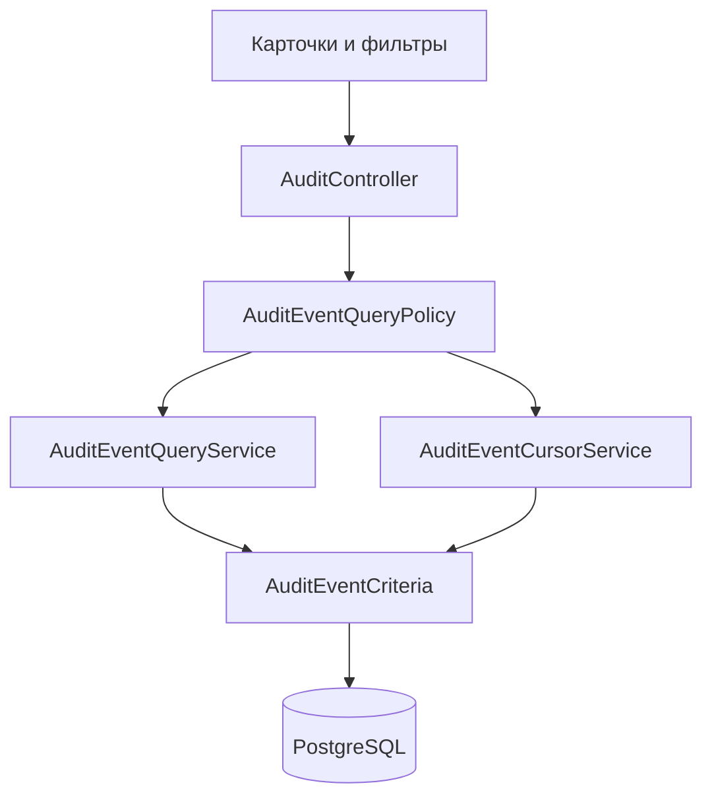

# Центр расследования событий — этап 7.5B.1

## Состояние и область изменения

Сводка и категории журнала реализованы на сервере. Выход в production
не утверждён. Проверки безопасности, права, миграции, лимиты экспорта
и существующий журнал не заменяются. Корреляция, проверка целостности,
очередь доставки и серверное подтверждение preview — отдельные этапы.

## Контракт

`GET /api/admin/audit-events/summary` принимает те же фильтры, что журнал:
`dateFrom`, `dateTo`, `userId`, `userEmail`, `organizationId`, `eventType`,
`category`. Обе даты обязательны, обе границы проверяются существующей
политикой; конец периода не включается. Сводка охватывает весь интервал,
а не страницу. Один агрегирующий SQL-запрос группирует записи по типу.
Таймаут транзакции — 10 секунд. Никаких изменений записей или схемы БД.

| Счётчик | Семантика |
| --- | --- |
| Всего | Все записи, включая исторические неизвестные коды |
| Успешные | Явно определённый перечень успешных операций |
| Отказы | Неудачный вход, отказ маршрутизации AI, rate limit |
| Критические | Обнаружение повторного использования refresh-токена |

Сигнал не равен доказанному инциденту. Критичность независима от результата.
Ошибка выполнения не является отказом доступа. Сумма групп не обязана
равняться общему количеству. Полный перечень задаётся классом
`AuditEventClassification`; все 59 известных типов отнесены к категории.

Фильтр `metric` используется в списке, курсорном запросе и выгрузке;
сводка игнорирует только собственный фильтр `metric`, чтобы соседние
карточки показывали доступные результаты. Категория применяется ко всем
запросам. При выборе карточки сбрасывается страница, при смене категории —
также точный тип события и предыдущая карточка. Остальные фильтры сохраняются.
Ошибка сводки не подменяется нулём. Таблица остаётся доступна.

### Рабочая область журнала

- Выбор карточки или категории сворачивает подробную форму и поднимает
  таблицу к сводке. Период и активные условия остаются видимыми;
  результаты, кнопки CSV и пагинация не скрываются.
- «Показать фильтры» возвращает расширенную форму; ручное изменение
  высоты и полный спуск до подвала остаются доступными.
  Неприменённые фильтры нельзя скрыть быстрым переходом.
- Справочник организаций отображается отдельным всплывающим слоем
  с внутренней прокруткой; число совпадений не меняет высоту формы.
  Поиск, выбор UUID, права и серверная область отчёта не изменены.
- При смене страницы или набора записей прокрутка таблицы возвращается
  к началу. Пустое состояние не подменяется устаревшими записями.

## Границы доступа и критерии приёмки

- ADMIN: только организация текущего пользователя; явная чужая запрещена.
- SUPER_ADMIN: доступ к платформе и заданной организации.
- USER: сводка закрыта теми же правилами, что и журнал.
- Совпадение счётчиков и выборки при неизменных данных; независимые HTTP
  запросы могут видеть новые записи между обновлениями.
- Проверка пустого результата, недоступной сводки, смены фильтров,
  устаревшего запроса, пагинации, CSV, изоляции и ограничения периода.
- Нагрузочный тест агрегата на staging с объёмом, соответствующим
  предполагаемому production. Требуются EXPLAIN ANALYZE, p95 и таймауты.
  Без этих измерений масштабируемость на больших объёмах не подтверждена.

## Следующие шаги

1. 7.5B.2 — серверное подтверждение preview: привязка доказательства к
   организации, пользователю, текущей версии, содержимому и сроку; атомарная
   защита от повторного использования и конкурентного сохранения; явное
   подтверждение блокировки всех моделей; негативные тесты и аудит.
2. 7.5B.3 — идентификатор запроса от сервера, сквозная передача в события,
   поиск по точному значению, tenant isolation и маскирование секретов.
   Исторические события без идентификатора остаются без него.
3. 7.5B.4 — эксплуатационный статус доставки и доказуемая целостность:
   метрики pending/dead-letter/возраст, защищённая диагностика, политика
   хранения, внешний контроль неизменности/сверка, тесты восстановления.
4. 7.5C — изолированный staging, мониторинг, TLS, резервирование, restore,
   измерение RPO/RTO и проверка отказов.
5. 7.6 — единая матрица тестов, актуальные доказательства, повторная оценка
   угроз и итоговое решение GO/NO GO на точном commit SHA.

До прохождения всех критериев действует NO GO.
