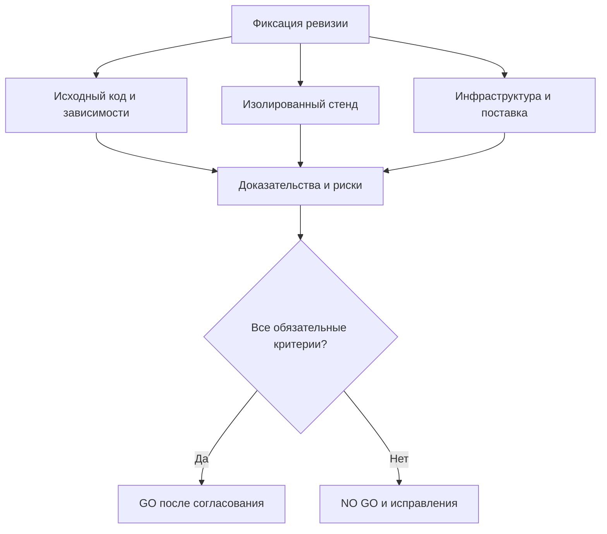
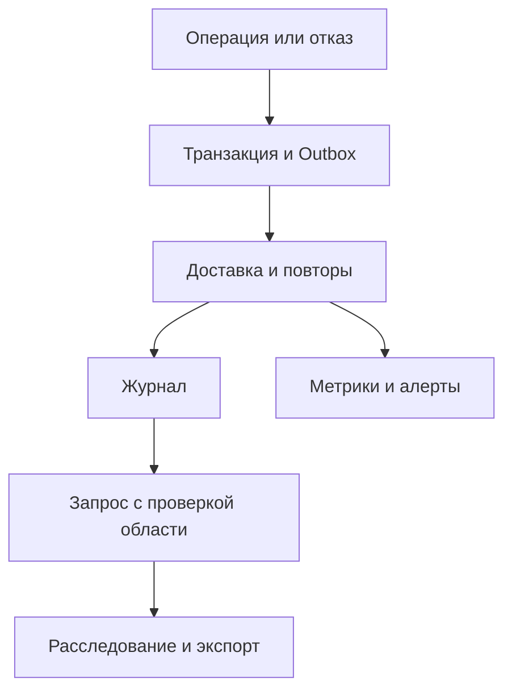

# SafeAI Desk — программа полной production-приёмки

Дата базового среза: 20.11.2026. Статус: **NO GO до получения полного комплекта доказательств**.
Этот документ — инженерный регламент, не сертификат соответствия.

## 1. Цели, границы и принципы

- Проверить все доверительные границы, роли, сущности, API, фоновые процессы и инфраструктуру.
- Не ослаблять существующие пороги покрытия, Trivy, RBAC, миграции, CI и release gates.
- Не подменять реальные PostgreSQL/Redis/HTTPS/AI/S3 проверками на mock.
- Не переносить production-данные и действующие ключи в тестовое окружение.
- Не считать отсутствие ошибки доказательством: каждый контроль имеет позитивный,
  негативный и, где применимо, конкурентный сценарий.
- Все активные испытания, включая отказоустойчивость, выполняются на отдельно
  согласованном изолированном стенде. Не атаковать сторонние сервисы.

Ориентиры: [OWASP ASVS](https://owasp.org/www-project-application-security-verification-standard/),
[OWASP GenAI Security](https://genai.owasp.org/llm-top-10/),
[NIST SSDF](https://csrc.nist.gov/pubs/sp/800/218/final).
Не заявляем соответствие этим стандартам до сопоставления и независимого подтверждения.

## 2. Контуры проверки



| Контур | Проверяем | Доказательства |
| --- | --- | --- |
| Код | Java, TS, API, SQL, конфигурация | Ревью, SAST, тесты, coverage |
| Приложение | Роли, API, UI, фоновая обработка | JUnit, Playwright, протоколы |
| Данные | Изоляция, удаление, целостность | PostgreSQL, Redis, S3 |
| Поставка | Образы, SBOM, подпись, CI | Trivy, CodeQL, release manifest |
| Эксплуатация | TLS, сеть, мониторинг, backup | Staging, restore, измерения |

## 3. Роли и тестовые данные

Создать две клиентские организации A и B, платформенную организацию, суперадминистратора,
по администратору и пользователю в A/B, отключённые аккаунты и организацию, отдельного
субъекта для удаления данных. Идентификаторы объектов A/B должны быть известны тестам,
чтобы проверять прямую подстановку чужих UUID. Данные синтетические, без реальных ПДн.

| Роль | Платформенные данные | Объекты своей организации | Чужие объекты |
| --- | --- | --- | --- |
| Неавторизованный | Запрет | Запрет | Запрет |
| Пользователь | Запрет | Только разрешённые владельцу/ACL | Запрет |
| Администратор | Запрет | Только в рамках роли и организации | Запрет |
| Суперадминистратор | По правам | По правам | Только явно разрешённые операции |
| Сервисная роль | Только по назначению | Только по назначению | По назначению |

Проверять каждый endpoint по фактическому серверному контракту, включая отсутствие
лишних полей ответа и отсутствие побочных эффектов при отказе.
Вход через интерфейс не заменяет проверку непосредственного HTTP-запроса.

## 4. Этапы и контрольные ворота

| Этап | Задача | Условие завершения |
| --- | --- | --- |
| 7.5A | Baseline и каталог событий | Инвентарь, контракт и отчёт |
| 7.5B | Усиление серверной безопасности | Негативные и конкурентные тесты |
| 7.5C | Готовность эксплуатации | Staging, backup/restore, алерты |
| 7.6 | Независимая полная приёмка | Матрица и повторный аудит |
| 8 | Развёртывание | GO, утверждённый release и rollback |

### 7.5B — обязательное серверное подтверждение политики AI

В исходном контракте сохранение не требовало ранее выданного серверного
подтверждения preview. Ниже — требования к усилению и границы приёмки.

1. Авторизованный preview проверяет область организации и исходную версию политики,
   нормализует черновик на сервере, вычисляет хеш всех влияющих полей и результат.
2. Сервер сохраняет одноразовый непрогнозируемый идентификатор подтверждения,
   связанный с actor, org, expectedVersion, хешем, версией схемы проверки и сроком.
   Токен не выводится в лог, аудит или URL. Срок ограничен, например 5 минут.
3. Осознанное подтверждение блокировки всех моделей — отдельное явное действие,
   связанное с тем же результатом preview. Нельзя заменить произвольным boolean.
4. Save атомарно валидирует и погашает подтверждение под блокировкой, повторяет
   критические проверки (суммы, валюта, каталог, маршрутизация, права, актуальная версия).
   При изменении контекста требует новую симуляцию; при неудачном save не создаёт версию.
5. Успешный retry с тем же idempotency key и телом не создаёт дубли; иной payload
   с тем же ключом отклоняется. Два конкурентных сохранения — максимум одна версия.
6. Новая миграция append-only, ограничение срока, cleanup, ограничение выдачи proof,
   секреты и артефакты не попадают в API read models; UX корректно обрабатывает 409/422.

Нельзя внедрять только frontend-проверку либо отключать старые проверки.
Подтверждение проверяется на всех путях создания новой версии политики.

#### 7.5B.2 — реализация и проверка

- Preview выдаёт случайный UUID на 300 секунд; V93 хранит только SHA-256
  идентификатора, хеш черновика и контекста, actor и организацию.
- На пару actor/организация действует один актуальный proof; новый preview
  заменяет предыдущий. Сохранение обязательно подтверждается и при отключении правил.
- Под блокировкой организации повторно оценивается контекст маршрутизации.
  Изменение значимого результата, каталога или лимитов требует нового preview.
- Повтор того же запроса в срок действия proof возвращает созданную версию,
  не создавая повторной записи, версии и события аудита. Другой черновик отклоняется.
- Блокировка всех моделей требует отдельного согласия; в аудит не попадает
  идентификатор proof. Привилегии V93 ограничены чтением, удалением и нужными
  столбцами записи; опубликованные миграции остаются неизменными.
- Это подтверждение конфигурации, а не гарантия будущего вызова AI.
  Все действующие проверки маршрутизации и фактического бюджета сохраняются.

Приёмка: unit, PostgreSQL-конкурентность, откат транзакции, контроль ACL
чистой и обновлённой базы, неизменность миграций, frontend и браузерные сценарии.
До подтверждения этих проверок в актуальном окружении release остаётся NO GO.

### 7.5C — инфраструктура

Подписанный release manifest, точные digest образов, строгий Trivy, проверка
происхождения артефактов, SSH без паролей и публичного root, ограничение входящих
портов, внутренние базы вне публичной сети, минимальные привилегии и TLS.
Выполнить испытания отказов и восстановление в чистой среде. Измерить RPO/RTO
относительно заранее утверждённых владельцем целей. Не придумывать допустимые значения.

## 5. Журнал как центр расследования

Сначала доказать фактическую регистрацию событий, затем расширять интерфейс.
Реестр event types, результат и severity — разные понятия: ошибка пользователя
не обязательно критический инцидент, восстановление доставки — не ошибка.



Нужны отдельные тесты для каждого реально достижимого пути каждого типа события:
успех, отказ, rollback, дублирование, сбой outbox, повтор, DLQ и восстановление.
Отдельно: неизвестные/устаревшие типы не теряются, корреляция безопасна, никакой
JWT, пароль, ключ, исходный промпт, содержимое документа или персональные данные
сверх минимально необходимого объёма не раскрываются.

Будущая реализация центра расследования после baseline:

- Серверные категория, outcome и severity с версионированной семантикой.
  KPI считают весь доступный набор по тем же фильтрам, что строки и CSV.
- Нажатие карточки, в том числе с нулём, устанавливает серверный фильтр.
  Разделять невыполненную операцию, запрет политики, предупреждение,
  успешное событие и неизвестный исторический результат.
- Индексируемая корреляция запроса, валидируемая и ограниченная по длине.
  Не считать произвольный внешний correlation ID доказательством подлинности.
- Allowlist безопасных прежних/новых значений; запрет выгрузки секретов.
- Существующие ограничения пагинации, экспорта и ролей сохраняются.
- Отображение состояние доставки/outbox из защищённых агрегатов, не сырых payload.
- Контроль подмены и независимое хранение: модель угроз для привилегированного
  администратора БД, внешний защищённый архив и проверка цепочки доказательств.
  Не заявлять неизменяемость только на основании запрета UPDATE для app role.
- Регламент хранения и удаления, legal hold при применимости, защищённый экспорт
  с учётом роли, области запроса, времени, количества и контрольной суммы.

## 6. Запуск локального тестового контура

В корне **полного** checkout, с Java 21, Node 24, npm 11, Docker/Testcontainers,
доступом к реестрам, локальным Chromium и актуальным origin/main:

```bash
bash infra/scripts/run-production-audit.sh --static
git fetch --no-tags origin main:refs/remotes/origin/main
bash infra/scripts/run-production-audit.sh --local --confirm-isolated
```

Локальный сценарий выполняет существующие строгие gates, frontend, Maven,
проверки отчётов, concurrency/performance и browser UI (mock API). Не развёртывает
стенд, не запускает production, не отправляет реальный запрос AI-провайдеру.
Логи сохраняются в закрытом временном каталоге. Отчёты могут содержать тестовые
идентификаторы: просматривать локально, перед передачей санитизировать.

Затем отдельно выполнить действующие workflows CI и согласованные staging jobs,
сохраняя обязательные проверки, в частности security-ci, docker-ci, performance-ci,
redis-topology-ci, provider-data-assurance, acceptance-staging и production-release.
Проверка отчётов не заменяет факт запуска: требовать неизменяемой связи с SHA,
версией образа и конкретным workflow attempt.

## 7. Риски, доказательства и GO / NO GO

Для каждой строки матрицы указать статус: PASS / FAIL / BLOCKED / NOT RUN / N/A.
N/A допустим только с обоснованием неприменимости и согласованием владельца риска.
Никаких автоматических PASS по наличию теста в исходниках.

| Приоритет | Определение | Действие |
| --- | --- | --- |
| P0 | Обход доступа, чужие данные, секрет, компрометация выпуска | NO GO |
| P1 | Существенный риск безопасности, потери/расходов/целостности | NO GO |
| P2 | Ограниченный риск, деградация удобства/наблюдаемости | Исправить или согласовать |
| P3 | Незначительный дефект | План исправлений |

Карточка замечания: ID, SHA, окружение, роль, предусловия, минимальный
воспроизводимый сценарий, факт и ожидаемое поведение, влияние, severity, владелец,
исправление, регрессионный тест, доказательство повторной проверки.

GO требует:

- Все P0/P1 и обязательные security gates закрыты, нет невыполненных обязательных тестов.
- Подтверждённые данные и бюджет, RPO/RTO, SLO, отказоустойчивость и изоляция.
- Staging с теми же digest и конфигурационным профилем, что утверждённый release.
- Отсутствие неподтверждённых исключений сканера; политика CRITICAL и исправимых
  HIGH/CRITICAL не ослабляется. Скан от даты выпуска, не прошлой сборки.
- Доказаны целостность релиза, безопасный rollback и восстановление с резервной копии.
- Владелец продукта, безопасности и эксплуатации согласовали фактический отчёт.

NO GO позволяет исправлять и повторять тесты. Не является указанием удалить данные,
перезапустить production либо обходить блокировку релиза.
