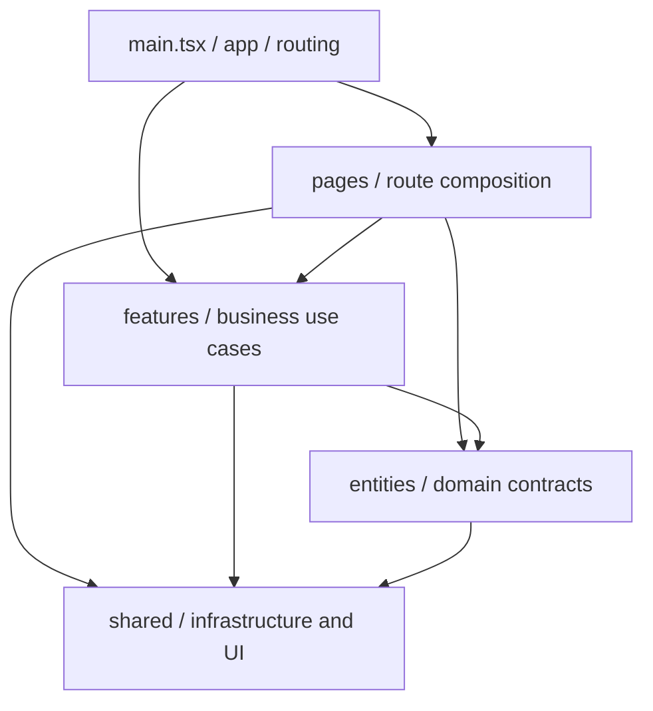

# SafeAI Desk — Frontend

> **Актуализация документа: 25 октября 2026 года.**
> **Размещение:** `SafeAI-Desk/frontend/README.md`.
> **Рабочая ветка:** `refactor/frontend-audit-boundary` (состояние до документирующего коммита).
> **Основа:** предыдущий полный README от 24.10.2026, пакет актуальных изменений `frontend-review-after-ci.zip`, файлы патчей v6–v9 и результаты запуска команд на Mac 25.10.2026.
> **Проверенный статус:** `npm run ci` — **PASS**, 127 файлов Vitest / **1 155 тестов**, TypeScript — PASS, ESLint — **0 ошибок / 0 предупреждений**, Vite production build и `verify:bundle` — PASS. Новый строгий аудит зависимостей включён в `architecture:check` и пройден.
> **Версия приложения:** `0.1.0` (`frontend/package.json`). Документ описывает рабочее дерево, а не опубликованный release; серверные E2E, production backend и Node.js 24 не проверялись данным локальным прогоном.

## Содержание

1. [Назначение и возможности](#1-назначение-и-возможности)
2. [Технологии и системные требования](#2-технологии-и-системные-требования)
3. [Быстрый старт](#3-быстрый-старт)
4. [Команды разработки и CI](#4-команды-разработки-и-ci)
5. [Архитектура и правила зависимостей](#5-архитектура-и-правила-зависимостей)
6. [Структура каталогов](#6-структура-каталогов)
7. [Маршруты и роли](#7-маршруты-и-роли)
8. [Описание модулей по слоям](#8-описание-модулей-по-слоям)
9. [API-контракты и работа с backend](#9-api-контракты-и-работа-с-backend)
10. [Основные пользовательские сценарии](#10-основные-пользовательские-сценарии)
11. [Безопасность и границы гарантий](#11-безопасность-и-границы-гарантий)
12. [UI, стили и доступность](#12-ui-стили-и-доступность)
13. [Тестирование и качество](#13-тестирование-и-качество)
14. [Правила внесения изменений](#14-правила-внесения-изменений)
15. [Конфигурация сборки и развёртывание](#15-конфигурация-сборки-и-развёртывание)
16. [Известные ограничения и задачи](#16-известные-ограничения-и-задачи)
17. [Реестр файлов по подтверждённому срезу](#17-реестр-файлов-по-подтверждённому-срезу)

## 1. Назначение и возможности

**SafeAI Desk Frontend** — интерфейс корпоративного приложения для работы с AI-моделями, чатами, базами знаний, пользователями и административными функциями. Клиент реализован как SPA на React и TypeScript. Источником истины о пользователе, правах, организациях, квотах, операциях и состояниях данных является backend.

Функциональные области:

| Область | Возможности |
| --- | --- |
| **Auth** | Вход, проверка сессии, выход, обработка 401/429 и временной недоступности, синхронизация состояния между вкладками |
| **Chat** | Список чатов, создание, переименование и архивирование, история сообщений, отправка AI-запросов, состояния обработки, восстановление результатов, данные об использовании и стоимости |
| **Knowledge** | Каталог баз знаний, поиск и фильтры, управление доступом, документы и версии, загрузка, скачивание, безопасный предпросмотр и переиндексация |
| **Users** | Список сотрудников, фильтрация, создание, изменение, роли, блокировка/разблокировка, сброс пароля, контролируемое постоянное удаление |
| **Organizations** | Каталог организаций, создание и администрирование, проверка последствий деактивации |
| **Audit** | Журнал событий, фильтры по датам/действиям/инициаторам/организациям, подробности, экспорт CSV текущей страницы |
| **Usage** | Статистика токенов и стоимости, разрезы по сотрудникам/моделям/дням, периодам и организациям, графики и CSV |
| **Models** | Каталог моделей, конфигурации/политики, runtime-диагностика, история версий и сведения о маршрутизации модели |

Внешний интерфейс — **на русском языке**; технические имена контрактов, типов, статусов и методов сохраняются в согласованном с backend виде.

## 2. Технологии и системные требования

Версии сверены с доступным `frontend/package.json` и изменениями рабочей ветки на 25.10.2026. Эти версии **не обновлялись** в патчах v6–v9; уточнять их по фактическим `package.json` и `package-lock.json` при следующем обновлении зависимостей. Локальный CI запущен на **Node.js 26.5.0** с параметром `NODE_OPTIONS=--no-experimental-webstorage`, хотя объявленный `engines.node` по-прежнему требует **Node.js 24.x**. Совместимость и CI на заявленной Node 24.x следует подтвердить отдельно.

| Зависимость / инструмент | Версия / требование | Назначение |
| --- | --- | --- |
| Node.js | `>=24.0.0 <25` | Исполнение dev/build/test-инструментов |
| npm | `>=11.0.0 <12`; `packageManager: npm@11.17.0` | Воспроизводимая установка зависимостей |
| React / React DOM | `19.2.7` | UI и React Hooks |
| React Router DOM | `7.18.3` | Клиентская маршрутизация |
| TypeScript | `6.0.3` | Строгая типизация и проверка контрактов |
| Vite | `8.0.16` | Dev-сервер, production build |
| Vitest | `4.1.10` | Unit и компонентные тесты |
| Testing Library / JSDOM | `16.3.2` / `29.1.1` | Тестирование React-интерфейса |
| Recharts | `3.9.2` | Визуализация статистики |
| ESLint | `9.39.5` | Статический анализ; TypeScript, React Hooks, accessibility |

Типы версий зафиксированы в `package-lock.json`; для повторяемой установки используется `npm ci`, а не произвольное обновление пакетов.

**Требования к браузеру:** современный браузер, поддерживающий используемые Web API. Критически важно наличие **Web Locks API для безопасной координации обновления сессии между вкладками**. Для production требуется HTTPS/secure context. Список официально поддерживаемых браузеров необходимо закрепить после E2E-проверки — в этом снимке браузерная матрица не зафиксирована.

## 3. Быстрый старт

Команды выполняются **из `frontend/`**, если не указано иное.

```bash
# Из корня монорепозитория SafeAI-Desk
cd frontend

node --version  # должен быть Node 24
npm --version   # должен быть npm 11
npm ci
npm run dev
```

Локальная конфигурация `vite.config.ts`:

- dev-сервер: `http://127.0.0.1:5173`;
- запросы `/api` проксируются на `http://127.0.0.1:8080`;
- preview production build: `http://127.0.0.1:4173`;
- `strictPort: true`: при занятом порте Vite не выбирает случайный другой порт.

При локальной работе с Node.js 26 (вне объявленного `engines`) для текущего окружения Vitest использован обход проблемы experimental Web Storage:

```bash
NODE_OPTIONS=--no-experimental-webstorage npm run ci
```

Это **не замена** проверке на официально поддерживаемой Node.js 24 и **не рекомендация** менять диапазон `engines` без согласованного обновления окружения.

Для работы с реальными данными требуется отдельно поднятый совместимый backend на порту 8080. Этот README не объявляет backend-реализацию частью Frontend.

**macOS/Linux — полная локальная проверка:**

```bash
bash ./install-and-check.sh
```

**Windows:**

```bat
install-and-check.cmd
```

Скрипты проверяют версии Node/npm, затем запускают установку, архитектурные проверки, типизацию, lint, тесты, coverage и сборку. Они **не выполняют `git clean`, не удаляют исходники и не делают commit**.

## 4. Команды разработки и CI

Команды заданы в `package.json`:

| Команда | Назначение |
| --- | --- |
| `npm run dev` | Локальный Vite-сервер |
| `npm run typecheck` | `tsc -b --pretty false`: проектные TypeScript references |
| `npm run lint` | `eslint . --max-warnings=0` |
| `npm run architecture:check` | 7 тестов архитектурных правил/анализатора → проверка импортов и ограничений слоёв → проверка расположения исходников → `audit-dependencies.cjs --strict` |
| `npm run test` | Однократный полный Vitest run |
| `npm run test:watch` | Vitest в режиме разработки |
| `npm run test:coverage` | Vitest + V8 coverage |
| `npm run build` | TypeScript → Vite production build → проверка бандла |
| `npm run preview` | Просмотр собранного приложения |
| `npm run check` | Архитектура → lint → тесты → build |
| `npm run ci` | Архитектура (включая **strict dependency audit**) → lint (`--max-warnings=0`) → coverage → TypeScript/Vite build/verify:bundle |
| `npm run audit:prod` | `npm audit --omit=dev --audit-level=high` |

**Фактическая цепочка `architecture:check` на 25.10.2026** (`package.json` после v9):

```bash
node --test scripts/architecture-feature-rules.test.cjs scripts/audit-dependencies.test.cjs
node scripts/check-architecture.cjs
node scripts/verify-source-layout.cjs
node scripts/audit-dependencies.cjs --strict
```

Строгий анализатор записывает отчёты в `${HOME}/SafeAI-Audit/safeai-frontend-dependencies.md` и `.json` (если явно не задан `--out`); это **результаты проверки**, а не файлы для коммита. `npm run ci` запускает перечисленные команды посредством `architecture:check` и требует ноль замечаний ESLint.

Например, перед pull request:

```bash
npm ci
npm run architecture:check
npm run typecheck
npm run lint
npm run test
npm run test:coverage
npm run build
```

> **Важная зависимость от репозитория:** `npm run build` вызывает `verify:bundle` → `node ../scripts/verify-build.mjs`. Этот скрипт расположен **за пределами `frontend/`**, в корневом `scripts/` монорепозитория. Сборка не будет полностью воспроизводима из одного изолированного ZIP папки `frontend`, если внешний скрипт отсутствует.

## 5. Архитектура и правила зависимостей

Принята **слойная feature-oriented структура**. Это не буквальная гарантия строгой реализации всех ограничений FSD: архитектурный checker и новый strict-аудитор автоматически проверяют описанные ниже классы импортов и циклов. Разрешённые горизонтальные связи между features выводятся в отчёт **как направления зависимости, а не как ошибки**; циклы features отдельно контролируются.



### Ответственность слоёв

- **`app/`** — маршруты, auth-provider, shell приложения, общие состояния переходов.
- **`pages/`** — точки входа маршрутов. Собирают контроллеры и представления, подключают стили и error boundary; не должны превращаться в монолиты с сетевой и доменной логикой.
- **`features/<feature>/`** — функциональные сценарии: контроллеры, UI, операции, API-фасады, тесты, локальные стили.
- **`entities/<entity>/`** — доменные типы, валидаторы и API-клиенты сущностей (`user`, `organization`, `knowledge`, `model`).
- **`shared/`** — HTTP/CSRF/auth coordination, валидаторы wire-контрактов, примитивы UI, общие утилиты, глобальные стили.
- **`test/`** — общая среда тестирования и переиспользуемые фикстуры; production-код не должен зависеть от тестовых данных.

### Разрешённое направление

```text
app      → pages, features, entities, shared
pages    → features, entities, shared
features → entities, shared
entities → shared
shared   → shared
```

Запрещены зависимости `shared → entities/features/pages/app`, `entities → features/pages/app`, `features → pages/app`. Дополнительно отдельным контрактом запрещено `audit → admin`: аудит обращается к собственному API-фасаду, а не к admin-совместимости. Разрешённые связи `features → features` отслеживаются в отчёте; циклических групп на 25.10.2026 нет. Не следует допускать новых скрытых направлений без ревью.

### Внутренние директории feature

| Каталог | Содержимое | Правило |
| --- | --- | --- |
| `api/` | Клиентские функции и парсеры HTTP-ответов, совместимые фасады | Сетевые контракты не дублировать в UI |
| `controller/` | React Hooks, orchestration, операции и контроль состояния | Управляет жизненным циклом, не верстает экран целиком |
| `hooks/` | Исторически выделенные узкоспециализированные Hooks | Например, `features/audit/hooks`; не переносить без проверки импортов |
| `lib/` | Pure helpers, форматирование, фильтрация, вычисления, вспомогательные фасады | Не размещать сюда большие экранные контроллеры без причины |
| `model/` | Feature-level типы и состояния, не равные backend entity | Например, фильтры каталога знаний |
| `ui/` | Компоненты, модальные окна, таблицы, формы, графики | Не должны зависеть от `pages` |
| `styles/` | Локальные CSS-файлы feature | Подключаются из нужной точки входа/компонента |
| `constants/` | Локальные константы | Например, типы событий аудита |

**Расположение компонентов:** в `features/models/` экранные представления размещены в `ui/`, а управляющие хуки — в `controller/`. В `features/chat/controller/` ещё находятся отдельные `*.tsx` представления: это существующее локальное исключение, а не правило для новых модулей. Переносить их без отдельного плана и регрессионных тестов не следует.

**Правило импортов:** используются относительные ESM import/export, а не неописанные aliases. При перемещении файла обновлять **все** обычные импорты, `import type`, `vi.mock()`, динамические импорты, CSS-импорты и тесты.

## 6. Структура каталогов

Ниже показана **актуализированная структура для текущего обсуждения**, включая подтверждённые на скриншотах директории. Это описание структуры исходников, а не отчёт об успешной сборке или полный вывод `git ls-files`.

```text
SafeAI-Desk/
├── scripts/
│   └── verify-build.mjs           # внешний относительно frontend скрипт (наличие проверить в Git)
└── frontend/
    ├── README.md                  # этот документ
    ├── .gitignore
    ├── eslint.config.mjs
    ├── index.html
    ├── package.json
    ├── package-lock.json
    ├── vite.config.ts
    ├── tsconfig.json
    ├── tsconfig.app.json
    ├── tsconfig.test.json
    ├── tsconfig.node.json
    ├── install-and-check.sh
    ├── install-and-check.cmd
    ├── STATIC_CHECK_REPORT.json   # исторический отчёт, не текущий статус CI
    ├── scripts/
    │   ├── architecture-feature-rules.cjs
    │   ├── architecture-feature-rules.test.cjs
    │   ├── audit-dependencies.cjs
    │   ├── audit-dependencies.test.cjs
    │   ├── check-architecture.cjs
    │   └── verify-source-layout.cjs
    └── src/
        ├── main.tsx
        ├── vite-env.d.ts
        ├── app/
        │   ├── App.tsx
        │   └── App.test.tsx
        ├── pages/                   # маршруты и их тесты
        │   ├── LoginPage.tsx
        │   ├── ChatPage.tsx
        │   ├── KnowledgePage.tsx
        │   ├── KnowledgeDetailsPage.tsx
        │   ├── AdminUsersPage.tsx
        │   ├── AdminOrganizationsPage.tsx
        │   ├── AdminAuditPage.tsx
        │   ├── AdminUsagePage.tsx
        │   ├── AdminModelsPage.tsx
        │   └── *.test.tsx
        ├── entities/
        │   ├── user/{api,domain}/
        │   ├── organization/{api,lib}/
        │   ├── knowledge/api/knowledge/
        │   └── model/api/model/
        ├── features/
        │   ├── admin/api/
        │   ├── admin-organizations/{lib,styles,ui}/
        │   ├── admin-users/{controller,lib,styles,ui}/
        │   │   ├── ui/dialogs/
        │   │   └── ui/adminUsersView/
        │   ├── audit/{api,constants,controller,hooks,lib,styles,ui}/
        │   │   ├── api/adminAudit/
        │   │   └── ui/auditFilters/
        │   ├── auth/{api,controller,state,ui}/
        │   ├── chat/{api,controller,lib,ui}/
        │   │   ├── api/chat/
        │   │   └── controller/operations/
        │   ├── knowledge/{controller,lib,model,styles,ui}/
        │   │   ├── ui/details/
        │   │   └── ui/knowledgeMembers/
        │   ├── models/
        │   │   ├── controller/          # загрузка/операции/диагностика, НЕ экранные компоненты
        │   │   ├── styles/              # оформление рабочей области управления моделями
        │   │   └── ui/
        │   │       ├── access/          # правила организаций
        │   │       ├── catalog/         # таблица, регулируемая область
        │   │       ├── catalogVersion/  # создание/редактирование версии каталога
        │   │       ├── diagnostics/     # диагностика модели и маршрутизации
        │   │       ├── modelControlPlane/
        │   │       ├── modelControlPlaneViews/  # viewPresentation.tsx + viewPresentationLabels.ts
        │   │       ├── modelPolicyModal/    # пять вкладок; policyFormTabsConfig.ts, policyModalLabels.ts
        │   │       ├── modelPolicySelectors/
        │   │       ├── overview/        # обзор моделей и доступности
        │   │       ├── modelsNavigationState.ts    # значения разделов и парсер URL
        │   │       └── modelConfigurationReadiness.ts  # предварительная сводка, не authorization
        │   └── usage/{api,controller,lib,styles,ui}/
        │       ├── api/adminUsage/
        │       └── api/usage/
        ├── shared/
        │   ├── api/http/
        │   ├── lib/hooks/
        │   ├── styles/
        │   └── ui/
        │       ├── modal/
        │       └── resizableScrollRegion/
        └── test/
            ├── fixtures/
            └── setup.ts
```

**Новые модули после разделения React Fast Refresh (25.10.2026):** `features/models/ui/modelsNavigationState.ts`, `modelConfigurationReadiness.ts`, `modelControlPlaneViews/viewPresentationLabels.ts`, `modelPolicyModal/policyFormTabsConfig.ts`, `modelPolicyModal/policyModalLabels.ts` и `features/admin-organizations/ui/organizationTypeDescription.ts`. В `.tsx` остались React-компоненты, в `.ts` — типы, чистые функции и конфигурация; бизнес-операции, API и RBAC не переносились этими шестью файлами.

**Важно о видимых в IntelliJ папках:** `frontend/node_modules/` — установленные зависимости, `frontend/dist/` — результат сборки, `frontend/coverage/` — результаты тестового покрытия. На скриншотах они присутствуют локально, но **не являются частью архитектуры `src`** и не должны попадать в коммит. Исключения проверяются в `.gitignore` и через `git status`.

Фигурные скобки (`{api,lib,...}`) означают набор подкаталогов. Полный файловый реестр на основании предоставленного среза и новых изменений приведён в [разделе 17](#17-реестр-файлов-по-подтверждённому-срезу).

## 7. Маршруты и роли

Маршруты проверены по `src/app/App.tsx`:

| URL | Страница | Доступ на уровне UI |
| --- | --- | --- |
| `/` | `RootRedirect` | Перенаправление: `SUPER_ADMIN → /admin/users`; прочие аутентифицированные → `/chat`; гость → `/login` |
| `/login` | `LoginPage` | Гость; аутентифицированный перенаправляется |
| `/chat` | `ChatPage` | `ADMIN`, `USER` |
| `/knowledge` | `KnowledgePage` | `ADMIN`, `USER` |
| `/knowledge/:knowledgeBaseId` | `KnowledgeDetailsPage` | `ADMIN`, `USER`; объектные разрешения отдельно |
| `/admin/users` | `AdminUsersPage` | `ADMIN`, `SUPER_ADMIN` |
| `/admin/organizations` | `AdminOrganizationsPage` | `SUPER_ADMIN` |
| `/admin/audit` | `AdminAuditPage` | `ADMIN`, `SUPER_ADMIN` |
| `/admin/usage` | `AdminUsagePage` | `ADMIN`, `SUPER_ADMIN` |
| `/admin/models` | `AdminModelsPage` | `ADMIN`, `SUPER_ADMIN` |
| `*` | `NotFoundRoute` | Экран «Страница не найдена» |

`ProtectedRoute` в `App.tsx` отвечает за **доступ на уровне интерфейса**, навигацию и корректную обработку `loading`, `unauthenticated`, `temporarily-unavailable`. Он **не заменяет** проверку роли и tenant scope на каждом backend endpoint.

В списке ролей используются `SUPER_ADMIN`, `ADMIN`, `USER`. Авторизованный пользователь по `AuthUser` имеет **ровно одну роль**, что валидируется при разборе ответа auth API.

## 8. Описание модулей по слоям

### 8.1. `src/main.tsx` и `src/app/`

- `main.tsx` — проверка DOM-элемента `#root`, создание React root, `React.StrictMode`, глобальный `ErrorBoundary`, `BrowserRouter`, импорт `shared/styles/index.css`.
- `app/App.tsx` — `AuthProvider`, shell/topbar, navigation, lazy-loaded страницы через `React.lazy`/`Suspense`, `ProtectedRoute`, экран отказа, корневой redirect, 404, выход из учётной записи.
- `app/App.test.tsx` — регрессионные тесты верхнеуровневых маршрутов и приложения.
- `vite-env.d.ts` — Vite type declarations.

### 8.2. `src/shared/api/` — HTTP и wire-контракты

| Файл | Ответственность |
| --- | --- |
| `http.ts` | Устойчивый фасад экспортов API-клиента, ошибок и вспомогательных методов; не дублировать в feature сетевой транспорт |
| `http/httpConfig.ts` | Конфигурация HTTP и таймаутов |
| `http/httpPaths.ts` | Проверка `VITE_API_BASE_URL`, same-origin адресов, ограничение запросов путями `/api/...` |
| `http/httpClient.ts` | Публичная реализация `apiRequest` и опции запроса |
| `http/httpTransport.ts` | Низкоуровневое выполнение и обработка сетевых запросов |
| `http/httpAuthFlow.ts` | CSRF и обработка authentication flow/refresh |
| `httpErrors.ts` | Ошибки API и безопасное представление ошибок для UI |
| `httpRequestSupport.ts`, `httpResponseSupport.ts` | Разбор и обеспечение корректности запросов/ответов |
| `authCoordinator.ts` | События авторизации между вкладками; `Web Locks` для взаимного исключения refresh |
| `runtime.ts` | Runtime-парсеры типов, UUID, enum, даты, decimal, пагинации; отклонение некорректного wire data |
| `query.ts` | Нормализация пагинации, построение query-string, безопасные URL/UUID path segments |
| `types.ts` | Общие роли, перечисления статусов, используемые несколькими features |

Принцип: серверный JSON сначала принимается как `unknown`, затем проверяется parser/validator. Нельзя подменять это `as SomeDto` ради прохождения `tsc`.

### 8.3. `src/shared/lib/` — общая предметно-независимая логика

| Файл | Назначение |
| --- | --- |
| `date.ts` | Строгие календарные даты, UTC/local границы суток, включительный период, ограничение длины диапазона, поддержка годов `0000–0099` |
| `format.ts` | Отображение времени, целых счётчиков, десятичных сумм USD без некорректного превращения `null` в ноль |
| `page.ts` | `PageResponse<T>`, проверки пагинационной структуры, явное преобразование массива в страницу |
| `password.ts` | Клиентская проверка парольной политики, Unicode и UTF-8 bytes |
| `secureUuid.ts` | Криптографически стойкие UUID через Web Crypto; отсутствие небезопасного `Math.random` fallback |
| `frontendErrorReporting.ts` | Локальный ID инцидента и событие `safeai:frontend-error`, без отправки приватного stack в production console |
| `hooks/useAutoClearMessage.ts` | Общий хук автоматического удаления временного сообщения |

### 8.4. `src/shared/ui/` — общие UI-примитивы

- `Modal.tsx` и `modal/*`: focus management, scroll locking/stacking, позиционирование, resize и lifecycle модальных окон.
- `ResizableScrollRegion.tsx` и `resizableScrollRegion/*`: регулируемая рабочая область, сохранение высоты, управление pointer/keyboard, разделение upper/lower/footer.
- `ErrorBoundary.tsx`, `PageErrorBoundary.tsx`: глобальные/страничные границы React ошибок.
- `StateBlock.tsx`: состояния `LoadingState`, `EmptyState`, `ErrorState`.
- `ConfirmDialog.tsx`: подтверждение опасных действий.

Общие компоненты не должны знать о бизнес-сущностях чата, аудита или конкретных страницах.

### 8.5. `src/entities/` — доменные модели

**User** — `entities/user/api/userApi.ts`, `entities/user/domain/userManagementRolePolicy.ts`:

- `User` — базовая запись пользователя со строго типизированной ролью, `version`, tenant ID и timestamps.
- `UserDetails = User & { organizationName: string | null }` — **отдельный контракт подробной записи**, не эквивалентен `User`; поле обязательно, хотя может быть `null`.
- `getUsers`, `searchUsers`, `getUserDetails`, `getUserStatistics`, create/update/roles/enabled/reset-password/permanent deletion.
- `expectedVersion` используется в мутациях для optimistic concurrency. Не удалять и не подставлять фиктивную версию.
- `userManagementRolePolicy.ts` — правила доступных операций по роли.

**Organization** — `entities/organization/api/organizationApi.ts`, `lib/organizations.ts`:

- `Organization`, `OrganizationDirectoryItem`, тип/защищённость организации;
- каталог, детали, поиск, создание, переименование, `getOrganizationDisableImpact`, disable/enable;
- контроль ограничений защищённых организаций и версии изменения.

**Knowledge** — `entities/knowledge/api/knowledgeApi.ts`, `knowledgeDocumentApi.ts`, поддиректория `api/knowledge/*`:

- `KnowledgeBase`, `KnowledgeBaseAccess`, документ, версия, состояние обработки, health индекса;
- роли доступа к базе, поиск/выдача каталогов, загрузка документов и новых версий, история версий, переиндексация;
- runtime parser/validator для внешних ответов.

**Model** — `entities/model/api/modelApi.ts`, `modelCatalogHistoryApi.ts`, `api/model/*`:

- типы каталога, runtime/route, policy, семантика и валидаторы модельных контрактов;
- API-фасад сохраняет публичные импорты, внутренние клиенты и парсеры разделены по назначению.

### 8.6. `src/features/auth/`

| Подмодуль | Что делает |
| --- | --- |
| `api/authApi.ts` | `login`, `getCurrentUser`, `logout`; парсер `AuthUser` |
| `state/authContext.definition.ts` | `AuthContextValue`, статусы auth, контекст |
| `state/AuthContext.tsx` | Последовательность auth-операций, обновление текущего пользователя, logout, отмена устаревших операций |
| `state/useAuth.ts` | Безопасное получение состояния авторизации |
| `controller/useLoginPageController.ts` | Состояние формы входа, double-submit guard, Retry-After, UX ошибок |
| `ui/LoginPageView.tsx` | Форма входа, semantic labels и состояния |

Состояния auth включают `loading`, `authenticated`, `unauthenticated`, `temporarily-unavailable`, `logout-unconfirmed`.

### 8.7. `src/features/chat/`

**Ключевые модули:**

- `api/chatApi.ts` — публичный facade методов чата и типов;
- `api/chat/chatClient.ts` — HTTP-вызовы, в том числе `/api/chats`, messages, capabilities, turn status и answer passport;
- `api/chat/chatTypes.ts`, `chatEnums.ts`, `chat*Parser.ts`, `chatValidation.ts` — строгие типы/парсеры;
- `controller/useChatPageController.ts` — публичный feature-controller и сборка состояния;
- `controller/operations/useChatSessionLifecycle.ts` — первичная загрузка, открытие чата и восстановление связанных данных;
- `controller/operations/chatDirectoryActions.ts`, `chatHistoryActions.ts` — операции со списком и историей;
- `controller/operations/chatTurnSubmission.ts`, `chatTurnFailures.ts`, `chatTurnReconciliation.ts`, `chatTurnUpdates.ts` — отправка, ошибки, reconciliation и применение успешного результата;
- `controller/ChatPageView.tsx`, `ChatSidebar.tsx`, `ChatConversationPanel.tsx`, `ChatPageDialogs.tsx` — видимые блоки страницы;
- `lib/chatPage.helpers.ts`, `chatPageSupport.ts` — объединение сообщений, pending turn, расчёт статусов, форматирование usage/pricing, задержки и вспомогательные функции.

**Изменения 25.10.2026:** фабрики операций в `useChatPageController.ts` создаются при вызове обработчиков, а не при React render (`react-hooks/refs`), при сохранении общих `sendInFlightRef`, `pendingTurnsRef`, `AbortController` и проверки идентичности `clientRequestId`. Добавлен регрессионный тест **двух быстрых отправок без дублирования POST** в `useChatPageController.lifecycle.test.tsx`. Это не перенос серверной транзакционности во frontend.

**Неизменяемые правила chat-turn:**

1. Для исходной операции создаётся один `clientRequestId` через secure UUID.
2. При сетевой неопределённости или `PROCESSING` состояние сначала проверяется по **тому же** `clientRequestId`; новый ключ автоматически не создаётся.
3. `AMBIGUOUS` и `IDEMPOTENCY_CONFLICT` не допускают бесконтрольного повтора с новым идентификатором.
4. Ответ сверяется с запрошенными `chatId`/`clientRequestId`; подтверждённые сообщения объединяются без дублирования.
5. `AnswerPassport` относится к конкретному `turnId`, а не просто к текущему открытому чату.
6. `costUsd: null` означает отсутствие подтверждённой стоимости, **не нулевую цену**.

Режимы знаний в чате: `GENERAL`, `KNOWLEDGE_ASSISTED`, `KNOWLEDGE_ONLY`. Доступность и ограничения режима определяются backend-контрактом и правами пользователя.

### 8.8. `src/features/knowledge/`

| Подмодуль | Назначение |
| --- | --- |
| `controller/useKnowledgeDirectoryController.ts` | Каталог баз, серверный поиск/фильтрация/пагинация, create/update |
| `controller/useKnowledgeDetailsPageController.ts` | Композиция страницы одной базы знаний |
| `controller/useKnowledgeDetailsData.ts` | Overview, access, health, страницы документов, refresh |
| `controller/useKnowledgeDocumentActions.ts` | Скачивание, предпросмотр и переиндексация документа |
| `controller/useKnowledgeUploadController.ts` | Создание документа/версии, validation, busy guard, состояние запроса |
| `controller/useKnowledgeVersionsController.ts` | Загрузка истории, открытие/скачивание версии |
| `lib/knowledgeFileTransfer.ts` | Проверка MIME+сигнатуры raster-файла, разделение preview и download |
| `model/knowledgeDirectoryTypes.ts` | Типы фильтров каталога |
| `ui/KnowledgeDirectoryWorkspace.tsx` | Каталог и карточки |
| `ui/KnowledgeDetailsWorkspace.tsx` | Композиция подробного представления |
| `ui/details/*` | Документы, версии, модальные окна, форматирование |
| `ui/knowledgeMembers/*` | Управление участниками базы и уровнями доступа |

Загрузка файла ограничена на клиенте **25 MiB** (`25 * 1024 * 1024`); backend обязан валидировать лимит, тип и содержимое независимо. После успешного upload ошибка последующего refresh **не должна отображаться как ошибка самого POST**.

### 8.9. `src/features/admin-users/`

- `ui/AdminUsersWorkspace.tsx` — композиция списка и диалогов;
- `ui/AdminUsersView.tsx`, `ui/adminUsersView/*` — список, фильтры, действия, детали;
- `ui/AdminUsersDialogs.tsx`, `ui/dialogs/*` — создание, редактирование, роли, пароль, удаление, включение;
- `lib/useAdminUsersDirectory.ts` — получение списка/поиск/пагинация и details;
- `lib/useAdminUserCreate.ts` — создание и проверка входных данных;
- `lib/useAdminUserMutations.ts`, `controller/*Mutations.ts` — доменные изменения с проверками полномочий, `expectedVersion`, double-submit protection и конфликтов; фабрики операций создаются внутри обработчиков, а не во время render, общий синхронный lock сохранён;
- `styles/*` — оформление страницы и контролов.

Правила: обычный `ADMIN` не может произвольно управлять чужой организацией; для чувствительных операций `SUPER_ADMIN` действуют отдельные политики; собственная запись и защищённые роли обрабатываются особенно строго. Эти клиентские проверки дополнены, но **не заменены**, backend ACL.

### 8.10. `src/features/admin-organizations/`

- `lib/useAdminOrganizationsDirectory.ts` — справочник/пагинация;
- `lib/useAdminOrganizationCreate.ts`, `useAdminOrganizationMutations.ts` — создание и мутации;
- `lib/adminOrganizationsSupport.ts` — вспомогательные правила;
- `ui/AdminOrganizationsView.tsx`, `AdminOrganizationDialogs.tsx`, `AdminOrganizationsUi.tsx` — интерфейс, подтверждения, формы;
- `ui/organizationTypeDescription.ts` — чистая функция описания типа организации (вынесена из TSX для корректного React Fast Refresh);
- `styles/*` — оформление раздела.

Опасное отключение организации использует оценку последствий (`OrganizationDisableImpact`); нельзя заменять подтверждение простым переключателем без согласования backend-правил.

### 8.11. `src/features/audit/`

- `controller/useAdminAuditController.ts` — фильтры, URL, страница, выбор события, оркестрация;
- `hooks/useAuditEvents.ts`, `useAuditDirectories.ts` — загрузка событий и справочников;
- `api/adminAuditApi.ts`, `api/adminAudit/*` — API, парсеры, sanitizer и типы;
- `lib/adminAudit.helpers.ts`, `constants/auditEvents.ts` — фильтры, пресеты дат и известные типы;
- `ui/AdminAuditPageView.tsx`, `AuditFilters.tsx`, `AuditTable.tsx`, `AuditPagination.tsx`, `AuditDetailsModal.tsx`, `auditCsv.ts`, `ui/auditFilters/*` — полный интерфейс журнала.

Инварианты: смена субъекта/организации/роли не должна показывать старую выдачу; `ADMIN` не получает произвольный организационный scope через URL/форму; CSV экспортирует **только события текущей загруженной страницы**, а не весь журнал. Детали события требуют sanitization и проверки выдачи на сервере.

**Изменение зависимостей 25.10.2026:** аудит использует собственный `features/audit/api/adminAuditApi.ts` вместо обратного импорта admin-фасада. Запрет `audit → admin` закреплён отдельным архитектурным правилом и тестами.

### 8.12. `src/features/usage/`

**API:** `api/usageApi.ts`, `api/adminUsageApi.ts`, подпапки `api/usage/*`, `api/adminUsage/*` — запросы, строгие парсеры, типы, coverage и валидация.

**Контроллеры:**

- `controller/useAdminUsageReport.ts` — выбранная вкладка, черновые/применённые фильтры, URL, смена страниц;
- `controller/useAdminUsageReportQuery.ts` — асинхронная загрузка с изоляцией контекста user/tenant;
- `controller/useAdminUsageModelOptions.ts`, `useAdminUsageOrganizationOptions.ts` — варианты фильтров и debounced search;
- `controller/useUsageWorkspace.ts` — UI-состояние раскрытия/сжатия рабочей области.

**Вспомогательные файлы:** `lib/adminUsageFilterState.ts` (UTC-даты/URL/нормализация), `adminUsagePresentation.ts` (подписи), `adminUsageReportLoader.ts` (выбор endpoint), `adminUsage.helpers.ts` и `adminUsagePageSupport.ts` (фасады совместимости), `usagePanelHeight.ts` (геометрия).

**Представление:** `ui/AdminUsageWorkspace.tsx`, `AdminUsageControls.tsx`, `UsageReportView.tsx`, `UsageKpis.tsx`, `UsageBreakdownChart.tsx`, `UsageDailyChart.tsx`, `usageCsv.ts`, `UsageFilterCombobox.tsx`.

Вкладки: `summary`, `users`, `models`, `daily`. Для `summary` и `users` используется серверная пагинация (размер страницы 50 в загрузчике отчёта); `models` и `daily` работают с соответствующими агрегированными выдачами. CSV формируется из **фактически полученных строк**, а не незагруженной БД. Даты usage выражаются через UTC start и **exclusive end**. Отдельно различаются отсутствие данных, нулевая сумма, неполная/неоценённая стоимость.

### 8.13. `src/features/models/` — каталог, доступ и диагностика

Раздел `/admin/models` содержит **четыре вкладки страницы**: «Обзор», «Каталог», «Доступ», «Диагностика». Это отдельная навигация от **пяти вкладок модального окна** редактирования правил: «Доступ», «Лимиты», «Бюджет», «Требования к данным», «Проверка».

| Подмодуль / файл | Ответственность |
| --- | --- |
| `controller/useAdminModelsController.ts` | Состояние экрана, серверные данные и действия с моделями |
| `controller/useAdminModelsDiagnostics.ts` | Запросы диагностической информации |
| `controller/useAdminModelsOrganizationSearch.ts` | Поиск организации для управления её правилами |
| `ui/AdminModelsPageView.tsx`, `AdminModelsUpper.tsx` | Визуальная композиция экрана (находятся в `ui/`, **не** в `controller/`) |
| `ui/AdminModelsNavigation.tsx` | React-навигатор четырёх вкладок страницы |
| `ui/modelsNavigationState.ts` | Тип `ModelsSection`, список `MODELS_SECTIONS`, безопасный парсер `section` из URL |
| `ui/overview/ModelsOverview.tsx` | Краткая сводка подключения, каталога и доступности |
| `ui/modelConfigurationReadiness.ts` | Чистая предварительная сводка совместимости Runtime/каталога/политики; **не** принимает решение о разрешении запроса |
| `ui/catalog/ModelsCatalogWorkspace.tsx` | Рабочая область каталога, таблица версий и действия |
| `ui/catalog/useCatalogPanelHeight.ts` | Размер прокручиваемой рабочей области каталога |
| `ui/access/ModelsAccessWorkspace.tsx` | Правила использования моделей организациями |
| `ui/diagnostics/ModelsDiagnosticsWorkspace.tsx` | Диагностика и результаты проверки подключения/маршрутизации |
| `ui/catalogVersion/*` | Поля версии модели: идентификатор, возможности, лимиты, тарифы, данные |
| `ui/modelControlPlane/*` | Типы, подготовка черновиков, нормализация идентификаторов и стоимости |
| `ui/modelControlPlaneViews/viewPresentation.tsx` | React-компоненты индикации и подсказок |
| `ui/modelControlPlaneViews/viewPresentationLabels.ts` | Тексты, тон статусов и функции форматирования для карточек моделей, политик и решений |
| `ui/modelControlPlaneViews/*` | Таблица моделей, карточки подключения и политики, свидетельства решений |
| `ui/ModelCatalogVersionModal.tsx`, `ModelCatalogHistoryModal.tsx` | Изменение записи каталога и история версий |
| `ui/ModelPolicyModal.tsx` | Форма изменения правил организации с **пятью** логическими вкладками |
| `ui/modelPolicyModal/PolicyFormTabs.tsx` | Клавиатурная навигация, ARIA-вкладки и панели формы |
| `ui/modelPolicyModal/policyFormTabsConfig.ts` | Пять ID вкладок и тип `PolicyTab` без JSX |
| `ui/modelPolicyModal/policyModalPresentation.tsx` | Компонент-подсказка `InfoHint` |
| `ui/modelPolicyModal/policyModalLabels.ts` | Подписи режимов бюджета и причины результата preview |
| `ui/modelPolicyModal/useModelPolicyModalController.ts` | Единый черновик, проверка, сохранение, защита от гонок |
| `ui/modelPolicyModal/policyPreviewStatus.ts` | Классификация результата и актуальности серверной проверки |
| `ui/modelPolicyModal/PolicyFormPreview.tsx` | Причины отказов, ограничения, версии каталога и подтверждение полной блокировки |
| `ui/modelPolicyModal/PolicyFormRequirements.tsx` | Требования к тарифам, обучению и хранению данных |
| `ui/modelPolicySelectors/*` | Поиск, выбор, allowlist/denylist и модель по умолчанию |
| `styles/AdminModelsSections.css` | Компоновка четырёх вкладок и адаптивное поведение страницы |
| `ui/ModelPolicyTabs.css`, `ModelPolicySelectorsScale.css`, `ModelPolicyCheck.css` | Оформление вкладок, больших списков моделей и результатов проверки |

**Каталог и подключение — разные понятия.** Список/версии каталога описывают модели и их характеристики; подключённый провайдер и модель задаются конфигурацией сервера. Редактирование политики организации **не переключает** backend-провайдера.

**Правила организации** (`OrganizationModelPolicy`) версионируются отдельно от записей модели в каталоге. Версия правил организации и версия модели не должны совпадать. Обновление создаёт новую версию правил только после успешного ответа сервера; предыдущие версии должны оставаться неизменными согласно backend-контракту.

**Предварительная проверка правил** (`ModelPolicyPreview`) не является пробным запросом нейросети. Она анализирует разрешения и запреты, текущую совместимость каталога/подключения, лимиты и стоимость, а также требования к обучению и хранению данных. В UI необходимо отличать: *не проверено*, *выполняется проверка*, *проверено и доступно*, *обнаружены ограничения*, *доступ заблокирован*, *проверка устарела* и *ошибка проверки*. Получение HTTP-ответа от сервера не означает, что доступ разрешён.

**React Fast Refresh:** для `modelsNavigationState.ts`, `modelConfigurationReadiness.ts`, `viewPresentationLabels.ts`, `policyFormTabsConfig.ts`, `policyModalLabels.ts` и `organizationTypeDescription.ts` использованы отдельные `.ts`-файлы, поскольку они не содержат JSX. Это разделение вспомогательного кода и компонентов, **не новые backend-сервисы и не изменение правил авторизации**.

**Инварианты безопасности модального окна:**

1. Все пять вкладок редактируют **один черновик**, а не пять независимо сохраняемых политик.
2. Любое изменение черновика инвалидирует старый результат. Даже последовательность A → B → A **не восстанавливает** прежнюю проверку.
3. Изменение подключённой модели или действующих данных каталога также требует новой проверки; устаревший ответ асинхронного запроса не должен становиться актуальным.
4. Перед сохранением **включённых** правил необходим результат предварительной проверки для данного черновика. При полной блокировке всех исполняемых моделей необходимо явное подтверждение администратора.
5. Проверяются tenant ID и версия открытой политики; при внешнем изменении политики запрещена запись старого черновика под новым optimistic-lock version.
6. Списки разрешённых и запрещённых моделей не могут пересекаться; незавершённый ввод и ошибки селектора блокируют отправку.
7. `NOT_DECLARED` в метаданных использования данных для обучения **не доказывает** соблюдение запрета обучения. Изменять сведения каталога без подтверждения провайдера нельзя. Требования запрета обучения и нулевого хранения независимы друг от друга.
8. UI-предупреждение по метаданным каталога **не равно** окончательному решению сервера. Принудительный контроль доступа, актуального каталога, версий и политик должен быть на backend, включая момент сохранения.

Визуальные регрессии нужно проверять на ширинах смартфона, планшета и рабочего монитора, при увеличении масштаба браузера и с длинными списками моделей. `catalog` предоставляет регулируемую рабочую область; мобильная версия не должна требовать перетаскивания шторки.

### 8.14. `src/features/admin/api/adminApi.ts`

Совместимый публичный фасад административных типов/API, который связывает исторические импорты с специализированными модулями аудита и usage. **Не создавать здесь новую независимую реализацию клиентов**, если уже существует feature-/entity-specific API.

### 8.15. `src/pages/` и `src/test/`

В `pages/` лежат только **маршрутные страницы** и их colocated tests. Одноимённые `LoginPage.tsx`, `AdminUsagePage.tsx` и другие **не должны появляться в `features/usage` или другой feature**. Старые дубликаты страниц ранее вызвали многочисленные TS2307.

`src/test/setup.ts` — общий Testing Library/Vitest setup. `src/test/fixtures/` — административные/чатовые фикстуры и тестовые harness, включая model-control-plane fixtures. Тесты могут импортировать production-код; production-код **не может** импортировать эти фикстуры.

## 9. API-контракты и работа с backend

### 9.1. Общие принципы

1. Запросы строятся через центральный `apiRequest` и относительные пути `/api/...`.
2. `VITE_API_BASE_URL` (если определён) валидируется как **same-origin path**, а не произвольный внешний URL. В Vite эта переменная встраивается **на этапе сборки**.
3. Cookies/CSRF и обновление сессии координируются через `shared/api/http/*` и `authCoordinator.ts`, а не вручную внутри каждого feature.
4. Непроверенный ответ сервера — `unknown`; обязательные поля, enum, UUID, датировки, денежные строки и страницы проверяются runtime-parser.
5. Запросы чтения по возможности принимают `AbortSignal`; отменённый/устаревший ответ не должен перетирать новый контекст.
6. Ошибки преобразуются в безопасные UI-сообщения. Техническое тело ошибки/stack/credentials нельзя выводить пользователю или бесконтрольно логировать.

### 9.2. Семейства endpoints, присутствующие в клиенте

| Область | Основные пути | Клиентская точка входа |
| --- | --- | --- |
| Auth | `/api/auth/login`, `/me`, `/logout`, `/refresh`, `/csrf` | `auth/api/authApi.ts`, `shared/api/http/httpAuthFlow.ts` |
| Чаты | `/api/chats`, `/api/chats/capabilities`, `/:id/messages`, `/:id/turns/...` | `features/chat/api/chatApi.ts` |
| Пользователи | `/api/users`, `/api/users/search`, `/:id`, `/statistics`, mutation endpoints | `entities/user/api/userApi.ts` |
| Организации | `/api/organizations`, `/directory`, `/:id` и операции управления | `entities/organization/api/organizationApi.ts` |
| Базы знаний | `/api/knowledge-bases`, `/:id/documents` и операции документов/версий | `entities/knowledge/api/*` |
| Аудит | `/api/admin/audit-events`, `/audit-event-types`, `/audit-actors`, `/audit-organizations` | `features/audit/api/adminAuditApi.ts` |
| Usage | `/api/admin/usage/summary`, `/users`, `/models`, `/daily`, `by-organization/...` | `features/usage/api/*` |
| Models | `/api/admin/models/runtime`, `/catalog`, `/policies/...`, `/route-decisions/...` | `entities/model/api/*` |

Это **краткий перечень семейств**, а не полная OpenAPI-спецификация. Точное HTTP method/body/query/response смотреть в соответствующем `*Client.ts`, фасаде `*Api.ts` и контрактных тестах. Не менять схемы backend по одному лишь README.

### 9.3. Примеры типовых контрактов

**PageResponse** — `shared/lib/page.ts`:

```ts
type PageResponse<T> = {
    content: T[]
    page: number
    size: number
    totalElements: number
    totalPages: number
}
```

`normalizePageResponse()` не превращает повреждённый ответ `content: null` в «пустую страницу». Некорректная пагинация — контрактная ошибка.

**User vs UserDetails** — `entities/user/api/userApi.ts`:

```ts
type UserDetails = User & {
    organizationName: string | null
}
```

Не мокать `getUserDetails()` простым `User` без обязательного `organizationName`. Для обновления использовать фактическую серверную `version` в `expectedVersion`.

**Chat turn** — `features/chat/api/chat/chatTypes.ts`:

```ts
type KnowledgeMode =
    | 'GENERAL'
    | 'KNOWLEDGE_ASSISTED'
    | 'KNOWLEDGE_ONLY'
```

`clientRequestId`, состояние операции, `turnId`, связанные `userMessage`/`assistantMessage` и answer passport — связанные части **одной и той же операции**. Не подменять их данными другого turn.

**Usage financial data:** `costUsd` хранится как decimal string или `null`; числа в JavaScript нельзя использовать как точный денежный контракт. Сохранены отдельные usage/pricing status и coverage.

**Instant:** `expectInstant()` принимает ISO-8601 timestamp с обязательной timezone (`Z` или смещение вида `+03:00`), валидной календарной датой и дробной точностью до 9 знаков. Date-only и timestamp без зоны недопустимы.

## 10. Основные пользовательские сценарии

### Вход и проверка сессии

```text
LoginPage → useLoginPageController → authApi.login()
          → shared HTTP/CSRF → backend
          → parseAuthUser() → AuthContext → ProtectedRoute → нужная страница
```

При 401 используется обобщённое сообщение о неверных учётных данных; при 429 обрабатывается `Retry-After`. Пароль не trim-ится клиентом. Избегать двойного POST и случайного раскрытия тела ответа авторизации.

### Чат и восстановление AI-операции

```text
ChatPage → useChatPageController → chatTurnSubmission
         → POST /api/chats/:id/messages (clientRequestId)
         ├── confirmed → ChatTurnUpdates + messages + passport
         └── unknown/processing → reconciliation по тому же clientRequestId
                                  → confirmed / failed / ambiguous
```

При неизвестном статусе запрещено автоматически создавать новую независимую операцию. Загруженные сообщения сливаются по ID, а оптимистичные сообщения удаляются/согласуются при появлении серверной версии.

### Каталог и документы Knowledge

```text
KnowledgePage → useKnowledgeDirectoryController → server search/paging
KnowledgeDetailsPage → useKnowledgeDetailsPageController
                     ├── useKnowledgeDetailsData → access/health/documents
                     ├── useKnowledgeUploadController → POST document/version
                     ├── useKnowledgeDocumentActions → preview/download/reindex
                     └── useKnowledgeVersionsController → history/versions
```

Интерфейс учитывает состояние индексации (`PENDING`, `VALIDATING`, `EXTRACTING`, `CHUNKING` и прочие backend statuses), версию документа и доступ к базе. Переиндексация выполняется отдельно от upload и требует проверки возможностей объекта/пользователя.

### Администрирование пользователей

```text
AdminUsersPage → AdminUsersWorkspace
               → directory + creation + mutation controllers
               → userApi + role policy + expectedVersion
               → reload after committed mutation
```

Важно различать отказ самой мутации и сбой обновления списка **после успешной мутации**. Не повторять опасный POST из-за ошибки последующего UI-refresh.

### Аудит и статистика

```text
AdminAuditPage → useAdminAuditController → filters → auditApi → current page
                                                   → CSV current page
AdminUsagePage → useAdminUsageReport → filters / tab / tenant scope
                                      → useAdminUsageReportQuery
                                      → usage API → charts / CSV
```

Изменённые, но не применённые черновики фильтров не влияют на экспорт уже загруженных данных.

### Модели и правила организации

```text
AdminModelsPage → useAdminModelsController → четыре вкладки страницы
                                           ├── Обзор
                                           ├── Каталог → версии моделей / история / редактирование
                                           ├── Доступ → ModelPolicyModal
                                           └── Диагностика

ModelPolicyModal → единый PolicyDraft → вкладки Доступ / Лимиты / Бюджет / Данные / Проверка
                                      → buildPolicyRequest(expectedPreviousVersion)
                                      → серверный preview текущего черновика
                                      → оценка доступности / причин отказа
                                      → при lockout: подтверждение администратора
                                      → безопасное сохранение новой версии политики
```

Текущая проверка автоматически перестаёт быть применимой после изменения черновика, runtime или сведений действующего каталога; важно предотвращать повторную актуализацию старой проверки при возврате прежних значений. Если во время HTTP-запроса контекст изменился, ответ не должен разрешать сохранение. `preview` оценивает параметры политики, но не гарантирует успех любого будущего AI-запроса: окончательные условия проверяются backend при исполнении.

## 11. Безопасность и границы гарантий

### 11.1. Авторизация и tenant isolation

- UI скрывает недоступные маршруты/действия, **но не является рубежом авторизации**.
- Backend обязан независимо проверять идентичность пользователя, назначенные роли, tenant scope, ACL конкретной базы знаний/документа и optimistic locking.
- При смене пользователя/организации/роли устаревшие данные и модальные окна не должны оставаться видимыми.
- Нельзя полагаться на `organizationId` из браузерного URL или форм как на источник полномочий.

### 11.2. Межвкладочный refresh

- `authCoordinator.ts` применяет **Web Locks** для исключительной блокировки refresh.
- `BroadcastChannel` и `storage` events используются для сообщений о состоянии auth между вкладками; это **не distributed mutex**.
- После исправления от 21.10.2026 без Web Locks refresh возвращает `AUTH_COORDINATION_UNAVAILABLE`: **fail-closed**, вместо неатомарного `localStorage` lease.
- Для production требуются тесты нескольких вкладок в поддерживаемых браузерах и фактическая серверная политика refresh-token rotation/reuse detection.

### 11.3. Загрузка и предпросмотр документов

- `knowledgeFileTransfer.ts` не выполняет same-origin inline preview HTML, SVG, PDF, XML и неопознанных MIME.
- Inline preview доступен только для raster PNG/JPEG/GIF/WebP после сверки **MIME и сигнатуры**; остальные файлы скачиваются.
- Этот запрет — осознанная мера безопасности. Возвращать предпросмотр PDF/HTML только в изолированном viewer-origin/sandbox после браузерной security-проверки.
- Backend должен выставлять подходящие `Content-Type`, `Content-Disposition`, `X-Content-Type-Options: nosniff`, CSP и строго проверять входящие файлы.
- Клиентский лимит загрузки/список расширений не является серверной защитой.

### 11.4. Защита от повторных мутаций

- Для upload/login/chat и чувствительных user mutations предусмотрены блокировки повторного действия.
- Не заменять синхронный guard одним только React-state `busy`, если два вызова могут произойти до очередного render.
- Для idempotent chat retry используется **тот же** `clientRequestId`.
- Версионные мутации отправляют актуальную `expectedVersion`; при 409 требуется загрузить свежее состояние перед повтором.

### 11.5. Ошибки и мониторинг

`frontendErrorReporting.ts` создаёт incident ID и публикует событие `safeai:frontend-error`. **В данном снимке не подтверждена передача этих событий в серверную систему мониторинга**. Подключение телеметрии требует отдельного endpoint, минимизации PII, rate limiting и тестов доставки.

Нельзя помещать в telemetry пароли, access/refresh токены, тела пользовательских сообщений, содержание документов, персональные данные из URL или произвольные raw response bodies.

## 12. UI, стили и доступность

### 12.1. CSS

- `shared/styles/index.css` — глобальная стилизация и базовые layout-классы; подключается из `main.tsx`.
- Локальные стили features подключаются соответствующими страницами/компонентами, например `features/knowledge/styles/KnowledgePage.css`.
- `ResizableScrollRegion.css` и `Modal`-related styles относятся к shared UI.
- `shared/styles/production-hardening.css` и `shared/styles/user-management-additions.css` **не импортируются из production TS/TSX/CSS по текущему снимку**. Нельзя подключать их автоматически: они могут переопределить текущий CSS-каскад. Перед удалением проверить всю систему сборки, включая возможные внешние импорты.
- Несколько тематических CSS-файлов для Models/Organizations исторически накладываются друг на друга. Плановая нормализация допустима только с визуальной регрессией.

### 12.2. Компоненты каталога и модального окна правил

- Четыре вкладки **страницы** моделей не смешивать с пятью вкладками **формы правил организации**.
- На десктопе рабочая область каталога может иметь собственную прокрутку и регулировку высоты; нельзя допускать перекрытия навигации, панелей действий или футера.
- В форме правил держать постоянными организацию, статус включения политики и действия «Проверить правила» / «Сохранить правила», не расходуя основную высоту на большие информационные баннеры.
- Списки моделей должны масштабироваться до предусмотренного контрактом максимума (отображаемый счётчик — до 200), без бесконечного роста карточек или выпадения popover за область экрана.
- Вкладка «Проверка» показывает предварительное решение backend, отдельные причины отклонения, лимиты и полноту сведений о стоимости. Метки `NOT_USED`, `CONTRACTUAL_NO_TRAINING`, `NOT_DECLARED` остаются в API, но в обычных пользовательских сообщениях переводятся на русский язык.
- Индикатор «Не сохранено» независим от индикатора «Требуется повторная проверка». Цвет индикатора готовой проверки отражает результат доступа, а не только факт получения ответа.
- Уточнённые пять вкладок и компактная шапка не являются основанием запрещать вертикальную прокрутку на небольших экранах. Наличие CSS-правил само по себе не подтверждает пройденную проверку всех размеров viewport.

### 12.3. Accessibility

ESLint включает проверки `jsx-a11y`, в том числе `alt-text`, валидные `aria-*`, семантику ссылок/заголовков/label и запрет положительного `tabIndex`. Основные интерактивные элементы должны сохранять keyboard navigation, понятные accessible names, видимый focus, `role=alert`/`aria-live` там, где это необходимо.

`ResizableScrollRegion` поддерживает pointer и keyboard; при его рефакторинге нельзя подменять рабочую механику статичной JS-геометрией ради прохождения JSDOM-теста. Вкладки политики должны сохранять `role=tablist`/`tab`/`tabpanel`, roving `tabIndex`, переключение ArrowLeft/ArrowRight/Home/End и видимый фокус. Тексты предупреждений о блокировке не должны скрываться ради уменьшения высоты интерфейса.

## 13. Тестирование и качество

### 13.1. Раскладка и инструменты

- Unit: pure helpers и parser functions (`*.test.ts`).
- Компоненты/Hooks: React Testing Library, `renderHook`, `userEvent`, JSDOM (`*.test.tsx`).
- Fixtures: `src/test/fixtures`; initialization: `src/test/setup.ts`.
- API: моки `apiRequest`/`fetch` или конкретных фасадов с проверкой URL/method/body/signal.
- Coverage: V8; результаты в `coverage/` (`text`, `json-summary`, `html`).
- Tests в `.test.ts/.tsx` исключены из `tsconfig.app.json`, но **включены в `tsconfig.test.json`** и проверяются общей `tsc -b`.

### 13.2. Минимальная регрессия по функциональности

| Модуль | Обязательные сценарии |
| --- | --- |
| Auth | Login success, 401, 429/Retry-After, logout-unconfirmed, изменение контекста, Web Locks contention/timeout/unavailable |
| HTTP | CSRF, path validation, abort, non-JSON/invalid JSON, 401/refresh, публичные ошибки |
| Chat | Double submit, idem-key, processing/reconciliation, 404/429/ambiguous, histories, passports, смена чата, pagination |
| Knowledge | ACL, создание/изменение, поиск, пагинация, upload vs refresh, двойная отправка, версии, MIME magic, download, reindex |
| Users | `User`/`UserDetails`, role policy, другой tenant, version conflict 409, повторный submit, permanent deletion |
| Audit | Организация только по полномочиям, дата/URL, фильтры, смена user/tenant/roles, CSV текущей страницы |
| Usage | UTC/exclusive end, модели/организации, поиск и фильтры, 4 вкладки, пагинация, decimals, CSV, layout |
| Models | Четыре вкладки страницы, пять вкладок политики, списки 0–200, версии каталога/политики, tenant isolation, A → B → A, смена runtime/effectiveCatalog во время preview, stale response, lockout acknowledgement, причины отказа и доступность |
| Shared UI | Modal focus/stack, Resizable keyboard/pointer, ErrorBoundary, error reporting |

**За пределами JSDOM** обязательно добавить/поддерживать браузерные E2E: многовкладочная авторизация, PDF/HTML/SVG download и PNG preview, реальная клавиатура/resize, загрузка/отмена документов, смена прав и сетевые гонки.

### 13.3. Архитектурная проверка

`scripts/check-architecture.cjs`:

- разбирает TS/TSX через TypeScript AST;
- проверяет относительные `import`/`export`, динамические `import()` и пути в `vi.mock`/`jest.mock`;
- запрещает обратные зависимости слоёв и production-импорты тестовых фикстур;
- сообщает о горизонтальных межfeature-зависимостях для последующей работы.

Отдельный `scripts/architecture-feature-rules.cjs` запрещает ранее существовавшую обратную зависимость **`audit → admin`**; её устранение подтверждено `architecture-feature-rules.test.cjs`.

`scripts/audit-dependencies.cjs` использует TypeScript Compiler API и алгоритм Тарьяна для поиска компонент сильной связности. Он различает runtime-циклы, циклы с учётом типов, запрещённые направления слоёв, зависимости production → test и неразрешённые импорты. Сканер покрыт собственными тестами в `audit-dependencies.test.cjs`. В режиме `--strict` нарушение приводит к ненулевому коду завершения; допустимые горизонтальные связи features **отображаются отдельно**.

На 25.10.2026 из рабочего дерева получено: 417 проанализированных TS/TSX (286 production / 131 test-or-test-support), 0 runtime-циклов, 0 циклов с типами, 0 layer violations, 0 production → test, 0 unresolved imports и **7 направлений межfeature-зависимостей без циклических групп**. Их наличие не тождественно нарушению запретных границ.

`scripts/verify-source-layout.cjs`:

- запрещает размещать маршрутные страницы вне `src/pages/`;
- требует комментарий с актуальным путём в начале каждого `.ts`, `.tsx`, `.css`;
- проверяет наличие девяти обязательных route-page.

### 13.4. Подтверждённый статус на 25.10.2026

Результаты относятся к **локальной рабочей ветке `refactor/frontend-audit-boundary`** после патчей v6–v9 и до документирующего коммита. Все команды выполнялись на Mac; вывод команд предоставлен пользователем. Это не независимая проверка удалённого CI-сервера.

| Проверка | Подтверждённый результат |
| --- | --- |
| `NODE_OPTIONS=--no-experimental-webstorage npm run ci` | **Код завершения 0** |
| `npm run typecheck` | **PASS** (включая тестовый tsconfig) |
| `npm run lint` | **PASS**, 0 ошибок и 0 предупреждений (`--max-warnings=0`) |
| Vitest/V8 coverage в составе CI | **127/127 тестовых файлов, 1 155/1 155 тестов** |
| Тесты архитектуры | **7/7** (4 правила features + 3 теста анализатора) |
| `audit-dependencies.cjs --strict` | **PASS**: 0 runtime/type cycles, 0 layer violations, 0 prod → test, 0 unresolved imports |
| Направления межfeature-зависимостей | **7**, без циклических групп; не блокируют strict |
| `verify-source-layout.cjs` | **449 файлов размещения/заголовков**, 0 ошибок |
| `vite build` и `verify:bundle` | **PASS**, в том числе проверка lazy chunk `AdminUsagePage` |
| `git diff --check` и `git diff --cached --check` | **PASS**, после удаления лишних завершающих пустых строк из трёх новых `.ts` |

Новый тест `features/chat/controller/useChatPageController.lifecycle.test.tsx` проверяет **два быстрых вызова отправки → один POST**. При переносе фабрик React-обработчиков сохранены общие refs-блокировки и повторное использование `clientRequestId`; статический анализ и тесты не заменяют браузерную проверку реальных конкурентных сценариев.

**Границы подтверждения:** в этом цикле не показаны результаты `npm ci` на чистом Node.js 24.x, `npm run audit:prod`, сквозных browser E2E с реальным backend, проверки нескольких вкладок авторизации и security-тестирования production-инфраструктуры. Наличие успешного frontend CI не доказывает безопасность серверных endpoint, ACL и tenant isolation.

**Число файлов:** `verify-source-layout.cjs` сообщает 449 source-файлов, включая CSS и декларации; анализатор зависимостей сообщает **417 анализируемых TS/TSX** (не считая файл деклараций `vite-env.d.ts`). Нельзя сравнивать эти величины без учёта различных областей сканирования.

## 14. Правила внесения изменений

1. **До изменения:** открыть актуальный файл и все его вызывающие компоненты, связанные контракты и тесты. Не объединять несколько старых ZIP-патчей вслепую.
2. **Перемещения:** после `git mv` обновить все относительные импорты, `vi.mock`, CSS, динамические импорты, пути заголовков и тестовые harness. Запустить `npm run architecture:check` (включает тесты анализатора и strict-аудит зависимостей).
3. **Заголовки путей:** первый комментарий в каждом TS/TSX `// frontend/src/...`, в CSS `/* frontend/src/... */`. Не добавлять комментарии в `.json`.
4. **Типы:** сохранять `unknown` на wire и runtime validation; не использовать `any` / `@ts-ignore` / не делать обязательные свойства необязательными для подавления TS-ошибок.
5. **Точность:** сохранить decimal-string денежные поля, UTC boundary, nullable смысл и серверные `expectedVersion`.
6. **Права:** вся новая операция проходит UI-policy и backend ACL; при смене контекста отменять/игнорировать старые async responses.
7. **Мутации:** не отправлять повторно опасное действие, если сервер мог уже выполнить его; отделять ошибку операции от ошибки последующего refresh.
8. **Тесты:** добавлять рядом с изменённой логикой, не удалять существующие regressions, покрывать негативные состояния и гонки. Для chat-turn и sensitive mutations отдельно проверять два конкурентных вызова до завершения первого Promise.
9. **CSS:** править первоисточник соответствующего feature вместо очередного глобального `!important` патча.
10. **Git:** работать в отдельной ветке, проверять `git diff --check` **и** `git diff --cached --check`, не применять конфликтующий patch принудительно, не коммитить `node_modules/`, `dist/`, `coverage/` или локальные отчёты из `${HOME}/SafeAI-Audit/`.
11. **React Fast Refresh:** при экспорте React-компонента из `.tsx` размещать общедоступные обычные функции, типы и конфигурации в отдельном `.ts`; не отключать `react-refresh/only-export-components` или `react-hooks/refs` только ради прохождения CI.

### Минимальная последовательность перед merge

```bash
npm ci
npm run architecture:check
npm run typecheck
npm run lint
npm run test
npm run test:coverage
npm run build
npm run audit:prod
```

Дополнительно: ручная проверка ключевых сценариев на реальном backend, а для security-sensitive изменений — browser E2E и review серверных прав/заголовков.

## 15. Конфигурация сборки и развёртывание

`vite.config.ts` задаёт:

- React plugin и JSX-трансформацию;
- сборку в ES2022, раздельный CSS, manifest;
- отсутствие sourcemap в production (`sourcemap: false`);
- предупреждение о больших чанках от 700 KiB (`chunkSizeWarningLimit: 700`);
- Vitest + `jsdom`, setup `src/test/setup.ts`, V8 coverage;
- localhost proxy `/api` → backend 8080 **только для dev-сервера**.

Для production:

1. Установить зависимости и собрать на официально заявленных Node.js 24.x/npm 11, выполнить полный CI; успешный локальный прогон 25.10.2026 на Node 26 с workaround требует повторной проверки на поддерживаемой версии.
2. Разместить `dist/` на web-сервере; если используется React Router history routing, настроить SPA fallback для routes, **не перехватывая** `/api/**`.
3. Настроить same-origin backend API и защищённые session cookies, CSRF, security headers, политику CORS (при необходимости), CSP и обработку скачивания файлов.
4. Проверить secure context и наличие Web Locks в поддерживаемых браузерах.
5. Проверить, что секреты backend **не встроены** в публичные `VITE_*` значения.
6. Убедиться, что внешний `../scripts/verify-build.mjs` входит в workspace на CI.

**Не хранить** access/refresh токены в `localStorage` ради упрощения интеграции; менять схему авторизации только совместно с backend.

## 16. Известные ограничения и задачи

| Тема | Состояние на дату среза / следующий шаг |
| --- | --- |
| Auth без Web Locks | Fail-closed `AUTH_COORDINATION_UNAVAILABLE`; требуется документировать browser support и при необходимости разработать безопасный серверный recovery |
| Browser E2E | В данном снимке нет подтверждённого полного прогона нескольких вкладок/предпросмотра/headers с реальным backend |
| Frontend incidents | Локальное событие генерируется, но транспорт до серверной системы наблюдаемости не подтверждён |
| CSS overrides | Два `shared/styles/*` файла исторически не были подключены; для Models появились `AdminModelsSections.css`, `ModelPolicyTabs.css`, `ModelPolicySelectorsScale.css`, `ModelPolicyCheck.css`. Проверить каскад и адаптивность браузером; не добавлять новые глобальные `!important` без причины |
| Межfeature связи | Strict-аудитор 25.10.2026 нашёл 7 направлений и 0 циклических групп; `audit → admin` устранено и запрещено отдельным правилом. Остальные связи оценивать по мере выделения стабильных интерфейсов |
| Большие модули | UI моделей разнесён на overview/catalog/access/diagnostics и отдельные компоненты формы; остаются другие крупные части frontend — разделять по ответственности с тестами, а не только ради числа строк |
| Серверная безопасность preview | Frontend ограничивает raster preview, но безопасность download/headers/CSP и изолированный viewer требуют backend + browser проверки |
| `STATIC_CHECK_REPORT.json` | Исторический отчёт. Текущий подтверждённый результат — локальный CI v9 от 25.10.2026 (1 155/1 155, 0 ESLint, 0 dependency violations) |
| Root config | `package.json` после v9 включает строгий аудит в `architecture:check`, ESLint проверяет `.cjs` с отдельным набором CommonJS globals. Версии зависимостей не менялись; перед релизом проверить `npm ci` на Node 24.x |
| Инвентаризация дерева | По выводу `verify-source-layout.cjs` на 25.10.2026 проверено 449 source-файлов и 0 ошибок. Реестр ниже составлен из предыдущего документа и шести файлов diff v7; полную индивидуальную сверку каждой строки выполнять через `git ls-files --cached --others --exclude-standard frontend/src` при следующей инвентаризации |
| Preview/save | Frontend защищает от устаревших проверок и конкурентного сохранения; сервер обязан повторно применять актуальные правила и версии при сохранении и выполнении запросов |

## 17. Реестр файлов по подтверждённому срезу

Реестр сохранён **без сокращений** из полной документации 24.10.2026 и дополнен **шестью `.ts`-модулями**, фактически добавленными рефакторингом Fast Refresh 25.10.2026 (пакет diff, v7). Прежние перенесённые представления находятся в `ui/`, а не в `controller/`. Неполноту отдельных исторических путей исключать только после автоматического сравнения с деревом Git, а не по предположению.

**Точность:** шестёрка новых модулей подтверждена кодовым diff и итоговым staging; остальные пути унаследованы из ранее составленного реестра и не проверены независимо поимённо на текущем Mac. Общая цифра согласуется с проверкой `verify-source-layout.cjs` от 25.10.2026 (449); полную пофайловую инвентаризацию при необходимости следует получать через `git ls-files --cached --others --exclude-standard frontend/src`.

В документированном реестре теперь **449 исходных файлов**, в том числе **127 файлов `*.test.ts(x)`**; по расширениям — `241` `.ts` (включая `vite-env.d.ts`), `177` `.tsx`, `31` `.css`. Строгий TS-анализатор сообщает **417 TS/TSX**, потому что пропускает декларационный `vite-env.d.ts`. В CI при этом исполняется **1 155 отдельных тестов**.

### `app/` — 2 файлов

```text
app/App.test.tsx
app/App.tsx
```

### `pages/` — 17 файлов

```text
pages/AdminAuditPage.production.test.tsx
pages/AdminAuditPage.tsx
pages/AdminModelsPage.production.test.tsx
pages/AdminModelsPage.test.tsx
pages/AdminModelsPage.tsx
pages/AdminOrganizationsPage.tsx
pages/AdminUsagePage.tsx
pages/AdminUsagePage.workspaceFlow.test.tsx
pages/AdminUsersPage.composition.test.tsx
pages/AdminUsersPage.tsx
pages/ChatPage.tsx
pages/KnowledgeDetailsPage.test.tsx
pages/KnowledgeDetailsPage.tsx
pages/KnowledgePage.test.tsx
pages/KnowledgePage.tsx
pages/LoginPage.test.tsx
pages/LoginPage.tsx
```

### `features/` — 327 файлов

```text
features/admin-organizations/lib/adminOrganizationsSupport.ts
features/admin-organizations/lib/useAdminOrganizationCreate.ts
features/admin-organizations/lib/useAdminOrganizationMutations.ts
features/admin-organizations/lib/useAdminOrganizationsDirectory.ts
features/admin-organizations/styles/AdminOrganizationsClarity.css
features/admin-organizations/styles/AdminOrganizationsPage.css
features/admin-organizations/styles/AdminOrganizationsWorkspace.css
features/admin-organizations/ui/AdminOrganizationDialogs.clarity.test.tsx
features/admin-organizations/ui/AdminOrganizationDialogs.tsx
features/admin-organizations/ui/AdminOrganizationsUi.tsx
features/admin-organizations/ui/AdminOrganizationsView.test.tsx
features/admin-organizations/ui/AdminOrganizationsView.tsx
features/admin-organizations/ui/organizationTypeDescription.ts
features/admin-users/controller/deleteMutations.ts
features/admin-users/controller/editMutations.ts
features/admin-users/controller/enabledMutations.ts
features/admin-users/controller/mutationTypes.ts
features/admin-users/controller/passwordMutations.ts
features/admin-users/controller/roleMutations.ts
features/admin-users/lib/adminUsersSupport.ts
features/admin-users/lib/useAdminUserCreate.ts
features/admin-users/lib/useAdminUserMutations.production.test.tsx
features/admin-users/lib/useAdminUserMutations.ts
features/admin-users/lib/useAdminUsersDirectory.search.test.tsx
features/admin-users/lib/useAdminUsersDirectory.ts
features/admin-users/styles/AdminUsersPage.css
features/admin-users/styles/AdminUsersProductionControls.css
features/admin-users/ui/AdminUsersDialogs.production.test.tsx
features/admin-users/ui/AdminUsersDialogs.tsx
features/admin-users/ui/AdminUsersDialogs.types.ts
features/admin-users/ui/AdminUsersQuickActions.test.tsx
features/admin-users/ui/AdminUsersQuickActions.tsx
features/admin-users/ui/AdminUsersUi.test.tsx
features/admin-users/ui/AdminUsersUi.tsx
features/admin-users/ui/AdminUsersView.production.test.tsx
features/admin-users/ui/AdminUsersView.search.test.tsx
features/admin-users/ui/AdminUsersView.tsx
features/admin-users/ui/AdminUsersWorkspace.tsx
features/admin-users/ui/UserActionsMenu.test.tsx
features/admin-users/ui/UserActionsMenu.tsx
features/admin-users/ui/UserDetailExtras.tsx
features/admin-users/ui/UserIdentityCell.tsx
features/admin-users/ui/UserRoleBadge.tsx
features/admin-users/ui/UserRoleSelector.tsx
features/admin-users/ui/__tests__/UserRoleSelector.test.tsx
features/admin-users/ui/adminUsersView/UserRoleInfoDialog.tsx
features/admin-users/ui/adminUsersView/UsersDirectoryContent.tsx
features/admin-users/ui/adminUsersView/UsersDirectoryUpper.tsx
features/admin-users/ui/adminUsersViewTypes.ts
features/admin-users/ui/dialogs/ConfirmUserEnabledDialog.tsx
features/admin-users/ui/dialogs/CreateUserDialog.tsx
features/admin-users/ui/dialogs/DeleteUserDialog.tsx
features/admin-users/ui/dialogs/EditUserDialog.tsx
features/admin-users/ui/dialogs/ResetUserPasswordDialog.tsx
features/admin-users/ui/dialogs/UserDetailsDialog.tsx
features/admin-users/ui/dialogs/UserRolesDialog.tsx
features/admin-users/ui/userRole.ts
features/admin/api/adminApi.test.ts
features/admin/api/adminApi.ts
features/audit/api/adminAudit/auditClient.ts
features/audit/api/adminAudit/auditConstants.ts
features/audit/api/adminAudit/auditParsers.ts
features/audit/api/adminAudit/auditSanitizer.ts
features/audit/api/adminAudit/auditTypes.ts
features/audit/api/adminAuditApi.production.test.ts
features/audit/api/adminAuditApi.ts
features/audit/constants/auditEvents.ts
features/audit/controller/useAdminAuditController.test.tsx
features/audit/controller/useAdminAuditController.ts
features/audit/hooks/useAuditDirectories.ts
features/audit/hooks/useAuditEvents.ts
features/audit/lib/adminAudit.helpers.test.ts
features/audit/lib/adminAudit.helpers.ts
features/audit/styles/AdminAuditPage.css
features/audit/ui/AdminAuditPageView.test.tsx
features/audit/ui/AdminAuditPageView.tsx
features/audit/ui/AuditActor.test.tsx
features/audit/ui/AuditActor.tsx
features/audit/ui/AuditDetailsModal.tsx
features/audit/ui/AuditFilters.production.test.tsx
features/audit/ui/AuditFilters.test.tsx
features/audit/ui/AuditFilters.tsx
features/audit/ui/AuditPagination.tsx
features/audit/ui/AuditTable.tsx
features/audit/ui/auditCsv.test.ts
features/audit/ui/auditCsv.ts
features/audit/ui/auditEventGroups.test.ts
features/audit/ui/auditEventGroups.ts
features/audit/ui/auditFilters/AuditActorFields.tsx
features/audit/ui/auditFilters/AuditDateFields.tsx
features/audit/ui/auditFilters/AuditEventTypeFields.tsx
features/audit/ui/auditFilters/AuditOrganizationFields.tsx
features/audit/ui/auditFilters/AuditSubmitActions.tsx
features/audit/ui/auditFilters/auditDirectoryOptions.test.ts
features/audit/ui/auditFilters/auditDirectoryOptions.ts
features/audit/ui/auditFilters/auditFilterControls.tsx
features/audit/ui/auditFilters/auditFilterTypes.ts
features/audit/ui/auditFilters/useAuditDirectoryQueries.ts
features/audit/ui/types.ts
features/auth/api/authApi.test.ts
features/auth/api/authApi.ts
features/auth/controller/useLoginPageController.ts
features/auth/state/AuthContext.test.tsx
features/auth/state/AuthContext.tsx
features/auth/state/authContext.definition.ts
features/auth/state/useAuth.ts
features/auth/ui/LoginPageView.tsx
features/chat/api/chat/chatClient.ts
features/chat/api/chat/chatCoreParsers.ts
features/chat/api/chat/chatEnums.ts
features/chat/api/chat/chatMessageParser.ts
features/chat/api/chat/chatPassportParser.ts
features/chat/api/chat/chatTurnParsers.ts
features/chat/api/chat/chatTypes.ts
features/chat/api/chat/chatValidation.ts
features/chat/api/chatApi.http-contract.test.ts
features/chat/api/chatApi.parsers.test.ts
features/chat/api/chatApi.test.ts
features/chat/api/chatApi.ts
features/chat/api/chatCreateApi.test.ts
features/chat/api/chatTitleApi.test.ts
features/chat/controller/ChatConversationPanel.tsx
features/chat/controller/ChatHero.test.tsx
features/chat/controller/ChatHero.tsx
features/chat/controller/ChatPageDialogs.tsx
features/chat/controller/ChatPageView.tsx
features/chat/controller/ChatSidebar.tsx
features/chat/controller/chatTrustInfo.ts
features/chat/controller/operations/chatControllerDefaults.ts
features/chat/controller/operations/chatControllerTypes.ts
features/chat/controller/operations/chatDirectoryActions.test.ts
features/chat/controller/operations/chatDirectoryActions.ts
features/chat/controller/operations/chatHistoryActions.test.ts
features/chat/controller/operations/chatHistoryActions.ts
features/chat/controller/operations/chatTurnFailures.ts
features/chat/controller/operations/chatTurnOperations.test.ts
features/chat/controller/operations/chatTurnReconciliation.test.ts
features/chat/controller/operations/chatTurnReconciliation.ts
features/chat/controller/operations/chatTurnSubmission.ts
features/chat/controller/operations/chatTurnUpdates.ts
features/chat/controller/operations/useChatSessionLifecycle.ts
features/chat/controller/useChatPageController.lifecycle.test.tsx
features/chat/controller/useChatPageController.ts
features/chat/lib/chatComposerBehavior.test.ts
features/chat/lib/chatPage.helpers.test.ts
features/chat/lib/chatPage.helpers.ts
features/chat/lib/chatPageSupport.ts
features/chat/ui/ChatHistoryRow.css
features/chat/ui/ChatHistoryRow.test.tsx
features/chat/ui/ChatHistoryRow.tsx
features/chat/ui/ChatMessageViews.mock.test.tsx
features/chat/ui/ChatMessageViews.tsx
features/chat/ui/ChatTitleEditor.css
features/chat/ui/ChatTitleEditor.test.tsx
features/chat/ui/ChatTitleEditor.tsx
features/knowledge/controller/useKnowledgeDetailsData.ts
features/knowledge/controller/useKnowledgeDetailsPageController.ts
features/knowledge/controller/useKnowledgeDirectoryController.ts
features/knowledge/controller/useKnowledgeDocumentActions.ts
features/knowledge/controller/useKnowledgeUploadController.test.tsx
features/knowledge/controller/useKnowledgeUploadController.ts
features/knowledge/controller/useKnowledgeVersionsController.ts
features/knowledge/lib/knowledgeFileTransfer.test.ts
features/knowledge/lib/knowledgeFileTransfer.ts
features/knowledge/model/knowledgeDirectoryTypes.ts
features/knowledge/styles/KnowledgeDetailsPage.css
features/knowledge/styles/KnowledgePage.css
features/knowledge/ui/KnowledgeBaseCard.tsx
features/knowledge/ui/KnowledgeBaseFormModal.css
features/knowledge/ui/KnowledgeBaseFormModal.test.tsx
features/knowledge/ui/KnowledgeBaseFormModal.tsx
features/knowledge/ui/KnowledgeDetailsWorkspace.tsx
features/knowledge/ui/KnowledgeDirectoryWorkspace.tsx
features/knowledge/ui/KnowledgeMembersModal.css
features/knowledge/ui/KnowledgeMembersModal.production.test.tsx
features/knowledge/ui/KnowledgeMembersModal.test.tsx
features/knowledge/ui/KnowledgeMembersModal.tsx
features/knowledge/ui/KnowledgePagination.tsx
features/knowledge/ui/details/KnowledgeDetailsContent.tsx
features/knowledge/ui/details/KnowledgeUploadDialog.tsx
features/knowledge/ui/details/KnowledgeVersionsDialog.tsx
features/knowledge/ui/details/knowledgeDocumentFormat.ts
features/knowledge/ui/knowledgeMembers/KnowledgeMembersView.tsx
features/knowledge/ui/knowledgeMembers/knowledgeMembersConfig.ts
features/knowledge/ui/knowledgeMembers/useKnowledgeMembersController.ts
features/models/controller/useAdminModelsController.ts
features/models/controller/useAdminModelsDiagnostics.ts
features/models/controller/useAdminModelsOrganizationSearch.test.tsx
features/models/controller/useAdminModelsOrganizationSearch.ts
features/models/styles/AdminModelsPage.css
features/models/styles/AdminModelsPageVisualRefresh.css
features/models/styles/AdminModelsProductionEnhancements.css
features/models/styles/AdminModelsSections.css
features/models/styles/ModelControlPlaneReadability.css
features/models/ui/AdminModelsNavigation.test.tsx
features/models/ui/AdminModelsNavigation.tsx
features/models/ui/AdminModelsPageView.tsx
features/models/ui/AdminModelsUpper.tsx
features/models/ui/CatalogEmptyState.tsx
features/models/ui/ModelAvailabilitySummary.test.tsx
features/models/ui/ModelAvailabilitySummary.tsx
features/models/ui/ModelCatalogHistoryModal.css
features/models/ui/ModelCatalogHistoryModal.tsx
features/models/ui/ModelCatalogVersionModal.css
features/models/ui/ModelCatalogVersionModal.production.test.tsx
features/models/ui/ModelCatalogVersionModal.test.tsx
features/models/ui/ModelCatalogVersionModal.tsx
features/models/ui/ModelControlPlaneModalShell.css
features/models/ui/ModelControlPlaneViews.safety.test.tsx
features/models/ui/ModelControlPlaneViews.test.tsx
features/models/ui/ModelControlPlaneViews.tsx
features/models/ui/ModelFormControls.tsx
features/models/ui/ModelPolicyCheck.css
features/models/ui/ModelPolicyModal.css
features/models/ui/ModelPolicyModal.previewHardening.test.tsx
features/models/ui/ModelPolicyModal.production.test.tsx
features/models/ui/ModelPolicyModal.safety.test.tsx
features/models/ui/ModelPolicyModal.tabs.test.tsx
features/models/ui/ModelPolicyModal.test.tsx
features/models/ui/ModelPolicyModal.tsx
features/models/ui/ModelPolicyModal.workflow.test.tsx
features/models/ui/ModelPolicyModelSelectors.safety.test.tsx
features/models/ui/ModelPolicyModelSelectors.scale.test.tsx
features/models/ui/ModelPolicyModelSelectors.test.tsx
features/models/ui/ModelPolicyModelSelectors.tsx
features/models/ui/ModelPolicyProductionEnhancements.css
features/models/ui/ModelPolicySelectorsScale.css
features/models/ui/ModelPolicyTabs.css
features/models/ui/ModelUsability2026.test.tsx
features/models/ui/modelConfigurationReadiness.ts
features/models/ui/modelsNavigationState.ts
features/models/ui/access/ModelsAccessWorkspace.tsx
features/models/ui/catalog/ModelsCatalogStructure.test.tsx
features/models/ui/catalog/ModelsCatalogWorkspace.tsx
features/models/ui/catalog/useCatalogPanelHeight.test.tsx
features/models/ui/catalog/useCatalogPanelHeight.ts
features/models/ui/catalogVersion/CatalogCapabilitiesSection.tsx
features/models/ui/catalogVersion/CatalogDataSection.tsx
features/models/ui/catalogVersion/CatalogIdentitySection.tsx
features/models/ui/catalogVersion/CatalogLimitsSection.tsx
features/models/ui/catalogVersion/CatalogPricingSection.tsx
features/models/ui/catalogVersion/catalogLabels.ts
features/models/ui/catalogVersion/catalogPresentation.tsx
features/models/ui/catalogVersion/catalogSectionTypes.ts
features/models/ui/diagnostics/ModelsDiagnosticsWorkspace.tsx
features/models/ui/modelControlPlane/catalogDraft.ts
features/models/ui/modelControlPlane/modelKeys.ts
features/models/ui/modelControlPlane/modelPricing.ts
features/models/ui/modelControlPlane/modelTypes.ts
features/models/ui/modelControlPlane/modelValues.ts
features/models/ui/modelControlPlane/policyDraft.ts
features/models/ui/modelControlPlaneSupport.production.test.ts
features/models/ui/modelControlPlaneSupport.test.ts
features/models/ui/modelControlPlaneSupport.ts
features/models/ui/modelControlPlaneViews/CatalogTable.tsx
features/models/ui/modelControlPlaneViews/PolicyCard.tsx
features/models/ui/modelControlPlaneViews/RouteDecisionEvidence.tsx
features/models/ui/modelControlPlaneViews/RuntimeCard.tsx
features/models/ui/modelControlPlaneViews/viewPresentation.tsx
features/models/ui/modelControlPlaneViews/viewPresentationLabels.ts
features/models/ui/modelPolicyModal/PolicyFormOverview.tsx
features/models/ui/modelPolicyModal/PolicyFormPreview.tsx
features/models/ui/modelPolicyModal/PolicyFormRequirements.tsx
features/models/ui/modelPolicyModal/PolicyFormSelectors.tsx
features/models/ui/modelPolicyModal/PolicyFormSettings.tsx
features/models/ui/modelPolicyModal/PolicyFormTabs.tsx
features/models/ui/modelPolicyModal/policyFormTabsConfig.ts
features/models/ui/modelPolicyModal/policyModalLabels.ts
features/models/ui/modelPolicyModal/policyModalPresentation.tsx
features/models/ui/modelPolicyModal/policyModalTypes.ts
features/models/ui/modelPolicyModal/policyPreviewStatus.ts
features/models/ui/modelPolicyModal/useModelPolicyModalController.ts
features/models/ui/modelPolicySelectors/DefaultModelSelector.tsx
features/models/ui/modelPolicySelectors/ModelKeySelector.tsx
features/models/ui/modelPolicySelectors/selectorSupport.ts
features/models/ui/modelPolicySelectors/selectorTypes.ts
features/models/ui/modelPolicySelectors/useModelKeySelector.ts
features/models/ui/overview/ModelsOverview.tsx
features/usage/api/__tests__/usageApi.test.ts
features/usage/api/adminUsage/adminUsageClient.ts
features/usage/api/adminUsage/adminUsageCoverage.ts
features/usage/api/adminUsage/adminUsageParsers.ts
features/usage/api/adminUsage/adminUsageTypes.ts
features/usage/api/adminUsage/adminUsageValidation.ts
features/usage/api/adminUsageApi.production.test.ts
features/usage/api/adminUsageApi.ts
features/usage/api/usage/usageClient.ts
features/usage/api/usage/usageParsers.ts
features/usage/api/usage/usageTypes.ts
features/usage/api/usage/usageValidation.ts
features/usage/api/usageApi.modelFilter.test.ts
features/usage/api/usageApi.organizationRoutes.test.ts
features/usage/api/usageApi.production.test.ts
features/usage/api/usageApi.test.ts
features/usage/api/usageApi.ts
features/usage/controller/useAdminUsageModelOptions.ts
features/usage/controller/useAdminUsageOrganizationOptions.ts
features/usage/controller/useAdminUsageReport.ts
features/usage/controller/useAdminUsageReportQuery.ts
features/usage/controller/useUsageWorkspace.ts
features/usage/lib/adminUsage.helpers.test.ts
features/usage/lib/adminUsage.helpers.ts
features/usage/lib/adminUsageFilterState.ts
features/usage/lib/adminUsagePageSupport.test.ts
features/usage/lib/adminUsagePageSupport.ts
features/usage/lib/adminUsagePresentation.ts
features/usage/lib/adminUsageReportLoader.modelFilter.test.ts
features/usage/lib/adminUsageReportLoader.ts
features/usage/lib/usagePanelHeight.test.ts
features/usage/lib/usagePanelHeight.ts
features/usage/styles/AdminUsagePage.css
features/usage/ui/AdminUsageControls.tsx
features/usage/ui/AdminUsageWorkspace.tsx
features/usage/ui/UsageBreakdownChart.tsx
features/usage/ui/UsageDailyChart.test.tsx
features/usage/ui/UsageDailyChart.tsx
features/usage/ui/UsageFilterCombobox.css
features/usage/ui/UsageFilterCombobox.test.tsx
features/usage/ui/UsageFilterCombobox.tsx
features/usage/ui/UsageKpis.tsx
features/usage/ui/UsageReportView.tsx
features/usage/ui/usageBreakdownChartData.test.ts
features/usage/ui/usageBreakdownChartData.ts
features/usage/ui/usageCsv.test.ts
features/usage/ui/usageCsv.ts
features/usage/ui/usageMetrics.test.ts
features/usage/ui/usageMetrics.ts
```

### `entities/` — 40 файлов

```text
entities/knowledge/api/knowledge/knowledgeClient.ts
entities/knowledge/api/knowledge/knowledgeParsers.ts
entities/knowledge/api/knowledge/knowledgeTypes.ts
entities/knowledge/api/knowledge/knowledgeValidation.ts
entities/knowledge/api/knowledgeApi.production.test.ts
entities/knowledge/api/knowledgeApi.test.ts
entities/knowledge/api/knowledgeApi.ts
entities/knowledge/api/knowledgeDocumentApi.test.ts
entities/knowledge/api/knowledgeDocumentApi.ts
entities/knowledge/api/knowledgeSearchApi.test.ts
entities/model/api/model/modelCatalogParser.ts
entities/model/api/model/modelClient.ts
entities/model/api/model/modelEnums.ts
entities/model/api/model/modelParsers.ts
entities/model/api/model/modelPolicyParsers.ts
entities/model/api/model/modelRouteParser.ts
entities/model/api/model/modelRuntimeParsers.ts
entities/model/api/model/modelSemantics.ts
entities/model/api/model/modelTypes.ts
entities/model/api/model/modelWire.ts
entities/model/api/modelApi.contract.test.ts
entities/model/api/modelApi.exports.test.ts
entities/model/api/modelApi.productionHardening.test.ts
entities/model/api/modelApi.refactor.test.ts
entities/model/api/modelApi.runtimeProbe.test.ts
entities/model/api/modelApi.test.ts
entities/model/api/modelApi.ts
entities/model/api/modelApi.unconfiguredPolicy.test.ts
entities/model/api/modelCatalogHistoryApi.test.ts
entities/model/api/modelCatalogHistoryApi.ts
entities/organization/api/organizationApi.impact.test.ts
entities/organization/api/organizationApi.test.ts
entities/organization/api/organizationApi.ts
entities/organization/lib/organizations.test.ts
entities/organization/lib/organizations.ts
entities/user/api/__tests__/userApi.contract.test.ts
entities/user/api/userApi.test.ts
entities/user/api/userApi.ts
entities/user/domain/__tests__/userManagementRolePolicy.test.ts
entities/user/domain/userManagementRolePolicy.ts
```

### `shared/` — 57 файлов

```text
shared/api/authCoordinator.lock.test.ts
shared/api/authCoordinator.ts
shared/api/http.chat-errors.test.ts
shared/api/http.production.test.ts
shared/api/http.public-errors.test.ts
shared/api/http.test.ts
shared/api/http.ts
shared/api/http/httpAuthFlow.ts
shared/api/http/httpClient.ts
shared/api/http/httpConfig.ts
shared/api/http/httpPaths.ts
shared/api/http/httpTransport.ts
shared/api/httpErrors.ts
shared/api/httpRequestSupport.ts
shared/api/httpResponseSupport.ts
shared/api/query.test.ts
shared/api/query.ts
shared/api/runtime.instant.test.ts
shared/api/runtime.ts
shared/api/types.ts
shared/lib/date.test.ts
shared/lib/date.ts
shared/lib/format.test.ts
shared/lib/format.ts
shared/lib/frontendErrorReporting.ts
shared/lib/hooks/useAutoClearMessage.ts
shared/lib/page.test.ts
shared/lib/page.ts
shared/lib/password.test.ts
shared/lib/password.ts
shared/lib/secureUuid.ts
shared/styles/index.css
shared/styles/production-hardening.css
shared/styles/user-management-additions.css
shared/ui/ConfirmDialog.tsx
shared/ui/ErrorBoundary.tsx
shared/ui/Modal.lifecycle.test.tsx
shared/ui/Modal.policy-layout.test.tsx
shared/ui/Modal.test.tsx
shared/ui/Modal.tsx
shared/ui/Modal.windowing.test.tsx
shared/ui/PageErrorBoundary.tsx
shared/ui/ResizableScrollRegion.css
shared/ui/ResizableScrollRegion.production.test.tsx
shared/ui/ResizableScrollRegion.tsx
shared/ui/ResizableScrollRegion.usageWorkspace.test.tsx
shared/ui/StateBlock.tsx
shared/ui/modal/modalFocus.ts
shared/ui/modal/modalGeometry.test.ts
shared/ui/modal/modalGeometry.ts
shared/ui/modal/modalStack.ts
shared/ui/modal/useModalLifecycle.ts
shared/ui/modal/useModalResize.ts
shared/ui/resizableScrollRegion/regionStorage.test.ts
shared/ui/resizableScrollRegion/regionStorage.ts
shared/ui/resizableScrollRegion/regionTypes.ts
shared/ui/resizableScrollRegion/useResizableScrollRegion.ts
```

### `test/` — 4 файлов

```text
test/fixtures/adminUsersViewHarness.tsx
test/fixtures/chatApiFixtures.ts
test/fixtures/modelControlPlaneTestFixtures.ts
test/setup.ts
```

### Корневые файлы `src/` — 2

```text
main.tsx
vite-env.d.ts
```

---

**Правило актуализации:** после переноса или удаления файла обновляйте этот реестр и соответствующие разделы архитектуры в той же ветке. Для проверки **включая staged и untracked исходники** из корня проекта используйте `git ls-files --cached --others --exclude-standard frontend/src` (при необходимости с `sort -u`); `git ls-files` без `--others` не покажет ещё не отслеживаемые файлы. Не включайте временные каталоги `dist/`, `coverage/`, `node_modules/`.

**Состояние на 25.10.2026:** исходный полный CI проходит. Документ обновлён по доступным артефактам, не обещает прохождение browser E2E и не подменяет проверку backend/RBAC. При изменении числа файлов, команд или архитектурных ограничений обновлять README вместе с соответствующим изменением кода.
